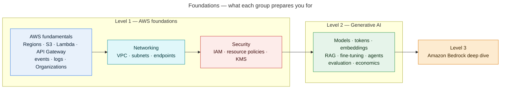

# Level 1 and 2 — Foundations

> **Level:** Beginner · **Verified:** 2026-11-15 · **Time:** about 7 days at 2 hours a day

Everything later in the course assumes you can read an AWS architecture and that you know what
a token, an embedding and a retrieval pipeline are. This section gets you there. It has two halves:
the AWS building blocks that every Bedrock system sits on, and the generative-AI concepts that
Bedrock's features are built around.

[Academy home](../README.md) · [Learning roadmap](../LEARNING-ROADMAP.md) · [Glossary](../GLOSSARY.md) · Next section: [Amazon Bedrock deep dive](../01-amazon-bedrock/README.md)

## How the pieces fit

| Group | Why you need it for Bedrock |
|:--|:--|
| [AWS fundamentals](aws-fundamentals/README.md) | Model and feature availability is per Region; applications are built from S3, Lambda, API Gateway and events; everything is observed through CloudWatch and audited through CloudTrail |
| [Networking](networking/README.md) | Private access to Bedrock goes through interface VPC endpoints; agents and knowledge bases reach your data across network boundaries |
| [Security](security/README.md) | Every Bedrock call is an IAM-authorised API call; Bedrock assumes service roles to read your data; encryption choices are KMS choices |
| [Generative AI fundamentals](generative-ai-fundamentals/README.md) | Bedrock's features are implementations of these concepts — inference, embeddings, RAG, customization, agents, evaluation |

## Already know some of this?

- **Experienced with AWS** — skim [Networking](networking/README.md) for VPC endpoints, then go to
  [Generative AI fundamentals](generative-ai-fundamentals/README.md).
- **Experienced with generative AI, new to AWS** — do Level 1 in full; IAM and networking are
  where most first Bedrock deployments go wrong.
- **Both** — jump to [Amazon Bedrock deep dive](../01-amazon-bedrock/README.md) and read
  [what changed since older tutorials](../FEATURE-VERIFICATION.md#what-changed-since-older-tutorials) first.

## Chapters

<!-- TOC:START — generated by scripts/build-nav.py; do not edit by hand -->
| # | Chapter | Group | Status |
|--:|:--|:--|:-:|
| 1 | [AWS global infrastructure: Regions, Availability Zones and the edge](aws-fundamentals/01-global-infrastructure.md) | AWS fundamentals | 🚧 planned |
| 2 | [Amazon S3, AWS Lambda and Amazon API Gateway](aws-fundamentals/02-s3-lambda-api-gateway.md) | AWS fundamentals | 🚧 planned |
| 3 | [Amazon EventBridge, Amazon SQS and Amazon SNS](aws-fundamentals/03-eventbridge-sqs-sns.md) | AWS fundamentals | 🚧 planned |
| 4 | [Amazon CloudWatch and AWS CloudTrail](aws-fundamentals/04-cloudwatch-cloudtrail.md) | AWS fundamentals | 🚧 planned |
| 5 | [AWS Organizations and AWS Control Tower](aws-fundamentals/05-organizations-control-tower.md) | AWS fundamentals | 🚧 planned |
| 6 | [VPCs and subnets](networking/01-vpc-and-subnets.md) | Networking | 🚧 planned |
| 7 | [Public and private networking](networking/02-public-private-networking.md) | Networking | 🚧 planned |
| 8 | [VPC endpoints and AWS PrivateLink](networking/03-vpc-endpoints-and-privatelink.md) | Networking | 🚧 planned |
| 9 | [IAM fundamentals: principals, policies and evaluation](security/01-iam-fundamentals.md) | Security | 🚧 planned |
| 10 | [IAM roles, trust policies and cross-account access](security/02-iam-roles-and-trust.md) | Security | 🚧 planned |
| 11 | [Resource-based policies](security/03-resource-policies.md) | Security | 🚧 planned |
| 12 | [AWS KMS and encryption](security/04-kms-encryption.md) | Security | 🚧 planned |
| 13 | [Generative AI, foundation models and LLMs](generative-ai-fundamentals/01-generative-ai-and-foundation-models.md) | Level 2 — Generative AI fundamentals | 🚧 planned |
| 14 | [Tokens, context windows, and training versus inference](generative-ai-fundamentals/02-tokens-context-windows-inference.md) | Level 2 — Generative AI fundamentals | 🚧 planned |
| 15 | [Embeddings, vector search, semantic search and hybrid search](generative-ai-fundamentals/03-embeddings-and-vector-search.md) | Level 2 — Generative AI fundamentals | 🚧 planned |
| 16 | [Retrieval-augmented generation (RAG)](generative-ai-fundamentals/04-rag-fundamentals.md) | Level 2 — Generative AI fundamentals | 🚧 planned |
| 17 | [Fine-tuning and model customization](generative-ai-fundamentals/05-fine-tuning-and-customization.md) | Level 2 — Generative AI fundamentals | 🚧 planned |
| 18 | [Agentic AI, tool calling and multi-agent architectures](generative-ai-fundamentals/06-agents-tool-calling-multi-agent.md) | Level 2 — Generative AI fundamentals | 🚧 planned |
| 19 | [Model evaluation and model selection](generative-ai-fundamentals/07-model-evaluation-and-selection.md) | Level 2 — Generative AI fundamentals | 🚧 planned |
| 20 | [Latency and token economics](generative-ai-fundamentals/08-latency-and-token-economics.md) | Level 2 — Generative AI fundamentals | 🚧 planned |
<!-- TOC:END -->
