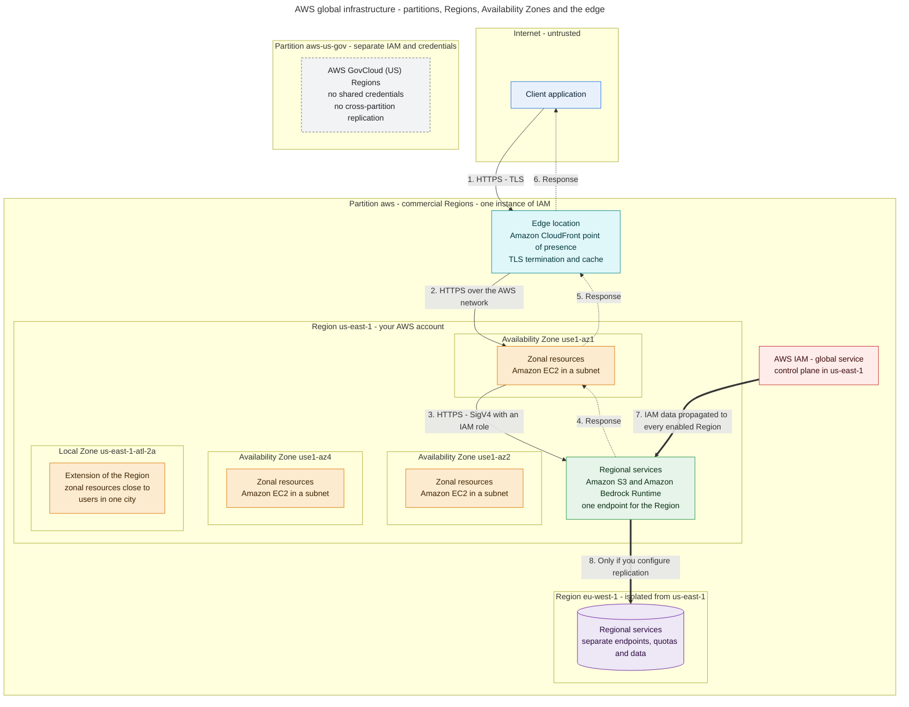

# AWS global infrastructure: Regions, Availability Zones and the edge

> **Level:** Beginner · **Verified:** 2026-11-15 · **Feature status:** n/a · **Time:** ~15 min

Every AWS resource lives somewhere: in a partition, in a Region and often in an Availability Zone.
This chapter explains that map, because the first decision in any Amazon Bedrock project — "which
Region?" — decides which models and features you can use at all.

## Learning objectives

After this chapter you can:

- Explain how partitions, Regions, Availability Zones, Local Zones and edge locations nest.
- Distinguish a control plane from a data plane, and zonal, Regional and global services.
- Choose a Region from model and feature availability, data residency, latency and price.
- Explain why an Amazon Bedrock model can exist in one Region and not in another.

## Prerequisites

- None — this is the first chapter of the course. Unknown terms are in the [glossary](../../GLOSSARY.md).
- An AWS account is useful for the example, but not required.

## Concept in plain language

Think of AWS as a worldwide logistics company.

- A **partition** is a separate legal entity of that company with its own staff badges. A badge
  from one entity opens no doors in another.
- A **Region** is a city where the company operates. What you store in one city is in no other
  city unless you ship a copy yourself.
- An **Availability Zone** is one of several warehouses in that city, on separate power lines and
  roads: far enough apart that one flood does not reach two, close enough to move goods almost
  instantly.
- A **Local Zone** is a small depot in another town that still reports to its city.
- An **edge location** is a pick-up point near customers. It hands out copies of popular items and
  takes orders; the real work happens in the city.

You rent space in a city. That choice fixes which services are on offer, where your data sits and
how far your users are from it.

## How it really works

### The hierarchy

| Layer | What it is | What it isolates | How you see it |
|:--|:--|:--|:--|
| Partition | A group of Regions with its own instance of AWS Identity and Access Management (IAM): `aws` (commercial), `aws-cn` (China), `aws-us-gov` (AWS GovCloud (US)) and `aws-eusc` (AWS European Sovereign Cloud) | Credentials and cross-Region features never cross a partition | First field of every Amazon Resource Name (ARN): `arn:aws:…` |
| Region | A geographic location with at least three Availability Zones, isolated from and independent of other Regions | A service failure stays inside one Region; your data stays there unless you replicate it | Region code such as `us-east-1`, in endpoints and ARNs |
| Availability Zone (AZ) | One or more discrete data centers with independent, redundant power, networking and connectivity, up to about 100 km from the other AZs of the Region | Physical failures such as power loss, flooding or fire; AWS also separates deployments to different AZs in time | Zone name `us-east-1a` and AZ ID `use1-az1` |
| Local Zone | An extension of a Region close to a large population centre | Nothing extra: it depends on control planes in its parent Region | Zone name such as `us-west-2-lax-1a`; you enable it, then create a subnet in it |
| Edge location (point of presence) | A site of the AWS edge network that serves Amazon CloudFront content and answers Amazon Route 53 DNS queries | Not a place for your workload: it caches and forwards | You never pick one; DNS sends each user to the location that can best serve the request |

Sources: [Partitions](https://docs.aws.amazon.com/whitepapers/latest/aws-fault-isolation-boundaries/partitions.html),
[Regions](https://docs.aws.amazon.com/whitepapers/latest/aws-fault-isolation-boundaries/regions.html),
[Availability Zones](https://docs.aws.amazon.com/whitepapers/latest/aws-fault-isolation-boundaries/availability-zones.html),
[How AWS Local Zones work](https://docs.aws.amazon.com/local-zones/latest/ug/how-local-zones-work.html),
[How CloudFront delivers content](https://docs.aws.amazon.com/AmazonCloudFront/latest/DeveloperGuide/HowCloudFrontWorks.html).

The numbers on the verification date:

| What | Number | Source |
|:--|:--|:--|
| Regions and Availability Zones, all partitions | 39 Regions, 124 AZs | [AWS Global Infrastructure](https://aws.amazon.com/about-aws/global-infrastructure/) |
| Regions a standard AWS account (partition `aws`) can use | 34, of which 17 are opt-in | [AWS Regions](https://docs.aws.amazon.com/global-infrastructure/latest/regions/aws-regions.html) |
| CloudFront points of presence and Regional edge caches | 750+ and 15 | [AWS Global Infrastructure](https://aws.amazon.com/about-aws/global-infrastructure/) |
| Local Zones | 46 | [AWS Global Infrastructure](https://aws.amazon.com/about-aws/global-infrastructure/) |

**Our reading:** the two Region counts differ because the larger one also counts Regions in the
other partitions, which a standard account cannot reach.

A Region introduced after 20 March 2019 is an **opt-in Region**: it is disabled, and your IAM
credentials do not work there, until you enable it
([Enable or disable AWS Regions](https://docs.aws.amazon.com/accounts/latest/reference/manage-acct-regions.html)).

### Control plane and data plane

AWS splits most services in two. The **control plane** is the administrative API that creates,
changes and deletes resources — creating an Amazon S3 bucket, for example. The **data plane** does
the service's actual job — getting and putting objects. Data planes are deliberately simpler and
therefore more reliable
([Control planes and data planes](https://docs.aws.amazon.com/whitepapers/latest/aws-fault-isolation-boundaries/control-planes-and-data-planes.html)).
A design that keeps working without calling a control plane during a failure is *statically stable*.

### Zonal, Regional and global services

| Scope | Meaning | Examples AWS gives | What you must do |
|:--|:--|:--|:--|
| Zonal | You choose the AZ; each AZ fails independently | Amazon EC2, Amazon EBS | Spread resources over several AZs yourself |
| Regional | AWS builds the service across several AZs; one endpoint per Region | Amazon S3 | Nothing for an AZ failure; surviving a Regional failure is your design |
| Global | Resources are not tied to a Region; the control plane runs in **one** Region, the data plane is distributed | IAM, AWS Organizations, Amazon Route 53 and Amazon CloudFront — all with a control plane in `us-east-1` | Do not rely on creating or changing these resources during recovery |

Source: [Zonal services](https://docs.aws.amazon.com/whitepapers/latest/aws-fault-isolation-boundaries/zonal-services.html),
[Regional services](https://docs.aws.amazon.com/whitepapers/latest/aws-fault-isolation-boundaries/regional-services.html),
[Global services](https://docs.aws.amazon.com/whitepapers/latest/aws-fault-isolation-boundaries/global-services.html).

> [!NOTE]
> **Documented fact** — "The resources and data that you create in one Region don't exist in any
> other Region unless you explicitly use a replication or copy feature offered by an AWS service or
> replicate the resource yourself."
> Source: [Regions — AWS Fault Isolation Boundaries](https://docs.aws.amazon.com/whitepapers/latest/aws-fault-isolation-boundaries/regions.html)

### Why availability differs by Region

Regions are separate deployments of infrastructure and software, so every service, feature and model
has to be launched in each Region individually. AWS tells you to "select a Region that has the AWS
services and features that you need"
([AWS Regions](https://docs.aws.amazon.com/global-infrastructure/latest/regions/aws-regions.html))
and announces a planning tool, AWS Capabilities by Region, on the
[Global Infrastructure page](https://aws.amazon.com/about-aws/global-infrastructure/).

**Our reading:** a foundation model also needs specialised inference capacity in the Region. AWS
does not publish the reason for each gap, so treat the availability tables as the only source of
truth and never assume.

## Architecture diagram



**What this shows** — one partition (`aws`) with two isolated Regions. One Region is drawn in full:
three Availability Zones and a Local Zone hold zonal resources, and Regional services have a single
endpoint. The edge location and the global IAM service belong to the partition, not to a Region; a
second partition stands apart with nothing connecting it.

**Walkthrough**

1. The client connects over HTTPS to an edge location that DNS chose for it.
2. The edge location forwards the request over the AWS network to compute in one Availability Zone.
3. The compute calls a Regional service endpoint and signs the request (Signature Version 4, SigV4) with its IAM role.
4. The Regional service answers.
5. The compute returns its result to the edge location.
6. The edge location returns the response to the client.
7. In the background, IAM distributes roles and policies from its control plane in `us-east-1` to every enabled Region, so step 3 is authorised locally.
8. Nothing is copied to another Region unless you configure it, for example with Amazon S3 Cross-Region Replication.

**Legend** — solid arrow: request · dashed arrow: response · thick arrow: asynchronous replication ·
cylinder: data at rest · nested boxes: partition, Region and zone boundaries. The network inside a
Region is in [Diagram 01 — AWS global infrastructure and networking](../../diagrams/mermaid/01-aws-global-infrastructure-and-networking.md).

## Implementation details

1. **Choose the Region first.** Most resources, quotas and prices are per Region.
2. **Enable an opt-in Region only when you need it.** Enabling it propagates your IAM data there
   ([Enable or disable AWS Regions](https://docs.aws.amazon.com/accounts/latest/reference/manage-acct-regions.html)).
3. **Expect the Region in every name.** Endpoints follow
   `protocol://service_code.region_code.amazonaws.com`
   ([AWS PrivateLink guide](https://docs.aws.amazon.com/vpc/latest/privatelink/privatelink-access-aws-services.html))
   and ARNs follow `arn:partition:service:region:account-id:resource`
   ([ARN reference](https://docs.aws.amazon.com/IAM/latest/UserGuide/reference-arns.html)).
4. **Use AZ IDs across accounts.** For accounts created before November 2025, a zone name such as
   `us-east-1a` can mean different physical zones in different accounts; the AZ ID `use1-az1` is
   the same place for everyone
   ([AWS Availability Zones](https://docs.aws.amazon.com/global-infrastructure/latest/regions/aws-availability-zones.html)).
5. **Treat Local Zones as limited.** Only selected services run there, and VPC endpoints cannot be
   created in Local Zone subnets
   ([How AWS Local Zones work](https://docs.aws.amazon.com/local-zones/latest/ug/how-local-zones-work.html)).

> [!TIP]
> **Academy recommendation** — Decide the Region in this order: (1) are the models and features you
> need offered there, (2) where must the data stay, (3) how close is it to your users, (4) what does
> it cost. This is our design guidance, not an official AWS reference architecture.

### Why this matters for Bedrock

- **Inference has three geographic modes:** In-Region (the request never leaves the Region you
  call), Geographic cross-Region (routed inside a geography such as US or EU) and Global
  cross-Region (any supported commercial Region). Availability is published per model and per
  Region ([Regional availability by models](https://docs.aws.amazon.com/bedrock/latest/userguide/models-region-compatibility.html)).
  See [Cross-Region inference: Geo and Global profiles](../../01-amazon-bedrock/inference/04-cross-region-inference.md).
- **Cross-Region inference ignores opt-in status.** It "can route requests to AWS Regions that are
  not manually enabled in your AWS account"
  ([Cross-Region inference](https://docs.aws.amazon.com/bedrock/latest/userguide/cross-region-inference.html))
  — a [data residency](../../09-advanced-topics/11-cross-region-and-data-residency.md) question.
- **Features and partitions differ too.** The [verification register](../../FEATURE-VERIFICATION.md)
  records that Managed Knowledge Base runs in nine Regions, that AgentCore services cover between
  1 and 22 Regions each, and that AWS GovCloud (US) has a reduced feature set.
- Next: [Endpoints, APIs and authentication](../../01-amazon-bedrock/overview/02-endpoints-apis-and-authentication.md),
  [Model providers and the model catalog](../../01-amazon-bedrock/foundation-models/01-model-providers-and-catalog.md)
  and [Disaster recovery and business continuity](../../08-cost-performance-and-reliability/07-disaster-recovery-and-business-continuity.md).

## Example

Find out what your own account can reach. The commands are read-only and create nothing.

> **Code status:** illustrative · commands copied from the AWS documentation cited above · not run while building this repository · **never deployed**

```bash
# 1. Which Regions are enabled for this account (default Regions plus opt-in Regions you enabled)?
aws account list-regions \
  --region-opt-status-contains ENABLED_BY_DEFAULT ENABLED \
  --query "Regions[*].RegionName"

# 2. Is one particular opt-in Region enabled?
aws account get-region-opt-status --region-name af-south-1

# 3. Which Availability Zones does this account see in a Region, and what are their AZ IDs?
aws ec2 describe-availability-zones \
  --filters Name=zone-type,Values=availability-zone \
  --region "${AWS_REGION:-us-east-1}" \
  --query "AvailabilityZones[].{ZoneName:ZoneName,ZoneId:ZoneId}"
```

Command 1 returns Region codes; a Region missing from the list is an opt-in Region you have not
enabled. Command 3 returns pairs such as `us-east-1a` / `use1-az1`; record the AZ ID when two
accounts must use the same physical zone. The Region then appears in everything you address —
Amazon Bedrock Runtime is reached at `bedrock-runtime.<region>.amazonaws.com`
([Bedrock interface endpoints](https://docs.aws.amazon.com/bedrock/latest/userguide/vpc-interface-endpoints.html))
— so keep it in configuration, never in code.

## Common mistakes

> [!WARNING]
> **Common mistake** — Assuming a model or feature exists in every Region because it exists in the
> one used by a tutorial. Check the Regional availability table for the exact model before you
> design, and again before you deploy to a second Region.

| Mistake | Symptom | Fix |
|:--|:--|:--|
| Lining up subnets across accounts by zone name | Resources meant to share a zone end up in different physical zones | Use AZ IDs such as `use1-az1` |
| Relying on IAM, Route 53 or CloudFront changes during a failover | Recovery stalls while a control plane in `us-east-1` is impaired | Create roles, records and distributions in advance; fail over with data-plane mechanisms |
| Believing "multi-AZ" covers a Regional outage | The whole workload is down when one Regional service is impaired | Decide separately whether you need a second Region |
| Treating a Local Zone as a small Region | A service or a VPC endpoint cannot be created there | Check what the Local Zone supports; keep Regional dependencies in the parent Region |
| A "deny other Regions" policy written without cross-Region inference in mind | Calls through an inference profile are denied | Allow every destination Region of the profile — see [Organizations and Control Tower](05-organizations-control-tower.md) |

## Security considerations

- **Partitions are a hard identity boundary:** IAM credentials from one partition do not work in
  another.
- **A disabled Region is closed to your credentials.** **Academy recommendation:** leave unused
  Regions disabled and add an organization-wide Region restriction.
- **Data location is your decision.** Data stays in its Region unless you move it — and choosing a
  Geographic or Global inference profile *is* such a decision for prompts and responses.
- **Audit every enabled Region** with a multi-Region trail; see
  [Amazon CloudWatch and AWS CloudTrail](04-cloudwatch-cloudtrail.md).

## Cost considerations

- **More Regions cost more.** AWS calls multi-Region architectures a trade-off in "cost, effort,
  data consistency, latency, and operational burden"
  ([Regional services](https://docs.aws.amazon.com/whitepapers/latest/aws-fault-isolation-boundaries/regional-services.html)).
- **Spare capacity is the price of static stability.** AWS's example needs nine instances instead
  of six — 50% more — to survive the loss of one AZ without launching anything
  ([Zonal services](https://docs.aws.amazon.com/whitepapers/latest/aws-fault-isolation-boundaries/zonal-services.html)).
- **Disabling an opt-in Region does not stop charges** for resources left in it, and Local Zones
  are priced differently from their parent Region
  ([What is AWS Local Zones?](https://docs.aws.amazon.com/local-zones/latest/ug/what-is-aws-local-zones.html)).
- **Bedrock routing is not billed.** Cross-Region inference has no additional routing cost; you pay
  the price of the Region you call from
  ([Cross-Region inference](https://docs.aws.amazon.com/bedrock/latest/userguide/cross-region-inference.html)).

## Knowledge check

1. During an incident in `us-east-1` your runbook creates a new IAM role in the recovery Region. Why is that risky?
2. A colleague in another account says "put it in `us-east-1b` like ours". What do you ask for instead, and why?
3. What would happen if your organization denied every Region except `eu-central-1` and you then called an EU Geographic inference profile?

<details>
<summary>Answers</summary>

1. IAM is a global service whose control plane runs in `us-east-1`. Creating a role is a control-plane action, so it may be unavailable exactly then. Create the role beforehand.
2. The AZ ID (for example `use1-az2`). Zone names can map to different physical zones per account for accounts created before November 2025; AZ IDs are the same for everyone.
3. Requests that Amazon Bedrock routes to another EU Region would be denied, because Geographic cross-Region inference requires you to allow all destination Regions of the profile.

</details>

## Further reading

Official sources opened while writing this chapter:

- [AWS Global Infrastructure](https://aws.amazon.com/about-aws/global-infrastructure/) — current counts of Regions, Availability Zones, points of presence and Local Zones.
- [AWS Fault Isolation Boundaries (whitepaper)](https://docs.aws.amazon.com/whitepapers/latest/aws-fault-isolation-boundaries/abstract-and-introduction.html) — partitions, Regions, Availability Zones, control and data planes, service types.
- [Partitions](https://docs.aws.amazon.com/whitepapers/latest/aws-fault-isolation-boundaries/partitions.html) — the four partitions and what cannot cross them.
- [Global services](https://docs.aws.amazon.com/whitepapers/latest/aws-fault-isolation-boundaries/global-services.html) — which Region hosts each global control plane.
- [AWS Regions](https://docs.aws.amazon.com/global-infrastructure/latest/regions/aws-regions.html) — Region list, opt-in status and the CLI commands used in the example.
- [AWS Availability Zones](https://docs.aws.amazon.com/global-infrastructure/latest/regions/aws-availability-zones.html) — AZ IDs and zone-name mapping.
- [Enable or disable AWS Regions in your account](https://docs.aws.amazon.com/accounts/latest/reference/manage-acct-regions.html) — opt-in Regions and IAM data propagation.
- [What is AWS Local Zones?](https://docs.aws.amazon.com/local-zones/latest/ug/what-is-aws-local-zones.html) and [How AWS Local Zones work](https://docs.aws.amazon.com/local-zones/latest/ug/how-local-zones-work.html) — purpose, pricing note and limitations.
- [How CloudFront delivers content](https://docs.aws.amazon.com/AmazonCloudFront/latest/DeveloperGuide/HowCloudFrontWorks.html) — edge locations and Regional edge caches.
- [Identify AWS resources with ARNs](https://docs.aws.amazon.com/IAM/latest/UserGuide/reference-arns.html) — the partition and Region fields of an ARN.
- [Regional availability by models](https://docs.aws.amazon.com/bedrock/latest/userguide/models-region-compatibility.html) — In-Region, Geographic and Global inference per model.
- [Cross-Region inference](https://docs.aws.amazon.com/bedrock/latest/userguide/cross-region-inference.html) — routing, opt-in Regions, pricing and policy requirements.
