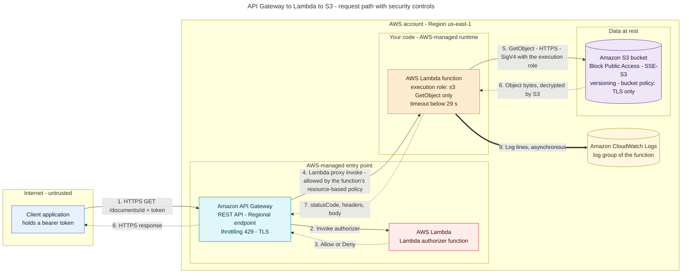

# Amazon S3, AWS Lambda and Amazon API Gateway

> **Level:** Beginner · **Verified:** 2026-11-15 · **Feature status:** n/a · **Time:** ~20 min

Storage, compute and an HTTPS front door: these three services form the smallest useful serverless
application on AWS. Almost every Amazon Bedrock application in this course is built from them, so
their limits — timeouts, payload sizes, concurrency — become the limits of your generative AI API.

## Learning objectives

After this chapter you can:

- Describe Amazon S3 buckets and objects, and explain default encryption, versioning and bucket policies.
- Explain the AWS Lambda execution model, the execution role, and how concurrency is counted.
- Choose between REST, HTTP and WebSocket APIs in Amazon API Gateway.
- Line up the timeout and payload limits of the three services so that a request does not fail halfway.
- Build and reason about the path API Gateway → Lambda → S3.

## Prerequisites

- [AWS global infrastructure: Regions, Availability Zones and the edge](01-global-infrastructure.md).
- Helpful, not required: [IAM fundamentals](../security/01-iam-fundamentals.md) for the policy examples.

## Concept in plain language

Picture a small restaurant with a storeroom.

- **Amazon S3** is the storeroom. Every item (an *object*) sits in a labelled room (a *bucket*) under
  a unique label (its *key*). The storeroom does not run out of space and is built not to lose
  anything, but it only stores and hands back — it does not cook.
- **AWS Lambda** is a kitchen that exists only while an order is being cooked. Each order gets its
  own cook; ten simultaneous orders mean ten cooks. When there is nothing to cook, nobody is paid.
- **Amazon API Gateway** is the front desk. It checks who the customer is, refuses to let the queue
  grow beyond what the kitchen can handle, passes the order in and hands the plate back.

The front desk waits only so long for the kitchen. Most of this chapter is about those waiting times.

## How it really works

### Amazon S3

- A **bucket** lives in one Region, and "objects that belong to a bucket that you create in a
  specific AWS Region never leave that Region, unless you explicitly transfer them". Bucket names
  are unique per partition unless you create the bucket in your account regional namespace
  ([General purpose buckets overview](https://docs.aws.amazon.com/AmazonS3/latest/userguide/UsingBucket.html)).
- An **object** is a key, a value of up to 50 TB, metadata and — with versioning — a version ID
  ([Amazon S3 objects overview](https://docs.aws.amazon.com/AmazonS3/latest/userguide/UsingObjects.html)).
- Reads are **strongly consistent**: a read that starts after a successful write returns the new data
  ([What is Amazon S3?](https://docs.aws.amazon.com/AmazonS3/latest/userguide/Welcome.html)).

| Feature | Default | What to know | Source |
|:--|:--|:--|:--|
| Access | Private; Block Public Access on for new buckets; access control lists (ACLs) disabled | You grant access with IAM policies and bucket policies | [What is Amazon S3?](https://docs.aws.amazon.com/AmazonS3/latest/userguide/Welcome.html) |
| Default encryption | SSE-S3 (AES-256) on every bucket since 5 January 2023 | Cannot be switched off. Choose SSE-KMS when you need control over the key | [Default encryption FAQ](https://docs.aws.amazon.com/AmazonS3/latest/userguide/default-encryption-faq.html) |
| Versioning | Off | Once enabled it can only be suspended, never removed. A delete adds a *delete marker*. Every version is billed as a full object | [S3 Versioning](https://docs.aws.amazon.com/AmazonS3/latest/userguide/Versioning.html) |
| Bucket policy | None | A resource-based JSON policy on the bucket; only the bucket owner can attach one | [Bucket policies](https://docs.aws.amazon.com/AmazonS3/latest/userguide/bucket-policies.html) |
| Durability | — | Standard storage classes keep objects in at least three Availability Zones | [Data protection in Amazon S3](https://docs.aws.amazon.com/AmazonS3/latest/userguide/DataDurability.html) |

### AWS Lambda

Lambda runs your handler inside an **execution environment**, an isolated runtime that passes
through `Init` (start the runtime, run code outside the handler), `Invoke` (run the handler) and
`Shutdown`. After an invocation the environment is frozen and reused for the next request, so only
the first request pays for `Init` — the *cold start*
([Execution environment lifecycle](https://docs.aws.amazon.com/lambda/latest/dg/lambda-runtime-environment.html)).

The function's permissions come from its **execution role**, an IAM role that trusts
`lambda.amazonaws.com` and that Lambda assumes for you
([Execution role](https://docs.aws.amazon.com/lambda/latest/dg/lambda-intro-execution-role.html)).
Who may *call* the function is a different matter, set in the function's resource-based policy.

**Concurrency** is the number of requests in flight. One environment serves one request at a time,
so `concurrency = requests per second × average duration in seconds`. *Reserved* concurrency caps
and guarantees a function's share at no charge; *provisioned* concurrency keeps environments
initialised and costs extra ([Lambda scaling](https://docs.aws.amazon.com/lambda/latest/dg/lambda-concurrency.html),
[Reserved concurrency](https://docs.aws.amazon.com/lambda/latest/dg/configuration-concurrency.html)).

| Lambda quota | Value | Changeable? |
|:--|:--|:--|
| Function timeout | 900 seconds (15 minutes) | No |
| Memory | 128 MB to 10,240 MB | Per function |
| Invocation payload, synchronous | 6 MB request and 6 MB response | No |
| Streamed response | 200 MB; the first 6 MB uncapped, then 2 MBps | No |
| Invocation payload, asynchronous | 1 MB | No |
| Concurrent executions per Region | 1,000 (lower for new accounts, raised automatically with use) | Yes |
| Scaling rate per function | 1,000 execution environments every 10 seconds | No |

Source: [Lambda quotas](https://docs.aws.amazon.com/lambda/latest/dg/gettingstarted-limits.html).

**Response streaming** sends partial output as soon as it exists, through a function URL, the
`InvokeWithResponseStream` API or an API Gateway proxy integration. It is native on Node.js managed
runtimes; Python needs a custom runtime or the Lambda Web Adapter. You are billed for the full
duration even if the client disconnects
([Response streaming](https://docs.aws.amazon.com/lambda/latest/dg/configuration-response-streaming.html)).

> [!IMPORTANT]
> **Status** — The Lambda documentation now calls the classic function a *Lambda Event Function* and
> lists separate quotas for Lambda Managed Instances, Lambda MicroVMs, Lambda Web Functions and
> durable functions. This chapter covers Event Functions only.
> Source: [Lambda quotas](https://docs.aws.amazon.com/lambda/latest/dg/gettingstarted-limits.html)

### Amazon API Gateway

| | REST API | HTTP API | WebSocket API |
|:--|:--|:--|:--|
| Model | Request and response | Request and response | Stateful, two-way messages |
| Endpoint types | Edge-optimized, Regional, private | Regional | — |
| Authorization | IAM, resource policies, Amazon Cognito, Lambda authorizers | IAM, JWT authorizers, Lambda authorizers | IAM, Lambda authorizers (on the `$connect` route) |
| AWS WAF, API keys, per-client throttling, request validation, caching | Yes | No | — |
| Integration timeout | 50 ms to 29 s; can be raised for Regional and private APIs | 30 s maximum, fixed | 29 s |
| Payload | 10 MB | 10 MB | 128 KB per message, 32 KB per frame |
| Response streaming | Yes (`STREAM` transfer mode, up to 15 minutes) | No | Messages pushed over the connection |
| Connection | — | — | 2 hours maximum, 10 minutes idle |

Sources: [Choose between REST APIs and HTTP APIs](https://docs.aws.amazon.com/apigateway/latest/developerguide/http-api-vs-rest.html),
[REST API quotas](https://docs.aws.amazon.com/apigateway/latest/developerguide/api-gateway-execution-service-limits-table.html),
[HTTP API quotas](https://docs.aws.amazon.com/apigateway/latest/developerguide/http-api-quotas.html),
[WebSocket API quotas](https://docs.aws.amazon.com/apigateway/latest/developerguide/apigateway-execution-service-websocket-limits-table.html),
[WebSocket access control](https://docs.aws.amazon.com/apigateway/latest/developerguide/apigateway-websocket-api-control-access.html),
[Response streaming](https://docs.aws.amazon.com/apigateway/latest/developerguide/response-transfer-mode.html).

A **Lambda authorizer** is a function that API Gateway calls first; it returns an IAM policy that
allows or denies the request, and the result can be cached
([Lambda authorizers](https://docs.aws.amazon.com/apigateway/latest/developerguide/apigateway-use-lambda-authorizer.html)).

**Throttling** uses a token bucket. By default an account gets 10,000 requests per second with a
burst of 5,000 per Region, shared by all REST, HTTP and WebSocket APIs (2,500 and 1,250 in some
newer Regions). Above that, clients receive `429 Too Many Requests`
([API Gateway quotas](https://docs.aws.amazon.com/apigateway/latest/developerguide/limits.html),
[Throttling](https://docs.aws.amazon.com/apigateway/latest/developerguide/api-gateway-request-throttling.html)).

> [!NOTE]
> **Documented fact** — "Amazon API Gateway gets permission to invoke your function from the
> function's resource-based policy."
> Source: [Invoking a Lambda function using an API Gateway endpoint](https://docs.aws.amazon.com/lambda/latest/dg/services-apigateway.html)

## Architecture diagram



**What this shows** — one synchronous request crossing three trust zones inside one account and
Region: the AWS-managed entry point, your function, and data at rest. Each hop is authorised by a
different mechanism: a token at the API, a resource-based policy on the function, and the execution
role at the bucket.

**Walkthrough**

1. The client calls the REST API over HTTPS and sends a bearer token.
2. API Gateway invokes the Lambda authorizer with the request details.
3. The authorizer returns an IAM policy; on `Deny` the client receives a 403 and nothing else runs.
4. API Gateway invokes the function through a Lambda proxy integration. The function's resource-based policy must allow `apigateway.amazonaws.com`.
5. The function calls `GetObject`, signed (Signature Version 4, SigV4) with its execution role's temporary credentials.
6. Amazon S3 checks the role's policy and the bucket policy, decrypts the object and returns it.
7. The function returns a JSON document with `statusCode`, `headers` and `body`.
8. API Gateway turns that document into the HTTPS response.
9. Meanwhile Lambda ships the function's log output to its log group.

**Legend** — solid arrow: request · dashed arrow: response · thick arrow: asynchronous · cylinder:
data store · boxes: trust boundaries. The production version is
[Diagram 22 — Serverless enterprise chatbot architecture](../../diagrams/mermaid/22-serverless-enterprise-chatbot.md).

## Implementation details

1. **Bucket.** Pick the Region, keep Block Public Access on, turn versioning on for data you cannot
   regenerate, and add a bucket policy that denies requests where `aws:SecureTransport` is `false`
   ([Bucket policy examples](https://docs.aws.amazon.com/AmazonS3/latest/userguide/example-bucket-policies.html)).
2. **Function.** Give the execution role only the actions and the key prefix it needs. Set the
   timeout from the caller's point of view, not to the maximum.
3. **API.** Choose the API type from the table above, attach an authorizer, set stage or method
   throttling below what the backend can serve, and deploy.
4. **Align the limits.** The smallest number on the path wins.

| Path | Longest wait | Largest response |
|:--|:--|:--|
| REST API, buffered (default) | 29 s unless raised | 6 MB (the Lambda limit, below the API's 10 MB) |
| HTTP API | 30 s | 6 MB |
| REST API with `STREAM` | 15 minutes; idle timeout 5 minutes (Regional, private) or 30 seconds (edge-optimized) | Up to Lambda's 200 MB streamed limit; rate-capped at 2 MB/s once the first megabytes have passed |

> [!TIP]
> **Academy recommendation** — Start with an HTTP API for a simple JSON backend. Move to a REST API
> when you need AWS WAF, API keys, request validation, a private endpoint or response streaming.
> This is our design guidance, not an official AWS reference architecture.

### Why this matters for Bedrock

- **Model calls are slow by web standards.** A long answer can outlast a 29-second integration
  timeout. AWS lists "Lower the time-to-first-byte (TTFB) for generative AI applications like
  chatbots" as the first use case of REST response streaming. See [InvokeModel and streaming APIs](../../01-amazon-bedrock/inference/02-invokemodel-and-streaming.md)
  and [API Gateway, CloudFront and Application Load Balancer](../../02-related-aws-services/compute/04-api-gateway-cloudfront-alb.md).
- **Lambda is the usual glue.** The function's execution role is what Bedrock authorises — see
  [AWS Lambda with Bedrock](../../02-related-aws-services/compute/01-lambda.md). AgentCore Gateway
  can also expose Lambda functions as tools ([AgentCore Gateway](../../01-amazon-bedrock/agentcore/04-agentcore-gateway.md)).
- **S3 holds almost everything Bedrock reads and writes in bulk:** knowledge base documents, batch
  inference input and output files
  ([Batch inference](https://docs.aws.amazon.com/bedrock/latest/userguide/batch-inference.html)),
  and model invocation logs. See [Amazon S3 and Amazon S3 Vectors](../../02-related-aws-services/storage/01-amazon-s3-and-s3-vectors.md)
  and [Batch inference](../../01-amazon-bedrock/inference/08-batch-inference.md).
- **This exact shape, with a model call added, is the first real project:**
  [Pattern: serverless enterprise chatbot](../../03-architecture-patterns/serverless/README.md) and
  [Project B](../../05-practical-projects/project-02-serverless-chatbot/README.md).

## Example

A function behind `GET /documents/{id}` that returns one JSON document from S3.

> **Code status:** syntax-checked (`python -m py_compile`) · mock-tested with a stubbed `boto3` client · **never deployed**

```python
"""GET /documents/{id}: Amazon API Gateway (Lambda proxy integration) -> AWS Lambda -> Amazon S3."""
import json
import os
import re

import boto3
from botocore.exceptions import ClientError

BUCKET = os.environ["DOCUMENT_BUCKET"]            # a bucket name is configuration, not a secret
PREFIX = os.environ.get("DOCUMENT_PREFIX", "documents/")
MAX_BYTES = 5 * 1024 * 1024                        # stay below Lambda's 6 MB buffered response limit
SAFE_ID = re.compile(r"^[A-Za-z0-9_-]{1,64}$")     # never build an object key from unchecked input

s3 = boto3.client("s3")                            # created once per execution environment (Init phase)


def _response(status: int, body: dict) -> dict:
    """Return the shape that the Lambda proxy integration requires."""
    return {
        "statusCode": status,
        "headers": {"Content-Type": "application/json"},
        "body": json.dumps(body),
        "isBase64Encoded": False,
    }


def handler(event, context):
    doc_id = (event.get("pathParameters") or {}).get("id", "")
    if not SAFE_ID.match(doc_id):
        return _response(400, {"message": "invalid document id"})

    try:
        obj = s3.get_object(Bucket=BUCKET, Key=f"{PREFIX}{doc_id}.json")
    except ClientError as err:
        if err.response["Error"]["Code"] == "NoSuchKey":
            return _response(404, {"message": "document not found"})
        raise                                      # unexpected: let Lambda record the failure

    if obj["ContentLength"] > MAX_BYTES:
        return _response(413, {"message": "document too large for a buffered response"})

    document = json.loads(obj["Body"].read())
    return _response(200, {"id": doc_id, "versionId": obj.get("VersionId"), "document": document})
```

The execution role needs one statement besides logging. `amzn-s3-demo-bucket` is the placeholder
bucket name used in the AWS documentation; replace it with yours.

> **Code status:** syntax-checked (JSON parse) · **never deployed**

```json
{
  "Version": "2012-10-17",
  "Statement": [
    {
      "Sid": "ReadDocumentsOnly",
      "Effect": "Allow",
      "Action": "s3:GetObject",
      "Resource": "arn:aws:s3:::amzn-s3-demo-bucket/documents/*"
    }
  ]
}
```

What to notice: the client is created outside the handler so warm invocations reuse it; the object
key is built only from validated input; the size check keeps the response under the 6 MB limit; and
the return value has exactly the fields the proxy integration expects — any other shape produces a
`502 Bad Gateway` ([Lambda proxy integrations](https://docs.aws.amazon.com/apigateway/latest/developerguide/set-up-lambda-proxy-integrations.html)).

## Common mistakes

> [!WARNING]
> **Common mistake** — Setting the Lambda timeout to 15 minutes behind an API whose integration
> timeout is 29 seconds. The client gets an error after 29 seconds while the function keeps running
> and keeps costing. Set the function timeout just below the API's, or switch to streaming.

| Mistake | Symptom | Fix |
|:--|:--|:--|
| Returning a plain string or dict from a proxy-integrated function | `502 Bad Gateway` | Return `statusCode`, `headers`, `body` |
| Returning a large file through the function | Invocation fails above 6 MB | Stream the response, or hand out a presigned S3 URL instead |
| Confusing the execution role with the function's resource-based policy | API Gateway cannot invoke the function, or the function cannot read S3 | Role = what the function may do; resource-based policy = who may call it |
| Estimating capacity in requests per second only | Throttling at modest traffic because each request runs for seconds | Compute concurrency = rate × duration, then check the Regional quota |
| Enabling versioning and never expiring old versions | Storage bill grows with every overwrite | Add an S3 Lifecycle rule for noncurrent versions |
| Expecting native response streaming from a Python handler | Response still arrives in one piece | Use a Node.js runtime, a custom runtime or the Lambda Web Adapter |

## Security considerations

- **Three separate permissions:** who may call the API (authorizer or IAM), who may invoke the
  function (resource-based policy), what the function may touch (execution role). Keep each minimal;
  see [IAM roles, trust policies and cross-account access](../security/02-iam-roles-and-trust.md).
- **Buckets stay private.** Keep all four Block Public Access settings on and grant access with
  policies, not ACLs ([Blocking public access](https://docs.aws.amazon.com/AmazonS3/latest/userguide/access-control-block-public-access.html)).
- **Encryption at rest is automatic; key control is not.** SSE-S3 is always there; use SSE-KMS when
  you need key policies and an audit trail of key use — see [AWS KMS and encryption](../security/04-kms-encryption.md).
- **Throttling is a security control too.** It bounds what a leaked token or a runaway client can
  spend — which matters once each request triggers a paid model call.
- **Validate input in the function.** API Gateway forwards whatever arrives.

## Cost considerations

- **Amazon S3** bills storage per GB-month by storage class, requests, data transfer and optional
  features; every stored version counts in full ([S3 pricing](https://aws.amazon.com/s3/pricing/)).
- **AWS Lambda** bills per request and per GB-second of duration, so memory size × run time is the
  lever. Waiting for a slow downstream call is billed time ([Lambda pricing](https://aws.amazon.com/lambda/pricing/)).
- **Amazon API Gateway** bills HTTP and REST APIs per call received plus data transferred out, and
  WebSocket APIs per message and connection minute ([API Gateway pricing](https://aws.amazon.com/api-gateway/pricing/)).
- **What makes the bill grow:** long timeouts that let stuck invocations run, provisioned
  concurrency left on, old object versions, and streaming responses whose client has gone away.

## Knowledge check

1. A function takes 4 seconds on average and receives 300 requests per second at peak. Does it fit in the default Regional concurrency quota?
2. Your API returns `502 Bad Gateway`, yet the function's log shows it finished without an error. What is the most likely cause?
3. What would happen if you deleted an object in a bucket with versioning enabled, and how would you get it back?
4. A chatbot answer takes 45 seconds to generate. Name two changes that let the user see text before the 29-second mark.

<details>
<summary>Answers</summary>

1. No. Concurrency = 300 × 4 = 1,200, above the default of 1,000 concurrent executions per Region. Shorten the work, request a higher quota, or put a queue in front.
2. The function returned something other than the proxy integration format (`statusCode`, `headers`, `body`), so API Gateway could not build a response.
3. Amazon S3 inserts a delete marker, which becomes the current version; nothing is removed permanently, so you can restore the previous version.
4. Use a REST API with the `STREAM` response transfer mode in front of a streaming function, or use a WebSocket API and push partial results over the connection. Raising the timeout alone does not show text earlier.

</details>

## Further reading

Official sources opened while writing this chapter:

- [What is Amazon S3?](https://docs.aws.amazon.com/AmazonS3/latest/userguide/Welcome.html) — features, access defaults and the consistency model.
- [General purpose buckets overview](https://docs.aws.amazon.com/AmazonS3/latest/userguide/UsingBucket.html) and [Amazon S3 objects overview](https://docs.aws.amazon.com/AmazonS3/latest/userguide/UsingObjects.html) — buckets, namespaces, object size.
- [Default encryption FAQ](https://docs.aws.amazon.com/AmazonS3/latest/userguide/default-encryption-faq.html) and [Setting default server-side encryption](https://docs.aws.amazon.com/AmazonS3/latest/userguide/bucket-encryption.html) — SSE-S3 and SSE-KMS.
- [S3 Versioning](https://docs.aws.amazon.com/AmazonS3/latest/userguide/Versioning.html), [Bucket policies](https://docs.aws.amazon.com/AmazonS3/latest/userguide/bucket-policies.html), [Bucket policy examples](https://docs.aws.amazon.com/AmazonS3/latest/userguide/example-bucket-policies.html), [Blocking public access](https://docs.aws.amazon.com/AmazonS3/latest/userguide/access-control-block-public-access.html), [Data protection in Amazon S3](https://docs.aws.amazon.com/AmazonS3/latest/userguide/DataDurability.html).
- [Lambda quotas](https://docs.aws.amazon.com/lambda/latest/dg/gettingstarted-limits.html) — every Lambda number in this chapter.
- [Lambda execution environment lifecycle](https://docs.aws.amazon.com/lambda/latest/dg/lambda-runtime-environment.html), [Execution role](https://docs.aws.amazon.com/lambda/latest/dg/lambda-intro-execution-role.html), [Lambda scaling and concurrency](https://docs.aws.amazon.com/lambda/latest/dg/lambda-concurrency.html), [Reserved concurrency](https://docs.aws.amazon.com/lambda/latest/dg/configuration-concurrency.html), [Invocation methods](https://docs.aws.amazon.com/lambda/latest/dg/lambda-invocation.html), [Response streaming](https://docs.aws.amazon.com/lambda/latest/dg/configuration-response-streaming.html).
- [Invoking a Lambda function using an API Gateway endpoint](https://docs.aws.amazon.com/lambda/latest/dg/services-apigateway.html) — API types and the resource-based policy.
- [What is Amazon API Gateway?](https://docs.aws.amazon.com/apigateway/latest/developerguide/welcome.html), [Choose between REST APIs and HTTP APIs](https://docs.aws.amazon.com/apigateway/latest/developerguide/http-api-vs-rest.html), [Overview of WebSocket APIs](https://docs.aws.amazon.com/apigateway/latest/developerguide/apigateway-websocket-api-overview.html), [Control access to WebSocket APIs](https://docs.aws.amazon.com/apigateway/latest/developerguide/apigateway-websocket-api-control-access.html).
- [API Gateway quotas](https://docs.aws.amazon.com/apigateway/latest/developerguide/limits.html), [REST API quotas](https://docs.aws.amazon.com/apigateway/latest/developerguide/api-gateway-execution-service-limits-table.html), [HTTP API quotas](https://docs.aws.amazon.com/apigateway/latest/developerguide/http-api-quotas.html), [WebSocket API quotas](https://docs.aws.amazon.com/apigateway/latest/developerguide/apigateway-execution-service-websocket-limits-table.html).
- [Throttle requests to your REST APIs](https://docs.aws.amazon.com/apigateway/latest/developerguide/api-gateway-request-throttling.html), [Lambda authorizers](https://docs.aws.amazon.com/apigateway/latest/developerguide/apigateway-use-lambda-authorizer.html), [Lambda proxy integrations](https://docs.aws.amazon.com/apigateway/latest/developerguide/set-up-lambda-proxy-integrations.html), [Stream the integration response](https://docs.aws.amazon.com/apigateway/latest/developerguide/response-transfer-mode.html).
- [S3 pricing](https://aws.amazon.com/s3/pricing/), [Lambda pricing](https://aws.amazon.com/lambda/pricing/), [API Gateway pricing](https://aws.amazon.com/api-gateway/pricing/) — pricing dimensions.
- [Process multiple prompts with batch inference](https://docs.aws.amazon.com/bedrock/latest/userguide/batch-inference.html) — batch input and output files in Amazon S3.
