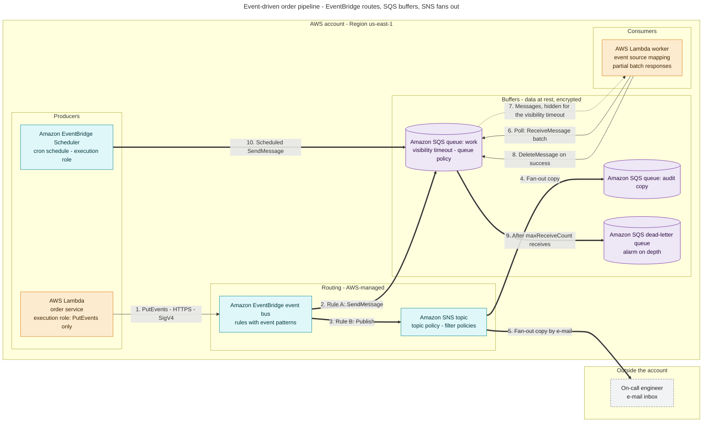

# Amazon EventBridge, Amazon SQS and Amazon SNS

> **Level:** Beginner · **Verified:** 2026-11-15 · **Feature status:** n/a · **Time:** ~20 min

Not every piece of work should happen while a user waits. These three services let one part of a
system hand work to another part and move on. Generative AI workloads lean on them heavily, because
model calls are slow, rate-limited and billed per use — exactly the kind of work you want to queue,
retry carefully and never run twice by accident.

## Learning objectives

After this chapter you can:

- Explain event buses, rules, Pipes and Scheduler in Amazon EventBridge, including the 2026 Custom Event Bus.
- Compare Amazon SQS standard and FIFO queues, and configure a visibility timeout and a dead-letter queue.
- Describe Amazon SNS topics, subscriptions and fan-out.
- State the delivery guarantee of each service and design a consumer that tolerates duplicates.
- Choose the right service for a given integration problem.

## Prerequisites

- [Amazon S3, AWS Lambda and Amazon API Gateway](02-s3-lambda-api-gateway.md) — the examples use Lambda functions as producers and consumers.

## Concept in plain language

Three ways of passing a note in an office:

- **Amazon SQS is an in-tray.** Notes wait in it until a worker takes one. While the worker deals
  with it, the note is hidden from colleagues. If the worker finishes, the note is thrown away; if
  the worker disappears, the note reappears for someone else.
- **Amazon SNS is a loudspeaker with a mailing list.** You announce something once and every
  subscriber gets their own copy — a system, an e-mail inbox, a phone.
- **Amazon EventBridge is the mail room.** It reads the label on each incoming envelope and forwards
  copies to everyone who registered interest in that kind of label. It also has an alarm clock
  (*Scheduler*) and a conveyor belt from one machine to another (*Pipes*).

None of them promises that a note arrives exactly once. Most of the engineering is about that.

## How it really works

### Amazon EventBridge

An **event** is a JSON record of something that happened. An **event bus** receives events and
routes them. Every account has a default bus that receives events from AWS services; you add custom
buses for your own events. The buses route in two different ways:

| Bus | Routing | Retention and replay | Ordering | Default retry |
|:--|:--|:--|:--|:--|
| Default event bus and Custom Event Bus - Classic | *Rules* with an event pattern, written by the bus owner; up to five targets per rule | Not retained; add an archive to replay | None | 24 hours, up to 185 attempts |
| Custom Event Bus | *Subscribers*: filters plus exactly one target, created by each consumer | Built in, 1 to 365 days; a subscriber can start in the past | First-in-first-out (FIFO) within an event group, per subscriber | 5 attempts or 300 seconds |

Sources: [Event bus (default and Classic)](https://docs.aws.amazon.com/eventbridge/latest/userguide/eb-event-bus.html),
[What is the EventBridge Custom Event Bus?](https://docs.aws.amazon.com/eventbridge/latest/userguide/eb-custom-bus-what-is.html),
[Retries on Classic targets](https://docs.aws.amazon.com/eventbridge/latest/userguide/eb-rule-retry-policy.html),
[Retry policies on subscribers](https://docs.aws.amazon.com/eventbridge/latest/userguide/eb-custom-bus-retry.html).

> [!IMPORTANT]
> **Status** — The Custom Event Bus with subscribers was announced on 24 September 2026 and launched
> in 14 Regions. Buses created earlier keep working and now appear as *Custom Event Bus - Classic*.
> AWS says: "For new applications, start with the Custom Event Bus."
> Source: [Launch post](https://aws.amazon.com/blogs/aws/introducing-enhanced-custom-event-buses-in-amazon-eventbridge-for-enterprise-scale-event-driven-applications/),
> [What Is Amazon EventBridge?](https://docs.aws.amazon.com/eventbridge/latest/userguide/eb-what-is.html)

- **Rules** match events against an *event pattern*. Rules that run on a schedule are a legacy
  feature ([Rules](https://docs.aws.amazon.com/eventbridge/latest/userguide/eb-rules.html)).
- **EventBridge Scheduler** replaces them: cron, rate and one-time schedules that can call more than
  270 services, with flexible time windows and retries
  ([Scheduler](https://docs.aws.amazon.com/scheduler/latest/UserGuide/what-is-scheduler.html)).
- **EventBridge Pipes** connect one source to one target, with optional filtering and enrichment.
  Sources are Amazon SQS queues, Amazon DynamoDB and Amazon Kinesis streams, Amazon MQ, Amazon MSK
  and Apache Kafka ([Pipes](https://docs.aws.amazon.com/eventbridge/latest/userguide/eb-pipes.html),
  [Pipes sources](https://docs.aws.amazon.com/eventbridge/latest/userguide/eb-pipes-event-source.html)).

### Amazon SQS

A queue stores messages until a consumer receives **and deletes** them. Receiving does not remove a
message: it hides it for the **visibility timeout**. If the consumer does not delete it in time, the
message becomes visible again and is delivered again
([Visibility timeout](https://docs.aws.amazon.com/AWSSimpleQueueService/latest/SQSDeveloperGuide/sqs-visibility-timeout.html)).

| | Standard queue | FIFO queue |
|:--|:--|:--|
| Throughput | Nearly unlimited | 300 API calls per second per action (3,000 messages with batching); more in high-throughput mode |
| Delivery | At least once — duplicates are possible | Exactly-once processing, using a deduplication ID |
| Order | Best effort | Strict within a message group |
| Use it for | Decoupling, buffering, worker pools | Steps that must happen in sequence |

| Setting | Default | Range |
|:--|:--|:--|
| Visibility timeout | 30 seconds | 0 seconds to 12 hours |
| Message retention | 4 days | 60 seconds to 14 days |
| Message size | — | Up to 1 MiB |
| Messages per batch request | — | 10 |

Sources: [Queue types](https://docs.aws.amazon.com/AWSSimpleQueueService/latest/SQSDeveloperGuide/sqs-queue-types.html),
[Message quotas](https://docs.aws.amazon.com/AWSSimpleQueueService/latest/SQSDeveloperGuide/quotas-messages.html).

A **dead-letter queue (DLQ)** is a second queue that receives a message after it has been received
`maxReceiveCount` times without being deleted. It must be in the same account and Region as the
source queue ([Dead-letter queues](https://docs.aws.amazon.com/AWSSimpleQueueService/latest/SQSDeveloperGuide/sqs-dead-letter-queues.html)).

### Amazon SNS

Publishers send a message to a **topic**; SNS pushes a copy to every **subscription** — SQS queues,
Lambda functions, HTTP(S) endpoints, e-mail, SMS, mobile push and Amazon Data Firehose. Sending one
message to several queues this way is called **fan-out**
([What is Amazon SNS?](https://docs.aws.amazon.com/sns/latest/dg/welcome.html)). A subscription can
carry a **filter policy** so that it receives only some messages
([Message filtering](https://docs.aws.amazon.com/sns/latest/dg/sns-message-filtering.html)).
FIFO topics deliver only to SQS queues, not to e-mail, SMS or HTTP(S) endpoints
([FIFO topic delivery](https://docs.aws.amazon.com/sns/latest/dg/fifo-message-delivery.html)).

### Delivery semantics

| Service | Guarantee | When delivery keeps failing |
|:--|:--|:--|
| EventBridge, default and Classic buses | At least once | Retries for 24 hours, then the event is dropped unless the target has a DLQ |
| EventBridge Custom Event Bus | At least once; duplicates published within 5 minutes can be suppressed | After 5 attempts or 300 seconds the event goes to the subscriber's DLQ, or is dropped |
| EventBridge Scheduler | At least once | Configurable retries |
| SQS standard | At least once | Message reappears after the visibility timeout; moves to the DLQ after `maxReceiveCount` |
| SQS FIFO | Exactly-once processing | Later messages of the same group wait |
| SNS to SQS or Lambda | Retried up to 100,015 times over 23 days | Discarded unless the subscription has a DLQ |
| SNS to e-mail, SMS, mobile push | Retried 50 times over 6 hours | Discarded unless the subscription has a DLQ |
| Lambda, asynchronous invoke | Two more attempts after a function error | Discarded, or sent to a DLQ or on-failure destination |

Sources: [Launch post](https://aws.amazon.com/blogs/aws/introducing-enhanced-custom-event-buses-in-amazon-eventbridge-for-enterprise-scale-event-driven-applications/),
[Ordering and deduplication](https://docs.aws.amazon.com/eventbridge/latest/userguide/eb-custom-bus-ordering.html),
[SNS delivery retries](https://docs.aws.amazon.com/sns/latest/dg/sns-message-delivery-retries.html),
[Lambda asynchronous retries](https://docs.aws.amazon.com/lambda/latest/dg/invocation-async-error-handling.html).

> [!NOTE]
> **Documented fact** — With a standard queue "a message may be delivered more than once due to
> retries or network delays", so AWS tells you to "design your application to handle potential
> duplicate messages by using idempotent operations".
> Source: [Amazon SQS queue types](https://docs.aws.amazon.com/AWSSimpleQueueService/latest/SQSDeveloperGuide/sqs-queue-types.html)

### Which one when

| You need to … | Use | Because |
|:--|:--|:--|
| Hand work to a worker and survive the worker being slow or crashing | SQS standard queue | Messages wait up to 14 days; the consumer sets the pace |
| Process steps strictly in order, per customer or per order | SQS FIFO queue | Order is kept inside a message group |
| Tell several systems, or people, about the same thing | SNS topic | Push fan-out, including e-mail and SMS |
| Route by content, or react to events from AWS services | EventBridge event bus | Patterns select events; AWS services publish to the default bus |
| Let many teams and accounts publish and subscribe on one bus | EventBridge Custom Event Bus | Shared through AWS Resource Access Manager; each team owns its subscribers |
| Run something at a time or on a recurring schedule | EventBridge Scheduler | Cron, rate and one-time schedules |
| Connect one stream or queue to one target without writing glue code | EventBridge Pipes | Point-to-point with filtering and enrichment |
| Protect a rate-limited backend from bursts | SQS in front of the consumer | The queue absorbs the burst |
| Coordinate a multi-step process with state | None of these | See [AWS Step Functions with Bedrock](../../02-related-aws-services/messaging/02-step-functions.md) |

## Architecture diagram



**What this shows** — one event published once and consumed three ways inside one account and
Region. EventBridge decides *who* gets the event, SQS holds work until a worker is ready, and SNS
copies a notification to a second queue and to a person. Every arrow into a queue or topic is
allowed by that resource's policy.

**Walkthrough**

1. The order service publishes an `OrderPlaced` event with `PutEvents`, signed (Signature Version 4, SigV4) with its execution role.
2. A rule whose pattern matches paid orders sends the event to the work queue.
3. A second rule matches the same event and publishes it to an SNS topic.
4. SNS delivers one copy to an audit queue.
5. SNS delivers another copy as an e-mail to the on-call engineer.
6. Lambda's event source mapping polls the work queue and receives a batch.
7. The received messages stay in the queue but are hidden for the visibility timeout.
8. Messages the function processed are deleted; failed ones become visible again later.
9. A message that has been received `maxReceiveCount` times moves to the dead-letter queue.
10. Independently, EventBridge Scheduler places a housekeeping message on the same queue every night.

**Legend** — solid arrow: synchronous request · dashed arrow: response · thick arrow: asynchronous
delivery · cylinder: messages at rest · boxes: roles in the pipeline and the account boundary. The
generative AI version is [Diagram 23 — Event-driven GenAI architecture](../../diagrams/mermaid/23-event-driven-genai.md).

## Implementation details

1. **Decide per hop: wait or hand over?** Anything a user does not need in the response belongs
   behind a queue or a bus.
2. **Derive the queue settings from the consumer.** For an SQS-triggered function AWS says: set the
   visibility timeout "to at least six times" the function timeout and `maxReceiveCount` "to at
   least 5" ([SQS event source mapping](https://docs.aws.amazon.com/lambda/latest/dg/services-sqs-configure.html)).
   Give the DLQ a longer retention period than the source queue.
3. **Grant the router access to the target.** "To deliver event data to a target, EventBridge needs
   permission to access the target resource"
   ([Event bus targets](https://docs.aws.amazon.com/eventbridge/latest/userguide/eb-targets.html)).
   For queues and topics that is a resource-based policy naming the sending service.
4. **Make the consumer idempotent.** Derive a key from the message (an order ID, an event ID), record
   it when the work is done, and skip a message whose key you have already seen.
5. **Report failures per message.** With `ReportBatchItemFailures` only the failed messages of a
   batch return to the queue ([SQS error handling](https://docs.aws.amazon.com/lambda/latest/dg/services-sqs-errorhandling.html)).
6. **Watch the dead-letter queue.** An alarm on its depth is the cheapest incident detector you will
   build — see [Amazon CloudWatch and AWS CloudTrail](04-cloudwatch-cloudtrail.md).

Variations: FIFO throughput limits differ by Region, and the Custom Event Bus is not in every Region;
check [EventBridge quotas](https://docs.aws.amazon.com/eventbridge/latest/userguide/eb-quota.html)
and the launch post before you depend on either.

> [!TIP]
> **Academy recommendation** — Default to a standard queue plus an idempotent consumer. Reach for
> FIFO only where a wrong order produces a wrong result. This is our design guidance, not an
> official AWS reference architecture.

### Why this matters for Bedrock

- **Queues pace model calls.** Bedrock quotas are counted per minute — tokens per minute, for
  example — and a queue with a concurrency-limited consumer turns a burst into a steady rate. See
  [Quotas, rate limits and throttling](../../08-cost-performance-and-reliability/05-quotas-rate-limits-and-throttling.md).
- **A duplicate message is a second model invocation** — paid twice, and possibly answered
  differently. Idempotency is a cost control here, not only a correctness one.
- **Bedrock is an event source.** It emits state-change events for model customization jobs and
  batch inference jobs to EventBridge "on a best-effort basis", which replaces polling
  ([Monitor Bedrock job state changes](https://docs.aws.amazon.com/bedrock/latest/userguide/monitoring-eventbridge.html)).
- **Document pipelines are event-driven by nature:** a file arrives, it is parsed, embedded and
  indexed. See [EventBridge, SQS and SNS with Bedrock](../../02-related-aws-services/messaging/01-eventbridge-sqs-sns.md),
  [Pattern: event-driven generative AI](../../03-architecture-patterns/event-driven/README.md) and
  [Human-in-the-loop workflows](../../09-advanced-topics/08-human-in-the-loop.md).

## Example

A rule sends paid orders to a queue, and a Lambda function works through the queue.

The event pattern of the rule (exact-match fields only):

> **Code status:** syntax-checked (JSON parse) · **never deployed**

```json
{
  "source": ["com.example.orders"],
  "detail-type": ["OrderPlaced"],
  "detail": {
    "status": ["PAID"]
  }
}
```

The worker. It assumes the rule delivers the whole event to the queue, so the business data is under
`detail`:

> **Code status:** syntax-checked (`python -m py_compile`) · mock-tested with a sample event · **never deployed**

```python
"""Amazon SQS -> AWS Lambda worker that reports partial batch failures."""
import json
import logging

logger = logging.getLogger()
logger.setLevel(logging.INFO)


def process(order: dict) -> None:
    """Business logic. It must be idempotent: the same message can arrive more than once."""
    if "orderId" not in order:
        raise ValueError("orderId is required")
    logger.info("processed order %s", order["orderId"])


def handler(event, context):
    failures = []
    for record in event["Records"]:
        try:
            eventbridge_event = json.loads(record["body"])   # the queue received the whole event
            process(eventbridge_event["detail"])
        except Exception:                                    # report the message, keep the batch going
            logger.exception("failed message %s", record["messageId"])
            failures.append({"itemIdentifier": record["messageId"]})
    return {"batchItemFailures": failures}
```

Settings that go with it, for a function timeout of 30 seconds:

| Setting | Value | Reason |
|:--|:--|:--|
| Queue visibility timeout | 180 seconds | Six times the function timeout |
| `maxReceiveCount` on the redrive policy | 5 | A few retries before the DLQ |
| DLQ message retention | 14 days | Longer than the source queue, so nothing expires before you look |
| Event source mapping response type | `ReportBatchItemFailures` | Only failed messages are retried |

## Common mistakes

> [!WARNING]
> **Common mistake** — Treating "the message was received" as "the work was done". If the function
> crashes after calling a model but before the message is deleted, the message comes back and the
> model is called again. Record completion under an idempotency key *before* you rely on it.

| Mistake | Symptom | Fix |
|:--|:--|:--|
| Visibility timeout shorter than the processing time | The same message is processed twice at once | At least six times the function timeout |
| No dead-letter queue | One bad message is retried until it expires; EventBridge and SNS drop events silently | Add a DLQ and an alarm on it |
| Letting one bad record raise an exception | The whole batch is retried | Catch per record and return `batchItemFailures` |
| FIFO queues everywhere | Throttling at a few hundred calls per second | Use FIFO only where order matters |
| Moving rules to the Custom Event Bus unchanged | Events are dead-lettered after 5 minutes instead of retried for a day | Set the subscriber's `RetryPolicy` explicitly |
| New schedules built as scheduled rules | You are building on a legacy feature | Use EventBridge Scheduler |
| Subscribing e-mail or HTTP(S) to a FIFO topic | The subscription fails | FIFO topics deliver to SQS queues only |

## Security considerations

- **Resource policies decide who may send.** Scope a queue or topic policy to the sending service
  and its source ARN — the AWS example for an EventBridge DLQ uses the principal
  `events.amazonaws.com` with an `aws:SourceArn` condition
  ([EventBridge dead-letter queues](https://docs.aws.amazon.com/eventbridge/latest/userguide/eb-rule-dlq.html)).
  More in [Resource-based policies](../security/03-resource-policies.md).
- **Messages are data at rest.** They can sit for 14 days in a queue and up to 365 days on a Custom
  Event Bus. Encrypt them and keep prompts, personal data and secrets out of events where a
  reference would do.
- **Fan-out widens the audience.** Every new subscriber receives the full message unless a filter or
  a transformation removes fields.
- **Cross-account sharing is explicit.** A Custom Event Bus is shared through AWS Resource Access
  Manager; consumer accounts own their subscribers and the owner can revoke them.

## Cost considerations

- **Amazon SQS** bills per request; every API action counts, each 64 KB of payload counts as one
  request, and one request can carry up to 10 messages ([SQS pricing](https://aws.amazon.com/sqs/pricing/)).
  Batching and long polling cut the number of requests.
- **Amazon SNS** bills standard topics per publish request and per delivery, by endpoint type; FIFO
  topics per published message, per subscription message and per payload size
  ([SNS pricing](https://aws.amazon.com/sns/pricing/)).
- **Amazon EventBridge** bills the Custom Event Bus by data published and delivered, plus retention
  and optional evaluation features. On Classic buses AWS management events are ingested free. A pipe
  is charged only for events that pass its filter ([EventBridge pricing](https://aws.amazon.com/eventbridge/pricing/)).
- **What makes the bill grow:** fan-out (one publish, many deliveries), retry storms against a
  broken consumer, large payloads, and — far larger than any messaging charge — the model calls that
  duplicates trigger.

## Knowledge check

1. A worker needs up to 2 minutes per message and the queue's visibility timeout is the default. What happens, and what do you change?
2. Why can a consumer of a standard queue not rely on receiving each message once?
3. An order must reach the billing system, the warehouse system and a data lake. Which service sits in the middle, and what sits in front of each consumer?
4. What would happen to an event on a Classic bus if the target stayed unavailable for two days and no dead-letter queue was configured?

<details>
<summary>Answers</summary>

1. After 30 seconds the message becomes visible again and another worker picks it up while the first is still busy. Raise the visibility timeout above the processing time (for a Lambda consumer, six times the function timeout) or extend it per message.
2. Standard queues guarantee at-least-once delivery; retries and network delays can deliver a message more than once. The consumer must be idempotent.
3. An SNS topic (or an EventBridge bus) fans the event out; an SQS queue in front of each consumer lets each one work at its own pace and fail independently.
4. EventBridge retries for 24 hours (up to 185 attempts), then drops the event. Without a DLQ it is lost.

</details>

## Further reading

Official sources opened while writing this chapter:

- [What Is Amazon EventBridge?](https://docs.aws.amazon.com/eventbridge/latest/userguide/eb-what-is.html) — buses, Pipes and Scheduler in one page.
- [Event bus (default and Classic)](https://docs.aws.amazon.com/eventbridge/latest/userguide/eb-event-bus.html), [Rules](https://docs.aws.amazon.com/eventbridge/latest/userguide/eb-rules.html), [Event bus targets](https://docs.aws.amazon.com/eventbridge/latest/userguide/eb-targets.html), [Sending events with PutEvents](https://docs.aws.amazon.com/eventbridge/latest/userguide/eb-putevents.html).
- [What is the EventBridge Custom Event Bus?](https://docs.aws.amazon.com/eventbridge/latest/userguide/eb-custom-bus-what-is.html), [Ordering and deduplication](https://docs.aws.amazon.com/eventbridge/latest/userguide/eb-custom-bus-ordering.html), [Retry policies and dead-letter queues](https://docs.aws.amazon.com/eventbridge/latest/userguide/eb-custom-bus-retry.html), [Launch post, 24 September 2026](https://aws.amazon.com/blogs/aws/introducing-enhanced-custom-event-buses-in-amazon-eventbridge-for-enterprise-scale-event-driven-applications/).
- [How EventBridge retries delivering events](https://docs.aws.amazon.com/eventbridge/latest/userguide/eb-rule-retry-policy.html), [EventBridge dead-letter queues](https://docs.aws.amazon.com/eventbridge/latest/userguide/eb-rule-dlq.html), [EventBridge quotas](https://docs.aws.amazon.com/eventbridge/latest/userguide/eb-quota.html).
- [Amazon EventBridge Pipes](https://docs.aws.amazon.com/eventbridge/latest/userguide/eb-pipes.html), [Pipes sources](https://docs.aws.amazon.com/eventbridge/latest/userguide/eb-pipes-event-source.html), [What is Amazon EventBridge Scheduler?](https://docs.aws.amazon.com/scheduler/latest/UserGuide/what-is-scheduler.html).
- [Amazon SQS queue types](https://docs.aws.amazon.com/AWSSimpleQueueService/latest/SQSDeveloperGuide/sqs-queue-types.html), [Standard queues](https://docs.aws.amazon.com/AWSSimpleQueueService/latest/SQSDeveloperGuide/standard-queues.html), [FIFO queues](https://docs.aws.amazon.com/AWSSimpleQueueService/latest/SQSDeveloperGuide/sqs-fifo-queues.html), [Visibility timeout](https://docs.aws.amazon.com/AWSSimpleQueueService/latest/SQSDeveloperGuide/sqs-visibility-timeout.html), [Dead-letter queues](https://docs.aws.amazon.com/AWSSimpleQueueService/latest/SQSDeveloperGuide/sqs-dead-letter-queues.html), [Message quotas](https://docs.aws.amazon.com/AWSSimpleQueueService/latest/SQSDeveloperGuide/quotas-messages.html).
- [What is Amazon SNS?](https://docs.aws.amazon.com/sns/latest/dg/welcome.html), [Message filtering](https://docs.aws.amazon.com/sns/latest/dg/sns-message-filtering.html), [Delivery retries](https://docs.aws.amazon.com/sns/latest/dg/sns-message-delivery-retries.html), [SNS dead-letter queues](https://docs.aws.amazon.com/sns/latest/dg/sns-dead-letter-queues.html), [FIFO topic delivery](https://docs.aws.amazon.com/sns/latest/dg/fifo-message-delivery.html).
- [SQS event source mapping](https://docs.aws.amazon.com/lambda/latest/dg/services-sqs-configure.html), [SQS error handling in Lambda](https://docs.aws.amazon.com/lambda/latest/dg/services-sqs-errorhandling.html), [Asynchronous invocation retries](https://docs.aws.amazon.com/lambda/latest/dg/invocation-async-error-handling.html).
- [Monitor Amazon Bedrock job state changes using Amazon EventBridge](https://docs.aws.amazon.com/bedrock/latest/userguide/monitoring-eventbridge.html) — Bedrock as an event source.
- [SQS pricing](https://aws.amazon.com/sqs/pricing/), [SNS pricing](https://aws.amazon.com/sns/pricing/), [EventBridge pricing](https://aws.amazon.com/eventbridge/pricing/) — pricing dimensions.
