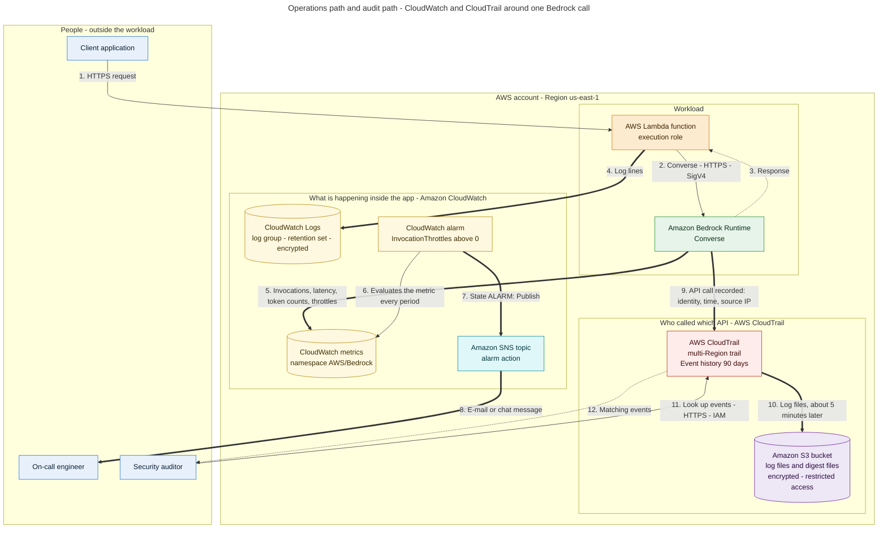

# Amazon CloudWatch and AWS CloudTrail

> **Level:** Beginner · **Verified:** 2026-11-15 · **Feature status:** n/a · **Time:** ~20 min

Two services answer two different questions. Amazon CloudWatch tells you **what is happening inside
your application**; AWS CloudTrail tells you **who called which AWS API**. A generative AI workload
needs both — and, as you will see, a third source for the question "what was actually said to the
model?".

## Learning objectives

After this chapter you can:

- Explain metrics, logs, alarms and dashboards in Amazon CloudWatch.
- Distinguish CloudTrail management events from data events, and event history from trails.
- Decide, for a given question, whether the answer is in CloudWatch, in CloudTrail or in neither.
- Create a first alarm and find out who made a specific API call.
- Say which Amazon Bedrock activity is recorded where, and what is off by default.

## Prerequisites

- [Amazon S3, AWS Lambda and Amazon API Gateway](02-s3-lambda-api-gateway.md) — Lambda writes the logs used here, and S3 stores trail files.
- [Amazon EventBridge, Amazon SQS and Amazon SNS](03-eventbridge-sqs-sns.md) — alarms notify through SNS.

## Concept in plain language

Think of a company car.

- **CloudWatch is the dashboard and the trip computer.** Gauges show speed and temperature
  (*metrics*), the computer keeps a list of messages (*logs*), and a warning lamp lights up when a
  value crosses a limit (*alarm*). It tells you the engine is overheating.
- **CloudTrail is the register at the key cabinet.** Every time someone takes a key it records who,
  when, which car and from which door. It tells you who was driving.

Neither replaces the other. When something breaks you usually read the dashboard first ("what
happened?") and the register second ("who changed something just before?").

## How it really works

### Amazon CloudWatch

| Building block | What it is | Facts to remember |
|:--|:--|:--|
| Metric | A time-ordered set of data points, identified by a namespace, a name and up to 30 dimensions | Exists only in the Region where it was created; cannot be deleted; expires after 15 months without new data. AWS namespaces look like `AWS/service` |
| Log event, log stream, log group | A timestamped message; the sequence of events from one source; a group of streams sharing retention and access settings | Kept **indefinitely** by default — you set the retention. Two log classes: Standard and Essentials (formerly Infrequent Access) |
| Metric filter | A rule that turns matching log events into metric data points | Lets you alarm on something that appears only in logs |
| Alarm | A watch on one metric or expression, in state `OK`, `ALARM` or `INSUFFICIENT_DATA` | Defined by *Period*, *Evaluation Periods* and *Datapoints to Alarm* — "M out of N" |
| Dashboard | A page of graphs and alarm states | Can span Regions and, with cross-account observability, accounts |
| Logs Insights | A query language over log groups | Commands are chained with the pipe character |

Sources: [Metrics concepts](https://docs.aws.amazon.com/AmazonCloudWatch/latest/monitoring/cloudwatch_concepts.html),
[CloudWatch Logs concepts](https://docs.aws.amazon.com/AmazonCloudWatch/latest/logs/CloudWatchLogsConcepts.html),
[Log groups and log streams](https://docs.aws.amazon.com/AmazonCloudWatch/latest/logs/Working-with-log-groups-and-streams.html),
[Alarm evaluation](https://docs.aws.amazon.com/AmazonCloudWatch/latest/monitoring/alarm-evaluation.html),
[Dashboards](https://docs.aws.amazon.com/AmazonCloudWatch/latest/monitoring/CloudWatch_Dashboards.html),
[Logs Insights syntax](https://docs.aws.amazon.com/AmazonCloudWatch/latest/logs/CWL_QuerySyntax.html).

Metric data loses resolution as it ages: data points with a period under 60 seconds are kept for 3
hours, 1-minute points for 15 days, 5-minute points for 63 days and 1-hour points for 455 days
([Metrics concepts](https://docs.aws.amazon.com/AmazonCloudWatch/latest/monitoring/cloudwatch_concepts.html)).

> [!IMPORTANT]
> **Status** — The CloudWatch documentation now distinguishes *OpenTelemetry Metrics (recommended)*
> from *CloudWatch Metrics (Classic)*, accepts OpenTelemetry data natively, and introduces
> *CloudWatch Omni*, an AI-powered observability experience for applications and AI agents.
> Existing "metrics, alarms, and dashboards keep working unchanged". This chapter teaches the
> Classic concepts, because AWS service metrics such as `AWS/Bedrock` use namespaces and dimensions.
> Source: [What is Amazon CloudWatch?](https://docs.aws.amazon.com/AmazonCloudWatch/latest/monitoring/WhatIsCloudWatch.html)

### AWS CloudTrail

A CloudTrail **event** is "the record of an activity in an AWS account". There are four types —
management, data, network activity and Insights events — and the first two matter most:

| | Management events | Data events |
|:--|:--|:--|
| What they record | Control-plane operations: creating, configuring and deleting resources; also sign-ins such as `ConsoleLogin` | Data-plane operations on or in a resource: Amazon S3 `GetObject`, Lambda `Invoke` |
| Logged by default | Yes | No — you select them with event selectors |
| Volume | Low | Often high |
| Charge | First copy delivered to S3 by a trail is free | Charged per event |

Source: [CloudTrail concepts](https://docs.aws.amazon.com/awscloudtrail/latest/userguide/cloudtrail-concepts.html),
[CloudTrail pricing](https://aws.amazon.com/cloudtrail/pricing/).

There are three ways to look at events:

| | Event history | Trail | CloudTrail Lake |
|:--|:--|:--|:--|
| Holds | The last 90 days of management events, per Region | The events you select, delivered as files to an S3 bucket, optionally also to CloudWatch Logs and EventBridge | Event data stores queried with SQL |
| Setup | None — it is on from the day the account exists | You create it; multi-Region and organization-wide trails exist | **Closed to new customers since 31 May 2026** |
| Good for | A quick lookup by one attribute | A durable record and audit evidence | Existing users only |

Sources: [What Is AWS CloudTrail?](https://docs.aws.amazon.com/awscloudtrail/latest/userguide/cloudtrail-user-guide.html),
[Working with trails](https://docs.aws.amazon.com/awscloudtrail/latest/userguide/cloudtrail-trails.html).

> [!IMPORTANT]
> **Status** — "AWS CloudTrail Lake will no longer be open to new customers starting on May 31,
> 2026. For capabilities similar to CloudTrail Lake, explore CloudWatch." The rest of CloudTrail,
> trails and Insights included, is not affected.
> Source: [CloudTrail Lake availability change](https://docs.aws.amazon.com/awscloudtrail/latest/userguide/cloudtrail-lake-service-availability-change.html)

Two properties make a trail usable as evidence. With **log file integrity validation**, CloudTrail
delivers an hourly, signed digest file containing a hash of every log file, so a modified or deleted
file is detectable
([Log file integrity](https://docs.aws.amazon.com/awscloudtrail/latest/userguide/cloudtrail-log-file-validation-intro.html)).
And an **organization trail** covers every account of an organization; member accounts can see it
but cannot change or delete it. CloudTrail is not real time: events typically arrive "within an
average of about 5 minutes of an API call"
([CloudTrail Lake](https://docs.aws.amazon.com/awscloudtrail/latest/userguide/cloudtrail-lake.html)).

### Two questions, two services — and a third

| Question | Where the answer is | On by default? |
|:--|:--|:-:|
| Is latency or the error rate rising? | CloudWatch metrics | Yes, for metrics AWS services publish |
| What did my code print before it failed? | CloudWatch Logs | Yes for Lambda, if the execution role allows it |
| Who changed this bucket policy, and from which IP address? | CloudTrail management events | Yes |
| Who read this S3 object? | CloudTrail data events | No |
| Who invoked a model? | CloudTrail — `InvokeModel` and `Converse` are logged as management events | Yes |
| How many tokens did each model consume? | CloudWatch metrics in the `AWS/Bedrock` namespace | Yes |
| What prompt was sent, and what came back? | Neither. Amazon Bedrock *model invocation logging* writes it to CloudWatch Logs or S3 | No |

> [!NOTE]
> **Documented fact** — "Amazon Bedrock logs Amazon Bedrock Runtime API operations (`InvokeModel`,
> `InvokeModelWithResponseStream`, `Converse`, and `ConverseStream`) as management events."
> Source: [Monitor Amazon Bedrock API calls using CloudTrail](https://docs.aws.amazon.com/bedrock/latest/userguide/logging-using-cloudtrail.html)

## Architecture diagram



**What this shows** — one model call inside one account and Region, and the two independent records
it leaves behind. The upper group is the operations path: logs and metrics feed an alarm that
reaches a person. The lower group is the audit path: the API call itself is recorded and stored
where the workload's own role cannot alter it.

**Walkthrough**

1. A client calls the application.
2. The function calls `Converse`, signed (Signature Version 4, SigV4) with its execution role.
3. Amazon Bedrock returns the model's answer.
4. Lambda sends whatever the function logged to its log group.
5. Amazon Bedrock publishes metrics for the call — count, latency, tokens, throttles — to CloudWatch.
6. An alarm evaluates one of those metrics each period.
7. When enough data points breach the threshold, the alarm goes to `ALARM` and publishes to an SNS topic.
8. The topic notifies the on-call engineer.
9. Independently, CloudTrail records the `Converse` call: which identity, when, from which IP address.
10. The trail delivers log files, and hourly digest files, to an S3 bucket.
11. An auditor looks up events through CloudTrail, authorised by IAM.
12. CloudTrail returns the matching events.

**Legend** — solid arrow: request · dashed arrow: response · thick arrow: asynchronous telemetry ·
cylinder: stored data · boxes: the workload, the operations path and the audit path. The production
version is [Diagram 29 — Production monitoring and incident-response architecture](../../diagrams/mermaid/29-production-monitoring-and-incident-response.md).

## Implementation details

1. **Logs.** A Lambda function logs to `/aws/lambda/<function name>` if its execution role has
   `logs:CreateLogGroup`, `logs:CreateLogStream` and `logs:PutLogEvents`
   ([Lambda logs](https://docs.aws.amazon.com/lambda/latest/dg/monitoring-cloudwatchlogs.html)).
   Set a retention period on every log group and write one JSON object per line so queries can filter on fields.
2. **Alarms.** Pick the metric, the statistic and the period; then decide how many of the last N
   periods must breach. Send the alarm action to an SNS topic.
3. **Trail.** Create one multi-Region trail — a trail created in the console is multi-Region — with
   log file validation, delivering to a bucket the workload cannot write to. In an organization, use
   an organization trail.
4. **Data events.** Add advanced event selectors only for the resource types you need; they are
   high-volume and charged.
5. **Scope.** Metrics and event history are per Region. With cross-Region inference, CloudTrail logs
   the request in the *source* Region and records where it ran in `additionalEventData.inferenceRegion`
   ([Cross-Region inference](https://docs.aws.amazon.com/bedrock/latest/userguide/cross-region-inference.html)).

> [!TIP]
> **Academy recommendation** — Before go-live, write down three questions you will need to answer at
> 03:00 ("is it slow?", "is it failing?", "who changed it?") and check that each has a metric, a log
> query or a trail behind it. This is our design guidance, not an official AWS reference architecture.

### Why this matters for Bedrock

- **Bedrock publishes its own metrics.** The `AWS/Bedrock` namespace carries `Invocations`,
  `InvocationLatency`, `InvocationThrottles`, `InvocationClientErrors`, `InvocationServerErrors`,
  `InputTokenCount`, `OutputTokenCount` and `TimeToFirstToken`, with a `ModelId` dimension
  ([Bedrock runtime metrics](https://docs.aws.amazon.com/bedrock/latest/userguide/monitoring-runtime-metrics.html)).
  See [CloudWatch and Bedrock-specific observability](../../02-related-aws-services/observability/01-cloudwatch-and-bedrock-observability.md).
- **Model calls are in CloudTrail by default; agent, knowledge base, flow and guardrail calls are
  not.** `InvokeAgent`, `Retrieve`, `InvokeFlow` and `ApplyGuardrail` are data events that need
  advanced event selectors. See [AWS CloudTrail for Bedrock](../../02-related-aws-services/security/05-cloudtrail-for-bedrock.md).
- **Prompts and responses are in neither.** Model invocation logging is "disabled by default",
  captures full request and response data, delivers only to a destination in the same account and
  Region, and covers only calls through the `bedrock-runtime` endpoint
  ([Model invocation logging](https://docs.aws.amazon.com/bedrock/latest/userguide/model-invocation-logging.html)).
  The governance side is in [Logging, audit and compliance evidence](../../06-security-governance/07-logging-audit-and-compliance.md).
- **Agents add traces.** AgentCore Observability sends traces, metrics and logs to CloudWatch — see
  [AgentCore Observability](../../01-amazon-bedrock/agentcore/07-agentcore-observability.md) and
  [Observability and tracing for GenAI](../../09-advanced-topics/12-observability-and-tracing.md).
- Operating all of this is the subject of [Production monitoring and incident response](../../08-cost-performance-and-reliability/08-monitoring-and-incident-response.md).

## Example

Three small pieces: get woken up when a model is throttled, find the matching errors in your logs,
and extend the audit record to knowledge base and guardrail calls.

**1. An alarm on Bedrock throttling.** Three of the last five one-minute periods must contain at
least one throttled invocation. Missing data is treated as not breaching, so the alarm stays `OK`
during periods without data points. The model ID is a parameter: confirm the current ID in the
Bedrock documentation before you use one.

> **Code status:** validated with `cfn-lint` 1.60.1 · **never deployed**

```yaml
AWSTemplateFormatVersion: "2010-09-09"
Description: Alarm when Amazon Bedrock throttles model invocations (illustrative).
Parameters:
  ModelId:
    Type: String
    Description: Model or inference profile ID exactly as it appears in the ModelId dimension.
  AlertTopicArn:
    Type: String
    Description: ARN of an existing Amazon SNS topic that notifies the on-call team.
Resources:
  BedrockThrottleAlarm:
    Type: AWS::CloudWatch::Alarm
    Properties:
      AlarmDescription: Amazon Bedrock throttled invocations for one model.
      Namespace: AWS/Bedrock
      MetricName: InvocationThrottles
      Dimensions:
        - Name: ModelId
          Value: !Ref ModelId
      Statistic: Sum
      Period: 60
      EvaluationPeriods: 5
      DatapointsToAlarm: 3
      Threshold: 0
      ComparisonOperator: GreaterThanThreshold
      TreatMissingData: notBreaching
      AlarmActions:
        - !Ref AlertTopicArn
```

**2. A Logs Insights query** on the function's log group, for the minutes around the alarm:

> **Code status:** illustrative · **never deployed**

```text
fields @timestamp, @message
| filter @message like /ERROR/
| sort @timestamp desc
| limit 20
```

**3. Advanced event selectors** that add Bedrock knowledge base and guardrail data events to a
trail. Both selectors are taken from the `aws cloudtrail put-event-selectors` example in the Bedrock
documentation.

> **Code status:** syntax-checked (JSON parse) · selectors copied from the AWS documentation · **never deployed**

```json
[
  {
    "Name": "Log all data events on a knowledge base in Amazon Bedrock.",
    "FieldSelectors": [
      { "Field": "eventCategory", "Equals": ["Data"] },
      { "Field": "resources.type", "Equals": ["AWS::Bedrock::KnowledgeBase"] }
    ]
  },
  {
    "Name": "Log all data events on a guardrail in Amazon Bedrock.",
    "FieldSelectors": [
      { "Field": "eventCategory", "Equals": ["Data"] },
      { "Field": "resources.type", "Equals": ["AWS::Bedrock::Guardrail"] }
    ]
  }
]
```

> [!CAUTION]
> **Cost or security hazard** — Data events are charged per event and can be very numerous. Try
> selectors in a sandbox account first, and remove them from the trail when you have finished.

## Common mistakes

> [!WARNING]
> **Common mistake** — Searching CloudTrail for the prompt that caused a bad answer. CloudTrail
> records that `Converse` was called, by whom and when — not what was said. If you need the content,
> model invocation logging must have been enabled *before* the call.

| Mistake | Symptom | Fix |
|:--|:--|:--|
| Leaving log groups at the default retention | Storage cost grows for ever | Set a retention period on every log group |
| Expecting object reads or knowledge base queries in event history | Nothing is found | Those are data events: enable them on a trail |
| A single-Region trail | Activity in another Region is missing | Use a multi-Region trail |
| Filtering Bedrock error metrics by `ModelId` only | Errors are undercounted, because some failures are published without that dimension | Also query the metric without a dimension |
| An alarm on a metric that is only published when something goes wrong | The alarm sits in `INSUFFICIENT_DATA` | Decide explicitly how missing data is treated |
| Planning new work on CloudTrail Lake | New accounts cannot use it | Use a trail to S3 or CloudWatch |
| Treating CloudTrail as real time | An event "is missing" for a few minutes | Allow for the delivery delay |

## Security considerations

- **Logs are sensitive data.** Application logs — and model invocation logs even more — can contain
  prompts, personal data and documents. Encrypt the log group, restrict who can read it and set a
  retention period. See [Data protection, privacy and data leakage prevention](../../06-security-governance/03-data-protection-and-privacy.md).
- **The audit record must be out of the workload's reach.** Deliver trail files to a bucket in a
  separate log archive account, turn on log file integrity validation, and use an organization
  trail that member accounts cannot modify — see [AWS Organizations and AWS Control Tower](05-organizations-control-tower.md).
- **Every event names an identity.** Give each workload its own role so that "who" in CloudTrail
  means something — see [IAM fundamentals](../security/01-iam-fundamentals.md).
- **Never log secrets.** A log line is readable by everyone who can read the log group.

## Cost considerations

- **Amazon CloudWatch** charges for logs ingested, stored and scanned by queries, for custom
  metrics, for alarms and for dashboards; metrics that AWS services send by default are free. The
  free tier covers 5 GB of log data, 10 custom metrics, 10 alarm metrics and 3 dashboards per month
  ([CloudWatch pricing](https://aws.amazon.com/cloudwatch/pricing/)).
- **AWS CloudTrail** event history is free, and a trail delivers one copy of management events to S3
  free of CloudTrail charges. Further copies cost $2.00 per 100,000 management events and data
  events $0.10 per 100,000 delivered ([CloudTrail pricing](https://aws.amazon.com/cloudtrail/pricing/)).
  You also pay Amazon S3 for the stored files.
- **What makes the bill grow:** verbose logs kept for ever, full prompts and responses written to
  CloudWatch Logs, high-resolution alarms, and broad data-event selectors on busy resources.

## Knowledge check

1. An S3 bucket became public at 14:05. Which service tells you who changed it, and do you need to have set anything up beforehand?
2. Users report slow answers from a chatbot. Which two Amazon Bedrock metrics do you look at first, and what does each tell you?
3. A compliance officer asks for every prompt sent last month. Invocation logging was never enabled. What can you provide?
4. What would happen to the evidence if an attacker with administrator access to a workload account deleted trail files, and which two measures limit the damage?

<details>
<summary>Answers</summary>

1. AWS CloudTrail. Changing a bucket policy or public-access setting is a management event, so it is in event history for 90 days without any setup.
2. `InvocationLatency` (time until the last token — is the model slow or the answers long?) and `InvocationThrottles` (is Amazon Bedrock throttling requests?). `TimeToFirstToken` helps for streaming calls.
3. Only metadata: CloudTrail shows who called `InvokeModel` or `Converse` and when, and CloudWatch shows counts and token totals. The prompt text was not recorded anywhere.
4. Without protection the record would be gone. Log file integrity validation makes deletion or modification detectable, and delivering an organization trail to a bucket in a separate log archive account keeps the files out of that administrator's reach.

</details>

## Further reading

Official sources opened while writing this chapter:

- [What is Amazon CloudWatch?](https://docs.aws.amazon.com/AmazonCloudWatch/latest/monitoring/WhatIsCloudWatch.html) — overview, OpenTelemetry support and CloudWatch Omni.
- [Metrics concepts](https://docs.aws.amazon.com/AmazonCloudWatch/latest/monitoring/cloudwatch_concepts.html) — namespaces, dimensions, retention.
- [Alarm evaluation](https://docs.aws.amazon.com/AmazonCloudWatch/latest/monitoring/alarm-evaluation.html) and [Using CloudWatch dashboards](https://docs.aws.amazon.com/AmazonCloudWatch/latest/monitoring/CloudWatch_Dashboards.html).
- [CloudWatch Logs concepts](https://docs.aws.amazon.com/AmazonCloudWatch/latest/logs/CloudWatchLogsConcepts.html), [Working with log groups and log streams](https://docs.aws.amazon.com/AmazonCloudWatch/latest/logs/Working-with-log-groups-and-streams.html), [Logs Insights query syntax](https://docs.aws.amazon.com/AmazonCloudWatch/latest/logs/CWL_QuerySyntax.html).
- [Sending Lambda function logs to CloudWatch Logs](https://docs.aws.amazon.com/lambda/latest/dg/monitoring-cloudwatchlogs.html) — log group name and permissions.
- [What Is AWS CloudTrail?](https://docs.aws.amazon.com/awscloudtrail/latest/userguide/cloudtrail-user-guide.html) and [CloudTrail concepts](https://docs.aws.amazon.com/awscloudtrail/latest/userguide/cloudtrail-concepts.html) — event types, event history, trails.
- [Logging management events](https://docs.aws.amazon.com/awscloudtrail/latest/userguide/logging-management-events-with-cloudtrail.html) and [Logging data events](https://docs.aws.amazon.com/awscloudtrail/latest/userguide/logging-data-events-with-cloudtrail.html).
- [Working with CloudTrail trails](https://docs.aws.amazon.com/awscloudtrail/latest/userguide/cloudtrail-trails.html) and [Validating log file integrity](https://docs.aws.amazon.com/awscloudtrail/latest/userguide/cloudtrail-log-file-validation-intro.html).
- [Working with AWS CloudTrail Lake](https://docs.aws.amazon.com/awscloudtrail/latest/userguide/cloudtrail-lake.html) and [CloudTrail Lake availability change](https://docs.aws.amazon.com/awscloudtrail/latest/userguide/cloudtrail-lake-service-availability-change.html).
- [Monitor Amazon Bedrock API calls using CloudTrail](https://docs.aws.amazon.com/bedrock/latest/userguide/logging-using-cloudtrail.html) — management and data events for Bedrock, and the event selectors in the example.
- [Monitor bedrock-runtime inference using CloudWatch metrics](https://docs.aws.amazon.com/bedrock/latest/userguide/monitoring-runtime-metrics.html) — the `AWS/Bedrock` metrics.
- [Monitor model invocation using CloudWatch Logs and Amazon S3](https://docs.aws.amazon.com/bedrock/latest/userguide/model-invocation-logging.html) — model invocation logging.
- [CloudWatch pricing](https://aws.amazon.com/cloudwatch/pricing/) and [CloudTrail pricing](https://aws.amazon.com/cloudtrail/pricing/).
