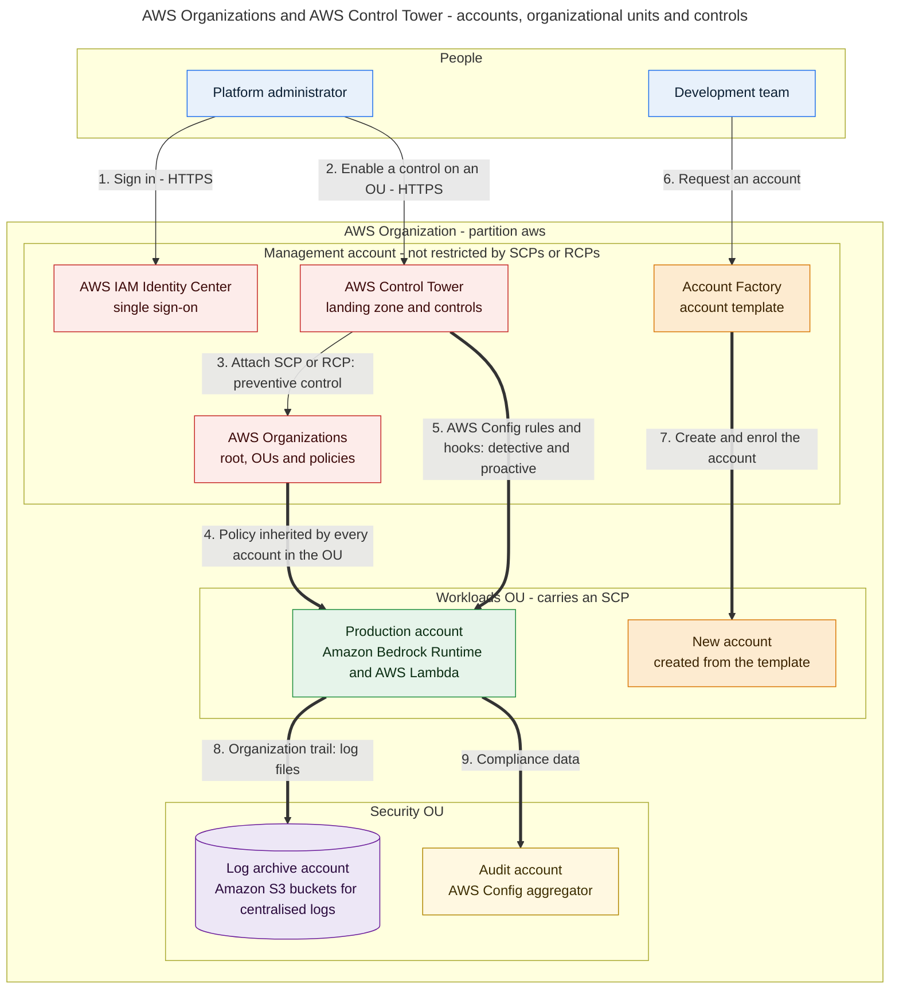

# AWS Organizations and AWS Control Tower

> **Level:** Beginner · **Verified:** 2026-11-15 · **Feature status:** n/a · **Time:** ~20 min

One AWS account is enough to learn; a company needs many. AWS Organizations groups accounts and lets
you set rules that no single account can override, and AWS Control Tower builds and maintains that
structure for you. For Amazon Bedrock this is where you decide, once and centrally, which models,
Regions and guardrails every team gets.

## Learning objectives

After this chapter you can:

- Describe an organization: root, organizational units, management account and member accounts.
- Explain what service control policies and resource control policies do — and what they never do.
- Explain delegated administration and why the management account should stay empty.
- Describe a Control Tower landing zone, its three kinds of control and Account Factory.
- Write a service control policy that restricts Amazon Bedrock without breaking cross-Region inference.

## Prerequisites

- [AWS global infrastructure: Regions, Availability Zones and the edge](01-global-infrastructure.md) — Regions and partitions.
- [Amazon CloudWatch and AWS CloudTrail](04-cloudwatch-cloudtrail.md) — trails, which Control Tower centralises.
- Helpful: [IAM fundamentals](../security/01-iam-fundamentals.md), because the policies below use IAM policy language.

## Concept in plain language

Think of a group of companies.

- Each subsidiary is an **AWS account**: its own staff, its own budget, its own locked building.
- Head office is the **management account**. It draws the org chart (**organizational units**) and
  pays the combined bill.
- Head office issues **house rules** that no subsidiary can overrule. A rule about what staff may do
  is a **service control policy (SCP)**; a rule about who may enter the buildings — even visitors
  from outside the group — is a **resource control policy (RCP)**. House rules only forbid. They
  never hand anyone a key.
- **AWS Control Tower** is the franchise manual plus the team that applies it. It fits the locks
  (*preventive* controls), installs smoke detectors (*detective* controls), checks building plans
  before construction (*proactive* controls) and opens each new branch from the same template
  (*Account Factory*).

## How it really works

### AWS Organizations

| Element | What it is | Limit |
|:--|:--|:--|
| Organization | A collection of AWS accounts that you manage centrally | 10 accounts by default, adjustable |
| Root | The top container; policies attached here reach everything below | 1 |
| Organizational unit (OU) | A group of accounts; OUs can contain OUs | 2,000 OUs, five levels deep |
| Management account | The account that created the organization. It pays all charges and cannot be changed | — |
| Member account | Every other account. An account belongs to one organization at a time | — |

Sources: [Terminology and concepts](https://docs.aws.amazon.com/organizations/latest/userguide/orgs_getting-started_concepts.html),
[Quotas for AWS Organizations](https://docs.aws.amazon.com/organizations/latest/userguide/orgs_reference_limits.html).

Organizations has two families of policy. **Authorization policies** — SCPs and RCPs — cap
permissions. **Declarative policies** configure services across accounts: backup, tag, AI services
opt-out, Amazon S3, Amazon GuardDuty and, relevant to this course, **Amazon Bedrock policies**
([Organization policies](https://docs.aws.amazon.com/organizations/latest/userguide/orgs_manage_policies.html)).

| | Service control policy (SCP) | Resource control policy (RCP) |
|:--|:--|:--|
| Caps | What IAM users and roles **in your member accounts** can do | What any principal, **inside or outside the organization**, can do to resources in your member accounts |
| Grants permissions | Never | Never |
| Applies to the management account | No | No |
| Applies to service-linked roles | No | No |
| Covers | Actions of AWS services, with a short list of documented exceptions | Only a published list of services, including Amazon S3, AWS KMS, AWS STS, Amazon SQS and AWS Secrets Manager |
| Maximum attached per root, OU or account | 10 | 5 |
| Maximum size | 10,240 characters | 5,120 characters |

Sources: [Service control policies](https://docs.aws.amazon.com/organizations/latest/userguide/orgs_manage_policies_scps.html),
[Resource control policies](https://docs.aws.amazon.com/organizations/latest/userguide/orgs_manage_policies_rcps.html),
[Organization policies](https://docs.aws.amazon.com/organizations/latest/userguide/orgs_manage_policies.html).

How they are evaluated:

- **Effective permissions are an intersection.** A request succeeds only if the SCPs and RCPs allow
  it *and* an identity-based or resource-based policy grants it.
- **Allow must be present at every level.** An action needs an `Allow` in an SCP at the root, at
  each OU on the path and at the account. That is why Organizations attaches the managed policy
  `FullAWSAccess` everywhere by default.
- **Deny at any level wins** for every account underneath
  ([SCP evaluation](https://docs.aws.amazon.com/organizations/latest/userguide/orgs_manage_policies_scps_evaluation.html)).

> [!NOTE]
> **Documented fact** — "SCPs don't affect users or roles in the management account. They affect
> only the member accounts in your organization."
> Source: [Service control policies](https://docs.aws.amazon.com/organizations/latest/userguide/orgs_manage_policies_scps.html)

Because of that, AWS recommends using the management account "only for tasks that must be performed
by that account" and registering member accounts as **delegated administrators** — either for
Organizations policy management or for one integrated AWS service
([Delegated administrator](https://docs.aws.amazon.com/organizations/latest/userguide/orgs_integrate_delegated_admin.html)).

### AWS Control Tower

Control Tower orchestrates AWS Organizations, AWS Service Catalog and AWS IAM Identity Center "to
build a landing zone in less than an hour"
([What Is AWS Control Tower?](https://docs.aws.amazon.com/controltower/latest/userguide/what-is-control-tower.html)).

- A **landing zone** is the multi-account environment itself: a root, a Security OU with two shared
  accounts — *log archive* and *audit* — an optional Sandbox OU and an IAM Identity Center directory.
  The **home Region** you choose cannot be changed later.
- A **control** is a rule applied to a whole OU:

| Behaviour | Implemented with | What it does | Where it works |
|:--|:--|:--|:--|
| Preventive | SCPs, RCPs and declarative policies | Disallows the action | All Regions |
| Detective | AWS Config rules | Reports resources that violate the rule | Regions governed by Control Tower |
| Proactive | AWS CloudFormation hooks | Stops a non-compliant resource before it is provisioned | Resources provisioned by CloudFormation, in governed Regions |

- **Account Factory** is a configurable account template, built on AWS Service Catalog, that creates
  and enrols new accounts. **Account Factory for Terraform (AFT)** does the same through a Terraform
  pipeline run from a separate AFT management account.

Sources: [How AWS Control Tower works](https://docs.aws.amazon.com/controltower/latest/userguide/how-control-tower-works.html),
[Control behavior and guidance](https://docs.aws.amazon.com/controltower/latest/controlreference/control-behavior.html),
[Regions and Control Tower](https://docs.aws.amazon.com/controltower/latest/userguide/region-how.html),
[Account Factory](https://docs.aws.amazon.com/controltower/latest/userguide/account-factory.html),
[AFT overview](https://docs.aws.amazon.com/controltower/latest/userguide/aft-overview.html).

> [!IMPORTANT]
> **Status** — Landing zone version 4.0 changes two defaults: Control Tower "no longer requires a
> Security OU, and you can define your own organizational structure", and "mandatory controls are no
> longer applied by default". Older material describes version 3.x.
> Source: [How AWS Control Tower works](https://docs.aws.amazon.com/controltower/latest/userguide/how-control-tower-works.html),
> [Control behavior and guidance](https://docs.aws.amazon.com/controltower/latest/controlreference/control-behavior.html)

## Architecture diagram



**What this shows** — an organization with a management account and two organizational units. The
management account holds only governance services. The Security OU holds the shared log archive and
audit accounts. The Workloads OU carries a service control policy that every account inside it
inherits, including accounts that do not exist yet.

**Walkthrough**

1. A platform administrator signs in through IAM Identity Center.
2. In Control Tower the administrator enables a control on the Workloads OU.
3. For a preventive control, Control Tower attaches an SCP or RCP through AWS Organizations.
4. The policy applies to every account in the OU from then on.
5. For detective and proactive controls, Control Tower deploys AWS Config rules and CloudFormation hooks into the accounts.
6. A development team asks for a new account through Account Factory.
7. Account Factory creates the account in the chosen OU and enrols it, so it inherits steps 4 and 5 immediately.
8. An organization trail delivers every account's CloudTrail log files to the log archive account.
9. AWS Config compliance data is aggregated in the audit account.

**Legend** — solid arrow: request · thick arrow: asynchronous deployment or delivery · cylinder:
stored logs · boxes: account and OU boundaries. The full design is
[Diagram 25 — Multi-account AWS architecture](../../diagrams/mermaid/25-multi-account-aws.md).

## Implementation details

1. **Enable all features** and group accounts into OUs by function — for example Security, Workloads
   (production and non-production) and Sandbox.
2. **Keep the management account empty.** Register delegated administrators for the security
   services you centralise.
3. **Write SCPs as deny lists.** Leave `FullAWSAccess` in place and add `Deny` statements for what
   must never happen. AWS "strongly recommends that you don't attach SCPs to the root of your
   organization without thoroughly testing"; start with one OU.
4. **Choose the Control Tower home Region deliberately,** govern only the Regions you use, and
   remember that an ungoverned Region is still usable unless a policy denies it.
5. **Create accounts through Account Factory** (or AFT) so that none starts without the baseline.

Variations: detective and proactive controls work only in governed Regions; preventive controls work
everywhere. The exact shared accounts and OUs depend on the landing zone version.

> [!TIP]
> **Academy recommendation** — Treat policies and controls like code: keep them in version control,
> review changes, and roll them out OU by OU. See
> [Governance at scale](../../06-security-governance/06-governance-at-scale.md). This is our design
> guidance, not an official AWS reference architecture.

### Why this matters for Bedrock

- **Accounts separate teams and environments.** AWS describes an account as "a billing boundary for
  costs" that "isolates resources for security". A sandbox for prompt experiments and a production
  account for the customer-facing assistant should not share a blast radius — see
  [Pattern: multi-account generative AI platform](../../03-architecture-patterns/multi-account/README.md)
  and [Project F](../../05-practical-projects/project-06-multi-account-platform/README.md).
- **Region restrictions and cross-Region inference interact.** For a Geographic inference profile
  an SCP must allow *all destination Regions* of the profile; for a Global profile it must allow
  `"aws:RequestedRegion": "unspecified"`
  ([Cross-Region inference](https://docs.aws.amazon.com/bedrock/latest/userguide/cross-region-inference.html)).
- **Guardrails can be enforced from the organization.** An *Amazon Bedrock policy* references one
  version of a guardrail created in the management account and applies it to "all model inference
  calls" in the accounts below; guardrails are per Region
  ([Amazon Bedrock policies](https://docs.aws.amazon.com/organizations/latest/userguide/orgs_manage_policies_bedrock.html)).
  See [Automated Reasoning checks and guardrail enforcement](../../01-amazon-bedrock/guardrails/02-automated-reasoning-and-enforcement.md).
- **RCPs protect the data around Bedrock, not Bedrock itself.** Amazon Bedrock is not in the list of
  services that support RCPs on the verification date; Amazon S3 and AWS KMS are, which covers
  knowledge base buckets and keys.
- **One trail for all accounts** answers "who invoked which model" across the organization.
  Deploying into many accounts is covered in
  [Multi-account and multi-Region deployments](../../04-infrastructure-as-code/maintenance/06-multi-account-multi-region.md).

## Example

A service control policy for a Workloads OU. The first statement comes from the AWS documentation;
the second keeps Amazon Bedrock inside three Regions.

> **Code status:** syntax-checked (JSON parse) · **never attached to a real organization**

```json
{
  "Version": "2012-10-17",
  "Statement": [
    {
      "Sid": "DenyLeavingTheOrganization",
      "Effect": "Deny",
      "Action": "organizations:LeaveOrganization",
      "Resource": "*"
    },
    {
      "Sid": "DenyBedrockOutsideApprovedRegions",
      "Effect": "Deny",
      "Action": "bedrock:*",
      "Resource": "*",
      "Condition": {
        "StringNotEquals": {
          "aws:RequestedRegion": ["us-east-1", "us-east-2", "us-west-2"]
        }
      }
    }
  ]
}
```

How to read it:

| Question | Answer |
|:--|:--|
| Does it let anyone call Amazon Bedrock? | No. It only removes permissions; an IAM policy must still allow the call |
| Why three Regions and not one? | AWS gives `us-east-1`, `us-east-2` and `us-west-2` as the example destinations of a US Geographic profile. Denying any destination Region breaks the profile. Check the destinations of the profile you actually use |
| What about Global inference profiles? | They need `unspecified` added to the list of allowed values |
| Does it cover the `bedrock-mantle` endpoint? | No. The [register](../../FEATURE-VERIFICATION.md) lists a separate IAM prefix, `bedrock-mantle`, which needs its own statement |
| Does it bind the management account? | No. SCPs never do |

Attach it to a test OU first, confirm in CloudTrail that only the intended calls are denied, and
then move it up.

## Common mistakes

> [!WARNING]
> **Common mistake** — Expecting an SCP to give access. Teams attach an "allow Bedrock" SCP and
> still receive access-denied errors, because an SCP only sets the ceiling. Permissions are granted
> by IAM policies in the account.

| Mistake | Symptom | Fix |
|:--|:--|:--|
| Running workloads in the management account | No SCP, RCP or preventive control applies to them | Keep the management account for organization tasks only |
| Detaching `FullAWSAccess` without a replacement | Every action in the affected accounts fails | Keep it and add `Deny` statements |
| Attaching a new SCP to the root first | An organization-wide outage | Test on one OU, then widen |
| A Region-deny policy written before inference profiles were used | Calls through a cross-Region profile are denied | Allow the profile's destination Regions, or `unspecified` for Global |
| Trying to restrict Amazon Bedrock with an RCP | The policy has no effect | Use SCPs and IAM policies |
| Changing resources that Control Tower created | The landing zone or a control enters an unknown state | Change them only through Control Tower |
| Expecting detective controls in a Region Control Tower does not govern | Nothing is reported there | Govern the Regions you use and deny the rest |

**Our reading:** proactive controls evaluate resources "that would be provisioned by AWS
CloudFormation". Tools that call service APIs directly, as Terraform's AWS provider does, are
therefore not checked by them; rely on preventive and detective controls plus
[policy checks in your pipeline](../../07-devops-and-cicd/06-policy-cost-and-approvals.md).

## Security considerations

- **The management account is the most powerful and the least restricted account you have.** No
  SCP, RCP or preventive control applies to it. Minimise who can sign in to it and what runs in it.
- **SCPs do not reach principals outside the organization or service-linked roles.** Use RCPs to
  stop external principals from reaching your resources.
- **Centralise evidence.** Log archive and audit accounts keep trails and compliance data away from
  the workloads they describe.
- **Stop accounts from leaving.** Denying `organizations:LeaveOrganization` keeps an account under
  your policies.
- **Give people access through IAM Identity Center,** not through IAM users in each account — see
  [IAM and IAM Identity Center for Bedrock](../../02-related-aws-services/security/01-iam-and-identity-center.md).

## Cost considerations

- **AWS Organizations and AWS Control Tower have no additional charge.** You pay for the services
  Control Tower configures: AWS Config, AWS CloudTrail, Amazon CloudWatch, Amazon SNS, Amazon S3,
  AWS Service Catalog and Amazon VPC ([Control Tower pricing](https://aws.amazon.com/controltower/pricing/)).
- **Watch AWS Config.** AWS warns that accounts running short-lived resources "may see an increase
  in costs from AWS Config as it records configuration changes".
- **One bill for all accounts.** The management account pays the charges of every member account,
  and volume pricing tiers can aggregate across the organization — AWS Lambda duration tiers do
  ([Lambda pricing](https://aws.amazon.com/lambda/pricing/)).
- **What makes the bill grow:** governing Regions you do not use, and many accounts each carrying
  the same baseline of recorders and logs.

## Knowledge check

1. A developer in a member account has `AdministratorAccess`, but an SCP on the OU denies `bedrock:*` outside `eu-central-1`. Can they call a model in `us-east-1`? Why?
2. The same developer's colleague works in the management account. Does the SCP stop them?
3. You want to be sure that no bucket in the organization can be read by an AWS account outside it. Which policy type do you use, and why not the other one?
4. What would happen if a team created a non-compliant resource with Terraform in an OU that has only a proactive control for it?

<details>
<summary>Answers</summary>

1. No. A `Deny` in an SCP at any level above the account overrides every IAM permission in that account, including `AdministratorAccess`.
2. No. SCPs do not affect users or roles in the management account — which is why workloads do not belong there.
3. A resource control policy. It caps what any principal, including one outside the organization, can do to your resources. An SCP only limits your own principals.
4. Nothing would stop it. Proactive controls are CloudFormation hooks and evaluate resources provisioned through CloudFormation. You need a preventive control (to block the action) or a detective control (to report the resource).

</details>

## Further reading

Official sources opened while writing this chapter:

- [Terminology and concepts for AWS Organizations](https://docs.aws.amazon.com/organizations/latest/userguide/orgs_getting-started_concepts.html) — structure, account types, delegated administrators.
- [Managing organization policies](https://docs.aws.amazon.com/organizations/latest/userguide/orgs_manage_policies.html) — policy types, limits per target, maximum sizes.
- [Service control policies](https://docs.aws.amazon.com/organizations/latest/userguide/orgs_manage_policies_scps.html) and [SCP evaluation](https://docs.aws.amazon.com/organizations/latest/userguide/orgs_manage_policies_scps_evaluation.html).
- [Resource control policies](https://docs.aws.amazon.com/organizations/latest/userguide/orgs_manage_policies_rcps.html) — including the list of supported services.
- [Amazon Bedrock policies](https://docs.aws.amazon.com/organizations/latest/userguide/orgs_manage_policies_bedrock.html) — organization-wide guardrail enforcement.
- [Delegated administrator for AWS services](https://docs.aws.amazon.com/organizations/latest/userguide/orgs_integrate_delegated_admin.html) and [Quotas for AWS Organizations](https://docs.aws.amazon.com/organizations/latest/userguide/orgs_reference_limits.html).
- [What Is AWS Control Tower?](https://docs.aws.amazon.com/controltower/latest/userguide/what-is-control-tower.html) and [How AWS Control Tower works](https://docs.aws.amazon.com/controltower/latest/userguide/how-control-tower-works.html).
- [About controls](https://docs.aws.amazon.com/controltower/latest/controlreference/controls.html) and [Control behavior and guidance](https://docs.aws.amazon.com/controltower/latest/controlreference/control-behavior.html).
- [How AWS Regions work with AWS Control Tower](https://docs.aws.amazon.com/controltower/latest/userguide/region-how.html) and [Resources created in the service integration accounts](https://docs.aws.amazon.com/controltower/latest/userguide/shared-account-resources.html).
- [Provision and manage accounts with Account Factory](https://docs.aws.amazon.com/controltower/latest/userguide/account-factory.html) and [Account Factory for Terraform overview](https://docs.aws.amazon.com/controltower/latest/userguide/aft-overview.html).
- [Cross-Region inference](https://docs.aws.amazon.com/bedrock/latest/userguide/cross-region-inference.html) — SCP requirements for Geographic and Global profiles.
- [AWS Control Tower pricing](https://aws.amazon.com/controltower/pricing/) and [AWS Lambda pricing](https://aws.amazon.com/lambda/pricing/) — what is charged, and consolidated pricing tiers.
