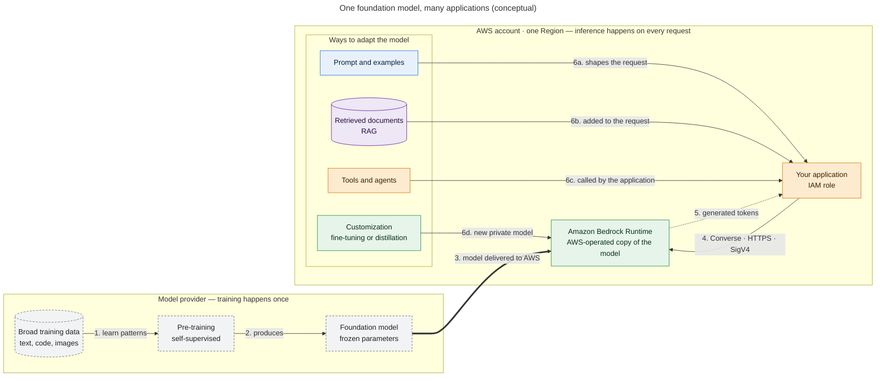

# Generative AI, foundation models and LLMs

> **Level:** Beginner · **Verified:** 2026-11-15 · **Feature status:** n/a · **Time:** ~15 min

Amazon Bedrock is, at its core, an API in front of many foundation models. This chapter explains what those models are, how they produce text, images and video, and what the word "foundation" promises — so that a model catalog stops looking like a list of brand names.

## Learning objectives

After this chapter you can:

- Explain how AI, generative AI, foundation models and large language models relate to each other.
- Describe how a language model produces text one token at a time, and why that makes it fluent but not automatically right.
- Tell model types apart by what goes in and what comes out: text, multimodal, embedding, image, video and speech.
- Explain what "foundation" means and name four ways to adapt one model to many jobs.
- Read a catalog entry: provider, family, tier, version and lifecycle state.

## Prerequisites

- None for the concepts.
- To follow the Amazon Bedrock references: [AWS global infrastructure: Regions, Availability Zones and the edge](../aws-fundamentals/01-global-infrastructure.md) and [IAM fundamentals: principals, policies and evaluation](../security/01-iam-fundamentals.md).

## Concept in plain language

Imagine a new colleague who has read an enormous library — books, manuals, websites, source code — and remembers the *patterns* in it rather than the pages. Ask them to continue a sentence, summarise a report or draft an e-mail and they produce something plausible, quickly, on almost any subject. That colleague is a **large language model**.

The colleague has three quirks. They stopped reading on a certain date and know nothing newer. They have never seen your company's private documents. And when they do not know, they tend to give a confident guess instead of saying so.

The word **foundation** comes from building. Pouring a foundation is slow and expensive, and you do it once; afterwards very different houses can stand on it. A foundation model is trained once, at great cost, by a model provider. Thousands of teams then build different applications on top without repeating that training.

**Generative AI** is the umbrella term: software that creates new content — text, images, video, audio, code — instead of only sorting or scoring content that already exists.

## How it really works

### Four nested terms

| Term | Precise meaning | Source |
|:--|:--|:--|
| Artificial intelligence (AI) | "The broader concept of making machines more human-like" — from smart assistants to self-driving cars | [What is generative AI?](https://aws.amazon.com/what-is/generative-ai/) |
| Generative AI | "A type of AI that can create new content and ideas, including conversations, stories, images, videos, and music" | [What is generative AI?](https://aws.amazon.com/what-is/generative-ai/) |
| Foundation model (FM) | "An AI model with a large number of parameters and trained on a massive amount of diverse data." It can generate text or images, or convert input into embeddings | [Key terminology](https://docs.aws.amazon.com/bedrock/latest/userguide/key-definitions.html) |
| Large language model (LLM) | One class of FM, focused on language tasks such as summarisation, text generation, classification, conversation and information extraction | [What is generative AI?](https://aws.amazon.com/what-is/generative-ai/) |

The name "foundation model" was introduced in 2021 for any model "trained on broad data (generally using self-supervision at scale) that can be adapted to a wide range of downstream tasks" ([Bommasani et al.](https://arxiv.org/abs/2108.07258)).

### How a language model produces text

1. **Tokens.** Text is cut into small units called tokens (see [Tokens, context windows, and training versus inference](02-tokens-context-windows-inference.md)).
2. **Architecture.** Almost all current LLMs are **transformers**, a neural network design "based solely on attention mechanisms" ([Vaswani et al.](https://arxiv.org/abs/1706.03762)). Attention lets the model weigh every token in the input against every other token, and the whole sequence is processed in parallel, which is what made training on very large data sets practical ([What is an LLM?](https://aws.amazon.com/what-is/large-language-model/)).
3. **Pre-training.** The provider shows the model huge amounts of text and lets it predict the next token again and again. Each wrong prediction nudges the model's **parameters** — billions of numeric weights — so that the next prediction is better. No human labels are needed; this is called self-supervised learning.
4. **Inference.** When you call the model, the parameters are frozen. The model computes a probability for every possible next token, picks one, appends it to the text and repeats until it decides to stop.

> [!NOTE]
> **Documented fact** — "For any given sequence, a model determines a probability distribution of options for the next token in the sequence. To generate each token in an output, the model samples from this distribution."
> Source: [Influence response generation with inference parameters](https://docs.aws.amazon.com/bedrock/latest/userguide/inference-parameters.html)

The consequence matters more than the mechanism: the model is optimised for a *plausible continuation*, not for truth. Fluent but wrong output (a "hallucination") is a property of how generation works, not a defect that a patch removes.

### Model types by input and output

| Type | Input → output | What to know | Examples listed on [Models at a glance](https://docs.aws.amazon.com/bedrock/latest/userguide/model-cards.html) on the verification date |
|:--|:--|:--|:--|
| Text and chat LLM | Text → text | The default for chat, summarising, extraction and code | Models from Amazon, Anthropic, Meta, Mistral AI, OpenAI and others |
| Multimodal understanding | Text plus images or video → text | "Multimodal" means more than one kind of input or output | Amazon Nova understanding models |
| Embedding model | Text or image → a list of numbers (a vector) | Used for search, not for generation — see [Embeddings, vector search, semantic search and hybrid search](03-embeddings-and-vector-search.md) | Amazon Titan Text Embeddings V2, Cohere Embed |
| Reranker | Query plus passages → relevance scores | Reorders search results | Cohere Rerank |
| Image generation | Text (and optionally an image) → image | Usually a **diffusion** model | Amazon Nova Canvas, Stability AI models |
| Video generation | Text (and optionally an image) → video | Check the model card for limits and pricing units | Amazon Nova Reel, Luma AI Ray2 |
| Speech | Speech ↔ speech or text | Voice applications | Amazon Nova Sonic models |

Diffusion models work differently from LLMs. During training they learn to remove noise that was added to real images; at inference they start from random noise and remove it step by step, steered by your prompt, until an image appears ([What is generative AI?](https://aws.amazon.com/what-is/generative-ai/), [Ho et al.](https://arxiv.org/abs/2006.11239)).

### What "foundation" buys you

One set of frozen weights can be adapted to many jobs. From cheapest to most expensive:

| Adaptation | What changes | Covered in |
|:--|:--|:--|
| Prompting | Instructions and examples inside the request | [Tokens, context windows, and training versus inference](02-tokens-context-windows-inference.md) |
| Retrieval (RAG) | Relevant documents are added to the request | [Retrieval-augmented generation (RAG)](04-rag-fundamentals.md) |
| Tools and agents | The model can ask your code to call APIs | [Agentic AI, tool calling and multi-agent architectures](06-agents-tool-calling-multi-agent.md) |
| Customization | The weights themselves; the result is a new private model | [Fine-tuning and model customization](05-fine-tuning-and-customization.md) |

The flip side is inheritance: "the defects of the foundation model are inherited by all the adapted models downstream" ([Bommasani et al.](https://arxiv.org/abs/2108.07258)).

### Providers, families, tiers and versions

A catalog entry has four levels: **provider → family → tier → version**. For example, Amazon (provider) offers Nova (family) in Micro, Lite and Pro tiers that, in AWS's words, give "a broad selection of capability, accuracy, speed, and cost operation points" ([What are foundation models?](https://aws.amazon.com/what-is/foundation-models/)). Within a family, a larger tier is usually more capable, slower and more expensive.

The [Amazon Bedrock pricing page](https://aws.amazon.com/bedrock/pricing/) lists models from AI21 Labs, Amazon, Anthropic, Cohere, DeepSeek, Google, Luma AI, Meta, MiniMax AI, Mistral AI, Moonshot AI, NVIDIA, OpenAI, Qwen, Stability AI, TwelveLabs, Writer, xAI and Z AI (as of the verification date).

> [!IMPORTANT]
> **Status** — Every model on Amazon Bedrock is in one of three states: Active, Legacy or End-of-Life. After the End-of-Life date, requests to the model fail. Treat the model as a dependency with an expiry date.
> Source: [Model lifecycle](https://docs.aws.amazon.com/bedrock/latest/userguide/model-lifecycle.html)

### Limits to design around

| Limit | Why it exists | Usual answer |
|:--|:--|:--|
| Knowledge cut-off | Training data is static | Retrieval, web search tools |
| No private knowledge | Your data was not in the training set | Retrieval, customization |
| Hallucination | Generation favours plausibility | Grounding, citations, evaluation |
| Varying output | The next token is sampled | Inference parameters, tests that tolerate variation |
| Bias | Learned from human-written data | Evaluation, guardrails, human review |

## Architecture diagram



**What this shows** — Training and inference are separate in time, place and ownership. The provider trains once; you only ever run inference against a copy that AWS operates, and you adapt behaviour from your side of the boundary. This is a conceptual model, not an official AWS diagram.

**Walkthrough**

1. The provider collects broad training data.
2. Pre-training turns that data into a set of parameters: the foundation model.
3. The provider delivers the model to AWS. Amazon Bedrock deploys it in accounts that the Bedrock service team owns; the provider has no access to them.
4. Your application sends a prompt with the Converse API, signed with its IAM role's credentials.
5. The model returns generated tokens. Its parameters do not change.
6. You adapt behaviour by (a) writing the prompt, (b) adding retrieved documents, (c) offering tools, or (d) creating a customized model that only your account can use.

**Legend** — solid arrow: request or data flow · dashed arrow: response · thick arrow: one-off delivery · cylinder: data store · boxes: trust boundaries.

**Variations** — Models from Amazon Bedrock Marketplace are deployed to an endpoint managed by Amazon SageMaker AI rather than served from the shared serverless catalog (see the [feature register](../../FEATURE-VERIFICATION.md#a2-models-access-and-customization)). Image and video models return media instead of tokens.

> [!NOTE]
> **Documented fact** — Amazon Bedrock deploys each provider's model in a Model Deployment Account owned and operated by the Bedrock service team. "Because the model providers don't have access to those accounts, they don't have access to Amazon Bedrock logs or to customer prompts and completions."
> Source: [Data protection](https://docs.aws.amazon.com/bedrock/latest/userguide/data-protection.html)

## Implementation details

In the order a builder meets them:

1. **Choose by modality first.** A chat model cannot produce embeddings, and an embedding model cannot chat.
2. **Check where and how the model is served.** The documentation lists capabilities, endpoint and API support, Region and cost as the things to check ([Model availability and compatibility](https://docs.aws.amazon.com/bedrock/latest/userguide/models.html)).
3. **Model access is on by default.** The old "request model access" console step no longer exists; see the [feature register](../../FEATURE-VERIFICATION.md#what-changed-since-older-tutorials).
4. **Call through a model-independent API.** Converse "provides a consistent interface that works with all models that support messages", so switching model is mostly a configuration change ([Converse API reference](https://docs.aws.amazon.com/bedrock/latest/APIReference/API_runtime_Converse.html)).
5. **Keep the model ID in configuration.** IDs change with every version, and versions reach End-of-Life.

> [!TIP]
> **Academy recommendation** — Start with the smallest tier that might work, measure it on your own examples, and move up only when the measurement says so. This is our design guidance, not an official AWS reference architecture.

### Where this shows up in Amazon Bedrock

- [What Amazon Bedrock is: services, namespaces and planes](../../01-amazon-bedrock/overview/01-what-is-amazon-bedrock.md) — the service that hosts the models.
- [Model providers and the model catalog](../../01-amazon-bedrock/foundation-models/01-model-providers-and-catalog.md) — providers, families and model cards.
- [Model lifecycle and selection](../../01-amazon-bedrock/foundation-models/02-model-lifecycle-and-selection.md) — Active, Legacy and End-of-Life.
- [Model access and subscriptions](../../01-amazon-bedrock/overview/03-model-access-and-subscriptions.md) — how access works today.
- [The Converse API](../../01-amazon-bedrock/inference/01-converse-api.md) — one request shape for many models.
- [Amazon Bedrock Marketplace](../../01-amazon-bedrock/foundation-models/05-bedrock-marketplace.md) — models outside the serverless catalog.

## Example

> **Code status:** syntax-checked (`python -m py_compile`) · never run against AWS · **never deployed**

```python
"""Send one prompt to two models through the same API.

Model IDs are parameters. Copy current IDs from the Amazon Bedrock model catalog.
"""
import os

import boto3

REGION = os.environ.get("AWS_REGION", "us-east-1")
MODEL_IDS = [os.environ["SMALL_MODEL_ID"], os.environ["LARGE_MODEL_ID"]]
PROMPT = "Explain what a foundation model is in two sentences."

client = boto3.client("bedrock-runtime", region_name=REGION)

for model_id in MODEL_IDS:
    response = client.converse(
        modelId=model_id,
        messages=[{"role": "user", "content": [{"text": PROMPT}]}],
        inferenceConfig={"maxTokens": 200},
    )
    blocks = response["output"]["message"]["content"]
    answer = "".join(block.get("text", "") for block in blocks)
    usage = response["usage"]
    print(f"{model_id}: {usage['inputTokens']} tokens in, {usage['outputTokens']} tokens out")
    print(answer)
```

The request is identical for both models; only `modelId` differs. Run it twice and the wording changes — the next chapter explains why.

## Common mistakes

> [!WARNING]
> **Common mistake** — Treating the model as a database. It stores patterns, not records, so it will "remember" facts that were never true. If the answer must be right, supply the facts in the request and ask the model to use only those.

| Mistake | Symptom | Fix |
|:--|:--|:--|
| Assuming the model learns from your conversations | "It forgot what I told it yesterday" | Parameters are frozen; send the context you need with each request |
| Picking the largest model by default | High cost and slow answers for simple tasks | Evaluate smaller tiers first |
| Using a chat model where an embedding model is needed (or the reverse) | API errors or meaningless output | Choose by input and output type |
| Hard-coding a model ID | Failures when the version reaches End-of-Life | Configuration value plus a lifecycle check |
| Trusting fluent output | Wrong answers reach users | Grounding, evaluation, human review where it matters |

## Security considerations

- **Who can call a model** is an IAM decision: the Converse API requires permission for the `bedrock:InvokeModel` action.
- **What happens to your prompt**: "Amazon Bedrock doesn't store any text, images, or documents that you provide as content. The data is only used to generate the response" ([Converse API reference](https://docs.aws.amazon.com/bedrock/latest/APIReference/API_runtime_Converse.html)). Model providers cannot see prompts or completions.
- **Model output is untrusted input** to the rest of your system. Validate it before you execute, store or display it.
- **Responsibility is shared**: AWS secures the service; you secure your application, including against prompt injection — see [Shared responsibility and a GenAI threat model](../../06-security-governance/01-shared-responsibility-and-threat-model.md).

## Cost considerations

- Pricing "is dependent on the modality, provider, and model" ([Amazon Bedrock pricing](https://aws.amazon.com/bedrock/pricing/)). Text models are priced per input token and per output token; other modalities use their own units.
- Within a family, larger tiers cost more per token, so model choice is usually the biggest cost decision.
- You do not pay for training a base model. You do pay for training and storing a customized one.
- [Latency and token economics](08-latency-and-token-economics.md) builds a full cost model.

## Knowledge check

1. A colleague says "the model knows our refund policy because we asked it about refunds last week." What is wrong with that statement?
2. You need to find the support tickets most similar to a new ticket. Which model type do you need, and why not a chat model?
3. What would happen to an application with a hard-coded model ID when that model reaches its End-of-Life date?
4. Why can the same foundation model power both a code assistant and a contract summariser?

<details>
<summary>Answers</summary>

1. Inference does not change the model's parameters. Unless the policy is sent with the request (or retrieved for it), the model has never seen it and will guess.
2. An embedding model: it turns each ticket into a vector so that similar tickets can be found by distance. A chat model generates text; it does not produce comparable vectors.
3. Requests fail after the End-of-Life date, and migration is not automatic. The ID must be configuration and someone must watch lifecycle notices.
4. It was trained on broad data and can be adapted — by prompt, retrieved context, tools or customization — without retraining from scratch. That adaptability is the definition of a foundation model.

</details>

## Further reading

Official sources opened while writing this chapter:

- [What is generative AI?](https://aws.amazon.com/what-is/generative-ai/) — definitions, model categories, diffusion models.
- [What are foundation models?](https://aws.amazon.com/what-is/foundation-models/) — definition, examples and challenges.
- [What is an LLM?](https://aws.amazon.com/what-is/large-language-model/) — transformers, parameters and training.
- [Amazon Bedrock overview](https://docs.aws.amazon.com/bedrock/latest/userguide/what-is-bedrock.html) — the service and its APIs.
- [Key terminology](https://docs.aws.amazon.com/bedrock/latest/userguide/key-definitions.html) — Bedrock's own definitions.
- [Models at a glance](https://docs.aws.amazon.com/bedrock/latest/userguide/model-cards.html) — the current catalog by provider.
- [Model availability and compatibility](https://docs.aws.amazon.com/bedrock/latest/userguide/models.html) — what to check when choosing a model.
- [Model lifecycle](https://docs.aws.amazon.com/bedrock/latest/userguide/model-lifecycle.html) — Active, Legacy and End-of-Life.
- [Data protection](https://docs.aws.amazon.com/bedrock/latest/userguide/data-protection.html) — Model Deployment Accounts.
- [Influence response generation with inference parameters](https://docs.aws.amazon.com/bedrock/latest/userguide/inference-parameters.html) — next-token sampling.
- [Converse API reference](https://docs.aws.amazon.com/bedrock/latest/APIReference/API_runtime_Converse.html) — request shape, permissions, data handling.
- [Amazon Bedrock pricing](https://aws.amazon.com/bedrock/pricing/) — providers and pricing dimensions.
- [Attention Is All You Need](https://arxiv.org/abs/1706.03762) — the Transformer paper (conceptual background).
- [On the Opportunities and Risks of Foundation Models](https://arxiv.org/abs/2108.07258) — origin of the term (conceptual background).
- [Denoising Diffusion Probabilistic Models](https://arxiv.org/abs/2006.11239) — diffusion models (conceptual background).
