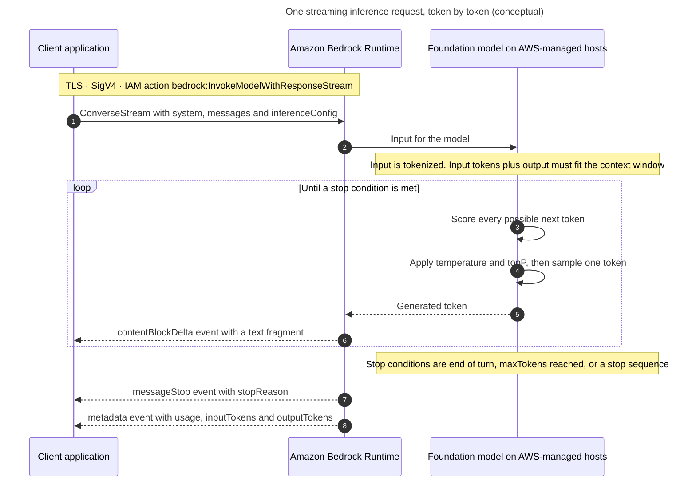

# Tokens, context windows, and training versus inference

> **Level:** Beginner · **Verified:** 2026-11-15 · **Feature status:** n/a · **Time:** ~20 min

Every limit, price and latency figure in Amazon Bedrock is expressed in tokens. This chapter explains what a token is, how much a model can read at once, what actually happens during an inference request, and which request settings change the answer.

## Learning objectives

After this chapter you can:

- Explain what a token is and why token counts differ between models.
- Budget a context window across instructions, history, documents and the answer.
- Distinguish training from inference and say which one your requests perform.
- Choose values for temperature, top-p, maximum tokens and stop sequences, and read the stop reason.
- Explain streaming and why the same prompt can give different answers.

## Prerequisites

- [Generative AI, foundation models and LLMs](01-generative-ai-and-foundation-models.md)

## Concept in plain language

A model does not read letters or words. It reads **tokens**: small pieces of text, a bit like the syllable tiles in a word game. Short common words are one tile; long or rare words are several.

The **context window** is the model's desk. Everything it may look at while answering — your instructions, the conversation so far, any documents you attached, and the answer it is writing — has to fit on that desk at the same time. The desk has a fixed size. When it is full, something must come off.

**Training** is the model going to school: slow, expensive, done by the model provider, finished before you ever meet the model. **Inference** is the model sitting an exam with only the desk in front of it. Your requests are always inference. The model leaves the exam room knowing nothing new.

The model writes its answer one tile at a time, and for every tile it rolls weighted dice. **Temperature** decides how adventurous the dice are. **Streaming** means you watch the tiles appear as they are placed instead of waiting for the finished page.

## How it really works

### Tokens and tokenization

Amazon Bedrock defines a token as "a sequence of characters that a model can interpret or predict as a single unit of meaning" — a word, a part of a word such as "-ed", a punctuation mark, or a common phrase ([Key terminology](https://docs.aws.amazon.com/bedrock/latest/userguide/key-definitions.html)).

A **tokenizer** converts text into token IDs before the model sees it, and converts IDs back into text afterwards. Most tokenizers build their vocabulary from frequent character sequences, so that rare and unknown words can be written as a sequence of sub-word units ([Sennrich et al.](https://arxiv.org/abs/1508.07909)). Three practical consequences:

- Tokens are not words. As a rule of thumb, code, numbers, long identifiers and rare words take more tokens per character than everyday prose.
- Each model family has its own tokenizer, so the same text has a different token count on different models.
- The system prompt and tool definitions are tokens too, not only the user's message.

> [!NOTE]
> **Documented fact** — "Token counting is model-specific because different models use different tokenization strategies." The `CountTokens` API returns the count that would be charged for a given input, and calling it incurs no charge.
> Source: [Monitor your token usage by counting tokens before running inference](https://docs.aws.amazon.com/bedrock/latest/userguide/count-tokens.html)

### The context window

The context window is the maximum number of tokens a model can take into account in one request, **input and output together**. A model's card states the window and, separately, the largest output it will produce. For example, on the verification date the Bedrock overview page described one model as having a "1,050,000-token context window shared between input and output, with up to 128,000 output tokens" ([Amazon Bedrock overview](https://docs.aws.amazon.com/bedrock/latest/userguide/what-is-bedrock.html)).

| What occupies the window | Who controls it | Grows when |
|:--|:--|:--|
| System prompt (instructions) | You | Policies and examples are added |
| Tool definitions | You | More tools, longer descriptions |
| Conversation history | Your application | Every turn |
| Documents and retrieved passages | Your retrieval logic | More or larger passages |
| The current user message | The user | — |
| The answer | The model, capped by `maxTokens` | The task needs long output |

The model is **stateless**: nothing carries over from one request to the next. A chat application creates the impression of memory by sending the earlier turns again with every request — which is why long conversations get slower and more expensive, and why they eventually overflow the window.

### Training versus inference

| | Training (and customization) | Inference |
|:--|:--|:--|
| What happens | Parameters are adjusted to predict the next token better | Frozen parameters are used to generate output |
| Who does it | The model provider; you, only if you customize a model | Every request you send |
| Cost shape | Large and occasional | Per token, per request |
| Changes the model? | Yes — produces a new set of parameters | No |
| Where your data goes | Into the parameters | Into the context window, for this request only |

Giving examples in a prompt can make a model behave differently for that request (often called in-context learning), but the parameters stay untouched. To change them you need [model customization](05-fine-tuning-and-customization.md).

### Generating a token, and the parameters that steer it

For each output position the model produces a score for every token in its vocabulary. The scores are turned into probabilities, one token is **sampled**, appended to the sequence, and the process repeats. Inference parameters reshape or cut that distribution.

| Parameter | Converse field | Effect | Typical use |
|:--|:--|:--|:--|
| Temperature | `inferenceConfig.temperature` | Lower values steepen the distribution towards the most likely tokens; higher values flatten it | Low for extraction and classification; higher for brainstorming |
| Top-p (nucleus sampling) | `inferenceConfig.topP` | Samples only from the most likely tokens whose probabilities add up to *p* | Alternative to temperature for trimming unlikely tokens |
| Top-k | Model-specific, passed in `additionalModelRequestFields` | Samples only from the *k* most likely tokens | Where the model supports it |
| Maximum tokens | `inferenceConfig.maxTokens` | Hard cap on output length | Always set it |
| Stop sequences | `inferenceConfig.stopSequences` | Generation stops when one of these strings is produced | Ending at a delimiter such as a closing tag |

As a conceptual formula, with scores *z* and temperature *T*, the probability of token *i* is `exp(z_i / T) / Σ_j exp(z_j / T)`. The AWS documentation illustrates the effect with three candidates — "horses" 0.7, "zebras" 0.2, "unicorns" 0.1: a top-p of 0.7 leaves only "horses"; a top-p of 0.9 leaves "horses" and "zebras" ([Inference parameters](https://docs.aws.amazon.com/bedrock/latest/userguide/inference-parameters.html)). Top-p sampling comes from research showing that the "unreliable tail" of the distribution should be cut off before sampling ([Holtzman et al.](https://arxiv.org/abs/1904.09751)).

> [!NOTE]
> **Documented fact** — In the Converse API, `temperature` and `topP` accept values from 0 to 1, and the default for `maxTokens` "is the maximum allowed value for the model that you are using". Defaults and supported ranges otherwise depend on the model.
> Source: [InferenceConfiguration](https://docs.aws.amazon.com/bedrock/latest/APIReference/API_runtime_InferenceConfiguration.html)

### Why generation stops

Every response carries a stop reason. The Converse API defines these values ([MessageStopEvent](https://docs.aws.amazon.com/bedrock/latest/APIReference/API_runtime_MessageStopEvent.html)):

| `stopReason` | Meaning | What to do |
|:--|:--|:--|
| `end_turn` | The model finished | Use the answer |
| `max_tokens` | The cap was reached; the answer is cut off | Raise the cap or ask for shorter output; never parse it as complete |
| `stop_sequence` | One of your stop sequences appeared | Expected |
| `tool_use` | The model is asking for a tool call | See [Agentic AI, tool calling and multi-agent architectures](06-agents-tool-calling-multi-agent.md) |
| `guardrail_intervened`, `content_filtered` | A safety control blocked or changed content | Handle as a refusal |
| `model_context_window_exceeded` | Input plus output did not fit the window | Shorten the input |
| `malformed_model_output`, `malformed_tool_use` | The model produced output that could not be parsed | Retry or fall back |

### Streaming

Without streaming you receive the whole answer when the last token has been generated. With streaming (`ConverseStream`, `InvokeModelWithResponseStream`) the service sends events as generation proceeds: `messageStart`, `contentBlockStart`, a series of `contentBlockDelta` events carrying text fragments, `contentBlockStop`, `messageStop` with the stop reason, and `metadata` with token usage ([ConverseStream API reference](https://docs.aws.amazon.com/bedrock/latest/APIReference/API_runtime_ConverseStream.html)).

Streaming does not make generation faster. It shortens the wait before the user sees *something*, which is usually what "feels slow" means.

### Non-determinism

Because each token is sampled, the same prompt can produce different answers. The Bedrock documentation notes that responses "may vary due to the stochastic nature of the LLM generation process" ([Prompt engineering concepts](https://docs.aws.amazon.com/bedrock/latest/userguide/prompt-engineering-guidelines.html)), and that a lower temperature "leads to more deterministic responses".

**Our reading:** "more deterministic" is not "identical". Model updates, routing between hosts and ties between equally likely tokens can still change output at temperature 0, so design for variation instead of assuming it away.

## Architecture diagram



**What this shows** — A single request as a loop. The input is read once; the output is produced one token at a time, and each new token becomes part of the input for the next step. AWS does not document the internals of model hosting, so the split between the service and the model is a conceptual model.

**Walkthrough**

1. The application sends the system prompt, the messages and the inference parameters. The caller needs the `bedrock:InvokeModelWithResponseStream` permission.
2. The service passes the input to the model, where it is tokenized.
3. The model scores every candidate for the next token.
4. Temperature and top-p reshape the distribution and one token is sampled.
5. The token is appended to the sequence and returned to the service.
6. The service forwards text to the client in `contentBlockDelta` events. Steps 3–6 repeat.
7. When a stop condition is met, a `messageStop` event reports the `stopReason`.
8. A final `metadata` event reports `inputTokens` and `outputTokens` — the numbers you are billed on.

**Legend** — solid arrow: request · dashed arrow: response or stream event · note: control or constraint · loop: repeated once per output token.

**Variations** — With the non-streaming `Converse` operation, steps 6–8 collapse into one response. Not every model supports streaming; `GetFoundationModel` reports it in `responseStreamingSupported`. The AWS CLI does not support the Bedrock streaming operations.

## Implementation details

In the order a builder meets them:

1. **Count before you send.** Use `CountTokens` (IAM action `bedrock:CountTokens`) for the model you will call; some models are not supported on `bedrock-runtime` for this operation.
2. **Set `maxTokens` on purpose.** The default is the model's maximum. The value is also what the service reserves against your tokens-per-minute quota when the request starts ([How tokens are counted](https://docs.aws.amazon.com/bedrock/latest/userguide/quotas-token-burndown.html)), so an oversized value causes throttling as well as cost.
3. **Tune one sampling control at a time.** Change temperature or top-p, not both, and keep the values in configuration.
4. **Always branch on `stopReason`.** A cut-off answer looks like an answer.
5. **Stream for people, not for machines.** A batch job gains nothing from streaming.
6. **Manage history.** Trim, summarise or cache the stable part of the prompt rather than letting the window fill up.

> [!TIP]
> **Academy recommendation** — Treat the context window as a budget with named lines (instructions, tools, history, documents, answer) and log the token count of each line. Most "the model got worse" incidents are one line quietly growing. This is our design guidance, not an official AWS reference architecture.

### Where this shows up in Amazon Bedrock

- [The Converse API](../../01-amazon-bedrock/inference/01-converse-api.md) — `inferenceConfig`, `stopReason` and `usage`.
- [InvokeModel and streaming APIs](../../01-amazon-bedrock/inference/02-invokemodel-and-streaming.md) — model-native parameters and the streaming operations.
- [OpenAI- and Anthropic-compatible APIs](../../01-amazon-bedrock/inference/03-openai-and-anthropic-compatible-apis.md) — the same concepts under other field names.
- [Model lifecycle and selection](../../01-amazon-bedrock/foundation-models/02-model-lifecycle-and-selection.md) — context window and output limits per model.
- [Prompt caching](../../01-amazon-bedrock/prompt-caching/01-prompt-caching.md) — paying less for the part of the window that repeats.
- [Model customization: fine-tuning, reinforcement fine-tuning and distillation](../../01-amazon-bedrock/foundation-models/03-model-customization.md) — the only path that changes parameters.

## Example

> **Code status:** syntax-checked and run locally (no AWS calls) · **never deployed**

The first example needs no AWS account. It applies temperature and top-p to the three-token distribution from the AWS documentation so that you can see what the parameters do.

```python
"""Temperature and top-p on a toy next-token distribution."""
import math


def apply_temperature(probs: dict[str, float], temperature: float) -> dict[str, float]:
    """Lower temperature sharpens the distribution; higher temperature flattens it."""
    if temperature == 0:  # limit case: always take the most likely token
        best = max(probs, key=probs.get)
        return {tok: 1.0 if tok == best else 0.0 for tok in probs}
    scaled = {tok: math.exp(math.log(p) / temperature) for tok, p in probs.items()}
    total = sum(scaled.values())
    return {tok: value / total for tok, value in scaled.items()}


def apply_top_p(probs: dict[str, float], top_p: float) -> dict[str, float]:
    """Keep the most likely tokens until their probabilities add up to top_p."""
    kept: dict[str, float] = {}
    cumulative = 0.0
    for tok, p in sorted(probs.items(), key=lambda item: item[1], reverse=True):
        kept[tok] = p
        cumulative += p
        if cumulative >= top_p - 1e-9:
            break
    total = sum(kept.values())
    return {tok: p / total for tok, p in kept.items()}


def show(label: str, probs: dict[str, float]) -> None:
    print(label, {tok: round(p, 3) for tok, p in probs.items()})


next_token = {"horses": 0.7, "zebras": 0.2, "unicorns": 0.1}
show("temperature 0.5:", apply_temperature(next_token, 0.5))
show("temperature 1.0:", apply_temperature(next_token, 1.0))
show("temperature 2.0:", apply_temperature(next_token, 2.0))
show("top_p 0.7:      ", apply_top_p(next_token, 0.7))
show("top_p 0.9:      ", apply_top_p(next_token, 0.9))
```

Output:

```text
temperature 0.5: {'horses': 0.907, 'zebras': 0.074, 'unicorns': 0.019}
temperature 1.0: {'horses': 0.7, 'zebras': 0.2, 'unicorns': 0.1}
temperature 2.0: {'horses': 0.523, 'zebras': 0.279, 'unicorns': 0.198}
top_p 0.7:       {'horses': 1.0}
top_p 0.9:       {'horses': 0.778, 'zebras': 0.222}
```

> **Code status:** syntax-checked (`python -m py_compile`) · never run against AWS · **never deployed**

The second example sets the same parameters on a real request and reads the stream.

```python
"""Stream a response and read the stop reason and token usage."""
import os

import boto3

client = boto3.client("bedrock-runtime", region_name=os.environ.get("AWS_REGION", "us-east-1"))

response = client.converse_stream(
    modelId=os.environ["MODEL_ID"],  # confirm the current ID in the model catalog
    system=[{"text": "Answer in at most three sentences."}],
    messages=[{"role": "user", "content": [{"text": "What is a context window?"}]}],
    inferenceConfig={"maxTokens": 300, "temperature": 0.2, "stopSequences": ["</answer>"]},
)

for event in response["stream"]:
    if "contentBlockDelta" in event:
        print(event["contentBlockDelta"]["delta"].get("text", ""), end="", flush=True)
    elif "messageStop" in event:
        stop_reason = event["messageStop"]["stopReason"]
        if stop_reason == "max_tokens":
            print("\n[answer was cut off]")
    elif "metadata" in event:
        usage = event["metadata"]["usage"]
        print(f"\n{usage['inputTokens']} tokens in, {usage['outputTokens']} tokens out")
```

## Common mistakes

> [!WARNING]
> **Common mistake** — Parsing a response without checking `stopReason`. When the value is `max_tokens`, JSON is unterminated and summaries end mid-sentence, yet the HTTP call succeeded. Check the stop reason before you use the text.

| Mistake | Symptom | Fix |
|:--|:--|:--|
| Leaving `maxTokens` at the default | Throttling at low traffic; occasional very long, expensive answers | Set it close to the longest answer you expect |
| Estimating tokens from words or characters | Requests rejected as too long; wrong cost forecasts | Count with the target model's tokenizer |
| Expecting the model to remember earlier requests | "It forgot my name" | Send the history, or store and retrieve it |
| Sending the full history forever | Latency and cost climb turn by turn, then `model_context_window_exceeded` | Trim or summarise old turns |
| Tests that compare exact output strings | Flaky test runs | Assert on structure or score with an evaluation instead |
| Raising temperature and top-p together | Incoherent output | Change one at a time |

## Security considerations

- **Everything in the context window can come back out.** Do not place secrets, credentials or another user's data in a system prompt; a determined user can often make the model repeat it.
- **Streaming and safety checks interact.** Text may reach the user before a check on the complete answer has finished; the contextual grounding documentation describes exactly this for streaming APIs. See [Amazon Bedrock Guardrails](../../01-amazon-bedrock/guardrails/01-guardrails.md).
- **Two IAM actions cover inference.** To deny a model completely you must deny both `bedrock:InvokeModel` and `bedrock:InvokeModelWithResponseStream`.
- **Inference does not train.** Amazon Bedrock states that content you send to Converse is not stored and is only used to generate the response.

## Cost considerations

- You pay for input tokens and output tokens; `usage` in every response tells you both.
- Conversation history is input. Re-sending ten earlier turns means paying for those turns again on every request.
- `maxTokens` is your per-request ceiling on output spend.
- Counting tokens with `CountTokens` is free.
- [Latency and token economics](08-latency-and-token-economics.md) turns these points into a cost model.

## Knowledge check

1. A request has 6,000 input tokens. The model's context window is 8,000 tokens and you set `maxTokens` to 4,000. What can go wrong?
2. Why does a chatbot become slower and more expensive as a conversation gets longer, even if each new question is short?
3. You set temperature to 0 and still see two different answers a week apart. Give two possible reasons.
4. A response has `stopReason` equal to `max_tokens`. What would happen if you passed its text straight to a JSON parser?

<details>
<summary>Answers</summary>

1. Input plus output share the window. Only about 2,000 tokens of output fit, so the answer can end early or the request can fail with a context-window stop reason, depending on the model.
2. The model is stateless, so the application re-sends the growing history as input on every turn. More input tokens mean more cost and a longer wait before the first token.
3. The model version may have changed, the request may have been served by different hosts, or two tokens may have had near-equal probability. Low temperature reduces variation; it does not guarantee identical output.
4. The parser would most likely fail, because the output was cut off before the closing brackets. Check the stop reason first and retry with a higher cap or a shorter task.

</details>

## Further reading

Official sources opened while writing this chapter:

- [Key terminology](https://docs.aws.amazon.com/bedrock/latest/userguide/key-definitions.html) — tokens, inference, model and inference parameters.
- [Influence response generation with inference parameters](https://docs.aws.amazon.com/bedrock/latest/userguide/inference-parameters.html) — temperature, top-k, top-p, length and stop sequences.
- [InferenceConfiguration](https://docs.aws.amazon.com/bedrock/latest/APIReference/API_runtime_InferenceConfiguration.html) — Converse field names, ranges and defaults.
- [Converse API reference](https://docs.aws.amazon.com/bedrock/latest/APIReference/API_runtime_Converse.html) — request structure, permissions and data handling.
- [ConverseStream API reference](https://docs.aws.amazon.com/bedrock/latest/APIReference/API_runtime_ConverseStream.html) — streaming events and permissions.
- [MessageStopEvent](https://docs.aws.amazon.com/bedrock/latest/APIReference/API_runtime_MessageStopEvent.html) — stop reason values.
- [TokenUsage](https://docs.aws.amazon.com/bedrock/latest/APIReference/API_runtime_TokenUsage.html) — the usage fields.
- [Monitor your token usage by counting tokens before running inference](https://docs.aws.amazon.com/bedrock/latest/userguide/count-tokens.html) — the CountTokens API.
- [How tokens are counted in Amazon Bedrock](https://docs.aws.amazon.com/bedrock/latest/userguide/quotas-token-burndown.html) — `max_tokens` and quota reservation.
- [Making inference requests](https://docs.aws.amazon.com/bedrock/latest/userguide/inference.html) — what inference is and the permissions it needs.
- [Prompt engineering concepts](https://docs.aws.amazon.com/bedrock/latest/userguide/prompt-engineering-guidelines.html) — prompts and output variation.
- [Use contextual grounding check](https://docs.aws.amazon.com/bedrock/latest/userguide/guardrails-contextual-grounding-check.html) — behaviour with streaming APIs.
- [Amazon Bedrock overview](https://docs.aws.amazon.com/bedrock/latest/userguide/what-is-bedrock.html) — example of a context window shared between input and output.
- [Neural Machine Translation of Rare Words with Subword Units](https://arxiv.org/abs/1508.07909) — sub-word tokenization (conceptual background).
- [The Curious Case of Neural Text Degeneration](https://arxiv.org/abs/1904.09751) — nucleus (top-p) sampling (conceptual background).
