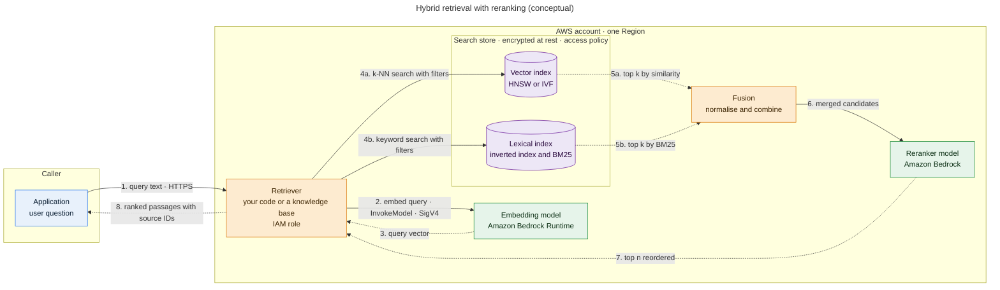

# Embeddings, vector search, semantic search and hybrid search

> **Level:** Beginner · **Verified:** 2026-11-15 · **Feature status:** n/a · **Time:** ~20 min

Before a model can answer from your documents, something has to find the right documents. This chapter explains how text becomes numbers that can be compared, how those numbers are searched quickly, and why production systems combine meaning-based search with keyword search and a reranking step.

## Learning objectives

After this chapter you can:

- Explain what an embedding is and what "close" means for two vectors.
- Choose between cosine similarity, dot product and Euclidean distance.
- Describe how HNSW and IVF indexes trade accuracy for speed.
- Compare semantic search, lexical (BM25) search and hybrid search, and say when each fails.
- Explain what a reranker adds and where it sits in a retrieval pipeline.

## Prerequisites

- [Generative AI, foundation models and LLMs](01-generative-ai-and-foundation-models.md)
- [Tokens, context windows, and training versus inference](02-tokens-context-windows-inference.md)

## Concept in plain language

Picture a huge map on which every paragraph you own is a pin. Paragraphs about the same subject are pinned close together: everything about refunds sits in one neighbourhood, everything about shipping in another. An **embedding** is simply the map coordinates of one pin. An **embedding model** is the cartographer that decides where each pin goes.

**Semantic search** is then easy to describe: pin the question on the same map and collect the nearest pins. "How do I get my money back?" lands next to the refund paragraphs even though it never uses the word "refund".

With millions of pins, measuring the distance to every one is too slow. An **approximate nearest neighbour index** is a shortcut. One kind works like a road network: take the motorway to the right region, then local roads to the right street. Another works like postal districts: decide which few districts the question belongs to and search only those.

**Lexical search** is the index at the back of a book: it finds pages that contain the exact words you typed. It is unbeatable for a part number and useless for a paraphrase. **Hybrid search** uses the map and the book index together. A **reranker** is a careful second reader who takes the shortlist and puts the best passages on top.

## How it really works

### Embeddings

An embedding model maps an input — a sentence, a chunk of a document, an image — to a fixed-length list of numbers, a **vector**. Amazon Bedrock describes embedding as "transforming input into a vector of numerical values ... to compare the similarity between different objects by using a shared numerical representation" ([Key terminology](https://docs.aws.amazon.com/bedrock/latest/userguide/key-definitions.html)).

| Property | Meaning | Why it matters |
|:--|:--|:--|
| Dimensions | Length of the vector | Storage and search cost grow with it; the index must be created for exactly this length |
| Element type | Floating-point (float32) or binary | Binary uses 1 bit per dimension instead of 32, at some loss of precision |
| Maximum input | Tokens the model accepts per input | Sets an upper bound on chunk size |
| Modality | Text only, or text and images in one space | Multimodal models let a text query find an image |

> [!NOTE]
> **Documented fact** — "Binary vectors, which use only 1 bit per dimension, aren't as costly on storage as floating-point (float32) vectors, which use 32 bits per dimension. However, binary vectors aren't as precise as floating-point vectors in their representation of the text."
> Source: [How Amazon Bedrock knowledge bases work](https://docs.aws.amazon.com/bedrock/latest/userguide/kb-how-it-works.html)

Vectors from different embedding models live on different maps. Documents and queries must be embedded by the **same** model, and changing the model means re-embedding everything.

### Similarity metrics

| Metric | Formula | Reads as | Notes |
|:--|:--|:--|:--|
| Cosine similarity | `(a · b) / (‖a‖ ‖b‖)` | Angle between the vectors; 1 is identical direction | Ignores vector length |
| Dot product (inner product) | `a · b` | Angle and length together | Equals cosine when vectors are normalised to length 1 |
| Euclidean (L2) distance | `‖a − b‖` | Straight-line distance; smaller is closer | For length-1 vectors it ranks results the same as cosine |

Use the metric the embedding model's documentation specifies, and configure the index with the same one. Vector engines on AWS offer all three; Amazon OpenSearch Serverless, for example, "provides distance metrics such as Euclidean distance, cosine similarity, and dot product similarity" ([vector search collections](https://docs.aws.amazon.com/opensearch-service/latest/developerguide/serverless-vector-search.html)).

### Exact and approximate nearest-neighbour search

**k-nearest-neighbour (k-NN) search** returns the *k* vectors closest to a query vector. Comparing the query with every stored vector is exact but scales linearly with the collection. **Approximate nearest neighbour (ANN)** indexes visit only a small part of the collection and accept that they occasionally miss a true neighbour. The quality measure is **recall**: the share of true nearest neighbours that the index returned.

AWS names the two index families you will meet most often: vector databases are "typically powered by k-nearest neighbor (k-NN) indexes and built with algorithms like the Hierarchical Navigable Small World (HNSW) and Inverted File Index (IVF) algorithms" ([What is a vector database?](https://aws.amazon.com/what-is/vector-databases/)).

| | HNSW | IVF |
|:--|:--|:--|
| Idea | A layered graph. Each vector links to near neighbours; sparse upper layers act as long-distance shortcuts | Vectors are grouped into clusters around centroids |
| Query | Start in the top layer, move greedily towards the query, descend a layer, repeat | Find the closest centroids, then scan only those clusters |
| Build | Incremental — vectors can be added one by one | Needs a clustering (training) step on representative data |
| Memory | Higher: the graph is held alongside the vectors | Lower, especially combined with compression such as product quantization |
| What you tune | Links per node; size of the candidate list | Number of clusters; number of clusters probed per query |

The HNSW paper reports that starting the search in the upper layer "allows a logarithmic complexity scaling" ([Malkov and Yashunin](https://arxiv.org/abs/1603.09320)). Cluster-based and compressed indexes are described in the FAISS paper ([Johnson et al.](https://arxiv.org/abs/1702.08734)). In both families the tuning knobs move you along the same curve: more work per query buys higher recall.

### Semantic, lexical and hybrid search

| | Semantic (dense vector) search | Lexical (keyword) search |
|:--|:--|:--|
| Matches | Meaning | Exact terms |
| Data structure | Vector index | Inverted index: term → documents |
| Scoring | Similarity metric | **BM25** |
| Strong at | Paraphrases, synonyms, questions in natural language | Product codes, names, error messages, rare words |
| Weak at | Exact identifiers; words the embedding model never saw | Different wording for the same idea |

**BM25** scores a document higher when a query term appears in it often (with diminishing returns), when the term is rare across the whole collection, and when the document is not unusually long. It is the default relevance algorithm in OpenSearch: "By default, OpenSearch calculates document scores using the keyword-based Okapi BM25 algorithm, which works well for search queries that contain keywords" ([Neural and hybrid search on OpenSearch Serverless](https://docs.aws.amazon.com/opensearch-service/latest/developerguide/serverless-configure-neural-search.html)).

The classic illustration of the difference is the question "Who is the bad guy in Lord of the Rings?" against a passage that says "villain": a term-based system struggles, a dense retriever matches ([Karpukhin et al.](https://arxiv.org/abs/2004.04906)).

**Hybrid search** runs both and merges the results. The two scores are on different scales, so they cannot be added directly. Two families of fusion exist:

- **Score-based:** normalise each list (OpenSearch Serverless supports `min_max` and `l2`) and combine with a weighted mean (`arithmetic_mean`, `geometric_mean` or `harmonic_mean`).
- **Rank-based:** ignore the scores and combine by position in each list.

### Reranking

First-stage retrieval is built for speed: query and documents are embedded separately, so the comparison is a cheap vector operation. A **reranker** model reads the query and each candidate passage *together* and scores how well the passage answers the query. That is more accurate and much more expensive per passage, so it is applied only to the shortlist.

> [!NOTE]
> **Documented fact** — "A reranker model calculates the relevance of chunks to a query and reorders the results based on the scores that it calculates." With a reranker "you can retrieve fewer, but more relevant, results", which can also decrease cost and latency of the generation step. Reranking in Amazon Bedrock works on text only.
> Source: [Improve the relevance of query responses with a reranker model](https://docs.aws.amazon.com/bedrock/latest/userguide/rerank.html)

## Architecture diagram



**What this shows** — The query-time half of a search system: one question fans out to a vector index and a lexical index, the two result lists are fused, and a reranker picks the final passages. It is a conceptual model, not an official AWS diagram; a managed knowledge base performs these steps for you.

**Walkthrough**

1. The application sends the question to the retriever.
2. The retriever calls the embedding model — the same model that embedded the documents.
3. The model returns the query vector.
4. The retriever searches (a) the vector index for nearest neighbours and (b) the lexical index for keyword matches. Metadata filters, such as tenant or document type, are applied in the store.
5. Each index returns its own top *k* with its own kind of score.
6. Fusion puts both lists on one scale and merges them.
7. The reranker scores each candidate against the query and returns the best *n*.
8. The retriever returns the passages and their source identifiers.

**Legend** — solid arrow: request · dashed arrow: response · cylinder: data store · boxes: trust boundaries.

**Variations** — With a Managed Knowledge Base, hybrid search is always on and AWS operates the embedding model, the reranker and the storage. With a customer-managed knowledge base, you choose the search type (`HYBRID` or `SEMANTIC`), and hybrid search needs a vector store that also holds a filterable text field; otherwise the query falls back to semantic search ([Configure and customize queries](https://docs.aws.amazon.com/bedrock/latest/userguide/kb-test-config.html)). Amazon S3 Vectors is not among the stores that page lists for hybrid search. Statuses are in the [feature register](../../FEATURE-VERIFICATION.md#a4-knowledge-bases-and-retrieval).

## Implementation details

In the order a builder meets them:

1. **Pick the embedding model first.** Dimensions, maximum input and modality are fixed by the model and constrain everything downstream. A Managed Knowledge Base supplies a managed model; if you bring your own it must produce float32 vectors with 1,024 dimensions ([feature register](../../FEATURE-VERIFICATION.md#a4-knowledge-bases-and-retrieval)).
2. **Create the index for that model.** Dimension and metric are set when the index is created.
3. **Choose how much to manage.** A self-managed engine exposes index type and tuning; fully managed stores hide them. Amazon S3 Vectors, for example, offers similarity queries "without provisioning any infrastructure" ([S3 Vectors](https://docs.aws.amazon.com/AmazonS3/latest/userguide/s3-vectors.html)).
4. **Store metadata with every vector** — at least the source document, a tenant or access label, and a date — so that you can filter and cite.
5. **Add lexical search when identifiers matter.** Order numbers, SKUs and error codes are the usual reason.
6. **Rerank a wider shortlist down to a few passages** before they go into a prompt.
7. **Plan capacity in requests, not tokens.** Embedding models "are throttled by requests per minute (RPM) rather than tokens per minute" ([Quotas for Amazon Bedrock](https://docs.aws.amazon.com/bedrock/latest/userguide/quotas.html)).

> [!TIP]
> **Academy recommendation** — Measure retrieval separately from generation. Keep a small set of questions with known correct passages and check recall whenever you change the embedding model, chunking or index settings. This is our design guidance, not an official AWS reference architecture.

### Where this shows up in Amazon Bedrock

- [Model providers and the model catalog](../../01-amazon-bedrock/foundation-models/01-model-providers-and-catalog.md) — embedding and reranker models.
- [Managed Knowledge Base](../../01-amazon-bedrock/knowledge-bases/02-managed-knowledge-base.md) — managed embedding, hybrid search and reranking.
- [Customer-managed knowledge bases and vector stores](../../01-amazon-bedrock/knowledge-bases/03-customer-managed-knowledge-bases.md) — choosing and operating the vector store yourself.
- [Retrieval, reranking and metadata filtering](../../01-amazon-bedrock/knowledge-bases/05-retrieval-reranking-filtering.md) — search type, number of results, filters and rerankers.
- [Amazon S3 and Amazon S3 Vectors](../../02-related-aws-services/storage/01-amazon-s3-and-s3-vectors.md) and [Amazon OpenSearch Service and OpenSearch Serverless](../../02-related-aws-services/databases/01-opensearch.md) — the stores themselves.
- [Vector store selection](../../09-advanced-topics/02-vector-store-selection.md), [Embedding model selection](../../09-advanced-topics/04-embedding-model-selection.md) and [Hybrid search, reranking and metadata filtering](../../09-advanced-topics/05-hybrid-search-reranking-metadata-filtering.md) — the design decisions in depth.

## Example

> **Code status:** syntax-checked and run locally (no AWS calls) · **never deployed**

The vectors below are invented three-dimensional toys so that the arithmetic is visible. Real embeddings come from an embedding model and have hundreds or thousands of dimensions.

```python
"""Exact nearest-neighbour search with cosine similarity on toy vectors."""
import math


def cosine(a: list[float], b: list[float]) -> float:
    dot = sum(x * y for x, y in zip(a, b))
    return dot / (math.sqrt(sum(x * x for x in a)) * math.sqrt(sum(y * y for y in b)))


def normalise(a: list[float]) -> list[float]:
    length = math.sqrt(sum(x * x for x in a))
    return [x / length for x in a]


documents = {
    "refund-policy": [0.90, 0.10, 0.00],
    "return-a-product": [0.80, 0.30, 0.10],
    "shipping-times": [0.20, 0.90, 0.10],
    "office-opening-hours": [0.05, 0.10, 0.95],
}
query = [0.85, 0.20, 0.05]  # stands for: "How do I get my money back?"

ranked = sorted(documents, key=lambda name: cosine(query, documents[name]), reverse=True)
for name in ranked:
    print(f"{cosine(query, documents[name]):.3f}  {name}")

# For vectors of length 1, the dot product gives the same number as cosine similarity.
q_unit, d_unit = normalise(query), normalise(documents["refund-policy"])
print(f"dot product of unit vectors: {sum(x * y for x, y in zip(q_unit, d_unit)):.3f}")
```

Output:

```text
0.991  refund-policy
0.990  return-a-product
0.438  shipping-times
0.131  office-opening-hours
dot product of unit vectors: 0.991
```

Note the last line of results: the search always returns *something*. "Nearest" does not mean "relevant".

## Common mistakes

> [!WARNING]
> **Common mistake** — Assuming the nearest vectors are relevant. A vector search always returns *k* results, even when nothing in the collection answers the question. Use a reranker or a minimum score, and let the application say "not found".

| Mistake | Symptom | Fix |
|:--|:--|:--|
| Embedding documents and queries with different models | Results look random | One model for both; re-embed everything when the model changes |
| Index metric differs from the one the model expects | Plausible but poor ranking | Match the metric to the model's documentation |
| Relying on semantic search for exact identifiers | The right order number is never found | Hybrid search, or a metadata filter on the identifier |
| Adding BM25 and cosine scores without normalising | One method dominates the merged list | Normalise or use rank-based fusion |
| Treating ANN as exact | A document that exists is occasionally missed | Measure recall; raise the search effort |
| Sending 50 raw candidates to the model | High cost, diluted answers | Rerank and keep a few |

## Security considerations

- **A vector index is a copy of your data.** Protect it like the source: encryption at rest, least-privilege access and no public exposure. Amazon S3 Vectors, for instance, uses its own `s3vectors` IAM namespace and keeps Block Public Access permanently on.
- **Filters are a security control only when the store enforces them.** Apply tenant and permission filters in the query to the store, never by asking the model to ignore passages. See [Multitenant RAG](../../09-advanced-topics/06-multitenant-rag.md).
- **Anything indexed can be retrieved.** A document containing instructions aimed at the model will be served to it like any other passage; see [Prompt injection, untrusted tool output and retrieval poisoning](../../06-security-governance/04-prompt-injection-and-untrusted-content.md).

## Cost considerations

- **Embedding** is charged when documents are ingested (again whenever they change or the model changes) and once per query.
- **Storage** grows with the number of vectors times dimensions. A rough size for float32 vectors is `N × d × 4` bytes before index overhead; binary vectors need `N × d / 8` bytes.
- **Memory** is the hidden cost of graph indexes on self-managed engines, because the graph is loaded into memory ([k-NN in Amazon OpenSearch Service](https://docs.aws.amazon.com/opensearch-service/latest/developerguide/knn.html)).
- **Reranking** adds a per-query charge but usually reduces the tokens sent to the generation model. Take current prices from the [Amazon Bedrock pricing page](https://aws.amazon.com/bedrock/pricing/).

## Knowledge check

1. Why must a query be embedded with the same model as the documents?
2. Users search for "E-4012" and the system returns passages about other error codes. What is the likely cause, and what would you change?
3. What would happen if you switched to a better embedding model but kept the existing index?
4. A reranker is more accurate than vector similarity. Why not use it to score every document in the collection?

<details>
<summary>Answers</summary>

1. Each model defines its own vector space. Distances between vectors from different models are meaningless.
2. Pure semantic search treats the code as just another token with little meaning. Add lexical (BM25) search in a hybrid setup, or filter on an error-code metadata field.
3. New query vectors would be compared with old document vectors from a different space, and dimensions may not even match. All documents must be re-embedded and re-indexed.
4. It reads the query together with each passage, so its cost grows with the number of passages. It is only affordable on a shortlist produced by a fast first stage.

</details>

## Further reading

Official sources opened while writing this chapter:

- [What are embeddings in machine learning?](https://aws.amazon.com/what-is/embeddings-in-machine-learning/) — embeddings and vectors explained.
- [What is a vector database?](https://aws.amazon.com/what-is/vector-databases/) — k-NN indexes, HNSW, IVF and hybrid scoring.
- [Key terminology](https://docs.aws.amazon.com/bedrock/latest/userguide/key-definitions.html) — Bedrock's definition of embedding.
- [How Amazon Bedrock knowledge bases work](https://docs.aws.amazon.com/bedrock/latest/userguide/kb-how-it-works.html) — float32 and binary vectors.
- [Configure and customize queries and response generation](https://docs.aws.amazon.com/bedrock/latest/userguide/kb-test-config.html) — search types, number of results, filters.
- [Improve the relevance of query responses with a reranker model](https://docs.aws.amazon.com/bedrock/latest/userguide/rerank.html) — reranking in Amazon Bedrock.
- [Build a managed knowledge base](https://docs.aws.amazon.com/bedrock/latest/userguide/kb-build-managed.html) — what a Managed Knowledge Base handles for you.
- [Quotas for Amazon Bedrock](https://docs.aws.amazon.com/bedrock/latest/userguide/quotas.html) — embedding models and requests per minute.
- [k-NN search in Amazon OpenSearch Service](https://docs.aws.amazon.com/opensearch-service/latest/developerguide/knn.html) — k-NN queries and graph memory.
- [Working with vector search collections](https://docs.aws.amazon.com/opensearch-service/latest/developerguide/serverless-vector-search.html) — distance metrics in OpenSearch Serverless.
- [Configure Neural Search and Hybrid Search on OpenSearch Serverless](https://docs.aws.amazon.com/opensearch-service/latest/developerguide/serverless-configure-neural-search.html) — BM25, normalisation and combination techniques.
- [Working with S3 Vectors and vector buckets](https://docs.aws.amazon.com/AmazonS3/latest/userguide/s3-vectors.html) — vector buckets, indexes and access control.
- [Efficient and robust approximate nearest neighbor search using HNSW graphs](https://arxiv.org/abs/1603.09320) — the HNSW paper (conceptual background).
- [Billion-scale similarity search with GPUs](https://arxiv.org/abs/1702.08734) — cluster-based and compressed indexes (conceptual background).
- [Dense Passage Retrieval for Open-Domain Question Answering](https://arxiv.org/abs/2004.04906) — dense versus BM25 retrieval (conceptual background).
