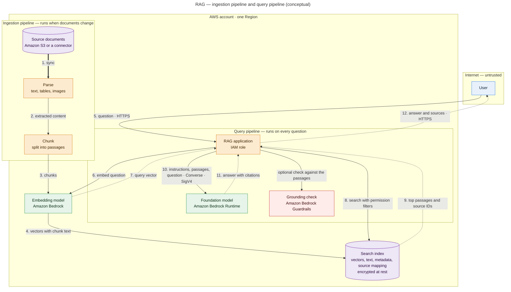

# Retrieval-augmented generation (RAG)

> **Level:** Beginner · **Verified:** 2026-11-15 · **Feature status:** n/a · **Time:** ~20 min

Retrieval-augmented generation is how a model answers from *your* documents without being retrained. This chapter separates the two pipelines every RAG system has, explains chunking, grounding and citations, and lists the ways RAG fails — because most of them are not the model's fault.

## Learning objectives

After this chapter you can:

- Explain what RAG adds to a foundation model and what it does not.
- Draw the ingestion pipeline and the query pipeline and say when each runs.
- Choose a chunking strategy and explain the trade-off between small and large chunks.
- Explain grounding and citations and how they are checked.
- Diagnose a wrong answer by locating the failing stage.

## Prerequisites

- [Tokens, context windows, and training versus inference](02-tokens-context-windows-inference.md)
- [Embeddings, vector search, semantic search and hybrid search](03-embeddings-and-vector-search.md)

## Concept in plain language

Think of an open-book exam. The student (the model) is clever and articulate but has not read your company's handbook. So you add a librarian. When a question arrives, the librarian fetches the few most relevant pages and puts them on the student's desk. The student writes the answer from those pages and notes which page each statement came from.

Two jobs keep this working. **Stocking the library** happens ahead of time: documents are collected, cut into passages and filed so they can be found. **Answering a question** happens on demand: find passages, hand them over, write the answer. If the library is badly stocked, the student has no chance — however clever.

That is all RAG is: *retrieve* relevant text, *augment* the prompt with it, let the model *generate* the answer.

## How it really works

### Why retrieval is needed

A foundation model has two kinds of knowledge. What it learned in training is frozen in its parameters; what you put in the context window is available for one request. The original RAG paper calls these parametric memory and non-parametric memory and combines them ([Lewis et al.](https://arxiv.org/abs/2005.11401)). RAG addresses the problems AWS lists for models used alone: presenting false information when the model has no answer, out-of-date or generic information, and answers from non-authoritative sources ([What is RAG?](https://aws.amazon.com/what-is/retrieval-augmented-generation/)).

> [!NOTE]
> **Documented fact** — Amazon Bedrock defines RAG as three steps: "Querying and retrieving information from a data source", "Augmenting a prompt with this information to provide better context to the foundation model", and "Obtaining a better response from the foundation model using the additional context".
> Source: [Key terminology](https://docs.aws.amazon.com/bedrock/latest/userguide/key-definitions.html)

### Two pipelines

| | Ingestion pipeline | Query pipeline |
|:--|:--|:--|
| Runs | When documents are added, changed or deleted | On every question |
| Latency budget | Minutes to hours | Seconds |
| Steps | Connect → parse → chunk → embed → index | Embed question → retrieve → rerank → build prompt → generate → cite |
| Output | A searchable index that maps every chunk to its source document | An answer with citations |
| Typical failure | Missing, stale or badly split content | Wrong passages, or an answer that ignores them |

Ingestion converts each document to text, splits it into chunks, embeds every chunk and writes it to an index "while maintaining a mapping to the original document". At query time the question is embedded with the same model, the index returns similar chunks, and "the user prompt is augmented with the additional context from the chunks" before it is sent to the model ([How knowledge bases work](https://docs.aws.amazon.com/bedrock/latest/userguide/kb-how-it-works.html)).

Ingestion is not a one-off. When files change the data source must be synchronised again; Amazon Bedrock syncs incrementally and re-parses, re-chunks, re-embeds and re-indexes only what changed ([Sync your data](https://docs.aws.amazon.com/bedrock/latest/userguide/kb-data-source-sync-ingest.html)).

### Chunking

A chunk is the unit that gets embedded, retrieved and pasted into the prompt. Chunk size is a trade-off in both directions.

| Chunks are… | Retrieval | Generation |
|:--|:--|:--|
| Small | Precise: one vector represents one idea | May lack the surrounding context needed to answer |
| Large | Blurry: one vector averages several ideas | More context, but more tokens and more noise |

| Strategy | How it splits | Use when |
|:--|:--|:--|
| Fixed-size with overlap | A set number of tokens per chunk, with a percentage repeated between neighbours | A predictable baseline |
| Default (Amazon Bedrock) | Chunks of approximately 300 tokens that keep sentences whole | You have no reason to choose otherwise |
| Hierarchical | Small child chunks for matching, replaced by their larger parent chunk when returned | Precise matching *and* broad context are both needed |
| Semantic | Boundaries placed where the meaning of neighbouring sentences diverges | Documents mix topics without clear structure |
| None | One chunk per file | You split the documents yourself beforehand |

Source for the table: [How content chunking works for knowledge bases](https://docs.aws.amazon.com/bedrock/latest/userguide/kb-chunking.html). Which strategies you can choose depends on the type of knowledge base.

### Grounding and citations

An answer is **grounded** when every statement in it is supported by the retrieved passages. A **citation** links a statement to the passage, and through the stored mapping to the source document, so a reader can check it.

Grounding is requested in the prompt and verified afterwards:

- **Instruct:** tell the model to answer only from the supplied passages, to cite them, and to say when they do not contain the answer.
- **Verify:** compare the answer with the passages. Amazon Bedrock Guardrails offers a contextual grounding check that scores *grounding* ("any new information introduced in the response will be considered un-grounded") and *relevance* to the question ([contextual grounding check](https://docs.aws.amazon.com/bedrock/latest/userguide/guardrails-contextual-grounding-check.html)).
- **Measure:** in evaluation, track faithfulness, citation precision and citation coverage — see [Model evaluation and model selection](07-model-evaluation-and-selection.md).

Citations do not make an answer true. They make it *checkable*.

### Typical failure modes

| Stage | Failure | Symptom | Mitigation |
|:--|:--|:--|:--|
| Parse | Tables, scanned pages or layout are lost | Numbers are wrong or missing | Use a parser suited to the file type; inspect the extracted text |
| Chunk | The answer is split across chunks, or a chunk has lost its heading | Partial or out-of-context answers | Overlap, hierarchical chunks, keep titles with the text |
| Sync | The index is older than the documents | Confident, outdated answers | Sync on change or on a schedule; show document dates |
| Retrieve | The right passage is not in the results | "I don't know", or a guess | Hybrid search, query rewriting, better chunking |
| Retrieve | Too many weak passages | Vague answers, higher cost | Rerank, return fewer passages, filter by metadata |
| Retrieve | A single search cannot answer a multi-part question | Half an answer | Decompose the question; agentic retrieval |
| Generate | The model overlooks a passage in a long context | The answer contradicts a retrieved passage | Fewer, better-ordered passages |
| Generate | The model answers from its own memory | Fluent statements with no source | Stricter instructions, grounding check, citations required |
| Access | Passages the user may not see are retrieved | Data leak in an answer | Permission filters applied in the store at query time |

The "overlooked passage" row is documented in research: model performance "is often highest when relevant information occurs at the beginning or end of the input context, and significantly degrades when models must access relevant information in the middle of long contexts" ([Liu et al.](https://arxiv.org/abs/2307.03172)). More retrieved text is not automatically better.

## Architecture diagram



**What this shows** — Two pipelines that share an embedding model and an index. The upper one prepares knowledge ahead of time; the lower one uses it for each question. This is a conceptual model, not an official AWS diagram.

**Walkthrough**

1. A sync job picks up new, changed and deleted documents.
2. Each document is parsed into text (and, for some parsers, tables and images).
3. The text is split into chunks.
4. Each chunk is embedded and stored with its text, metadata and a pointer to the source document.
5. A user asks a question.
6. The application sends the question to the same embedding model.
7. The model returns the query vector.
8. The application searches the index, restricted to what this user may see.
9. The index returns the best passages with their source identifiers.
10. The application builds a prompt — instructions, numbered passages, the question — and calls the model.
11. The model answers and cites the passages it used. The application can have the answer checked against the passages.
12. The application returns the answer with links to the sources.

**Legend** — solid arrow: request · dashed arrow: response · thick arrow: asynchronous job · cylinder: data store · boxes: trust boundaries.

**Variations** — With an Amazon Bedrock knowledge base, steps 1–4 and 6–9 are performed by the service, and with a Managed Knowledge Base AWS also operates the index. Agentic retrieval replaces steps 6–11 with a loop in which a model plans sub-queries, retrieves, judges whether the results are sufficient and repeats. See the matching diagram sets: [Knowledge Base ingestion pipeline](../../diagrams/mermaid/06-knowledge-base-ingestion-pipeline.md) and [Knowledge Base retrieval pipeline](../../diagrams/mermaid/07-knowledge-base-retrieval-pipeline.md).

## Implementation details

In the order a builder meets them:

1. **Decide who runs the pipelines.** Amazon Bedrock offers two knowledge base types; AWS recommends the Managed Knowledge Base, where it operates ingestion, storage, indexing and retrieval. A customer-managed knowledge base leaves the vector store and its configuration to you ([Knowledge Bases](https://docs.aws.amazon.com/bedrock/latest/userguide/knowledge-base.html)).
2. **Know which API matches which type.** `Retrieve` returns passages on both types. One-call answer generation is `RetrieveAndGenerate` on customer-managed knowledge bases only; on a Managed Knowledge Base it is `AgenticRetrieveStream` (verified in the [feature register](../../FEATURE-VERIFICATION.md#a4-knowledge-bases-and-retrieval)).
3. **Start with default chunking** and change it only when evaluation shows a chunking failure.
4. **Limit the passages.** A knowledge base query returns up to five results by default ([query configuration](https://docs.aws.amazon.com/bedrock/latest/userguide/kb-test-config.html)); raise the number deliberately.
5. **Write the prompt template yourself** when you call `Retrieve` and then the model: instructions first, numbered passages, the question last.
6. **Return sources to the user.** Keep the source identifier from retrieval all the way to the user interface.
7. **Schedule synchronisation** and monitor it like any other data pipeline.

> [!TIP]
> **Academy recommendation** — When an answer is wrong, look at the retrieved passages before you touch the prompt or the model. If the right passage was not retrieved, no prompt can fix it. This is our design guidance, not an official AWS reference architecture.

**When not to use RAG:** when the knowledge fits comfortably in the prompt, when the task needs a skill or style rather than facts (see [Fine-tuning and model customization](05-fine-tuning-and-customization.md)), or when the answer lives in a structured database that should be queried, not searched.

### Where this shows up in Amazon Bedrock

- [Knowledge Bases overview: managed versus customer-managed](../../01-amazon-bedrock/knowledge-bases/01-knowledge-bases-overview.md) — the two types and their APIs.
- [Managed Knowledge Base](../../01-amazon-bedrock/knowledge-bases/02-managed-knowledge-base.md) and [Customer-managed knowledge bases and vector stores](../../01-amazon-bedrock/knowledge-bases/03-customer-managed-knowledge-bases.md).
- [Ingestion, parsing and chunking](../../01-amazon-bedrock/knowledge-bases/04-ingestion-parsing-chunking.md) — the ingestion pipeline in detail.
- [Retrieval, reranking and metadata filtering](../../01-amazon-bedrock/knowledge-bases/05-retrieval-reranking-filtering.md) — the query pipeline in detail.
- [Agentic retrieval with AgenticRetrieveStream](../../01-amazon-bedrock/agentic-retrieval/01-agentic-retrieval.md) — multi-step retrieval.
- [Amazon Bedrock Guardrails](../../01-amazon-bedrock/guardrails/01-guardrails.md) — contextual grounding checks.
- [Model and RAG evaluation](../../01-amazon-bedrock/model-evaluation/01-model-evaluation.md) — measuring retrieval and generation.
- Practice: [Lab 5: design a RAG pipeline](../../labs/lab-05-design-a-rag-pipeline.md) and [Pattern: enterprise RAG](../../03-architecture-patterns/enterprise-rag/README.md).

## Example

> **Code status:** syntax-checked and run locally (no AWS calls) · **never deployed**

The "augment" step is ordinary string handling. This example builds a grounded prompt from passages that a retriever has already returned; the passages and paths are invented.

```python
"""Build a grounded, citable prompt from retrieved passages."""

SYSTEM_PROMPT = (
    "Answer using only the numbered sources. "
    "Cite the source number in square brackets after each statement, for example [2]. "
    "If the sources do not contain the answer, reply: I cannot answer from the provided documents."
)


def build_user_message(question: str, passages: list[dict], max_passages: int = 3) -> str:
    """passages: best first; each has 'text' and 'source'."""
    lines = ["Sources:"]
    for number, passage in enumerate(passages[:max_passages], start=1):
        lines.append(f"[{number}] ({passage['source']}) {passage['text']}")
    lines += ["", f"Question: {question}"]
    return "\n".join(lines)


retrieved = [
    {"source": "policies/refunds.pdf, page 2",
     "text": "Refunds are issued to the original payment method after the returned item is received."},
    {"source": "policies/returns.pdf, page 1",
     "text": "Items can be returned within the return period shown on the order confirmation."},
    {"source": "faq/shipping.md",
     "text": "Standard shipping is free for orders above the threshold shown at checkout."},
    {"source": "faq/opening-hours.md", "text": "The support desk is closed on public holidays."},
]

print(build_user_message("How do I get a refund?", retrieved))
```

Output:

```text
Sources:
[1] (policies/refunds.pdf, page 2) Refunds are issued to the original payment method after the returned item is received.
[2] (policies/returns.pdf, page 1) Items can be returned within the return period shown on the order confirmation.
[3] (faq/shipping.md) Standard shipping is free for orders above the threshold shown at checkout.

Question: How do I get a refund?
```

Send `SYSTEM_PROMPT` as the system prompt and this text as the user message with the Converse API. Because the sources are numbered, a citation such as `[1]` in the answer can be mapped back to a document.

## Common mistakes

> [!WARNING]
> **Common mistake** — Tuning the prompt when retrieval is the problem. If the passage that contains the answer never reaches the model, the model can only refuse or invent. Log the retrieved passages for every answer and read them first.

| Mistake | Symptom | Fix |
|:--|:--|:--|
| Never re-syncing | Answers quote superseded documents | Sync on change; monitor ingestion |
| Retrieving many passages "to be safe" | Slow, expensive, vaguer answers | Rerank and keep a few |
| No instruction for the "not found" case | The model fills gaps from its own memory | Tell it what to say when sources are insufficient |
| Dropping source identifiers | No way to cite or audit | Carry source IDs from the index to the user interface |
| One index for everyone, no filters | Users see content they should not | Permission-aware retrieval |
| Judging quality by a few manual questions | Regressions go unnoticed | A fixed evaluation set for retrieval and for answers |

## Security considerations

- **Retrieval must respect permissions.** Enforce access in the store with filters or document-level access control; a passage that reaches the prompt can appear in the answer.
- **Documents are untrusted input.** Text inside a retrieved document can contain instructions aimed at the model (indirect prompt injection). See [Prompt injection, untrusted tool output and retrieval poisoning](../../06-security-governance/04-prompt-injection-and-untrusted-content.md).
- **The index and the logs hold your data.** Encrypt the index, and remember that logged prompts now contain document excerpts. See [Data protection, privacy and data leakage prevention](../../06-security-governance/03-data-protection-and-privacy.md).
- **Citations support audit.** Storing which passages produced which answer gives you evidence when an answer is challenged.

## Cost considerations

- **Ingestion:** parsing and embedding every chunk, repeated for changed documents. Parsers and chunkers that call a foundation model add inference cost.
- **Storage:** the index — vectors, text and metadata.
- **Per question:** one embedding call, one retrieval, optionally one rerank, and one generation call whose input is dominated by the retrieved passages. Halving the passages roughly halves the input tokens.
- **Managed Knowledge Base** is priced on different dimensions — data stored and retrieval calls — with managed parsing, embedding and reranking not charged separately; see the [feature register](../../FEATURE-VERIFICATION.md#a4-knowledge-bases-and-retrieval) and confirm figures on the [Amazon Bedrock pricing page](https://aws.amazon.com/bedrock/pricing/).

## Knowledge check

1. Which pipeline do you investigate first when an answer cites a policy that was replaced last month?
2. A user asks "Which of our two warranty plans is cheaper for a three-year-old device?" and gets an answer about only one plan. Which failure mode is this, and what helps?
3. What would happen if you doubled the chunk size without changing anything else?
4. Why is a cited answer not necessarily a correct answer?

<details>
<summary>Answers</summary>

1. Ingestion. The index is stale: the new document was not synchronised, or the old one was not removed.
2. A single retrieval did not cover both parts of the question. Decompose the question into sub-queries (agentic retrieval does this) or retrieve more diverse passages.
3. Each vector would represent more text, so matching becomes less precise; each retrieved passage would cost more tokens and may bury the relevant sentence. Whether answers improve must be measured.
4. A citation only shows where a statement is claimed to come from. The model can cite a passage that does not support the statement, and the source itself can be wrong. Citation precision and faithfulness have to be evaluated.

</details>

## Further reading

Official sources opened while writing this chapter:

- [What is RAG?](https://aws.amazon.com/what-is/retrieval-augmented-generation/) — motivation and the conceptual flow.
- [Key terminology](https://docs.aws.amazon.com/bedrock/latest/userguide/key-definitions.html) — Bedrock's definition of RAG.
- [Retrieve data and generate AI responses with Amazon Bedrock Knowledge Bases](https://docs.aws.amazon.com/bedrock/latest/userguide/knowledge-base.html) — the two knowledge base types.
- [How Amazon Bedrock knowledge bases work](https://docs.aws.amazon.com/bedrock/latest/userguide/kb-how-it-works.html) — pre-processing and runtime execution.
- [How content chunking works for knowledge bases](https://docs.aws.amazon.com/bedrock/latest/userguide/kb-chunking.html) — chunking strategies.
- [Sync your data with your Amazon Bedrock knowledge base](https://docs.aws.amazon.com/bedrock/latest/userguide/kb-data-source-sync-ingest.html) — incremental sync.
- [Configure and customize queries and response generation](https://docs.aws.amazon.com/bedrock/latest/userguide/kb-test-config.html) — number of results, search type, filters.
- [Build a managed knowledge base](https://docs.aws.amazon.com/bedrock/latest/userguide/kb-build-managed.html) — managed versus customer-managed.
- [Use agentic retrieval to query a knowledge base](https://docs.aws.amazon.com/bedrock/latest/userguide/kb-test-agentic-retrieve.html) — planning, iteration and response generation.
- [Use contextual grounding check to filter hallucinations in responses](https://docs.aws.amazon.com/bedrock/latest/userguide/guardrails-contextual-grounding-check.html) — grounding and relevance.
- [Use metrics to understand RAG system performance](https://docs.aws.amazon.com/bedrock/latest/userguide/knowledge-base-evaluation-metrics.html) — faithfulness and citation metrics.
- [Retrieval-Augmented Generation for Knowledge-Intensive NLP Tasks](https://arxiv.org/abs/2005.11401) — the RAG paper (conceptual background).
- [Lost in the Middle: How Language Models Use Long Contexts](https://arxiv.org/abs/2307.03172) — position effects in long contexts (conceptual background).
