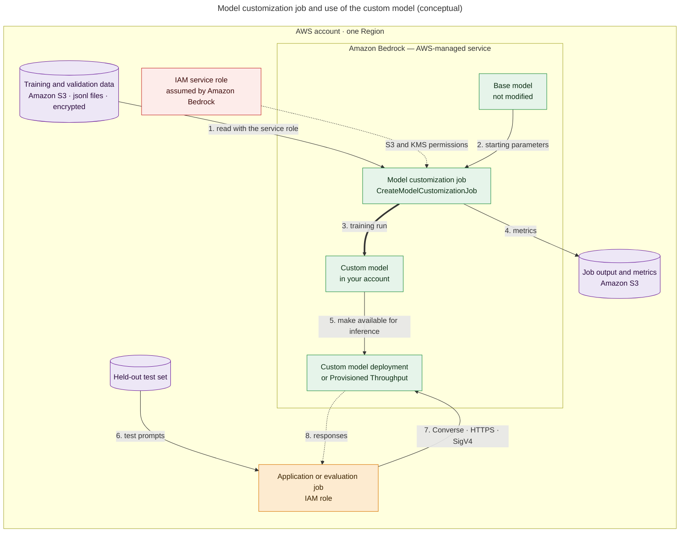

# Fine-tuning and model customization

> **Level:** Beginner · **Verified:** 2026-11-15 · **Feature status:** n/a · **Time:** ~20 min

Prompting and retrieval change what a model *reads*. Customization changes the model *itself*. This chapter explains the difference, the four customization techniques you will hear about, what data each needs and what can go wrong — so that you reach for training only when it is the right tool.

## Learning objectives

After this chapter you can:

- Choose between prompt engineering, RAG and customization for a given problem.
- Explain supervised fine-tuning, reinforcement fine-tuning, distillation and continued pre-training.
- State the current Amazon Bedrock status of each technique.
- Describe the data a customization job needs and how to prepare it.
- Name the main risks of a customized model and how to contain them.

## Prerequisites

- [Tokens, context windows, and training versus inference](02-tokens-context-windows-inference.md)
- [Retrieval-augmented generation (RAG)](04-rag-fundamentals.md)

## Concept in plain language

You have hired a capable generalist. There are three ways to get better work from them.

- **Give better instructions.** Explain the task, show two good examples, describe the format. This is *prompt engineering*. It takes minutes and changes nothing about the person.
- **Hand over the right documents at the right moment.** This is *RAG*. The person is the same; they are simply better informed for this task.
- **Send them on a course.** This is *customization*. They come back changed: a new habit, a house style, a specialist skill. It takes time and money, and what they learned is fixed until the next course.

Courses come in several kinds. In **supervised fine-tuning** a teacher shows worked examples: this question, that answer. In **reinforcement fine-tuning** a coach does not show the answer but scores each attempt. In **distillation** a senior expert answers many questions and a junior learns to imitate them, so the junior can do the routine work faster and cheaper. In **continued pre-training** the person simply reads a large pile of your domain's literature, with no questions asked.

## How it really works

### Three ways to adapt a model

| | Prompt engineering | RAG | Customization |
|:--|:--|:--|:--|
| What changes | The input | The input, with retrieved data | The model's parameters |
| You need | Well-written instructions and examples | A searchable, current corpus | A training dataset or a reward function, plus an evaluation set |
| Best for | Task definition, tone, output format | Facts that are private or change | Consistent behaviour, style or task skill that instructions cannot achieve; a smaller, cheaper model for a narrow task |
| Poor fit for | Knowledge the model does not have | Teaching a skill or style | Facts that change — they are frozen at training time |
| Time to change | Minutes | The next sync | A new training job |
| Result | Same model | Same model | A new, private model that you must serve and maintain |

Prompt engineering is "the practice of optimizing textual input to a Large Language Model (LLM) to obtain desired responses" ([Prompt engineering concepts](https://docs.aws.amazon.com/bedrock/latest/userguide/prompt-engineering-guidelines.html)). Model customization is "the process of using training data to adjust the model parameter values in a base model to create a custom model" ([Key terminology](https://docs.aws.amazon.com/bedrock/latest/userguide/key-definitions.html)). The techniques combine: a fine-tuned model still takes a prompt and can still be used with retrieval.

> [!TIP]
> **Academy recommendation** — Work in order of cost: improve the prompt, then add retrieval, then consider customization — and measure with the same evaluation set at every step. This is our design guidance, not an official AWS reference architecture.

### The customization techniques

| Technique | You provide | Training signal | Amazon Bedrock status (register, 2026-11-15) |
|:--|:--|:--|:--|
| Supervised fine-tuning | Labelled examples: an input and the output you want | The gap between the model's output and your label | GA · per model |
| Reinforcement fine-tuning | Prompts and a reward function that scores responses | The score each generated response receives | GA · per model |
| Distillation | Prompts, a teacher model and a student model | The teacher's responses to your prompts | GA · per model |
| Continued pre-training | A large body of unlabelled domain text | Next-token prediction, as in pre-training | **UNVERIFIED** — see below |

Statuses are taken from the [feature register](../../FEATURE-VERIFICATION.md#a2-models-access-and-customization). "Per model" means each technique is available only for specific models and Regions.

**Supervised fine-tuning.** The job runs further training passes (epochs) over your examples, starting from the base model's parameters. In AWS's words, "the model learns to associate what types of outputs should be generated for certain types of inputs. The model parameters are adjusted in the process" ([Customize your model](https://docs.aws.amazon.com/bedrock/latest/userguide/custom-models.html)). Settings such as the number of epochs are **hyperparameters**: values that control the training process.

**Reinforcement fine-tuning.** Use it when you can *score* an answer more easily than you can *write* the ideal one. The model generates several responses per prompt, a reward function grades them, and the model is updated to earn higher rewards. On Amazon Bedrock the reward function is code in AWS Lambda or a judge model, and training uses Group Relative Policy Optimization ([reinforcement fine-tuning](https://docs.aws.amazon.com/bedrock/latest/userguide/reinforcement-fine-tuning.html)).

**Distillation.** A large "teacher" model produces answers; a smaller "student" is fine-tuned on them, so that it approaches the teacher's quality on your task at lower cost and latency. The idea is older than LLMs ([Hinton et al.](https://arxiv.org/abs/1503.02531)). On Amazon Bedrock you supply prompts — or existing invocation logs — and the service generates the teacher responses, may add synthetic data, and fine-tunes the student ([model distillation](https://docs.aws.amazon.com/bedrock/latest/userguide/model-distillation.html)).

**Continued pre-training.** Conceptually this continues the original self-supervised training on unlabelled text from your domain, so the model absorbs vocabulary and style without task labels. Its status on Amazon Bedrock is **UNVERIFIED — REQUIRES DOCUMENTATION REVIEW**: on the verification date the customization overview page listed three methods (supervised fine-tuning, reinforcement fine-tuning and distillation) and did not mention continued pre-training, and no AWS deprecation notice was found. It is open item U1 in the [feature register](../../FEATURE-VERIFICATION.md#open-items--unverified). Do not plan on it without checking the current documentation.

### Data requirements

| Requirement | Why |
|:--|:--|
| Representative | Examples must look like real production inputs, including the awkward ones |
| Consistent | Contradictory labels teach the model to be inconsistent |
| Separated | Training, validation and test sets must not share examples, or your metrics will flatter the model |
| Clean | Personal data, secrets and anything you may not use for training must be removed first |
| Correctly formatted | The record layout depends on the technique and the model |

> [!NOTE]
> **Documented fact** — Training and validation datasets are `.jsonl` files, "where each line is a JSON object corresponding to a record". You must prepare at least a training dataset; whether a validation dataset is supported, and the record format, depend on the type of customization job and on the model.
> Source: [Prepare data for fine-tuning your models](https://docs.aws.amazon.com/bedrock/latest/userguide/model-customization-prepare.html)

Volume depends on the technique and the task; there is no universal number. For reinforcement fine-tuning AWS advises to "begin with 100-200 examples, validate reward function correctness, and scale gradually" ([reinforcement fine-tuning](https://docs.aws.amazon.com/bedrock/latest/userguide/reinforcement-fine-tuning.html)).

### Risks

| Risk | What you see | Containment |
|:--|:--|:--|
| Overfitting | Excellent on training examples, worse on new inputs | Validation set, fewer epochs, more varied data |
| Lost general ability | The model gets worse at tasks outside the training data | Keep a broad regression set in your evaluation |
| Memorised training data | The model reproduces sensitive examples | Scrub the data; restrict who may invoke the model |
| Frozen facts | Answers are right for the day the data was collected | Keep changing facts in retrieval, not in parameters |
| Reward gaming | Rewards rise while real quality does not | Test the reward function; review samples by hand |
| Inherited errors | A distilled student repeats the teacher's mistakes | Evaluate the teacher on your task first |
| Lifecycle | The base model becomes Legacy and can no longer be fine-tuned | Keep data and pipeline reproducible so you can retrain on a newer base |

Two rows are documented. Overfitting appears in the reinforcement fine-tuning best practices as "training rewards increase while validation rewards decrease". The lifecycle row comes from the lifecycle policy: once a base model is in the Legacy state "you cannot create new fine-tuning jobs on that model" ([Model lifecycle](https://docs.aws.amazon.com/bedrock/latest/userguide/model-lifecycle.html)). **Our reading:** the other rows are general machine-learning practice rather than statements from the Amazon Bedrock documentation.

## Architecture diagram



**What this shows** — Customization is a batch job that turns your data and a base model into a new model, which then has to be made available for inference and evaluated before anyone relies on it. This is a conceptual model, not an official AWS diagram.

**Walkthrough**

1. The job reads training (and, where supported, validation) files from Amazon S3 using an IAM role that Amazon Bedrock assumes.
2. Training starts from the base model's parameters. The base model in the catalog is not changed.
3. The training run produces a custom model.
4. The job writes its output data to Amazon S3.
5. The custom model is made available for inference: through a custom model deployment for on-demand inference, or through Provisioned Throughput.
6. Prompts from a test set the model has never seen are prepared.
7. The application or an evaluation job calls the custom model.
8. Responses are compared with the base model's results before release.

**Legend** — solid arrow: request or data flow · dashed arrow: response or permission · thick arrow: long-running job · cylinder: data store · boxes: trust boundaries.

**Variations** — For distillation, step 1 can read prompts from model invocation logs, and the job also calls the teacher model. For reinforcement fine-tuning, the job additionally invokes your reward function. Which serving option exists in step 5 depends on the model; a model trained elsewhere is brought in through Custom Model Import instead of a customization job.

## Implementation details

In the order a builder meets them:

1. **Prove the need.** Record the best result you can reach with prompting and retrieval on a fixed evaluation set. That number is the baseline a custom model has to beat.
2. **Check support.** Each technique works only with specific base models in specific Regions; the documentation lists them per technique.
3. **Prepare data** in the format for your technique and model, and put it in Amazon S3.
4. **Create the IAM service role.** It needs a trust policy for Amazon Bedrock and access to the buckets; AWS documents conditions such as `aws:SourceAccount` to prevent the confused-deputy problem ([service role for model customization](https://docs.aws.amazon.com/bedrock/latest/userguide/model-customization-iam-role.html)).
5. **Run the job** and watch training and validation metrics.
6. **Serve the model.** In an inference request you pass "the ARN of the custom model deployment (for on-demand inference) or the ARN of your provisioned model (for Provisioned Throughput)" ([Converse API reference](https://docs.aws.amazon.com/bedrock/latest/APIReference/API_runtime_Converse.html)).
7. **Evaluate against the baseline**, then plan retraining: your data will change and the base model will eventually be retired.

### Where this shows up in Amazon Bedrock

- [Model customization: fine-tuning, reinforcement fine-tuning and distillation](../../01-amazon-bedrock/foundation-models/03-model-customization.md) — the jobs, supported models and IaC.
- [Custom Model Import and on-demand custom model deployment](../../01-amazon-bedrock/foundation-models/04-custom-model-import.md) — serving custom and imported models.
- [Provisioned Throughput](../../01-amazon-bedrock/inference/07-provisioned-throughput.md) — the other way to serve a custom model.
- [Prompt optimization](../../01-amazon-bedrock/prompt-management/02-prompt-optimization.md) — improving prompts before you train.
- [Model and RAG evaluation](../../01-amazon-bedrock/model-evaluation/01-model-evaluation.md) — comparing a custom model with its base.
- [Model lifecycle and selection](../../01-amazon-bedrock/foundation-models/02-model-lifecycle-and-selection.md) — what Legacy status means for custom models.
- Decision guide: [RAG versus fine-tuning versus long-context inference](../../09-advanced-topics/01-rag-vs-fine-tuning-vs-long-context.md).

## Example

> **Code status:** syntax-checked and run locally (no AWS calls) · **never deployed**

Data preparation is where most customization projects succeed or fail. This example removes duplicates and assigns each example to a training, validation or test set by hashing its input, so the same input can never end up in two sets — even when the dataset grows later. The record shape is generic; convert to the layout your model requires as the last step.

```python
"""Split labelled examples into training, validation and test sets without leakage."""
import hashlib
import json


def fingerprint(text: str) -> str:
    normalised = " ".join(text.lower().split())
    return hashlib.sha256(normalised.encode("utf-8")).hexdigest()


def split(examples: list[dict], validation_share: float = 0.15, test_share: float = 0.15) -> dict:
    sets: dict[str, list[dict]] = {"train": [], "validation": [], "test": []}
    seen: set[str] = set()
    for example in examples:
        key = fingerprint(example["input"])
        if key in seen:  # duplicate input: keep the first one only
            continue
        seen.add(key)
        position = int(key[:8], 16) / 0xFFFFFFFF  # stable number between 0 and 1
        if position < test_share:
            sets["test"].append(example)
        elif position < test_share + validation_share:
            sets["validation"].append(example)
        else:
            sets["train"].append(example)
    return sets


examples = [{"input": f"Classify ticket number {n}", "output": "billing" if n % 2 else "technical"}
            for n in range(1, 41)]
examples.append({"input": "classify  ticket number 7", "output": "billing"})  # near-duplicate

sets = split(examples)
print({name: len(items) for name, items in sets.items()})
print(json.dumps(sets["train"][0]))
```

Output:

```text
{'train': 27, 'validation': 7, 'test': 6}
{"input": "Classify ticket number 1", "output": "billing"}
```

## Common mistakes

> [!WARNING]
> **Common mistake** — Fine-tuning to teach the model facts. The facts are frozen on the day the dataset was built, cannot be cited, and need a new training job to correct. Put facts in retrieval; use customization for behaviour.

| Mistake | Symptom | Fix |
|:--|:--|:--|
| No baseline | Nobody can say whether the custom model is better | Evaluate prompt-only and RAG variants first, on the same set |
| Test examples also in training data | Impressive metrics, disappointing production | Split before training and keep the test set untouched |
| Training on unreviewed production logs | The model learns existing mistakes and may memorise personal data | Curate and scrub |
| Treating the custom model as finished | Quality drifts as inputs change; the base model is retired | Schedule re-evaluation and retraining |
| Forgetting serving cost | A cheap training job followed by an expensive always-on deployment | Cost the whole lifecycle before you start |
| A reward function that is easy to satisfy | High reward, poor answers | Test the reward function on good and bad answers first |

## Security considerations

- **Training data is the crown jewels in concentrated form.** Encrypt the bucket, restrict access, and remove personal data and secrets before training — a model can reproduce what it was trained on.
- **The service role is a trust decision.** Limit it to the specific buckets and use the confused-deputy conditions AWS documents.
- **A custom model is derived data.** Control who can invoke it with IAM, and decide who may delete or copy it.
- **Your data stays yours.** For distillation, AWS states: "Only you can access the final distilled model. Amazon Bedrock doesn't use your data to train any other teacher or student model for public use."
- **Logs used as training data** contain real prompts and responses; apply the same controls to them. See [Data protection, privacy and data leakage prevention](../../06-security-governance/03-data-protection-and-privacy.md).

## Cost considerations

- **Training:** "You are charged for model training based on the number of tokens processed by the model (number of tokens in training data corpus × number of epochs)" — in symbols, `tokens × epochs × P_train`. Reinforcement fine-tuning is listed with an hourly training rate instead.
- **Storage:** a monthly charge per custom model.
- **Distillation extras:** when the service generates teacher responses, those inference calls are billed at the teacher model's on-demand rate.
- **Serving:** per token through an on-demand deployment where available, or per hour through Provisioned Throughput.
- **Recurring work:** every retraining repeats the training cost and the evaluation effort.

Take all prices from the [Amazon Bedrock pricing page](https://aws.amazon.com/bedrock/pricing/); they differ by model.

## Knowledge check

1. A support chatbot gives outdated delivery times. A colleague proposes fine-tuning on last month's tickets. What do you recommend instead, and why?
2. You can write a program that checks whether generated SQL runs and returns the expected rows, but you have few hand-written reference queries. Which technique fits?
3. What would happen to your metrics if 20% of the test examples were also in the training set?
4. A large model gives excellent answers for one narrow task but is too slow and expensive at your volume. Which technique addresses this, and what is its main risk?
5. What is the Amazon Bedrock status of continued pre-training in this course?

<details>
<summary>Answers</summary>

1. Retrieval. Delivery times are facts that change; RAG serves the current value and can cite it. Fine-tuning would freeze last month's values into the model.
2. Reinforcement fine-tuning: the program is a reward function, and no labelled outputs are required.
3. They would be too optimistic, because the model has already seen those answers. The measured quality would not predict production quality.
4. Distillation into a smaller student model. The student inherits the teacher's errors and only matches it on the kind of prompts it was trained with, so evaluate both.
5. UNVERIFIED. It is not listed on the customization overview page and no deprecation notice was found, so the register treats it as an open item.

</details>

## Further reading

Official sources opened while writing this chapter:

- [Customize your model to improve its performance for your use case](https://docs.aws.amazon.com/bedrock/latest/userguide/custom-models.html) — the customization methods Amazon Bedrock currently lists, and how training is charged.
- [Customize a model with fine-tuning](https://docs.aws.amazon.com/bedrock/latest/userguide/custom-model-fine-tuning.html) — supported models and Regions.
- [Customize a model with reinforcement fine-tuning](https://docs.aws.amazon.com/bedrock/latest/userguide/reinforcement-fine-tuning.html) — how it works and best practices.
- [Customize a model with distillation](https://docs.aws.amazon.com/bedrock/latest/userguide/model-distillation.html) — teacher, student and synthetic data.
- [Prepare data for fine-tuning your models](https://docs.aws.amazon.com/bedrock/latest/userguide/model-customization-prepare.html) — dataset files and formats.
- [Create a service role for model customization](https://docs.aws.amazon.com/bedrock/latest/userguide/model-customization-iam-role.html) — trust policy and permissions.
- [Key terminology](https://docs.aws.amazon.com/bedrock/latest/userguide/key-definitions.html) — model customization and hyperparameters.
- [Prompt engineering concepts](https://docs.aws.amazon.com/bedrock/latest/userguide/prompt-engineering-guidelines.html) — what prompt engineering is.
- [Model lifecycle](https://docs.aws.amazon.com/bedrock/latest/userguide/model-lifecycle.html) — customized models when the base model becomes Legacy.
- [Converse API reference](https://docs.aws.amazon.com/bedrock/latest/APIReference/API_runtime_Converse.html) — how a custom model is addressed at inference time.
- [Increase model invocation capacity with Provisioned Throughput](https://docs.aws.amazon.com/bedrock/latest/userguide/prov-throughput.html) — serving by the hour.
- [Amazon Bedrock pricing](https://aws.amazon.com/bedrock/pricing/) — customization and storage prices.
- [Distilling the Knowledge in a Neural Network](https://arxiv.org/abs/1503.02531) — the distillation paper (conceptual background).
