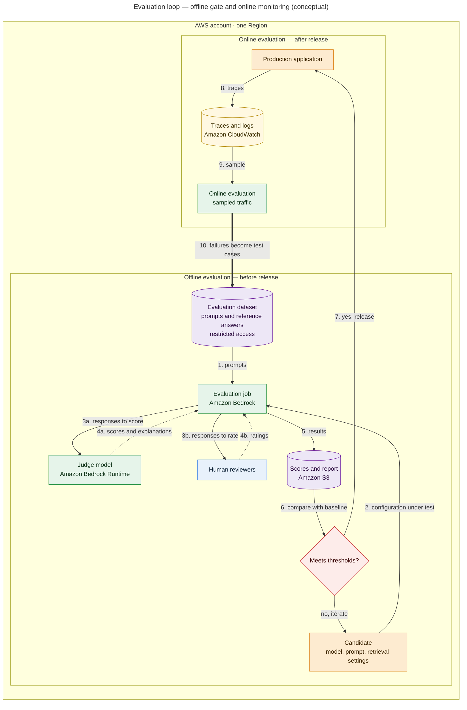

# Model evaluation and model selection

> **Level:** Beginner · **Verified:** 2026-11-15 · **Feature status:** n/a · **Time:** ~20 min

"Which model should we use?" and "did that change make it better?" are the same question: both need a repeatable measurement. This chapter covers how generative AI output is measured — automatically, by another model, and by people — and how to turn measurements and constraints into a model choice you can defend.

## Learning objectives

After this chapter you can:

- Distinguish offline from online evaluation and say what each is for.
- Choose between automatic metrics, an LLM judge and human review.
- Evaluate a RAG system by measuring retrieval and generation separately.
- List the criteria for selecting a model and separate hard constraints from trade-offs.
- Build and read a weighted decision matrix.

## Prerequisites

- [Generative AI, foundation models and LLMs](01-generative-ai-and-foundation-models.md)
- [Tokens, context windows, and training versus inference](02-tokens-context-windows-inference.md)
- [Retrieval-augmented generation (RAG)](04-rag-fundamentals.md)

## Concept in plain language

Choosing a model is like hiring. A public benchmark is a CV: useful for a shortlist, but it describes someone else's tasks. What you trust is a **work-sample test** — your own tasks, the same for every candidate, marked the same way. That is *offline evaluation*. After hiring comes the **probation period**: you watch real work, because real customers ask things your test never imagined. That is *online evaluation*.

Marking can be done three ways. An **answer key** is fast and cheap but only works when answers are short and unambiguous. A **senior colleague** can mark essays against a rubric quickly and at scale — in our case a second model, the *judge*. A **panel of experts** is slow and expensive and is the standard that the other two are checked against.

Finally, some requirements are not negotiable. A candidate who cannot legally work in your country is out, however brilliant. Models have the same kind of pass-or-fail conditions, and they come before any scoring.

## How it really works

### Offline and online evaluation

| | Offline evaluation | Online evaluation |
|:--|:--|:--|
| When | Before release; on every change to model, prompt or retrieval | Continuously, in production |
| Data | A fixed dataset of prompts, usually with reference answers | Real traffic, usually sampled |
| Answers the question | "Is this version better than the last one?" | "Is it still good on what users actually ask?" |
| Strength | Repeatable and comparable; can block a release | Sees real inputs and drift |
| Weakness | Only as good as the dataset | No reference answers; issues are found after they occur |
| On AWS | Amazon Bedrock evaluation jobs | AgentCore Evaluations (online, on-demand and batch); A/B tests |

The two feed each other: every failure found online should become a test case in the offline dataset.

### Three ways to score

**Automatic (programmatic) metrics** compute a number from the output, usually by comparing it with a reference.

| Family | Example | What it tells you | Limit |
|:--|:--|:--|:--|
| Exact comparison | Accuracy, F1 | Whether a label or short answer is right | Closed answers only |
| Word overlap | n-gram overlap with a reference | Surface similarity | Penalises correct paraphrases |
| Embedding similarity | BERTScore | Semantic similarity to a reference | Needs a reference; a fluent wrong answer can still score well |
| Robustness | Change in score after small input changes | Stability | Says nothing about absolute quality |
| Safety | Toxicity score | Harmful content | Depends on the classifier used |

BERTScore exists because overlap metrics "often fail to robustly match paraphrases"; it compares tokens through contextual embeddings instead of exact matches ([Zhang et al.](https://arxiv.org/abs/1904.09675)). Amazon Bedrock's programmatic evaluation jobs group metrics as accuracy, robustness and toxicity, with a computed metric per task type — for example BERTScore for summarisation and F1 for question answering ([evaluation task types](https://docs.aws.amazon.com/bedrock/latest/userguide/model-evaluation-tasks.html)).

**LLM-as-judge** uses a second model to score a response against a rubric and explain the score. It handles open-ended answers that no formula can mark.

> [!NOTE]
> **Documented fact** — A judge-based evaluation "requires two different models, a generator model and an evaluator model". Built-in judge metrics in Amazon Bedrock include correctness, completeness, faithfulness, helpfulness, logical coherence, relevance, following instructions, professional style and tone, harmfulness, stereotyping and refusal; you can also define custom metrics.
> Source: [LLM as a judge](https://docs.aws.amazon.com/bedrock/latest/userguide/evaluation-judge.html), [judge metrics](https://docs.aws.amazon.com/bedrock/latest/userguide/model-evaluation-metrics.html)

A judge is itself a model: it varies between runs, can be wrong, and follows its rubric only as well as the rubric is written.

**Human evaluation** has people rate or compare outputs. In Amazon Bedrock the workers "can be employees of your company or a group of subject-matter experts from your industry" ([Evaluations](https://docs.aws.amazon.com/bedrock/latest/userguide/evaluation.html)). Use it for what only people can judge — tone, usefulness, domain correctness — and to check that your judge agrees with experts.

| | Automatic | LLM judge | Human |
|:--|:--|:--|:--|
| Cost per example | Lowest | Model inference | Highest |
| Speed | Fastest | Fast | Slowest |
| Open-ended answers | Poor | Good | Best |
| Repeatable | Yes | Mostly | Varies by reviewer |
| Typical role | Regression checks | Main quality signal | Calibration and sign-off |

### RAG-specific metrics

A RAG answer can be wrong because retrieval failed or because generation failed. Measure them separately; Amazon Bedrock offers "retrieve only" and "retrieve and generate" evaluation jobs for this reason ([RAG evaluation](https://docs.aws.amazon.com/bedrock/latest/userguide/evaluation-kb.html)).

| Stage | Metric | Question it answers |
|:--|:--|:--|
| Retrieval | Context relevance | Are the retrieved passages about the question? |
| Retrieval | Context coverage | Do they contain everything in the reference answer? (needs ground truth) |
| Generation | Correctness, completeness | Is the answer right, and does it cover all parts of the question? |
| Generation | Faithfulness | Does the answer avoid claims that the retrieved passages do not support? |
| Generation | Citation precision | Are the cited passages the right ones? |
| Generation | Citation coverage | Is every statement backed by a citation? |

Metric names follow [RAG evaluation metrics](https://docs.aws.amazon.com/bedrock/latest/userguide/knowledge-base-evaluation-metrics.html). For agents, the same principle extends to whole runs: AgentCore Evaluations scores sessions, traces and spans with LLM-as-judge evaluators.

### Model selection criteria

| Criterion | Question | Where the answer comes from | Kind |
|:--|:--|:--|:--|
| Capability | Is quality good enough on *our* task? | Your offline evaluation | Score |
| Context window | Do the largest input and the longest output fit? | Model card | Gate |
| Modality | Does it accept our inputs and produce our outputs? | Model card | Gate |
| Latency | Are time to first token and generation speed acceptable? | Your own measurement | Score, or gate for real-time use |
| Cost | What does one request cost at our token mix? | Pricing page and your token counts | Score |
| Region availability | Is it offered in our Region, or only through a cross-Region inference profile? | Model card | Gate |
| Data handling | Where may data be processed, and under which terms? | Cross-Region inference and data protection documentation; provider terms | Gate |
| Features | Tool use, streaming, prompt caching, customization? | Model card | Gate or score |
| Lifecycle | Is it Active, and for how long? | Model card | Gate |

The Amazon Bedrock documentation gives a shorter list with the same shape: capabilities, endpoint and API, Region, and cost and throughput ([Model availability and compatibility](https://docs.aws.amazon.com/bedrock/latest/userguide/models.html)).

Region and data handling are linked. A Geographic cross-Region inference profile keeps processing "within geographic boundaries (such as US, EU, and APAC)"; a Global profile can route to "any supported AWS commercial Region worldwide" ([Cross-Region inference](https://docs.aws.amazon.com/bedrock/latest/userguide/cross-region-inference.html)). If a model is offered only through a Global profile and your data must stay in one geography, the model fails the gate.

### The decision matrix

Apply gates first, then score what remains. The numbers below are **hypothetical** scores from 1 (worst) to 5 (best) for three invented candidates; replace them with your own measurements.

| Criterion | Weight | Model A (large) | Model B (medium) | Model C (small) |
|:--|--:|--:|--:|--:|
| Quality on our evaluation set | 0.40 | 5 | 4 | 3 |
| Latency | 0.20 | 2 | 4 | 5 |
| Cost | 0.25 | 1 | 3 | 5 |
| Features | 0.15 | 5 | 5 | 2 |
| **Weighted total** | 1.00 | **3.40** | **3.90** | **3.75** |

Model B wins although it is best at nothing. Change the weights — for example quality 0.60, latency 0.10, cost 0.15 and features 0.15 for a legal drafting assistant — and Model A wins, 4.10 against 4.00. The matrix does not make the decision; it makes the trade-off visible and repeatable.

## Architecture diagram



**What this shows** — Evaluation as a loop with a release gate in the middle. Offline evaluation decides whether a candidate may ship; online evaluation watches what shipped and feeds failures back into the dataset. This is a conceptual model, not an official AWS diagram.

**Walkthrough**

1. The evaluation dataset supplies prompts (and reference answers where they exist).
2. The candidate — one combination of model, prompt and retrieval settings — is what is under test.
3. The job generates responses and sends them (a) to a judge model and/or (b) to human reviewers. Programmatic metrics are computed by the job itself.
4. Scores, explanations and ratings come back.
5. Results are written to the Amazon S3 bucket you specify.
6. Results are compared with the current baseline and with fixed thresholds.
7. If the candidate passes, it is released; otherwise you change the candidate and run again.
8. The production application emits traces.
9. A sample of real interactions is scored without reference answers.
10. Interactions that scored badly are added to the dataset, so the next candidate is tested on them.

**Legend** — solid arrow: request or data flow · dashed arrow: response · thick arrow: feedback into the dataset · cylinder: data store · diamond: decision · boxes: trust boundaries.

**Variations** — You can evaluate responses produced outside Amazon Bedrock by supplying them in the dataset; the job then skips the generation step. For RAG, the candidate includes the knowledge base and the job type is retrieve-only or retrieve-and-generate. For agents, steps 8–9 are what AgentCore Evaluations performs on sessions, traces and spans.

## Implementation details

In the order a builder meets them:

1. **Write the dataset before you compare models.** Collect real or realistic prompts, cover the awkward cases, and add reference answers where there is one right answer. Examples chosen to cover the cases you care about are worth more than volume.
2. **Define "good" as thresholds**, per metric, before you look at results.
3. **Apply the gates** — modality, context window, Region, data handling, lifecycle — to cut the candidate list.
4. **Run the same evaluation for each candidate** and change one thing at a time: model *or* prompt *or* retrieval.
5. **Check the judge.** Have experts rate a sample and compare with the judge's scores before you trust it at scale.
6. **Fill in the matrix**, agree the weights with the people who own the product, and record the decision.
7. **Re-run on every change**, including model version upgrades forced by the model lifecycle.
8. **Watch production** with sampled online evaluation and feed failures back.

> [!TIP]
> **Academy recommendation** — Use a judge model that is different from, and at least as capable as, the model being judged, and keep judge prompt and judge model fixed between runs so that scores stay comparable. This is our design guidance, not an official AWS reference architecture.

**When one model is not the answer:** if easy and hard requests arrive on the same endpoint, routing can send each to a different model. Amazon Bedrock intelligent prompt routing does this between models of the same family; see [Model routing and fallback models](../../09-advanced-topics/10-model-routing-and-fallback.md).

### Where this shows up in Amazon Bedrock

- [Model and RAG evaluation](../../01-amazon-bedrock/model-evaluation/01-model-evaluation.md) — evaluation jobs: programmatic, judge, human and RAG.
- [AgentCore Evaluations and Optimization](../../01-amazon-bedrock/agentcore/10-agentcore-evaluations-and-optimization.md) — online evaluation and A/B tests for agents.
- [Model providers and the model catalog](../../01-amazon-bedrock/foundation-models/01-model-providers-and-catalog.md) — model cards, where the gates are checked.
- [Model lifecycle and selection](../../01-amazon-bedrock/foundation-models/02-model-lifecycle-and-selection.md) — lifecycle states and selection on Bedrock.
- [Cross-Region inference: Geo and Global profiles](../../01-amazon-bedrock/inference/04-cross-region-inference.md) — Region availability and where data is processed.
- [Service tiers: Reserved, Priority, Standard and Flex](../../01-amazon-bedrock/inference/06-service-tiers.md) — a cheaper tier for evaluation runs.
- [Prompt optimization](../../01-amazon-bedrock/prompt-management/02-prompt-optimization.md) — evaluating prompts across models.
- Going deeper: [Model quality evaluation in production](../../09-advanced-topics/13-model-quality-evaluation.md) and the [Model evaluation architecture](../../diagrams/mermaid/20-model-evaluation.md) diagram set.

## Example

> **Code status:** syntax-checked and run locally (no AWS calls) · **never deployed**

Gates first, then a weighted score. Every name and number is hypothetical — these are not real models, prices or measurements.

```python
"""Model selection: hard constraints first, then a weighted score. All values are hypothetical."""

REQUIREMENTS = {"region": "eu-central-1", "modalities": {"text", "image"}, "min_context_tokens": 100_000}
WEIGHTS = {"quality": 0.40, "latency": 0.20, "cost": 0.25, "features": 0.15}

CANDIDATES = {
    "model-a-large": {"regions": {"us-east-1", "eu-central-1"}, "modalities": {"text", "image"},
                      "context_tokens": 200_000,
                      "scores": {"quality": 5, "latency": 2, "cost": 1, "features": 5}},
    "model-b-medium": {"regions": {"us-east-1", "eu-central-1"}, "modalities": {"text", "image"},
                       "context_tokens": 200_000,
                       "scores": {"quality": 4, "latency": 4, "cost": 3, "features": 5}},
    "model-c-small": {"regions": {"eu-central-1"}, "modalities": {"text", "image"},
                      "context_tokens": 128_000,
                      "scores": {"quality": 3, "latency": 5, "cost": 5, "features": 2}},
    "model-d-text-only": {"regions": {"eu-central-1"}, "modalities": {"text"},
                          "context_tokens": 400_000,
                          "scores": {"quality": 5, "latency": 4, "cost": 4, "features": 4}},
}


def failed_gates(model: dict) -> list[str]:
    failures = []
    if REQUIREMENTS["region"] not in model["regions"]:
        failures.append("region")
    if not REQUIREMENTS["modalities"] <= model["modalities"]:
        failures.append("modality")
    if model["context_tokens"] < REQUIREMENTS["min_context_tokens"]:
        failures.append("context window")
    return failures


def weighted_score(scores: dict) -> float:
    return sum(WEIGHTS[criterion] * scores[criterion] for criterion in WEIGHTS)


ranking = []
for name, model in CANDIDATES.items():
    failures = failed_gates(model)
    if failures:
        print(f"{name}: excluded ({', '.join(failures)})")
    else:
        ranking.append((weighted_score(model["scores"]), name))

for score, name in sorted(ranking, reverse=True):
    print(f"{name}: {score:.2f}")
```

Output:

```text
model-d-text-only: excluded (modality)
model-b-medium: 3.90
model-c-small: 3.75
model-a-large: 3.40
```

The model with the best quality score never reaches the ranking, because it fails a gate.

## Common mistakes

> [!WARNING]
> **Common mistake** — Choosing a model from a public leaderboard. A leaderboard measures other people's tasks, prompts and languages. Use it to build a shortlist, then decide on your own dataset.

| Mistake | Symptom | Fix |
|:--|:--|:--|
| Evaluating with a handful of hand-picked prompts | Demo works, production surprises | A dataset that includes hard and unusual cases |
| Changing model and prompt in the same step | Nobody knows which change helped | One variable per comparison |
| Letting a model judge its own output | Flattering scores | A separate judge, checked against human ratings |
| Looking only at averages | Rare but severe failures are hidden | Inspect the worst examples and the score distribution |
| Scoring only the final RAG answer | Retrieval faults blamed on the model | Retrieval and generation metrics side by side |
| Evaluating once | Quality drifts after a model or data change | Evaluation in the release pipeline and in production |
| Ignoring latency and cost | The "best" model is unusable at scale | Put them in the matrix with agreed weights |

## Security considerations

- **Evaluation datasets are often real data.** They may contain customer text and expected answers; store them encrypted, restrict access and apply the same retention rules as production data.
- **Human review exposes data to people.** Decide who the reviewers are and what they may see before sending prompts and responses to them.
- **Judging is inference.** Prompts and responses are sent to the judge model, so the judge must satisfy the same data-handling gate as the generator.
- **Safety is a metric.** Include adversarial and harmful prompts in the dataset and track harmfulness and refusal scores, not only correctness. See [Shared responsibility and a GenAI threat model](../../06-security-governance/01-shared-responsibility-and-threat-model.md).
- **Keep the evidence.** Stored evaluation reports show what was tested before a release.

## Cost considerations

- **An evaluation run is inference.** Cost is roughly dataset size × (generator tokens + judge tokens), for every candidate.
- **Evaluation is rarely urgent.** The documentation names model evaluations as a workload suited to the Flex service tier, which trades longer processing time for a lower price; see [Latency and token economics](08-latency-and-token-economics.md).
- **Human evaluation** costs people's time and is the most expensive per example — spend it on calibration and final sign-off.
- **Online evaluation** scales with the sampling rate, which is the main cost control.
- **Not evaluating is the expensive option**: the alternative is discovering quality problems through users.

## Knowledge check

1. Your offline scores are excellent, but users complain. Name two likely explanations and what you would do.
2. For which of these would an automatic metric be enough: classifying e-mails into five categories, or writing a customer apology? Why?
3. A RAG system scores high on context relevance and low on faithfulness. Where is the problem?
4. What would happen to the result of the example matrix if the cost weight were set to zero and its weight added to quality?
5. A model is available to you only through a Global cross-Region inference profile, and your data must be processed within the EU. What do you conclude?

<details>
<summary>Answers</summary>

1. The dataset does not represent real usage, or the metric does not capture what users care about. Sample production traffic, add the failing cases to the dataset, and check the judge against human ratings.
2. Classification: there is one correct label, so accuracy or F1 is sufficient. An apology is open-ended; it needs a judge model or human raters.
3. Generation. The right passages were retrieved, but the answer contains claims they do not support. Tighten instructions, add a grounding check, or try a different model.
4. Quality would weigh 0.65. Model A scores 0.65×5 + 0.20×2 + 0.15×5 = 4.40, Model B 4.15 and Model C 3.25, so the large model wins.
5. The model fails the data-handling gate for this workload, whatever its quality. Choose a model available in-Region or through an EU Geographic profile.

</details>

## Further reading

Official sources opened while writing this chapter:

- [Evaluate the performance of Amazon Bedrock resources](https://docs.aws.amazon.com/bedrock/latest/userguide/evaluation.html) — the evaluation job types.
- [Model evaluation task types](https://docs.aws.amazon.com/bedrock/latest/userguide/model-evaluation-tasks.html) — programmatic metrics and built-in datasets.
- [Evaluate model performance using another LLM as a judge](https://docs.aws.amazon.com/bedrock/latest/userguide/evaluation-judge.html) — generator and evaluator models.
- [Use metrics to understand model performance](https://docs.aws.amazon.com/bedrock/latest/userguide/model-evaluation-metrics.html) — built-in judge metrics.
- [Evaluate the performance of RAG sources](https://docs.aws.amazon.com/bedrock/latest/userguide/evaluation-kb.html) — retrieve-only and retrieve-and-generate jobs.
- [Use metrics to understand RAG system performance](https://docs.aws.amazon.com/bedrock/latest/userguide/knowledge-base-evaluation-metrics.html) — RAG metrics.
- [Evaluate agent performance with AgentCore Evaluations](https://docs.aws.amazon.com/bedrock-agentcore/latest/devguide/evaluations.html) — evaluation of agent traces.
- [Model availability and compatibility](https://docs.aws.amazon.com/bedrock/latest/userguide/models.html) — what to consider when picking a model.
- [Models at a glance](https://docs.aws.amazon.com/bedrock/latest/userguide/model-cards.html) — the catalog and model cards.
- [Model lifecycle](https://docs.aws.amazon.com/bedrock/latest/userguide/model-lifecycle.html) — Active, Legacy and End-of-Life.
- [Cross-Region inference](https://docs.aws.amazon.com/bedrock/latest/userguide/cross-region-inference.html) — Geographic and Global profiles.
- [Data protection](https://docs.aws.amazon.com/bedrock/latest/userguide/data-protection.html) — who can access prompts and completions.
- [Service tiers for optimizing performance and cost](https://docs.aws.amazon.com/bedrock/latest/userguide/service-tiers-inference.html) — the Flex tier and evaluation workloads.
- [Understanding intelligent prompt routing](https://docs.aws.amazon.com/bedrock/latest/userguide/prompt-routing.html) — routing between models of one family.
- [BERTScore: Evaluating Text Generation with BERT](https://arxiv.org/abs/1904.09675) — embedding-based metrics (conceptual background).
