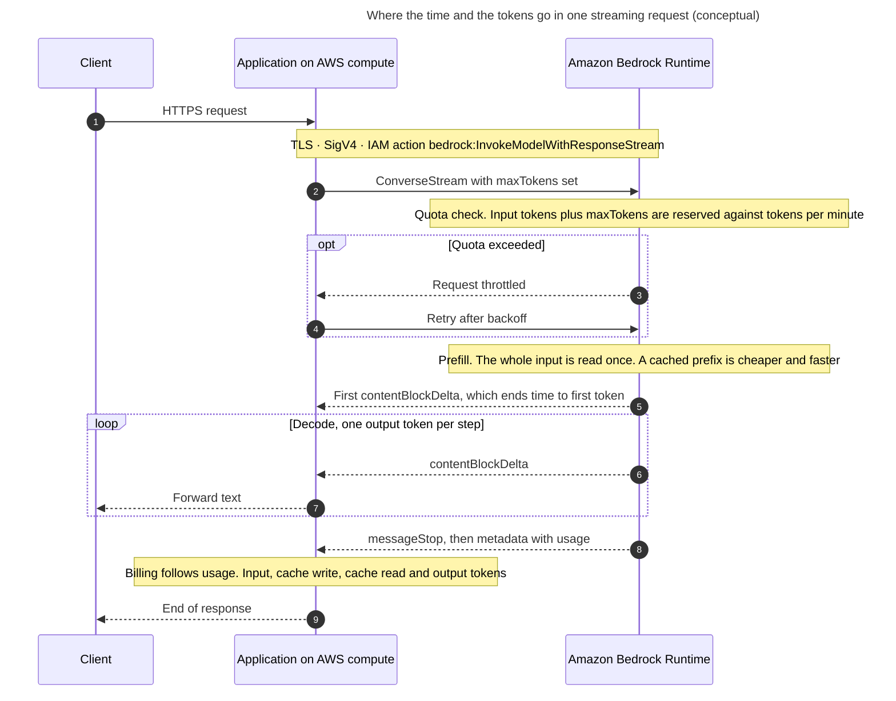

# Latency and token economics

> **Level:** Beginner · **Verified:** 2026-11-15 · **Feature status:** n/a · **Time:** ~20 min

Two questions decide whether a generative AI feature survives contact with production: "how long does the user wait?" and "what does each request cost?" Both are functions of tokens. This chapter gives you the vocabulary, the formulas and a worked cost model with symbolic values that you can fill in with real prices.

## Learning objectives

After this chapter you can:

- Define time to first token, tokens per second and end-to-end latency, and say what drives each.
- Explain why input and output tokens are priced separately and which usually dominates.
- Explain prompt caching and batch inference as pricing concepts and when each applies.
- Describe tokens-per-minute and requests-per-minute limits and how `max_tokens` affects them.
- Build a per-request and per-month cost model from token counts and prices.

## Prerequisites

- [Tokens, context windows, and training versus inference](02-tokens-context-windows-inference.md)
- Helpful: [Retrieval-augmented generation (RAG)](04-rag-fundamentals.md) and [Agentic AI, tool calling and multi-agent architectures](06-agents-tool-calling-multi-agent.md), because both multiply tokens.

## Concept in plain language

Think of a taxi with two meters. One meter runs while the driver *reads* your directions (input tokens); the other runs while the driver *drives* (output tokens). The driving meter ticks faster, because driving is the expensive part. Long directions and long journeys both cost money — but a long journey costs more.

Waiting works like a restaurant. There is the time until the **first dish** arrives, the **pace** at which dishes follow, and the time until the **meal is over**. A kitchen that brings the first dish quickly feels fast even when the whole meal takes just as long.

The kitchen also has a capacity: so many orders and so many dishes per minute. Order more and you wait at the door. And two discounts exist. If you order the *same starter every time*, the kitchen can prepare it once and reuse it (caching). If you do not need the meal now, you can order for tomorrow at a lower price (batch).

## How it really works

### Three latency measures

| Measure | Definition | Driven mainly by |
|:--|:--|:--|
| Time to first token (TTFT) | From sending the request to receiving the first output token | Input length, queueing, cache hits |
| Output tokens per second (OTPS) | Speed of generation after the first token | The model and its current load |
| End-to-end latency | From the user's action to the complete answer | TTFT + output length ÷ OTPS, plus your network, your code, retries and any extra model calls |

Amazon Bedrock describes two stages on the model host. In **prefill**, "the model processes the entire input prompt in a single forward pass and produces the first output token"; its duration "scales primarily with input length". In **decode**, the model "generates each subsequent output token sequentially, one token per forward pass", so total time "scales with the number of output tokens".

> [!NOTE]
> **Documented fact** — `InvocationLatency (ms) = TimeToFirstToken (ms) + (OutputTokenCount / OTPS) * 1000`. Amazon Bedrock publishes `InvocationLatency`, `TimeToFirstToken`, `InputTokenCount` and `OutputTokenCount` as Amazon CloudWatch metrics; `TimeToFirstToken` exists only for the streaming operations.
> Source: [Diagnose InvocationLatency increases using OTPS](https://docs.aws.amazon.com/bedrock/latest/userguide/monitoring-runtime-otps.html), [runtime metrics](https://docs.aws.amazon.com/bedrock/latest/userguide/monitoring-cw.html)

The formula explains most latency tuning. Output length is usually the largest term, because output is produced one token at a time while input is read in one pass.

| Lever | Acts on | Note |
|:--|:--|:--|
| Shorter answers | Decode time | Cap `maxTokens`; ask for concise formats |
| Shorter prompts | TTFT | Trim history; send fewer passages |
| Prompt caching | TTFT and input cost | For a long prefix that repeats |
| Smaller or faster model | Both | Check quality with an evaluation |
| Streaming | Perceived wait only | Total time is unchanged |
| Priority service tier | Both | "Fastest response times for a price premium" |
| Fewer sequential model calls | End-to-end | Every agent step adds a full TTFT plus decode |
| Parallel independent calls | End-to-end | Uses quota faster |

### Token pricing

For on-demand text inference you pay per token, with **separate prices for input and output**. On the [Amazon Bedrock pricing page](https://aws.amazon.com/bedrock/pricing/) the output price is higher than the input price for most models, so a short prompt with a long answer can cost more than a long prompt with a short answer.

| Pricing dimension | Unit | Relative to Standard on-demand (as of 2026-11-15) | Source |
|:--|:--|:--|:--|
| Input tokens | Per token | Baseline | [Pricing](https://aws.amazon.com/bedrock/pricing/) |
| Output tokens | Per token | Separate, usually higher price | [Pricing](https://aws.amazon.com/bedrock/pricing/) |
| Cache write | Per token written to the cache | "Can be higher than the standard input token rate" | [Prompt caching](https://docs.aws.amazon.com/bedrock/latest/userguide/prompt-caching.html) |
| Cache read | Per token read from the cache | Reduced rate | [Prompt caching](https://docs.aws.amazon.com/bedrock/latest/userguide/prompt-caching.html) |
| Priority tier | Per token | About 75% premium, per model | [Pricing](https://aws.amazon.com/bedrock/pricing/) |
| Flex tier | Per token | About 50% discount, per model | [Pricing](https://aws.amazon.com/bedrock/pricing/) |
| Batch inference | Per token, asynchronous | 50% lower, for select models | [Pricing](https://aws.amazon.com/bedrock/pricing/) |
| Global cross-Region inference profile | Per token | Approximately 10% savings | [Cross-Region inference](https://docs.aws.amazon.com/bedrock/latest/userguide/cross-region-inference.html) |
| Reserved tier | Fixed price per 1,000 tokens-per-minute reserved, billed monthly | Capacity, not usage | [Service tiers](https://docs.aws.amazon.com/bedrock/latest/userguide/service-tiers-inference.html) |
| Provisioned Throughput | Per hour per model unit | Capacity, not usage | [Provisioned Throughput](https://docs.aws.amazon.com/bedrock/latest/userguide/prov-throughput.html) |

Which options a given model supports is stated on its model card. Percentages are AWS's published relations between tiers, not prices; actual prices differ by model and Region.

### Caching and batch as concepts

**Prompt caching** stores the processed form of a prompt *prefix* so that later requests starting with exactly the same prefix do not pay full price or full prefill time for it.

- The first request **writes** the cache; later ones **read** it. Reads are cheap; writes can cost more than ordinary input.
- The prefix must be identical. Put stable content first (system prompt, tool definitions, reference documents) and changing content last.
- Entries expire. The time to live depends on the model and is refreshed by each hit ([feature register](../../FEATURE-VERIFICATION.md#a3-prompts)).
- A minimum prefix length applies — "minimums currently range from 512 to 4,096 tokens per cache checkpoint" — and a cache hit is never guaranteed.

Caching pays off when the same long prefix is reused often within the time to live. It loses money when prefixes are rarely reused, because you pay the write rate and never collect the read discount.

**Batch inference** trades immediacy for price: you submit many prompts as files in Amazon S3, the job runs asynchronously, and results are written back to Amazon S3 ([Batch inference](https://docs.aws.amazon.com/bedrock/latest/userguide/batch-inference.html)). It suits classification, extraction, summarisation and evaluation over large sets. It does not suit anything a person is waiting for. Prompt caching is not supported with batch inference, so the two discounts do not stack.

### Throughput limits

Capacity is shared, so every account has quotas.

| Limit | What it counts | Scope on `bedrock-runtime` |
|:--|:--|:--|
| Tokens per minute (TPM) | Input and output tokens together | Per model, per Region |
| Requests per minute (RPM) | Inference requests | Per model, per Region; enforced for some models and not others |
| Tokens per day (TPD) | Tokens across all supported models | Per account, per Region |

Source: [Quotas for the bedrock-runtime endpoint](https://docs.aws.amazon.com/bedrock/latest/userguide/quotas-runtime.html). Three details catch people out ([How tokens are counted](https://docs.aws.amazon.com/bedrock/latest/userguide/quotas-token-burndown.html)):

1. **Reservation.** When a request starts, `total input tokens + max_tokens` is deducted from the quota; unused tokens are returned at the end. A large `max_tokens` blocks capacity you never use.
2. **Burndown rate.** For some models an output token counts as several tokens against the quota. The final deduction is `InputTokenCount + CacheWriteInputTokenCount + (OutputTokenCount × burndown rate)`.
3. **Billing is separate.** "You're only billed for your actual token usage." In AWS's example, 1,000 input tokens and 100 output tokens on a model with a 5× burndown rate take 1,500 tokens from the quota but are billed as 1,100.

Cache reads do not count towards the tokens-per-minute quota. Embedding models are throttled by requests per minute instead.

A rough capacity estimate follows: sustainable requests per minute ≈ `TPM quota ÷ (I + O × b)`, where `I` is input tokens per request, `O` output tokens and `b` the burndown rate.

### A worked cost model (symbolic)

Define, per request:

| Symbol | Meaning |
|:--|:--|
| `I_s` | Static input tokens: system prompt and tool definitions, identical every time |
| `I_d` | Dynamic input tokens: history, retrieved passages, the question |
| `O` | Output tokens |
| `P_in`, `P_out` | Price per 1,000 input and output tokens |
| `P_cw`, `P_cr` | Price per 1,000 cache-write and cache-read tokens |
| `h` | Share of requests that hit the cache for the static part |
| `R` | Requests per day |

```text
cost per request, no caching   = (I_s + I_d) / 1000 × P_in  +  O / 1000 × P_out
cost per request, with caching = I_d / 1000 × P_in
                               + I_s / 1000 × (h × P_cr + (1 − h) × P_cw)
                               + O / 1000 × P_out
cost per month                 ≈ 30 × R × cost per request
```

The [Example](#example) section evaluates these formulas with clearly hypothetical values. Take real values for `P_in`, `P_out`, `P_cw` and `P_cr` from the pricing page for your model and Region, and real token counts from the `usage` field of your own responses.

## Architecture diagram



**What this shows** — One request on a timeline, with the points where latency accumulates and where tokens are counted. The quota reservation, prefill and decode stages are described in the AWS documentation; how they are implemented inside the service is not, so treat the picture as a conceptual model.

**Walkthrough**

1. The client calls your application.
2. The application calls `ConverseStream`. The service checks the request against the tokens-per-minute quota, reserving input tokens plus `maxTokens`.
3. If the quota is exhausted, the request is throttled.
4. The application retries after a delay. Time spent here is part of end-to-end latency but not of the model's own latency.
5. Prefill ends when the first output arrives: this is time to first token.
6. Decode produces the rest of the output; its duration is output tokens divided by tokens per second.
7. The application forwards text to the client as it arrives.
8. The final events carry the stop reason and the `usage` counts that billing is based on.
9. The application closes the response: this is end-to-end latency.

**Legend** — solid arrow: request · dashed arrow: response or stream event · note: control, stage or accounting point · `opt`: happens only when throttled · `loop`: repeats per output token.

**Variations** — Without streaming, steps 5–8 collapse into one response and no time-to-first-token metric is published. On the `bedrock-mantle` endpoint, input and output tokens have separate per-minute quotas and burndown does not apply. With batch inference there is no interactive timeline at all.

## Implementation details

In the order a builder meets them:

1. **Measure before optimising.** Log `inputTokens`, `outputTokens`, cache read and write tokens, time to first token and total time for every request.
2. **Set `maxTokens` close to the real answer length.** It caps spend and stops over-reservation of quota.
3. **Order the prompt for caching:** stable content first, variable content last. Then check the cache fields in `usage` to confirm hits.
4. **Pick the service tier per workload:** Standard by default, Priority for latency-critical user traffic, Flex for work that can wait, Reserved for steady high volume. Your on-demand quota is shared across the Priority, Standard and Flex tiers.
5. **Move offline work to batch.**
6. **Alarm on tokens per second, not only on total latency.** Total latency rises when answers get longer; tokens per second falls only when generation itself slows down.
7. **Plan quota from peak load**, including the burndown rate, and request increases before launch.

> [!IMPORTANT]
> **Status** — Latency-optimized inference (`performanceConfig.latency` set to `optimized`) is in **preview**, for selected models and Regions only.
> Source: [Optimize model inference for latency](https://docs.aws.amazon.com/bedrock/latest/userguide/latency-optimized-inference.html)

> [!TIP]
> **Academy recommendation** — Give every feature a token budget (input, output, calls per user action) alongside its latency target, and review both in design. This is our design guidance, not an official AWS reference architecture.

### Where this shows up in Amazon Bedrock

- [InvokeModel and streaming APIs](../../01-amazon-bedrock/inference/02-invokemodel-and-streaming.md) — streaming and time to first token.
- [Prompt caching](../../01-amazon-bedrock/prompt-caching/01-prompt-caching.md) — cache checkpoints, time to live, billing.
- [Service tiers: Reserved, Priority, Standard and Flex](../../01-amazon-bedrock/inference/06-service-tiers.md) — price and performance per request.
- [Batch inference](../../01-amazon-bedrock/inference/08-batch-inference.md) — asynchronous jobs at a lower price.
- [Provisioned Throughput](../../01-amazon-bedrock/inference/07-provisioned-throughput.md) — capacity by the hour.
- [Cross-Region inference: Geo and Global profiles](../../01-amazon-bedrock/inference/04-cross-region-inference.md) — throughput and the Global price difference.
- [Application inference profiles](../../01-amazon-bedrock/inference/05-application-inference-profiles.md) — cost and usage tracking per application.
- Going deeper: [Pricing model and cost drivers](../../08-cost-performance-and-reliability/01-pricing-model-and-cost-drivers.md), [Latency optimization](../../08-cost-performance-and-reliability/03-latency-optimization.md), [Quotas, rate limits and throttling](../../08-cost-performance-and-reliability/05-quotas-rate-limits-and-throttling.md) and [Lab 7: estimate the cost of a chatbot](../../labs/lab-07-estimate-chatbot-cost.md).

## Example

> **Code status:** syntax-checked and run locally (no AWS calls) · **never deployed**

All prices below are **hypothetical** and expressed in abstract "units", not in any currency. They are chosen only to make the arithmetic easy to follow.

```python
"""A token cost model. Prices are hypothetical units per 1,000 tokens - not real prices."""

P_IN, P_OUT = 1.00, 4.00                    # assume: input and output price
P_CACHE_WRITE, P_CACHE_READ = 1.25, 0.10    # assume: cache write and cache read price
BATCH_FACTOR = 0.50                         # assume: batch costs half of on-demand

STATIC_IN = 2_000     # I_s: system prompt and tool definitions
DYNAMIC_IN = 1_500    # I_d: history, retrieved passages, question
OUT = 400             # O
REQUESTS_PER_DAY = 10_000
CACHE_HIT_RATIO = 0.90


def cost_per_request(static_in: int, dynamic_in: int, out: int, hit_ratio: float | None = None) -> float:
    if hit_ratio is None:
        input_cost = (static_in + dynamic_in) / 1000 * P_IN
    else:
        blended = hit_ratio * P_CACHE_READ + (1 - hit_ratio) * P_CACHE_WRITE
        input_cost = dynamic_in / 1000 * P_IN + static_in / 1000 * blended
    return input_cost + out / 1000 * P_OUT


def conversation_input_tokens(turns: int, system: int, user: int, answer: int) -> int:
    """Total input tokens when every turn re-sends the system prompt and all earlier turns."""
    return sum(system + (n - 1) * (user + answer) + user for n in range(1, turns + 1))


scenarios = {
    "on-demand": cost_per_request(STATIC_IN, DYNAMIC_IN, OUT),
    "with prompt caching": cost_per_request(STATIC_IN, DYNAMIC_IN, OUT, CACHE_HIT_RATIO),
    "half the output": cost_per_request(STATIC_IN, DYNAMIC_IN, OUT // 2),
    "batch": cost_per_request(STATIC_IN, DYNAMIC_IN, OUT) * BATCH_FACTOR,
}
for name, cost in scenarios.items():
    print(f"{name:20} {cost:5.2f} units per request, {cost * REQUESTS_PER_DAY * 30:12,.0f} units per month")

print("10-turn chat, total input tokens:", conversation_input_tokens(10, system=500, user=50, answer=200))
print("the same 10 questions asked separately:", 10 * (500 + 50))
```

Output:

```text
on-demand             5.10 units per request,    1,530,000 units per month
with prompt caching   3.53 units per request,    1,059,000 units per month
half the output       4.30 units per request,    1,290,000 units per month
batch                 2.55 units per request,      765,000 units per month
10-turn chat, total input tokens: 16750
the same 10 questions asked separately: 5500
```

Three things to read from this. Output is 10% of the tokens but 31% of the on-demand cost. Caching the static 2,000 tokens saves about 31% — but only because nine in ten requests hit the cache. And a ten-turn conversation consumes three times the input tokens of ten separate questions, because history is re-sent on every turn.

## Common mistakes

> [!WARNING]
> **Common mistake** — Estimating cost from the prompt alone. Output tokens have their own, usually higher, price, and in a conversation or an agent loop the input is re-sent on every call. Model the whole interaction, not one message.

| Mistake | Symptom | Fix |
|:--|:--|:--|
| Leaving `max_tokens` at a high default | Throttling well below the expected request rate | Set it near the real answer length |
| Ignoring the burndown rate | Quota exhausted "too early" | Include it in capacity planning |
| A timestamp or user name at the start of the system prompt | Cache write on every request, no reads | Move variable content after the stable prefix |
| Assuming a cache hit | Costs above forecast | Read the cache fields in `usage`; track the hit ratio |
| Using batch for interactive work | Users wait for a job that has no completion guarantee | Batch only for offline workloads |
| Reporting average latency | Slow requests hidden | Track percentiles, and time to first token separately |
| Alarming on total latency only | False alarms whenever answers get longer | Alarm on tokens per second |
| Paying for Priority everywhere | Higher bill with no user-visible benefit | Priority for latency-critical paths only |

## Security considerations

- **Unbounded usage is a financial attack surface.** An unauthenticated or unthrottled endpoint lets anyone spend your tokens. Require authentication, rate-limit per user, cap `maxTokens`, and set budgets and alarms.
- **Attribute usage.** Application inference profiles and request metadata let you see which application or tenant produced which tokens; an unexplained jump in usage is also a security signal.
- **Control the expensive options.** Access to service tiers can be restricted with IAM, so that only approved workloads use Priority or Reserved capacity.
- **Usage logs are sensitive.** Logging prompts to analyse cost stores the data that was in them.

## Cost considerations

- **Output tokens** are the first place to look: shorter answers cut both cost and latency.
- **Input tokens** grow silently through history, retrieved passages and tool definitions.
- **Call count** multiplies everything in RAG pipelines and agent loops.
- **Discounts have conditions:** caching needs repeated prefixes within the time to live; batch and Flex need tolerance for delay; Global cross-Region profiles need freedom over where data is processed.
- **Capacity products** (Reserved tier, Provisioned Throughput) are billed whether you use them or not.
- Related chapters: [Cost optimization and token budgeting](../../08-cost-performance-and-reliability/02-cost-optimization-and-token-budgeting.md) and [Caching strategies](../../08-cost-performance-and-reliability/04-caching-strategies.md).

## Knowledge check

1. A response takes 12 seconds. Time to first token is 1 second and the answer has 550 output tokens. What is the tokens-per-second rate, and which change would shorten the total time most?
2. Your system prompt is 3,000 tokens and identical for every user, but it starts with the current date and time. Why does prompt caching not help, and what do you change?
3. With a tokens-per-minute quota of `Q`, input of 3,000 tokens, 500 output tokens and a burndown rate of 5, roughly how many requests per minute can you sustain? What would happen if `max_tokens` were left at 32,000?
4. A nightly job classifies 200,000 documents. Which two pricing options are worth considering, and why can you not combine either with prompt caching for batch?
5. Why does a conversation get more expensive per turn even when the user's messages stay short?

<details>
<summary>Answers</summary>

1. Decode took 11 seconds for 550 tokens: 50 tokens per second. Output length dominates, so a shorter answer (or a faster model) helps most; shortening the prompt would only reduce the 1-second part.
2. Caching needs an identical prefix. The timestamp changes the first tokens, so every request writes a new cache entry and none is read. Move the date after the stable part of the prompt.
3. Each request consumes about 3,000 + 500 × 5 = 5,500 quota tokens, so about `Q ÷ 5,500` requests per minute. With `max_tokens` at 32,000, each request reserves 35,000 tokens when it starts, so far fewer requests can run at once even though the final deduction is the same.
4. Batch inference and the Flex tier: both exchange delay for a lower price. Prompt caching is supported only for on-demand inference, not for the batch API.
5. The model is stateless, so each turn re-sends all earlier turns as input. Input tokens per turn grow with the length of the conversation.

</details>

## Further reading

Official sources opened while writing this chapter:

- [Amazon Bedrock pricing](https://aws.amazon.com/bedrock/pricing/) — per-token prices, tiers, batch and customization pricing.
- [Diagnose InvocationLatency increases using output tokens per second (OTPS)](https://docs.aws.amazon.com/bedrock/latest/userguide/monitoring-runtime-otps.html) — prefill, decode and the latency formula.
- [Monitor bedrock-runtime inference using CloudWatch metrics](https://docs.aws.amazon.com/bedrock/latest/userguide/monitoring-cw.html) — latency and token metrics.
- [How tokens are counted in Amazon Bedrock](https://docs.aws.amazon.com/bedrock/latest/userguide/quotas-token-burndown.html) — reservation, burndown rate and `max_tokens`.
- [Quotas for the bedrock-runtime endpoint](https://docs.aws.amazon.com/bedrock/latest/userguide/quotas-runtime.html) — tokens per minute, requests per minute, tokens per day.
- [Quotas for Amazon Bedrock](https://docs.aws.amazon.com/bedrock/latest/userguide/quotas.html) — how quotas apply to an account.
- [Prompt caching for faster model inference](https://docs.aws.amazon.com/bedrock/latest/userguide/prompt-caching.html) — implicit and explicit caching, billing.
- [Service tiers for optimizing performance and cost](https://docs.aws.amazon.com/bedrock/latest/userguide/service-tiers-inference.html) — Reserved, Priority, Standard and Flex.
- [Process multiple prompts with batch inference](https://docs.aws.amazon.com/bedrock/latest/userguide/batch-inference.html) — batch jobs and their limits.
- [Cross-Region inference](https://docs.aws.amazon.com/bedrock/latest/userguide/cross-region-inference.html) — Geographic and Global profiles and pricing.
- [Increase model invocation capacity with Provisioned Throughput](https://docs.aws.amazon.com/bedrock/latest/userguide/prov-throughput.html) — model units and commitment terms.
- [Optimize model inference for latency](https://docs.aws.amazon.com/bedrock/latest/userguide/latency-optimized-inference.html) — latency-optimized inference (preview).
- [TokenUsage](https://docs.aws.amazon.com/bedrock/latest/APIReference/API_runtime_TokenUsage.html) — the usage fields returned with every response.
- [Converse API reference](https://docs.aws.amazon.com/bedrock/latest/APIReference/API_runtime_Converse.html) — `serviceTier`, `performanceConfig` and `requestMetadata`.
