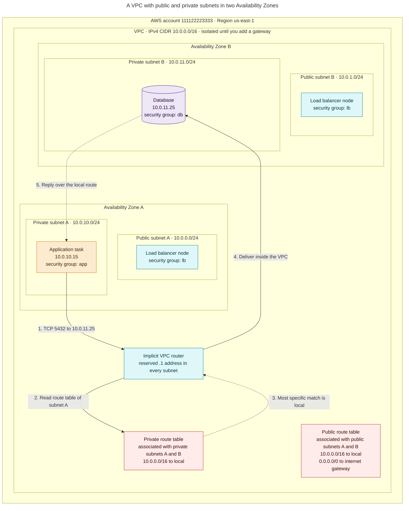

# VPCs and subnets

> **Level:** Beginner · **Verified:** 2026-11-15 · **Feature status:** n/a · **Time:** ~15 min

A virtual private cloud (VPC) is the private network you own inside AWS. Amazon Bedrock itself does not run in your VPC, but the applications, agents and databases that use it usually do, so every private Bedrock design starts with a VPC and its subnets.

## Learning objectives

After this chapter you can:

- Explain what a VPC, a CIDR block, a subnet and a route table are, and how they relate.
- Calculate how many addresses a subnet really gives you.
- Lay out subnets across two Availability Zones for a resilient workload.
- Describe what the default VPC contains and why production workloads use their own VPC.
- Distinguish IPv4-only, dual-stack and IPv6-only subnets.

## Prerequisites

- [AWS global infrastructure: Regions, Availability Zones and the edge](../aws-fundamentals/01-global-infrastructure.md)

## Concept in plain language

Think of a VPC as an office building that only your company may enter. The **CIDR block** is the range of room numbers the building may use. A **subnet** is one floor: a slice of those room numbers that sits in exactly one wing (one Availability Zone). A **route table** is the signpost at each floor's exit that says "for these room numbers, go this way".

Nothing leaves the building unless you build a door. The doors (internet gateways, NAT gateways, VPC endpoints) are the subject of the next two chapters.

Terms you have not met yet are defined in the [glossary](../../GLOSSARY.md).

## How it really works

| Building block | Precise definition | Scope |
|:--|:--|:--|
| VPC | A virtual network dedicated to your AWS account, logically isolated from other virtual networks | One Region |
| IPv4 CIDR block | The address range of the VPC, written in Classless Inter-Domain Routing notation such as `10.0.0.0/16`. Allowed size: `/16` (65,536 addresses) to `/28` (16 addresses) | VPC |
| Subnet | A range of addresses inside the VPC CIDR. Subnet CIDR blocks cannot overlap | Exactly one Availability Zone |
| Route table | A set of routes: a **destination** (CIDR block or prefix list) and a **target** (gateway, network interface or connection) | VPC; associated with subnets |
| Local route | The route that every route table has for traffic inside the VPC | VPC |

> [!NOTE]
> **Documented fact** — Each subnet must reside entirely within one Availability Zone and cannot span zones.
> Source: [Subnets for your VPC](https://docs.aws.amazon.com/vpc/latest/userguide/configure-subnets.html)

**Five addresses per subnet are not yours.** AWS reserves the first four addresses and the last address of every subnet: the network address, the VPC router (`.1`), the DNS server address (`.2`), one for future use (`.3`) and the broadcast address. A `/24` subnet therefore offers 251 usable addresses and a `/28` only 11. Source: [Subnet CIDR blocks](https://docs.aws.amazon.com/vpc/latest/userguide/subnet-sizing.html).

**Routing.** Every VPC has an implicit router. When a packet leaves a network interface, the router reads the route table associated with that subnet and uses the most specific route that matches the destination (longest prefix match). A subnet that you do not explicitly associate with a route table uses the VPC's **main route table**. Source: [How route priority works](https://docs.aws.amazon.com/vpc/latest/userguide/route-tables-priority.html).

**Subnet types are a routing property, not a setting.** AWS documents four common types:

| Type | What makes it that type |
|:--|:--|
| Public | Its route table has a route to an internet gateway |
| Private | No direct route to an internet gateway; needs a NAT device to reach the internet |
| VPN-only | Routes to a Site-to-Site VPN through a virtual private gateway, none to an internet gateway |
| Isolated | No routes to destinations outside the VPC |

**The default VPC.** Accounts created after 4 December 2013 have a default VPC in each Region: CIDR `172.31.0.0/16`, one `/20` default subnet per Availability Zone, an attached internet gateway, and a main route table that sends `0.0.0.0/0` to that gateway. Every default subnet is public. Source: [Default VPC components](https://docs.aws.amazon.com/vpc/latest/userguide/default-vpc-components.html).

**IPv4 and IPv6 at a glance.**

| Subnet mode | Addresses | Notes |
|:--|:--|:--|
| IPv4 only | IPv4 CIDR | The default. Private addresses normally come from the RFC 1918 ranges |
| Dual stack | IPv4 and IPv6 CIDR | The VPC needs both an IPv4 and an IPv6 CIDR block |
| IPv6 only | IPv6 CIDR | Resources must communicate over IPv6 |

An Amazon-provided IPv6 block for a VPC is between `/44` and `/60`; you cannot choose the range. IPv6 addresses are globally unique and therefore public by default, and IPv6 traffic needs its own routes. Sources: [VPC CIDR blocks](https://docs.aws.amazon.com/vpc/latest/userguide/vpc-cidr-blocks.html), [Internet gateways](https://docs.aws.amazon.com/vpc/latest/userguide/VPC_Internet_Gateway.html).

**Default quotas** (per Region unless stated, all adjustable): 5 VPCs, 200 subnets per VPC, 5 IPv4 CIDR blocks per VPC, 200 route tables per VPC, 500 non-propagated routes per route table. Source: [Amazon VPC quotas](https://docs.aws.amazon.com/vpc/latest/userguide/amazon-vpc-limits.html).

## Architecture diagram



**What this shows** — One VPC in one Region, split into four subnets across two Availability Zones. The two private subnets share a route table that only knows the local route, so their traffic can reach anything inside the VPC and nothing outside it.

**Walkthrough**

1. The application in private subnet A opens a TCP connection to the database address in private subnet B.
2. The implicit VPC router looks up the route table associated with subnet A.
3. The only matching route is the local route for `10.0.0.0/16`.
4. The router delivers the packet to subnet B, in another Availability Zone, without leaving the VPC.
5. The reply returns the same way. Security groups on both ends still decide whether the connection is allowed.

| Legend | Meaning |
|:--|:--|
| Solid arrow | Request or lookup |
| Dashed arrow | Response |
| Cylinder | Data store |
| Nested boxes | Account and Region, VPC, Availability Zone, subnet |
| Red boxes | Route tables (the control that decides where traffic may go) |

**Variations** — In a dual-stack VPC each route table also has a local route for the IPv6 CIDR. The public route table is unused in this walkthrough; [Public and private networking](02-public-private-networking.md) follows a packet through it. The academy's full networking picture is in [diagram set 1](../../diagrams/mermaid/01-aws-global-infrastructure-and-networking.md).

## Implementation details

1. **Choose the VPC CIDR first, and choose it once.** You cannot grow or shrink an existing CIDR block; you can only associate additional blocks. AWS recommends the RFC 1918 private ranges and warns against `172.17.0.0/16`, which some AWS services use internally.
2. **Do not overlap.** A CIDR block added to a VPC must not overlap a peered VPC's blocks, and VPCs attached to the same Direct Connect gateway must not overlap either. Plan address space across accounts before you create the first VPC.
3. **Create subnets in at least two Availability Zones**, one set per tier (public, private, data).
4. **Associate every subnet with a route table explicitly.** Otherwise it silently uses the main route table.
5. **Decide on IPv6 early.** Adding an IPv6 block later is possible, but route tables, security groups and network ACLs all need matching IPv6 entries.

> [!TIP]
> **Academy recommendation** — Leave the main route table with only the local route and attach purpose-built route tables to each subnet. A subnet somebody forgets to associate is then isolated, not public.
> This is our design guidance, not an official AWS reference architecture.

### Why this matters for Bedrock

Amazon Bedrock is reached through Regional service endpoints, so the model never has an address in your VPC. Your VPC design matters for everything around it:

- **Callers.** AWS Lambda functions attached to a VPC and Amazon Bedrock AgentCore Runtime in VPC mode place network interfaces in your subnets; containers and instances run there directly. See [AWS Lambda with Bedrock](../../02-related-aws-services/compute/01-lambda.md) and [AgentCore Runtime](../../01-amazon-bedrock/agentcore/02-agentcore-runtime.md).
- **Availability Zone choice.** AgentCore VPC connectivity works only in specific Availability Zone IDs per Region, and resource creation fails if a subnet is elsewhere. Source: [Configure AgentCore Runtime and tools for VPC](https://docs.aws.amazon.com/bedrock-agentcore/latest/devguide/agentcore-vpc.html).
- **Private access.** Isolated subnets reach Bedrock through interface endpoints, covered in [VPC endpoints and AWS PrivateLink](03-vpc-endpoints-and-privatelink.md) and then in [Private connectivity for Bedrock](../../02-related-aws-services/networking/01-private-connectivity-for-bedrock.md).
- **Whole designs.** [Pattern: secure private enterprise Bedrock](../../03-architecture-patterns/private-enterprise/README.md) and [Project E](../../05-practical-projects/project-05-private-genai/README.md) build on the layout in this chapter.

## Example

A subnet planner that applies the two documented rules from this chapter: the `/16` to `/28` size limit and the five reserved addresses.

> **Code status:** syntax-checked (`python -m py_compile`) and run locally · standard library only, no AWS calls · **never deployed**

```python
"""Plan equal-sized subnets for a VPC and count the usable addresses."""
import ipaddress

AWS_RESERVED_PER_SUBNET = 5  # first four addresses and the last one


def plan(vpc_cidr: str, new_prefix: int, count: int) -> list[dict]:
    vpc = ipaddress.ip_network(vpc_cidr)
    if not 16 <= vpc.prefixlen <= 28 or not 16 <= new_prefix <= 28:
        raise ValueError("VPC and subnet IPv4 CIDR blocks must be between /16 and /28")
    subnets = list(vpc.subnets(new_prefix=new_prefix))[:count]
    return [
        {"cidr": str(s), "usable": s.num_addresses - AWS_RESERVED_PER_SUBNET}
        for s in subnets
    ]


if __name__ == "__main__":
    for row in plan("10.0.0.0/16", new_prefix=24, count=4):
        print(row)  # {'cidr': '10.0.0.0/24', 'usable': 251} ...
```

## Common mistakes

> [!WARNING]
> **Common mistake** — Sizing subnets for today's servers. Managed services consume addresses too: every interface endpoint, VPC-attached Lambda function and AgentCore Runtime configuration creates network interfaces in your subnets. A `/28` has 11 usable addresses.

| Mistake | Symptom | Fix |
|:--|:--|:--|
| Overlapping CIDR blocks between VPCs or with the corporate network | Peering or Direct Connect association is refused, or routes are ambiguous | Allocate non-overlapping ranges centrally before creating VPCs |
| Expecting a subnet to span Availability Zones | One zone fails and the whole tier is gone | One subnet per tier per Availability Zone |
| Relying on the main route table | A new subnet inherits a route to the internet gateway | Keep the main route table local-only; associate explicitly |
| Running production in the default VPC | Every default subnet is public and instances get public IPv4 addresses | Build a dedicated VPC; keep the default VPC for experiments or delete it |
| Adding IPv6 without IPv6 routes | IPv6 traffic is dropped although IPv4 works | Add separate IPv6 routes and rules |

## Security considerations

- A VPC is an isolation boundary: without a gateway, peering connection or endpoint, nothing routes in or out.
- Route tables are a security control. Give each subnet only the routes its workload needs, and restrict who may change routes with IAM.
- Use private subnets for anything that should not be reached from the internet.
- Enable VPC Flow Logs on the VPC or subnets to record accepted and rejected traffic.
- VPC Block Public Access can block internet gateway traffic for a whole account and Region, with explicit exclusions. Source: [Block public access to VPCs and subnets](https://docs.aws.amazon.com/vpc/latest/userguide/security-vpc-bpa.html).

## Cost considerations

- There is no additional charge for a VPC, its subnets or its route tables. Source: [What is Amazon VPC?](https://docs.aws.amazon.com/vpc/latest/userguide/what-is-amazon-vpc.html)
- Public IPv4 addresses are charged, including the ones assigned automatically in default subnets. Private IPv4 addresses are not.
- Traffic between Availability Zones can incur data transfer charges, so keep chatty components in the same Availability Zone where resilience allows.
- The components you attach later (NAT gateways, interface endpoints) are where the network bill comes from.

## Knowledge check

1. A subnet has the CIDR block `10.0.5.0/27`. How many addresses can your resources use?
2. Your team creates a new subnet and launches a database in it without touching route tables. The main route table contains `0.0.0.0/0` to an internet gateway. Is the subnet public or private, and why?
3. What would happen if you created a VPC with `10.0.0.0/16` and later needed to peer it with another VPC that also uses `10.0.0.0/16`?

<details>
<summary>Answers</summary>

1. 27. A `/27` has 32 addresses and AWS reserves five in every subnet.
2. Public. The subnet is implicitly associated with the main route table, which has a route to an internet gateway; the type follows the routing.
3. The ranges overlap, so the two VPCs cannot route to each other through peering. You cannot resize the existing block; you would have to rebuild one VPC in a different range.

</details>

## Further reading

Official sources opened while writing this chapter:

- [What is Amazon VPC?](https://docs.aws.amazon.com/vpc/latest/userguide/what-is-amazon-vpc.html) — features and pricing statement.
- [How Amazon VPC works](https://docs.aws.amazon.com/vpc/latest/userguide/how-it-works.html) — VPCs, subnets, default VPC, route tables.
- [VPC CIDR blocks](https://docs.aws.amazon.com/vpc/latest/userguide/vpc-cidr-blocks.html) — size limits, RFC 1918 ranges, association rules, IPv6 blocks.
- [Subnet CIDR blocks](https://docs.aws.amazon.com/vpc/latest/userguide/subnet-sizing.html) — reserved addresses, IPv6 subnet sizes.
- [Subnets for your VPC](https://docs.aws.amazon.com/vpc/latest/userguide/configure-subnets.html) — subnet types and IP modes.
- [Route table concepts](https://docs.aws.amazon.com/vpc/latest/userguide/RouteTables.html) and [How route priority works](https://docs.aws.amazon.com/vpc/latest/userguide/route-tables-priority.html) — main route table, local route, longest prefix match.
- [Default VPC components](https://docs.aws.amazon.com/vpc/latest/userguide/default-vpc-components.html) — what AWS creates for you.
- [IP addressing for your VPCs and subnets](https://docs.aws.amazon.com/vpc/latest/userguide/vpc-ip-addressing.html) — private and public IPv4, IPv6.
- [Amazon VPC quotas](https://docs.aws.amazon.com/vpc/latest/userguide/amazon-vpc-limits.html) — default limits quoted above.
- [Block public access to VPCs and subnets](https://docs.aws.amazon.com/vpc/latest/userguide/security-vpc-bpa.html) — account-wide internet block.
- [Configure AgentCore Runtime and tools for VPC](https://docs.aws.amazon.com/bedrock-agentcore/latest/devguide/agentcore-vpc.html) — supported Availability Zones and network interfaces.
