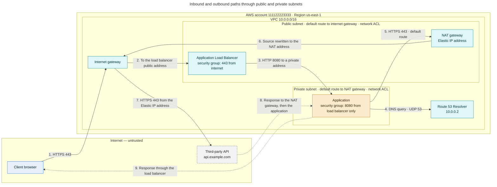

# Public and private networking

> **Level:** Beginner · **Verified:** 2026-11-15 · **Feature status:** n/a · **Time:** ~20 min

This chapter explains the doors of a VPC: how traffic gets in, how it gets out, and which controls decide what is allowed. For Amazon Bedrock workloads the outbound side matters most, because an agent that can reach any internet address can also send your data there.

## Learning objectives

After this chapter you can:

- Explain what makes a subnet public or private, and what an internet gateway and a NAT gateway each do.
- Compare security groups and network ACLs and choose the right one for a rule.
- Describe the layers available for controlling outbound (egress) traffic.
- Explain how DNS works inside a VPC and which two VPC attributes control it.
- Diagnose why a workload in a private subnet cannot reach an AWS service or the internet.

## Prerequisites

- [VPCs and subnets](01-vpc-and-subnets.md)

## Concept in plain language

Your VPC is a building with no doors. An **internet gateway** is the front door, usable only by rooms with a street address (a public IP address). A **NAT gateway** is a mail room: back offices hand it their letters, it posts them under the company's address and passes replies back, but nobody outside can walk through it.

Two kinds of guards check traffic. A **security group** stands at each room's door, remembers who went out, and lets the answer back in. A **network ACL** stands at the floor's entrance with a numbered checklist and no memory.

## How it really works

**Internet gateway.** A horizontally scaled, redundant VPC component that provides a route target for internet traffic and performs one-to-one network address translation (NAT) for IPv4. You can attach one to a VPC at a time. A subnet is **public** when its route table has a route to the internet gateway; a resource in it also needs a public IPv4 address or an IPv6 address to communicate. Source: [Internet gateways](https://docs.aws.amazon.com/vpc/latest/userguide/VPC_Internet_Gateway.html).

**NAT gateway.** A managed NAT service that lets resources in private subnets start connections to destinations outside the VPC while nothing outside can start a connection to them.

| Property | Documented value |
|:--|:--|
| Connectivity types | **Public** (lives in a public subnet, has an Elastic IP address, routes to the internet gateway) or **private** (routes to other VPCs or on-premises networks) |
| Placement | Created in one Availability Zone and redundant within it. AWS recommends one per Availability Zone so that a failure in one does not cut off the others. A Regional NAT gateway option that spans Availability Zones also exists |
| Protocols | TCP, UDP and ICMP |
| Capacity | 5 Gbps, scaling automatically to 100 Gbps; up to 55,000 simultaneous connections to each unique destination per IPv4 address |
| Security groups | Cannot be associated with a NAT gateway; use network ACLs on its subnet |

Sources: [NAT gateways](https://docs.aws.amazon.com/vpc/latest/userguide/vpc-nat-gateway.html), [NAT gateway basics](https://docs.aws.amazon.com/vpc/latest/userguide/nat-gateway-basics.html).

For IPv6, the outbound-only equivalent is the **egress-only internet gateway**, which is stateful and free of charge. Source: [Egress-only internet gateways](https://docs.aws.amazon.com/vpc/latest/userguide/egress-only-internet-gateway.html).

**Security groups versus network ACLs.**

| Characteristic | Security group | Network ACL |
|:--|:--|:--|
| Level of operation | Resource (network interface) | Subnet |
| Rule type | Allow rules only | Allow and deny rules |
| Rule evaluation | All rules are evaluated before deciding | Rules are evaluated in ascending number order until one matches |
| Return traffic | Automatically allowed (stateful) | Must be explicitly allowed (stateless) |
| Can reference | CIDR blocks, prefix lists, other security groups | CIDR blocks |
| Default | Default group allows inbound only from itself and all outbound | Default ACL allows all inbound and outbound |

Source: [Infrastructure security in Amazon VPC](https://docs.aws.amazon.com/vpc/latest/userguide/infrastructure-security.html).

> [!NOTE]
> **Documented fact** — AWS recommends security groups as the primary mechanism for controlling network access, with network ACLs as a secondary, coarse-grained control (for example, to deny a specific subset of traffic).
> Source: [Infrastructure security in Amazon VPC](https://docs.aws.amazon.com/vpc/latest/userguide/infrastructure-security.html)

**Egress control is layered.** No single feature decides where a workload may send data.

| Layer | What it controls |
|:--|:--|
| Route table | Whether a path out of the subnet exists at all |
| Security group outbound rules | Allowed destinations by CIDR, prefix list or security group, per port |
| Network ACL | Subnet-wide allow and deny by CIDR and port |
| Route 53 Resolver DNS Firewall | Which domain names workloads may resolve |
| AWS Network Firewall | Stateful inspection and domain allow-lists at the VPC perimeter |
| VPC endpoints and endpoint policies | Private paths to specific AWS services, and what may be done through them |
| VPC Block Public Access | Account-wide block of internet gateway traffic |

Sources: [DNS Firewall](https://docs.aws.amazon.com/Route53/latest/DeveloperGuide/resolver-dns-firewall.html), [AWS Network Firewall](https://docs.aws.amazon.com/network-firewall/latest/developerguide/what-is-aws-network-firewall.html), [VPC Block Public Access](https://docs.aws.amazon.com/vpc/latest/userguide/security-vpc-bpa.html).

**DNS in a VPC.** Every VPC has a built-in resolver, the Route 53 Resolver (also called the Amazon DNS server). It answers at `169.254.169.253`, at `fd00:ec2::253`, and at the VPC's primary IPv4 CIDR base address plus two (for example `10.0.0.2`). Two VPC attributes control it:

| Attribute | Effect | Default |
|:--|:--|:--|
| `enableDnsSupport` | The VPC can resolve names through the Amazon DNS server | `true` |
| `enableDnsHostnames` | Instances with public IP addresses get public DNS hostnames | `false`, except in a default VPC |

Both must be `true` to use private hosted zones or private DNS for interface endpoints. You cannot filter traffic to the Amazon DNS server with security groups or network ACLs, and each network interface is limited to 1,024 packets per second to link-local services, which includes DNS. Source: [Understanding Amazon DNS](https://docs.aws.amazon.com/vpc/latest/userguide/AmazonDNS-concepts.html).

## Architecture diagram



**What this shows** — Both directions of traffic in a two-tier VPC. Inbound requests reach only the public subnet; the application in the private subnet reaches the internet only by starting a connection through the NAT gateway.

**Walkthrough**

1. A client sends an HTTPS request to the load balancer's public DNS name.
2. The internet gateway delivers it into the public subnet; the load balancer's security group allows port 443.
3. The load balancer forwards to the application, whose security group allows port 8080 only from the load balancer's security group.
4. To call an external API the application resolves its name through the Route 53 Resolver.
5. The private subnet's route table sends non-local traffic to the NAT gateway.
6. The NAT gateway replaces the source address with its own; the internet gateway maps that to the Elastic IP address.
7. The request leaves AWS from a fixed public address that the third party can allow-list.
8. The response retraces the path. Security groups are stateful, so no inbound rule is needed.
9. The application's answer returns to the client through the load balancer.

| Legend | Meaning |
|:--|:--|
| Solid arrow | Request |
| Dashed arrow | Response |
| Blue-green boxes | Entry and exit points |
| Dashed grey box | Outside your AWS account |
| Nested boxes | Trust and network boundaries |

**Variations** — With IPv6, step 5 uses an egress-only internet gateway and no address translation. If the destination in step 7 is an AWS service rather than a third party, the traffic crosses the internet gateway but, as AWS documents, does not leave the AWS network; [VPC endpoints and AWS PrivateLink](03-vpc-endpoints-and-privatelink.md) removes the gateway from that path altogether.

## Implementation details

1. **Public subnets hold only what must face the internet**: load balancers and NAT gateways. Entry points are covered in [API Gateway, CloudFront and Application Load Balancer](../../02-related-aws-services/compute/04-api-gateway-cloudfront-alb.md).
2. **One route table per private subnet per Availability Zone**, each pointing at the NAT gateway in the same Availability Zone, keeps a failure contained.
3. **Reference security groups, not addresses.** "Allow 8080 from the load balancer's security group" survives scaling and IP changes.
4. **Tighten outbound rules.** Security groups allow all outbound traffic by default; replace that rule with the destinations the workload needs.
5. **Turn on both DNS attributes** before you create interface endpoints or private hosted zones.

> [!TIP]
> **Academy recommendation** — Start from "no default route" for workloads that only call AWS services, and add a NAT gateway only when a named external dependency requires it. Then narrow that path with DNS Firewall or Network Firewall domain lists.
> This is our design guidance, not an official AWS reference architecture.

### Why this matters for Bedrock

- **A public subnet does not give managed compute internet access.** A Lambda function attached to a public subnet gets neither internet access nor a public IP address, and AgentCore states the same for its network interfaces: place them in private subnets with a route to a NAT gateway. Sources: [Lambda and VPCs](https://docs.aws.amazon.com/lambda/latest/dg/configuration-vpc.html), [AgentCore and VPCs](https://docs.aws.amazon.com/bedrock-agentcore/latest/devguide/agentcore-vpc.html).
- **Bedrock endpoints are public by default.** From a private subnet you need either a NAT gateway or an interface endpoint to reach them; see [Private connectivity for Bedrock](../../02-related-aws-services/networking/01-private-connectivity-for-bedrock.md).
- **Agents make egress a security question.** A tool that can call any URL is a path for data to leave. The AgentCore Browser tool needs internet access through a NAT gateway when run in VPC mode, so its egress path deserves the tightest controls. See [AgentCore Browser and Code Interpreter](../../01-amazon-bedrock/agentcore/08-agentcore-browser-and-code-interpreter.md), [Prompt injection, untrusted tool output and retrieval poisoning](../../06-security-governance/04-prompt-injection-and-untrusted-content.md) and [Network security and private access](../../06-security-governance/05-network-security-and-private-access.md).
- **The complete private design** is drawn in [diagram set 24](../../diagrams/mermaid/24-secure-private-enterprise-bedrock.md).

## Example

Outbound rules for the application's security group, in the shape the Amazon EC2 `AuthorizeSecurityGroupEgress` operation accepts. They allow HTTPS to addresses inside the VPC (where interface endpoints live) and to Amazon S3 through its prefix list, and nothing else.

> **Code status:** syntax-checked (JSON parse) · identifiers are placeholders · **never deployed**

```json
{
  "GroupId": "sg-0123456789abcdef0",
  "IpPermissions": [
    {
      "IpProtocol": "tcp",
      "FromPort": 443,
      "ToPort": 443,
      "IpRanges": [
        {
          "CidrIp": "10.0.0.0/16",
          "Description": "HTTPS to interface endpoints and internal services in the VPC"
        }
      ]
    },
    {
      "IpProtocol": "tcp",
      "FromPort": 443,
      "ToPort": 443,
      "PrefixListIds": [
        {
          "PrefixListId": "pl-0123456789abcdef0",
          "Description": "HTTPS to Amazon S3 through the gateway endpoint"
        }
      ]
    }
  ]
}
```

These rules restrict anything only after the default "allow all outbound" rule has been removed from the group.

## Common mistakes

> [!WARNING]
> **Common mistake** — Treating "private subnet" as "cannot reach the internet". A private subnet with a default route to a NAT gateway can send data to any address its security groups allow. Private describes the inbound side only.

| Mistake | Symptom | Fix |
|:--|:--|:--|
| NAT gateway created in a private subnet | Outbound connections time out | A public NAT gateway must sit in a public subnet with a route to the internet gateway |
| One NAT gateway shared by all Availability Zones | An outage in that Availability Zone cuts internet access for all of them; cross-AZ data transfer charges | One NAT gateway per Availability Zone, or a Regional NAT gateway |
| Network ACL allows the request but not the reply | Connections hang although security groups look correct | Network ACLs are stateless: allow the return traffic on ephemeral ports |
| Leaving the default outbound rule in place | Egress rules you added have no effect | Remove "all traffic to `0.0.0.0/0`" and allow named destinations |
| `enableDnsHostnames` left `false` | Private DNS for interface endpoints does not resolve to private addresses | Set both DNS attributes to `true` |
| Lambda function attached to a public subnet | Calls to the internet or to AWS APIs time out | Use private subnets with a NAT gateway or VPC endpoints |

## Security considerations

- Security groups do not filter traffic to the Amazon DNS server, the instance metadata service or the Amazon Time Sync Service. Use DNS Firewall for DNS-based exfiltration.
- Restrict who may create internet gateways, change routes or edit security groups with IAM; see [IAM fundamentals](../security/01-iam-fundamentals.md).
- A NAT gateway translates addresses; it does not choose destinations. Destination filtering comes from the other layers in the egress table.
- Record traffic with VPC Flow Logs.

## Cost considerations

- Internet gateways, egress-only internet gateways, security groups and network ACLs have no charge.
- A NAT gateway is billed per hour while provisioned and per gigabyte processed, on top of normal data transfer. The AWS pricing example for US East (Ohio) uses $0.045 per hour and $0.045 per GB. Source: [Amazon VPC pricing](https://aws.amazon.com/vpc/pricing/).
- One NAT gateway per Availability Zone multiplies the hourly charge; using one in another Availability Zone adds data transfer charges.
- Traffic to Amazon S3 sent through a gateway endpoint avoids NAT data processing charges.
- Every public IPv4 address is charged, including the Elastic IP address of a public NAT gateway.

## Knowledge check

1. Why can a database in a private subnet download a patch from the internet but not be reached from the internet?
2. You add a network ACL rule that allows outbound TCP 443 from a subnet. Connections still fail, yet the security group allows the traffic. What is the most likely cause?
3. What would happen if you deleted the NAT gateway in a VPC whose application only calls Amazon S3 and Amazon Bedrock, and you had created endpoints for both?

<details>
<summary>Answers</summary>

1. Its route table sends outbound traffic to a NAT gateway, which only translates connections started from inside; there is no route from the internet gateway to the private subnet and no public address.
2. Network ACLs are stateless. The inbound rule for the reply traffic on ephemeral ports is missing.
3. Nothing would break for those two services, and the NAT gateway hourly and data processing charges would stop. Any call to another destination would start to fail.

</details>

## Further reading

Official sources opened while writing this chapter:

- [Enable internet access for a VPC using an internet gateway](https://docs.aws.amazon.com/vpc/latest/userguide/VPC_Internet_Gateway.html) — public subnets, address translation.
- [NAT gateways](https://docs.aws.amazon.com/vpc/latest/userguide/vpc-nat-gateway.html) and [NAT gateway basics](https://docs.aws.amazon.com/vpc/latest/userguide/nat-gateway-basics.html) — connectivity types, capacity, rules.
- [Enable outbound IPv6 traffic using an egress-only internet gateway](https://docs.aws.amazon.com/vpc/latest/userguide/egress-only-internet-gateway.html) — IPv6 outbound-only access.
- [Infrastructure security in Amazon VPC](https://docs.aws.amazon.com/vpc/latest/userguide/infrastructure-security.html) — security group and network ACL comparison.
- [Control traffic to your AWS resources using security groups](https://docs.aws.amazon.com/vpc/latest/userguide/vpc-security-groups.html) and [Default security groups](https://docs.aws.amazon.com/vpc/latest/userguide/default-security-group.html) — statefulness, defaults, unfiltered traffic.
- [Control subnet traffic with network access control lists](https://docs.aws.amazon.com/vpc/latest/userguide/vpc-network-acls.html) and [Default network ACL](https://docs.aws.amazon.com/vpc/latest/userguide/default-network-acl.html) — rule numbering, statelessness.
- [Understanding Amazon DNS](https://docs.aws.amazon.com/vpc/latest/userguide/AmazonDNS-concepts.html) — resolver addresses and DNS attributes.
- [Using DNS Firewall to filter outbound DNS traffic](https://docs.aws.amazon.com/Route53/latest/DeveloperGuide/resolver-dns-firewall.html) — domain-based DNS filtering.
- [What is AWS Network Firewall?](https://docs.aws.amazon.com/network-firewall/latest/developerguide/what-is-aws-network-firewall.html) — perimeter filtering.
- [Block public access to VPCs and subnets](https://docs.aws.amazon.com/vpc/latest/userguide/security-vpc-bpa.html) — account-wide block.
- [Access AWS services through AWS PrivateLink](https://docs.aws.amazon.com/vpc/latest/privatelink/privatelink-access-aws-services.html) — statement that traffic to AWS services through an internet gateway stays on the AWS network.
- [AuthorizeSecurityGroupEgress](https://docs.aws.amazon.com/AWSEC2/latest/APIReference/API_AuthorizeSecurityGroupEgress.html) and [IpPermission](https://docs.aws.amazon.com/AWSEC2/latest/APIReference/API_IpPermission.html) — request shape used in the example.
- [Giving Lambda functions access to resources in an Amazon VPC](https://docs.aws.amazon.com/lambda/latest/dg/configuration-vpc.html) — public subnets do not give functions internet access.
- [Configure AgentCore Runtime and tools for VPC](https://docs.aws.amazon.com/bedrock-agentcore/latest/devguide/agentcore-vpc.html) — NAT gateway requirement for internet access.
- [Amazon VPC pricing](https://aws.amazon.com/vpc/pricing/) — NAT gateway pricing dimensions and example.
