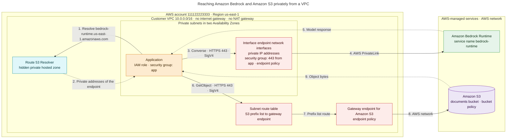

# VPC endpoints and AWS PrivateLink

> **Level:** Beginner · **Verified:** 2026-11-15 · **Feature status:** n/a · **Time:** ~20 min

VPC endpoints let resources in a VPC call AWS services without an internet gateway or a NAT gateway. They are how a workload in an isolated subnet reaches Amazon Bedrock, and they add two controls of their own: a security group and an endpoint policy.

## Learning objectives

After this chapter you can:

- Distinguish gateway endpoints from interface endpoints and say which services use which.
- Explain how private DNS makes an unchanged SDK call go to an endpoint.
- Write an endpoint policy and explain how it combines with IAM policies.
- Describe what AWS PrivateLink does and does not change about the traffic path.
- Name the interface endpoint services for Amazon Bedrock and Amazon Bedrock AgentCore.

## Prerequisites

- [VPCs and subnets](01-vpc-and-subnets.md)
- [Public and private networking](02-public-private-networking.md)

## Concept in plain language

AWS services live outside your building. Normally you leave by the front door (the internet gateway) to reach them. A **VPC endpoint** is a private corridor from your floor straight into the service's building.

There are two kinds. A **gateway endpoint** is a signpost: a route that says "for Amazon S3, take this corridor". An **interface endpoint** is an internal phone extension: the service gets a private address on your floor, and the phone directory (DNS) points the service's usual name at it. You can post a guard at the extension (a security group) and a rulebook on the corridor (an endpoint policy).

## How it really works

| | Gateway endpoint | Interface endpoint |
|:--|:--|:--|
| Services | Amazon S3 and Amazon DynamoDB only | Most AWS services, including Amazon Bedrock |
| Technology | A route-table target; does **not** use AWS PrivateLink | AWS PrivateLink |
| What is created | A route: destination is the service's AWS-managed prefix list, target is the endpoint | One requester-managed network interface with a private IP address per selected subnet (one subnet per Availability Zone) |
| How traffic finds it | Routing; clients keep using the service's public addresses | DNS; the service name resolves to the private addresses |
| Security controls | Endpoint policy, security group rules that reference the prefix list | Endpoint policy, security group on the endpoint network interfaces |
| Reachable from on premises or another Region | No | Yes, over Direct Connect, VPN, peering or a transit gateway |
| Charge | None | Hourly per Availability Zone, plus per GB processed |

Sources: [Gateway endpoints](https://docs.aws.amazon.com/vpc/latest/privatelink/gateway-endpoints.html), [Access AWS services through AWS PrivateLink](https://docs.aws.amazon.com/vpc/latest/privatelink/privatelink-access-aws-services.html), [AWS PrivateLink for Amazon S3](https://docs.aws.amazon.com/AmazonS3/latest/userguide/privatelink-interface-endpoints.html). PrivateLink also defines Gateway Load Balancer, resource and service-network endpoints, which this course does not use.

**Private DNS.** Each interface endpoint gets its own Regional and zonal DNS names, in the form `endpoint_id.service_id.region.vpce.amazonaws.com`. If you enable private DNS, and the VPC has both `enableDnsSupport` and `enableDnsHostnames` set, AWS creates a hidden, AWS-managed private hosted zone that resolves the service's default name (for example `bedrock-runtime.us-east-1.amazonaws.com`) to the endpoint's private addresses. Existing SDK code then uses the endpoint with no change. AWS recommends enabling it.

**Endpoint policies.** An endpoint policy is a resource-based policy, written in the IAM policy language, attached to the endpoint.

> [!NOTE]
> **Documented fact** — An endpoint policy does not override or replace identity-based policies or resource-based policies. If you attach none, the default policy allows all principals, all actions and all resources through the endpoint.
> Source: [Control access to VPC endpoints using endpoint policies](https://docs.aws.amazon.com/vpc/latest/privatelink/vpc-endpoints-access.html)

Other documented rules: the policy needs a `Principal` element and cannot exceed 20,480 characters; not every service supports endpoint policies; for gateway endpoints the `Principal` must be `*`, narrowed with the `aws:PrincipalArn` condition key; changes can take a few minutes to apply. It is one more filter a request must pass, alongside the IAM policies described in [IAM fundamentals](../security/01-iam-fundamentals.md).

**What PrivateLink changes.** Traffic between an interface endpoint and the service stays within the AWS network without traversing the public internet, and the service cannot start connections into your VPC through the endpoint. Be precise about the benefit: AWS also documents that traffic to an AWS service through an internet gateway does not leave the AWS network. What an interface endpoint adds is that your subnets need **no internet path at all**, the service has **private addresses**, and you gain **two enforcement points**. Source: [AWS PrivateLink concepts](https://docs.aws.amazon.com/vpc/latest/privatelink/concepts.html).

### Interface endpoint services for Amazon Bedrock

As documented on 2026-11-15. `<region>` is a Region code such as `us-east-1`.

| Service name | Carries | Default DNS name with private DNS | Documented on |
|:--|:--|:--|:--|
| `com.amazonaws.<region>.bedrock` | Control plane API actions | `bedrock.<region>.amazonaws.com` | Bedrock guide, PrivateLink list |
| `com.amazonaws.<region>.bedrock-runtime` | Runtime (inference) API actions | `bedrock-runtime.<region>.amazonaws.com` | Bedrock guide, PrivateLink list |
| `com.amazonaws.<region>.bedrock-mantle` | Mantle API actions | `bedrock-mantle.<region>.api.aws` | Bedrock guide only |
| `com.amazonaws.<region>.bedrock-agent` | "Agents build-time" API actions | `bedrock-agent.<region>.amazonaws.com` | Bedrock guide, PrivateLink list |
| `com.amazonaws.<region>.bedrock-agent-runtime` | "Agents runtime" API actions | `bedrock-agent-runtime.<region>.amazonaws.com` | Bedrock guide, PrivateLink list |
| `com.amazonaws.<region>.bedrock-fips`, `…bedrock-runtime-fips` | FIPS variants; only in us-east-1, us-east-2, us-west-2, ca-central-1, us-gov-east-1 and us-gov-west-1 | **UNVERIFIED — REQUIRES DOCUMENTATION REVIEW** (the Bedrock page lists no DNS name for them) | Bedrock guide only |
| `com.amazonaws.<region>.bedrock-data-automation`, `…-runtime`, and a `-fips` variant of each | Amazon Bedrock Data Automation | **UNVERIFIED — REQUIRES DOCUMENTATION REVIEW** (no Data Automation endpoint page was opened) | PrivateLink list only |
| `com.amazonaws.<region>.bedrock-agentcore` | AgentCore data plane: Runtime, Memory, built-in tools, Identity, Web Search | `bedrock-agentcore.<region>.amazonaws.com` | AgentCore guide, PrivateLink list |
| `com.amazonaws.<region>.bedrock-agentcore-control` | AgentCore control plane | **UNVERIFIED — REQUIRES DOCUMENTATION REVIEW** (not stated on the AgentCore page) | AgentCore guide, PrivateLink list |
| `com.amazonaws.<region>.bedrock-agentcore.gateway` | AgentCore Gateway | `*.gateway.bedrock-agentcore.<region>.amazonaws.com` | AgentCore guide only |

Sources: [Bedrock interface VPC endpoints](https://docs.aws.amazon.com/bedrock/latest/userguide/vpc-interface-endpoints.html), [AgentCore interface VPC endpoints](https://docs.aws.amazon.com/bedrock-agentcore/latest/devguide/vpc-interface-endpoints.html), [AWS services that integrate with AWS PrivateLink](https://docs.aws.amazon.com/vpc/latest/privatelink/aws-services-privatelink-support.html).

> [!IMPORTANT]
> **Status** — The three pages do not list the same names: the PrivateLink list omits `bedrock-mantle`, the Bedrock FIPS services and `bedrock-agentcore.gateway`, and the Bedrock page omits Data Automation. The authoritative check for your Region is the `describe-vpc-endpoint-services` command shown on the PrivateLink page. An endpoint service name for AWS Agent Registry is **UNVERIFIED — REQUIRES DOCUMENTATION REVIEW**: the AgentCore page lists only the three names above.

**Our reading:** knowledge base, flow and prompt management calls use the `bedrock-agent` and `bedrock-agent-runtime` namespaces (see the [feature register](../../FEATURE-VERIFICATION.md)), so they travel through those two endpoints even though the Bedrock page labels them "Agents".

## Architecture diagram



**What this shows** — An application in a VPC with no route to the internet calls Amazon Bedrock Runtime through an interface endpoint and reads Amazon S3 through a gateway endpoint.

**Walkthrough**

1. The SDK resolves the normal Regional Bedrock Runtime name.
2. Because private DNS is enabled, the resolver answers with the private addresses of the endpoint network interfaces.
3. The application sends a signed HTTPS request there; the endpoint's security group must allow port 443 from it.
4. PrivateLink carries the request to the service. To succeed it must pass the endpoint policy as well as the caller's IAM policies.
5. The response returns over the same connection.
6. For Amazon S3 the SDK sends the request to a public S3 address.
7. The subnet route table matches the S3 prefix list and sends the packet to the gateway endpoint.
8. The request reaches Amazon S3. It must pass the gateway endpoint policy, the caller's IAM policies and the bucket policy.
9. The object returns to the application.

| Legend | Meaning |
|:--|:--|
| Solid arrow | Request |
| Dashed arrow | Response |
| Red boxes | Enforcement points you configure |
| Cylinder | Data store |
| Outer boxes | Your account and VPC versus AWS-managed services |

**Variations** — Without private DNS, the application must be given the endpoint-specific URL (`https://vpce-id.bedrock-runtime.region.vpce.amazonaws.com`) explicitly. Callers that authenticate to AgentCore Runtime or Gateway with OAuth bearer tokens instead of SigV4 are not IAM principals, so an endpoint policy must use `Principal: "*"` for them to pass. Amazon S3 also offers an interface endpoint for access from on premises.

## Implementation details

1. **Enable both DNS attributes on the VPC**, then create the endpoint with private DNS on.
2. **Select one subnet per Availability Zone, in at least two Availability Zones.** With only one, an impairment there cuts every subnet off from the service.
3. **Create a dedicated security group for endpoints** that allows inbound HTTPS only from the security groups of the callers.
4. **Attach an endpoint policy** rather than keeping the default full-access policy.
5. **Create only the endpoints you call.** Inference alone needs just `bedrock-runtime`.
6. **Remember the other services your code uses**: AWS STS, Amazon CloudWatch Logs, AWS KMS and AWS Secrets Manager each have their own interface endpoint.

> [!TIP]
> **Academy recommendation** — Treat "can this subnet work with no NAT gateway?" as the test of a private design. List every AWS API the workload calls, create an endpoint for each, and only then remove the default route.
> This is our design guidance, not an official AWS reference architecture.

### Why this matters for Bedrock

Interface endpoints are the foundation of every private Bedrock architecture in this course.

- Next step: [Private connectivity for Bedrock: interface endpoints and PrivateLink](../../02-related-aws-services/networking/01-private-connectivity-for-bedrock.md) applies this chapter to each Bedrock namespace.
- [Endpoints, APIs and authentication](../../01-amazon-bedrock/overview/02-endpoints-apis-and-authentication.md) explains what each namespace is for.
- [AgentCore Gateway](../../01-amazon-bedrock/agentcore/04-agentcore-gateway.md) uses the separate gateway endpoint service.
- [Network security and private access](../../06-security-governance/05-network-security-and-private-access.md) adds organisation-wide enforcement, [Project E](../../05-practical-projects/project-05-private-genai/README.md) builds it, and [diagram set 24](../../diagrams/mermaid/24-secure-private-enterprise-bedrock.md) draws it.

## Example

An endpoint policy for a `bedrock-runtime` interface endpoint. It starts from the example in the Bedrock documentation and adds one condition so that only principals from your own account can use the endpoint.

> **Code status:** syntax-checked (JSON parse) · illustrative · **never deployed**

```json
{
  "Version": "2012-10-17",
  "Statement": [
    {
      "Sid": "OnlyThisAccountMayInvokeModels",
      "Effect": "Allow",
      "Principal": "*",
      "Action": [
        "bedrock:InvokeModel",
        "bedrock:InvokeModelWithResponseStream"
      ],
      "Resource": "*",
      "Condition": {
        "StringEquals": {
          "aws:PrincipalAccount": "111122223333"
        }
      }
    }
  ]
}
```

Through this endpoint, any other Bedrock action and any caller from another account is refused. The policy grants nothing by itself: the caller still needs an identity-based policy that allows the action.

## Common mistakes

> [!WARNING]
> **Common mistake** — Creating the endpoint and assuming traffic uses it. If private DNS is off, or a DNS attribute on the VPC is `false`, the SDK still resolves the public address and the call fails (no route) or silently goes through the NAT gateway.

| Mistake | Symptom | Fix |
|:--|:--|:--|
| Endpoint security group does not allow 443 from the caller | Connection timeout to a private address | Add an inbound rule from the caller's security group |
| Created `bedrock` but the code calls `bedrock-runtime` | Control plane calls work, inference times out | Create the endpoint for the namespace the code actually calls |
| Endpoint in one Availability Zone | An impairment there breaks all callers | Two or more Availability Zones |
| Endpoint policy treated as a grant | `AccessDenied` although the endpoint policy allows the action | Add the permission to the caller's identity-based policy as well |
| Endpoint policy names IAM principals but callers use OAuth | AgentCore calls are rejected at the endpoint | Use `Principal: "*"` for those resources and restrict by resource |
| Gateway endpoint not associated with the subnet's route table | S3 calls time out in isolated subnets | Associate every relevant route table |

## Security considerations

- Endpoints give you network-level proof of origin: resource policies can require a specific endpoint or VPC with the `aws:SourceVpce` and `aws:SourceVpc` condition keys, as shown for bucket policies in [Resource-based policies](../security/03-resource-policies.md).
- The default endpoint policy is full access. Narrow it to your account or organisation and to the actions you use.
- The endpoint's security group is a second, independent control. Requests are still HTTPS and still signed.
- Restrict who may create or modify endpoints: a new endpoint with a permissive policy is a new way out of the VPC.

## Cost considerations

- Gateway endpoints for Amazon S3 and DynamoDB have no additional charge.
- An interface endpoint is billed for each hour it is provisioned **in each Availability Zone**, plus $0.01 per GB processed for the first petabyte per month in a Region. The AWS pricing example uses $0.01 per hour per endpoint network interface. Source: [AWS PrivateLink pricing](https://aws.amazon.com/privatelink/pricing/).
- The hourly part scales with endpoints times Availability Zones: four services in two Availability Zones is eight network interfaces billed around the clock.
- Endpoints replace NAT gateway data processing for the services they cover. If a NAT gateway remains for other traffic, both are billed.

## Knowledge check

1. Your code calls `bedrock-runtime.us-east-1.amazonaws.com` and you created an interface endpoint for it. What decides whether the request goes to the endpoint or to the public address?
2. An endpoint policy allows `bedrock:InvokeModel` for all principals. A role with no Bedrock permissions calls the model through the endpoint. Is the call allowed?
3. What would happen to Amazon S3 access from an isolated subnet if you created an S3 gateway endpoint but selected only the public subnets' route table?

<details>
<summary>Answers</summary>

1. DNS. With private DNS enabled and both VPC DNS attributes set, the name resolves to the endpoint's private addresses; otherwise it resolves to public addresses.
2. No. The endpoint policy does not grant permissions; the role's identity-based policy must also allow the action.
3. It would fail. A gateway endpoint works through routes, and the isolated subnet's route table has no route to it.

</details>

## Further reading

Official sources opened while writing this chapter:

- [What is AWS PrivateLink?](https://docs.aws.amazon.com/vpc/latest/privatelink/what-is-privatelink.html) and [AWS PrivateLink concepts](https://docs.aws.amazon.com/vpc/latest/privatelink/concepts.html) — endpoint types, network interfaces, traffic path.
- [Access AWS services through AWS PrivateLink](https://docs.aws.amazon.com/vpc/latest/privatelink/privatelink-access-aws-services.html) — DNS names, private DNS, Availability Zone guidance.
- [Access an AWS service using an interface VPC endpoint](https://docs.aws.amazon.com/vpc/latest/privatelink/create-interface-endpoint.html) — prerequisites and creation steps.
- [Gateway endpoints](https://docs.aws.amazon.com/vpc/latest/privatelink/gateway-endpoints.html) — routing, prefix lists, security rules.
- [Control access to VPC endpoints using endpoint policies](https://docs.aws.amazon.com/vpc/latest/privatelink/vpc-endpoints-access.html) — policy rules and the default policy.
- [AWS services that integrate with AWS PrivateLink](https://docs.aws.amazon.com/vpc/latest/privatelink/aws-services-privatelink-support.html) — service name list and discovery commands.
- [Use interface VPC endpoints with Amazon Bedrock](https://docs.aws.amazon.com/bedrock/latest/userguide/vpc-interface-endpoints.html) — Bedrock service names, DNS names, example policies.
- [Use interface VPC endpoints with Amazon Bedrock AgentCore](https://docs.aws.amazon.com/bedrock-agentcore/latest/devguide/vpc-interface-endpoints.html) — AgentCore service names and OAuth caveat.
- [AWS PrivateLink for Amazon S3](https://docs.aws.amazon.com/AmazonS3/latest/userguide/privatelink-interface-endpoints.html) — gateway versus interface endpoints for S3.
- [Controlling access from VPC endpoints with bucket policies](https://docs.aws.amazon.com/AmazonS3/latest/userguide/example-bucket-policies-vpc-endpoint.html) — `aws:SourceVpce` and `aws:SourceVpc`.
- [AWS PrivateLink pricing](https://aws.amazon.com/privatelink/pricing/) — hourly and data processing charges.
