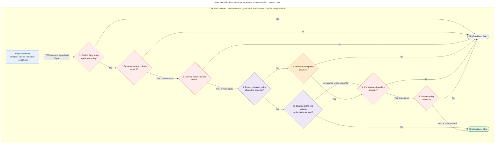

# IAM fundamentals: principals, policies and evaluation

> **Level:** Beginner · **Verified:** 2026-11-15 · **Feature status:** n/a · **Time:** ~20 min

AWS Identity and Access Management (IAM) decides whether every API call is allowed. Calling a model in Amazon Bedrock is an API call like any other, so who may use which model, from where, is expressed entirely in IAM policies.

## Learning objectives

After this chapter you can:

- Name the kinds of principal that can make a request to AWS.
- Distinguish the policy types and say which ones grant permissions and which only limit them.
- Trace a request through the policy evaluation logic and predict the decision.
- Apply least privilege to a policy for model invocation.
- Explain what IAM Access Analyzer checks and what it costs.

## Prerequisites

- [AWS Organizations and AWS Control Tower](../aws-fundamentals/05-organizations-control-tower.md)
- [Amazon CloudWatch and AWS CloudTrail](../aws-fundamentals/04-cloudwatch-cloudtrail.md)

## Concept in plain language

Imagine a building where every door has a guard, and every guard asks the same question: "who are you, what do you want to do, to what, and under what circumstances?" The guard then reads every rulebook that applies.

Two rules never change. **If no rulebook says yes, the answer is no.** And **if any rulebook says no, the answer is no, whatever the others say.** Some rulebooks hand out permissions (your badge, a list on the door). Others only draw a fence around what a badge may ever grant (company-wide rules). You get in only if something says yes and nothing, including every fence, says no.

Terms are defined in the [glossary](../../GLOSSARY.md).

## How it really works

**Principals.** A principal is the authenticated entity that makes a request.

| Principal | What it is | Credentials |
|:--|:--|:--|
| Root user | The identity created with the account; has complete access | Email address and password |
| IAM user | A long-lived identity in one account | Password, access keys |
| IAM role (role session) | An identity that is assumed; see [IAM roles, trust policies and cross-account access](02-iam-roles-and-trust.md) | Temporary credentials |
| Federated principal | A person or workload authenticated by an external identity provider | Temporary credentials |
| AWS service principal | An AWS service acting in your account, such as `bedrock.amazonaws.com` | Managed by AWS |

For each request AWS assembles a **request context**: the principal, the action, the resource, and environment data such as source IP address and time.

**Policy types.** AWS documents nine. A policy is a JSON document whose statements each contain an `Effect` (`Allow` or `Deny`), `Action`, `Resource` and optional `Condition`; resource-based policies also contain a `Principal`.

| Policy type | Attached to | Grants permissions? |
|:--|:--|:-:|
| Identity-based policy (managed or inline) | IAM user, group or role | Yes |
| Resource-based policy | A resource: bucket, key, queue, role (as its trust policy) | Yes |
| VPC endpoint policy | A VPC endpoint | No — a boundary on traffic through that endpoint |
| Permissions boundary | IAM user or role | No — caps what identity-based policies can grant |
| Service control policy (SCP) | Organization root, OU or account | No — caps IAM users and roles in member accounts |
| Resource control policy (RCP) | Organization root, OU or account | No — caps access to resources in member accounts |
| Session policy | One role session, passed when the role is assumed | No — caps that session |
| Access control list (ACL) | Some resources, such as S3 buckets | Yes, cross-account only |
| AWS RAM resource share | Shared resources | Yes — a managed alternative to resource-based policies |

Source: [Policies and permissions in IAM](https://docs.aws.amazon.com/IAM/latest/UserGuide/access_policies.html).

**Evaluation logic.** The AWS enforcement code applies these documented rules:

> [!NOTE]
> **Documented fact** — By default, all requests are implicitly denied (except for the root user). A request must be explicitly allowed by a policy to succeed. An explicit deny overrides an explicit allow.
> Source: [How AWS enforcement code logic evaluates requests](https://docs.aws.amazon.com/IAM/latest/UserGuide/reference_policies_evaluation-logic_policy-eval-denyallow.html)

Within one account, the order is: explicit deny in any policy, then RCPs, SCPs, resource-based policies, identity-based policies, permissions boundaries and session policies. The decision flowchart below follows that order. Three consequences are worth memorising:

- **Same account: union.** If either an identity-based policy or a resource-based policy allows the action, it is allowed (unless something denies it).
- **Guardrail policies: intersection.** SCPs, RCPs, permissions boundaries and session policies never grant anything; when present, each must also allow the action.
- **Cross-account: both sides.** AWS evaluates the request in the caller's account and in the resource's account, and both must return Allow. [Resource-based policies](03-resource-policies.md) covers this.

SCPs and RCPs have documented exceptions: neither affects the organization's management account, and neither restricts service-linked roles. Sources: [SCPs](https://docs.aws.amazon.com/organizations/latest/userguide/orgs_manage_policies_scps.html), [RCPs](https://docs.aws.amazon.com/organizations/latest/userguide/orgs_manage_policies_rcps.html).

**Least privilege** means granting only the actions, on only the resources, under only the conditions a task needs. AWS's own guidance is pragmatic: start with AWS managed policies, then move toward least privilege using real access activity, add conditions, and remove what is unused. Source: [Security best practices in IAM](https://docs.aws.amazon.com/IAM/latest/UserGuide/best-practices.html).

**IAM Access Analyzer** supports that work:

| Capability | What it tells you |
|:--|:--|
| External access analyzer | Which resources are shared outside your account or organization (your "zone of trust") |
| Internal access analyzer | Which principals inside your organization can reach selected critical resources |
| Unused access analyzer | Unused roles, access keys, passwords and permissions |
| Policy validation | Grammar errors, security warnings and suggestions for a policy |
| Custom policy checks | Whether a policy grants new access or specific actions you forbid |
| Policy generation | A policy based on activity recorded in AWS CloudTrail |

External access analysis is Regional: you need an analyzer in every Region where you have resources. Source: [Using IAM Access Analyzer](https://docs.aws.amazon.com/IAM/latest/UserGuide/what-is-access-analyzer.html).

## Architecture diagram



**What this shows** — The order in which AWS evaluates the policies that apply to a request made by an IAM role inside a single account. It is our redrawing of the flow described in the IAM documentation, not an official AWS diagram.

**Walkthrough**

1. AWS looks for a `Deny` statement that matches the request in every applicable policy. One match ends the evaluation.
2. If the resource's account is in an organization and the service supports RCPs, the applicable RCPs must allow the action.
3. If the principal's account is in an organization, the applicable SCPs must allow the action.
4. A resource-based policy that allows the principal can settle the decision without any identity-based policy. If it names the role session or an IAM user directly (4a), the request is allowed. If it names the role's ARN, the permissions boundary and session policy can still block it.
5. Otherwise an identity-based policy must allow the action. No match here is the most common implicit deny.
6. If the role or user has a permissions boundary, it must also allow the action.
7. If a session policy was passed when the role was assumed, it must also allow the action.

| Legend | Meaning |
|:--|:--|
| Diamond | A question AWS answers from your policies |
| Red | Policies that deny or only limit |
| Purple | Resource-based policy |
| Orange | Identity-based policy |
| Rounded box | Final decision |

**Variations** — A resource-based policy that names a whole account (`arn:aws:iam::111122223333:root`) delegates the decision to that account's identity-based policies, so evaluation continues at step 5. AWS KMS key policies and IAM role trust policies are documented exceptions to "either policy can allow": the resource-based policy must allow the principal. For an IAM user there is no session policy step. Cross-account requests run this evaluation twice, once in each account.

## Implementation details

1. **Use roles, not IAM users.** AWS recommends federation for people and roles for workloads so that credentials are temporary. People sign in through IAM Identity Center; see [IAM and IAM Identity Center for Bedrock](../../02-related-aws-services/security/01-iam-and-identity-center.md).
2. **Scope `Resource`.** Name the ARN, not `*`, wherever the action supports resource-level permissions.
3. **Add conditions.** Global condition keys such as `aws:RequestedRegion`, `aws:PrincipalOrgID` and `aws:SourceVpce` let one statement express "only from here".
4. **Use explicit `Deny` sparingly and deliberately.** A deny cannot be overridden, which makes it the right tool for guardrails and the wrong tool for everyday grants.
5. **Validate before deploying.** Run policy validation on every policy change, in the console or in a pipeline.
6. **Review with data.** Generate policies from CloudTrail activity and remove unused access.

> [!TIP]
> **Academy recommendation** — Write each workload role as two small policies: what the workload does (allow, on named resources) and what it must never do (deny). Keep organisation-wide limits in SCPs, not in every role.
> This is our design guidance, not an official AWS reference architecture.

### Why this matters for Bedrock

- **IAM is the model access control.** There is no separate "request access" step any more (see the [feature register](../../FEATURE-VERIFICATION.md) and [Model access and subscriptions](../../01-amazon-bedrock/overview/03-model-access-and-subscriptions.md)), so which principals may call which models is decided by `bedrock:InvokeModel` permissions on model ARNs.
- **Action prefixes differ by endpoint.** Bedrock actions use the `bedrock:` prefix, the `bedrock-mantle` endpoint uses `bedrock-mantle:CreateInference`, and AgentCore uses `bedrock-agentcore:`. A policy written for one does not cover the others. See [Endpoints, APIs and authentication](../../01-amazon-bedrock/overview/02-endpoints-apis-and-authentication.md).
- **Region guardrails interact with cross-Region inference.** AWS documents that SCPs must allow every destination Region of a geographic inference profile, and must allow `"aws:RequestedRegion": "unspecified"` for global profiles. A Region deny written without this in mind breaks inference. See [Cross-Region inference](../../01-amazon-bedrock/inference/04-cross-region-inference.md).
- **Going further:** [Identity, least privilege and IAM isolation for agents](../../06-security-governance/02-identity-and-least-privilege.md) and [Governance at scale](../../06-security-governance/06-governance-at-scale.md).

## Example

An identity-based policy for an application role. The model ID is a placeholder: confirm the current ID in the model catalog before use.

> **Code status:** syntax-checked (JSON parse) · illustrative · **never deployed**

```json
{
  "Version": "2012-10-17",
  "Statement": [
    {
      "Sid": "InvokeOneApprovedModel",
      "Effect": "Allow",
      "Action": [
        "bedrock:InvokeModel",
        "bedrock:InvokeModelWithResponseStream"
      ],
      "Resource": "arn:aws:bedrock:us-east-1::foundation-model/EXAMPLE_MODEL_ID"
    },
    {
      "Sid": "DenyBedrockOutsideTheApprovedRegion",
      "Effect": "Deny",
      "Action": "bedrock:*",
      "Resource": "*",
      "Condition": {
        "StringNotEquals": {
          "aws:RequestedRegion": "us-east-1"
        }
      }
    }
  ]
}
```

| Request by this role | Decision | Why |
|:--|:--|:--|
| `InvokeModel` on the approved model in us-east-1 | Allow | Statement 1 allows it and nothing denies it |
| `InvokeModel` on a different model in us-east-1 | Deny (implicit) | No statement allows that resource |
| Any Bedrock action in eu-west-1, even if another attached policy allows it | Deny (explicit) | Statement 2 matches, and an explicit deny always wins |
| `InvokeModel` through a US geographic inference profile | Deny (implicit) | The inference profile is a different resource that statement 1 does not allow. Region restrictions must also allow every destination Region of a profile |

## Common mistakes

> [!WARNING]
> **Common mistake** — Debugging an `AccessDenied` by adding more `Allow` statements. If the cause is an explicit deny, an SCP or a permissions boundary, no allow will ever help. Work down the flowchart first and find which policy type said no.

| Mistake | Symptom | Fix |
|:--|:--|:--|
| `"Action": "bedrock:*"` with `"Resource": "*"` on an application role | Any model, any feature, any cost | Name the actions and the model or inference profile ARNs |
| Expecting an SCP to grant access | Still denied although the SCP "allows" it | SCPs only limit; add an identity-based or resource-based allow |
| Region-deny SCP plus cross-Region inference | Inference fails intermittently or always | Allow the profile's destination Regions, or `unspecified` for global profiles |
| Long-lived access keys for workloads | Keys leak into code and logs | Use roles and temporary credentials |
| Access Analyzer enabled in one Region only | Shared resources elsewhere go unreported | Create an external access analyzer in every Region you use |

## Security considerations

- Protect the root user with multi-factor authentication and do not use it for daily work.
- Prefer temporary credentials everywhere; require multi-factor authentication for people.
- Treat permission to edit policies (`iam:*`) as equivalent to the permissions it could grant.
- AWS CloudTrail records API activity, including requests that were denied. [AWS CloudTrail for Bedrock](../../02-related-aws-services/security/05-cloudtrail-for-bedrock.md) covers what Bedrock logs.
- Use permissions boundaries when you delegate role creation to teams or pipelines.

## Cost considerations

- IAM, IAM Identity Center and AWS STS are offered at no additional charge. Source: [What is IAM?](https://docs.aws.amazon.com/IAM/latest/UserGuide/introduction.html)
- In IAM Access Analyzer, external access analysis, policy validation and policy generation have no additional charge. Internal access analysis is charged per monitored resource per month, unused access analysis per IAM role or user per month, and custom policy checks per API call. Source: [IAM Access Analyzer pricing](https://aws.amazon.com/iam/access-analyzer/pricing/).
- The real cost lever is indirect: an over-broad Bedrock permission lets any caller choose the most expensive model.

## Knowledge check

1. A role has an identity-based policy that allows `bedrock:InvokeModel` on all models. The account's SCP does not mention Bedrock at all and contains no `FullAWSAccess` statement. Is the call allowed?
2. An S3 bucket policy allows `s3:GetObject` for a role in the same account. The role has no identity-based policy for S3 and no permissions boundary. Can it read the object?
3. What would happen if you attached `AdministratorAccess` to the application role in the example?

<details>
<summary>Answers</summary>

1. No. SCPs do not grant, but they must allow: an action that no applicable SCP allows is implicitly denied.
2. Yes. Within one account, a resource-based policy that names the principal is enough.
3. Calls in us-east-1 would be allowed for every service and model. Bedrock calls in any other Region would still be denied, because the explicit deny overrides the administrator allow.

</details>

## Further reading

Official sources opened while writing this chapter:

- [What is IAM?](https://docs.aws.amazon.com/IAM/latest/UserGuide/introduction.html) — identities, access management, cost statement.
- [How IAM works](https://docs.aws.amazon.com/IAM/latest/UserGuide/intro-structure.html) — principals, request context, authorisation basics.
- [Policies and permissions in IAM](https://docs.aws.amazon.com/IAM/latest/UserGuide/access_policies.html) — the nine policy types.
- [Policy evaluation logic](https://docs.aws.amazon.com/IAM/latest/UserGuide/reference_policies_evaluation-logic.html) — union and intersection rules.
- [How AWS enforcement code logic evaluates requests](https://docs.aws.amazon.com/IAM/latest/UserGuide/reference_policies_evaluation-logic_policy-eval-denyallow.html) — the evaluation order used in the flowchart.
- [Policy evaluation for requests within a single account](https://docs.aws.amazon.com/IAM/latest/UserGuide/reference_policies_evaluation-logic_policy-eval-basics.html) — worked example.
- [Cross-account policy evaluation logic](https://docs.aws.amazon.com/IAM/latest/UserGuide/reference_policies_evaluation-logic-cross-account.html) — two evaluations.
- [AWS JSON policy elements: Principal](https://docs.aws.amazon.com/IAM/latest/UserGuide/reference_policies_elements_principal.html) — account, role, session and service principals.
- [Permissions boundaries for IAM entities](https://docs.aws.amazon.com/IAM/latest/UserGuide/access_policies_boundaries.html) — effective permissions with boundaries.
- [Service control policies](https://docs.aws.amazon.com/organizations/latest/userguide/orgs_manage_policies_scps.html) and [Resource control policies](https://docs.aws.amazon.com/organizations/latest/userguide/orgs_manage_policies_rcps.html) — organisation-level limits and their exceptions.
- [Security best practices in IAM](https://docs.aws.amazon.com/IAM/latest/UserGuide/best-practices.html) — least privilege guidance.
- [Using IAM Access Analyzer](https://docs.aws.amazon.com/IAM/latest/UserGuide/what-is-access-analyzer.html) and [IAM Access Analyzer pricing](https://aws.amazon.com/iam/access-analyzer/pricing/) — capabilities and charges.
- [How Amazon Bedrock works with IAM](https://docs.aws.amazon.com/bedrock/latest/userguide/security_iam_service-with-iam.html) — Bedrock action prefix and supported IAM features.
- [Cross-Region inference](https://docs.aws.amazon.com/bedrock/latest/userguide/cross-region-inference.html) — SCP requirements for inference profiles.
