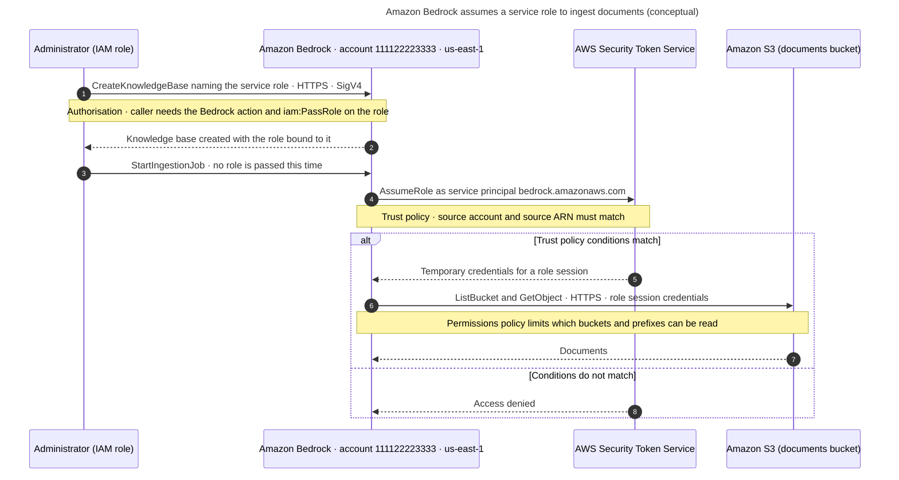

# IAM roles, trust policies and cross-account access

> **Level:** Beginner · **Verified:** 2026-11-15 · **Feature status:** n/a · **Time:** ~20 min

A role is how anything in AWS borrows permissions for a short time: a Lambda function, a pipeline, a person from another account, or Amazon Bedrock itself. Most Bedrock features that touch your data work by assuming a role that you define.

## Learning objectives

After this chapter you can:

- Explain how a role differs from an IAM user and what the two policies on a role do.
- Read a trust policy and say exactly who can assume the role.
- Distinguish service roles from service-linked roles.
- Set up both halves of cross-account access.
- Recognise the confused-deputy problem and prevent it with condition keys.
- Describe how OIDC federation gives a pipeline temporary credentials without stored keys.

## Prerequisites

- [IAM fundamentals: principals, policies and evaluation](01-iam-fundamentals.md)

## Concept in plain language

A role is a uniform on a hook, with no owner and no key of its own. Two labels are sewn into it. The **trust policy** lists who may put it on. The **permissions policy** lists what the wearer may do.

Whoever puts the uniform on receives a visitor badge that expires. While wearing it they have the uniform's permissions and none of their own.

The **confused deputy** is a trusted helper who wears your uniform and can be talked into using it for a stranger. The cure is to write on the label not just *who* may wear it but *on whose behalf*.

## How it really works

| | IAM user | IAM role |
|:--|:--|:--|
| Belongs to | One person or workload | Whoever the trust policy allows |
| Credentials | Long-term password or access keys | None of its own; temporary credentials for each session |
| Policies | Identity-based | Identity-based (permissions) **and** a trust policy |
| AWS guidance | Only where federation or roles are not possible | Preferred for people and workloads |

Source: [IAM roles](https://docs.aws.amazon.com/IAM/latest/UserGuide/id_roles.html).

**Two policies.** The trust policy is a resource-based policy attached to the role; it is required, and it is the only resource-based policy type that IAM itself supports. Its `Principal` element names who may assume the role:

| `Principal` key | Trusts | Action used |
|:--|:--|:--|
| `"AWS"` | An account, IAM user or IAM role | `sts:AssumeRole` |
| `"Service"` | An AWS service principal, such as `bedrock.amazonaws.com` | `sts:AssumeRole` |
| `"Federated"` | An external identity provider (OIDC or SAML) | `sts:AssumeRoleWithWebIdentity`, `sts:AssumeRoleWithSAML` |

You cannot use a wildcard inside a principal ARN in a trust policy.

**Sessions.** Assuming a role returns temporary security credentials for a role session. The requested duration can be up to 43,200 seconds (12 hours), depending on the role's maximum session duration; when one role is used to assume another (role chaining) the session is limited to one hour.

**Service roles and service-linked roles.**

| | Service role | Service-linked role |
|:--|:--|:--|
| Created by | You (or a console on your behalf) | The service, or you through the service |
| Permissions | You write and can change them | Predefined by the service; you can view but not edit them |
| Trust policy | You write it | Defined by the service |
| Restricted by SCPs | Yes | No |
| Bedrock examples | Knowledge base, batch inference and model customization roles; AgentCore Runtime execution role | `AWSServiceRoleForBedrockAgentCoreNetwork`, which AgentCore uses to create network interfaces in your VPC |

> [!NOTE]
> **Documented fact** — Amazon Bedrock supports service roles and does not use service-linked roles. Its console creates service roles automatically for supported features, or you can supply a custom one.
> Sources: [How Amazon Bedrock works with IAM](https://docs.aws.amazon.com/bedrock/latest/userguide/security_iam_service-with-iam.html), [Service roles](https://docs.aws.amazon.com/bedrock/latest/userguide/security-iam-sr.html)

**Passing a role.** To configure a service with a role, the caller needs `iam:PassRole` on that role; the service checks it. A role can only be passed to a service in the same account. This check stops a user from running a job with a more powerful role than their own. Source: [Grant a user permissions to pass a role](https://docs.aws.amazon.com/IAM/latest/UserGuide/id_roles_use_passrole.html).

**Cross-account access has two halves.** The account that owns the role (the *trusting* account) names the other account, or a role in it, in the trust policy. The *trusted* account then allows its own principal to call `sts:AssumeRole` on that role ARN. Neither half works alone. A principal that assumes a role gives up its original permissions for the session, unlike one named directly in a resource-based policy ([Resource-based policies](03-resource-policies.md)).

**The confused deputy.** AWS documents two forms and a control for each:

| Form | Example | Control in the trust or resource policy |
|:--|:--|:--|
| Cross-account | A SaaS vendor's account assumes roles for many customers | `sts:ExternalId`, a value the vendor generates per customer |
| Cross-service | An AWS service principal acts for many accounts | `aws:SourceArn`, `aws:SourceAccount`, `aws:SourceOrgID`, `aws:SourceOrgPaths` |

A trust policy that says only "`bedrock.amazonaws.com` may assume this role" trusts the service acting for *any* customer. The condition keys add "…when acting for this account and this resource". Source: [The confused deputy problem](https://docs.aws.amazon.com/IAM/latest/UserGuide/confused-deputy.html).

**OIDC federation.** A workload outside AWS, such as a CI/CD job, obtains a signed JSON Web Token from its OpenID Connect provider and exchanges it for temporary credentials with `sts:AssumeRoleWithWebIdentity`. The trust policy names the provider as a `Federated` principal and tests token claims. For GitHub, IAM refuses to save a trust policy that does not test the `token.actions.githubusercontent.com:sub` claim; the same applies to `app.terraform.io:sub` for HCP Terraform. Source: [Create a role for OIDC federation](https://docs.aws.amazon.com/IAM/latest/UserGuide/id_roles_create_for-idp_oidc.html).

## Architecture diagram



**What this shows** — The life of a Bedrock service role: passed once, by someone allowed to pass it, and assumed later by the service each time work is done. The exchange with AWS STS is a conceptual model of "Amazon Bedrock assumes this role"; AWS does not document the internal calls.

**Walkthrough**

1. An administrator creates a knowledge base and names the service role. The service authorises the request, including the caller's permission to pass that role.
2. Bedrock confirms creation; the role is now bound to the knowledge base.
3. Later, someone starts an ingestion job. No role is passed, so no `iam:PassRole` check happens.
4. Bedrock assumes the role as its service principal. The trust policy's conditions decide whether that is allowed.
5. If they match, Bedrock receives temporary credentials for a role session.
6. Bedrock reads the bucket with those credentials; the role's permissions policy limits what it can read.
7. Amazon S3 returns the documents.
8. If the conditions do not match, the role cannot be assumed and the job fails with an access error.

| Legend | Meaning |
|:--|:--|
| Solid arrow | Request |
| Dashed arrow | Response |
| Note | Security control evaluated at that point |
| `alt` block | The two possible outcomes of the trust policy check |

**Variations** — AgentCore Runtime follows the same pattern with a different service principal, `bedrock-agentcore.amazonaws.com`, and AWS Lambda does the same with a function's execution role. In cross-account access the caller in message 4 is a principal in another account; for a third party the condition to test is `sts:ExternalId`.

## Implementation details

1. **One role per workload**, named for what it does.
2. **Write the trust policy first.** Name the exact service principal, add `aws:SourceAccount`, and add `aws:SourceArn` as soon as the resource ID is known. Bedrock's documentation recommends replacing the `*` in the ARN with specific IDs after creation.
3. **Scope `iam:PassRole`** to named role ARNs. `"Resource": "*"` on `iam:PassRole` lets a user hand any role to a service.
4. **Never guess a service principal.** IAM warns that the name is case-sensitive and varies between services; take it from the service's documentation.
5. **Do not delete and recreate a role that other policies name.** A role ARN in a trust policy is stored as the role's unique ID; a recreated role has a new ID and the old reference stops matching.
6. **For CI/CD use OIDC**, with the `aud` and `sub` claims pinned to your organization, repository and branch.

### Why this matters for Bedrock

Documented trust policies for Bedrock features, all with `aws:SourceAccount` set to your account ID:

| Feature | Service principal | `aws:SourceArn` pattern |
|:--|:--|:--|
| Knowledge bases | `bedrock.amazonaws.com` | `arn:aws:bedrock:REGION:ACCOUNT:knowledge-base/*` |
| Batch inference | `bedrock.amazonaws.com` | `arn:aws:bedrock:REGION:ACCOUNT:model-invocation-job/*` |
| Model customization | `bedrock.amazonaws.com` | `arn:aws:bedrock:REGION:ACCOUNT:model-customization-job/*` |
| Model invocation logging to CloudWatch Logs | `bedrock.amazonaws.com` | `arn:aws:bedrock:REGION:ACCOUNT:*` |
| AgentCore Runtime execution role | `bedrock-agentcore.amazonaws.com` | `arn:aws:bedrock-agentcore:REGION:ACCOUNT:*` |

Two Bedrock-specific warnings from the documentation:

- A user who can pass a role to Bedrock can make Bedrock use that role's permissions. If Alice may not invoke a custom model but can pass a role to an evaluation job that can, the job invokes it for her.
- Managing data sources does not pass a role, so anyone who can create a data source and start ingestion can read whatever the knowledge base's role can read, then query it. Grant that role only the buckets and prefixes it needs.

Where these roles are used: [Managed Knowledge Base](../../01-amazon-bedrock/knowledge-bases/02-managed-knowledge-base.md), [Batch inference](../../01-amazon-bedrock/inference/08-batch-inference.md), [Model customization](../../01-amazon-bedrock/foundation-models/03-model-customization.md), [AgentCore Runtime](../../01-amazon-bedrock/agentcore/02-agentcore-runtime.md), [Identity, least privilege and IAM isolation for agents](../../06-security-governance/02-identity-and-least-privilege.md) and [GitHub Actions for IaC](../../07-devops-and-cicd/04-github-actions.md).

## Example

The trust policy of a service role that Amazon Bedrock assumes for knowledge bases in one account and Region.

> **Code status:** syntax-checked (JSON parse) · follows the Bedrock documentation, with placeholder account and Region · **never deployed**

```json
{
  "Version": "2012-10-17",
  "Statement": [
    {
      "Sid": "BedrockKnowledgeBasesInThisAccountOnly",
      "Effect": "Allow",
      "Principal": {
        "Service": "bedrock.amazonaws.com"
      },
      "Action": "sts:AssumeRole",
      "Condition": {
        "StringEquals": {
          "aws:SourceAccount": "111122223333"
        },
        "ArnLike": {
          "aws:SourceArn": "arn:aws:bedrock:us-east-1:111122223333:knowledge-base/*"
        }
      }
    }
  ]
}
```

For comparison, a trust policy for OIDC federation from one branch of one GitHub repository, as used by a deployment pipeline. The organization and repository names are placeholders.

> **Code status:** syntax-checked (JSON parse) · follows the IAM documentation · **never deployed**

```json
{
  "Version": "2012-10-17",
  "Statement": [
    {
      "Sid": "GitHubActionsFromOneRepositoryBranch",
      "Effect": "Allow",
      "Principal": {
        "Federated": "arn:aws:iam::111122223333:oidc-provider/token.actions.githubusercontent.com"
      },
      "Action": "sts:AssumeRoleWithWebIdentity",
      "Condition": {
        "StringEquals": {
          "token.actions.githubusercontent.com:aud": "sts.amazonaws.com",
          "token.actions.githubusercontent.com:sub": "repo:example-org/example-repo:ref:refs/heads/main"
        }
      }
    }
  ]
}
```

## Common mistakes

> [!WARNING]
> **Common mistake** — A trust policy for a service principal with no `Condition`. It works in every test, which is why it survives. It also lets the service assume your role while acting for a resource in someone else's account.

| Mistake | Symptom | Fix |
|:--|:--|:--|
| Only one half of cross-account access configured | `AccessDenied` on `sts:AssumeRole` | Trust policy in the role's account **and** an identity-based allow in the caller's account |
| Trusting a whole third-party account without an external ID | Any of the vendor's customers who learns your role ARN can be served with it | Require `sts:ExternalId` |
| `iam:PassRole` on `*` | A developer runs a job with an administrator role | Limit to named role ARNs; consider the `iam:PassedToService` condition key |
| `sub` claim matched with a broad wildcard | Workflows in repositories you do not control can assume the role | Pin organization, repository and branch |
| Expecting 12-hour sessions after role chaining | Credentials expire after one hour | Assume the target role directly, or refresh |
| Editing a Bedrock-created service role casually | A feature stops working | Change service roles only as the Bedrock documentation directs |

## Security considerations

- The trust policy is the perimeter of a role. IAM Access Analyzer's external access analyzer reports roles that can be assumed from outside your zone of trust.
- Use `aws:SourceArn` and `aws:SourceAccount` wherever a service principal is trusted.
- A leaked session works until it expires; keep durations short for powerful roles.
- Role assumption is an AWS STS API call, so it appears in AWS CloudTrail like other API activity.

## Cost considerations

- Roles, trust policies and AWS STS calls have no additional charge.
- **Our reading:** usage is charged to the account that owns the role making the call, so assuming a role in another account moves the Bedrock cost there. [Pattern: multi-account generative AI platform](../../03-architecture-patterns/multi-account/README.md) relies on this.

## Knowledge check

1. A role's trust policy allows `"Service": "bedrock.amazonaws.com"` with no conditions. What can go wrong, and what two keys close the gap?
2. A developer in account A must read a bucket in account B through a role in account B. List everything that must be configured.
3. What would happen if you deleted a role named in another role's trust policy and created a new role with the same name?

<details>
<summary>Answers</summary>

1. Bedrock, acting for a resource in another customer's account, could be made to assume your role (cross-service confused deputy). `aws:SourceAccount` and `aws:SourceArn` restrict the role to requests made for your account and resource.
2. In B: a role whose trust policy names account A (or the developer's role) and whose permissions policy allows the S3 actions. In A: an identity-based policy that allows `sts:AssumeRole` on that role's ARN.
3. The trust policy would stop matching, because it stores the deleted role's unique ID. You must edit the trust policy to reference the new role.

</details>

## Further reading

Official sources opened while writing this chapter:

- [What is IAM?](https://docs.aws.amazon.com/IAM/latest/UserGuide/introduction.html) — IAM and AWS STS cost statement.
- [IAM roles](https://docs.aws.amazon.com/IAM/latest/UserGuide/id_roles.html) — terms, service and service-linked roles, role chaining, session duration.
- [AWS JSON policy elements: Principal](https://docs.aws.amazon.com/IAM/latest/UserGuide/reference_policies_elements_principal.html) — principal types and the role ID behaviour.
- [Cross account resource access in IAM](https://docs.aws.amazon.com/IAM/latest/UserGuide/id_roles_compare-resource-policies.html) — roles versus resource-based policies.
- [The confused deputy problem](https://docs.aws.amazon.com/IAM/latest/UserGuide/confused-deputy.html) — external ID and source condition keys.
- [Grant a user permissions to pass a role to an AWS service](https://docs.aws.amazon.com/IAM/latest/UserGuide/id_roles_use_passrole.html) — `iam:PassRole`.
- [Create a service-linked role](https://docs.aws.amazon.com/IAM/latest/UserGuide/id_roles_create-service-linked-role.html) — how service-linked roles differ.
- [OIDC federation](https://docs.aws.amazon.com/IAM/latest/UserGuide/id_roles_providers_oidc.html) and [Create a role for OpenID Connect federation](https://docs.aws.amazon.com/IAM/latest/UserGuide/id_roles_create_for-idp_oidc.html) — trust policies for identity providers, GitHub and HCP Terraform rules.
- [Service control policies](https://docs.aws.amazon.com/organizations/latest/userguide/orgs_manage_policies_scps.html) — service-linked roles are not restricted.
- [Service roles (Amazon Bedrock)](https://docs.aws.amazon.com/bedrock/latest/userguide/security-iam-sr.html) and [How Amazon Bedrock works with IAM](https://docs.aws.amazon.com/bedrock/latest/userguide/security_iam_service-with-iam.html) — Bedrock's use of roles.
- [Cross-service confused deputy prevention (Amazon Bedrock)](https://docs.aws.amazon.com/bedrock/latest/userguide/cross-service-confused-deputy-prevention.html) — model customization trust policy.
- [Create a service role for Amazon Bedrock Knowledge Bases](https://docs.aws.amazon.com/bedrock/latest/userguide/kb-permissions.html) — trust policy used in the example; data source warning.
- [Create a custom service role for batch inference](https://docs.aws.amazon.com/bedrock/latest/userguide/batch-iam-sr.html) — batch trust policy.
- [Monitor model invocation using CloudWatch Logs and Amazon S3](https://docs.aws.amazon.com/bedrock/latest/userguide/model-invocation-logging.html) — logging role trust policy.
- [IAM permissions for AgentCore Runtime](https://docs.aws.amazon.com/bedrock-agentcore/latest/devguide/runtime-permissions.html) — execution role trust policy.
- [Configure AgentCore Runtime and tools for VPC](https://docs.aws.amazon.com/bedrock-agentcore/latest/devguide/agentcore-vpc.html) — the AgentCore service-linked role.
