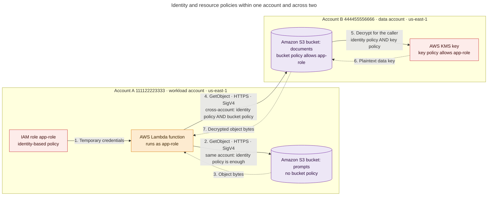

# Resource-based policies

> **Level:** Beginner · **Verified:** 2026-11-15 · **Feature status:** n/a · **Time:** ~20 min

A resource-based policy is attached to the thing being accessed (a bucket, a key, a queue) rather than to the caller. It is how Amazon Bedrock is allowed to write logs to your bucket or use your encryption key, and how resources are shared across accounts.

## Learning objectives

After this chapter you can:

- Explain how a resource-based policy differs from an identity-based policy.
- Recognise the resource-based policies of Amazon S3, AWS KMS, AWS Lambda, Amazon SQS, Amazon SNS and VPC endpoints.
- Predict the outcome when identity and resource policies combine, inside one account and across two.
- Write a policy that lets an AWS service principal act for your account only.
- Find unintended external access with IAM Access Analyzer.

## Prerequisites

- [IAM fundamentals: principals, policies and evaluation](01-iam-fundamentals.md)
- [IAM roles, trust policies and cross-account access](02-iam-roles-and-trust.md)

## Concept in plain language

An identity-based policy is a badge that lists the rooms its holder may enter. A resource-based policy is a list pinned to one door naming who may come in.

Inside your own building, either is enough. A visitor from another company needs **both**: their employer must let them go, and your door list must name them. A few doors, such as the vault, ignore badges unless the door list says badges count.

## How it really works

A resource-based policy is a JSON policy document that must contain a `Principal` element. It is always inline: it exists only as part of the resource. Principals can be accounts, IAM users, IAM roles, role sessions, federated principals or AWS services.

| Resource | Policy name | Rules worth knowing |
|:--|:--|:--|
| Amazon S3 bucket | Bucket policy | Covers the bucket and the objects the bucket owner owns. Access control lists are disabled by default |
| AWS KMS key | Key policy | Every key has exactly one. IAM policies have no effect on a key unless its key policy enables them. Applies in one Region |
| AWS Lambda function | Resource-based policy | A full JSON policy (up to 20 KB) or individual statements added one at a time; allows services and other accounts to invoke |
| Amazon SQS queue | Queue access policy | Can grant other accounts, which IAM identity-based policies cannot |
| Amazon SNS topic | Topic access policy | A new topic is accessible only to its owner until a policy grants more |
| IAM role | Trust policy | Decides who can assume the role |
| VPC endpoint | Endpoint policy | Limits what can pass through the endpoint; grants nothing |
| Amazon Bedrock guardrail and guardrail profile | Resource-based policy | Only a restricted set of statement patterns; required for organization-level enforced guardrails |
| AgentCore Runtime, runtime endpoint, Gateway, Memory | Resource-based policy | Cross-account invocation needs a policy on both the runtime and its endpoint |

Sources are listed per service in [Further reading](#further-reading).

**How identity and resource policies combine.**

| Identity-based policy | Resource-based policy | Same account | Cross-account |
|:--|:--|:-:|:-:|
| Allows | Silent | Allow | Deny |
| Silent | Allows the principal | Allow | Deny |
| Allows | Allows the principal | Allow | Allow |
| Either one explicitly denies | — | Deny | Deny |

> [!NOTE]
> **Documented fact** — Within the same account, if either the identity-based policy or the resource-based policy allows the request and the other does not, the request is still allowed. In cross-account access, a principal needs an `Allow` in the identity policy **and** the resource-based policy.
> Sources: [Policy evaluation within a single account](https://docs.aws.amazon.com/IAM/latest/UserGuide/reference_policies_evaluation-logic_policy-eval-basics.html), [Cross account resource access in IAM](https://docs.aws.amazon.com/IAM/latest/UserGuide/id_roles_compare-resource-policies.html)

Three refinements:

- **Exceptions to "either can allow".** KMS key policies and IAM role trust policies must explicitly allow the principal, even in the same account.
- **Naming an account delegates.** `"Principal": {"AWS": "arn:aws:iam::444455556666:root"}` does not mean the root user. That account's administrators can grant the access onward with identity-based policies, up to what you allowed.
- **Organization policies sit above both.** SCPs limit your principals; RCPs limit access to your resources, including by principals outside your organization. RCPs apply only to a documented list of services, which includes Amazon S3, AWS KMS, Amazon SQS, Amazon SNS, AWS Secrets Manager and AWS STS; Amazon Bedrock is not on the list as read on the verification date. Source: [Resource control policies](https://docs.aws.amazon.com/organizations/latest/userguide/orgs_manage_policies_rcps.html).

**Service principals.** When the principal is an AWS service, the policy authorises the service, not the customer who configured it. Add `aws:SourceAccount` and, where you can, `aws:SourceArn` so that it is allowed only when acting for your account and resource (the confused deputy from [the roles chapter](02-iam-roles-and-trust.md)).

**Network conditions.** Resource policies can also test where a request came from: `aws:SourceVpce` (a specific VPC endpoint) and `aws:SourceVpc`. AWS warns that such bucket policies can block all access, including the console, if the ID is wrong.

## Architecture diagram



**What this shows** — One function reading from two buckets. In its own account the role's identity-based policy is enough. In another account three policies must line up: the role's identity-based policy, the bucket policy and the key policy.

**Walkthrough**

1. The Lambda function runs with temporary credentials for `app-role`.
2. It reads from a bucket in the same account. The bucket has no policy; the role's identity-based policy allows `s3:GetObject`, which is sufficient.
3. Amazon S3 returns the object.
4. It reads from a bucket in account B. AWS evaluates account A (identity-based policy) and account B (bucket policy); both must allow.
5. The object is encrypted with a KMS key in account B, so Amazon S3 asks AWS KMS to decrypt for the caller, who needs `kms:Decrypt` in its identity-based policy and in the key policy.
6. AWS KMS returns the data key to Amazon S3.
7. Amazon S3 returns the decrypted object.

| Legend | Meaning |
|:--|:--|
| Solid arrow | Request |
| Dashed arrow | Response |
| Cylinder | Data store with its resource-based policy |
| Red boxes | IAM role and KMS key |
| Outer boxes | Account boundaries (trust boundaries) |

**Variations** — If the bucket policy in account B named the whole account A instead of `app-role`, step 4 would still need the role's identity-based policy; nothing else changes. If account A were outside account B's organization and that organization attached an RCP denying external principals, steps 4 and 5 would fail regardless of the bucket and key policies. Alternatively the function can assume a role in account B, trading two resource policies for one trust policy.

## Implementation details

1. **Decide which side owns the rule**: the resource-based policy for "who may touch this data", the identity-based policy for "what this workload does".
2. **Name roles, not accounts,** when the set of callers is small and stable; name the account and delegate when the other team manages its own roles.
3. **Add conditions to every service-principal statement.**
4. **Remember the key.** Access to encrypted data needs the key policy as well as the data's policy; see [AWS KMS and encryption](04-kms-encryption.md).
5. **Edit Lambda policies carefully.** Putting a full JSON policy replaces statements that were added individually.
6. **Check the result.** IAM Access Analyzer's external access analyzer reports buckets, keys, roles, functions, queues, topics and secrets shared outside your zone of trust, and can preview a policy's effect before you deploy it.

> [!TIP]
> **Academy recommendation** — For data buckets, write the bucket policy as an explicit allow for named roles and service principals, and let an RCP carry the organisation-wide "nobody outside our organization" rule.
> This is our design guidance, not an official AWS reference architecture.

### Why this matters for Bedrock

- **Bedrock acts on your resources as a service principal.** Model invocation logging to Amazon S3 works only if the bucket policy lets `bedrock.amazonaws.com` put objects (the example below). See [AWS CloudTrail for Bedrock](../../02-related-aws-services/security/05-cloudtrail-for-bedrock.md) and [Logging, audit and compliance evidence](../../06-security-governance/07-logging-audit-and-compliance.md).
- **Some Bedrock resources have their own resource-based policies.** Guardrails and guardrail profiles use them for sharing and for organization-level enforcement ([Automated Reasoning checks and guardrail enforcement](../../01-amazon-bedrock/guardrails/02-automated-reasoning-and-enforcement.md)). AgentCore Runtime, Gateway and Memory use them for cross-account invocation ([AgentCore Runtime](../../01-amazon-bedrock/agentcore/02-agentcore-runtime.md), [AgentCore Gateway](../../01-amazon-bedrock/agentcore/04-agentcore-gateway.md)); a runtime or gateway that authenticates callers with OAuth must use `"Principal": "*"` narrowed by conditions.
- **Knowledge base data sources** in Amazon S3 are governed by the bucket policy as well as the service role; see [Amazon S3 and Amazon S3 Vectors](../../02-related-aws-services/storage/01-amazon-s3-and-s3-vectors.md).
- **Shared platforms** build on these rules: [Pattern: multi-account generative AI platform](../../03-architecture-patterns/multi-account/README.md), [Governance at scale](../../06-security-governance/06-governance-at-scale.md).

> [!IMPORTANT]
> **Status** — The Bedrock IAM page read on 2026-11-15 names guardrails and guardrail inference profiles as the Bedrock resources that support resource-based policies. The [feature register](../../FEATURE-VERIFICATION.md) also lists a CloudFormation type `AWS::Bedrock::KnowledgeBasePolicy`; what it attaches to and how it is evaluated is **UNVERIFIED — REQUIRES DOCUMENTATION REVIEW** (no documentation page for it was opened).
> Source: [How Amazon Bedrock works with IAM](https://docs.aws.amazon.com/bedrock/latest/userguide/security_iam_service-with-iam.html)

## Example

A bucket policy that lets Amazon Bedrock deliver model invocation logs for one account and Region. The bucket name and prefix are placeholders.

> **Code status:** syntax-checked (JSON parse) · follows the Bedrock documentation, with placeholder names · **never deployed**

```json
{
  "Version": "2012-10-17",
  "Statement": [
    {
      "Sid": "AmazonBedrockLogsWrite",
      "Effect": "Allow",
      "Principal": {
        "Service": "bedrock.amazonaws.com"
      },
      "Action": "s3:PutObject",
      "Resource": "arn:aws:s3:::amzn-s3-demo-bucket/bedrock-logs/AWSLogs/111122223333/BedrockModelInvocationLogs/*",
      "Condition": {
        "StringEquals": {
          "aws:SourceAccount": "111122223333"
        },
        "ArnLike": {
          "aws:SourceArn": "arn:aws:bedrock:us-east-1:111122223333:*"
        }
      }
    }
  ]
}
```

Read it as a sentence: the Bedrock service (`Principal`) may write objects (`Action`) under one prefix (`Resource`), but only when it acts for account 111122223333 in us-east-1 (`Condition`). The documentation notes that the bucket must be in the same account and Region as the logging configuration and that bucket ACLs must be disabled for the policy to take effect.

## Common mistakes

> [!WARNING]
> **Common mistake** — `"Principal": "*"` with no condition. On a bucket, queue or topic this means everyone, including callers outside your organization. Use it only together with a condition such as `aws:PrincipalOrgID`, `aws:SourceVpce` or `aws:SourceArn`.

| Mistake | Symptom | Fix |
|:--|:--|:--|
| Cross-account bucket policy written, caller's identity policy forgotten | `AccessDenied` from the other account | Both sides must allow |
| Bucket uses a KMS key whose key policy does not allow the caller | `AccessDenied` on `GetObject` although Amazon S3 permissions are correct | Allow `kms:Decrypt` in the key policy and the identity policy |
| Service principal allowed without `aws:SourceAccount` | The service can write to your resource while acting for another account | Add `aws:SourceAccount` and `aws:SourceArn` |
| Bucket policy denies everything not from one VPC endpoint | Console access and service deliveries stop | Scope the deny, and test with a second role before applying |
| Full Lambda policy put over existing permissions | Triggers stop invoking the function | Read the existing policy first and include its statements |
| Expecting an endpoint policy or SCP to grant access | Still denied | Those policy types only limit |

## Security considerations

- Resource-based policies, including role trust policies, are how principals outside your account get access, so review them as your external perimeter. IAM Access Analyzer external access analysis has no additional charge.
- Use `Deny` statements for rules that must hold whatever identity policies say, such as "only through this VPC endpoint".
- Use RCPs to state organisation-wide limits once, for the services that support them.
- Changes to bucket, key, queue and function policies are API calls recorded in AWS CloudTrail.

## Cost considerations

- Policies are configuration, not billed resources, and IAM has no additional charge.
- Cross-account access moves some charges: when a principal uses a KMS key in another account, the account that makes the request pays for the key usage. Source: [AWS KMS pricing](https://aws.amazon.com/kms/pricing/).

## Knowledge check

1. A role and a queue are in the same account. The queue policy allows the role to send messages; the role has no SQS permissions. Can it send?
2. The same queue policy now names a role in a different account. What else is needed?
3. What would happen if you removed the `Condition` block from the example bucket policy?

<details>
<summary>Answers</summary>

1. Yes. Within one account an allow in the resource-based policy is sufficient.
2. An identity-based policy in the other account that allows the role to send to that queue's ARN. Cross-account access needs both.
3. Log delivery would still work, but the policy would trust the Bedrock service principal whatever account or resource it was acting for. The condition keys are what tie the permission to your account; this is the cross-service confused deputy protection AWS recommends wherever a service principal is granted access.

</details>

## Further reading

Official sources opened while writing this chapter:

- [Policies and permissions in IAM](https://docs.aws.amazon.com/IAM/latest/UserGuide/access_policies.html) — definition of resource-based policies.
- [Policy evaluation for requests within a single account](https://docs.aws.amazon.com/IAM/latest/UserGuide/reference_policies_evaluation-logic_policy-eval-basics.html) and [Cross-account policy evaluation logic](https://docs.aws.amazon.com/IAM/latest/UserGuide/reference_policies_evaluation-logic-cross-account.html) — how the policies combine.
- [How AWS enforcement code logic evaluates requests](https://docs.aws.amazon.com/IAM/latest/UserGuide/reference_policies_evaluation-logic_policy-eval-denyallow.html) — the KMS and trust policy exceptions.
- [Cross account resource access in IAM](https://docs.aws.amazon.com/IAM/latest/UserGuide/id_roles_compare-resource-policies.html) — delegation and roles versus resource policies.
- [AWS JSON policy elements: Principal](https://docs.aws.amazon.com/IAM/latest/UserGuide/reference_policies_elements_principal.html) — account and service principals.
- [The confused deputy problem](https://docs.aws.amazon.com/IAM/latest/UserGuide/confused-deputy.html) — source condition keys in resource policies.
- [Bucket policies for Amazon S3](https://docs.aws.amazon.com/AmazonS3/latest/userguide/bucket-policies.html) and [Controlling access from VPC endpoints with bucket policies](https://docs.aws.amazon.com/AmazonS3/latest/userguide/example-bucket-policies-vpc-endpoint.html) — bucket policies and network conditions.
- [Key policies in AWS KMS](https://docs.aws.amazon.com/kms/latest/developerguide/key-policies.html) and [Allowing users in other accounts to use a KMS key](https://docs.aws.amazon.com/kms/latest/developerguide/key-policy-modifying-external-accounts.html) — key policy rules.
- [Working with resource-based policies in Lambda](https://docs.aws.amazon.com/lambda/latest/dg/access-control-resource-based.html) — full policies and individual permissions.
- [Using policies with Amazon SQS](https://docs.aws.amazon.com/AWSSimpleQueueService/latest/SQSDeveloperGuide/sqs-using-identity-based-policies.html) — queue policies and IAM policies together.
- [Example cases for Amazon SNS access control](https://docs.aws.amazon.com/sns/latest/dg/sns-access-policy-use-cases.html) — topic policies and defaults.
- [Control access to VPC endpoints using endpoint policies](https://docs.aws.amazon.com/vpc/latest/privatelink/vpc-endpoints-access.html) — endpoint policies.
- [Resource control policies](https://docs.aws.amazon.com/organizations/latest/userguide/orgs_manage_policies_rcps.html) — supported services and effect.
- [Using IAM Access Analyzer](https://docs.aws.amazon.com/IAM/latest/UserGuide/what-is-access-analyzer.html) and [IAM Access Analyzer pricing](https://aws.amazon.com/iam/access-analyzer/pricing/) — external access findings.
- [How Amazon Bedrock works with IAM](https://docs.aws.amazon.com/bedrock/latest/userguide/security_iam_service-with-iam.html) and [Using resource-based policies for guardrails](https://docs.aws.amazon.com/bedrock/latest/userguide/guardrails-resource-based-policies.html) — Bedrock resource-based policies.
- [Resource-based policies for Amazon Bedrock AgentCore](https://docs.aws.amazon.com/bedrock-agentcore/latest/devguide/resource-based-policies.html) — Runtime, Gateway and Memory policies.
- [Monitor model invocation using CloudWatch Logs and Amazon S3](https://docs.aws.amazon.com/bedrock/latest/userguide/model-invocation-logging.html) — bucket policy used in the example.
- [AWS KMS pricing](https://aws.amazon.com/kms/pricing/) — who pays for cross-account key use.
