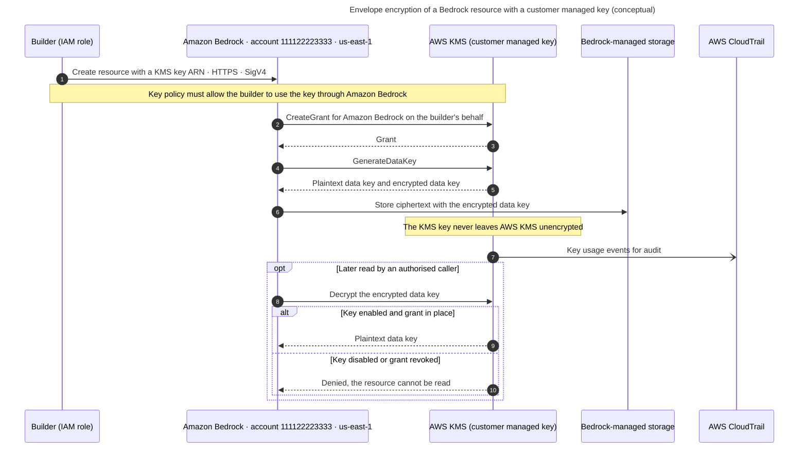

# AWS KMS and encryption

> **Level:** Beginner · **Verified:** 2026-11-15 · **Feature status:** n/a · **Time:** ~20 min

AWS Key Management Service (AWS KMS) holds the keys that encrypt data at rest across AWS. Amazon Bedrock encrypts what it stores by default; this chapter explains what changes, and what you take on, when you ask it to use a key you control.

## Learning objectives

After this chapter you can:

- Compare AWS owned keys, AWS managed keys and customer managed keys.
- Explain envelope encryption and why the KMS key never touches your data directly.
- Describe the three ways access to a key is granted: key policy, IAM policy and grants.
- Use encryption context for integrity, auditing and access control.
- Decide when a multi-Region key is appropriate.
- List what encrypting Bedrock resources with a customer managed key requires.

## Prerequisites

- [IAM fundamentals: principals, policies and evaluation](01-iam-fundamentals.md)
- [Resource-based policies](03-resource-policies.md)

## Concept in plain language

Picture a bank vault that holds one master key and never lets it out. For each document, the vault cuts a fresh small key. You lock the document with the small key, the vault locks the small key with the master key, and you tape the locked small key to the document. That bundle is the **envelope**.

To read the document, you hand the locked small key back to the vault. The vault checks who you are, notes the visit in a ledger, and returns the small key unlocked. Disable the master key and every document it protects becomes unreadable at once, wherever the copies are.

## How it really works

**Three kinds of KMS key.**

| | Customer managed key | AWS managed key | AWS owned key |
|:--|:--|:--|:--|
| Lives in | Your account | Your account, alias `aws/service-name` | An account managed by the AWS service |
| Key policy | You control it | Controlled by the service; you can view it | Not visible to you |
| Use recorded in your AWS CloudTrail | Yes | Yes | No |
| Rotation | Optional: automatic (default every 365 days) or on demand | Every year, automatic | Decided by the service |
| Cost | Monthly fee plus usage | No monthly fee; usage is charged | None |

AWS describes AWS managed keys as a legacy type, not created for new services since 2021; services now default to AWS owned keys and offer customer managed keys for control. Source: [AWS KMS keys](https://docs.aws.amazon.com/kms/latest/developerguide/concepts.html).

**Envelope encryption.** Data is encrypted with a **data key**, and the data key is encrypted under the KMS key and stored next to the data. To decrypt, the service sends the encrypted data key to AWS KMS and gets the plaintext data key back.

> [!NOTE]
> **Documented fact** — KMS keys never leave the AWS KMS hardware security modules unencrypted (validated to FIPS 140-3 Security Level 3). To use a KMS key you must call AWS KMS.
> Source: [AWS KMS cryptography essentials](https://docs.aws.amazon.com/kms/latest/developerguide/kms-cryptography.html)

That last sentence is the security model: every use of the key is an API call that can be authorised, conditioned and logged.

**Who may use a key.** Three mechanisms are evaluated together:

| Mechanism | What it is | Notes |
|:--|:--|:--|
| Key policy | The resource-based policy of the key. Every key has exactly one | Unlike other resource policies, it gives nothing to the account automatically. IAM policies work only if the key policy contains the statement that enables them |
| IAM policy | An identity-based policy that allows `kms:` actions | Ineffective for allows without that key policy statement |
| Grant | A delegation of specific operations on one key to one grantee | Allow-only; can be constrained; can be retired or revoked without editing any policy; up to 50,000 per key |

AWS services commonly create a grant on your behalf, use it, and retire it when the work is done. Sources: [Key policies](https://docs.aws.amazon.com/kms/latest/developerguide/key-policies.html), [Grants](https://docs.aws.amazon.com/kms/latest/developerguide/grants.html).

**Encryption context.** An optional set of non-secret key–value pairs passed with a cryptographic operation on a symmetric key. It is cryptographically bound to the ciphertext, so the same context must be supplied to decrypt. It appears in plaintext in CloudTrail, and policies and grants can require it with the `kms:EncryptionContext:` condition keys and grant constraints. Source: [Encryption context](https://docs.aws.amazon.com/kms/latest/developerguide/encrypt_context.html).

**Multi-Region keys.** A set of KMS keys in different Regions that share a key ID and key material, so data encrypted in one Region can be decrypted in another without a cross-Region call. They are not global: you create a primary key, replicate it where you choose, and manage each key's policy separately. A single-Region key cannot be converted. Most AWS services treat a multi-Region key as a single-Region key. Source: [Multi-Region keys](https://docs.aws.amazon.com/kms/latest/developerguide/multi-region-keys-overview.html).

**Rotation** replaces the key material used for new encryption; older material is kept for decryption. It does not re-encrypt existing data or rotate data keys. Source: [Rotate AWS KMS keys](https://docs.aws.amazon.com/kms/latest/developerguide/rotate-keys.html).

## Architecture diagram



**What this shows** — How an AWS service uses your key: a grant, a data key, ciphertext stored with the encrypted data key, and a KMS call on later reads. It is a conceptual model assembled from the Bedrock encryption pages; the exact calls differ by feature.

**Walkthrough**

1. A builder creates a Bedrock resource and names a customer managed key.
2. Bedrock creates a grant on the key, which succeeds only if the key policy lets the builder create grants through Bedrock.
3. AWS KMS returns the grant.
4. Bedrock asks for a data key.
5. AWS KMS returns it twice: in plaintext and encrypted under your key.
6. Bedrock stores the ciphertext together with the encrypted data key.
7. AWS KMS records key usage in CloudTrail, in your account.
8. To read the resource later, Bedrock sends the encrypted data key back to AWS KMS.
9. AWS KMS returns the plaintext data key while the grant and policies allow it.
10. If you have disabled the key or revoked the grant, AWS KMS refuses and the resource cannot be decrypted. That switch is what a customer managed key gives you.

| Legend | Meaning |
|:--|:--|
| Solid arrow | Request |
| Dashed arrow | Response |
| Open arrowhead | Asynchronous event |
| Note | Security control |
| `opt` and `alt` blocks | A later step and its two outcomes |

**Variations** — With the default AWS owned key, none of this needs configuration and no events appear in your CloudTrail. For data in your own Amazon S3 buckets, Amazon S3 makes the KMS calls and Bedrock's service role needs the key permissions. Retrieval instructions do not cache data keys, so every read calls `Decrypt`.

## Implementation details

1. **Decide whether you need a customer managed key.** It buys control of the key policy, an audit trail of key use and the ability to cut off access. It also costs money and makes you responsible for not losing access.
2. **Create a symmetric encryption key in the same Region** as the resource it protects.
3. **Keep the account statement in the key policy.** Without it, IAM policies cannot grant access and a key whose only named principal is deleted becomes unmanageable.
4. **Separate administrators from users.** The console's default key policy does this: key administrators can manage the key but not use it for cryptographic operations.
5. **Restrict use to the service** with the `kms:ViaService` condition key, for example `bedrock.us-east-1.amazonaws.com`.
6. **Treat `kms:CreateGrant` as sensitive.** AWS compares it to permission to change the key policy.

> [!TIP]
> **Academy recommendation** — Use customer managed keys where a requirement calls for key control or key-usage audit, and AWS owned keys elsewhere. One key per data classification and environment is usually enough.
> This is our design guidance, not an official AWS reference architecture.

### Why this matters for Bedrock

By default Amazon Bedrock encrypts custom models and knowledge base resources with AWS owned keys, at no charge. What a customer managed key involves, as documented:

| Bedrock resource | How the key is used | Permissions on the key |
|:--|:--|:--|
| Custom models (customization and copy jobs) | Key named at job creation. Bedrock creates a long-lived primary grant, retired when the model is deleted, and short-lived secondary grants for asynchronous work | The role that creates the model: `kms:CreateGrant`, `kms:DescribeKey`, `kms:GenerateDataKey`, `kms:Decrypt`. Roles that only invoke it: `kms:Decrypt` |
| Managed Knowledge Base (the encryption page calls it a "fully managed knowledge base") | One key, chosen at creation, covers transient ingestion data and stored data. Bedrock creates a grant and retires it when the knowledge base is deleted | The identity that creates the knowledge base: `kms:CreateGrant`, `kms:GenerateDataKey`, `kms:Decrypt` through Bedrock. The knowledge base's service role needs none |
| Retrieval instructions | Symmetric key in the same account and Region, given by ARN, fixed at creation. AWS managed keys are not supported | The authoring role, through Bedrock; and the Bedrock service principal for content review, limited by `aws:SourceArn` |
| Data in your Amazon S3 buckets (data sources, batch input and output) | Amazon S3 server-side encryption with your key | The Bedrock service role: `kms:Decrypt` to read, `kms:GenerateDataKey` to write; `kms:ViaService` names Amazon S3, not Bedrock |
| Model invocation logs in an encrypted bucket | Amazon S3 server-side encryption with your key | `bedrock.amazonaws.com`: `kms:GenerateDataKey`, with `aws:SourceAccount` and `aws:SourceArn` |

Agents Classic and model evaluation jobs also accept a key at creation. Two documented failure modes: a batch inference job with missing key permissions is accepted, then fails with an Amazon S3 permission message that does not mention AWS KMS; and if the key behind a retrieval instruction is disabled, `AgenticRetrieveStream` requests that apply it fail.

See also: [AWS KMS, Secrets Manager and Parameter Store](../../02-related-aws-services/security/02-kms-secrets-manager-parameter-store.md), [Data protection, privacy and data leakage prevention](../../06-security-governance/03-data-protection-and-privacy.md), [Managed Knowledge Base](../../01-amazon-bedrock/knowledge-bases/02-managed-knowledge-base.md), [Model customization](../../01-amazon-bedrock/foundation-models/03-model-customization.md), [Batch inference](../../01-amazon-bedrock/inference/08-batch-inference.md) and [Cross-Region considerations and data residency](../../09-advanced-topics/11-cross-region-and-data-residency.md).

## Example

A key policy for a customer managed key that encrypts Bedrock custom models, following the Bedrock documentation. One role builds models; another only invokes them. Role names are placeholders.

> **Code status:** syntax-checked (JSON parse) · follows the Bedrock documentation · **never deployed**

```json
{
  "Version": "2012-10-17",
  "Id": "PermissionsCustomModelKey",
  "Statement": [
    {
      "Sid": "EnableIamPoliciesForThisAccount",
      "Effect": "Allow",
      "Principal": {
        "AWS": "arn:aws:iam::111122223333:root"
      },
      "Action": "kms:*",
      "Resource": "*"
    },
    {
      "Sid": "PermissionsEncryptCustomModel",
      "Effect": "Allow",
      "Principal": {
        "AWS": "arn:aws:iam::111122223333:role/model-builder-role"
      },
      "Action": [
        "kms:Decrypt",
        "kms:GenerateDataKey",
        "kms:DescribeKey",
        "kms:CreateGrant"
      ],
      "Resource": "*",
      "Condition": {
        "StringLike": {
          "kms:ViaService": "bedrock.us-east-1.amazonaws.com"
        }
      }
    },
    {
      "Sid": "PermissionsDecryptModel",
      "Effect": "Allow",
      "Principal": {
        "AWS": "arn:aws:iam::111122223333:role/model-user-role"
      },
      "Action": "kms:Decrypt",
      "Resource": "*",
      "Condition": {
        "StringLike": {
          "kms:ViaService": "bedrock.us-east-1.amazonaws.com"
        }
      }
    }
  ]
}
```

`"Resource": "*"` is normal here: a key policy applies only to its own key. The first statement is the default one that lets IAM policies in the account grant access.

## Common mistakes

> [!WARNING]
> **Common mistake** — Scheduling a key for deletion, or disabling it, to "clean up". Everything encrypted under it becomes unreadable; AWS documents that Bedrock can then no longer access a custom model encrypted with that key. Check what a key protects before touching it.

| Mistake | Symptom | Fix |
|:--|:--|:--|
| IAM policy allows `kms:Decrypt` but the key policy does not enable IAM policies | `AccessDenied` from AWS KMS | Add the account statement, or name the principal in the key policy |
| Bucket encrypted with a customer managed key; Bedrock service role has only S3 permissions | The job cannot read or write the objects. For batch inference the error names Amazon S3, not AWS KMS | Give the service role `kms:Decrypt` and, for output, `kms:GenerateDataKey` |
| Sensitive values placed in encryption context | They appear in plaintext in CloudTrail | Use non-secret identifiers only |
| Expecting rotation to re-encrypt stored data | Old ciphertext still depends on old key material | Rotation is transparent; re-encrypt only if a requirement demands it |
| Expecting a multi-Region key to make a service work across Regions | The service still treats each Region's key separately | Read the service's replication documentation; multi-Region keys mainly help client-side encryption |
| Alias or key ID where an ARN is required | Validation error at creation | Pass the key ARN |

## Security considerations

- Encryption at rest complements IAM: a principal allowed by both the resource and the key reads plaintext.
- Every use of a customer managed key is recorded in CloudTrail, with its encryption context. AWS owned keys give you no such record.
- In transit, AWS requires TLS 1.2 and recommends TLS 1.3 for Bedrock API calls.
- Review who holds `kms:CreateGrant`, `kms:PutKeyPolicy` and `kms:ScheduleKeyDeletion`.

## Cost considerations

- Each customer managed key costs $1 per month, prorated hourly. Each multi-Region replica is a separate key. The first and second rotations each add $1 per month; later rotations add nothing.
- Requests cost $0.03 per 10,000 for symmetric keys, after a free tier of 20,000 requests per month. Source: [AWS KMS pricing](https://aws.amazon.com/kms/pricing/).
- AWS owned keys are free. AWS managed keys have no monthly fee but their use is charged.
- With Bedrock, a customer managed key adds KMS charges; features that call `Decrypt` on every read turn request volume into KMS request volume.

## Knowledge check

1. Why does AWS KMS encrypt a data key instead of encrypting your 2 GB file directly?
2. Your security team wants proof of every time a Bedrock custom model's key was used, and the ability to revoke access within minutes. Which key type do you need, and why?
3. What would happen if you removed the first statement from the example key policy and later deleted both roles?

<details>
<summary>Answers</summary>

1. Envelope encryption keeps the KMS key inside AWS KMS: only the small data key is sent there, while the data is encrypted where it lives. Access to all of that data is then controlled through one key.
2. A customer managed key. Its use is logged in your CloudTrail and you control its policy and grants. AWS owned keys offer neither.
3. No principal would have access to the key and IAM policies could not grant it, so the key would be unmanageable and the models encrypted under it unusable until AWS Support restored access.

</details>

## Further reading

Official sources opened while writing this chapter:

- [AWS KMS keys](https://docs.aws.amazon.com/kms/latest/developerguide/concepts.html) — key types and the key hierarchy.
- [AWS KMS cryptography essentials](https://docs.aws.amazon.com/kms/latest/developerguide/kms-cryptography.html) — envelope encryption and hardware security modules.
- [Key policies in AWS KMS](https://docs.aws.amazon.com/kms/latest/developerguide/key-policies.html) and [Default key policy](https://docs.aws.amazon.com/kms/latest/developerguide/key-policy-default.html) — the account statement, administrators and users.
- [Allowing users in other accounts to use a KMS key](https://docs.aws.amazon.com/kms/latest/developerguide/key-policy-modifying-external-accounts.html) — cross-account key use.
- [Grants in AWS KMS](https://docs.aws.amazon.com/kms/latest/developerguide/grants.html) — grant concepts, constraints and limits.
- [Encryption context](https://docs.aws.amazon.com/kms/latest/developerguide/encrypt_context.html) — rules, logging and policy conditions.
- [Multi-Region keys in AWS KMS](https://docs.aws.amazon.com/kms/latest/developerguide/multi-region-keys-overview.html) — primary and replica keys.
- [Rotate AWS KMS keys](https://docs.aws.amazon.com/kms/latest/developerguide/rotate-keys.html) — automatic and on-demand rotation.
- [AWS KMS pricing](https://aws.amazon.com/kms/pricing/) — key and request charges.
- [Data encryption (Amazon Bedrock)](https://docs.aws.amazon.com/bedrock/latest/userguide/data-encryption.html) and [Data protection (Amazon Bedrock)](https://docs.aws.amazon.com/bedrock/latest/userguide/data-protection.html) — what can be encrypted with a KMS key; TLS requirement.
- [Encryption of custom models](https://docs.aws.amazon.com/bedrock/latest/userguide/encryption-custom-job.html) — grants and the key policy used in the example.
- [Encryption of knowledge base resources](https://docs.aws.amazon.com/bedrock/latest/userguide/encryption-kb.html) — managed knowledge bases and retrieval instructions.
- [Create a custom service role for batch inference](https://docs.aws.amazon.com/bedrock/latest/userguide/batch-iam-sr.html) — key permissions for Amazon S3 data and the failure message.
- [Monitor model invocation using CloudWatch Logs and Amazon S3](https://docs.aws.amazon.com/bedrock/latest/userguide/model-invocation-logging.html) — key policy statement for encrypted log buckets.
