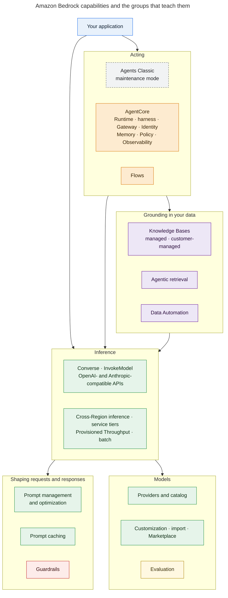

# Level 3 — Amazon Bedrock deep dive

> **Level:** Intermediate · **Verified:** 2026-11-15 · **Time:** about 10 days at 2 hours a day

One chapter per feature, all in the same 14-point shape: what it is, why it exists, when to use
it, when **not** to, architecture, request lifecycle, dependencies, security, networking, pricing
dimensions, scaling, IaC support, a working example and the official documentation.

[Academy home](../README.md) · [Feature verification matrix](../FEATURE-VERIFICATION.md) · [Diagram index](../diagrams/diagram-index.md) · Previous: [Foundations](../00-foundations/README.md) · Next: [Related AWS services](../02-related-aws-services/README.md)

> [!IMPORTANT]
> **Status** — Read [what changed since older tutorials](../FEATURE-VERIFICATION.md#what-changed-since-older-tutorials)
> before this section. Agents is now "Agents Classic" in maintenance mode, knowledge bases come
> in two types, and AgentCore has thirteen services. Features differ in deployment model, APIs,
> limits and Region support — never assume one behaves like another.

## Capability map

## Which feature for which job

| You want to… | Start with | Status |
|:--|:--|:-:|
| Call a model from code | [Converse API](inference/01-converse-api.md) | GA |
| Reuse existing OpenAI or Anthropic SDK code | [Compatible APIs](inference/03-openai-and-anthropic-compatible-apis.md) | GA |
| Get more throughput or resilience | [Cross-Region inference](inference/04-cross-region-inference.md) · [Service tiers](inference/06-service-tiers.md) | GA |
| Cut cost on repeated context | [Prompt caching](prompt-caching/01-prompt-caching.md) · [Batch inference](inference/08-batch-inference.md) | GA |
| Answer questions from your documents | [Knowledge Bases overview](knowledge-bases/01-knowledge-bases-overview.md) | GA |
| Handle multi-step questions over your data | [Agentic retrieval](agentic-retrieval/01-agentic-retrieval.md) | GA, Managed KB only |
| Build an agent that uses tools | [AgentCore overview](agentcore/01-agentcore-overview.md) | GA |
| Understand an existing Bedrock agent | [Agents Classic](agents/01-agents-classic.md) | Maintenance |
| Chain prompts and steps without code | [Flows](flows/01-bedrock-flows.md) | GA |
| Block harmful or off-topic content | [Guardrails](guardrails/01-guardrails.md) | GA |
| Extract structure from documents, images, audio, video | [Data Automation](data-automation/01-bedrock-data-automation.md) | GA |
| Adapt a model to your task | [Model customization](foundation-models/03-model-customization.md) | GA |
| Compare models or RAG configurations | [Model evaluation](model-evaluation/01-model-evaluation.md) | GA |

For the reasoning behind choosing between these, see
[Choosing between RAG, agents, flows and plain inference](../09-advanced-topics/14-choosing-rag-agents-flows.md).

## Chapters

<!-- TOC:START — generated by scripts/build-nav.py; do not edit by hand -->
| # | Chapter | Group | Status |
|--:|:--|:--|:-:|
| 1 | [What Amazon Bedrock is: services, namespaces and planes](overview/01-what-is-amazon-bedrock.md) | Overview | ✅ |
| 2 | [Endpoints, APIs and authentication](overview/02-endpoints-apis-and-authentication.md) | Overview | ✅ |
| 3 | [Model access and subscriptions](overview/03-model-access-and-subscriptions.md) | Overview | 🚧 planned |
| 4 | [Projects, Workspaces and the Web Search tool](overview/04-projects-workspaces-and-web-search.md) | Overview | 🚧 planned |
| 5 | [Model providers and the model catalog](foundation-models/01-model-providers-and-catalog.md) | Foundation models | ✅ |
| 6 | [Model lifecycle and selection](foundation-models/02-model-lifecycle-and-selection.md) | Foundation models | 🚧 planned |
| 7 | [Model customization: fine-tuning, reinforcement fine-tuning and distillation](foundation-models/03-model-customization.md) | Foundation models | 🚧 planned |
| 8 | [Custom Model Import and on-demand custom model deployment](foundation-models/04-custom-model-import.md) | Foundation models | 🚧 planned |
| 9 | [Amazon Bedrock Marketplace](foundation-models/05-bedrock-marketplace.md) | Foundation models | 🚧 planned |
| 10 | [The Converse API](inference/01-converse-api.md) | Inference | ✅ |
| 11 | [InvokeModel and streaming APIs](inference/02-invokemodel-and-streaming.md) | Inference | 🚧 planned |
| 12 | [OpenAI- and Anthropic-compatible APIs](inference/03-openai-and-anthropic-compatible-apis.md) | Inference | 🚧 planned |
| 13 | [Cross-Region inference: Geo and Global profiles](inference/04-cross-region-inference.md) | Inference | 🚧 planned |
| 14 | [Application inference profiles](inference/05-application-inference-profiles.md) | Inference | ✅ |
| 15 | [Service tiers: Reserved, Priority, Standard and Flex](inference/06-service-tiers.md) | Inference | ✅ |
| 16 | [Provisioned Throughput](inference/07-provisioned-throughput.md) | Inference | 🚧 planned |
| 17 | [Batch inference](inference/08-batch-inference.md) | Inference | 🚧 planned |
| 18 | [Prompt management](prompt-management/01-prompt-management.md) | Prompt management | 🚧 planned |
| 19 | [Prompt optimization](prompt-management/02-prompt-optimization.md) | Prompt management | 🚧 planned |
| 20 | [Prompt caching](prompt-caching/01-prompt-caching.md) | Prompt caching | 🚧 planned |
| 21 | [Knowledge Bases overview: managed versus customer-managed](knowledge-bases/01-knowledge-bases-overview.md) | Knowledge Bases | 🚧 planned |
| 22 | [Managed Knowledge Base](knowledge-bases/02-managed-knowledge-base.md) | Knowledge Bases | 🚧 planned |
| 23 | [Customer-managed knowledge bases and vector stores](knowledge-bases/03-customer-managed-knowledge-bases.md) | Knowledge Bases | 🚧 planned |
| 24 | [Ingestion, parsing and chunking](knowledge-bases/04-ingestion-parsing-chunking.md) | Knowledge Bases | 🚧 planned |
| 25 | [Retrieval, reranking and metadata filtering](knowledge-bases/05-retrieval-reranking-filtering.md) | Knowledge Bases | 🚧 planned |
| 26 | [Structured data retrieval and GraphRAG](knowledge-bases/06-structured-data-and-graphrag.md) | Knowledge Bases | 🚧 planned |
| 27 | [Agentic retrieval with AgenticRetrieveStream](agentic-retrieval/01-agentic-retrieval.md) | Agentic retrieval | 🚧 planned |
| 28 | [Amazon Bedrock Agents Classic](agents/01-agents-classic.md) | Agents (Classic) | 🚧 planned |
| 29 | [Multi-agent collaboration](agents/02-multi-agent-collaboration.md) | Agents (Classic) | 🚧 planned |
| 30 | [Agents Classic versus AgentCore, and migrating](agents/03-agents-classic-vs-agentcore.md) | Agents (Classic) | 🚧 planned |
| 31 | [AgentCore overview](agentcore/01-agentcore-overview.md) | Amazon Bedrock AgentCore | 🚧 planned |
| 32 | [AgentCore Runtime](agentcore/02-agentcore-runtime.md) | Amazon Bedrock AgentCore | 🚧 planned |
| 33 | [AgentCore harness](agentcore/03-agentcore-harness.md) | Amazon Bedrock AgentCore | 🚧 planned |
| 34 | [AgentCore Gateway](agentcore/04-agentcore-gateway.md) | Amazon Bedrock AgentCore | 🚧 planned |
| 35 | [AgentCore Identity](agentcore/05-agentcore-identity.md) | Amazon Bedrock AgentCore | 🚧 planned |
| 36 | [AgentCore Memory](agentcore/06-agentcore-memory.md) | Amazon Bedrock AgentCore | 🚧 planned |
| 37 | [AgentCore Observability](agentcore/07-agentcore-observability.md) | Amazon Bedrock AgentCore | 🚧 planned |
| 38 | [AgentCore Browser and Code Interpreter](agentcore/08-agentcore-browser-and-code-interpreter.md) | Amazon Bedrock AgentCore | 🚧 planned |
| 39 | [AgentCore Policy](agentcore/09-agentcore-policy.md) | Amazon Bedrock AgentCore | 🚧 planned |
| 40 | [AgentCore Evaluations and Optimization](agentcore/10-agentcore-evaluations-and-optimization.md) | Amazon Bedrock AgentCore | 🚧 planned |
| 41 | [AWS Agent Registry](agentcore/11-agentcore-registry.md) | Amazon Bedrock AgentCore | 🚧 planned |
| 42 | [AgentCore Payments, Web Search and Web Answer](agentcore/12-agentcore-payments-and-web-search.md) | Amazon Bedrock AgentCore | 🚧 planned |
| 43 | [Amazon Bedrock Flows](flows/01-bedrock-flows.md) | Flows | 🚧 planned |
| 44 | [Amazon Bedrock Guardrails](guardrails/01-guardrails.md) | Guardrails | 🚧 planned |
| 45 | [Automated Reasoning checks and guardrail enforcement](guardrails/02-automated-reasoning-and-enforcement.md) | Guardrails | 🚧 planned |
| 46 | [Model and RAG evaluation](model-evaluation/01-model-evaluation.md) | Model evaluation | 🚧 planned |
| 47 | [Amazon Bedrock Data Automation](data-automation/01-bedrock-data-automation.md) | Data Automation | 🚧 planned |
<!-- TOC:END -->
