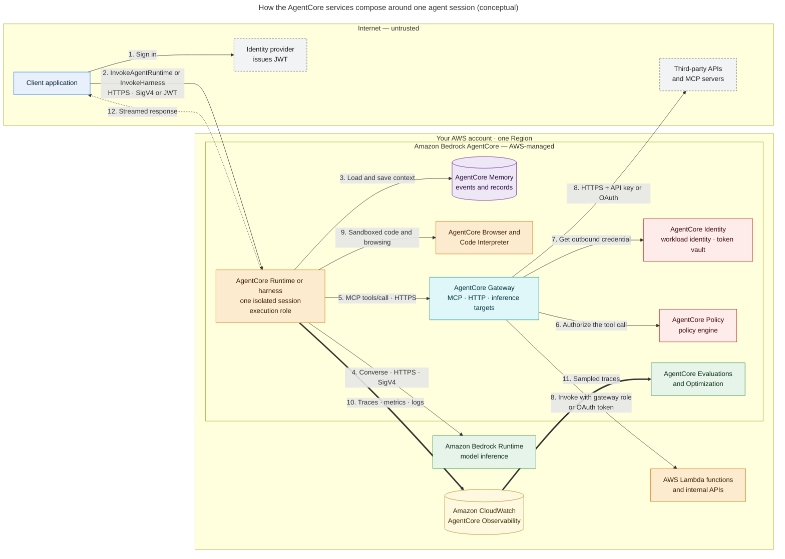

# AgentCore overview

> **Level:** Intermediate · **Verified:** 2026-11-15 · **Feature status:** GA (no new Optimization Insights jobs since 2026-10-16) · **Time:** ~20 min

Amazon Bedrock AgentCore is the AWS platform for running agents in production: thirteen services that host agent code, connect it to tools, give it identity and memory, and observe and govern what it does. This chapter is the map; the eleven chapters after it are the territory.

## Learning objectives

After this chapter you can:

- Explain what AgentCore is and why it is described as modular, framework-agnostic and model-agnostic.
- Name the thirteen AgentCore services, their status and the one job each of them does.
- Distinguish the control-plane and data-plane namespaces and say which call goes where.
- Describe how the services compose around one agent session.
- Check Region coverage before you design, because it differs by service.
- Place AgentCore next to Amazon Bedrock Agents Classic and choose a starting interface (CLI, SDK, IaC).

## Prerequisites

- [Agentic AI, tool calling and multi-agent architectures](../../00-foundations/generative-ai-fundamentals/06-agents-tool-calling-multi-agent.md)
- [What Amazon Bedrock is: services, namespaces and planes](../overview/01-what-is-amazon-bedrock.md)
- [Amazon Bedrock Agents Classic](../agents/01-agents-classic.md) — useful background, not required

## Concept in plain language

A model can decide *what* to do; it cannot do anything by itself. Turning it into a working agent needs a place to run the loop, a safe way to reach tools, a way to prove who the agent is, somewhere to remember things, and a record of what happened.

Think of AgentCore as a serviced office building for agents. **Runtime** is the private office each conversation gets. The **harness** is a fully staffed office where the routine is already organised. **Gateway** is the front desk that connects the office to outside suppliers. **Identity** is the badge system, **Memory** the filing cabinet, **Observability** the CCTV, and **Policy** the rule book the front desk enforces. You can rent the whole building or a single room: each service works alone, with any agent framework and any model.

Terms such as MCP, A2A and microVM are defined in the [glossary](../../GLOSSARY.md).

## How it really works

> [!NOTE]
> **Documented fact** — AgentCore is "an agentic platform for building, deploying, and operating highly effective agents securely at scale using any framework and foundation model"; its services "work together or independently".
> Source: [What is Amazon Bedrock AgentCore?](https://docs.aws.amazon.com/bedrock-agentcore/latest/devguide/what-is-bedrock-agentcore.html)

### The thirteen services

The overview page lists thirteen services. Status comes from the [feature register](../../FEATURE-VERIFICATION.md) and the [release notes](https://docs.aws.amazon.com/bedrock-agentcore/latest/devguide/doc-history.html).

| Service | Status | What it does | Chapter |
|:--|:--|:--|:--|
| Runtime | GA | Serverless host for your agent or tool code; one isolated session per conversation, on microVMs or on Instances | [AgentCore Runtime](02-agentcore-runtime.md) |
| harness | GA since 2026-06-17 | Managed agent loop: you declare model, prompt, tools, skills and memory; AgentCore runs the loop | [AgentCore harness](03-agentcore-harness.md) |
| Gateway | GA | One secured endpoint in front of tools (as MCP), other agents (HTTP) and model providers (inference) | [AgentCore Gateway](04-agentcore-gateway.md) |
| Identity | GA | Workload identity for agents plus a token vault for OAuth tokens and API keys | [AgentCore Identity](05-agentcore-identity.md) |
| Memory | GA | Short-term events and long-term records extracted by strategies | [AgentCore Memory](06-agentcore-memory.md) |
| Observability | GA | Traces, metrics and logs in Amazon CloudWatch, in OpenTelemetry-compatible format | [AgentCore Observability](07-agentcore-observability.md) |
| Browser | GA | Managed cloud browser an agent can drive | [AgentCore Browser and Code Interpreter](08-agentcore-browser-and-code-interpreter.md) |
| Code Interpreter | GA | Isolated sandbox for code the agent writes (Python, JavaScript, TypeScript) | [AgentCore Browser and Code Interpreter](08-agentcore-browser-and-code-interpreter.md) |
| Policy | GA | Deterministic rules evaluated on every tool call through a Gateway | [AgentCore Policy](09-agentcore-policy.md) |
| Evaluations | GA | Scores sessions, traces and spans with built-in or custom evaluators | [AgentCore Evaluations and Optimization](10-agentcore-evaluations-and-optimization.md) |
| Optimization | Recommendations, batch evaluation and A/B tests GA; Insights: no new jobs since 2026-10-16 (redesign) | Turns traces into prompt and tool-description recommendations and tests them | [AgentCore Evaluations and Optimization](10-agentcore-evaluations-and-optimization.md) |
| Registry (AWS Agent Registry) | GA | Governed catalog of agents, MCP servers, tools and skills | [AWS Agent Registry](11-agentcore-registry.md) |
| Payments | GA since 2026-08-18 (preview from May 2026) | Microtransaction payments (x402 and MPP) through wallet providers | [AgentCore Payments, Web Search and Web Answer](12-agentcore-payments-and-web-search.md) |

Web Search and Web Answer are priced as separate AgentCore features but are not in the list of thirteen; they are covered with Payments.

> [!IMPORTANT]
> **Status** — Payments is generally available since 2026-08-18, after a preview that began in May 2026. Optimization Insights accepts no new batch or recurring jobs since 2026-10-16 while AWS redesigns it.
> Source: [Payments GA announcement](https://aws.amazon.com/about-aws/whats-new/2026/08/bedrock-agentcore-payments-ga/), [Release notes](https://docs.aws.amazon.com/bedrock-agentcore/latest/devguide/doc-history.html), [Recurring insights report](https://docs.aws.amazon.com/bedrock-agentcore/latest/devguide/insights-recurring-report.html)

Policy deserves one clarification. The Policy page says policies are written in Cedar and can also be authored in Dogwood, an open-source language; the overview page describes Dogwood as Cedar-compatible. The [Policy chapter](09-agentcore-policy.md) explains the difference.

### Control plane and data plane

AgentCore has two API namespaces, and both use the same IAM action prefix, `bedrock-agentcore:`.

| Plane | Endpoint | Used for | Examples |
|:--|:--|:--|:--|
| Control | `bedrock-agentcore-control.<region>.amazonaws.com` | Creating and configuring resources | `CreateAgentRuntime`, `CreateHarness`, `CreateGateway`, `CreateGatewayTarget` |
| Data | `bedrock-agentcore.<region>.amazonaws.com` | Using resources | `InvokeAgentRuntime`, `InvokeHarness`, memory events, tool sessions |
| Gateway data path | `https://<gateway-id>.gateway.bedrock-agentcore.<region>.amazonaws.com` | Agents and MCP clients calling tools | MCP `tools/list`, `tools/call` |

AWS Agent Registry is the exception: it uses the `agent-registry` namespace, with separate control and data endpoints. Every operation of both planes is listed in the [generated API reference](../../references/bedrock-api-operations.md). Sources: [Quotas](https://docs.aws.amazon.com/bedrock-agentcore/latest/devguide/bedrock-agentcore-limits.html), [Interfaces](https://docs.aws.amazon.com/bedrock-agentcore/latest/devguide/develop-agents.html), [Release notes](https://docs.aws.amazon.com/bedrock-agentcore/latest/devguide/doc-history.html).

### How it relates to Agents Classic

Amazon Bedrock Agents Classic is in maintenance mode and has been closed to new customers since 2026-07-30. AWS recommends migrating to AgentCore, with the managed harness as the default path and code-defined agents on Runtime when you need to own the loop. The difference in shape matters: Agents Classic was one service with one fixed orchestration; AgentCore is a set of parts you assemble. Source: [Agents Classic maintenance mode](https://docs.aws.amazon.com/bedrock/latest/userguide/agents-classic-maintenance-mode.html). The mapping is in [Agents Classic versus AgentCore, and migrating](../agents/03-agents-classic-vs-agentcore.md).

## Architecture diagram



**What this shows** — One request passing through the services that most agents use. Nothing here is mandatory: an agent on Amazon ECS can use only Gateway and Memory, and a Runtime agent can call tools without a Gateway. This is an academy diagram, not an official AWS reference architecture.

**Walkthrough**

1. The user signs in with your identity provider (only needed for JWT inbound authorization).
2. The client invokes the agent. Runtime or the harness routes the call to that session's isolated compute.
3. The agent loads conversation context and relevant long-term records from Memory.
4. The agent calls a model. With Amazon Bedrock this is a SigV4 call made with the execution role.
5. When the model asks for a tool, the agent calls the Gateway's MCP endpoint.
6. If a policy engine is attached, the Gateway has the tool call authorized before it runs.
7. The Gateway obtains the outbound credential for the target from Identity.
8. The Gateway invokes the tool: a Lambda function or internal API with its own role, or a third-party API with an API key or OAuth token.
9. Built-in tools give the agent a browser and a code sandbox without a Gateway hop.
10. Traces, metrics and logs flow to CloudWatch.
11. Evaluations and Optimization read those traces to score and improve the agent.
12. The response streams back to the client.

**Legend** — solid arrow: request · dashed arrow: response · thick arrow: asynchronous telemetry · cylinder: data store · dashed grey box: outside your AWS account · nested boxes: trust boundaries. The detailed view, with every protocol and control, is [diagram set 12](../../diagrams/mermaid/12-agentcore-architecture.md).

## Implementation details

### 1. Check Region coverage first

AgentCore is listed in 22 Regions, but not every service is in every Region (as of the verification date).

| Available in | Services |
|:--|:--|
| All 22 Regions | Runtime on microVMs, Gateway, Identity, built-in tools, Observability, Policy, Evaluations |
| 21 (not AWS GovCloud (US-West)) | Optimization |
| 16 | harness, Memory |
| 15 | Runtime on Instances |
| 12 | Payments |
| 10 | AWS Agent Registry |
| 7 / 6 / 1 | Web Search Tool / Web Search API / Web Answer |

Source: [Supported AWS Regions](https://docs.aws.amazon.com/bedrock-agentcore/latest/devguide/agentcore-regions.html). Feature-level limits exist too: Runtime platform version V2 is listed in 19 Regions and Gateway semantic search in 18 (see the Runtime and Gateway chapters).

> [!WARNING]
> **Common mistake** — Reading "the harness is generally available wherever AgentCore is" as "everywhere". The harness and Memory are missing from six AgentCore Regions, including US West (N. California) and Europe (Milan).

### 2. Choose an interface

| Interface | What it is | Use it when |
|:--|:--|:--|
| AgentCore CLI (`@aws/agentcore`) | Node.js CLI (Node.js 20.12 or later); version 1.0 since October 2026. Deploys through AWS CDK constructs from `@aws/agentcore-cdk` | You want the fastest path from a project folder to a deployed agent |
| AgentCore Python SDK | Python primitives for Runtime, Memory, tools, Identity and Evaluations; `BedrockAgentCoreApp` wraps your agent | You write the agent in Python |
| AWS SDK and AWS CLI | The full API surface: `bedrock-agentcore-control` and `bedrock-agentcore` | Any other language, automation, or operations the helpers do not cover |
| AgentCore MCP server | Lets a coding assistant create, deploy and test AgentCore agents | You work from an MCP-capable IDE |
| IaC | Terraform `aws_bedrockagentcore_*`, CloudFormation `AWS::BedrockAgentCore::*`, CDK L1 and stable L2 constructs (AWS Agent Registry: `aws_agentregistry_registry`, `AWS::AgentRegistry::*`) | Anything that must be reviewed, repeated and promoted |

Source: [Understand the available interfaces](https://docs.aws.amazon.com/bedrock-agentcore/latest/devguide/develop-agents.html). The register also lists a TypeScript SDK and marks the earlier starter toolkit as deprecated. IaC coverage per service is in [Terraform coverage for Amazon Bedrock](../../04-infrastructure-as-code/terraform/10-terraform-for-bedrock.md) and [CDK coverage for Amazon Bedrock](../../04-infrastructure-as-code/aws-cdk/09-cdk-for-bedrock.md).

### 3. Decide how much you assemble yourself

> [!TIP]
> **Academy recommendation** — Start with the harness. Move to your own code on Runtime only for a reason you can name: an existing agent codebase, a graph or workflow that is not an agent loop, multi-agent routing, or bidirectional streaming. Add Gateway as soon as a second agent needs the same tools.
> This is our design guidance, not an official AWS reference architecture.

## Example

Two clients, two planes. The calls mirror the documented ones; nothing here was run against AWS.

> **Code status:** syntax-checked (`python -m py_compile`) · **never deployed**

```python
"""Control plane versus data plane: two clients, one IAM action prefix."""
import json
import uuid

import boto3

REGION = "us-east-1"  # overridable; check the Regions table for each service you use

# Control plane: create, update and describe resources.
control = boto3.client("bedrock-agentcore-control", region_name=REGION)
# Data plane: use resources (invoke agents, write memory events, run tool sessions).
data = boto3.client("bedrock-agentcore", region_name=REGION)


def runtime_status(agent_runtime_id: str) -> str:
    """GetAgentRuntime is a control-plane call."""
    return control.get_agent_runtime(agentRuntimeId=agent_runtime_id)["status"]


def ask(agent_runtime_arn: str, prompt: str, session_id: str | None = None) -> dict:
    """InvokeAgentRuntime is a data-plane call. Session IDs need at least 33 characters."""
    session_id = session_id or f"session-{uuid.uuid4()}"  # 44 characters
    response = data.invoke_agent_runtime(
        agentRuntimeArn=agent_runtime_arn,
        runtimeSessionId=session_id,
        payload=json.dumps({"prompt": prompt}),
        qualifier="DEFAULT",
    )
    return json.loads(response["response"].read())
```

## Common mistakes

| Mistake | Symptom | Fix |
|:--|:--|:--|
| Treating AgentCore as "Agents Classic version 2" | Looking for action groups, aliases and one `InvokeAgent` call | Learn the parts: harness or Runtime for the loop, Gateway for tools, Memory for state |
| Calling a control-plane operation on the data-plane client (or the reverse) | Unknown operation, or access denied on the wrong endpoint | `bedrock-agentcore-control` creates; `bedrock-agentcore` uses |
| Designing in a Region where one service is missing | Deployment fails late, on Memory, harness or Registry | Check the Regions table per service before choosing the Region |
| Building everything at once | A long first project with nothing running | Add one service at a time; each works alone |
| Assuming the model must be on Amazon Bedrock | Extra plumbing to reach another provider | Runtime runs any model your code calls; the harness supports several providers; Gateway has inference targets |

## Security considerations

- **Two inbound paths.** Runtime, the harness and Gateway accept IAM (SigV4) or OAuth 2.0 bearer tokens (JWT). Decide per resource; VPC endpoint policies can only restrict IAM principals.
- **Execution roles are the blast radius.** Each Runtime, harness and Gateway assumes an IAM role you own. Scope it to the models, tools and data that one agent needs. See [Identity, least privilege and IAM isolation for agents](../../06-security-governance/02-identity-and-least-privilege.md).
- **Session isolation is provided; user-to-session mapping is not.** AgentCore isolates sessions but does not enforce which user may use which session ID. Your backend does.
- **Put controls outside the agent.** Policy and Gateway interceptors run where the agent cannot reason around them. See [Prompt injection, untrusted tool output and retrieval poisoning](../../06-security-governance/04-prompt-injection-and-untrusted-content.md).
- **Private access.** Interface VPC endpoints exist for the data plane, the control plane and Gateway.

## Cost considerations

- AgentCore has no upfront commitment or minimum fee; each service is metered separately and only when used.
- The harness has no charge of its own: you pay for the Runtime compute, model tokens, Memory and tools it uses.
- Model inference is billed by the model provider (Amazon Bedrock or another), not by AgentCore.
- Observability is billed at Amazon CloudWatch rates.
- Identity has no additional charge when used through Runtime or Gateway.
- Per-service dimensions and figures: [AgentCore pricing](https://aws.amazon.com/bedrock/agentcore/pricing/) and [Pricing model and cost drivers](../../08-cost-performance-and-reliability/01-pricing-model-and-cost-drivers.md).

## Knowledge check

1. A team says "we already run our agent on Amazon EKS, so AgentCore is not for us". Which AgentCore services could they still use, and why is that possible?
2. Your pipeline calls `CreateGatewayTarget` and later an agent calls a tool through the gateway. Which endpoint does each request go to?
3. What would happen if you designed a harness-based agent with Memory for US West (N. California)?
4. Why is "which model does AgentCore use?" the wrong question?

<details>
<summary>Answers</summary>

1. Any of them except the hosting itself — for example Gateway for tools, Identity for outbound credentials, Memory, Observability, Evaluations. The services are documented as usable together or independently, with any framework.
2. `CreateGatewayTarget` goes to the control plane (`bedrock-agentcore-control`). The tool call goes to the gateway's own URL (`<gateway-id>.gateway.bedrock-agentcore.<region>.amazonaws.com`), which is data-path traffic.
3. It could not be deployed there: on the verification date neither the harness nor Memory is listed for that Region, although Runtime, Gateway and Identity are.
4. AgentCore does not own the model. Your code on Runtime calls whichever model it wants; the harness lets you declare a model from several providers; Gateway can route inference to providers. Model choice and model billing are separate from AgentCore.

</details>

## Further reading

Official sources opened while writing this chapter:

- [What is Amazon Bedrock AgentCore?](https://docs.aws.amazon.com/bedrock-agentcore/latest/devguide/what-is-bedrock-agentcore.html) — definition and the list of thirteen services.
- [Release notes for Amazon Bedrock AgentCore](https://docs.aws.amazon.com/bedrock-agentcore/latest/devguide/doc-history.html) — launch and GA entries, CLI 1.0, Registry namespace.
- [AgentCore harness is now generally available](https://aws.amazon.com/about-aws/whats-new/2026/06/amazon-bedrock-agentcore-harness-generally-available/) — GA date of the harness (2026-06-17).
- [Supported AWS Regions](https://docs.aws.amazon.com/bedrock-agentcore/latest/devguide/agentcore-regions.html) — the per-service Region table.
- [Understand the available interfaces](https://docs.aws.amazon.com/bedrock-agentcore/latest/devguide/develop-agents.html) — CLI, Python SDK, MCP server, AWS SDK, console.
- [Quotas for Amazon Bedrock AgentCore](https://docs.aws.amazon.com/bedrock-agentcore/latest/devguide/bedrock-agentcore-limits.html) — endpoint formats and limits.
- [Use interface VPC endpoints (AWS PrivateLink)](https://docs.aws.amazon.com/bedrock-agentcore/latest/devguide/vpc-interface-endpoints.html) — the three endpoint service names and what endpoint policies can restrict.
- [Policy in Amazon Bedrock AgentCore](https://docs.aws.amazon.com/bedrock-agentcore/latest/devguide/policy.html) — Cedar and Dogwood authoring.
- [Amazon Bedrock Agents Classic maintenance mode](https://docs.aws.amazon.com/bedrock/latest/userguide/agents-classic-maintenance-mode.html) — status of Agents Classic and the recommended migration paths.
- [AgentCore pricing](https://aws.amazon.com/bedrock/agentcore/pricing/) — metering per service.
