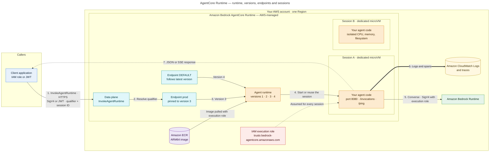
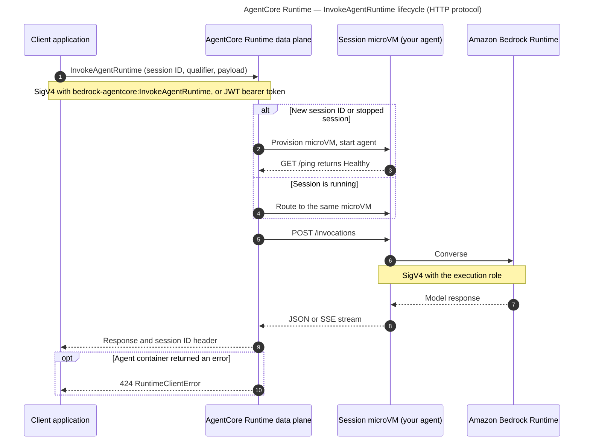

# AgentCore Runtime

> **Level:** Intermediate · **Verified:** 2026-11-15 · **Feature status:** GA · **Time:** ~25 min

AgentCore Runtime is the serverless host for agent or tool code that you write. It sits between your client and everything the agent calls, and gives every conversation its own isolated compute.

> [!IMPORTANT]
> **Status** — GA. Two compute types: **microVMs** (all 22 AgentCore Regions) and **Instances** (15 Regions). Two platform versions for microVMs: **V1** and **V2** (V2 listed in 19 Regions). All figures are as of the verification date.
> Source: [Supported AWS Regions](https://docs.aws.amazon.com/bedrock-agentcore/latest/devguide/agentcore-regions.html), [microVMs — platform versions](https://docs.aws.amazon.com/bedrock-agentcore/latest/devguide/runtime-how-it-works.html)

## Learning objectives

- Explain the session isolation model and the session lifecycle (active, idle, stopped).
- Choose between microVMs and Instances, and between platform versions V1 and V2.
- Implement the service contract: protocols, ports and paths.
- Choose container or direct code deployment, and manage versions and endpoints.
- Configure inbound authorization, the execution role, VPC mode and PrivateLink.
- Read the quotas and the pricing dimensions before sizing a workload.

## Prerequisites

- [AgentCore overview](01-agentcore-overview.md)
- [IAM roles, trust policies and cross-account access](../../00-foundations/security/02-iam-roles-and-trust.md)
- [VPC endpoints and AWS PrivateLink](../../00-foundations/networking/03-vpc-endpoints-and-privatelink.md)
- [The Converse API](../inference/01-converse-api.md)

## 1. What it is

In plain language: you hand AWS a container image or a zip file that contains your agent, and Runtime runs one private copy of it per conversation, for as long as that conversation is alive.

Precisely: an **agent runtime** is a versioned resource that references your artifact, an execution role, a protocol and a network mode. Clients call `InvokeAgentRuntime` with a `runtimeSessionId`; Runtime routes each session to dedicated compute and forwards the request to your code over the protocol you declared.

| Item | Value |
|:--|:--|
| Service namespace / endpoint | Control plane `bedrock-agentcore-control.<region>.amazonaws.com`; data plane `bedrock-agentcore.<region>.amazonaws.com` |
| Control-plane operations | `CreateAgentRuntime`, `UpdateAgentRuntime`, `GetAgentRuntime`, `ListAgentRuntimes`, `ListAgentRuntimeVersions`, `DeleteAgentRuntime`, `CreateAgentRuntimeEndpoint`, `UpdateAgentRuntimeEndpoint`, `CreateCapacityProvider` |
| Data-plane operations | `InvokeAgentRuntime` (`POST /runtimes/{agentRuntimeArn}/invocations`), `InvokeAgentRuntimeCommand`, `StopRuntimeSession`, `GetAgentCard`. WebSocket: `InvokeAgentRuntimeWithWebSocketStream`, `InvokeAgentRuntimeCommandShell` |
| IAM action prefix | `bedrock-agentcore:` (for example `bedrock-agentcore:InvokeAgentRuntime`) |

Operation names are checked against the [generated API reference](../../references/bedrock-api-operations.md). The two WebSocket operations are documented in the Developer Guide but are not in the AWS SDK service model, so you call them over a signed WebSocket connection, not through an SDK method.

## 2. Why it exists

An agent is not a stateless function. It holds a conversation, waits on models and tools, may run for hours, and acts with a user's privileges. Without Runtime you would build per-session isolation, sticky routing, idle reaping, long-running job handling, streaming, inbound authentication and trace plumbing yourself, on top of containers or functions that were not designed for it.

## 3. When to use it

- You have, or want, your own agent code: any framework (Strands Agents, LangGraph, CrewAI, LlamaIndex, Google ADK, OpenAI Agents SDK) or none.
- You need a pattern that is not a plain agent loop: graphs, workflows, multi-agent supervisors.
- You host an MCP server or an A2A agent rather than a chat agent.
- You need bidirectional streaming (WebSocket) or a user interface protocol (AG-UI).
- Sessions must be isolated from each other at the compute level.

## 4. When not to use it

- **A standard agent loop is enough.** Use the [AgentCore harness](03-agentcore-harness.md): configuration instead of code.
- **Short, stateless calls with no session.** A function that calls the Converse API is simpler; see [AWS Lambda with Bedrock](../../02-related-aws-services/compute/01-lambda.md).
- **You must control the host**, run sidecars or use networking that Runtime does not offer. Use containers; see [Amazon ECS, Amazon EKS and AWS Fargate](../../02-related-aws-services/compute/02-containers-ecs-eks-fargate.md). You can still use Gateway, Memory and Identity from there.
- **A deterministic process with a few model steps.** Use [AWS Step Functions with Bedrock](../../02-related-aws-services/messaging/02-step-functions.md).

## 5. Internal architecture

The customer-visible model has four levels.

| Level | What it is | Key facts |
|:--|:--|:--|
| Agent runtime | The resource that holds your artifact and configuration | Has its own workload identity in AgentCore Identity |
| Version | Immutable snapshot of the configuration | Version 1 is created with the runtime; every update creates a new one |
| Endpoint | Addressable pointer to one version | `DEFAULT` is created automatically and follows the latest version; named endpoints move only when you move them |
| Session | One conversation, identified by `runtimeSessionId` | Dedicated compute; states active, idle, stopped |

> [!NOTE]
> **Documented fact** — "Each user session runs in a dedicated microVM with isolated CPU, memory, and filesystem resources ... After session completion, the entire microVM is terminated and memory is sanitized."
> Source: [Host agent or tools with AgentCore Runtime](https://docs.aws.amazon.com/bedrock-agentcore/latest/devguide/agents-tools-runtime.html)

**Session lifecycle.** A session is created on the first invocation with a new ID. It is **active** while handling a request, a command or background work (your `/ping` returns `HealthyBusy`), **idle** otherwise, and **stopped** after the idle timeout (default 15 minutes), the maximum lifetime (default 8 hours), a `StopRuntimeSession` call or a failed health check. Invoking a stopped session with the same ID provisions new compute; in-memory state is gone unless you configured session storage or wrote it to AgentCore Memory. Source: [Use isolated sessions for agents](https://docs.aws.amazon.com/bedrock-agentcore/latest/devguide/runtime-sessions.html).

**Compute types.**

| Characteristic | microVMs | Instances |
|:--|:--|:--|
| Where it runs | AWS-managed, serverless | Amazon EC2 managed instances in **your** account, defined by a capacity provider |
| Maximum session duration | 8 hours | 14 days |
| Architecture | Linux containers, `arm64` | Linux, `x86_64` and `arm64` |
| Networking | `PUBLIC` or VPC | VPC |
| Agents per session | One | Several agents can share one instance and its filesystem |
| GPU | Not supported | Supported instance families |
| Billing | Consumption, by AgentCore | Amazon EC2 cost plus a management fee |

You cannot change the compute type after a runtime is created. Source: [Instances](https://docs.aws.amazon.com/bedrock-agentcore/latest/devguide/runtime-instances-how-it-works.html).

**Platform versions (microVMs).**

| | V1 | V2 |
|:--|:--|:--|
| How a session starts | Pulls the image and initialises your code | Restores a snapshot taken after your code first reports healthy |
| Create and update | Seconds | Minutes; the container must report healthy within 120 seconds |
| Maximum image size (compressed) | 2 GB | 10 GB |
| Resource configurations (committed baseline, burst to 8 vCPU / 32 GB) | No | Yes |
| Session context keys, lifecycle hooks | No | Yes |

> [!IMPORTANT]
> **Status** — The sources disagree on the default. The Developer Guide says a runtime created without `platformVersion` uses V1. A What's New post dated 2026-11-12 says new runtimes use V2 by default in 19 Regions. Set `platformVersion` explicitly.
> Source: [microVMs — platform versions](https://docs.aws.amazon.com/bedrock-agentcore/latest/devguide/runtime-how-it-works.html), [The next generation AgentCore runtime is now the default](https://aws.amazon.com/about-aws/whats-new/2026/11/new-agentcore-runtime-default/)



**What this shows** — How one call finds its compute. The endpoint chooses the version; the session ID chooses the microVM. Session B belongs to another conversation and shares nothing with session A.

1. The client calls the data plane with a runtime ARN, an optional `qualifier` (endpoint name) and a session ID.
2. Runtime resolves the qualifier; without one it uses `DEFAULT`.
3. The endpoint points at exactly one version.
4. Runtime starts compute for a new session ID or reuses the running one.
5. Your code calls a model with the execution role's credentials.
6. Logs and spans go to CloudWatch.
7. The response returns as JSON or as a server-sent event stream.

**Legend** — solid: request · dashed: response or role assumption · thick: telemetry · cylinder: data store. **Our reading:** how AWS places microVMs on hosts is not documented; the What's New post names Firecracker as the microVM technology. The full picture is [diagram set 13](../../diagrams/mermaid/13-agentcore-runtime-and-tool-execution.md).

## 6. Request and response lifecycle

Your code must implement the **service contract** for its protocol.

| Protocol (`serverProtocol`) | Default port | Default path | Message format |
|:--|:-:|:--|:--|
| HTTP | 8080 | `POST /invocations`, `GET /ping`, optional WebSocket `/ws` | JSON or SSE; WebSocket text or binary |
| MCP | 8000 | `/mcp` | JSON-RPC |
| A2A | 9000 | `/` | JSON-RPC 2.0; discovery through Agent Cards |
| AG-UI | 8080 | `/invocations` (SSE), `/ws` | Event streams |

All four accept SigV4 or OAuth 2.0. WebSocket is not a separate protocol setting: it is the `/ws` path of the HTTP and AG-UI contracts. A container must listen on `0.0.0.0` and be built for ARM64. Some ports are reserved for the platform (for example 8443 and 4317–4318). Sources: [Service contract](https://docs.aws.amazon.com/bedrock-agentcore/latest/devguide/runtime-service-contract.html), [HTTP protocol contract](https://docs.aws.amazon.com/bedrock-agentcore/latest/devguide/runtime-http-protocol-contract.html).



- **Step 1.** The caller is authenticated and authorized before any compute is touched. SigV4-configured runtimes answer a failed check with 403; JWT-configured runtimes answer a missing token with 401 and a `WWW-Authenticate` header.
- **Steps 2–4.** Runtime provisions compute for a new or stopped session, or routes to the running one. A second operation on a session that is being provisioned or torn down gets a retryable 409 `RetryableConflictException`.
- **Steps 5–8.** Runtime forwards the payload; your code does its work and answers.
- **Step 9.** The response carries the session ID header (`X-Amzn-Bedrock-AgentCore-Runtime-Session-Id`; `Mcp-Session-Id` for MCP). Send it back on the next call or you land on a new microVM.
- **Step 10 and other errors.** 424 `RuntimeClientError` means your container returned 4xx or 5xx — read your logs. 429 is `ThrottlingException`; on the HTTP surface 402 is `ServiceQuotaExceededException`.

## 7. Dependencies

| Depends on | Why | Required or optional |
|:--|:--|:-:|
| IAM execution role | Identity of your code at run time; pulls the image, writes telemetry | Required |
| Amazon ECR | Holds the ARM64 container image | Required for container deployment |
| Amazon S3 | Holds the `.zip` for direct code deployment | Required for direct code deployment |
| AgentCore Identity | A workload identity is created automatically for each runtime | Automatic |
| Amazon CloudWatch and AWS X-Ray | Logs, metrics, traces | Expected by the documented role policy |
| A model endpoint | Amazon Bedrock or any other provider your code calls | Optional |
| Your VPC, subnets, security groups | VPC mode; always for Instances | Optional for microVMs |
| Amazon EC2, Amazon EBS | Instances compute type, in your account | Only for Instances |

## 8. Security considerations

- **Inbound authorization is one of two, never both.** IAM SigV4 is the default. Add an authorizer configuration (discovery URL, allowed audiences, clients, scopes, custom claims) to accept JWT bearer tokens instead. With JWT you call the HTTPS API directly; the AWS SDK cannot send the token. Source: [Inbound Auth and Outbound Auth](https://docs.aws.amazon.com/bedrock-agentcore/latest/devguide/runtime-oauth.html).
- **Execution role.** Trust `bedrock-agentcore.amazonaws.com` with `aws:SourceAccount` and `aws:SourceArn` conditions. The documented policy grants ECR pull, CloudWatch Logs, X-Ray, `cloudwatch:PutMetricData` for the `bedrock-agentcore` namespace, workload access tokens and model invocation. Source: [IAM permissions for AgentCore Runtime](https://docs.aws.amazon.com/bedrock-agentcore/latest/devguide/runtime-permissions.html).
- **All sessions share that role.** On platform version V2, session context keys (`aws:AgentCoreRuntimeSourceSid`, `aws:AgentCoreRuntimeSourceArn`) let one role policy scope each session to its own data, such as an S3 prefix.
- **User identity.** `X-Amzn-Bedrock-AgentCore-Runtime-User-Id` passes an unverified user ID and requires the extra action `bedrock-agentcore:InvokeAgentRuntimeForUser`. Prefer JWT in production, and deny that action where it is not needed.
- **Session-to-user mapping is yours.** AgentCore does not check that a user owns a session ID.
- **Validate input in your entrypoint.** Runtime does not inspect payloads. See [Prompt injection, untrusted tool output and retrieval poisoning](../../06-security-governance/04-prompt-injection-and-untrusted-content.md).
- **Fronting with a Gateway.** A resource-based policy (SigV4) or an allowed-workload configuration (JWT) can restrict a runtime to calls that come from your gateway.

## 9. Networking requirements

| Direction | Option | What you configure |
|:--|:--|:--|
| Inbound (callers → Runtime API) | Public endpoint, or interface VPC endpoints | `com.amazonaws.<region>.bedrock-agentcore` (data plane) and `com.amazonaws.<region>.bedrock-agentcore-control` (control plane) |
| Outbound (your agent → world) | `PUBLIC` network mode | Nothing; the session has internet access |
| Outbound | `VPC` network mode | Subnets and security groups; AgentCore creates network interfaces with the service-linked role `AWSServiceRoleForBedrockAgentCoreNetwork` |

In VPC mode a session has **no internet access by default**, and a public subnet does not give it any: use private subnets with a NAT gateway, or VPC endpoints. AWS recommends endpoints for Amazon ECR (`ecr.dkr`, `ecr.api`), Amazon S3 (gateway) and CloudWatch Logs. Subnets must be in supported Availability Zone IDs or creation fails. A VPC endpoint policy can restrict IAM principals only; for JWT callers the principal must be `*`. Sources: [Configure Runtime and tools for VPC](https://docs.aws.amazon.com/bedrock-agentcore/latest/devguide/agentcore-vpc.html), [Interface VPC endpoints](https://docs.aws.amazon.com/bedrock-agentcore/latest/devguide/vpc-interface-endpoints.html). Design guidance: [Private connectivity for Bedrock](../../02-related-aws-services/networking/01-private-connectivity-for-bedrock.md).

## 10. Pricing dimensions

| Dimension | Unit | Notes |
|:--|:--|:--|
| microVM CPU | vCPU-hour, billed per second | Only CPU actually consumed; none during I/O wait if nothing else runs. V1 $0.0895; V2 $0.1276 consumption or $0.0997 committed baseline |
| microVM memory | GB-hour, billed per second | 128 MB minimum; V2 reclaims idle memory. V1 $0.00945; V2 $0.0169 consumption or $0.0132 committed baseline |
| Instances | Instance-hour | Your Amazon EC2 rate plus a management fee that is a percentage of the On-Demand price |
| Artifact storage | Amazon ECR, or S3 Standard for zip packages | Billed by those services |
| Data transfer | Standard Amazon EC2 rates | — |

Figures are US dollar list prices read on the verification date from [AgentCore pricing](https://aws.amazon.com/bedrock/agentcore/pricing/); confirm them before you budget. Model tokens are billed separately by the model provider. Billing covers the whole session, including idle time until termination, so the idle timeout is a cost lever.

## 11. Scaling considerations

Quoted from [Quotas for Amazon Bedrock AgentCore](https://docs.aws.amazon.com/bedrock-agentcore/latest/devguide/bedrock-agentcore-limits.html):

| Limit | Value | Adjustable |
|:--|:--|:-:|
| Active session workloads per account | 5,000 in US East (N. Virginia) and US West (Oregon); 2,500 elsewhere | Yes |
| Agents per account / versions per agent / endpoints per agent | 1,000 / 1,000 / 10 | Yes |
| Hardware per session | 2 vCPU / 8 GB default; up to 8 vCPU / 32 GB with a V2 resource configuration | No |
| Docker image size (compressed) | 2 GB on V1; 10 GB on V2 | No |
| Direct code package | 250 MB compressed; 750 MB uncompressed | No |
| Environment variables per agent | 4 KB total | No |
| Request timeout (synchronous) | 15 minutes | No |
| Payload size | 100 MB | No |
| Streaming maximum duration / chunk size | 60 minutes / 10 MB | No |
| Asynchronous job duration | 8 hours (microVMs); 14 days (Instances) | No |
| Idle session timeout / maximum session duration | 15 minutes / 8 hours by default, set in `LifecycleConfiguration` | Yes |
| Data-plane request rate | 1,000 TPS per account, shared across data-plane APIs | Yes |
| New session creation rate | 25 TPS per account, shared across endpoints | Yes |
| Control-plane mutation / Get / List rate | 50 / 150 / 25 TPS | No |

The direct code deployment page still quotes 1.6 new sessions per second for containers; the quotas page, updated in August 2026, gives one shared 25 TPS quota. We quote the quotas page. Throttling shows up as 429; exceeding a resource quota as 402. See [Quotas, rate limits and throttling](../../08-cost-performance-and-reliability/05-quotas-rate-limits-and-throttling.md).

## 12. IaC support

| Tool | Support | Resource / construct | Notes |
|:--|:-:|:--|:--|
| Terraform (`hashicorp/aws` 6.73.0) | ✅ | `aws_bedrockagentcore_agent_runtime`, `aws_bedrockagentcore_agent_runtime_endpoint` | Has `platform_version`, `lifecycle_configuration`, `filesystem_configuration`. No capacity provider or resource configuration arguments in this version, so Instances and committed baselines are not expressible |
| CloudFormation | ✅ | `AWS::BedrockAgentCore::Runtime`, `AWS::BedrockAgentCore::RuntimeEndpoint`, `AWS::BedrockAgentCore::CapacityProvider` | `Runtime` has `CapacityProviderConfiguration`, `ResourceConfigurations` and `HooksConfiguration` in the specification bundled with `aws-cdk-lib` 2.277.0 |
| AWS CDK (`aws-cdk-lib` 2.277.0) | L1 and stable L2 | `aws_bedrockagentcore.Runtime`, `RuntimeEndpoint`; `CfnRuntime`, `CfnRuntimeEndpoint`, `CfnCapacityProvider` | The L2 has a `platformVersion` property |

For Instances from Terraform, the verified alternative is the CloudFormation types (for example through `aws_cloudformation_stack`) until the provider adds the arguments. See [Terraform coverage for Amazon Bedrock](../../04-infrastructure-as-code/terraform/10-terraform-for-bedrock.md).

## 13. Working example

**Deployment choice first.**

| | Container image | Direct code deployment |
|:--|:--|:--|
| Artifact | ARM64 image in Amazon ECR | `.zip` in Amazon S3 (Python; Node.js since April 2026) |
| Size limit | 2 GB (V1) or 10 GB (V2) | 250 MB compressed |
| Patching | AWS patches the kernel; you rebuild the image | AWS also patches the language runtime, automatically |
| Best for | Existing container pipelines, special dependencies | Fast iteration, small packages |

Source: [Direct code deployment](https://docs.aws.amazon.com/bedrock-agentcore/latest/devguide/runtime-get-started-code-deploy.html).

**The agent entrypoint.** The AgentCore Python SDK implements `/invocations` and `/ping` for you.

> **Code status:** syntax-checked (`python -m py_compile`) · written against the documented SDK interface · **not run, never deployed**

```python
"""Minimal AgentCore Runtime entrypoint (HTTP protocol, AgentCore Python SDK)."""
import os

import boto3
from bedrock_agentcore.runtime import BedrockAgentCoreApp

# Read configuration at start-up. The model ID is injected by the infrastructure code;
# confirm the current ID in the Amazon Bedrock documentation.
MODEL_ID = os.environ["MODEL_ID"]

app = BedrockAgentCoreApp()


@app.entrypoint
def invoke(payload):
    """Runs for every POST /invocations. `payload` is the JSON body of the request."""
    prompt = payload.get("prompt")
    if not isinstance(prompt, str) or not prompt.strip():
        return {"error": "prompt must be a non-empty string"}

    # Create the client per request. On platform version V2, objects created at import
    # time are frozen into the snapshot, including credentials that later expire.
    bedrock = boto3.Session().client("bedrock-runtime")
    result = bedrock.converse(
        modelId=MODEL_ID,
        messages=[{"role": "user", "content": [{"text": prompt}]}],
    )
    return {"response": result["output"]["message"]["content"][0]["text"]}


if __name__ == "__main__":
    app.run()  # starts the server on port 8080; the SDK answers GET /ping
```

**The infrastructure.** Runtime, a pinned endpoint and the execution role.

> **Code status:** validated with `terraform validate` (provider 6.73.0), together with a `versions.tf` that pins `hashicorp/aws ~> 6.73` and configures the provider from `var.aws_region` and `var.tags` · **never planned or applied against AWS**

```hcl
variable "aws_region" {
  description = "Region to deploy into. Check that Runtime and the platform version are available there."
  type        = string
  default     = "us-east-1"
}

variable "tags" {
  description = "Tags applied to every resource through the provider's default_tags."
  type        = map(string)
  default     = { Project = "bedrock-academy", Chapter = "agentcore-runtime" }
}

variable "agent_runtime_name" {
  description = "Name of the agent runtime. Also the prefix of its workload identity."
  type        = string
  default     = "academy_support_agent"
}

variable "container_image_uri" {
  description = "URI of an ARM64 image in Amazon ECR, including the tag."
  type        = string
}

variable "ecr_repository_arn" {
  description = "ARN of the ECR repository that holds the image; scopes the pull permissions."
  type        = string
}

variable "platform_version" {
  description = "V1 or V2. Set explicitly so that a changing service default cannot change behaviour."
  type        = string
  default     = "V2"

  validation {
    condition     = contains(["V1", "V2"], var.platform_version)
    error_message = "platform_version must be V1 or V2."
  }
}

variable "model_id" {
  description = "Model or inference profile ID passed to the agent. Confirm the current ID before use."
  type        = string
}

variable "idle_session_timeout_seconds" {
  description = "Seconds a session may stay idle before its microVM is terminated (60-28800)."
  type        = number
  default     = 900
}

variable "max_session_lifetime_seconds" {
  description = "Maximum lifetime of the compute behind a session (60-28800 on microVMs)."
  type        = number
  default     = 28800
}

variable "prod_runtime_version" {
  description = "Version the prod endpoint points at. Null on the first apply; then set it to the version you tested."
  type        = string
  default     = null
}

data "aws_caller_identity" "current" {}
data "aws_partition" "current" {}
data "aws_region" "current" {}

locals {
  account_id = data.aws_caller_identity.current.account_id
  partition  = data.aws_partition.current.partition
  region     = data.aws_region.current.region
  arn_prefix = "arn:${local.partition}:bedrock-agentcore:${local.region}:${local.account_id}"
  log_prefix = "arn:${local.partition}:logs:${local.region}:${local.account_id}:log-group"
}

# Trust policy: only AgentCore, and only for resources in this account and Region.
data "aws_iam_policy_document" "runtime_trust" {
  statement {
    sid     = "AssumeRolePolicy"
    effect  = "Allow"
    actions = ["sts:AssumeRole"]

    principals {
      type        = "Service"
      identifiers = ["bedrock-agentcore.amazonaws.com"]
    }

    condition {
      test     = "StringEquals"
      variable = "aws:SourceAccount"
      values   = [local.account_id]
    }

    condition {
      test     = "ArnLike"
      variable = "aws:SourceArn"
      values   = ["${local.arn_prefix}:*"]
    }
  }
}

resource "aws_iam_role" "runtime" {
  name               = "${var.agent_runtime_name}-execution"
  assume_role_policy = data.aws_iam_policy_document.runtime_trust.json
}

# Permissions follow the documented execution role for a container agent.
data "aws_iam_policy_document" "runtime_permissions" {
  statement {
    sid       = "ECRImageAccess"
    effect    = "Allow"
    actions   = ["ecr:BatchGetImage", "ecr:GetDownloadUrlForLayer"]
    resources = [var.ecr_repository_arn]
  }

  statement {
    sid       = "ECRTokenAccess"
    effect    = "Allow"
    actions   = ["ecr:GetAuthorizationToken"]
    resources = ["*"]
  }

  statement {
    sid       = "LogGroups"
    effect    = "Allow"
    actions   = ["logs:DescribeLogStreams", "logs:CreateLogGroup"]
    resources = ["${local.log_prefix}:/aws/bedrock-agentcore/runtimes/*"]
  }

  statement {
    sid       = "DescribeLogGroups"
    effect    = "Allow"
    actions   = ["logs:DescribeLogGroups"]
    resources = ["${local.log_prefix}:*"]
  }

  statement {
    sid       = "LogStreams"
    effect    = "Allow"
    actions   = ["logs:CreateLogStream", "logs:PutLogEvents"]
    resources = ["${local.log_prefix}:/aws/bedrock-agentcore/runtimes/*:log-stream:*"]
  }

  statement {
    sid    = "Tracing"
    effect = "Allow"
    actions = [
      "xray:PutTraceSegments",
      "xray:PutTelemetryRecords",
      "xray:GetSamplingRules",
      "xray:GetSamplingTargets",
    ]
    resources = ["*"]
  }

  statement {
    sid       = "Metrics"
    effect    = "Allow"
    actions   = ["cloudwatch:PutMetricData"]
    resources = ["*"]

    condition {
      test     = "StringEquals"
      variable = "cloudwatch:namespace"
      values   = ["bedrock-agentcore"]
    }
  }

  statement {
    sid    = "GetAgentAccessToken"
    effect = "Allow"
    actions = [
      "bedrock-agentcore:GetWorkloadAccessToken",
      "bedrock-agentcore:GetWorkloadAccessTokenForJWT",
    ]
    resources = [
      "${local.arn_prefix}:workload-identity-directory/default",
      "${local.arn_prefix}:workload-identity-directory/default/workload-identity/${var.agent_runtime_name}-*",
    ]
  }

  statement {
    sid     = "BedrockModelInvocation"
    effect  = "Allow"
    actions = ["bedrock:InvokeModel", "bedrock:InvokeModelWithResponseStream"]
    resources = [
      "arn:${local.partition}:bedrock:*::foundation-model/*",
      "arn:${local.partition}:bedrock:${local.region}:${local.account_id}:*",
    ]
  }
}

resource "aws_iam_role_policy" "runtime" {
  name   = "agentcore-runtime-execution"
  role   = aws_iam_role.runtime.id
  policy = data.aws_iam_policy_document.runtime_permissions.json
}

resource "aws_bedrockagentcore_agent_runtime" "this" {
  agent_runtime_name = var.agent_runtime_name
  description        = "Support agent hosted on AgentCore Runtime (microVMs)"
  role_arn           = aws_iam_role.runtime.arn
  platform_version   = var.platform_version

  agent_runtime_artifact {
    container_configuration {
      container_uri = var.container_image_uri
    }
  }

  # PUBLIC: no network interfaces in your VPC. For VPC mode use network_mode = "VPC"
  # and add a network_mode_config block with subnets and security_groups.
  network_configuration {
    network_mode = "PUBLIC"
  }

  # HTTP contract: POST /invocations and GET /ping on port 8080.
  protocol_configuration {
    server_protocol = "HTTP"
  }

  lifecycle_configuration {
    idle_runtime_session_timeout = var.idle_session_timeout_seconds
    max_lifetime                 = var.max_session_lifetime_seconds
  }

  # No authorizer_configuration block: inbound authorization is IAM (SigV4), the default.

  environment_variables = {
    MODEL_ID = var.model_id
  }

  depends_on = [aws_iam_role_policy.runtime]
}

# A named endpoint. DEFAULT always follows the latest version; this one moves when you say so.
resource "aws_bedrockagentcore_agent_runtime_endpoint" "prod" {
  name             = "prod"
  description      = "Production endpoint, moved to a new version deliberately"
  agent_runtime_id = aws_bedrockagentcore_agent_runtime.this.agent_runtime_id
  agent_runtime_version = coalesce(
    var.prod_runtime_version,
    aws_bedrockagentcore_agent_runtime.this.agent_runtime_version,
  )
}

output "agent_runtime_arn" {
  description = "ARN to pass to InvokeAgentRuntime."
  value       = aws_bedrockagentcore_agent_runtime.this.agent_runtime_arn
}

output "prod_endpoint_arn" {
  description = "ARN of the prod endpoint; pass its name as the qualifier."
  value       = aws_bedrockagentcore_agent_runtime_endpoint.prod.agent_runtime_endpoint_arn
}
```

**Calling it.** Reuse the session ID to stay on the same microVM.

> **Code status:** syntax-checked · **not run, never deployed**

```python
"""Invoke the prod endpoint twice in one session (IAM / SigV4 inbound authorization)."""
import json
import uuid

import boto3

client = boto3.client("bedrock-agentcore")  # data plane


def ask(agent_runtime_arn: str, session_id: str, prompt: str) -> dict:
    response = client.invoke_agent_runtime(
        agentRuntimeArn=agent_runtime_arn,
        qualifier="prod",                # endpoint name; omit for DEFAULT
        runtimeSessionId=session_id,     # at least 33 characters
        payload=json.dumps({"prompt": prompt}),
    )
    return json.loads(response["response"].read())


def demo(agent_runtime_arn: str) -> None:
    session_id = f"user-42-{uuid.uuid4()}"  # your backend maps users to session IDs
    print(ask(agent_runtime_arn, session_id, "Where is order ORD-12345?"))
    print(ask(agent_runtime_arn, session_id, "And when will it arrive?"))  # same microVM
```

If you deploy this in a sandbox account, it creates billable sessions when invoked; destroy it with `terraform destroy` when you are done.

## Common mistakes

| Mistake | Symptom | Fix |
|:--|:--|:--|
| Building the image for `amd64` | Runtime fails to start the container | Build with `--platform linux/arm64` |
| Listening on `127.0.0.1` or the wrong port | Health check fails; 424 on every call | Listen on `0.0.0.0` and the protocol's port (8080, 8000 or 9000) |
| Session ID shorter than 33 characters | Validation error | Use a UUID with a prefix |
| Not sending the session ID back | Every call cold-starts a new microVM and loses context | Reuse `runtimeSessionId` for the whole conversation |
| Keeping state only in memory | Context disappears after 15 idle minutes | Use AgentCore Memory or session storage |
| Updating `time_of_last_update` on every `/ping` | Sessions never go idle and exhaust the session quota | Change it only when the status changes, or let the SDK answer |
| Pointing production clients at `DEFAULT` | Every update goes live immediately | Use a named endpoint and move it deliberately |
| VPC mode in a public subnet | Agent cannot reach the internet or Amazon ECR | Private subnets plus NAT gateway or VPC endpoints |
| On V2, creating SDK clients or random values at import time | Stale credentials, identical "random" values in every session | Do per-request work inside the handler |

## Knowledge check

1. A user returns after a 20-minute coffee break and continues the conversation with the same session ID. What happens to the compute, and what happens to the conversation history?
2. Why can a named endpoint protect production from a bad deployment when `DEFAULT` cannot?
3. Your agent spends 90% of a session waiting for model responses. Which pricing dimension is barely affected by that waiting, and which one keeps accruing?
4. A team sets JWT inbound authorization and then tries to call the agent with `boto3`. What would happen, and what should they do?
5. When would you choose Instances over microVMs?

<details>
<summary>Answers</summary>

1. With the default 15-minute idle timeout the microVM was terminated. The next call provisions new compute for the same session ID. Anything held only in memory or on the ephemeral disk is gone; history survives only if it was written to AgentCore Memory or to configured session storage.
2. `DEFAULT` moves to every new version automatically. A named endpoint stays on its version until you update it, so you can test the new version first and roll back by pointing the endpoint at the earlier version.
3. CPU is billed only for consumption, so I/O wait adds almost nothing. Memory keeps accruing for the life of the session (on V2, idle memory is reclaimed).
4. The AWS SDK signs with SigV4 and cannot send the bearer token, and a runtime accepts only one inbound type. They must make an HTTPS request to `InvokeAgentRuntime` with an `Authorization: Bearer` header.
5. Sessions longer than 8 hours (up to 14 days), GPU workloads, several collaborating agents on one machine, or a requirement that compute and data stay in your own account with your EC2 pricing agreements.

</details>

## 14. Official documentation

- [Host agent or tools with AgentCore Runtime](https://docs.aws.amazon.com/bedrock-agentcore/latest/devguide/agents-tools-runtime.html) — capabilities, isolation statement, compute types.
- [microVMs](https://docs.aws.amazon.com/bedrock-agentcore/latest/devguide/runtime-how-it-works.html) — runtimes, versions, endpoints, sessions, platform versions, resource configurations.
- [Instances](https://docs.aws.amazon.com/bedrock-agentcore/latest/devguide/runtime-instances-how-it-works.html) — capacity providers and the compute type comparison.
- [Understand the AgentCore Runtime service contract](https://docs.aws.amazon.com/bedrock-agentcore/latest/devguide/runtime-service-contract.html) — protocols, ports, reserved ports.
- [HTTP protocol contract](https://docs.aws.amazon.com/bedrock-agentcore/latest/devguide/runtime-http-protocol-contract.html) — `/invocations`, `/ws`, `/ping`, error codes.
- [Use isolated sessions for agents](https://docs.aws.amazon.com/bedrock-agentcore/latest/devguide/runtime-sessions.html) — lifecycle, session headers, session context keys.
- [Configure lifecycle settings](https://docs.aws.amazon.com/bedrock-agentcore/latest/devguide/runtime-lifecycle-settings.html) — `idleRuntimeSessionTimeout`, `maxLifetime`.
- [Optimize your agent for AgentCore Runtime V2](https://docs.aws.amazon.com/bedrock-agentcore/latest/devguide/runtime-v2-optimize.html) — the SDK entrypoint pattern and what belongs in the handler.
- [Get started with direct code deployment](https://docs.aws.amazon.com/bedrock-agentcore/latest/devguide/runtime-get-started-code-deploy.html) — zip versus container.
- [Get started without the AgentCore CLI](https://docs.aws.amazon.com/bedrock-agentcore/latest/devguide/getting-started-custom.html) — ARM64 container and the `invoke_agent_runtime` call.
- [AgentCore Runtime versioning and endpoints](https://docs.aws.amazon.com/bedrock-agentcore/latest/devguide/agent-runtime-versioning.html) — how `DEFAULT` and named endpoints move.
- [Authenticate and authorize with Inbound Auth and Outbound Auth](https://docs.aws.amazon.com/bedrock-agentcore/latest/devguide/runtime-oauth.html) — SigV4 versus JWT, the user ID header.
- [IAM permissions for AgentCore Runtime](https://docs.aws.amazon.com/bedrock-agentcore/latest/devguide/runtime-permissions.html) — execution role and trust policy.
- [Configure AgentCore Runtime and tools for VPC](https://docs.aws.amazon.com/bedrock-agentcore/latest/devguide/agentcore-vpc.html) — VPC mode, Availability Zones, required endpoints.
- [Use interface VPC endpoints (AWS PrivateLink)](https://docs.aws.amazon.com/bedrock-agentcore/latest/devguide/vpc-interface-endpoints.html) — endpoint service names and policies.
- [InvokeAgentRuntime API reference](https://docs.aws.amazon.com/bedrock-agentcore/latest/APIReference/API_InvokeAgentRuntime.html) — request syntax, headers, errors.
- [Quotas for Amazon Bedrock AgentCore](https://docs.aws.amazon.com/bedrock-agentcore/latest/devguide/bedrock-agentcore-limits.html) — every limit quoted above.
- [The next generation AgentCore runtime is now the default](https://aws.amazon.com/about-aws/whats-new/2026/11/new-agentcore-runtime-default/) — V2 default announcement.
- [AgentCore pricing](https://aws.amazon.com/bedrock/agentcore/pricing/) — pricing dimensions and figures.
- [Terraform: `aws_bedrockagentcore_agent_runtime`](https://raw.githubusercontent.com/hashicorp/terraform-provider-aws/main/website/docs/r/bedrockagentcore_agent_runtime.html.markdown) — arguments and valid values.
