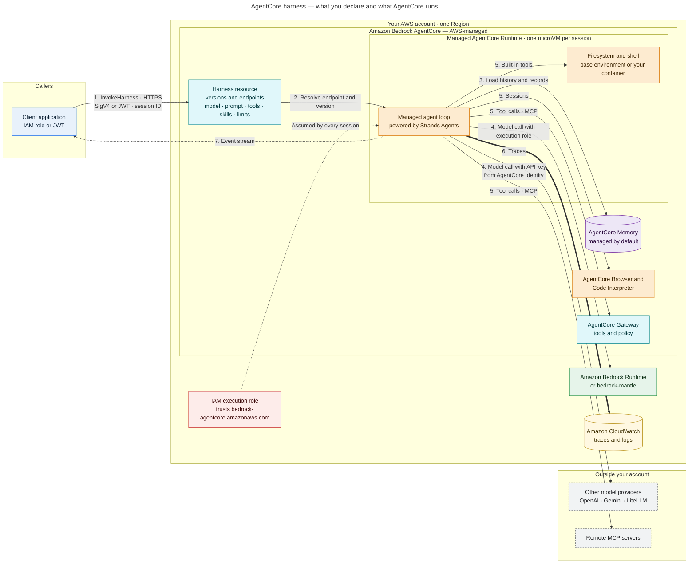
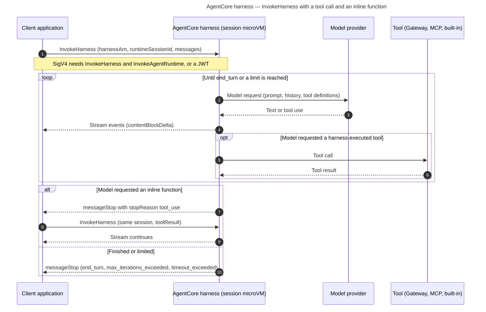

# AgentCore harness

> **Level:** Intermediate · **Verified:** 2026-11-15 · **Feature status:** GA · **Time:** ~25 min

The AgentCore harness is a managed agent loop: you describe the agent as configuration and AgentCore runs it, one isolated session at a time. It sits on top of AgentCore Runtime and is the path AWS recommends for workloads coming from Amazon Bedrock Agents Classic.

> [!IMPORTANT]
> **Status** — GA since 2026-06-17 (public preview from April 2026). Listed in 16 of the 22 AgentCore Regions, including AWS GovCloud (US-West); not in US West (N. California), Europe (Milan), Europe (Spain), Asia Pacific (Malaysia), Asia Pacific (Hyderabad) or Asia Pacific (Thailand).
> Source: [AgentCore harness is now generally available](https://aws.amazon.com/about-aws/whats-new/2026/06/amazon-bedrock-agentcore-harness-generally-available/), [Supported AWS Regions](https://docs.aws.amazon.com/bedrock-agentcore/latest/devguide/agentcore-regions.html)

## Learning objectives

- Explain what an agent harness is and which parts AgentCore manages.
- List what you declare on a harness: model, system prompt, tools, skills, memory, environment and limits.
- Create a harness with `CreateHarness` and run it with `InvokeHarness`, including per-invocation overrides.
- Describe the session isolation model and the trust boundary it does not cover.
- Map Agents Classic features to their harness equivalents and name the gaps.
- Decide between the harness and your own framework on Runtime.

## Prerequisites

- [AgentCore overview](01-agentcore-overview.md)
- [AgentCore Runtime](02-agentcore-runtime.md) — the harness inherits its sessions, quotas and networking
- [Agentic AI, tool calling and multi-agent architectures](../../00-foundations/generative-ai-fundamentals/06-agents-tool-calling-multi-agent.md)

## 1. What it is

In plain language: every agent needs a loop that calls the model, runs the tools the model asks for, feeds the results back, trims the context and stops at some point. The harness is that loop, already built and operated, so that your "agent" becomes a configuration document.

Precisely: a **harness** is a logical resource. Each harness is backed by a managed AgentCore Runtime that AgentCore provisions for you, and the loop itself is powered by the open-source Strands Agents framework. AWS CloudTrail records harness operations under the resource type `AWS::BedrockAgentCore::Runtime`.

| Item | Value |
|:--|:--|
| Service namespace / endpoint | Control plane `bedrock-agentcore-control.<region>.amazonaws.com`; data plane `bedrock-agentcore.<region>.amazonaws.com` |
| Control-plane operations | `CreateHarness`, `UpdateHarness`, `GetHarness`, `ListHarnesses`, `DeleteHarness`, `ListHarnessVersions`, `CreateHarnessEndpoint`, `UpdateHarnessEndpoint` |
| Data-plane operations | `InvokeHarness` (`POST /harnesses/invoke`), `InvokeAgentRuntimeCommand` (shell command in the session, no model involved) |
| IAM action prefix | `bedrock-agentcore:` — and each harness call needs **two** actions, for example `InvokeHarness` plus `InvokeAgentRuntime` |

Operation names are checked against the [generated API reference](../../references/bedrock-api-operations.md).

> [!NOTE]
> **Documented fact** — "AgentCore harness is a logical resource. Each harness you create is backed by a managed AgentCore Runtime that AgentCore provisions and operates on your behalf."
> Source: [Quotas for Amazon Bedrock AgentCore](https://docs.aws.amazon.com/bedrock-agentcore/latest/devguide/bedrock-agentcore-limits.html)

### What you declare

| You declare | Options | Default when omitted |
|:--|:--|:--|
| **Model** | Amazon Bedrock, OpenAI, Google Gemini, or any LiteLLM-compatible provider; for Bedrock an API format (`converse_stream`, `responses`, `chat_completions`) | The current AgentCore-recommended model, which can change |
| **System prompt** | Text instructions | Managed default instructions, which can change |
| **Tools** | Five types: `remote_mcp`, `agentcore_gateway`, `agentcore_browser`, `agentcore_code_interpreter`, `inline_function` | None configured |
| **Allowed tools** | Selectors such as `shell`, `read`, `@builtin`, `@server/tool`, or `*` | The recommended built-in set (shell, file tools, planning, web fetch, subagents) |
| **Skills** | AWS skills catalog, Git (HTTPS), Amazon S3, or a path in the filesystem | None |
| **Memory** | Managed memory, an existing AgentCore Memory, or disabled | Managed memory is provisioned |
| **Environment** | Base environment (Python and bash) or your own `linux/arm64` container; `PUBLIC` or VPC network; session storage, Amazon EFS or Amazon S3 Files mounts; environment variables | Base environment, public network |
| **Limits** | `maxIterations`, `timeoutSeconds`, `maxTokens`, idle timeout, maximum lifetime, context truncation | 75 iterations, 3,600 s, no token cap, 900 s idle, 28,800 s lifetime, summarization |
| **Inbound authorization** | IAM (SigV4) or a JWT authorizer | IAM |

Only the harness name and an execution role are required by `CreateHarness`. Most of the rest can also be overridden for a single `InvokeHarness` call without changing the resource. Sources: [Models and instructions](https://docs.aws.amazon.com/bedrock-agentcore/latest/devguide/harness-models.html), [Tools](https://docs.aws.amazon.com/bedrock-agentcore/latest/devguide/harness-tools.html), [Skills](https://docs.aws.amazon.com/bedrock-agentcore/latest/devguide/harness-skills.html), [Memory](https://docs.aws.amazon.com/bedrock-agentcore/latest/devguide/harness-memory.html), [Environment and filesystem](https://docs.aws.amazon.com/bedrock-agentcore/latest/devguide/harness-environment.html), [Observability and cost controls](https://docs.aws.amazon.com/bedrock-agentcore/latest/devguide/harness-operations.html).

## 2. Why it exists

Writing an agent loop for a demo takes an afternoon. Running one for many users needs concurrency, per-user isolation, credentials for tools, state that survives restarts, context management, failure handling and tracing. With Runtime alone you still write the loop and wire every other AgentCore service from code. With the harness, each of those is a configuration field, and switching a model or adding a tool is a configuration change, not a redeployment.

## 3. When to use it

- The agent is a standard loop: reason, call tools, answer.
- You are migrating from Agents Classic and want the closest managed equivalent.
- You want to compare models, prompts or tool sets on real traffic without redeploying.
- The agent needs a working environment — shell, files, code execution — for coding, data analysis or research tasks.
- You want to embed an agent step in an AWS Step Functions workflow (there is a native `InvokeHarness` task).

## 4. When not to use it

- **You need another framework or a non-loop pattern** (graphs, workflows). Use your own code on [AgentCore Runtime](02-agentcore-runtime.md).
- **You need bidirectional streaming.** The harness does not support it; Runtime does.
- **You need multi-agent routing.** The harness supports agent-as-tool and subagent delegation; full supervisor or routing patterns need framework code. See [Agent orchestration patterns](../../09-advanced-topics/07-agent-orchestration-patterns.md).
- **You need stage-specific prompt overrides** as in Agents Classic (pre-processing, post-processing). Not replicated; use code on Runtime.
- **You only need retrieval with an answer.** Use [Agentic retrieval with AgenticRetrieveStream](../agentic-retrieval/01-agentic-retrieval.md).

You are not locked in: the AgentCore CLI can export a harness to Strands code that runs on Runtime.

## 5. Internal architecture



**What this shows** — The harness resource is configuration; the work happens in a session microVM of a Runtime that AgentCore manages for you. Everything the loop touches is reached with the execution role you provide.

1. The client invokes the harness with a session ID.
2. The qualifier selects an endpoint, which points at an immutable harness version (`DEFAULT` follows the latest).
3. With memory enabled, the loop loads the session's history and relevant long-term records.
4. The loop calls the configured model: Amazon Bedrock with the execution role, or another provider with an API key held in AgentCore Identity.
5. The loop runs the tools the model requests: built-in shell and file tools inside the microVM, Gateway or remote MCP tools over the network, Browser and Code Interpreter sessions.
6. Every step is traced to CloudWatch.
7. Events stream back to the client while the loop runs.

**Legend** — solid: request · dashed: response or role assumption · thick: telemetry · cylinder: data store · grey dashed boxes: outside your AWS account.

**Session isolation.** Each session runs in its own microVM (the security page names Firecracker) with its own filesystem and shell; sessions share no state. Sessions are stateful: within a session, files and fetched skills stay on disk between invocations. When the microVM expires and is replaced, memory and any persistent filesystem carry the state forward. Source: [AgentCore harness](https://docs.aws.amazon.com/bedrock-agentcore/latest/devguide/harness.html), [Security and access controls](https://docs.aws.amazon.com/bedrock-agentcore/latest/devguide/harness-security.html).

## 6. Request and response lifecycle



The response is an event stream: `messageStart`, `contentBlockStart`, `contentBlockDelta`, `contentBlockStop`, `messageStop` (with a `stopReason`), `metadata` (token usage and latency), `hookEvent` and `runtimeClientError`.

- **Step 1.** The request is authorized, then routed to the session's microVM (started if needed). Any field you pass besides `messages` overrides the harness default for this call only.
- **Steps 2–6.** The loop alternates between model and tools, streaming as it goes. `allowedTools` restricts what the model may choose.
- **Steps 7–9.** An **inline function** runs on your side. The harness stops with `tool_use`; you send the matching `toolResult` in a new call with the same session ID. This is the pattern for human approval and for return of control.
- **Step 10.** Stop reasons that signal a limit: `max_iterations_exceeded`, `timeout_exceeded`, `max_output_tokens_exceeded`, and `hook_stopped` when a lifecycle hook denied the call.

Errors arrive inside the stream as `runtimeClientError`; throttling and quota errors are the Runtime ones. Source: [Get started with the harness](https://docs.aws.amazon.com/bedrock-agentcore/latest/devguide/harness-get-started.html).

## 7. Dependencies

| Depends on | Why | Required or optional |
|:--|:--|:-:|
| AgentCore Runtime | Every harness is backed by a managed runtime; sessions, quotas and networking come from it | Automatic |
| IAM execution role | Model invocation, image pull, telemetry, tools, memory | Required |
| A model provider | Amazon Bedrock, or an external provider with an API key in AgentCore Identity | Required |
| AgentCore Memory | Managed memory is created unless you disable it | Default on |
| AgentCore Gateway, remote MCP servers | Tools | Optional |
| AgentCore Browser, Code Interpreter | Built-in tool sessions | Optional |
| Amazon ECR | Your own container image; in VPC mode also the managed image | Optional |
| Amazon CloudWatch | Traces and logs | Automatic |

## 8. Security considerations

- **Two permissions per call.** `InvokeHarness` requires `bedrock-agentcore:InvokeHarness` **and** `bedrock-agentcore:InvokeAgentRuntime` on the harness ARN; control-plane calls follow the same pattern (for example `UpdateHarness` plus `UpdateAgentRuntime`).
- **The gate is authentication plus isolation, nothing more.** Any caller who passes IAM or JWT authorization reaches the whole session, including shell and configured tools. The harness validates request structure, not meaning.
- **Overrides are powerful.** A caller of `InvokeHarness` can override the model, its pass-through parameters, tools and skills. If your application forwards end-user input, strip or allow-list those fields before the call.
- **Skills are trusted input.** The harness does not inspect skill content fetched from Git or Amazon S3.
- **`allowedTools` is not IAM.** It limits the model's choice during `InvokeHarness`. It does not limit `InvokeAgentRuntimeCommand`, which runs commands as root in the microVM; withhold that IAM action instead.
- **Per-user credentials need JWT.** With SigV4 callers the harness does not propagate a user identity to tools; user-scoped tokens in AgentCore Identity require the OAuth inbound path.
- **Guardrails.** Add a `guardrailConfig` to the Bedrock model's additional parameters (Converse format) to filter model input and output; enforce tool-level rules with Policy on the Gateway. See [Amazon Bedrock Guardrails](../guardrails/01-guardrails.md) and [AgentCore Policy](09-agentcore-policy.md).

Source: [Security and access controls](https://docs.aws.amazon.com/bedrock-agentcore/latest/devguide/harness-security.html).

> [!CAUTION]
> **Cost or security hazard** — `allowedTools: ["*"]` gives the model every configured tool plus the built-in set, including `shell` and file writes, and the built-in set can grow. For production, list the selectors the agent needs.

## 9. Networking requirements

Networking is Runtime's. Sessions run on the public network by default; for private resources, set the environment's network mode to `VPC` with subnets and security groups. In VPC mode the managed container image is pulled from a private Amazon ECR repository at session start, so the VPC needs interface endpoints for `ecr.dkr` and `ecr.api`, a gateway endpoint for Amazon S3, and — for Bedrock models — an interface endpoint for `bedrock-runtime`; otherwise sessions fail to start. Callers reach `InvokeHarness` through the public endpoint or the `com.amazonaws.<region>.bedrock-agentcore` interface endpoint. Remote MCP servers, Git skill sources and external model providers need outbound internet access (a NAT gateway in VPC mode).

## 10. Pricing dimensions

> [!NOTE]
> **Documented fact** — "There is no separate harness charge. You pay only for the underlying AgentCore capabilities you use."
> Source: [AgentCore harness](https://docs.aws.amazon.com/bedrock-agentcore/latest/devguide/harness.html)

| Dimension | Unit | Notes |
|:--|:--|:--|
| AgentCore Runtime | vCPU-hours and GB-hours, per second | From microVM start to termination; memory stays billable while idle |
| Model inference | Input and output tokens, by the provider | One invocation makes several model calls; the built-in tool definitions add roughly 3,000 input tokens per request |
| AgentCore Memory | Events, stored records, retrievals | Managed memory is on by default |
| Browser and Code Interpreter | vCPU-hours and GB-hours of their sessions | Only when used |
| Gateway, Web Search, Web Answer | Invocations, searches, queries | Only when used |
| Observability | Amazon CloudWatch ingestion, storage, queries | Every invocation emits telemetry |

Figures are on the [AgentCore pricing](https://aws.amazon.com/bedrock/agentcore/pricing/) page. Prompt caching is enabled automatically for supported Bedrock models on the Converse format, which lowers the cost of repeated tool definitions.

## 11. Scaling considerations

Harness invocations are bound by the [AgentCore Runtime quotas](02-agentcore-runtime.md#11-scaling-considerations): active sessions, the shared data-plane request rate, new-session rate, payload and streaming limits. On top of those, the harness has its own controls and limits:

| Control or limit | Value | Source |
|:--|:--|:--|
| `maxIterations` | Default 75 | [Observability and cost controls](https://docs.aws.amazon.com/bedrock-agentcore/latest/devguide/harness-operations.html) |
| `timeoutSeconds` | Default 3,600 | Same page |
| `maxTokens` | No default | Same page |
| `idleRuntimeSessionTimeout` / `maxLifetime` | Default 900 / 28,800 s; range 60–28,800 | Same page |
| Lifecycle hooks per harness | 20 | [Lifecycle hooks](https://docs.aws.amazon.com/bedrock-agentcore/latest/devguide/harness-lifecycle-hooks.html) |
| Session ID length | 33–100 characters | [InvokeHarness](https://docs.aws.amazon.com/bedrock-agentcore/latest/APIReference/API_InvokeHarness.html) |
| Amazon S3 skill size | 1 GB | [Skills](https://docs.aws.amazon.com/bedrock-agentcore/latest/devguide/harness-skills.html) |
| Git skill fetch | Must complete within 60 s | Same page |
| Step Functions `InvokeHarness` task | 15 minutes maximum | [Step Functions integration](https://docs.aws.amazon.com/step-functions/latest/dg/connect-bedrockagentcore.html) |

A shorter idle timeout cuts billable memory after the last call but causes more cold starts.

## 12. IaC support

| Tool | Support | Resource / construct | Notes |
|:--|:-:|:--|:--|
| Terraform (`hashicorp/aws` 6.73.0) | ✅ | `aws_bedrockagentcore_harness` | No resource for harness endpoints and no lifecycle-hook argument in this version |
| CloudFormation | ✅ | `AWS::BedrockAgentCore::Harness`, `AWS::BedrockAgentCore::HarnessEndpoint` | — |
| AWS CDK (`aws-cdk-lib` 2.277.0) | L1 only | `aws_bedrockagentcore.CfnHarness`, `CfnHarnessEndpoint` | No L2 construct |

For harness endpoints from Terraform, the verified alternatives are the CloudFormation type or the `CreateHarnessEndpoint` API. The AgentCore CLI keeps the same configuration in a `harness.yaml` file and deploys through CDK.

## 13. Working example

A harness with a Bedrock model, Gateway tools, Code Interpreter, AWS skills and managed memory.

> **Code status:** validated with `terraform validate` (provider 6.73.0), together with a `versions.tf` that pins `hashicorp/aws ~> 6.73` and configures the provider from `var.aws_region` and `var.tags` · **never planned or applied against AWS**

```hcl
variable "aws_region" {
  description = "Region to deploy into. The harness is not available in every AgentCore Region."
  type        = string
  default     = "us-east-1"
}

variable "tags" {
  description = "Tags applied through default_tags."
  type        = map(string)
  default     = { Project = "bedrock-academy", Chapter = "agentcore-harness" }
}

variable "harness_name" {
  description = "1-40 characters: a letter first, then letters, digits and underscores. Changing it replaces the harness."
  type        = string
  default     = "academy_research_agent"
}

variable "model_id" {
  description = "Bedrock model or inference profile ID. Pin it; the service default can change. Confirm the current ID."
  type        = string
}

variable "system_prompt" {
  description = "Instructions for the agent. Pin them; the managed default instructions can change."
  type        = string
  default     = "You are a research assistant. Cite the tool result that supports each claim."
}

variable "gateway_arn" {
  description = "ARN of an AgentCore Gateway with IAM inbound authorization whose tools the agent may call."
  type        = string
}

variable "allowed_tools" {
  description = "Tool selectors the model may use. The wildcard allows every configured and built-in tool, including shell."
  type        = list(string)
  default     = ["*"]
}

data "aws_caller_identity" "current" {}
data "aws_partition" "current" {}
data "aws_region" "current" {}

locals {
  account_id = data.aws_caller_identity.current.account_id
  partition  = data.aws_partition.current.partition
  region     = data.aws_region.current.region
  arn_prefix = "arn:${local.partition}:bedrock-agentcore:${local.region}:${local.account_id}"
  log_prefix = "arn:${local.partition}:logs:${local.region}:${local.account_id}:log-group"
}

data "aws_iam_policy_document" "harness_trust" {
  statement {
    effect  = "Allow"
    actions = ["sts:AssumeRole"]

    principals {
      type        = "Service"
      identifiers = ["bedrock-agentcore.amazonaws.com"]
    }

    condition {
      test     = "StringEquals"
      variable = "aws:SourceAccount"
      values   = [local.account_id]
    }
  }
}

resource "aws_iam_role" "harness" {
  name               = "${var.harness_name}-execution"
  assume_role_policy = data.aws_iam_policy_document.harness_trust.json
}

# Based on the documented sample execution role for a harness on the public network.
data "aws_iam_policy_document" "harness_permissions" {
  statement {
    sid     = "BedrockModelInvocation"
    effect  = "Allow"
    actions = ["bedrock:InvokeModel", "bedrock:InvokeModelWithResponseStream"]
    resources = [
      "arn:${local.partition}:bedrock:*::foundation-model/*",
      "arn:${local.partition}:bedrock:${local.region}:${local.account_id}:*",
    ]
  }

  statement {
    sid       = "ManagedImagePull"
    effect    = "Allow"
    actions   = ["ecr-public:GetAuthorizationToken", "sts:GetServiceBearerToken"]
    resources = ["*"]
  }

  statement {
    sid    = "Tracing"
    effect = "Allow"
    actions = [
      "xray:PutTraceSegments",
      "xray:PutTelemetryRecords",
      "xray:GetSamplingRules",
      "xray:GetSamplingTargets",
    ]
    resources = ["*"]
  }

  statement {
    sid       = "LogGroups"
    effect    = "Allow"
    actions   = ["logs:CreateLogGroup", "logs:DescribeLogStreams"]
    resources = ["${local.log_prefix}:/aws/bedrock-agentcore/runtimes/*"]
  }

  statement {
    sid       = "DescribeLogGroups"
    effect    = "Allow"
    actions   = ["logs:DescribeLogGroups"]
    resources = ["${local.log_prefix}:*"]
  }

  statement {
    sid       = "LogStreams"
    effect    = "Allow"
    actions   = ["logs:CreateLogStream", "logs:PutLogEvents"]
    resources = ["${local.log_prefix}:/aws/bedrock-agentcore/runtimes/*:log-stream:*"]
  }

  statement {
    sid       = "LogResourcePolicy"
    effect    = "Allow"
    actions   = ["logs:PutResourcePolicy"]
    resources = ["*"]
  }

  statement {
    sid       = "Metrics"
    effect    = "Allow"
    actions   = ["cloudwatch:PutMetricData"]
    resources = ["*"]

    condition {
      test     = "StringEquals"
      variable = "cloudwatch:namespace"
      values   = ["bedrock-agentcore"]
    }
  }

  statement {
    sid    = "WorkloadIdentity"
    effect = "Allow"
    actions = [
      "bedrock-agentcore:GetWorkloadAccessToken",
      "bedrock-agentcore:GetWorkloadAccessTokenForJWT",
    ]
    resources = [
      "${local.arn_prefix}:workload-identity-directory/default",
      "${local.arn_prefix}:workload-identity-directory/default/workload-identity/harness_*",
    ]
  }

  statement {
    sid    = "CodeInterpreterDefault"
    effect = "Allow"
    actions = [
      "bedrock-agentcore:StartCodeInterpreterSession",
      "bedrock-agentcore:StopCodeInterpreterSession",
      "bedrock-agentcore:GetCodeInterpreterSession",
      "bedrock-agentcore:ListCodeInterpreterSessions",
      "bedrock-agentcore:InvokeCodeInterpreter",
    ]
    resources = ["arn:${local.partition}:bedrock-agentcore:${local.region}:aws:code-interpreter/*"]
  }

  statement {
    sid    = "ManagedMemory"
    effect = "Allow"
    actions = [
      "bedrock-agentcore:CreateEvent",
      "bedrock-agentcore:DeleteEvent",
      "bedrock-agentcore:GetEvent",
      "bedrock-agentcore:ListEvents",
      "bedrock-agentcore:RetrieveMemoryRecords",
    ]
    resources = ["${local.arn_prefix}:memory/harness_*"]
  }

  statement {
    sid       = "GatewayAccess"
    effect    = "Allow"
    actions   = ["bedrock-agentcore:InvokeGateway"]
    resources = [var.gateway_arn]
  }
}

resource "aws_iam_role_policy" "harness" {
  name   = "agentcore-harness-execution"
  role   = aws_iam_role.harness.id
  policy = data.aws_iam_policy_document.harness_permissions.json
}

resource "aws_bedrockagentcore_harness" "this" {
  harness_name       = var.harness_name
  execution_role_arn = aws_iam_role.harness.arn

  # What the agent is: model, instructions, tools, skills, memory.
  model {
    bedrock_model_config {
      model_id   = var.model_id
      api_format = "converse_stream"
    }
  }

  system_prompt {
    text = var.system_prompt
  }

  tool {
    type = "agentcore_gateway"
    name = "enterprise_tools"

    config {
      agentcore_gateway {
        gateway_arn = var.gateway_arn

        outbound_auth {
          aws_iam = true
        }
      }
    }
  }

  tool {
    type = "agentcore_code_interpreter"
    name = "code_interpreter"
  }

  skill {
    aws_skills {
      paths = ["core-skills/*"]
    }
  }

  memory {
    managed_memory_configuration {
      event_expiry_duration = 30
      strategies            = ["SEMANTIC", "SUMMARIZATION"]
    }
  }

  truncation {
    strategy = "sliding_window"

    config {
      sliding_window {
        messages_count = 50
      }
    }
  }

  # Hard limits for one invocation.
  allowed_tools   = var.allowed_tools
  max_iterations  = 50
  max_tokens      = 8192
  timeout_seconds = 1800

  # Where it runs: the managed Runtime behind the harness.
  environment {
    agentcore_runtime_environment {
      network_configuration {
        network_mode = "PUBLIC"
      }

      lifecycle_configuration {
        idle_runtime_session_timeout = 600
        max_lifetime                 = 14400
      }
    }
  }

  depends_on = [aws_iam_role_policy.harness]
}

output "harness_arn" {
  description = "ARN to pass to InvokeHarness."
  value       = aws_bedrockagentcore_harness.this.arn
}
```

Invoking it follows the documented `boto3` call. The second call in the same session continues the conversation.

> **Code status:** syntax-checked (`python -m py_compile`) · **not run, never deployed**

```python
"""Invoke a harness and print the streamed answer. Reuse the session ID to continue."""
import uuid

import boto3

client = boto3.client("bedrock-agentcore")  # data plane


def ask(harness_arn: str, session_id: str, text: str, actor_id: str | None = None) -> str:
    request = {
        "harnessArn": harness_arn,
        "runtimeSessionId": session_id,  # 33-100 characters
        "messages": [{"role": "user", "content": [{"text": text}]}],
    }
    if actor_id:
        request["actorId"] = actor_id  # scopes memory to one user
    response = client.invoke_harness(**request)

    stop_reason = "unknown"
    for event in response["stream"]:
        if "contentBlockDelta" in event:
            delta = event["contentBlockDelta"].get("delta", {})
            if "text" in delta:
                print(delta["text"], end="", flush=True)
        elif "messageStop" in event:
            stop_reason = event["messageStop"].get("stopReason", "unknown")
        elif "runtimeClientError" in event:
            raise RuntimeError(event["runtimeClientError"]["message"])
    return stop_reason  # end_turn, tool_use, max_iterations_exceeded ...


def demo(harness_arn: str) -> None:
    session_id = str(uuid.uuid4())  # 36 characters
    ask(harness_arn, session_id, "Summarise open orders by region.", actor_id="user-42")
    ask(harness_arn, session_id, "Now plot them.", actor_id="user-42")
```

A deployed harness bills for session compute, model tokens and memory when invoked. `terraform destroy` removes it; by default deleting a harness also deletes its managed memory.

### What it replaces from Agents Classic

| Agents Classic | With the harness | Gap to plan for |
|:--|:--|:--|
| Managed orchestration loop | The harness loop | — |
| Action groups (OpenAPI or function schema, Lambda executor) | Tools behind AgentCore Gateway, exposed as MCP | Lambda event shape and tool names change |
| Knowledge base attached to the agent | Gateway-fronted knowledge base tool | The built-in connector is for Managed Knowledge Base |
| Session and memory settings | AgentCore Memory, short-term and long-term | **Our reading:** decide what happens to existing session history; no migration of it is documented |
| Guardrail attached to the agent | Guardrail on the Bedrock model call; policy enforcement on the Gateway | Two layers instead of one |
| Return of control, `AMAZON.UserInput` | Inline function tools | You define the tool explicitly |
| Code Interpreter action group | AgentCore Code Interpreter | — |
| Trace API | AgentCore Observability traces | **Our reading:** dashboards and alarms built on Classic traces need rebuilding |
| Versions and aliases | Harness versions and named endpoints | — |
| Stage-specific prompt overrides | System prompt only | Not replicated on the harness |
| Multi-agent collaboration | Agent-as-tool; AWS rates multi-agent routing as limited | Use code on Runtime |
| Custom orchestrator | Not available on the harness | Use code on Runtime |

Source: [Agents Classic maintenance mode](https://docs.aws.amazon.com/bedrock/latest/userguide/agents-classic-maintenance-mode.html). The migration procedure is in [Agents Classic versus AgentCore, and migrating](../agents/03-agents-classic-vs-agentcore.md).

### Decision table: harness or Runtime with your own framework

| Question | Harness | Runtime with your own code |
|:--|:--|:--|
| Who writes the loop? | AgentCore (Strands-powered) | You, in any framework or none |
| How do you change model, prompt or tools? | Edit configuration, or override per call | Change code and deploy a new version |
| Artifact to build | None; optional custom container as environment | ARM64 container or zip package |
| Memory, Gateway, Browser, Code Interpreter | Configuration fields | You call them from code |
| Shell and file tools | Built in | You implement them |
| Streaming | Response streaming | Response and bidirectional streaming |
| Patterns | Agent loop, agent-as-tool, subagents | Anything: graphs, workflows, supervisors, MCP servers, A2A agents |
| Session isolation, VPC, inbound auth, versions, endpoints | Same as Runtime | Provided by Runtime |
| Compute | microVMs | microVMs or Instances |
| Exit path | Export to Strands code on Runtime | — |

Source: [AgentCore harness vs. Runtime](https://docs.aws.amazon.com/bedrock-agentcore/latest/devguide/harness-vs-runtime.html).

> [!TIP]
> **Academy recommendation** — Choose the harness unless a row in the right-hand column is a requirement you can name today. Pin the model, the system prompt and the tool selectors explicitly, because the managed defaults are allowed to change.
> This is our design guidance, not an official AWS reference architecture.

## Common mistakes

| Mistake | Symptom | Fix |
|:--|:--|:--|
| Granting only `bedrock-agentcore:InvokeHarness` | Access denied on invoke | Also grant `bedrock-agentcore:InvokeAgentRuntime` on the harness ARN |
| Relying on managed defaults in production | Behaviour changes without a deployment | Set model, system prompt, truncation and `allowedTools` explicitly |
| Leaving `allowedTools` at `*` | The model can run shell commands and write files | List the selectors the agent needs |
| Forwarding end-user JSON straight into `InvokeHarness` | Users override model, tools or skills | Build the request server-side; allow-list fields |
| VPC mode without Amazon ECR and S3 endpoints | Sessions fail to start (image pull timeout) | Add `ecr.dkr`, `ecr.api` and the S3 gateway endpoint |
| Expecting a custom container's `ENTRYPOINT` to run | Background process is missing | The harness overrides it; start processes with `InvokeAgentRuntimeCommand` |
| A new session ID for every message | No conversation continuity, repeated cold starts | Reuse `runtimeSessionId` for the conversation |
| Forgetting managed memory is on | Unexpected Memory charges | Disable memory or set the event expiry deliberately |

## Knowledge check

1. In one sentence each: what does a harness add on top of Runtime, and what does it take away?
2. A product manager wants to try a cheaper model for 5% of requests tomorrow. How would you do that with a harness, and what would the same change require on Runtime with your own code?
3. Your web application authenticates users, then calls `InvokeHarness` with SigV4 from its backend. A tool needs each user's own OAuth token. What would happen, and what must change?
4. Why does setting `allowedTools` to a short list not stop an operator from running `rm -rf` in a session?
5. Which Agents Classic features make you choose Runtime over the harness when migrating?

<details>
<summary>Answers</summary>

1. It adds a managed agent loop with model, tools, memory and limits as configuration; it takes away the choice of framework, non-loop patterns and bidirectional streaming.
2. Pass a `model` override on those `InvokeHarness` calls (or run an A/B test through Optimization); nothing is redeployed. With your own code you would change the code or its configuration and deploy a new runtime version.
3. With SigV4 the harness does not propagate a per-user identity to tools, so user-scoped tokens in the token vault cannot be used. Configure a JWT authorizer on the harness and invoke it with the user's bearer token.
4. `allowedTools` only constrains the model's tool selection during `InvokeHarness`. `InvokeAgentRuntimeCommand` is a separate API that runs commands directly as root; it is controlled by IAM.
5. Stage-specific prompt overrides, a custom orchestrator, and multi-agent collaboration with routing.

</details>

## 14. Official documentation

- [AgentCore harness](https://docs.aws.amazon.com/bedrock-agentcore/latest/devguide/harness.html) — what the harness is; no separate charge.
- [AgentCore harness vs. Runtime](https://docs.aws.amazon.com/bedrock-agentcore/latest/devguide/harness-vs-runtime.html) — conceptual difference and feature grid.
- [Get started with the harness](https://docs.aws.amazon.com/bedrock-agentcore/latest/devguide/harness-get-started.html) — `create-harness`, `invoke_harness`, stream events and stop reasons.
- [Models and instructions](https://docs.aws.amazon.com/bedrock-agentcore/latest/devguide/harness-models.html) — providers, defaults, API formats, guardrails.
- [Tools](https://docs.aws.amazon.com/bedrock-agentcore/latest/devguide/harness-tools.html) — tool types, built-in tools, `allowedTools` selectors.
- [Skills](https://docs.aws.amazon.com/bedrock-agentcore/latest/devguide/harness-skills.html) — skill sources and limits.
- [Memory](https://docs.aws.amazon.com/bedrock-agentcore/latest/devguide/harness-memory.html) — managed, existing and disabled memory; truncation.
- [Environment and filesystem](https://docs.aws.amazon.com/bedrock-agentcore/latest/devguide/harness-environment.html) — base environment, custom containers, mounts, commands.
- [Security and access controls](https://docs.aws.amazon.com/bedrock-agentcore/latest/devguide/harness-security.html) — permissions model, trust boundary, VPC, execution role policy.
- [Observability and cost controls](https://docs.aws.amazon.com/bedrock-agentcore/latest/devguide/harness-operations.html) — cost drivers and limits.
- [Lifecycle hooks](https://docs.aws.amazon.com/bedrock-agentcore/latest/devguide/harness-lifecycle-hooks.html) — hook events and targets.
- [InvokeHarness API reference](https://docs.aws.amazon.com/bedrock-agentcore/latest/APIReference/API_InvokeHarness.html) — request fields and overrides.
- [Quotas for Amazon Bedrock AgentCore](https://docs.aws.amazon.com/bedrock-agentcore/latest/devguide/bedrock-agentcore-limits.html) — harness quotas are the Runtime quotas.
- [Invoke AgentCore harness with Step Functions](https://docs.aws.amazon.com/step-functions/latest/dg/connect-bedrockagentcore.html) — the `InvokeHarness` task.
- [AgentCore harness is now generally available](https://aws.amazon.com/about-aws/whats-new/2026/06/amazon-bedrock-agentcore-harness-generally-available/) — GA date.
- [Release notes](https://docs.aws.amazon.com/bedrock-agentcore/latest/devguide/doc-history.html) — preview, GovCloud availability, hooks, managed defaults.
- [Agents Classic maintenance mode](https://docs.aws.amazon.com/bedrock/latest/userguide/agents-classic-maintenance-mode.html) — the Agents Classic to AgentCore mapping.
- [Terraform: `aws_bedrockagentcore_harness`](https://raw.githubusercontent.com/hashicorp/terraform-provider-aws/main/website/docs/r/bedrockagentcore_harness.html.markdown) — arguments and valid values.
