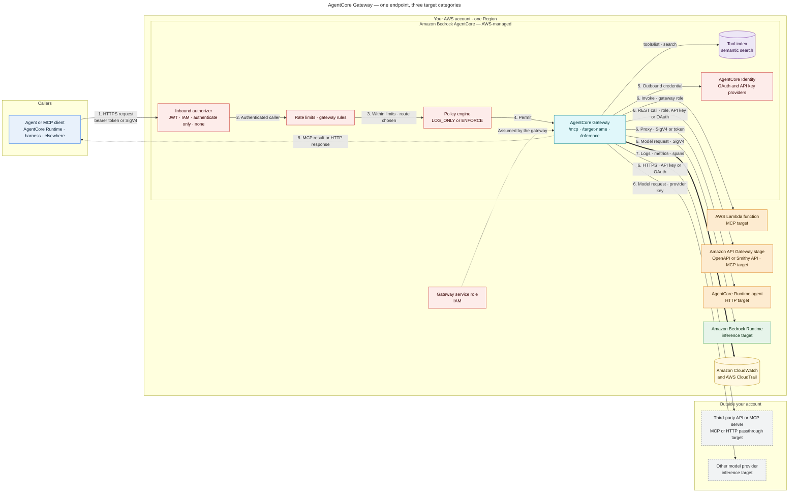
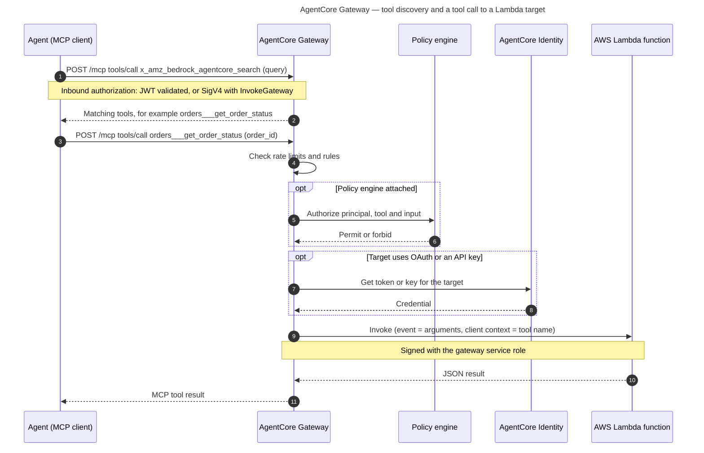

# AgentCore Gateway

> **Level:** Intermediate · **Verified:** 2026-11-15 · **Feature status:** GA · **Time:** ~25 min

AgentCore Gateway is a managed entry point for agentic traffic. It turns APIs and AWS Lambda functions into Model Context Protocol (MCP) tools, fronts other agents and MCP servers, and routes inference requests to model providers — all behind one endpoint with inbound and outbound authorization.

> [!IMPORTANT]
> **Status** — GA, listed in all 22 AgentCore Regions. Semantic tool search is listed in 18 Regions. HTTP passthrough targets and inference targets were added in mid-2026; configurable rate limits in August 2026.
> Source: [Supported AWS Regions](https://docs.aws.amazon.com/bedrock-agentcore/latest/devguide/agentcore-regions.html), [Semantic search](https://docs.aws.amazon.com/bedrock-agentcore/latest/devguide/gateway-using-mcp-semantic-search.html), [Release notes](https://docs.aws.amazon.com/bedrock-agentcore/latest/devguide/doc-history.html)

## Learning objectives

- Name the three target categories and the target types in each.
- Explain how a Lambda function, a REST API, an OpenAPI specification or a Smithy model becomes an MCP tool.
- Use semantic tool search when a gateway holds many tools.
- Choose an inbound authorization type and an outbound credential method per target.
- Describe where gateway rules, rate limits and a policy engine act on a request.
- Read the quotas, the PrivateLink options and the pricing dimensions.

## Prerequisites

- [AgentCore overview](01-agentcore-overview.md)
- [Agentic AI, tool calling and multi-agent architectures](../../00-foundations/generative-ai-fundamentals/06-agents-tool-calling-multi-agent.md)
- [IAM roles, trust policies and cross-account access](../../00-foundations/security/02-iam-roles-and-trust.md)
- [AWS Lambda with Bedrock](../../02-related-aws-services/compute/01-lambda.md)

## 1. What it is

In plain language: an agent needs tools, and each tool has its own protocol, address and credentials. A gateway is a single front desk. The agent asks the desk "what can I use?" and "please run this", and the desk knows how to reach each back office and which key opens it.

Precisely: a **gateway** is a resource with an inbound authorizer, an IAM service role and a set of **targets**. For MCP targets it behaves as one virtual MCP server that aggregates all their tools; for HTTP targets it proxies; for inference targets it routes by model.

| Item | Value |
|:--|:--|
| Service namespace / endpoint | Control plane `bedrock-agentcore-control.<region>.amazonaws.com`; data path `https://<gateway-id>.gateway.bedrock-agentcore.<region>.amazonaws.com` (MCP at `/mcp`, inference at `/inference`, HTTP targets at `/<target-name>/…`) |
| Control-plane operations | `CreateGateway`, `UpdateGateway`, `GetGateway`, `ListGateways`, `DeleteGateway`, `CreateGatewayTarget`, `UpdateGatewayTarget`, `SynchronizeGatewayTargets`, `CreateGatewayRule`, `CreateGatewayRateLimit` |
| Data-plane operations | Not SDK operations: MCP JSON-RPC methods such as `tools/list` and `tools/call` over HTTPS, HTTP requests to targets, and inference requests |
| IAM action prefix | `bedrock-agentcore:` — callers of an IAM-authorized gateway need `bedrock-agentcore:InvokeGateway` |

Control-plane names are checked against the [generated API reference](../../references/bedrock-api-operations.md). The release notes call the rate-limit operations `CreateRateLimit` and so on; the API reference and the AWS SDK use `CreateGatewayRateLimit`, which is what we use.

### The three target categories

| Category | How the gateway treats it | Target types |
|:--|:--|:--|
| **MCP targets** | Aggregation: all MCP targets appear as one MCP server with one `tools/list`. Supports capability synchronization, semantic search and three-legged OAuth | AWS Lambda functions · Amazon API Gateway REST API stages · OpenAPI specifications · Smithy models · MCP servers · integration provider templates · built-in connectors (for example Managed Knowledge Base, Web Search Tool, Web Answer, AWS Step Functions) |
| **HTTP targets** | Proxy: traffic goes to the target without aggregation or protocol translation; clients address each target by path. No synchronization or semantic search | AgentCore Runtime agents · HTTP passthrough targets (other agents including A2A services, external MCP servers, any HTTP endpoint) |
| **Inference targets** | Routing: one endpoint for model traffic; the destination is chosen from the `model` field of the request | Inference connector targets (preconfigured providers) · inference provider targets (you define endpoint, model mappings and operations) |

Source: [Core concepts](https://docs.aws.amazon.com/bedrock-agentcore/latest/devguide/gateway-core-concepts.html), [Supported targets](https://docs.aws.amazon.com/bedrock-agentcore/latest/devguide/gateway-supported-targets.html).

## 2. Why it exists

Without a gateway, every agent carries its own tool integrations: client code per API, a place to keep each API key, OAuth flows and token refresh, and a tool list that grows until it crowds the prompt. Change one API and you redeploy every agent that uses it. The gateway moves that work out of the agents: tools are defined once, credentials stay in AgentCore Identity, and controls such as policy and rate limits sit where an agent cannot reason around them.

## 3. When to use it

- Several agents, or agents built by different teams, need the same tools.
- You have existing Lambda functions or REST APIs and want them as MCP tools without writing an MCP server.
- Tools need credentials the agent must not hold (API keys, OAuth tokens, a different IAM role).
- You want deterministic authorization, guardrails or rate limits on tool calls.
- The tool catalogue is large enough that the model should search it.
- You want one governed endpoint in front of agents on Runtime, or in front of several model providers.

## 4. When not to use it

- **One agent, one in-process tool.** Define the tool in the agent's code; a network hop adds latency and cost for no governance gain.
- **You only call Amazon Bedrock models and need no routing layer.** Call the model directly; see [The Converse API](../inference/01-converse-api.md). For model routing and fallback inside Bedrock, see [Model routing and fallback models](../../09-advanced-topics/10-model-routing-and-fallback.md).
- **Publishing a public REST API for applications.** That is Amazon API Gateway's job; see [API Gateway, CloudFront and Application Load Balancer](../../02-related-aws-services/compute/04-api-gateway-cloudfront-alb.md). A gateway can then expose a stage of that API to agents.
- **A customer-managed knowledge base as a tool.** The built-in connector is for Managed Knowledge Base only; use a Lambda target that calls `Retrieve`, or see [Managed Knowledge Base](../knowledge-bases/02-managed-knowledge-base.md).

## 5. Internal architecture



**What this shows** — The controls a request passes before it reaches a target, and the six kinds of destination. The boxes for authorizer, rules and policy are functions of the gateway, drawn separately to show the order; **our reading** of that order comes from the rate-limit guidance, which states that rate limits are applied before Policy.

1. The caller sends an MCP, HTTP or inference request with a bearer token or a SigV4 signature.
2. The inbound authorizer validates it (or, with offloaded types, leaves authorization to another component).
3. Rate limits are checked and gateway rules select a target or configuration.
4. If a policy engine is attached, the call is authorized against the policies.
5. The gateway obtains the outbound credential the target needs.
6. The gateway invokes the target in its own protocol.
7. Logs, metrics and spans are emitted.
8. The result returns in the caller's protocol.

**Legend** — solid: request · dashed: response or role assumption · thick: telemetry · cylinder: data store · grey dashed boxes: outside your AWS account. The identity flows are drawn in [diagram set 14](../../diagrams/mermaid/14-agentcore-gateway-and-identity.md).

### How things become MCP tools

| Source | What you provide | What the gateway does |
|:--|:--|:--|
| AWS Lambda function | Function ARN and a **tool schema** (name, description, `inputSchema`, optional `outputSchema`), inline or in Amazon S3 | Invokes the function with the tool arguments as the event; passes the tool name in the Lambda client context |
| Amazon API Gateway REST API | REST API ID and stage, with optional tool filters and overrides | Exposes the selected methods as tools |
| OpenAPI specification | The specification, inline or in Amazon S3 | Translates between MCP and REST calls |
| Smithy model | The model, inline or in Amazon S3 | Generates tools that call the modelled service |
| MCP server | The server endpoint | Discovers its tools, prompts and resources at synchronization; call `SynchronizeGatewayTargets` when the server changes |
| Integration template or connector | A template or connector ID and its parameters | Supplies the schema and endpoint handling for you |

Every tool is exposed under the name `<target-name>___<tool-name>` (three underscores). Agents see the prefixed name; a Lambda function must strip the prefix. Sources: [AWS Lambda function targets](https://docs.aws.amazon.com/bedrock-agentcore/latest/devguide/gateway-add-target-lambda.html), [Tool naming](https://docs.aws.amazon.com/bedrock-agentcore/latest/devguide/gateway-tool-naming.html).

### Semantic tool search

A model that receives hundreds of tool definitions wastes tokens and chooses worse. When you enable semantic search at gateway creation, the gateway adds a built-in tool, `x_amz_bedrock_agentcore_search`. The agent calls it through `tools/call` with a natural-language `query` and receives the relevant tools, instead of loading the whole list. Search applies to MCP targets only, is billed per search and per indexed tool, and has its own default quota (25 search-based tool calls per minute).

## 6. Request and response lifecycle



- **Steps 1–2.** The agent finds tools by search, or with `tools/list`. A JWT-authorized gateway answers a missing or invalid token with 401 and a `WWW-Authenticate` header that advertises the required scopes, and insufficient scopes with 403.
- **Steps 3–4.** A call that exceeds a rate limit is throttled before anything else runs.
- **Steps 5–6.** In `ENFORCE` mode a forbidden call stops here; in `LOG_ONLY` mode the decision is recorded and the call continues.
- **Steps 7–8.** For a Lambda target this step is skipped: Lambda targets use the gateway service role only.
- **Steps 9–11.** The gateway invokes the function and wraps its JSON response as an MCP result. The default invocation timeout is 15 minutes and the payload limit 6 MB.

## 7. Dependencies

| Depends on | Why | Required or optional |
|:--|:--|:-:|
| IAM service role | The gateway's identity for calling targets; trusts `bedrock-agentcore.amazonaws.com` | Required |
| An inbound authorizer choice | Every gateway must have one | Required |
| An identity provider | Issues the JWTs for `CUSTOM_JWT` gateways | Required for JWT |
| AgentCore Identity | A workload identity is created for the gateway; credential providers hold OAuth clients and API keys | Automatic; providers optional |
| AWS Secrets Manager | Stores the secrets behind credential providers | With OAuth or API keys |
| Targets | Lambda functions, APIs, MCP servers, runtimes, model providers | At least one to be useful |
| AgentCore Policy | Policy engine attached to the gateway | Optional |
| AWS KMS | Customer managed key for gateway data | Optional |
| Amazon VPC Lattice | Private endpoints to targets in your VPC | Optional |

## 8. Security considerations

**Inbound authorization** — who may call the gateway.

| Type | How it works | Use it for |
|:--|:--|:--|
| JWT (`CUSTOM_JWT`) | Validates a bearer token against your identity provider's discovery URL, with allowed audiences, clients, scopes and custom claims | End users and external MCP clients |
| IAM (`AWS_IAM`) | SigV4; the caller needs `bedrock-agentcore:InvokeGateway` on the gateway ARN | Agents and services inside AWS |
| Authenticate only (`AUTHENTICATE_ONLY`) | Offloaded: the gateway authenticates but leaves the authorization decision to the target, a policy engine or an interceptor | Targets that authorize by themselves |
| None (`NONE`) | No authentication or authorization at the gateway | Only a gateway you intend to make public, with your own throttling and checks — AWS says not to use it for testing convenience ([inbound authorization](https://docs.aws.amazon.com/bedrock-agentcore/latest/devguide/gateway-inbound-auth.html); the core-concepts page still says "development and testing") |

**Outbound authorization** — how the gateway proves itself to a target. Credentials come from the gateway's own role or from AgentCore Identity; the agent never sees them.

| Target type | Gateway service role | Caller IAM credentials | OAuth (client credentials / authorization code / token exchange) | Token passthrough | API key | None |
|:--|:-:|:-:|:-:|:-:|:-:|:-:|
| Lambda function | Yes | No | No | No | No | No |
| API Gateway stage | Yes | No | No | No | Yes | Yes |
| OpenAPI schema | Yes | No | Yes / Yes / Yes | No | Yes | Yes |
| Smithy schema | Yes | No | Yes / No / No | No | No | No |
| MCP server | Yes | No | Yes / Yes / Yes | No | Yes | Yes |
| AgentCore Runtime (HTTP) | Yes | Yes | Yes / No / No | Yes | No | No |

Source: [Inbound authorization](https://docs.aws.amazon.com/bedrock-agentcore/latest/devguide/gateway-inbound-auth.html), [Outbound authorization](https://docs.aws.amazon.com/bedrock-agentcore/latest/devguide/gateway-outbound-auth.html). The flows are explained in [AgentCore Identity](05-agentcore-identity.md).

Further points:

- **The service role is an upper bound.** It is shared by every target that uses it, so its permissions are what any authorized caller can reach. Use separate gateways for different trust levels.
- **Policy attachment point.** A policy engine is attached to the gateway (`policyEngineConfiguration`, mode `LOG_ONLY` or `ENFORCE`) and evaluates each tool call outside the agent's code. Guardrail checks can run through Policy as well. See [AgentCore Policy](09-agentcore-policy.md).
- **Interceptors.** Lambda interceptors can inspect or transform requests and responses.
- **JWT subjects are logged.** With JWT authorization the token's subject appears in AWS CloudTrail; do not put personal data in it.
- **Tool descriptions and results are untrusted content** from the model's point of view. See [Prompt injection, untrusted tool output and retrieval poisoning](../../06-security-governance/04-prompt-injection-and-untrusted-content.md).

## 9. Networking requirements

| Path | Option |
|:--|:--|
| Callers → gateway | Public gateway URL, or an interface VPC endpoint `com.amazonaws.<region>.bedrock-agentcore.gateway`. With private DNS the name is `*.gateway.bedrock-agentcore.<region>.amazonaws.com` |
| Callers → control plane | Interface VPC endpoint `com.amazonaws.<region>.bedrock-agentcore-control` |
| Gateway → public targets | Over the internet, with TLS certificates from public certificate authorities |
| Gateway → targets in your VPC | A private endpoint on the target, through Amazon VPC Lattice: managed by AWS in your VPC, or a resource configuration you manage. Private certificate authorities are supported for MCP server, OpenAPI and passthrough targets |
| Gateway → private identity provider | A private endpoint in the JWT authorizer configuration |

An endpoint policy can restrict IAM principals; for a JWT-authorized gateway the principal must be `*`. Source: [Interface VPC endpoints](https://docs.aws.amazon.com/bedrock-agentcore/latest/devguide/vpc-interface-endpoints.html). Design guidance: [Private connectivity for Bedrock](../../02-related-aws-services/networking/01-private-connectivity-for-bedrock.md).

## 10. Pricing dimensions

| Dimension | Unit | Notes |
|:--|:--|:--|
| API invocations (list tools, invoke tool, ping) | Per 1,000 invocations | $0.005 |
| Search API | Per 1,000 invocations | $0.025 |
| Tool indexing for semantic search | Per 100 tools indexed per month | $0.02 |
| Data egress to your VPCs | Per GB processed | $0.006 in commercial Regions |
| Customer-defined rate limits | — | No extra charge |
| Policy | Per authorization request; per token for natural-language authoring | Billed as AgentCore Policy |
| Web Search, Managed Knowledge Base connectors | Per query, per their own pricing | Billed separately |

Figures are US dollar list prices read on the verification date from [AgentCore pricing](https://aws.amazon.com/bedrock/agentcore/pricing/); confirm them before you budget. Identity adds no charge when used through a gateway. Targets (Lambda, API Gateway, model providers) bill as usual.

## 11. Scaling considerations

Quoted from [Quotas for Amazon Bedrock AgentCore](https://docs.aws.amazon.com/bedrock-agentcore/latest/devguide/bedrock-agentcore-limits.html); all are listed as adjustable.

| Quota | Default |
|:--|:--|
| Gateways per account | 1,000 |
| Targets per gateway | 100 |
| Tools per target | 1,000 |
| Timeout for a gateway invocation | 15 minutes |
| Tool-call, tool-list and tool-search payload size | 6 MB |
| Inline schema size / Amazon S3 schema size | 1 MB / 10 MB |
| Tool name length | 256 characters |
| Tool-call and tool-list rate | 200 TPS per gateway and per account |
| Concurrent connections | 5,000 per gateway and per account |
| Search-based tool-call rate | 25 per minute |
| `CreateGateway` / `CreateGatewayTarget` rate | 5 TPS each |
| Concurrent target create, update and delete operations on one gateway | 5 |

**Gateway rules** steer traffic without redeploying targets. A rule has a priority (1 to 1,000,000, lower first), optional conditions (`matchPrincipals`, `matchPaths`, `matchModels`) and one or two actions: route to a target (static or weighted, with an optional fallback chain for inference) or apply a configuration bundle (static or weighted, used for A/B tests). A gateway holds up to 20 rules. Source: [Add rules to a gateway](https://docs.aws.amazon.com/bedrock-agentcore/latest/devguide/gateway-rules.html).

**Rate limits** are yours to define on top of the service-managed ones. Each limit has dimension keys (target name, tool name, model ID, a JWT claim, the IAM principal) and entries with a rate for requests, tokens or connections. All limits must pass; the effective rate is the lower of yours and the service's; a rate of 0 blocks. Limits per gateway: 50 rate limits, 1,000 entries each; changes propagate within 30 seconds. Source: [Add rate limits to a gateway](https://docs.aws.amazon.com/bedrock-agentcore/latest/devguide/gateway-rate-limits.html).

> [!WARNING]
> **Common mistake** — Treating rate limits as a security control. They fail open: if a limit cannot be evaluated the request is allowed. Use authorization and Policy for security, rate limits for fairness and protection of back ends.

## 12. IaC support

| Tool | Support | Resource / construct | Notes |
|:--|:-:|:--|:--|
| Terraform (`hashicorp/aws` 6.73.0) | ✅ | `aws_bedrockagentcore_gateway`, `aws_bedrockagentcore_gateway_target`, `aws_bedrockagentcore_gateway_rule` | Targets cover `mcp`, `http` and `inference`. No rate-limit resource; rule conditions are `match_paths` and `match_principals` |
| CloudFormation | ✅ | `AWS::BedrockAgentCore::Gateway`, `GatewayTarget`, `GatewayRule`, `GatewayRateLimit` | — |
| AWS CDK (`aws-cdk-lib` 2.277.0) | L1 and stable L2 | L2 `aws_bedrockagentcore.Gateway`, `GatewayTarget`; L1 `CfnGatewayRule`, `CfnGatewayRateLimit` | The L2 grants the gateway role `lambda:InvokeFunction` for Lambda targets |

For rate limits from Terraform, the verified alternatives are the CloudFormation type or the `CreateGatewayRateLimit` API.

## 13. Working example

A gateway with JWT inbound authorization and semantic search, and one Lambda MCP target.

> **Code status:** validated with `terraform validate` (provider 6.73.0), together with a `versions.tf` that pins `hashicorp/aws ~> 6.73` and configures the provider from `var.aws_region` and `var.tags` · **never planned or applied against AWS**

```hcl
variable "aws_region" {
  description = "Region to deploy into. Semantic search is not available in every Gateway Region."
  type        = string
  default     = "us-east-1"
}

variable "tags" {
  description = "Tags applied to every resource through the provider's default_tags."
  type        = map(string)
  default     = { Project = "bedrock-academy", Chapter = "agentcore-gateway" }
}

variable "gateway_name" {
  description = "Name of the gateway."
  type        = string
  default     = "academy-tools"
}

variable "oidc_discovery_url" {
  description = "OIDC discovery URL of your identity provider. Must end with /.well-known/openid-configuration."
  type        = string
  default     = "https://idp.example.com/.well-known/openid-configuration"
}

variable "allowed_client_ids" {
  description = "OAuth client IDs that may call the gateway (validated against the client_id claim)."
  type        = list(string)
}

variable "order_lookup_lambda_arn" {
  description = "ARN of an existing AWS Lambda function that implements the tool."
  type        = string
}

data "aws_caller_identity" "current" {}

data "aws_iam_policy_document" "gateway_trust" {
  statement {
    effect  = "Allow"
    actions = ["sts:AssumeRole"]

    principals {
      type        = "Service"
      identifiers = ["bedrock-agentcore.amazonaws.com"]
    }

    condition {
      test     = "StringEquals"
      variable = "aws:SourceAccount"
      values   = [data.aws_caller_identity.current.account_id]
    }
  }
}

resource "aws_iam_role" "gateway" {
  name               = "${var.gateway_name}-gateway"
  assume_role_policy = data.aws_iam_policy_document.gateway_trust.json
}

# The gateway role is the upper bound of what any caller can reach through this gateway.
data "aws_iam_policy_document" "gateway_permissions" {
  statement {
    sid       = "InvokeToolFunction"
    effect    = "Allow"
    actions   = ["lambda:InvokeFunction"]
    resources = [var.order_lookup_lambda_arn]
  }
}

resource "aws_iam_role_policy" "gateway" {
  name   = "invoke-tool-targets"
  role   = aws_iam_role.gateway.id
  policy = data.aws_iam_policy_document.gateway_permissions.json
}

resource "aws_bedrockagentcore_gateway" "this" {
  name        = var.gateway_name
  description = "MCP endpoint for order tools"
  role_arn    = aws_iam_role.gateway.arn

  # Inbound authorization: who may call the gateway.
  authorizer_type = "CUSTOM_JWT"

  authorizer_configuration {
    custom_jwt_authorizer {
      discovery_url   = var.oidc_discovery_url
      allowed_clients = var.allowed_client_ids
    }
  }

  # MCP gateway: aggregates all MCP targets into one virtual MCP server.
  protocol_type = "MCP"

  protocol_configuration {
    mcp {
      # Adds the built-in x_amz_bedrock_agentcore_search tool.
      search_type = "SEMANTIC"
    }
  }

  # To attach AgentCore Policy, add a policy_engine_configuration block
  # with the policy engine ARN and mode "LOG_ONLY" or "ENFORCE".
}

resource "aws_bedrockagentcore_gateway_target" "orders" {
  name               = "orders"
  description        = "Order lookup tools backed by AWS Lambda"
  gateway_identifier = aws_bedrockagentcore_gateway.this.gateway_id

  # Outbound authorization: the gateway signs the Lambda invoke with its own role.
  credential_provider_configuration {
    gateway_iam_role {}
  }

  target_configuration {
    mcp {
      lambda {
        lambda_arn = var.order_lookup_lambda_arn

        tool_schema {
          inline_payload {
            name        = "get_order_status"
            description = "Return the shipping status of one customer order. Use it when the user asks where an order is."

            input_schema {
              type        = "object"
              description = "Identifies the order"

              property {
                name        = "order_id"
                type        = "string"
                description = "Order identifier, for example ORD-12345"
                required    = true
              }
            }
          }
        }
      }
    }
  }

  depends_on = [aws_iam_role_policy.gateway]
}

output "gateway_url" {
  description = "URL of the gateway. MCP clients use its /mcp path."
  value       = aws_bedrockagentcore_gateway.this.gateway_url
}

output "gateway_arn" {
  description = "ARN used in IAM policies and as a harness tool reference."
  value       = aws_bedrockagentcore_gateway.this.gateway_arn
}
```

The function behind the target follows the documented input format: arguments in the event, tool name in the client context. The agent sees this tool as `orders___get_order_status`.

> **Code status:** syntax-checked (`python -m py_compile`) · **not run, never deployed**

```python
"""AWS Lambda handler behind an AgentCore Gateway Lambda target."""
DELIMITER = "___"  # tools are exposed as <target-name>___<tool-name>


def lambda_handler(event, context):
    # The tool arguments are the event. The tool name is in the client context.
    full_name = context.client_context.custom["bedrockAgentCoreToolName"]
    tool_name = full_name.split(DELIMITER, 1)[-1]

    if tool_name == "get_order_status":
        order_id = event.get("order_id")
        if not isinstance(order_id, str) or not order_id:
            return {"error": "order_id is required"}
        # Replace with a real lookup. The return value must be JSON-serialisable.
        return {"order_id": order_id, "status": "SHIPPED"}

    return {"error": f"unknown tool: {tool_name}"}
```

A deployed gateway bills per call and per indexed tool; remove it with `terraform destroy`. A complete agent that uses a gateway is built in [Project D](../../05-practical-projects/project-04-agentic-ai/README.md).

## Common mistakes

| Mistake | Symptom | Fix |
|:--|:--|:--|
| Reading the tool name from the Lambda event | Every call ends in "unknown tool" | Read `context.client_context.custom["bedrockAgentCoreToolName"]` and strip the `<target>___` prefix |
| Reusing a Bedrock Agents Classic action-group Lambda unchanged | The function fails to parse the event | The event and context shapes differ; adapt the function or put a small adapter in front |
| Renaming a target | Tool names change; allow-lists, policies and tests break | Choose short, stable target names |
| Vague tool descriptions | The model picks the wrong tool, and semantic search ranks badly | Write descriptions for a model: what the tool does and when to use it |
| One broad service role for every target | Any authorized caller can reach everything the role can | Scope the role; split gateways by trust level; add Policy |
| `NONE` authorization used as a testing shortcut | Anyone with the URL can call your tools | Use JWT or IAM, even in development; `NONE` only for deliberately public gateways |
| Expecting semantic search or `tools/list` to cover HTTP targets | Tools are missing | Only MCP targets are aggregated and indexed |
| MCP server changed, gateway not synchronized | Stale tool catalogue | Call `SynchronizeGatewayTargets` |
| Relying on rate limits to block an attacker | Requests pass when a limit cannot be evaluated | Rate limits fail open; use authorization and Policy |

## Knowledge check

1. A gateway has a Lambda target, an OpenAPI target and an AgentCore Runtime target. Which of them appear in the response to `tools/list`, and why?
2. Your agent must call a SaaS API on behalf of the signed-in user. Which inbound type and which outbound method fit, and where does the user's token live?
3. Two teams share one gateway. Team A's Lambda target can delete records. How do you stop Team B's agents from calling it — name two independent controls.
4. What would happen if you rename the target `orders` to `order-service` in the example?
5. A gateway holds 600 tools and the model's accuracy is dropping. What do you change, and what does it cost?

<details>
<summary>Answers</summary>

1. The Lambda and OpenAPI tools. They are MCP targets, which the gateway aggregates into one virtual MCP server. The Runtime target is an HTTP target: it is proxied by path and is not part of the aggregated tool list.
2. JWT inbound authorization, so the gateway knows the user; OAuth outbound with the authorization code grant (or token exchange) on an OpenAPI or MCP server target. The user's token is stored in the AgentCore Identity token vault, not in the agent.
3. A policy engine in `ENFORCE` mode that permits the tool only for Team A's principals, and separate gateways with separate service roles. A rate-limit entry of 0 for Team B's principal also blocks the calls, but rate limits fail open, so it does not count as a security control.
4. The tool's MCP name changes from `orders___get_order_status` to `order-service___get_order_status`. Anything that names the tool — `allowedTools` lists, policies, evaluation datasets — must be updated; the Lambda code that strips the prefix keeps working.
5. Enable semantic search (set at gateway creation) and let the agent call `x_amz_bedrock_agentcore_search` instead of loading every definition. You pay per search call and per indexed tool, and search calls have their own quota.

</details>

## 14. Official documentation

- [Amazon Bedrock AgentCore Gateway](https://docs.aws.amazon.com/bedrock-agentcore/latest/devguide/gateway.html) — what the gateway is and its capabilities.
- [Core concepts for AgentCore Gateway](https://docs.aws.amazon.com/bedrock-agentcore/latest/devguide/gateway-core-concepts.html) — gateway, targets, authorizer, credential providers, target types.
- [Supported targets](https://docs.aws.amazon.com/bedrock-agentcore/latest/devguide/gateway-supported-targets.html) — the three target categories.
- [AWS Lambda function targets](https://docs.aws.amazon.com/bedrock-agentcore/latest/devguide/gateway-add-target-lambda.html) — tool schema and Lambda input format.
- [Understand how AgentCore Gateway tools are named](https://docs.aws.amazon.com/bedrock-agentcore/latest/devguide/gateway-tool-naming.html) — the `___` naming rule.
- [Managed Knowledge Bases as connector target](https://docs.aws.amazon.com/bedrock-agentcore/latest/devguide/gateway-target-connector-managed-kb.html) — the knowledge base connector and its two tools.
- [Search for tools with a natural language query](https://docs.aws.amazon.com/bedrock-agentcore/latest/devguide/gateway-using-mcp-semantic-search.html) — semantic search and its Regions.
- [Set up inbound authorization](https://docs.aws.amazon.com/bedrock-agentcore/latest/devguide/gateway-inbound-auth.html) — JWT, IAM and offloaded types.
- [Set up outbound authorization](https://docs.aws.amazon.com/bedrock-agentcore/latest/devguide/gateway-outbound-auth.html) — methods per target type.
- [Add rules to a gateway](https://docs.aws.amazon.com/bedrock-agentcore/latest/devguide/gateway-rules.html) — conditions, actions, limits.
- [Add rate limits to a gateway](https://docs.aws.amazon.com/bedrock-agentcore/latest/devguide/gateway-rate-limits.html) — dimensions, entries, fail-open behaviour.
- [CreateGatewayRateLimit API reference](https://docs.aws.amazon.com/bedrock-agentcore-control/latest/APIReference/API_CreateGatewayRateLimit.html) — operation name and dimension keys.
- [Configure rate limits for AI traffic on AgentCore gateway](https://aws.amazon.com/blogs/machine-learning/configure-rate-limits-for-ai-traffic-on-agentcore-gateway/) — evaluation order relative to Policy.
- [Policy in Amazon Bedrock AgentCore](https://docs.aws.amazon.com/bedrock-agentcore/latest/devguide/policy.html) — policy engines associated with gateways.
- [Use interface VPC endpoints (AWS PrivateLink)](https://docs.aws.amazon.com/bedrock-agentcore/latest/devguide/vpc-interface-endpoints.html) — the gateway endpoint service name and endpoint policies.
- [Quotas for Amazon Bedrock AgentCore](https://docs.aws.amazon.com/bedrock-agentcore/latest/devguide/bedrock-agentcore-limits.html) — gateway endpoints and quotas.
- [Release notes](https://docs.aws.amazon.com/bedrock-agentcore/latest/devguide/doc-history.html) — HTTP and inference targets, rate limits, private certificate authorities, connectors.
- [AgentCore pricing](https://aws.amazon.com/bedrock/agentcore/pricing/) — Gateway pricing dimensions and figures.
- [Terraform: `aws_bedrockagentcore_gateway`](https://raw.githubusercontent.com/hashicorp/terraform-provider-aws/main/website/docs/r/bedrockagentcore_gateway.html.markdown) and [`aws_bedrockagentcore_gateway_target`](https://raw.githubusercontent.com/hashicorp/terraform-provider-aws/main/website/docs/r/bedrockagentcore_gateway_target.html.markdown) — arguments and valid values.
