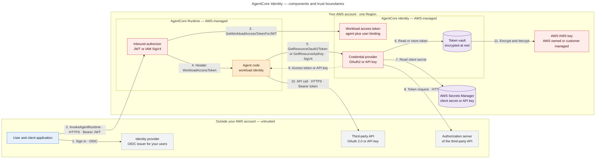
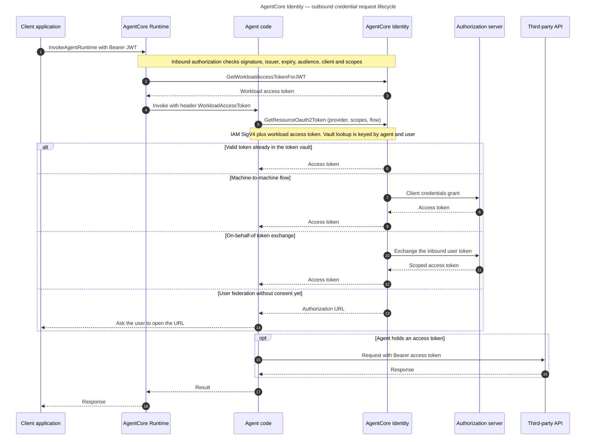

# AgentCore Identity

> **Level:** Intermediate · **Verified:** 2026-11-15 · **Feature status:** GA · **Time:** ~25 min

Amazon Bedrock AgentCore Identity gives each agent its own identity and keeps the OAuth tokens and API keys the agent needs in an encrypted vault. In a Bedrock architecture it sits between your agent (on AgentCore Runtime, behind AgentCore Gateway, or self-hosted) and every tool that is not protected by IAM.

> [!IMPORTANT]
> **Status** — Generally available with the AgentCore platform (2025-10-13) and listed in all 22 AgentCore Regions. Later additions: on-behalf-of token exchange (April 2026), Private Key JWT client authentication and references to your own Secrets Manager secrets (July 2026), and the Consent Portal (September 2026).
> Sources: [AgentCore release notes](https://docs.aws.amazon.com/bedrock-agentcore/latest/devguide/doc-history.html), [Supported AWS Regions](https://docs.aws.amazon.com/bedrock-agentcore/latest/devguide/agentcore-regions.html)

## Learning objectives

- Explain what a workload identity, a workload access token, a credential provider and the token vault are.
- Distinguish inbound authorization (who may call the agent) from outbound authorization (what the agent may call).
- Choose between 2-legged OAuth, 3-legged OAuth, on-behalf-of token exchange and an API key for a given tool.
- Write least-privilege IAM for an agent that retrieves credentials.
- Create a workload identity and credential providers with Terraform without putting a secret in code or state.

## Prerequisites

- [AgentCore overview](01-agentcore-overview.md), [AgentCore Runtime](02-agentcore-runtime.md) and [AgentCore Gateway](04-agentcore-gateway.md)
- [IAM roles, trust policies and cross-account access](../../00-foundations/security/02-iam-roles-and-trust.md)
- [AWS KMS and encryption](../../00-foundations/security/04-kms-encryption.md)

## 1. What it is

**Plain language.** An agent needs two things that a normal program does not: a badge that says "I am this agent", and keys to other people's systems (a calendar, a CRM, a partner API). AgentCore Identity issues the badge and keeps the keys in a locked cabinet. The agent gets a key only when it shows its badge and says which user it is working for.

**Precisely.** AgentCore Identity is an identity and credential management service for agents and automated workloads. Agent identities are implemented as **workload identities**; credentials are obtained and stored by **credential providers** in a **token vault**.

| Item | Value |
|:--|:--|
| Service namespace / endpoint | `bedrock-agentcore-control` (configuration) and `bedrock-agentcore` (tokens at run time) |
| Control-plane operations | `CreateWorkloadIdentity`, `UpdateWorkloadIdentity`, `CreateOauth2CredentialProvider`, `CreateApiKeyCredentialProvider`, `SetTokenVaultCMK`, `GetTokenVault`, `CreateConsentPortal` |
| Data-plane operations | `GetWorkloadAccessToken`, `GetWorkloadAccessTokenForJWT`, `GetWorkloadAccessTokenForUserId`, `GetResourceOauth2Token`, `GetResourceApiKey`, `CompleteResourceTokenAuth` |
| IAM action prefix | `bedrock-agentcore:` |

Operation names are checked against the SDK model in the [API operations reference](../../references/bedrock-api-operations.md).

| Term | Meaning (as documented) |
|:--|:--|
| Workload identity | The agent's own identity, held in the account's agent identity directory (`default`). Runtime and Gateway create one automatically; you create one with `CreateWorkloadIdentity` for agents hosted elsewhere |
| Inbound authorization | Checks who may call the agent or gateway: IAM SigV4 or an OAuth 2.0 JSON Web Token (JWT) |
| Outbound authorization | Gets the credential the agent presents to a tool: an OAuth access token or an API key |
| Workload access token | An AWS-signed opaque token that carries the agent identity **and** the user identity. It is accepted only by AgentCore services, never by external ones |
| Credential provider | Stored configuration for one resource server: OAuth2 (built-in vendors such as Google, GitHub, Slack, Salesforce, Atlassian, or custom) or API key |
| Token vault | Encrypted store for OAuth tokens, client credentials and API keys. A credential is returned only to the agent and user combination that obtained it |
| Consent portal | A hosted, AWS-managed page where users sign in and grant consent, attached to one gateway |

Sources: [AgentCore Identity terminology](https://docs.aws.amazon.com/bedrock-agentcore/latest/devguide/identity-terminology.html), [Understanding workload identities](https://docs.aws.amazon.com/bedrock-agentcore/latest/devguide/understanding-agent-identities.html), [Get workload access token](https://docs.aws.amazon.com/bedrock-agentcore/latest/devguide/get-workload-access-token.html).

## 2. Why it exists

An agent acts for many users against many systems. Without this service you would build: a registry of agent identities, an OAuth client for every provider, encrypted token storage, refresh-token handling, a consent screen, and — the hard part — a binding that stops user A's token from being handed to user B or to a different agent. Secrets also tend to end up in agent code or environment variables, where a prompt-injected agent can leak them. AgentCore Identity keeps client secrets out of the agent entirely.

## 3. When to use it

- An agent on Runtime, or a tool behind Gateway, calls an API protected by OAuth 2.0 or an API key.
- The agent must act **for a specific user** (read that user's calendar): 3-legged OAuth.
- The agent acts **as itself** against a shared system: 2-legged OAuth.
- A downstream service must see both the user and the agent without a second consent prompt: on-behalf-of token exchange.
- A self-hosted agent needs the same vault and the same audit trail.

## 4. When not to use it

- **The tool is an AWS service.** Use the agent's IAM execution role; see [Identity, least privilege and IAM isolation for agents](../../06-security-governance/02-identity-and-least-privilege.md).
- **You need a directory of human users.** Identity validates tokens from your identity provider; it does not replace one. See [IAM and IAM Identity Center for Bedrock](../../02-related-aws-services/security/01-iam-and-identity-center.md).
- **You need to decide which tool call is allowed.** That is [AgentCore Policy](09-agentcore-policy.md); Identity answers "who", Policy answers "may they".
- **You need general secret storage** (database passwords, certificates). Use [AWS Secrets Manager](../../02-related-aws-services/security/02-kms-secrets-manager-parameter-store.md).

## 5. Internal architecture



**What this shows** — The customer-visible parts of AgentCore Identity for an agent hosted on Runtime with JWT inbound authorization. Everything in the left box is outside your trust boundary; the client secret and the tokens never enter the agent's code path except for the final access token.

**Walkthrough**

1. The user signs in at your identity provider and the client receives a JWT.
2. The client calls the agent with the JWT as a bearer token.
3. Runtime validates the token against the configured authorizer, then calls `GetWorkloadAccessTokenForJWT` with the user's token and the agent's workload identity.
4. Runtime passes the workload access token to the agent in the `WorkloadAccessToken` payload header.
5. The agent asks a credential provider for an outbound credential, presenting the workload access token.
6. The provider looks in the token vault for a credential stored for this agent and user.
7. If it must talk to the authorization server, it reads the client secret from AWS Secrets Manager.
8. It runs the configured OAuth flow against the third-party authorization server and stores the result.
9. The agent receives only the access token or API key.
10. The agent calls the third-party API.
11. Vault contents are encrypted with an AWS owned key by default, or with your customer managed key.

| Legend | Meaning |
|:--|:--|
| Solid arrow | Request |
| Dashed arrow | Response |
| Cylinder | Data at rest |
| Red box | Security control |
| Grey dashed box | Outside your AWS account |

**Variations** — With IAM inbound authorization there is no user JWT; a caller that holds `bedrock-agentcore:InvokeAgentRuntimeForUser` can pass a user ID in the `X-Amzn-Bedrock-AgentCore-Runtime-User-Id` header, which AgentCore does **not** verify. A self-hosted agent performs step 3 itself. Behind a gateway, the gateway performs steps 5–9 for each target; see [diagram set 14](../../diagrams/mermaid/14-agentcore-gateway-and-identity.md).

### Inbound authorization

| Entry point | Options | Notes |
|:--|:--|:--|
| AgentCore Runtime | IAM SigV4 (default) **or** JWT bearer token | Not both on one runtime. The JWT authorizer checks the discovery URL, allowed audiences, allowed clients, allowed scopes and required custom claims |
| AgentCore Gateway | JWT (`CUSTOM_JWT`), IAM, `AUTHENTICATE_ONLY`, `NONE` | The last two make no authorization decision; you must enforce it in a policy engine, an interceptor or the target |

Sources: [Inbound Auth and Outbound Auth](https://docs.aws.amazon.com/bedrock-agentcore/latest/devguide/runtime-oauth.html), [Gateway inbound authorization](https://docs.aws.amazon.com/bedrock-agentcore/latest/devguide/gateway-inbound-auth.html).

### Outbound authorization

| Pattern | OAuth grant | How the agent asks | User consent | Credential represents |
|:--|:--|:--|:-:|:--|
| 2-legged (machine-to-machine) | Client credentials | `GetResourceOauth2Token`, `oauth2Flow` = `M2M` | No | The agent |
| 3-legged (user-delegated) | Authorization code | `GetResourceOauth2Token`, `oauth2Flow` = `USER_FEDERATION` | Yes, once | The user, for this agent |
| On-behalf-of | Token exchange (RFC 8693) or JWT authorization grant (RFC 7523) | `GetResourceOauth2Token`, `oauth2Flow` = `ON_BEHALF_OF_TOKEN_EXCHANGE` | No — the inbound token is exchanged | The user and the agent |
| API key | — | `GetResourceApiKey` | No | Whoever holds the key |

In a 3-legged flow the first request returns an **authorization URL**, not a token. After the user consents, your application must confirm that the person who consented is the person who asked, by calling `CompleteResourceTokenAuth` from a callback URL registered on the workload identity (`allowedResourceOauth2ReturnUrls`). The URL and its session are valid for 10 minutes. Refresh tokens returned by the provider are stored and used automatically.

The **Consent Portal** removes the need to host that callback yourself. It attaches to exactly one gateway that uses JWT inbound authorization, signs users in to the same OpenID Connect issuer, and lists every gateway target that uses the authorization-code grant as a connection the user can approve. The browser never holds a token.

Sources: [Supported authentication patterns](https://docs.aws.amazon.com/bedrock-agentcore/latest/devguide/common-use-cases.html), [On-behalf-of token exchange](https://docs.aws.amazon.com/bedrock-agentcore/latest/devguide/on-behalf-of-token-exchange.html), [Session binding](https://docs.aws.amazon.com/bedrock-agentcore/latest/devguide/oauth2-authorization-url-session-binding.html), [Configure a consent portal](https://docs.aws.amazon.com/bedrock-agentcore/latest/devguide/identity-consent-portal.html).

## 6. Request and response lifecycle



Steps 1–4 are inbound authorization and happen once per invocation. Step 5 happens once per tool that needs a credential. The four branches are the outcomes of that one call; the full 3-legged consent path, including session binding, is drawn in [diagram set 14](../../diagrams/mermaid/14-agentcore-gateway-and-identity.md).

**Error paths that matter**

| Symptom | Cause |
|:--|:--|
| HTTP 401 or 403 with a `WWW-Authenticate` header from a gateway | Missing or invalid token (401), or valid token without the required scopes (403) |
| `AccessDeniedException` on `GetResourceOauth2Token` | The agent's role lacks the action or the provider ARN |
| "WorkloadIdentity is linked to a service and cannot retrieve an access token by the caller" | You called a `GetWorkloadAccessToken…` operation for an identity that Runtime or Gateway manages |
| Third-party API rejects a token the vault returned | AgentCore cannot see a revocation at the provider. Request again with `forceAuthentication` set to true |
| `invalid_scope` when the consent portal signs a user in | A configured scope, or `openid`, is not permitted at the identity provider |
| `ThrottlingException` | Token operations default to 200 requests per second per account |

## 7. Dependencies

| Depends on | Why | Required or optional |
|:--|:--|:-:|
| An OpenID Connect or OAuth 2.0 identity provider | Issues the user JWT for inbound authorization; issues outbound tokens | Required for JWT and OAuth flows |
| AWS Secrets Manager | Client secrets and API keys of credential providers are stored as secrets; you may reference your own | Required |
| AWS KMS | Encrypts the token vault; signs assertions for Private Key JWT | Required (AWS owned key by default) |
| AgentCore Runtime or Gateway | Create the workload identity and fetch the workload access token for you | Optional |
| A public HTTPS callback in your application, or a consent portal | Completes session binding in 3-legged flows | Required for 3-legged flows |
| Amazon CloudWatch and AWS CloudTrail | Metrics, spans and audit records | Optional |

## 8. Security considerations

- **Scope IAM to named resources.** The role you give an agent decides which providers it can call; the service adds no further binding between a workload identity and a provider in the same account. Policy examples use `arn:aws:bedrock-agentcore:REGION:ACCOUNT:workload-identity-directory/default/workload-identity/NAME` and `…:token-vault/default/oauth2credentialprovider/NAME` (or `apikeycredentialprovider/NAME`), plus `secretsmanager:GetSecretValue` on the provider's secret. Source: [Scope down access to credential providers](https://docs.aws.amazon.com/bedrock-agentcore/latest/devguide/scope-credential-provider-access.html).
- **Prefer the JWT path.** `GetWorkloadAccessTokenForUserId` and the Runtime user-ID header accept an unverified string. AWS recommends an explicit `Deny` where they are not needed. The `BedrockAgentCoreFullAccess` managed policy allows the user-ID path.
- **Service-linked role.** For agents created on or after 2025-10-13, a service-linked role handles Runtime's token calls; older agents need the permissions on their execution role.
- **Encryption.** The vault is encrypted with an AWS owned key unless you set a customer managed key with `SetTokenVaultCMK`. Only single-Region symmetric keys are accepted, by key ARN, not alias. The key policy must trust the Identity service through `kms:ViaService`. Sources: [Identity data encryption](https://docs.aws.amazon.com/bedrock-agentcore/latest/devguide/identity-data-encryption.html), [Customer managed key policy](https://docs.aws.amazon.com/bedrock-agentcore/latest/devguide/kms-key-policy-configuration.html).
- **Audit.** With JWT inbound authorization, the token's subject claim is written to CloudTrail. Do not put personal data in `sub`.
- **No shared client secret.** Private Key JWT signs a client assertion with a KMS key (RS256, PS256 or ES256), so the private key never leaves KMS.

> [!CAUTION]
> **Cost or security hazard** — A workload access token bound to the wrong user returns that user's stored credentials. Derive the user identity from a verified token or from the authenticated caller, never from text the model or the request body supplied.

## 9. Networking requirements

- **Private access to the service.** Identity operations use the shared interface endpoints `com.amazonaws.REGION.bedrock-agentcore` (data plane) and `com.amazonaws.REGION.bedrock-agentcore-control` (control plane); Gateway has `com.amazonaws.REGION.bedrock-agentcore.gateway`. Endpoint policies can restrict IAM principals only, so OAuth callers need `Principal: *`. Source: [Interface VPC endpoints for AgentCore](https://docs.aws.amazon.com/bedrock-agentcore/latest/devguide/vpc-interface-endpoints.html).
- **Identity providers in your VPC.** A gateway's JWT authorizer can reach a private issuer through a `privateEndpoint` (managed VPC resource or self-managed VPC Lattice), which uses the `AWSServiceRoleForBedrockAgentCoreIdentity` service-linked role. The Terraform OAuth2 provider resource exposes a matching `private_endpoint` block for outbound providers. Source: [Gateway inbound authorization](https://docs.aws.amazon.com/bedrock-agentcore/latest/devguide/gateway-inbound-auth.html).
- **Redirects.** The identity provider must allow the provider's `callbackUrl`; your workload identity must allow your application's return URL.

See [Private connectivity for Bedrock](../../02-related-aws-services/networking/01-private-connectivity-for-bedrock.md).

## 10. Pricing dimensions

| Dimension | Unit | Notes |
|:--|:--|:--|
| Identity used through AgentCore Runtime or Gateway | — | No additional charge |
| Token or API key requests in every other case | Per successful request for a non-AWS resource | $0.010 per 1,000 requests on 2026-11-15 |
| AWS Secrets Manager, AWS KMS customer managed key | Per secret, per key, per request | Billed by those services |

Source: [Amazon Bedrock AgentCore pricing](https://aws.amazon.com/bedrock/agentcore/pricing/). Check the page before you budget; see [Pricing model and cost drivers](../../08-cost-performance-and-reliability/01-pricing-model-and-cost-drivers.md).

## 11. Scaling considerations

| Quota (per account, per Region) | Default | Adjustable |
|:--|--:|:-:|
| Workload identities | 11,000 | Yes |
| OAuth2 credential providers | 50 | Yes |
| API key credential providers | 50 | Yes |
| `GetWorkloadAccessToken…`, `GetResourceOauth2Token`, `GetResourceApiKey` | 200 per second each | Yes |
| `CompleteResourceTokenAuth` | 100 per second | Yes |
| Create, get, update, delete and list operations | 20 per second each | Yes |

Source: [Quotas for Amazon Bedrock AgentCore](https://docs.aws.amazon.com/bedrock-agentcore/latest/devguide/bedrock-agentcore-limits.html). **Our reading:** the provider quota, not the token rate, is what a multi-tenant design hits first — 50 providers is 50 downstream applications, not 50 users, because tokens are stored per user under one provider.

## 12. IaC support

| Tool | Support | Resource / construct | Notes |
|:--|:-:|:--|:--|
| Terraform (`hashicorp/aws` 6.73.0) | ✅ | `aws_bedrockagentcore_workload_identity`, `aws_bedrockagentcore_oauth2_credential_provider`, `aws_bedrockagentcore_api_key_credential_provider`, `aws_bedrockagentcore_token_vault_cmk` | Write-only arguments (`client_secret_wo`, `api_key_wo`) keep secrets out of state. No consent portal resource |
| CloudFormation | ✅ | `AWS::BedrockAgentCore::WorkloadIdentity`, `OAuth2CredentialProvider`, `ApiKeyCredentialProvider`, `ConsentPortal` | No type for the token vault key |
| AWS CDK (`aws-cdk-lib` 2.277.0) | L2 | `WorkloadIdentity`, `OAuth2CredentialProvider` (`usingGithub`, `usingCustom` …), `ApiKeyCredentialProvider` | `CfnConsentPortal` is L1 only |

Where a tool has no resource: set the token vault key with the `SetTokenVaultCMK` API or the console when you use CloudFormation or CDK, and create consent portals with CloudFormation, the console or `CreateConsentPortal` when you use Terraform. Names come from the [Terraform reference](../../references/terraform-aws-provider-bedrock.md) and the [CDK and CloudFormation reference](../../references/cdk-and-cloudformation-bedrock.md).

## 13. Working example

A workload identity for a self-hosted agent, an OAuth2 provider, an API key provider, an optional vault key and a least-privilege policy.

> **Code status:** validated with `terraform validate` (Terraform 1.17.2, provider 6.73.0) together with a `versions.tf` that pins the provider · **never planned or applied against AWS** · **never deployed**

```hcl
variable "name_prefix" {
  description = "Prefix for resource names."
  type        = string
  default     = "academy"
}

variable "oauth_return_urls" {
  description = "Application URLs AgentCore Identity may redirect to after a 3-legged flow."
  type        = list(string)
  default     = ["https://app.example.com/oauth/callback"]
}

variable "idp_discovery_url" {
  description = "Discovery URL of the authorization server that protects the downstream API."
  type        = string
  default     = "https://idp.example.com/.well-known/openid-configuration"
}

variable "idp_client_id" {
  description = "OAuth 2.0 client ID. Supply at run time; never commit it."
  type        = string
  sensitive   = true
  ephemeral   = true
}

variable "idp_client_secret" {
  description = "OAuth 2.0 client secret. Supply at run time; never commit it."
  type        = string
  sensitive   = true
  ephemeral   = true
}

variable "partner_api_key" {
  description = "API key for the partner API. Supply at run time; never commit it."
  type        = string
  sensitive   = true
  ephemeral   = true
}

variable "credentials_version" {
  description = "Increase by one to make Terraform send the write-only credentials again."
  type        = number
  default     = 1
}

variable "token_vault_kms_key_arn" {
  description = "ARN (not alias) of a single-Region symmetric customer managed key. Null keeps the AWS owned key."
  type        = string
  default     = null
}

data "aws_caller_identity" "current" {}
data "aws_partition" "current" {}
data "aws_region" "current" {}

locals {
  arn_prefix = "arn:${data.aws_partition.current.partition}:bedrock-agentcore:${data.aws_region.current.region}:${data.aws_caller_identity.current.account_id}"
}

# The agent's own identity. Runtime and Gateway create one automatically;
# create it yourself only for agents hosted elsewhere.
resource "aws_bedrockagentcore_workload_identity" "agent" {
  name                                = "${var.name_prefix}-support-agent"
  allowed_resource_oauth2_return_urls = var.oauth_return_urls
}

# Outbound OAuth 2.0: client credentials go to the token vault, not to the agent.
resource "aws_bedrockagentcore_oauth2_credential_provider" "crm" {
  name                       = "${var.name_prefix}-crm-oauth"
  credential_provider_vendor = "CustomOauth2"

  oauth2_provider_config {
    custom_oauth2_provider_config {
      client_id_wo                  = var.idp_client_id
      client_secret_wo              = var.idp_client_secret
      client_credentials_wo_version = var.credentials_version

      oauth_discovery {
        discovery_url = var.idp_discovery_url
      }
    }
  }
}

# Outbound API key for a service that does not speak OAuth.
resource "aws_bedrockagentcore_api_key_credential_provider" "partner" {
  name               = "${var.name_prefix}-partner-api-key"
  api_key_wo         = var.partner_api_key
  api_key_wo_version = var.credentials_version
}

# Optional: encrypt the token vault with your own KMS key.
resource "aws_bedrockagentcore_token_vault_cmk" "default" {
  count = var.token_vault_kms_key_arn == null ? 0 : 1

  kms_configuration {
    key_type    = "CustomerManagedKey"
    kms_key_arn = var.token_vault_kms_key_arn
  }
}

# Least-privilege policy for the IAM role of a self-hosted agent.
data "aws_iam_policy_document" "agent_identity" {
  statement {
    sid = "GetWorkloadAccessToken"
    actions = [
      "bedrock-agentcore:GetWorkloadAccessToken",
      "bedrock-agentcore:GetWorkloadAccessTokenForJWT",
    ]
    resources = [
      "${local.arn_prefix}:workload-identity-directory/default",
      aws_bedrockagentcore_workload_identity.agent.workload_identity_arn,
    ]
  }

  statement {
    sid     = "GetOutboundCredentials"
    actions = ["bedrock-agentcore:GetResourceOauth2Token", "bedrock-agentcore:GetResourceApiKey"]
    resources = [
      "${local.arn_prefix}:workload-identity-directory/default",
      aws_bedrockagentcore_workload_identity.agent.workload_identity_arn,
      "${local.arn_prefix}:token-vault/default",
      aws_bedrockagentcore_oauth2_credential_provider.crm.credential_provider_arn,
      aws_bedrockagentcore_api_key_credential_provider.partner.credential_provider_arn,
    ]
  }

  statement {
    sid     = "ReadProviderSecrets"
    actions = ["secretsmanager:GetSecretValue"]
    resources = [
      aws_bedrockagentcore_oauth2_credential_provider.crm.client_secret_arn[0].secret_arn,
      aws_bedrockagentcore_api_key_credential_provider.partner.api_key_secret_arn[0].secret_arn,
    ]
  }

  statement {
    sid       = "DenyUnverifiedUserIds"
    effect    = "Deny"
    actions   = ["bedrock-agentcore:GetWorkloadAccessTokenForUserId"]
    resources = ["${local.arn_prefix}:workload-identity-directory/default"]
  }
}

resource "aws_iam_policy" "agent_identity" {
  name   = "${var.name_prefix}-agent-identity-access"
  policy = data.aws_iam_policy_document.agent_identity.json
}

output "oauth_callback_url" {
  description = "Register this URL as an allowed redirect URI at the authorization server."
  value       = aws_bedrockagentcore_oauth2_credential_provider.crm.callback_url
}
```

The three credential variables are `sensitive` and `ephemeral`, and they feed write-only arguments, so Terraform stores them in neither the plan nor the state. Supply them from your pipeline's secret store (for example `TF_VAR_idp_client_secret`). To keep the secret in a Secrets Manager secret you already govern, use `client_secret_source = "EXTERNAL"` with a `client_secret_config` block instead. See [Secrets management and policy as code](../../04-infrastructure-as-code/maintenance/04-secrets-and-policy-as-code.md).

In the agent, the AgentCore SDK retrieves and injects the credential:

> **Code status:** syntax-checked (`python -m py_compile`) · adapted from the AWS documentation samples · not run · **never deployed**

```python
"""Tool functions whose credentials come from AgentCore Identity."""
import os

from bedrock_agentcore.identity.auth import requires_access_token, requires_api_key

CRM_PROVIDER = os.environ.get("CRM_OAUTH_PROVIDER_NAME", "academy-crm-oauth")
PARTNER_PROVIDER = os.environ.get("PARTNER_API_KEY_PROVIDER_NAME", "academy-partner-api-key")
CALLBACK_URL = os.environ.get("OAUTH_CALLBACK_URL", "https://app.example.com/oauth/callback")


def send_authorization_url(url: str) -> None:
    """Return the consent URL to the calling application (stream, callback or polling)."""
    print(f"authorization_required {url}")


@requires_access_token(
    provider_name=CRM_PROVIDER,
    scopes=["crm.read"],
    auth_flow="USER_FEDERATION",  # 3-legged: the user consents once
    on_auth_url=send_authorization_url,
    force_authentication=False,  # reuse the token stored in the vault
    callback_url=CALLBACK_URL,  # must be registered on the workload identity
)
async def read_customer_record(customer_id: str, *, access_token: str) -> dict:
    """Call the CRM as the user. The token is injected; the client secret never is."""
    return {"customer_id": customer_id, "authorized": bool(access_token)}


@requires_access_token(provider_name=CRM_PROVIDER, scopes=[], auth_flow="M2M")
async def read_shared_catalog(*, access_token: str) -> dict:
    """Call the CRM as the agent itself (2-legged)."""
    return {"authorized": bool(access_token)}


@requires_api_key(provider_name=PARTNER_PROVIDER)
async def call_partner_api(*, api_key: str) -> dict:
    """Call an API that takes a key instead of an OAuth token."""
    return {"authorized": bool(api_key)}
```

## Common mistakes

| Mistake | Symptom | Fix |
|:--|:--|:--|
| Passing a user ID taken from the request body | One user can read another user's connected account | Use JWT inbound authorization, or derive the ID from the authenticated caller; deny `GetWorkloadAccessTokenForUserId` |
| Forgetting to register the provider's `callbackUrl` at the authorization server | The provider rejects the redirect during consent | Read `callbackUrl` from the create response (the Terraform output above) and add it as a redirect URI |
| Skipping session binding | The flow never completes, or consent can be completed by the wrong person | Register a return URL on the workload identity and call `CompleteResourceTokenAuth` after checking the signed-in user; or use a consent portal |
| `Resource: "*"` on `GetResourceOauth2Token` | Any agent with that role can use every provider in the account | Scope to the workload identity and provider ARNs |
| Putting the client secret in a plain Terraform variable or `tfvars` file | Secret in state, plan or Git history | Write-only arguments with ephemeral variables, or an external secret reference |
| Configuring a KMS alias or a multi-Region key for the vault | `SetTokenVaultCMK` is rejected | Use the ARN of a single-Region symmetric key |
| Expecting a consent portal target to appear at once | Empty Connections page | Targets need the authorization-code grant and a return URL of `<portalUrl>/connect/callback`; the list is cached for up to 5 minutes |

## Knowledge check

1. An agent on Runtime uses JWT inbound authorization. Which two identities does its workload access token carry, and why can the agent not send that token to a third-party API?
2. Your HR system enforces per-employee access and employees already sign in to the agent with your corporate identity provider. Which outbound pattern avoids a second consent prompt while still letting the HR system see who is asking?
3. Why does the documentation require your application, and not AgentCore, to call `CompleteResourceTokenAuth`?
4. A team stores 40 Google tokens for 40 users. How many OAuth2 credential providers does that consume from the default quota of 50?

<details>
<summary>Answers</summary>

1. The agent's workload identity and the end user's identity (from the `iss` and `sub` claims of the JWT). The token is AWS-signed and opaque, and only AgentCore services accept it; it authorizes access to the token vault, not to external resource servers.
2. On-behalf-of token exchange. AgentCore Identity exchanges the inbound user token for a downstream token that carries both the user and the agent, and the HR system applies its existing policy.
3. Only your application knows who is signed in to the browser session. Checking that the person who consented is the person who started the request prevents an authorization URL forwarded to someone else from binding the wrong account.
4. One. A provider represents the resource server and its client configuration; tokens are stored in the vault per agent and user under that provider.

</details>

## 14. Official documentation

- [AgentCore Identity](https://docs.aws.amazon.com/bedrock-agentcore/latest/devguide/identity.html) and [Overview](https://docs.aws.amazon.com/bedrock-agentcore/latest/devguide/identity-overview.html) — what the service is.
- [Features of AgentCore Identity](https://docs.aws.amazon.com/bedrock-agentcore/latest/devguide/key-features-and-benefits.html) — directory, token vault, OAuth flows, SDK annotations.
- [AgentCore Identity terminology](https://docs.aws.amazon.com/bedrock-agentcore/latest/devguide/identity-terminology.html) — definitions used in this chapter.
- [Understanding workload identities](https://docs.aws.amazon.com/bedrock-agentcore/latest/devguide/understanding-agent-identities.html) — automatic and manual creation.
- [Get workload access token](https://docs.aws.amazon.com/bedrock-agentcore/latest/devguide/get-workload-access-token.html) — the three operations and their security controls.
- [Authenticate and authorize with Inbound Auth and Outbound Auth](https://docs.aws.amazon.com/bedrock-agentcore/latest/devguide/runtime-oauth.html) — Runtime authorizers, the user-ID header, the service-linked role.
- [Set up inbound authorization for your gateway](https://docs.aws.amazon.com/bedrock-agentcore/latest/devguide/gateway-inbound-auth.html) and [outbound authorization](https://docs.aws.amazon.com/bedrock-agentcore/latest/devguide/gateway-outbound-auth.html) — Gateway options and IAM policies.
- [Supported authentication patterns](https://docs.aws.amazon.com/bedrock-agentcore/latest/devguide/common-use-cases.html) and [On-behalf-of token exchange](https://docs.aws.amazon.com/bedrock-agentcore/latest/devguide/on-behalf-of-token-exchange.html) — the three OAuth patterns.
- [Configure credential provider](https://docs.aws.amazon.com/bedrock-agentcore/latest/devguide/resource-providers.html), [Obtain OAuth 2.0 access token](https://docs.aws.amazon.com/bedrock-agentcore/latest/devguide/identity-authentication.html) and [Obtain API key](https://docs.aws.amazon.com/bedrock-agentcore/latest/devguide/obtain-api-key.html) — providers, refresh tokens, SDK samples.
- [Integrate with Google Drive using OAuth2](https://docs.aws.amazon.com/bedrock-agentcore/latest/devguide/identity-getting-started-google.html) — tutorial; notes that `BedrockAgentCoreFullAccess` includes `GetWorkloadAccessTokenForUserId`.
- [OAuth 2.0 authorization URL session binding](https://docs.aws.amazon.com/bedrock-agentcore/latest/devguide/oauth2-authorization-url-session-binding.html) — `CompleteResourceTokenAuth` and the 10-minute validity.
- [Scope down access to credential providers by workload identity](https://docs.aws.amazon.com/bedrock-agentcore/latest/devguide/scope-credential-provider-access.html) — resource ARNs for IAM.
- [Identity data encryption](https://docs.aws.amazon.com/bedrock-agentcore/latest/devguide/identity-data-encryption.html), [Configure with API operations](https://docs.aws.amazon.com/bedrock-agentcore/latest/devguide/api-configuration-encryption.html) and [Set customer managed key policy](https://docs.aws.amazon.com/bedrock-agentcore/latest/devguide/kms-key-policy-configuration.html) — token vault encryption.
- [Configure a consent portal](https://docs.aws.amazon.com/bedrock-agentcore/latest/devguide/identity-consent-portal.html), [prerequisites](https://docs.aws.amazon.com/bedrock-agentcore/latest/devguide/identity-consent-portal-prerequisites.html), [create with the AWS CLI](https://docs.aws.amazon.com/bedrock-agentcore/latest/devguide/identity-create-consent-portal.html) and [configure a target](https://docs.aws.amazon.com/bedrock-agentcore/latest/devguide/identity-configure-consent-portal-target.html) — the hosted consent flow.
- [Interface VPC endpoints for AgentCore](https://docs.aws.amazon.com/bedrock-agentcore/latest/devguide/vpc-interface-endpoints.html) — endpoint names and policy limits.
- [Quotas for Amazon Bedrock AgentCore](https://docs.aws.amazon.com/bedrock-agentcore/latest/devguide/bedrock-agentcore-limits.html) — Identity quotas.
- [Amazon Bedrock AgentCore pricing](https://aws.amazon.com/bedrock/agentcore/pricing/) — the pricing rule and the per-request figure.
- [AgentCore release notes](https://docs.aws.amazon.com/bedrock-agentcore/latest/devguide/doc-history.html) — dates of the additions in the status box.
- Terraform provider documentation for [`aws_bedrockagentcore_oauth2_credential_provider`](https://raw.githubusercontent.com/hashicorp/terraform-provider-aws/main/website/docs/r/bedrockagentcore_oauth2_credential_provider.html.markdown) and [`aws_bedrockagentcore_api_key_credential_provider`](https://raw.githubusercontent.com/hashicorp/terraform-provider-aws/main/website/docs/r/bedrockagentcore_api_key_credential_provider.html.markdown) — write-only arguments and external secret references.
