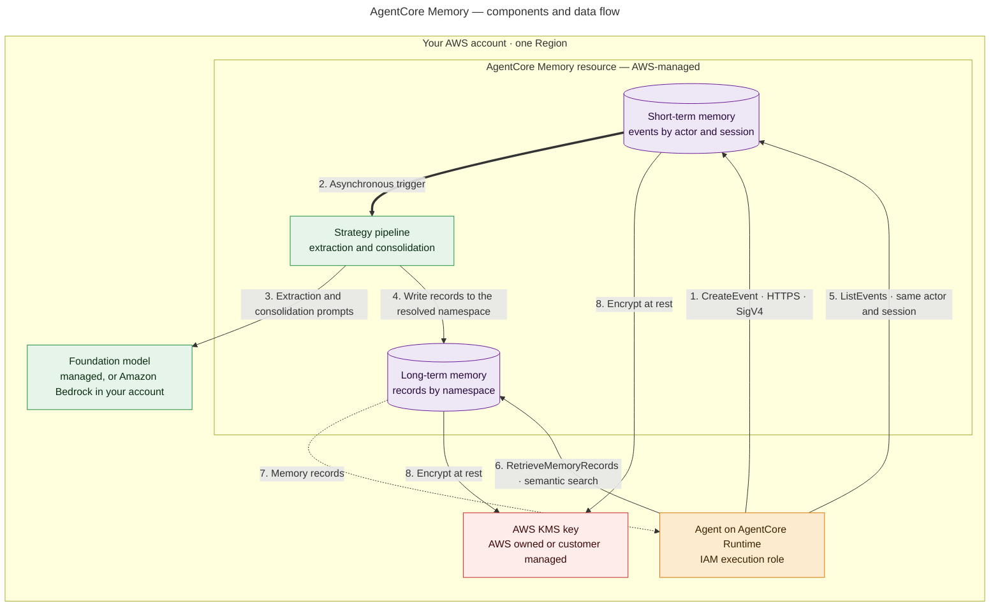
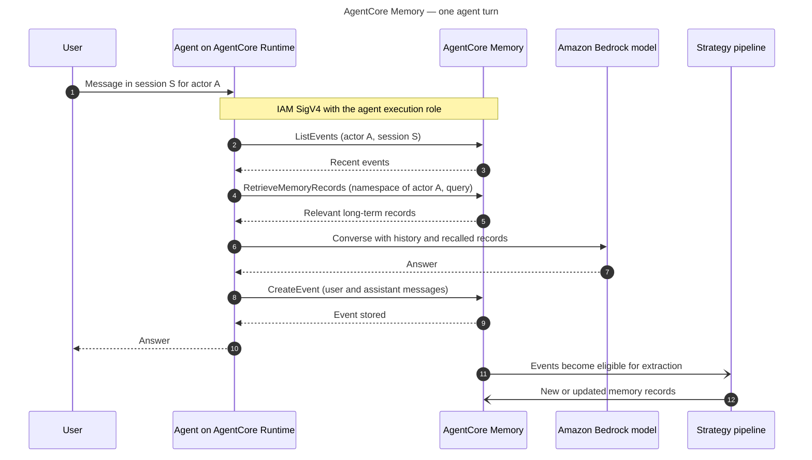

# AgentCore Memory

> **Level:** Intermediate · **Verified:** 2026-11-15 · **Feature status:** GA · **Time:** ~25 min

Amazon Bedrock AgentCore Memory is a managed store that lets an agent remember: the exact conversation so far (short-term memory) and the lasting facts, preferences and summaries distilled from many conversations (long-term memory). It sits beside the agent loop — the agent reads from it before calling the model and writes to it afterwards.

> [!IMPORTANT]
> **Status** — Generally available, in 16 of the 22 AgentCore Regions (not in US West (N. California), Europe (Milan), Europe (Spain), Asia Pacific (Malaysia), Asia Pacific (Hyderabad) or Asia Pacific (Thailand)). Recent additions: JSON payloads, direct ingestion with `IngestData` and custom namespace variables (August 2026); a time-to-live for long-term records and consumption-based short-term pricing (October 2026).
> Sources: [Supported AWS Regions](https://docs.aws.amazon.com/bedrock-agentcore/latest/devguide/agentcore-regions.html), [AgentCore release notes](https://docs.aws.amazon.com/bedrock-agentcore/latest/devguide/doc-history.html)

## Learning objectives

- Distinguish short-term memory (events) from long-term memory (records) and say who writes each.
- Name the four built-in strategies and explain what built-in-with-overrides and self-managed strategies change.
- Design namespaces that keep one user's memories away from another's.
- Explain how `AgenticRetrieveStream` uses a memory through `memoryConfiguration`.
- Create a memory and its strategies with Terraform.

## Prerequisites

- [AgentCore overview](01-agentcore-overview.md) and [AgentCore Runtime](02-agentcore-runtime.md)
- [Agentic AI, tool calling and multi-agent architectures](../../00-foundations/generative-ai-fundamentals/06-agents-tool-calling-multi-agent.md)
- [Embeddings, vector search, semantic search and hybrid search](../../00-foundations/generative-ai-fundamentals/03-embeddings-and-vector-search.md)

## 1. What it is

**Plain language.** A model forgets everything between calls. AgentCore Memory gives the agent two notebooks. The first is a transcript: every message, filed by person and by conversation, kept for a set number of days. The second is a page of takeaways per person — "prefers window seats", "order ABC-123 belongs to ticket 42" — that a background process writes by reading the transcript.

**Precisely.** A **memory** resource holds **events** (short-term) and **memory records** (long-term). **Memory strategies** attached to the resource decide what is extracted from events into records, and under which **namespace** each record is filed.

| Item | Value |
|:--|:--|
| Service namespace / endpoint | `bedrock-agentcore-control` (the memory resource) and `bedrock-agentcore` (events and records) |
| Control-plane operations | `CreateMemory`, `GetMemory`, `UpdateMemory`, `DeleteMemory`, `ListMemories` |
| Data-plane operations | `CreateEvent`, `GetEvent`, `ListEvents`, `DeleteEvent`, `ListSessions`, `ListActors`, `IngestData`, `RetrieveMemoryRecords`, `ListMemoryRecords`, `GetMemoryRecord`, `DeleteMemoryRecord`, `BatchCreateMemoryRecords`, `BatchUpdateMemoryRecords`, `BatchDeleteMemoryRecords` |
| IAM action prefix | `bedrock-agentcore:` |

Operation names are checked against the SDK model in the [API operations reference](../../references/bedrock-api-operations.md).

| | Short-term memory | Long-term memory |
|:--|:--|:--|
| Unit | **Event** — immutable and timestamped | **Memory record** |
| Written by | Your agent, with `CreateEvent` | AgentCore, asynchronously, by running your strategies |
| Scope | `actorId` (who) and `sessionId` (which conversation) | A namespace such as `/users/{actorId}/preferences/` |
| Read with | `ListEvents`, `GetEvent` | `RetrieveMemoryRecords` (semantic search), `ListMemoryRecords`, `GetMemoryRecord` |
| Lifetime | `eventExpiryDuration`, 7 to 365 days | Until deleted, or a per-strategy time-to-live (`recordExpirySpecification`) |
| Content | Conversational messages or JSON payloads, plus optional metadata | Facts, preferences, summaries, episodes |

Sources: [Memory types](https://docs.aws.amazon.com/bedrock-agentcore/latest/devguide/memory-types.html), [Memory terminology](https://docs.aws.amazon.com/bedrock-agentcore/latest/devguide/memory-terminology.html), [Quotas](https://docs.aws.amazon.com/bedrock-agentcore/latest/devguide/bedrock-agentcore-limits.html).

## 2. Why it exists

Without memory an agent treats every request as its first. Building memory yourself means a session store, an extraction job that calls a model, de-duplication of what it extracts ("consolidation"), a vector index for recall, per-user isolation and retention rules. AgentCore Memory provides all of these behind two API calls, and works with any framework or model.

## 3. When to use it

- A conversational agent must continue a session after a restart or a new microVM.
- The agent should recall preferences and facts **across** sessions.
- Long sessions need a running summary instead of the full history in the prompt.
- Several agents working for the same user need shared context.

## 4. When not to use it

- **Company documents and reference knowledge.** Use a knowledge base; see [Knowledge Bases overview](../knowledge-bases/01-knowledge-bases-overview.md). Memory is what the agent learned from conversations, not your document corpus.
- **A system of record.** An extracted memory that "the payment succeeded" is not the payment ledger. Use a database such as [Amazon DynamoDB](../../02-related-aws-services/databases/03-dynamodb.md).
- **Repeated context inside one long prompt.** That is a cost problem; see [Prompt caching](../prompt-caching/01-prompt-caching.md).
- **A Region without Memory.** Check the Region list before you design around it.

## 5. Internal architecture



**What this shows** — The customer-visible parts of one memory resource. The agent only ever calls two stores; the pipeline between them runs in the background and is configured, not called.

**Walkthrough**

1. The agent stores each turn as an event, tagged with an actor and a session.
2. New events make the session eligible for long-term processing. This is asynchronous: `CreateEvent` returns before anything is extracted.
3. For each strategy, the pipeline runs **extraction** (find what is worth keeping) and **consolidation** (merge it with what is already stored).
4. The resulting records are written under the strategy's namespace, with variables such as `{actorId}` replaced by real values.
5. Later in the same session the agent reloads the transcript.
6. In any session the agent searches long-term records by meaning, inside a namespace.
7. Matching records come back and go into the prompt.
8. Events and records are encrypted with an AWS owned key by default, or with your customer managed key.

| Legend | Meaning |
|:--|:--|
| Solid arrow | Request or write |
| Thick arrow | Asynchronous processing |
| Dashed arrow | Response |
| Cylinder | Data at rest |
| Green box | Model-driven processing |

**Variations** — With no strategy, a memory is short-term only. `IngestData` sends content straight to step 3 without storing an event. A self-managed strategy replaces steps 3 and 4 with your own pipeline. The full picture, including those branches, is in [diagram set 15](../../diagrams/mermaid/15-agentcore-memory.md).

### Strategies

| Built-in strategy (documented name) | Terraform `type` | Extracts | Namespace example from the AWS documentation |
|:--|:--|:--|:--|
| User preferences — `UserPreferenceMemoryStrategy` | `USER_PREFERENCE` | Preferences, choices and styles | `/users/{actorId}/preferences/` |
| Semantic — `SemanticMemoryStrategy` | `SEMANTIC` | Facts and contextual knowledge | `/support_cases/{sessionId}/facts/` |
| Session summaries — `SummaryMemoryStrategy` | `SUMMARIZATION` | A running summary of one session | `/summaries/{actorId}/{sessionId}/` |
| Episodic — `EpisodicStrategy` | `EPISODIC` | Structured episodes (intent, actions, outcome) plus cross-episode reflections | `/strategy/{memoryStrategyId}/actors/{actorId}/sessions/{sessionId}/` |

| Strategy class | Who runs extraction | Model | What you control |
|:--|:--|:--|:--|
| Built-in | AgentCore | Managed by the service | The namespace and an optional record time-to-live |
| Built-in with overrides (`customMemoryStrategy`) | AgentCore's pipeline | An Amazon Bedrock model **in your account**, invoked through `memoryExecutionRoleArn` | The prompt instructions (`appendToPrompt`) and `modelId` for extraction, consolidation and, for episodic, reflection. The output schema is fixed |
| Self-managed (`selfManagedConfiguration`) | You | Any | Everything. AgentCore delivers the conversation to your Amazon S3 bucket and notifies your Amazon SNS topic when a trigger fires (message count, token count or idle time); you write records back with the batch operations |

A memory can mix classes, up to six strategies. Sources: [Memory strategies](https://docs.aws.amazon.com/bedrock-agentcore/latest/devguide/memory-strategies.html), [Configure built-in strategies](https://docs.aws.amazon.com/bedrock-agentcore/latest/devguide/long-term-configuring-built-in-strategies.html), [Customize a built-in strategy](https://docs.aws.amazon.com/bedrock-agentcore/latest/devguide/memory-custom-strategy.html), [Self-managed strategy](https://docs.aws.amazon.com/bedrock-agentcore/latest/devguide/memory-self-managed-strategies.html).

### Namespaces and retrieval

A namespace is a path, like a folder. You write it as a **template** on the strategy; AgentCore fills in `{actorId}`, `{sessionId}` and `{memoryStrategyId}` when it extracts. You may add up to five custom variables (for example a tenant), declared in `namespaceKeys` and supplied on `CreateEvent` in `extractionConfig.namespaceVariables`; keys and values must be lowercase.

At read time you pass the **resolved** path. `RetrieveMemoryRecords` takes a `searchCriteria` query and either `namespace` (that path) or `namespacePath` (everything beneath a parent path).

> [!WARNING]
> **Common mistake** — Leaving off the leading or trailing slash. AgentCore stores namespaces as `/actors/alice/`. Without the trailing slash, a prefix for `customer-1` also matches `customer-12`, and an IAM condition on `bedrock-agentcore:namespace` or `bedrock-agentcore:namespacePath` written without both slashes matches nothing.
> Sources: [Namespaces](https://docs.aws.amazon.com/bedrock-agentcore/latest/devguide/specify-long-term-memory-organization.html), [Namespace design patterns](https://aws.amazon.com/blogs/machine-learning/organizing-agents-memory-at-scale-namespace-design-patterns-in-agentcore-memory/)

### Memory in agentic retrieval

> [!NOTE]
> **Documented fact** — `AgenticRetrieveStream` accepts an optional `memoryConfiguration` that points at an AgentCore Memory resource in the same account, in the `ACTIVE` state.
> Source: [Use agentic retrieval to query a knowledge base](https://docs.aws.amazon.com/bedrock/latest/userguide/kb-test-agentic-retrieve.html)

| Field | Effect |
|:--|:--|
| `memoryId` | The memory to use. On its own it is not valid; set at least one of the next two |
| `sessionBinding` (`actorId`, `sessionId`) | Restores that session's `USER` and `ASSISTANT` events from short-term memory as the conversation so far. `messages` must then carry only the current question |
| `retrievalConfigs` | Lets the retrieval agent search long-term records under a `namespace` or `namespacePath`, optionally narrowed by `strategyId` and up to five `metadataFilters`. At most one entry |
| `persistenceMode` | `DEFAULT` writes the question and generated answer back to the session as one event; `NONE` leaves the session unchanged |

The caller needs `bedrock-agentcore:GetMemory`, plus `ListEvents`, `RetrieveMemoryRecords` and `CreateEvent` for the features it uses. Bedrock does not check that the session or namespace you pass belongs to the user you intend — that is your job. See [Agentic retrieval with AgenticRetrieveStream](../agentic-retrieval/01-agentic-retrieval.md).

## 6. Request and response lifecycle



Steps 2–5 load context, steps 6–7 are the model call, steps 8–9 persist the turn. Steps 11–12 happen later and independently; a record extracted from this turn is not guaranteed to be retrievable in the next one.

**Error paths that matter**

| Symptom | Cause |
|:--|:--|
| `CreateEvent` is throttled | The defaults are 200 requests per second per account, and 5 per second per actor and session for conversational payloads |
| `CreateEvent` is rejected for size | More than 100 messages, a message over 100 KB, or an event over 10 MB |
| Records never appear | No strategy on the memory; a custom namespace variable was not supplied (watch the `NamespaceResolutionFailure` metric); or, with overrides, the Bedrock model call was throttled in your account |
| Retrieval returns nothing | The namespace passed does not equal the resolved template, often a missing slash |
| Access denied | The role lacks the action on the memory ARN. Callers of agentic retrieval also need `kms:Decrypt` on a memory's customer managed key |

## 7. Dependencies

| Depends on | Why | Required or optional |
|:--|:--|:-:|
| IAM role for the agent | Authorizes every data-plane call | Required |
| AWS KMS customer managed key | Replaces the AWS owned key (`encryptionKeyArn`) | Optional |
| Amazon Bedrock model access and a memory execution role | Built-in-with-overrides strategies invoke a model in your account | Required for overrides |
| Amazon S3 bucket, Amazon SNS topic and your own compute | Self-managed strategies | Required for self-managed |
| Amazon CloudWatch log delivery | Extraction and consolidation logs, spans | Optional |

## 8. Security considerations

- **IAM.** Scope actions to the memory ARN (`arn:aws:bedrock-agentcore:REGION:ACCOUNT:memory/MEMORY_ID`). Give the agent only the data-plane actions it uses; keep `CreateMemory`, `UpdateMemory` and `DeleteMemory` with the deployment role. Memories also support resource-based policies.
- **Isolation is by naming plus policy.** Actor IDs and namespaces are strings your application supplies. Derive them from a verified identity (see [AgentCore Identity](05-agentcore-identity.md)), never from model output, and back them with the namespace condition keys.
- **Encryption.** Data is encrypted at rest with an AWS owned key unless you supply a customer managed key. Event **metadata** is not encrypted with the customer managed key, so do not put sensitive content there. Sources: [Data encryption](https://docs.aws.amazon.com/bedrock-agentcore/latest/devguide/data-encryption.html), [Memory types](https://docs.aws.amazon.com/bedrock-agentcore/latest/devguide/memory-types.html).
- **Retention.** Events expire after `eventExpiryDuration`. Long-term records persist unless you set a time-to-live, which needs `bedrock-agentcore:UpdateMemoryRecordExpirySpecification`.
- **Execution role.** For overrides and self-managed strategies the service assumes a role you pass. Its trust policy names `bedrock-agentcore.amazonaws.com`; the documented self-managed example adds an `aws:SourceArn` condition that limits it to memory resources.

> [!TIP]
> **Academy recommendation** — Treat long-term memory as untrusted input. Anything a user or a tool result said can be extracted into a record and replayed into a later prompt, in another session. Scope retrieval to the current actor, and never let a recalled record carry instructions or authority. See [Prompt injection, untrusted tool output and retrieval poisoning](../../06-security-governance/04-prompt-injection-and-untrusted-content.md).
> This is our design guidance, not an official AWS reference architecture.

## 9. Networking requirements

Memory is a Regional AWS service; nothing runs in your VPC. Private access uses the shared AgentCore interface endpoints: `com.amazonaws.REGION.bedrock-agentcore` for events and records and `com.amazonaws.REGION.bedrock-agentcore-control` for the memory resource. Endpoint policies can limit both the actions and the memory ARNs reachable from a VPC. Source: [Interface VPC endpoints for AgentCore](https://docs.aws.amazon.com/bedrock-agentcore/latest/devguide/vpc-interface-endpoints.html). See [Private connectivity for Bedrock](../../02-related-aws-services/networking/01-private-connectivity-for-bedrock.md).

## 10. Pricing dimensions

| Dimension | Unit | Price on 2026-11-15 | Notes |
|:--|:--|:--|:--|
| Short-term ingestion | GB of event data | $1.00 per GB | Each event is billed as at least 12 KB and at most 64 KB |
| Short-term retrieval | GB of event data | $0.20 per GB | Same 12 KB and 64 KB bounds per event |
| Short-term storage | GB-month | $0.10 per GB-month | Actual size, prorated hourly over the event's lifetime |
| Long-term storage, built-in strategies | Records stored | $0.75 per 1,000 records per month | Billed hourly |
| Long-term storage, overrides and self-managed | Records stored | $0.25 per 1,000 records per month | Model usage is billed separately in your account |
| Long-term retrieval | Retrieve requests | $0.50 per 1,000 | |

Source: [Amazon Bedrock AgentCore pricing](https://aws.amazon.com/bedrock/agentcore/pricing/). **Our reading:** because small events are billed as 12 KB, writing one event per turn (both messages together) costs less than one event per message; and long-term retrieval, not storage, dominates for chatty agents that search memory on every turn.

## 11. Scaling considerations

| Quota (per account, per Region) | Default | Adjustable |
|:--|--:|:-:|
| Memory resources | 150 | Yes |
| Strategies per memory / per account | 6 / 900 | No / Yes |
| Event expiry | 7 to 365 days | No |
| Messages per `CreateEvent`; message size; event size | 100; 100 KB; 10 MB | No |
| `CreateEvent` and `ListEvents` | 200 per second each | Yes |
| `CreateEvent` per actor and session (conversational payloads) | 5 per second | No |
| `RetrieveMemoryRecords`, `ListMemoryRecords` | 30 per second each | Yes |
| Long-term extraction, built-in strategies | 150,000 tokens per minute | Yes |
| Episodic extraction per session | 50,000 tokens per minute | No |

Source: [Quotas for Amazon Bedrock AgentCore](https://docs.aws.amazon.com/bedrock-agentcore/latest/devguide/bedrock-agentcore-limits.html). One memory serves many users — isolation comes from actors and namespaces, not from one memory per user. With overrides, extraction also consumes your own Amazon Bedrock quota. See [Quotas, rate limits and throttling](../../08-cost-performance-and-reliability/05-quotas-rate-limits-and-throttling.md).

## 12. IaC support

| Tool | Support | Resource / construct | Notes |
|:--|:-:|:--|:--|
| Terraform (`hashicorp/aws` 6.73.0) | ✅ | `aws_bedrockagentcore_memory`, `aws_bedrockagentcore_memory_strategy` | Strategies are separate resources; `type` is `SEMANTIC`, `SUMMARIZATION`, `USER_PREFERENCE`, `EPISODIC` or `CUSTOM` |
| CloudFormation | ✅ | `AWS::BedrockAgentCore::Memory` | Strategies are properties of the memory |
| AWS CDK (`aws-cdk-lib` 2.277.0) | L2 | `Memory`, with `MemoryStrategy.usingBuiltInSummarization()`, `usingBuiltInSemantic()`, `usingBuiltInUserPreference()` | Default event expiry in the construct is 90 days |

Names come from the [Terraform reference](../../references/terraform-aws-provider-bedrock.md) and the [CDK and CloudFormation reference](../../references/cdk-and-cloudformation-bedrock.md).

## 13. Working example

A memory with two built-in strategies.

> **Code status:** validated with `terraform validate` (Terraform 1.17.2, provider 6.73.0) together with a `versions.tf` that pins the provider · **never planned or applied against AWS** · **never deployed**

```hcl
variable "memory_name" {
  description = "Name of the memory resource."
  type        = string
  default     = "academy_support_memory"
}

variable "event_expiry_days" {
  description = "How long short-term memory events are kept, in days."
  type        = number
  default     = 30

  validation {
    condition     = var.event_expiry_days >= 7 && var.event_expiry_days <= 365
    error_message = "event_expiry_days must be between 7 and 365."
  }
}

variable "memory_kms_key_arn" {
  description = "ARN of a customer managed KMS key for the memory. Null uses an AWS owned key."
  type        = string
  default     = null
}

# The memory resource: container for short-term events and long-term records.
resource "aws_bedrockagentcore_memory" "support" {
  name                  = var.memory_name
  description           = "Short-term and long-term memory for the support agent"
  event_expiry_duration = var.event_expiry_days
  encryption_key_arn    = var.memory_kms_key_arn
}

# Built-in strategy: one preference profile per actor, shared across sessions.
resource "aws_bedrockagentcore_memory_strategy" "preferences" {
  name                = "user_preferences"
  description         = "Preferences each user states, kept across sessions"
  memory_id           = aws_bedrockagentcore_memory.support.id
  type                = "USER_PREFERENCE"
  namespace_templates = ["/users/{actorId}/preferences/"]
}

# Built-in strategy: one running summary per actor and session.
resource "aws_bedrockagentcore_memory_strategy" "summary" {
  name                = "session_summaries"
  description         = "Running summary of each session"
  memory_id           = aws_bedrockagentcore_memory.support.id
  type                = "SUMMARIZATION"
  namespace_templates = ["/summaries/{actorId}/{sessionId}/"]
}

output "memory_id" {
  description = "Pass this ID as memoryId to CreateEvent and RetrieveMemoryRecords."
  value       = aws_bedrockagentcore_memory.support.id
}

output "memory_arn" {
  description = "Scope the agent role's IAM policy to this ARN."
  value       = aws_bedrockagentcore_memory.support.arn
}
```

The agent side, with `boto3`. The functions take the client as an argument so that a test can pass a stub.

> **Code status:** syntax-checked (`python -m py_compile`) and run locally against the stub at the bottom · no AWS calls · **never deployed**

```python
"""Short-term and long-term memory calls for one agent turn."""
from datetime import datetime, timezone


def remember_turn(client, memory_id, actor_id, session_id, user_text, assistant_text):
    """Store one turn as a single short-term memory event."""
    response = client.create_event(
        memoryId=memory_id,
        actorId=actor_id,
        sessionId=session_id,
        eventTimestamp=datetime.now(timezone.utc),
        payload=[
            {"conversational": {"role": "USER", "content": {"text": user_text}}},
            {"conversational": {"role": "ASSISTANT", "content": {"text": assistant_text}}},
        ],
    )
    return response["event"]


def session_history(client, memory_id, actor_id, session_id):
    """Reload the transcript of one session (short-term memory)."""
    response = client.list_events(
        memoryId=memory_id, actorId=actor_id, sessionId=session_id, includePayloads=True
    )
    return response["events"]


def recall_preferences(client, memory_id, actor_id, query, top_k=5):
    """Semantic search over one actor's preference records (long-term memory)."""
    response = client.retrieve_memory_records(
        memoryId=memory_id,
        namespace=f"/users/{actor_id}/preferences/",  # the resolved template, both slashes
        searchCriteria={"searchQuery": query, "topK": top_k},
    )
    return response["memoryRecordSummaries"]


class _StubClient:
    """Stands in for boto3.client("bedrock-agentcore") in a local test."""

    def __init__(self):
        self.calls = []

    def create_event(self, **kwargs):
        self.calls.append(("create_event", kwargs))
        return {"event": {"eventId": "example-event-id"}}

    def list_events(self, **kwargs):
        self.calls.append(("list_events", kwargs))
        return {"events": []}

    def retrieve_memory_records(self, **kwargs):
        self.calls.append(("retrieve_memory_records", kwargs))
        return {"memoryRecordSummaries": []}


if __name__ == "__main__":
    stub = _StubClient()
    remember_turn(stub, "academy_support_memory-EXAMPLE123", "user-123", "session-1", "Hi", "Hello")
    assert session_history(stub, "academy_support_memory-EXAMPLE123", "user-123", "session-1") == []
    assert recall_preferences(stub, "academy_support_memory-EXAMPLE123", "user-123", "seating") == []
    assert stub.calls[2][1]["namespace"] == "/users/user-123/preferences/"
    print("ok")
```

## Common mistakes

| Mistake | Symptom | Fix |
|:--|:--|:--|
| Expecting a record straight after `CreateEvent` | Recall misses what the user said a moment ago | Use short-term events for the current session; long-term extraction is asynchronous |
| Creating a memory with no strategy and searching it | `RetrieveMemoryRecords` is always empty | Add at least one strategy, or accept short-term only |
| Putting the actor ID into the template text when the memory is created | The memory works for one user only | Use `{actorId}` in the template and pass the real ID on each event |
| A namespace without a trailing slash | One user's query returns another user's records | Start and end every namespace with `/` |
| One memory resource per user | The quota of 150 memories is exhausted | One memory per application; isolate with actors and namespaces |
| Sensitive data in event metadata | It is not covered by your customer managed key | Keep metadata to non-sensitive filter values |
| Taking `sessionBinding` or a namespace from the request body in agentic retrieval | A caller reads another user's history | Resolve actor, session and namespace on the server from the verified identity |

## Knowledge check

1. A user tells the agent their seat preference and immediately asks a follow-up that depends on it. Which memory type answers the follow-up reliably, and why?
2. You need extraction to ignore everything except travel preferences and to run on a model you choose, but you do not want to operate a pipeline. Which strategy class fits, and what extra resource must you provide?
3. Two tenants share one memory. Which mechanism separates their long-term records, and where do the values come from at run time?
4. An `AgenticRetrieveStream` request sets `memoryConfiguration` with only a `memoryId`. What happens?

<details>
<summary>Answers</summary>

1. Short-term memory. The event is stored synchronously by `CreateEvent` and returned by `ListEvents`; the long-term record is produced by an asynchronous pipeline and may not exist yet.
2. Built-in with overrides. You change the prompt instructions and the `modelId`, AgentCore still runs the pipeline, and you must supply a memory execution role (`memoryExecutionRoleArn`) that lets the service invoke the Amazon Bedrock model in your account.
3. Namespaces with a custom variable such as a tenant key, declared in `namespaceKeys`, referenced in the strategy's namespace template and supplied on each `CreateEvent` in `extractionConfig.namespaceVariables`. Reads pass the resolved path, enforced with the namespace IAM condition keys.
4. The request is not valid. A `memoryConfiguration` must set `sessionBinding`, `retrievalConfigs`, or both.

</details>

## 14. Official documentation

- [Add memory to your AgentCore agent](https://docs.aws.amazon.com/bedrock-agentcore/latest/devguide/memory.html) — overview and use cases.
- [Memory types](https://docs.aws.amazon.com/bedrock-agentcore/latest/devguide/memory-types.html) — events, event metadata, asynchronous extraction and consolidation, semantic retrieval.
- [Memory terminology](https://docs.aws.amazon.com/bedrock-agentcore/latest/devguide/memory-terminology.html) — memory, strategy, namespace, record, session, actor, event.
- [Memory organization](https://docs.aws.amazon.com/bedrock-agentcore/latest/devguide/memory-organization.html) and [Specify long-term memory organization with namespaces](https://docs.aws.amazon.com/bedrock-agentcore/latest/devguide/specify-long-term-memory-organization.html) — actor and session scoping, namespace format, custom variables, IAM condition keys.
- [Memory strategies](https://docs.aws.amazon.com/bedrock-agentcore/latest/devguide/memory-strategies.html) and [Configure built-in strategies](https://docs.aws.amazon.com/bedrock-agentcore/latest/devguide/long-term-configuring-built-in-strategies.html) — strategy classes, the four built-in names, record time-to-live.
- [Customize a built-in strategy](https://docs.aws.amazon.com/bedrock-agentcore/latest/devguide/memory-custom-strategy.html) and [Configure a custom strategy](https://docs.aws.amazon.com/bedrock-agentcore/latest/devguide/long-term-configuring-custom-strategies.html) — overrides, `appendToPrompt`, `modelId`, the execution role.
- [Self-managed strategy](https://docs.aws.amazon.com/bedrock-agentcore/latest/devguide/memory-self-managed-strategies.html) — triggers, Amazon S3 payload, Amazon SNS notification, batch operations.
- [Amazon Bedrock capacity for built-in with overrides strategies](https://docs.aws.amazon.com/bedrock-agentcore/latest/devguide/bedrock-capacity.html) — model calls count against your own Bedrock quotas.
- [Ingest content into long-term memory](https://docs.aws.amazon.com/bedrock-agentcore/latest/devguide/long-term-ingest-data.html) — `IngestData`.
- [Data encryption](https://docs.aws.amazon.com/bedrock-agentcore/latest/devguide/data-encryption.html) — customer managed keys for memories.
- [Interface VPC endpoints for AgentCore](https://docs.aws.amazon.com/bedrock-agentcore/latest/devguide/vpc-interface-endpoints.html) — endpoint names and memory endpoint policies.
- [Quotas for Amazon Bedrock AgentCore](https://docs.aws.amazon.com/bedrock-agentcore/latest/devguide/bedrock-agentcore-limits.html) — Memory quotas.
- [Amazon Bedrock AgentCore pricing](https://aws.amazon.com/bedrock/agentcore/pricing/) — dimensions and figures.
- [AgentCore generated memory observability data](https://docs.aws.amazon.com/bedrock-agentcore/latest/devguide/observability-memory-metrics.html) — metrics, spans and extraction logs.
- [Use agentic retrieval to query a knowledge base](https://docs.aws.amazon.com/bedrock/latest/userguide/kb-test-agentic-retrieve.html) and [AgenticRetrieveMemoryConfiguration](https://docs.aws.amazon.com/bedrock/latest/APIReference/API_agent-runtime_AgenticRetrieveMemoryConfiguration.html) — `memoryConfiguration`.
- [Namespace design patterns in AgentCore Memory](https://aws.amazon.com/blogs/machine-learning/organizing-agents-memory-at-scale-namespace-design-patterns-in-agentcore-memory/) — AWS blog: `namespace` versus `namespacePath`, `searchCriteria`.
- [AgentCore release notes](https://docs.aws.amazon.com/bedrock-agentcore/latest/devguide/doc-history.html) — dates in the status box.
- Terraform provider documentation for [`aws_bedrockagentcore_memory`](https://raw.githubusercontent.com/hashicorp/terraform-provider-aws/main/website/docs/r/bedrockagentcore_memory.html.markdown) and [`aws_bedrockagentcore_memory_strategy`](https://raw.githubusercontent.com/hashicorp/terraform-provider-aws/main/website/docs/r/bedrockagentcore_memory_strategy.html.markdown) — arguments and strategy types.
