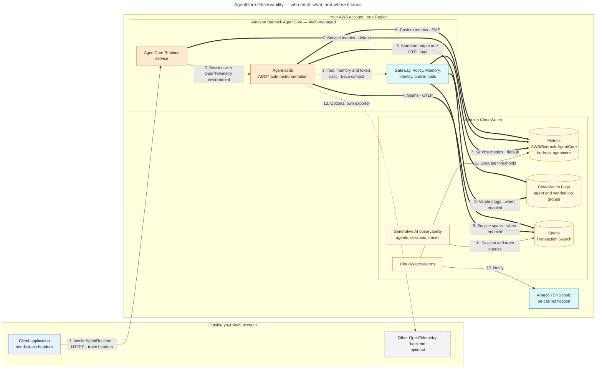
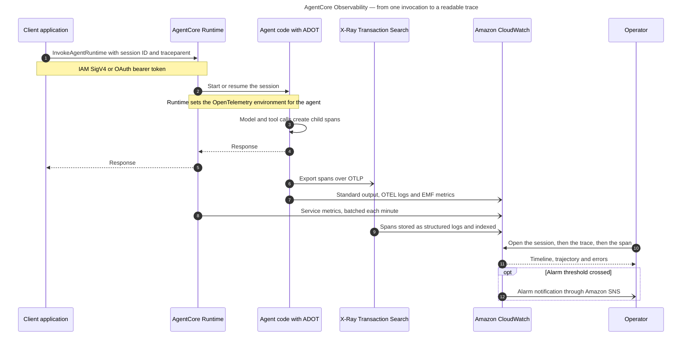

# AgentCore Observability

> **Level:** Intermediate · **Verified:** 2026-11-15 · **Feature status:** GA · **Time:** ~25 min

AgentCore Observability is the telemetry that Amazon Bedrock AgentCore services and your instrumented agent code write to Amazon CloudWatch — metrics, logs and spans — plus the console views that turn it into sessions and traces. It is how you find out what an agent actually did.

> [!IMPORTANT]
> **Status** — Generally available in all 22 AgentCore Regions. Changes in 2026 that older tutorials miss: cross-account monitoring (April); spans delivered to each agent's own log group, the default for agents created from 2026-07-20 in supported Regions (July); the `ActiveSessionCount` metric (July); the `OverheadLatency` metric for platform version V2 (November). Merging of your own OpenTelemetry resource attributes with Runtime's takes effect on 2026-11-16.
> Sources: [AgentCore release notes](https://docs.aws.amazon.com/bedrock-agentcore/latest/devguide/doc-history.html), [Supported AWS Regions](https://docs.aws.amazon.com/bedrock-agentcore/latest/devguide/agentcore-regions.html), [Add observability to your AgentCore resources](https://docs.aws.amazon.com/bedrock-agentcore/latest/devguide/observability-configure.html)

## Learning objectives

- Say which telemetry each AgentCore service emits by default and which you must switch on.
- Find any signal: the metric namespace, the log group and the place spans are stored.
- Instrument an agent with the AWS Distro for OpenTelemetry (ADOT), inside and outside AgentCore Runtime.
- Explain the session, trace and span model and how trace context is propagated.
- Choose what to alarm on, and estimate what drives the cost.

## Prerequisites

- [Amazon CloudWatch and AWS CloudTrail](../../00-foundations/aws-fundamentals/04-cloudwatch-cloudtrail.md)
- [AWS X-Ray, OpenTelemetry and ADOT](../../02-related-aws-services/observability/02-xray-opentelemetry-adot.md)
- [AgentCore Runtime](02-agentcore-runtime.md) and [AgentCore Gateway](04-agentcore-gateway.md)

## 1. What it is

**Plain language.** An agent decides at run time which model and tools to call, so you cannot read its behaviour from the code. Observability is the flight recorder: counters that say how busy and how healthy it is, a diary of what it logged, and a step-by-step timeline of each request.

**Precisely.** AgentCore emits telemetry in an OpenTelemetry (OTEL)-compatible format and stores all of it in Amazon CloudWatch in your account. There is no separate observability API: you configure CloudWatch and AWS X-Ray, and you instrument your agent.

| Item | Value |
|:--|:--|
| Service namespace / endpoint | None of its own. Data lands in Amazon CloudWatch metrics, CloudWatch Logs and X-Ray Transaction Search |
| Control-plane operations | X-Ray `UpdateTraceSegmentDestination` and `UpdateIndexingRule`; CloudWatch Logs `PutDeliverySource`, `PutDeliveryDestination`, `CreateDelivery`, `PutResourcePolicy` |
| Data-plane operations | OTLP export by the ADOT SDK; trace context on `InvokeAgentRuntime` (`traceId`, `traceParent`, `traceState`, `baggage`, `runtimeSessionId`) |
| IAM action prefix | `logs:`, `xray:` and `cloudwatch:` — not `bedrock-agentcore:` |

**Where each signal lands**

| Signal | Location |
|:--|:--|
| Service metrics from Runtime, Gateway, Memory, Identity, Policy and built-in tools | CloudWatch namespace `AWS/Bedrock-AgentCore` |
| Identity call counts and throttles for quotas | CloudWatch namespace `AWS/Usage` |
| Metrics your instrumented agent emits (Embedded Metric Format) | CloudWatch namespace `bedrock-agentcore` |
| Agent standard output and errors | Log group `/aws/bedrock-agentcore/runtimes/<agent_id>-<endpoint_name>`, stream `[runtime-logs]` |
| Agent OTEL structured logs | Same log group, stream `otel-rt-logs` |
| Spans | The `spans` stream of the agent's log group, or the shared `aws/spans` log group; searched with CloudWatch Transaction Search |
| Memory and Gateway application logs | `/aws/vendedlogs/bedrock-agentcore/{memory or gateway}/APPLICATION_LOGS/{resource-id}`, or Amazon S3, or Amazon Data Firehose |
| API audit records | AWS CloudTrail (documented for Gateway and AWS Agent Registry) |

Sources: [Observability overview](https://docs.aws.amazon.com/bedrock-agentcore/latest/devguide/observability.html), [View observability data](https://docs.aws.amazon.com/bedrock-agentcore/latest/devguide/observability-view.html), [Identity observability data](https://docs.aws.amazon.com/bedrock-agentcore/latest/devguide/observability-identity-metrics.html).

## 2. Why it exists

A request to an agent fans out into model calls, tool calls, token fetches and memory lookups across several services. Without a shared trace you see five unrelated log groups. AgentCore gives every service the same trace context and gives CloudWatch views that understand agents — sessions, traces, tool calls — so that "the agent was slow" becomes "the CRM tool took 2.8 s of a 3.1 s turn".

## 3. When to use it

- Always, for any agent beyond a prototype: enable Transaction Search once per account and Region.
- To debug a wrong or slow answer by reading the trace of that turn.
- To alarm on errors, throttles, latency and credential failures.
- To monitor agents in many accounts from one monitoring account.
- To feed traces to [AgentCore Evaluations](10-agentcore-evaluations-and-optimization.md).

## 4. When not to use it

- **Auditing who called an API.** That is AWS CloudTrail; see [AWS CloudTrail for Bedrock](../../02-related-aws-services/security/05-cloudtrail-for-bedrock.md).
- **Logging prompts and completions of direct model calls** that do not go through an agent. Use Bedrock model invocation logging; see [CloudWatch and Bedrock-specific observability](../../02-related-aws-services/observability/01-cloudwatch-and-bedrock-observability.md).
- **Judging answer quality.** Traces show what happened, not whether it was right. Use Evaluations.
- **You standardize on another OpenTelemetry backend.** Set `DISABLE_ADOT_OBSERVABILITY=true` on the runtime and configure your own exporter; service metrics still go to CloudWatch.

## 5. Internal architecture



**What this shows** — Two kinds of emitter and three kinds of store. AgentCore services emit metrics on their own; spans and logs from services, and everything from inside your agent, appear only after you enable them.

**Walkthrough**

1. The client invokes the agent and may pass a session ID and W3C or X-Ray trace headers.
2. Runtime starts the session and sets OpenTelemetry environment variables for the agent process.
3. The agent calls tools through Gateway, reads Memory and fetches tokens from Identity; the trace context travels with those calls.
4. The ADOT SDK exports the agent's spans (model calls, tool calls, framework steps).
5. Standard output and OTEL structured logs go to the agent's log group.
6. Metrics created by the instrumentation arrive in the `bedrock-agentcore` namespace.
7. Every AgentCore service publishes its own metrics to `AWS/Bedrock-AgentCore`, batched each minute.
8. Service-side spans are stored once tracing is enabled on the resource.
9. Memory, Gateway and Identity application logs are delivered once you configure a log destination.
10. The AgentCore observability page and the CloudWatch generative AI observability page read these stores.
11. Alarms watch metrics.
12. An alarm notifies your on-call channel.
13. Optionally, with AgentCore's ADOT configuration disabled, the agent exports to a backend you choose.

| Legend | Meaning |
|:--|:--|
| Solid arrow | Request or query |
| Thick arrow | Asynchronous telemetry |
| Dashed arrow | Optional path |
| Cylinder | Telemetry at rest |
| Grey dashed box | Outside your AWS account |

**Variations** — A self-hosted agent replaces steps 1–2 with your own entry point and sets the OTEL environment itself. Agents created before the per-agent span destination write spans to the shared `aws/spans` log group. The per-service picture is in [diagram set 16](../../diagrams/mermaid/16-agentcore-observability.md).

### What each service emits

| Resource | Metrics | Spans | Logs | Examples of documented metrics |
|:--|:-:|:-:|:-:|:--|
| Runtime (agent) | Default | Enable | Log group created by default | Invocations, Throttles, System Errors, User Errors, Latency, `OverheadLatency` (V2), Session Count, `ActiveSessionCount`, `CPUUsed-vCPUHours`, `MemoryUsed-GBHours` |
| Gateway | Default | Enable | Enable | `Invocations`, `Throttles`, `SystemErrors`, `UserErrors`, `Latency`, `Duration`, `TargetExecutionTime`, `TargetType` |
| Policy | Default | With gateway tracing | — | `AllowDecisions`, `DenyDecisions`, `NoDeterminingPolicies`, `LogOnlyDecisionFlips` |
| Memory | Default | Enable | Enable | Latency, Invocations, Errors, Throttles, Creation Count |
| Identity | Default | Enable | Enable on the runtime or gateway | `WorkloadAccessTokenFetchFailures`, `ResourceAccessTokenFetchFailures`, `ApiKeyFetchFailures` |
| Browser, Code Interpreter | Default | Enable | Enable | Invocations, Latency, Duration, `ActiveSessionCount` |

"Enable" means a one-time setting per resource (console toggle, or a CloudWatch Logs delivery). The documentation's own summary table differs slightly between pages on which spans are on by default; treat metrics as the only signal you get without acting. Sources: [AgentCore generated observability data](https://docs.aws.amazon.com/bedrock-agentcore/latest/devguide/observability-service-provided.html) and the per-service pages in section 14.

### Sessions, traces and spans

| Level | What it is | Typical question |
|:--|:--|:--|
| Session | One conversation between a user and an agent; contains many traces | Which users hit errors today? |
| Trace | One request-response cycle, including calls to tools and other agents | Why was this answer slow? |
| Span | One unit of work with a start, an end, a parent and attributes | Which tool call failed, with what input? |

Trace context crosses service boundaries in standard headers: `traceparent`, `tracestate` and `baggage` (W3C), `X-Amzn-Trace-Id` (X-Ray), and `X-Amzn-Bedrock-AgentCore-Runtime-Session-Id` for the session. Source: [Understand observability for agentic resources](https://docs.aws.amazon.com/bedrock-agentcore/latest/devguide/observability-telemetry.html).

### Instrumentation paths

| Where the agent runs | What you do |
|:--|:--|
| AgentCore Runtime | Add `aws-opentelemetry-distro>=0.18.0` and start the agent with `opentelemetry-instrument`. Runtime supplies the OTEL configuration. Frameworks with built-in OTEL support (Strands, LangChain, CrewAI) and the OpenInference, Openllmetry, OpenLit and Traceloop libraries are supported |
| AWS Lambda | Add the AWS Lambda Layer for OpenTelemetry and set `AWS_LAMBDA_EXEC_WRAPPER=/opt/otel-instrument` |
| Anywhere else | Same SDK, plus a log group you create and OTEL environment variables that name it (section 13). Put the session ID in OTEL baggage as `session.id` |
| Another backend | Set `DISABLE_ADOT_OBSERVABILITY=true`; Runtime then leaves the agent's OpenTelemetry configuration to you |

### Cross-account monitoring

AgentCore uses CloudWatch cross-account observability: an Observability Access Manager **sink** in a monitoring account and a **link** in each source account, sharing at least Metrics and Logs. The AgentCore observability console in the monitoring account then shows linked accounts' agents. It works within one Region. Source: [Monitor AgentCore resources across accounts](https://docs.aws.amazon.com/bedrock-agentcore/latest/devguide/observability-cross-account.html). See [Pattern: multi-account generative AI platform](../../03-architecture-patterns/multi-account/README.md).

## 6. Request and response lifecycle



Steps 1–5 are the request itself; telemetry (6–9) is exported asynchronously and never blocks the answer. AWS states that a complete trace is readable in under 10 seconds after it is written. Steps 10–11 are the debugging loop: session, then trace, then span.

**Failure paths that matter**

| Symptom | Cause |
|:--|:--|
| Metrics exist but no traces | CloudWatch Transaction Search is not enabled, or the trace segment destination is not CloudWatch Logs |
| Spans still arrive in `aws/spans` after opting in to the agent log group | ADOT older than 0.18.0, or the execution role lacks `logs:PutResourcePolicy` |
| A trace breaks at the client boundary | The caller did not send `traceparent`, so Runtime started a new trace |
| Sessions are not grouped | The session ID header was not sent, or for self-hosted agents `session.id` was not put in baggage |
| No Memory or Gateway logs | No log delivery configured for that resource |
| A policy denial leaves no gateway log line | By design: policy decisions are in policy metrics and spans, not gateway application logs |
| CPU and memory usage figures look late | Resource usage data can be delayed by up to 60 minutes |

## 7. Dependencies

| Depends on | Why | Required or optional |
|:--|:--|:-:|
| Amazon CloudWatch (metrics, Logs) | Stores every signal | Required |
| CloudWatch Transaction Search (AWS X-Ray) | Stores and indexes spans | Required for spans and traces |
| ADOT SDK 0.18.0 or later, or the Lambda layer | Emits spans, logs and metrics from agent code | Required for agent-level traces |
| `logs:PutResourcePolicy` on the agent execution role | Lets X-Ray deliver spans to the agent's log group | Required for the per-agent span destination |
| CloudWatch Logs deliveries, Amazon S3 or Amazon Data Firehose | Destinations for vended logs | Optional |
| CloudWatch Observability Access Manager | Cross-account views | Optional |
| Amazon SNS | Alarm notifications | Optional |

## 8. Security considerations

- **Telemetry contains data.** Spans can carry model payloads and tool requests and responses; Identity application logs include request and response payloads. Decide who may read each log group and whether to mask sensitive data in CloudWatch Logs.
- **Use the per-agent span destination.** With spans in the agent's own log group you can scope access control and encryption to one agent. The shared `aws/spans` group mixes all agents.
- **No secrets in attributes.** Values in `OTEL_RESOURCE_ATTRIBUTES` and `OTEL_SERVICE_NAME` appear in traces.
- **Labels are not a security boundary.** Whoever can call `UpdateAgentRuntime` can set the stage label; restrict that if you filter telemetry access by stage.
- **Resource policy.** Transaction Search needs a CloudWatch Logs resource policy that lets `xray.amazonaws.com` write, limited by `aws:SourceArn` and `aws:SourceAccount`.
- **Audit is separate.** CloudTrail, not this telemetry, is the record of API activity; see [Logging, audit and compliance evidence](../../06-security-governance/07-logging-audit-and-compliance.md).

## 9. Networking requirements

Service telemetry flows from AgentCore to CloudWatch inside AWS and needs nothing from your network. An agent hosted outside Runtime exports over OTLP (`http/protobuf`) to CloudWatch in its Region and therefore needs a route to those endpoints. Which interface endpoints an agent in Runtime VPC mode needs for its own telemetry is **UNVERIFIED — REQUIRES DOCUMENTATION REVIEW** (looked for a statement on the observability pages listed in section 14; found none). See [Private connectivity for Bedrock](../../02-related-aws-services/networking/01-private-connectivity-for-bedrock.md).

## 10. Pricing dimensions

AgentCore adds no charge of its own: "Spans, logs, and metrics — charged as per Amazon CloudWatch pricing".

| Dimension | Unit | Notes |
|:--|:--|:--|
| Span ingestion | GB | The AgentCore pricing page's worked example uses $0.35 per GB (2026-11-15) |
| Span event logs to standard logs | GB | The same example uses $0.50 per GB (2026-11-15) |
| Metrics, other logs, storage | CloudWatch units | Standard CloudWatch rates |
| Queries and sensitive-data masking | CloudWatch units | Listed by AWS as charged |

Source: [Amazon Bedrock AgentCore pricing](https://aws.amazon.com/bedrock/agentcore/pricing/). **Our reading:** cost follows spans per request times payload size. Capturing full model input and output on every span is the expensive choice; the Transaction Search indexing percentage and log retention are the two controls. See [Cost optimization and token budgeting](../../08-cost-performance-and-reliability/02-cost-optimization-and-token-budgeting.md).

## 11. Scaling considerations

| Fact | Value | Source |
|:--|:--|:--|
| Service metric resolution | One-minute batches | [Runtime observability data](https://docs.aws.amazon.com/bedrock-agentcore/latest/devguide/observability-runtime-metrics.html) |
| Session usage logs (`USAGE_LOGS`) | One-second granularity, may be delayed up to 60 minutes | Same page |
| Merged `OTEL_RESOURCE_ATTRIBUTES` | At most 4,096 bytes, otherwise not merged | [Add observability](https://docs.aws.amazon.com/bedrock-agentcore/latest/devguide/observability-configure.html) |
| Trace availability | Under 10 seconds from write to read | [Release notes](https://docs.aws.amazon.com/bedrock-agentcore/latest/devguide/doc-history.html), April 2026 |
| Cross-account | Up to 100,000 log groups per monitoring account; a source account shares with up to five monitoring accounts; one Region | Release notes, April 2026 |

There is no AgentCore quota on telemetry; CloudWatch and X-Ray quotas apply. `ActiveSessionCount` (dimension `Service` = `AgentCore.Runtime`, `AgentCore.CodeInterpreter` or `AgentCore.Browser`) is the metric to watch against session quotas; see [Quotas, rate limits and throttling](../../08-cost-performance-and-reliability/05-quotas-rate-limits-and-throttling.md).

## 12. IaC support

There is no AgentCore resource called "observability". You declare the CloudWatch and X-Ray resources around your AgentCore resources.

| Tool | Support | Resource / construct | Notes |
|:--|:-:|:--|:--|
| Terraform (`hashicorp/aws` 6.73.0) | ✅ | `aws_xray_trace_segment_destination`, `aws_xray_indexing_rule`, `aws_cloudwatch_log_resource_policy`, `aws_cloudwatch_log_delivery_source`, `aws_cloudwatch_log_delivery_destination`, `aws_cloudwatch_log_delivery`, `aws_cloudwatch_metric_alarm`, `aws_oam_sink`, `aws_oam_link` | Checked in the provider schema and with `terraform validate` |
| CloudFormation | ✅ | `AWS::XRay::TransactionSearchConfig`, `AWS::Logs::DeliverySource`, `AWS::Logs::DeliveryDestination`, `AWS::Logs::Delivery`, `AWS::Oam::Sink`, `AWS::Oam::Link` | Types present in the specification bundled with `aws-cdk-lib` 2.277.0 |
| AWS CDK (`aws-cdk-lib` 2.277.0) | L1 / L2 | `aws_xray.CfnTransactionSearchConfig`, `aws_logs.CfnDeliverySource`, `CfnDeliveryDestination`, `CfnDelivery`, `aws_oam.CfnSink`, `CfnLink`; L2 `aws_cloudwatch.Alarm` | No AgentCore-specific observability construct |

The per-agent span destination and the ADOT switches are environment variables on the agent runtime, set through the Runtime resource; see [Terraform coverage for Amazon Bedrock](../../04-infrastructure-as-code/terraform/10-terraform-for-bedrock.md).

## 13. Working example

The account-level setup, log delivery for one gateway and one alarm.

> **Code status:** validated with `terraform validate` (Terraform 1.17.2, provider 6.73.0) together with a `versions.tf` that pins the provider · **never planned or applied against AWS** · **never deployed**

```hcl
variable "gateway_arn" {
  description = "ARN of the AgentCore gateway whose logs and metrics you want."
  type        = string
}

variable "gateway_id" {
  description = "ID of the same gateway, used in resource and log group names."
  type        = string
}

variable "span_indexing_percentage" {
  description = "Percentage of spans that Transaction Search indexes for trace search."
  type        = number
  default     = 1
}

variable "log_retention_days" {
  description = "Retention of the vended log group, in days."
  type        = number
  default     = 30
}

variable "alarm_dimensions" {
  description = "Dimensions of the gateway metric. Confirm the published dimension set in the CloudWatch console."
  type        = map(string)
  default     = { Operation = "InvokeGateway" }
}

variable "alarm_topic_arn" {
  description = "ARN of the Amazon SNS topic that receives alarm notifications."
  type        = string
}

data "aws_caller_identity" "current" {}
data "aws_partition" "current" {}
data "aws_region" "current" {}

locals {
  logs_arn_prefix = "arn:${data.aws_partition.current.partition}:logs:${data.aws_region.current.region}:${data.aws_caller_identity.current.account_id}"
}

# One-time account setup: CloudWatch Transaction Search.
# 1. Let AWS X-Ray write spans to CloudWatch Logs.
data "aws_iam_policy_document" "xray_to_logs" {
  statement {
    sid       = "TransactionSearchXRayAccess"
    actions   = ["logs:PutLogEvents"]
    resources = ["${local.logs_arn_prefix}:log-group:aws/spans:*", "${local.logs_arn_prefix}:log-group:/aws/application-signals/data:*"]

    principals {
      type        = "Service"
      identifiers = ["xray.amazonaws.com"]
    }

    condition {
      test     = "ArnLike"
      variable = "aws:SourceArn"
      values   = ["arn:${data.aws_partition.current.partition}:xray:${data.aws_region.current.region}:${data.aws_caller_identity.current.account_id}:*"]
    }

    condition {
      test     = "StringEquals"
      variable = "aws:SourceAccount"
      values   = [data.aws_caller_identity.current.account_id]
    }
  }
}

resource "aws_cloudwatch_log_resource_policy" "xray_to_logs" {
  policy_name     = "TransactionSearchXRayAccess"
  policy_document = data.aws_iam_policy_document.xray_to_logs.json
}

# 2. Send trace segments to CloudWatch Logs and choose how much to index.
resource "aws_xray_trace_segment_destination" "cloudwatch_logs" {
  destination = "CloudWatchLogs"

  depends_on = [aws_cloudwatch_log_resource_policy.xray_to_logs]
}

resource "aws_xray_indexing_rule" "default" {
  name = "Default"

  rule {
    probabilistic {
      desired_sampling_percentage = var.span_indexing_percentage
    }
  }

  depends_on = [aws_xray_trace_segment_destination.cloudwatch_logs]
}

# Per resource: vended application logs for a gateway (source -> destination -> delivery).
resource "aws_cloudwatch_log_group" "gateway" {
  name              = "/aws/vendedlogs/bedrock-agentcore/gateway/APPLICATION_LOGS/${var.gateway_id}"
  retention_in_days = var.log_retention_days
}

resource "aws_cloudwatch_log_delivery_source" "gateway_logs" {
  name         = "${var.gateway_id}-logs-source"
  log_type     = "APPLICATION_LOGS"
  resource_arn = var.gateway_arn
}

resource "aws_cloudwatch_log_delivery_destination" "gateway_logs" {
  name = "${var.gateway_id}-logs-destination"

  delivery_destination_configuration {
    destination_resource_arn = aws_cloudwatch_log_group.gateway.arn
  }
}

resource "aws_cloudwatch_log_delivery" "gateway_logs" {
  delivery_source_name     = aws_cloudwatch_log_delivery_source.gateway_logs.name
  delivery_destination_arn = aws_cloudwatch_log_delivery_destination.gateway_logs.arn
}

# Alarm: the gateway returned server-side errors in 3 of the last 5 minutes.
resource "aws_cloudwatch_metric_alarm" "gateway_system_errors" {
  alarm_name          = "${var.gateway_id}-system-errors"
  alarm_description   = "AgentCore Gateway returned 5xx errors"
  namespace           = "AWS/Bedrock-AgentCore"
  metric_name         = "SystemErrors"
  dimensions          = var.alarm_dimensions
  statistic           = "Sum"
  period              = 60
  evaluation_periods  = 5
  datapoints_to_alarm = 3
  threshold           = 0
  comparison_operator = "GreaterThanThreshold"
  treat_missing_data  = "notBreaching"
  alarm_actions       = [var.alarm_topic_arn]
}

output "gateway_log_group_name" {
  description = "Log group that receives the gateway's vended application logs."
  value       = aws_cloudwatch_log_group.gateway.name
}
```

Instrumenting an agent that runs **on Runtime** takes one dependency and one start command:

> **Code status:** illustrative · taken from the AWS documentation · not run · **never deployed**

```text
# requirements.txt
aws-opentelemetry-distro>=0.18.0
boto3

# container start command
CMD ["opentelemetry-instrument", "python", "main.py"]
```

An agent that runs **outside Runtime** also needs a log group and these environment variables. The names are from the documentation; the values `my-agent` and `my-agent-id` are placeholders. Credentials come from the compute's IAM role, not from environment variables.

> **Code status:** illustrative · variable names from the AWS documentation, placeholder values · not run · **never deployed**

```text
AGENT_OBSERVABILITY_ENABLED=true
OTEL_PYTHON_DISTRO=aws_distro
OTEL_PYTHON_CONFIGURATOR=aws_configurator
OTEL_EXPORTER_OTLP_PROTOCOL=http/protobuf
OTEL_TRACES_EXPORTER=otlp
OTEL_RESOURCE_ATTRIBUTES=service.name=my-agent,aws.log.group.names=/aws/bedrock-agentcore/runtimes/my-agent-id
OTEL_EXPORTER_OTLP_LOGS_HEADERS=x-aws-log-group=/aws/bedrock-agentcore/runtimes/my-agent-id,x-aws-log-stream=runtime-logs,x-aws-metric-namespace=bedrock-agentcore
OTEL_EXPORTER_OTLP_TRACES_HEADERS=x-aws-log-group=/aws/bedrock-agentcore/runtimes/my-agent-id,x-aws-log-stream=spans
```

### What to alarm on

> [!TIP]
> **Academy recommendation** — Start with the alarms below. The metric names are documented; the choice and thresholds are ours. Confirm exact metric names and dimension sets in the CloudWatch console, because the documentation lists some Runtime and Memory metrics by display name only.
> This is our design guidance, not an official AWS reference architecture.

| What can go wrong | Metric in `AWS/Bedrock-AgentCore` | Why it matters |
|:--|:--|:--|
| Platform or target failures | Runtime System Errors; Gateway `SystemErrors` | Users see failed turns |
| Bad deployment or broken authorization | `UserErrors` rising after a release | 4xx from wrong tokens, schemas or permissions |
| Quota pressure | `Throttles`; `ActiveSessionCount` against the session quota | Requests are rejected before they reach the agent |
| Slow tools | Gateway `TargetExecutionTime` and `Duration` at p99 | Isolates the target's share of latency |
| Slow platform start | Runtime `OverheadLatency` (V2) next to `Latency` | Separates cold start from agent work |
| Credential failures | `WorkloadAccessTokenFetchFailures`, `ResourceAccessTokenFetchFailures`, `ApiKeyFetchFailures` | An expired client secret or revoked consent stops every tool that needs it |
| Policy surprises | `DenyDecisions`, `NoDeterminingPolicies`, `LogOnlyDecisionFlips` | A spike is an attack, a broken policy or a rollout that would start denying |
| Silent loss of long-term memory | Memory Errors and Throttles; `NamespaceResolutionFailure` | Extraction fails without failing the user's request |

Operational practice continues in [Production monitoring and incident response](../../08-cost-performance-and-reliability/08-monitoring-and-incident-response.md) and [Observability and tracing for GenAI](../../09-advanced-topics/12-observability-and-tracing.md).

## Common mistakes

| Mistake | Symptom | Fix |
|:--|:--|:--|
| Skipping Transaction Search | Dashboards show metrics but the Traces tab is empty | Enable it once per account and Region, with spans ingested as structured logs |
| Running the agent with plain `python` | No agent spans, only the Runtime invoke span | Start with `opentelemetry-instrument` and include the ADOT package |
| Looking for agent metrics in `AWS/Bedrock-AgentCore` | Custom metrics "missing" | Agent-emitted metrics are in the `bedrock-agentcore` namespace |
| Expecting Memory, Gateway or Identity logs by default | Empty log groups | Configure a log delivery per resource |
| Generating a new session ID per request | Every turn looks like a separate session | Reuse the session ID for related requests |
| Putting stage or tenant secrets in resource attributes | Sensitive values readable by anyone with log access | Use non-sensitive labels only |
| Setting `OTEL_RESOURCE_ATTRIBUTES` and assuming Runtime's defaults remain (before 2026-11-16) | Runtime's attributes are replaced, traces lose agent identifiers | Re-check after the merge behaviour takes effect; keep the value short |

## Knowledge check

1. A new agent on Runtime shows invocation metrics, but no traces. Name two independent causes.
2. Where would you look for (a) the number of 5xx responses from a gateway, (b) a custom counter your agent code emits, (c) the reason a specific tool call failed?
3. A security reviewer wants telemetry for the payments agent readable only by the payments team. Which 2026 change makes that practical, and what does it require?
4. Why can a policy denial be invisible in gateway application logs, and where do you find it?

<details>
<summary>Answers</summary>

1. CloudWatch Transaction Search is not enabled (or trace segments are not sent to CloudWatch Logs); or the agent code is not instrumented — the ADOT package is missing or the process was not started with `opentelemetry-instrument`.
2. (a) The `SystemErrors` metric in the `AWS/Bedrock-AgentCore` namespace. (b) The `bedrock-agentcore` namespace, where agent-emitted OTEL metrics arrive in Embedded Metric Format. (c) The trace for that request: open the tool-call span, then use its span ID or request ID to find the matching gateway log line.
3. The per-agent span destination: spans go to the `spans` stream of the agent's own log group instead of the shared `aws/spans` group, so access control and encryption can be scoped to that agent. It requires Transaction Search with CloudWatch Logs as the destination, `logs:PutResourcePolicy` on the execution role and ADOT 0.18.0 or later.
4. When a policy denies a tool call the gateway does not invoke the target and writes no request or response record. The decision is in the policy metrics (`DenyDecisions`) and in the `AuthorizeAction` span attributes when gateway tracing is enabled.

</details>

## 14. Official documentation

- [Observability, audit logging, and tracing for your agents](https://docs.aws.amazon.com/bedrock-agentcore/latest/devguide/observability.html) — the three pillars and where data is stored.
- [Add observability to your AgentCore resources](https://docs.aws.amazon.com/bedrock-agentcore/latest/devguide/observability-configure.html) — Transaction Search, span destination, ADOT inside and outside Runtime, log and trace delivery, trace headers, other platforms.
- [Understand observability for agentic resources](https://docs.aws.amazon.com/bedrock-agentcore/latest/devguide/observability-telemetry.html) — sessions, traces and spans.
- [AgentCore generated observability data](https://docs.aws.amazon.com/bedrock-agentcore/latest/devguide/observability-service-provided.html) — summary of signals per resource type.
- [Runtime observability data](https://docs.aws.amazon.com/bedrock-agentcore/latest/devguide/observability-runtime-metrics.html), [Gateway](https://docs.aws.amazon.com/bedrock-agentcore/latest/devguide/observability-gateway-metrics.html), [Memory](https://docs.aws.amazon.com/bedrock-agentcore/latest/devguide/observability-memory-metrics.html), [Identity](https://docs.aws.amazon.com/bedrock-agentcore/latest/devguide/observability-identity-metrics.html), [Policy](https://docs.aws.amazon.com/bedrock-agentcore/latest/devguide/observability-policy-metrics.html) and [built-in tools](https://docs.aws.amazon.com/bedrock-agentcore/latest/devguide/observability-tool-metrics.html) — metric, span and log references.
- [View observability data for your AgentCore agents](https://docs.aws.amazon.com/bedrock-agentcore/latest/devguide/observability-view.html) — console views, log group names, metric namespaces.
- [Monitor AgentCore resources across accounts](https://docs.aws.amazon.com/bedrock-agentcore/latest/devguide/observability-cross-account.html) — sink, link and limitations.
- [Specify long-term memory organization with namespaces](https://docs.aws.amazon.com/bedrock-agentcore/latest/devguide/specify-long-term-memory-organization.html) — the `NamespaceResolutionFailure` metric.
- [Amazon Bedrock AgentCore pricing](https://aws.amazon.com/bedrock/agentcore/pricing/) — the CloudWatch pricing rule and the worked example.
- [AgentCore release notes](https://docs.aws.amazon.com/bedrock-agentcore/latest/devguide/doc-history.html) — dates and limits quoted above.
- [Supported AWS Regions](https://docs.aws.amazon.com/bedrock-agentcore/latest/devguide/agentcore-regions.html) — Region availability.
