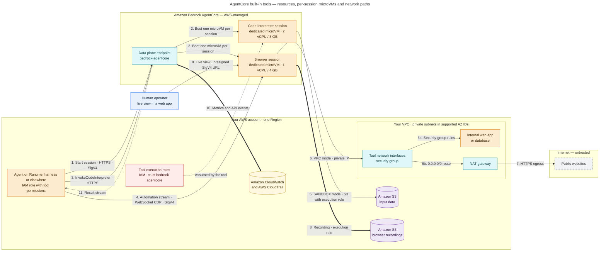
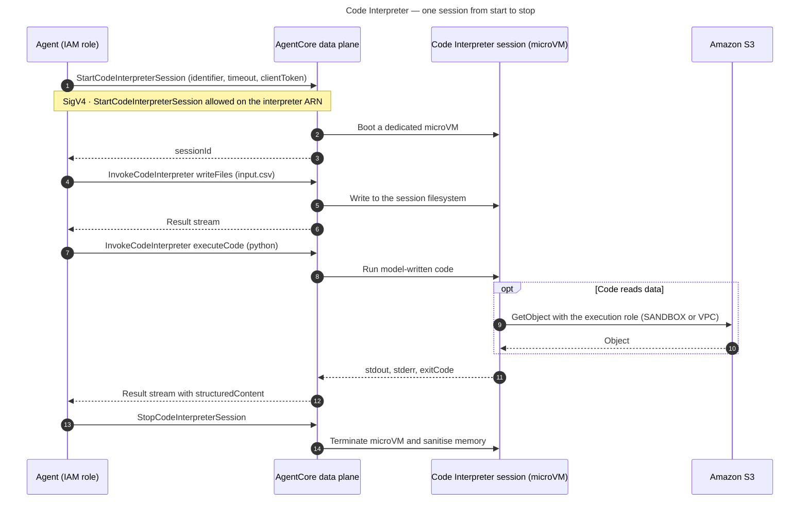
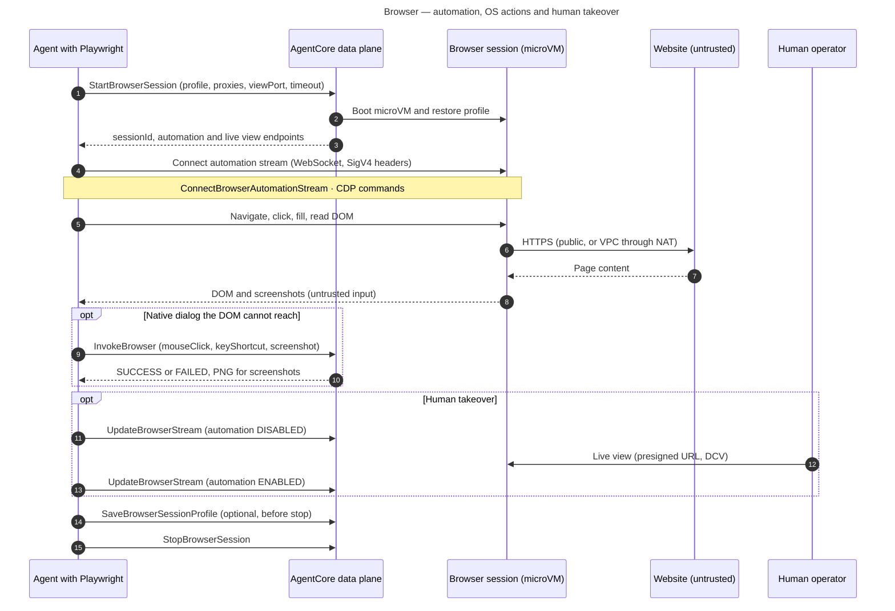

# AgentCore Browser and Code Interpreter

> **Level:** Intermediate · **Verified:** 2026-11-15 · **Feature status:** GA · **Time:** ~30 min

AgentCore Browser and AgentCore Code Interpreter are the two built-in tools of Amazon Bedrock AgentCore: a managed cloud browser an agent can drive, and a sandbox that runs code the model writes. Each session runs in its own microVM, so an agent can browse untrusted pages and execute untrusted code without touching your hosts.

> [!IMPORTANT]
> **Status** — Generally available; "AgentCore Built-in Tools" are listed in all 22 AgentCore Regions. Later additions: browser proxies, profiles and extensions (February 2026) and OS-level browser actions (May 2026). Web Bot Auth request signing was introduced as a preview in October 2025; whether it is now GA is **UNVERIFIED — REQUIRES DOCUMENTATION REVIEW** (no GA entry was found in the release notes).
> Sources: [Supported AWS Regions](https://docs.aws.amazon.com/bedrock-agentcore/latest/devguide/agentcore-regions.html), [Proxies, profiles and extensions](https://aws.amazon.com/blogs/machine-learning/customize-ai-agent-browsing-with-proxies-profiles-and-extensions-in-amazon-bedrock-agentcore-browser/), [OS level actions](https://aws.amazon.com/blogs/machine-learning/introducing-os-level-actions-in-amazon-bedrock-agentcore-browser/), [Web Bot Auth (Preview)](https://aws.amazon.com/blogs/machine-learning/reduce-captchas-for-ai-agents-browsing-the-web-with-web-bot-auth-preview-in-amazon-bedrock-agentcore-browser/)

## Learning objectives

- Explain the resource-and-session model of both tools and what "one microVM per session" protects you from.
- Choose a network mode — `PUBLIC`, `SANDBOX` (Code Interpreter only) or `VPC` — for a given data-access need.
- Drive a Code Interpreter session with `InvokeCodeInterpreter` and a browser session through its automation stream, `InvokeBrowser` and live view.
- Scope the execution role, the caller's permissions and the network so that model-written code and untrusted pages cannot reach more than they need.
- Read the quotas and the pricing dimensions, and create both tools with Terraform.

## Prerequisites

- [AgentCore overview](01-agentcore-overview.md) and [AgentCore Runtime](02-agentcore-runtime.md)
- [IAM roles, trust policies and cross-account access](../../00-foundations/security/02-iam-roles-and-trust.md)
- [VPCs and subnets](../../00-foundations/networking/01-vpc-and-subnets.md)

## 1. What it is

**Plain language.** Some questions need a calculator, and some answers sit behind a web form. Code Interpreter is a disposable computer the agent can type code into; Browser is a disposable Chrome window it can click through. Each conversation gets a fresh one, and it is wiped when the conversation ends.

**Precisely.** Each tool is a **resource** (a configuration: network mode, execution role, and for Browser recording and other options) on which you start **sessions**. AWS provides a system resource for each — `aws.codeinterpreter.v1` and `aws.browser.v1`, "default configuration with the most restrictive options" — and you can create custom resources with your own settings.

| Item | Value |
|:--|:--|
| Service namespace / endpoint | Control plane `bedrock-agentcore-control.<region>.amazonaws.com`; data plane `bedrock-agentcore.<region>.amazonaws.com`; browser streams under `/browser-streams/<browser-id>/sessions/<session-id>/automation` and `/live-view` on the data-plane host |
| Control-plane operations | `CreateCodeInterpreter`, `GetCodeInterpreter`, `ListCodeInterpreters`, `DeleteCodeInterpreter`; `CreateBrowser`, `GetBrowser`, `ListBrowsers`, `DeleteBrowser`; `CreateBrowserProfile`, `GetBrowserProfile`, `ListBrowserProfiles`, `DeleteBrowserProfile` |
| Data-plane operations | `StartCodeInterpreterSession`, `InvokeCodeInterpreter`, `GetCodeInterpreterSession`, `ListCodeInterpreterSessions`, `StopCodeInterpreterSession`; `StartBrowserSession`, `InvokeBrowser`, `UpdateBrowserStream`, `SaveBrowserSessionProfile`, `GetBrowserSession`, `ListBrowserSessions`, `StopBrowserSession` |
| WebSocket streams (IAM actions, not SDK operations) | `bedrock-agentcore:ConnectBrowserAutomationStream`, `bedrock-agentcore:ConnectBrowserLiveViewStream` |
| IAM action prefix | `bedrock-agentcore:` |

Operation names are checked against the [generated API reference](../../references/bedrock-api-operations.md). The API has no update operation for either tool, so **our reading** is that a configuration change means a new resource. Sources: [Browser fundamentals](https://docs.aws.amazon.com/bedrock-agentcore/latest/devguide/browser-resource-session-management.html), [Code Interpreter resource management](https://docs.aws.amazon.com/bedrock-agentcore/latest/devguide/code-interpreter-resource-management.html).

## 2. Why it exists

Without them you would run a headless browser fleet and a code sandbox yourself: images, scaling, per-user isolation, cleanup, egress control, and a way for a person to take over a stuck browser. Running model-written code inside your agent is worse: it inherits the agent's credentials and network. The built-in tools move both risks into a short-lived microVM with its own role and network mode.

## 3. When to use it

- The answer needs exact computation, data cleaning or a chart over a CSV, Excel or JSON file.
- The agent must use a web application that has no API: forms, portals, dashboards.
- You need an audit trail of what an agent did on a website (recording and replay), or a human to step in mid-task (live view).
- You use the AgentCore harness, which accepts both as tool types (`agentcore_browser`, `agentcore_code_interpreter`); see [AgentCore harness](03-agentcore-harness.md).

## 4. When not to use it

- **The system has an API.** Call it as a tool through [AgentCore Gateway](04-agentcore-gateway.md); a browser is slower, costlier and breaks when the page changes.
- **You only need search results or cited answers.** Use Web Search or Web Answer; see [AgentCore Payments, Web Search and Web Answer](12-agentcore-payments-and-web-search.md).
- **Code you wrote and reviewed.** Deploy it as a Lambda tool or inside your agent on [AgentCore Runtime](02-agentcore-runtime.md); a sandbox is for code you do not trust.
- **Heavy or long batch computation.** Sessions are capped at 2 vCPU / 8 GB and 8 hours; use AWS Batch, Amazon ECS or [AWS Lambda](../../02-related-aws-services/compute/01-lambda.md) orchestration instead.

## 5. Internal architecture



**What this shows** — Both tools follow the same pattern: a resource you configure once, sessions that each get a dedicated microVM, and a network mode that decides what the session can reach. The browser is drawn in VPC mode and the code interpreter in `SANDBOX` mode, which is the pairing used in the [working example](#13-working-example). This is an academy diagram, not an official AWS reference architecture.

1. The agent starts a session with SigV4.
2. Each session gets a dedicated microVM "with isolated CPU, memory, and filesystem resources", terminated and memory-sanitised at the end.
3. Code Interpreter takes one request per action and answers with a stream.
4. Browser automation is a WebSocket speaking the Chrome DevTools Protocol (CDP).
5. `SANDBOX` code reaches Amazon S3 with the execution role.
6. VPC mode places network interfaces in your subnets (service-linked role `AWSServiceRoleForBedrockAgentCoreNetwork`); security groups decide what they reach.
7. Internet from VPC mode needs a NAT gateway; a public subnet does not help.
8. A custom browser records sessions to your bucket.
9. A person watches or takes over through live view.
10. Metrics go to CloudWatch, API calls to CloudTrail.
11. Results return to the agent.

**Legend** — solid: request · dashed: response or role assumption · thick: asynchronous data · cylinder: data store · grey dashed box: outside your account. The full runtime-and-tools picture is planned as [diagram set 13](../../diagrams/mermaid/13-agentcore-runtime-and-tool-execution.md).

### Session model and isolation

| Property | Code Interpreter | Browser |
|:--|:--|:--|
| Session timeout | Default 900 s; up to 28,800 s (8 h) via `sessionTimeoutSeconds` | Same |
| Sessions per resource | Several at once, each with its own state | Several at once; "up to a maximum of 500 sessions" per browser |
| State across calls | Files and kernel state persist for the session's lifetime | Cookies and storage persist for the session; across sessions only through a saved **profile** |
| After termination | "the data is cleaned up" | "Ephemeral sessions that reset after each use" |
| Retention policy | "The time to live (TTL) retention policy for the session data is 30 days" | Same statement |

**Our reading** of the last two rows: the sandbox is wiped at session end, but some session data is retained for up to 30 days, so keep secrets out of sessions. Sources: [Code Interpreter session management](https://docs.aws.amazon.com/bedrock-agentcore/latest/devguide/code-interpreter-session-characteristics.html), [Browser fundamentals](https://docs.aws.amazon.com/bedrock-agentcore/latest/devguide/browser-resource-session-management.html), [Browser tool](https://docs.aws.amazon.com/bedrock-agentcore/latest/devguide/browser-tool.html).

### Network modes

| Mode | Code Interpreter | Browser | What the session can reach |
|:--|:-:|:-:|:--|
| `PUBLIC` | ✅ | ✅ | The public internet |
| `SANDBOX` | ✅ | — | "Limited external network access to AWS services": Amazon S3 for data operations |
| `VPC` | ✅ | ✅ | Your VPC through network interfaces in your subnets; internet only through a NAT gateway |

Sources: [Code Interpreter resource management](https://docs.aws.amazon.com/bedrock-agentcore/latest/devguide/code-interpreter-resource-management.html), [Configure Runtime and tools for VPC](https://docs.aws.amazon.com/bedrock-agentcore/latest/devguide/agentcore-vpc.html).

> [!WARNING]
> **Common mistake** — Trusting two stale passages. The Browser fundamentals page says the browser "supports the public network mode", but the VPC page and the API (`PUBLIC | VPC`) document VPC mode. The VPC page's CLI examples use `networkModeConfig`; the API and SDK field is `vpcConfig`.

### Code Interpreter in detail

| Aspect | What is documented |
|:--|:--|
| Tool names in `InvokeCodeInterpreter` | `executeCode`, `executeCommand` (shell, including the AWS CLI), `writeFiles`, `readFiles`, `listFiles`, `removeFiles`; `startCommandExecution`, `getTask`, `stopTask` for long-running commands |
| Languages | `language`: `python`, `javascript`, `typescript`; pre-installed Python and Node.js libraries |
| Result | A stream; `structuredContent` carries `stdout`, `stderr`, `exitCode`, `executionTime` |
| Files | Inline upload up to 100 MB; through Amazon S3 with terminal commands up to 5 GB; optional Amazon EFS or Amazon S3 Files mounts (`filesystemConfigurations`) |
| Certificates | Installed from AWS Secrets Manager at resource or session level |

Sources: [InvokeCodeInterpreter](https://docs.aws.amazon.com/bedrock-agentcore/latest/APIReference/API_InvokeCodeInterpreter.html), [StartCodeInterpreterSession](https://docs.aws.amazon.com/bedrock-agentcore/latest/APIReference/API_StartCodeInterpreterSession.html), [Code Interpreter](https://docs.aws.amazon.com/bedrock-agentcore/latest/devguide/code-interpreter-tool.html), [Pre-installed libraries](https://docs.aws.amazon.com/bedrock-agentcore/latest/devguide/code-interpreter-preinstalled-libraries.html).

### Browser in detail

| Capability | What it does |
|:--|:--|
| Automation stream | WebSocket CDP endpoint for Playwright, browser-use, Nova Act or Strands. One per session |
| Live view | AWS DCV stream a person can watch and use, through a SigV4-presigned URL; the TypeScript SDK ships a `BrowserLiveView` React component. One per session |
| `UpdateBrowserStream` | Sets the automation stream to `ENABLED` or `DISABLED`, for example while a person takes over |
| `InvokeBrowser` | OS-level mouse, keyboard and full-desktop screenshot actions for things CDP cannot reach: print and file dialogs, JavaScript alerts, context menus. Default viewport 1456×819 |
| Recording | DOM changes, user actions, console logs and network events, written to your S3 bucket and replayable in the console (custom browsers) |
| Profiles | Cookies and local storage saved with `SaveBrowserSessionProfile` and restored into new sessions |
| Proxies, extensions, enterprise policies, root CAs | Route traffic through your proxies (credentials from Secrets Manager); load Chrome extensions from S3; apply Chrome enterprise policy files; trust private certificate authorities |
| Web Bot Auth | `browserSigning` signs requests so participating WAF providers can recognise the agent and show fewer CAPTCHAs |

Sources: [Browser OS action](https://docs.aws.amazon.com/bedrock-agentcore/latest/devguide/browser-invoke.html), [Live View](https://docs.aws.amazon.com/bedrock-agentcore/latest/devguide/browser-dcv-integration.html), [Browser profiles](https://docs.aws.amazon.com/bedrock-agentcore/latest/devguide/browser-profiles.html), [Browser features](https://docs.aws.amazon.com/bedrock-agentcore/latest/devguide/browser-features.html).

## 6. Request and response lifecycle



- **Steps 1–3.** The caller needs `bedrock-agentcore:StartCodeInterpreterSession` on the interpreter. `clientToken` makes a retried start idempotent. A request that would exceed a quota returns `ServiceQuotaExceededException` (HTTP 402); one above the rate limit returns `ThrottlingException` (429); retry those with backoff.
- **Steps 4–12.** A call on an expired or stopped session fails. `isError` marks failed code, not an API error. Synchronous requests stop at 15 minutes; use `startCommandExecution` and `getTask` for longer work.
- **Steps 13–14.** Billing runs until the session ends, so stop it explicitly.



- **Steps 1–4.** The Python SDK's `browser_session()` and `generate_ws_headers()` start the session and sign the WebSocket URL; Playwright connects with `connect_over_cdp` ([Playwright quickstart](https://docs.aws.amazon.com/bedrock-agentcore/latest/devguide/browser-quickstart-playwright.html)).
- **Steps 5–8.** Page content is untrusted model input.
- **Steps 9–10.** `InvokeBrowser` has a lower rate quota (5 TPS).
- **Steps 11–13.** Live view is a separate IAM action.
- **Steps 14–15.** Profiles save only from an active session, and a save overwrites the previous profile.

## 7. Dependencies

| Depends on | Why | Required or optional |
|:--|:--|:-:|
| IAM permissions on the caller | Start, invoke, stream and stop actions on the tool ARN | Required |
| Execution role (trusts `bedrock-agentcore.amazonaws.com`) | What the session can do in AWS: S3 data, recording writes | Optional (custom resources) |
| Amazon S3 | Input data, recordings, extensions, enterprise policies, profile storage | Optional |
| Amazon VPC, subnets, security groups, NAT gateway | VPC mode | Optional |
| Service-linked role `AWSServiceRoleForBedrockAgentCoreNetwork` | Creates network interfaces in VPC mode; created automatically | With VPC mode |
| AWS Secrets Manager | Proxy credentials and certificates | Optional |
| Amazon CloudWatch, AWS CloudTrail | Metrics and audit | Automatic |

## 8. Security considerations

| Topic | What is documented |
|:--|:--|
| Execution role | "Defines what AWS resources the code interpreter can access"; model-written code runs with it. The documented trust policy pins `aws:SourceAccount` and `aws:SourceArn` |
| `SANDBOX` mode | "Limited external network access to AWS services" (Amazon S3), not no network. VPC mode puts egress under your security groups and routes |
| CDK defaults | The `CodeInterpreterCustom` and `BrowserCustom` L2 constructs default to `PUBLIC` (installed `aws-cdk-lib` 2.277.0 README) |
| Browser profiles | "May contain sensitive data such as authentication cookies"; restrict access to profile resources with IAM |
| Recordings | Capture network traffic and console logs; written with the execution role (`s3:PutObject`, `s3:ListMultipartUploadParts`, `s3:AbortMultipartUpload`, `aws:ResourceAccount` condition) |
| User binding | Isolation is per session; nothing binds a session to an end user, so your application keeps that mapping |

Sources: [Code Interpreter resource management](https://docs.aws.amazon.com/bedrock-agentcore/latest/devguide/code-interpreter-resource-management.html), [Code Interpreter sessions and IAM](https://docs.aws.amazon.com/bedrock-agentcore/latest/devguide/code-interpreter-resource-session-management.html), [Browser fundamentals](https://docs.aws.amazon.com/bedrock-agentcore/latest/devguide/browser-resource-session-management.html), [Browser profiles](https://docs.aws.amazon.com/bedrock-agentcore/latest/devguide/browser-profiles.html), [CDK and CloudFormation reference](../../references/cdk-and-cloudformation-bedrock.md).

> [!TIP]
> **Academy recommendation** — One execution role per tool, scoped to one bucket prefix; never reuse a Runtime or Gateway role. Treat DOM text and screenshots as untrusted input (see [Prompt injection, untrusted tool output and retrieval poisoning](../../06-security-governance/04-prompt-injection-and-untrusted-content.md)). Encrypt, restrict and expire the recording bucket. Automation actions for agents, `ConnectBrowserLiveViewStream` for people. Always set the network mode explicitly.
> This is our design guidance, not an official AWS reference architecture.

> [!CAUTION]
> **Security hazard** — A code interpreter in `PUBLIC` mode with a broad execution role is an exfiltration path: the model can read data with the role and send it anywhere. Combine a narrow role with `SANDBOX` or VPC mode.

## 9. Networking requirements

| Path | Option |
|:--|:--|
| Your code → tool APIs and streams | Public endpoint, or interface endpoint `com.amazonaws.<region>.bedrock-agentcore` (data plane) and `…bedrock-agentcore-control`; built-in tools are listed as supported on both |
| Session → internet | `PUBLIC` mode, or VPC mode with private subnets routed to a NAT gateway |
| Session → your private resources | VPC mode; subnets must be in the supported Availability Zone IDs or creation fails; at least two subnets in different AZs recommended |
| Session → Amazon S3 | `SANDBOX` mode, or VPC mode with an S3 gateway endpoint |

An endpoint policy can allow, for example, `bedrock-agentcore:InvokeCodeInterpreter` or `bedrock-agentcore:ConnectBrowserAutomationStream` for named principals on a named tool. The VPC page notes that network interfaces are shared by resources with the same subnet and security-group configuration and may stay in your VPC for up to 8 hours after an agent is deleted, so leave IP headroom in the subnets. Sources: [Interface VPC endpoints](https://docs.aws.amazon.com/bedrock-agentcore/latest/devguide/vpc-interface-endpoints.html), [Configure Runtime and tools for VPC](https://docs.aws.amazon.com/bedrock-agentcore/latest/devguide/agentcore-vpc.html). Design guidance: [Private connectivity for Bedrock](../../02-related-aws-services/networking/01-private-connectivity-for-bedrock.md).

## 10. Pricing dimensions

| Dimension | Unit | Notes |
|:--|:--|:--|
| CPU (Browser and Code Interpreter) | Per vCPU-hour, billed per second | $0.0895. Actual consumption: no CPU charge during I/O wait if nothing else runs |
| Memory | Per GB-hour, billed per second | $0.00945. Peak memory up to that second; 128 MB minimum |
| Minimum | Per session | 1 second; the billed span runs from microVM boot to shutdown and includes system overhead |
| Browser profiles | S3 storage | At S3 Standard rates, from 2026-04-15 |
| Data transfer | Per GB | Standard EC2 rates |

Figures are US dollar list prices read on the verification date from [AgentCore pricing](https://aws.amazon.com/bedrock/agentcore/pricing/). Recording storage, NAT gateway processing and the model tokens that drive the tools bill separately. See [Pricing model and cost drivers](../../08-cost-performance-and-reliability/01-pricing-model-and-cost-drivers.md).

## 11. Scaling considerations

Quoted from [Quotas for Amazon Bedrock AgentCore](https://docs.aws.amazon.com/bedrock-agentcore/latest/devguide/bedrock-agentcore-limits.html).

| Quota | Code Interpreter | Browser | Adjustable |
|:--|:--|:--|:-:|
| Concurrent active sessions per account | 1,000 | 1,000 | Yes |
| Tool configurations per account | 1,000 | 1,000 | Yes |
| Hardware per session | 2 vCPU / 8 GB | 1 vCPU / 4 GB | No |
| Disk per session | 10 GB | 10 GB | No |
| Synchronous request timeout / payload | 15 min / 100 MB | — | No |
| Asynchronous command maximum | 8 h | 8 h | No |
| Start-session rate | 30 TPS | 30 TPS | Yes |
| Invoke rate | 30 TPS (`InvokeCodeInterpreter`) | 5 TPS (`InvokeBrowser`) | Yes |
| Create-tool rate | 5 TPS | 5 TPS | Yes |
| Streams per session | — | 1 automation, 1 live view | No |
| Profiles | — | 100 per account; 50 MB each | Yes |
| Extensions | — | 10 per session; 10 MB each | Yes |
| Proxies | — | 5 per session; 100 domain patterns in total | No |

**Our reading:** the start-session rate and the boot of a fresh microVM make session start the step to economise. Reuse one session for a multi-step task instead of starting one per tool call, and stop it when the task ends.

## 12. IaC support

| Tool | Support | Resource / construct | Notes |
|:--|:-:|:--|:--|
| Terraform (`hashicorp/aws` 6.73.0) | ✅ | `aws_bedrockagentcore_code_interpreter`, `aws_bedrockagentcore_browser`, `aws_bedrockagentcore_browser_profile` | Network mode, VPC, execution role, certificates; for Browser also recording, `browser_signing`, enterprise policies. No `filesystem_configurations` |
| CloudFormation | ✅ | `AWS::BedrockAgentCore::CodeInterpreterCustom`, `BrowserCustom`, `BrowserProfile` | — |
| AWS CDK (`aws-cdk-lib` 2.277.0) | L1 and stable L2 | L2 `CodeInterpreterCustom`, `BrowserCustom` with `grantUse` and `grantRead`; L1 `CfnBrowserProfile` | L2 defaults to `PUBLIC` mode |

Sessions are runtime objects and are not provisioned with IaC. Names are checked against the [Terraform reference](../../references/terraform-aws-provider-bedrock.md) and the [CDK and CloudFormation reference](../../references/cdk-and-cloudformation-bedrock.md).

## 13. Working example

A code interpreter in `SANDBOX` mode that may only read one S3 prefix, a browser in VPC mode that records every session, and a policy that lets your agent's role use these two tools and nothing else.

> **Code status:** validated with `terraform fmt -check`, `terraform validate` and TFLint 0.66 (provider 6.73.0, with a `versions.tf` that pins `hashicorp/aws ~> 6.73` and configures the provider from `var.aws_region` and `var.tags`) · mock-tested with `terraform test` and a `mock_provider` (network modes, recording, name validation) · **never planned or applied against AWS**

```hcl
variable "aws_region" {
  description = "Region to deploy into. Check that your subnets are in Availability Zone IDs that AgentCore supports there."
  type        = string
  default     = "us-east-1"
}

variable "tags" {
  description = "Tags applied to every resource through the provider's default_tags."
  type        = map(string)
  default     = { Project = "bedrock-academy", Chapter = "agentcore-built-in-tools" }
}

variable "name_prefix" {
  description = "Prefix for tool and role names. Tool names allow letters, digits and underscores only."
  type        = string
  default     = "academy"

  validation {
    condition     = can(regex("^[a-zA-Z][a-zA-Z0-9_]{0,30}$", var.name_prefix))
    error_message = "Start with a letter and use only letters, digits and underscores (at most 31 characters)."
  }
}

variable "input_bucket_name" {
  description = "Existing S3 bucket in this account from which the code interpreter may read input files."
  type        = string
}

variable "input_prefix" {
  description = "Key prefix inside the input bucket that the code interpreter may read."
  type        = string
  default     = "agent-inputs/"
}

variable "recording_bucket_name" {
  description = "Existing S3 bucket in this account that receives browser session recordings."
  type        = string
}

variable "browser_subnet_ids" {
  description = "Private subnets with a route to a NAT gateway. A public subnet gives the browser no internet access."
  type        = list(string)
}

variable "browser_security_group_ids" {
  description = "Security groups for the browser's network interfaces. Allow outbound HTTPS; no inbound rules are needed."
  type        = list(string)
}

variable "agent_role_name" {
  description = "Name of the existing IAM role your agent runs as, for example an AgentCore Runtime execution role."
  type        = string
}

data "aws_caller_identity" "current" {}

data "aws_partition" "current" {}

locals {
  account_id = data.aws_caller_identity.current.account_id
  partition  = data.aws_partition.current.partition
}

# Trust policy for both tool execution roles: only AgentCore, only this account and Region.
data "aws_iam_policy_document" "tools_trust" {
  statement {
    sid     = "BedrockAgentCoreBuiltInTools"
    effect  = "Allow"
    actions = ["sts:AssumeRole"]

    principals {
      type        = "Service"
      identifiers = ["bedrock-agentcore.amazonaws.com"]
    }

    condition {
      test     = "StringEquals"
      variable = "aws:SourceAccount"
      values   = [local.account_id]
    }

    condition {
      test     = "ArnLike"
      variable = "aws:SourceArn"
      values   = ["arn:${local.partition}:bedrock-agentcore:${var.aws_region}:${local.account_id}:*"]
    }
  }
}

# ---------------------------------------------------------------------------
# Code Interpreter: SANDBOX network mode, read-only access to one S3 prefix.
# ---------------------------------------------------------------------------

resource "aws_iam_role" "code_interpreter" {
  name               = "${var.name_prefix}-code-interpreter"
  assume_role_policy = data.aws_iam_policy_document.tools_trust.json
}

# Whatever this role allows, code written by the model can do. Keep it to one prefix.
data "aws_iam_policy_document" "code_interpreter" {
  statement {
    sid       = "ReadInputObjects"
    effect    = "Allow"
    actions   = ["s3:GetObject"]
    resources = ["arn:${local.partition}:s3:::${var.input_bucket_name}/${var.input_prefix}*"]
  }

  statement {
    sid       = "ListInputPrefix"
    effect    = "Allow"
    actions   = ["s3:ListBucket"]
    resources = ["arn:${local.partition}:s3:::${var.input_bucket_name}"]

    condition {
      test     = "StringLike"
      variable = "s3:prefix"
      values   = ["${var.input_prefix}*"]
    }
  }
}

resource "aws_iam_role_policy" "code_interpreter" {
  name   = "read-agent-inputs"
  role   = aws_iam_role.code_interpreter.id
  policy = data.aws_iam_policy_document.code_interpreter.json
}

resource "aws_bedrockagentcore_code_interpreter" "analysis" {
  name               = "${var.name_prefix}_analysis"
  description        = "Sandbox for model-written data analysis; network access limited to Amazon S3"
  execution_role_arn = aws_iam_role.code_interpreter.arn

  network_configuration {
    # SANDBOX: limited network access (Amazon S3). PUBLIC: internet. VPC: your subnets.
    network_mode = "SANDBOX"
  }

  depends_on = [aws_iam_role_policy.code_interpreter]
}

# ---------------------------------------------------------------------------
# Browser: VPC network mode, every session recorded to Amazon S3.
# ---------------------------------------------------------------------------

resource "aws_iam_role" "browser" {
  name               = "${var.name_prefix}-browser"
  assume_role_policy = data.aws_iam_policy_document.tools_trust.json
}

data "aws_iam_policy_document" "browser" {
  statement {
    sid    = "WriteSessionRecordings"
    effect = "Allow"
    actions = [
      "s3:PutObject",
      "s3:ListMultipartUploadParts",
      "s3:AbortMultipartUpload",
    ]
    resources = ["arn:${local.partition}:s3:::${var.recording_bucket_name}/browser-recordings/*"]

    condition {
      test     = "StringEquals"
      variable = "aws:ResourceAccount"
      values   = [local.account_id]
    }
  }
}

resource "aws_iam_role_policy" "browser" {
  name   = "write-session-recordings"
  role   = aws_iam_role.browser.id
  policy = data.aws_iam_policy_document.browser.json
}

resource "aws_bedrockagentcore_browser" "research" {
  name               = "${var.name_prefix}_research"
  description        = "Browser with network interfaces in our VPC; egress through NAT; sessions recorded"
  execution_role_arn = aws_iam_role.browser.arn

  network_configuration {
    network_mode = "VPC"

    vpc_config {
      subnets         = var.browser_subnet_ids
      security_groups = var.browser_security_group_ids
    }
  }

  recording {
    enabled = true

    s3_location {
      bucket = var.recording_bucket_name
      prefix = "browser-recordings/"
    }
  }

  depends_on = [aws_iam_role_policy.browser]
}

# ---------------------------------------------------------------------------
# The agent may start, use and stop sessions on these two tools only.
# Live view (ConnectBrowserLiveViewStream) belongs to a human operator role.
# ---------------------------------------------------------------------------

data "aws_iam_policy_document" "agent_tools" {
  statement {
    sid    = "UseCodeInterpreter"
    effect = "Allow"
    actions = [
      "bedrock-agentcore:StartCodeInterpreterSession",
      "bedrock-agentcore:InvokeCodeInterpreter",
      "bedrock-agentcore:GetCodeInterpreterSession",
      "bedrock-agentcore:StopCodeInterpreterSession",
    ]
    resources = [aws_bedrockagentcore_code_interpreter.analysis.code_interpreter_arn]
  }

  statement {
    sid    = "UseBrowser"
    effect = "Allow"
    actions = [
      "bedrock-agentcore:StartBrowserSession",
      "bedrock-agentcore:GetBrowserSession",
      "bedrock-agentcore:StopBrowserSession",
      "bedrock-agentcore:ConnectBrowserAutomationStream",
      "bedrock-agentcore:UpdateBrowserStream",
    ]
    resources = [aws_bedrockagentcore_browser.research.browser_arn]
  }
}

resource "aws_iam_role_policy" "agent_tools" {
  name   = "use-agentcore-built-in-tools"
  role   = var.agent_role_name
  policy = data.aws_iam_policy_document.agent_tools.json
}

output "code_interpreter_id" {
  description = "Pass as codeInterpreterIdentifier to StartCodeInterpreterSession."
  value       = aws_bedrockagentcore_code_interpreter.analysis.code_interpreter_id
}

output "browser_id" {
  description = "Pass as browserIdentifier to StartBrowserSession."
  value       = aws_bedrockagentcore_browser.research.browser_id
}
```

The agent side: upload a file, run model-written code against it, and always stop the session.

> **Code status:** syntax-checked (`python -m py_compile`) · request parameters validated against the botocore 1.44.3 service model · mock-tested (botocore `Stubber` plus a mocked stream: the session is stopped even when execution fails) · **never deployed**

```python
"""Run model-written Python in an isolated AgentCore Code Interpreter session."""
import uuid

import boto3

REGION = "us-east-1"  # overridable
client = boto3.client("bedrock-agentcore", region_name=REGION)


def _invoke(interpreter_id: str, session_id: str, name: str, arguments: dict) -> dict:
    """Call one Code Interpreter tool and return its result from the event stream."""
    response = client.invoke_code_interpreter(
        codeInterpreterIdentifier=interpreter_id,
        sessionId=session_id,
        name=name,  # executeCode, executeCommand, readFiles, writeFiles, ...
        arguments=arguments,
    )
    for event in response["stream"]:
        if "result" in event:
            return event["result"]
    return {}


def run_untrusted_code(interpreter_id: str, code: str, csv_text: str) -> dict:
    """Upload a file, run code against it, and always stop the session."""
    session = client.start_code_interpreter_session(
        codeInterpreterIdentifier=interpreter_id,  # custom ID, or "aws.codeinterpreter.v1"
        name="analysis",
        sessionTimeoutSeconds=900,  # the default; the maximum is 28,800
        clientToken=str(uuid.uuid4()),  # idempotency: 33 to 256 characters
    )
    session_id = session["sessionId"]
    try:
        _invoke(interpreter_id, session_id, "writeFiles",
                {"content": [{"path": "input.csv", "text": csv_text}]})
        result = _invoke(interpreter_id, session_id, "executeCode",
                         {"code": code, "language": "python", "clearContext": True})
        # structuredContent carries stdout, stderr, exitCode and executionTime.
        return {"isError": result.get("isError", False), **result.get("structuredContent", {})}
    finally:
        # Billing runs until the session ends; do not wait for the timeout.
        client.stop_code_interpreter_session(
            codeInterpreterIdentifier=interpreter_id, sessionId=session_id
        )
```

If you deploy the Terraform in a sandbox account, the tools cost nothing while idle, but the NAT gateway your VPC mode relies on bills hourly. Remove everything with `terraform destroy`.

## Common mistakes

| Mistake | Symptom | Fix |
|:--|:--|:--|
| VPC-mode tool in a public subnet | No internet access; pages time out | Private subnets routed to a NAT gateway |
| Subnet in an unsupported Availability Zone ID | Tool creation fails | Check the AZ ID table on the VPC page |
| Reusing the Runtime or Gateway role as the tool execution role | Sandbox code can reach secrets and data meant for the agent | One narrow role per tool |
| Treating `SANDBOX` as "no network" | Data leaves through S3 | Narrow role; VPC mode when you need full egress control |
| Not stopping sessions | Paying until the 15-minute default timeout | `try`/`finally` with `Stop…Session` |
| One session per tool call | Slow agent, start-rate throttling | Reuse a session for a task |
| Saving a profile after `StopBrowserSession` | Save fails | Save while the session is active |
| Granting live view to the agent role | An agent can open the human channel | Live view only for operator roles |
| Copying `networkModeConfig` from the VPC page's CLI example | Validation error | Use `vpcConfig` (`vpc_config` in Terraform) |

## Knowledge check

1. Your data-analysis agent must read a CSV from Amazon S3 and must not reach the internet. Which network mode do you choose, and what else limits what the code can read?
2. Two users' agents share one custom code interpreter. Can user A's session read files user B's session wrote? Why?
3. A procurement portal opens a native file-upload dialog that Playwright cannot click. What do you use, and what does the agent need to see the result?
4. Why does the working example give `ConnectBrowserAutomationStream` to the agent role but not `ConnectBrowserLiveViewStream`?
5. A VPC-mode browser in subnets with an internet gateway route cannot load any public site. What is wrong?

<details>
<summary>Answers</summary>

1. `SANDBOX`, which limits network access to Amazon S3 — or VPC mode with an S3 gateway endpoint and no NAT if you need full control. The execution role then limits which objects the code can read; scope it to the bucket prefix.
2. No. Each session runs in a dedicated microVM with isolated CPU, memory and filesystem, and the microVM is terminated and its memory sanitised when the session ends.
3. `InvokeBrowser` with OS-level actions (`mouseClick`, `keyType`, `keyShortcut`) and the `screenshot` action, which captures the full desktop including native dialogs; a vision-capable model reads the PNG.
4. Live view lets a person watch and control the session. Keeping it on a separate operator role keeps the human channel under human control.
5. Tool network interfaces get private IP addresses only, so a public subnet gives no internet access. Use private subnets with a default route to a NAT gateway.

</details>

## 14. Official documentation

- [Built-in tools: Code Interpreter](https://docs.aws.amazon.com/bedrock-agentcore/latest/devguide/code-interpreter-tool.html) — purpose, languages, file sizes, execution time.
- [Code Interpreter session management](https://docs.aws.amazon.com/bedrock-agentcore/latest/devguide/code-interpreter-session-characteristics.html) — timeout, persistence, microVM isolation, retention.
- [Code Interpreter resource management](https://docs.aws.amazon.com/bedrock-agentcore/latest/devguide/code-interpreter-resource-management.html) — system and custom resources, network modes.
- [Code Interpreter sessions and IAM](https://docs.aws.amazon.com/bedrock-agentcore/latest/devguide/code-interpreter-resource-session-management.html) — permissions and trust policy.
- [Write files to a session](https://docs.aws.amazon.com/bedrock-agentcore/latest/devguide/code-interpreter-file-operations.html) and [Amazon S3 integration](https://docs.aws.amazon.com/bedrock-agentcore/latest/devguide/code-interpreter-s3-integration.html) — file handling.
- [Pre-installed libraries](https://docs.aws.amazon.com/bedrock-agentcore/latest/devguide/code-interpreter-preinstalled-libraries.html) — Python and Node.js packages.
- [InvokeCodeInterpreter](https://docs.aws.amazon.com/bedrock-agentcore/latest/APIReference/API_InvokeCodeInterpreter.html) and [StartCodeInterpreterSession](https://docs.aws.amazon.com/bedrock-agentcore/latest/APIReference/API_StartCodeInterpreterSession.html) — API reference.
- [Browser tool](https://docs.aws.amazon.com/bedrock-agentcore/latest/devguide/browser-tool.html) and [Browser fundamentals](https://docs.aws.amazon.com/bedrock-agentcore/latest/devguide/browser-resource-session-management.html) — workflow, streams, permissions, session characteristics.
- [Browser features](https://docs.aws.amazon.com/bedrock-agentcore/latest/devguide/browser-features.html), [Browser OS action](https://docs.aws.amazon.com/bedrock-agentcore/latest/devguide/browser-invoke.html), [Browser profiles](https://docs.aws.amazon.com/bedrock-agentcore/latest/devguide/browser-profiles.html), [Live View](https://docs.aws.amazon.com/bedrock-agentcore/latest/devguide/browser-dcv-integration.html) — advanced browser capabilities.
- [Playwright quickstart](https://docs.aws.amazon.com/bedrock-agentcore/latest/devguide/browser-quickstart-playwright.html) — connecting over CDP with signed headers.
- [Configure Runtime and tools for VPC](https://docs.aws.amazon.com/bedrock-agentcore/latest/devguide/agentcore-vpc.html) — VPC mode, AZ IDs, NAT, service-linked role.
- [Interface VPC endpoints](https://docs.aws.amazon.com/bedrock-agentcore/latest/devguide/vpc-interface-endpoints.html) — PrivateLink support and endpoint policies.
- [Quotas for Amazon Bedrock AgentCore](https://docs.aws.amazon.com/bedrock-agentcore/latest/devguide/bedrock-agentcore-limits.html) — Browser and Code Interpreter quotas.
- [Supported AWS Regions](https://docs.aws.amazon.com/bedrock-agentcore/latest/devguide/agentcore-regions.html) — built-in tools by Region.
- [AgentCore pricing](https://aws.amazon.com/bedrock/agentcore/pricing/) — CPU, memory and profile storage pricing.
- [Terraform: `aws_bedrockagentcore_code_interpreter`](https://raw.githubusercontent.com/hashicorp/terraform-provider-aws/main/website/docs/r/bedrockagentcore_code_interpreter.html.markdown) and [`aws_bedrockagentcore_browser`](https://raw.githubusercontent.com/hashicorp/terraform-provider-aws/main/website/docs/r/bedrockagentcore_browser.html.markdown) — arguments and valid values.
