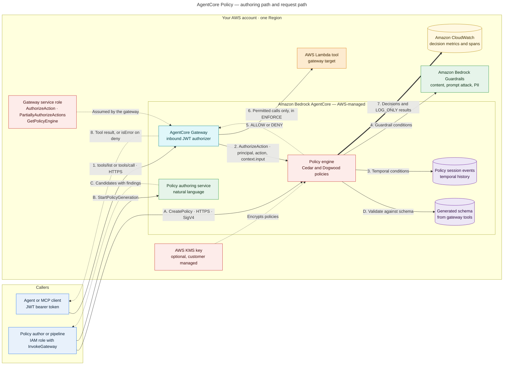
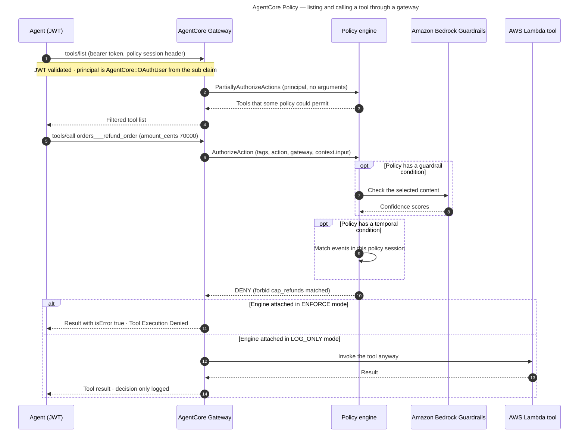

# AgentCore Policy

> **Level:** Advanced · **Verified:** 2026-11-15 · **Feature status:** GA · **Time:** ~30 min

Policy in Amazon Bedrock AgentCore decides, deterministically and outside the agent's code, whether each tool call that passes through an AgentCore Gateway may run. You attach a policy engine to a gateway; the engine evaluates Cedar or Dogwood policies against the caller, the tool and the tool's arguments on every request.

> [!IMPORTANT]
> **Status** — GA (thirteen Regions at launch; the register dates it 2026-03-03), now listed in all 22 AgentCore Regions. Guardrails in policy launched on 2026-06-17 in five Regions (us-east-1, eu-west-2, eu-north-1, ap-southeast-2, ap-northeast-1); the current list is **UNVERIFIED — REQUIRES DOCUMENTATION REVIEW** (absent from the Regions page). Temporal policies were announced on 2026-08-06. Dogwood, a Cedar-compatible language, is documented alongside Cedar.
> Sources: [Release notes](https://docs.aws.amazon.com/bedrock-agentcore/latest/devguide/release-notes.html), [Supported AWS Regions](https://docs.aws.amazon.com/bedrock-agentcore/latest/devguide/agentcore-regions.html), [Guardrails in policy announcement](https://aws.amazon.com/about-aws/whats-new/2026/06/amazon-bedrock-agentcore-policy-guardrails-generally-available/), [Temporal policies announcement](https://aws.amazon.com/about-aws/whats-new/2026/08/temporal-policies-agentcore/), [Feature register](../../FEATURE-VERIFICATION.md)

## Learning objectives

- Explain where Policy sits in a gateway request and why default-deny and forbid-wins make it predictable.
- Write Cedar policies against the AgentCore entity model: `AgentCore::OAuthUser`, `AgentCore::Action`, `AgentCore::Gateway`, `context.input`.
- Decide when a rule needs Dogwood: guardrail signals or session history.
- Roll out safely with engine-level and policy-level `LOG_ONLY`, and review natural-language-generated policies.
- Distinguish Policy from Amazon Bedrock Guardrails and from IAM, and grant the IAM permissions each role needs.

## Prerequisites

- [AgentCore Gateway](04-agentcore-gateway.md) and [AgentCore Identity](05-agentcore-identity.md)
- [IAM fundamentals: principals, policies and evaluation](../../00-foundations/security/01-iam-fundamentals.md)
- [Amazon Bedrock Guardrails](../guardrails/01-guardrails.md) — helpful for the guardrail section

## 1. What it is

**Plain language.** The gateway is the front desk that forwards an agent's requests to tools. Policy is the rule book at that desk: "anyone with the refund scope may refund, but never more than 500 dollars unless they are a supervisor". The desk checks the book before every call, and if no rule says yes, the answer is no.

**Precisely.** A **policy engine** stores policies and is associated with gateways: at most one engine per gateway, many gateways per engine. For each tool call the gateway asks for a decision (`bedrock-agentcore:AuthorizeAction`); for `tools/list`, which tools the caller could be permitted (`bedrock-agentcore:PartiallyAuthorizeActions`). The engine derives a **schema** from its gateways' tools and validates every policy against it on creation.

| Item | Value |
|:--|:--|
| Service namespace / endpoint | Control plane `bedrock-agentcore-control.<region>.amazonaws.com`; evaluation happens inside AgentCore Gateway |
| Control-plane operations | `CreatePolicyEngine`, `GetPolicyEngine`, `UpdatePolicyEngine`, `ListPolicyEngines`, `DeletePolicyEngine`; `CreatePolicy`, `GetPolicy`, `UpdatePolicy`, `ListPolicies`, `DeletePolicy`; `StartPolicyGeneration`, `GetPolicyGeneration`, `ListPolicyGenerations`, `ListPolicyGenerationAssets`; association through `CreateGateway` / `UpdateGateway` (`policyEngineConfiguration`) |
| Data-plane operations | None that you call. The gateway's role uses the IAM actions `AuthorizeAction` and `PartiallyAuthorizeActions` |
| IAM action prefix | `bedrock-agentcore:` |

Sources: [Policy](https://docs.aws.amazon.com/bedrock-agentcore/latest/devguide/policy.html), [Core concepts](https://docs.aws.amazon.com/bedrock-agentcore/latest/devguide/policy-core-concepts.html), [IAM permissions](https://docs.aws.amazon.com/bedrock-agentcore/latest/devguide/policy-permissions.html). Operation names are checked against the [generated API reference](../../references/bedrock-api-operations.md); `CreatePolicyEngine`'s SDK description states the one-engine-per-gateway rule.

### The entity model

| Cedar element | AgentCore mapping |
|:--|:--|
| `principal` | `AgentCore::OAuthUser` — from the JWT `sub` claim, with every other claim as a **string tag** — or `AgentCore::IamEntity`, whose `id` attribute is the caller's IAM ARN |
| `action` | `AgentCore::Action::"<target-name>___<tool-name>"` (three underscores), or `action in AgentCore::Action::"<target-name>"` for a whole target |
| `resource` | `AgentCore::Gateway::"<gateway ARN>"` |
| `context.input` | The tool arguments (MCP targets) or the request body (runtime and inference targets) |

Two scope rules are enforced when a policy is created: naming specific actions requires `resource ==` a specific gateway ARN, and an unconstrained action requires `resource is AgentCore::Gateway`. A bare `resource` is rejected ("a wildcard resource was detected"), and action names take no wildcards. Sources: [Policy scope](https://docs.aws.amazon.com/bedrock-agentcore/latest/devguide/policy-scope.html), [Action and resource scoped policies](https://docs.aws.amazon.com/bedrock-agentcore/latest/devguide/example-policies-action-resource.html).

### Cedar and Dogwood

| | Cedar | Dogwood |
|:--|:--|:--|
| What it is | AWS's open-source authorization language | An open-source language that is a superset of Cedar: "every valid Cedar policy is also a valid Dogwood policy" |
| Conditions | The current request: principal, action, resource, `context.input` | Adds `when guardrails { … }` (a signal computed at evaluation time) and `when temporal { … }` (history of the policy session) |
| Effects | `permit`, `forbid` | Adds `suppressOutput`, which withholds a tool's response when a guardrail condition on the output matches |
| API field | `definition.cedar.statement` | `definition.policy.statement` |
| AWS guidance | Existing Cedar policies "continue to be supported" | "Write Dogwood" |

Sources: [Core concepts](https://docs.aws.amazon.com/bedrock-agentcore/latest/devguide/policy-core-concepts.html), [Guardrails in policies](https://docs.aws.amazon.com/bedrock-agentcore/latest/devguide/policy-guardrails-in-policies.html), [Temporal policies](https://docs.aws.amazon.com/bedrock-agentcore/latest/devguide/policy-temporal.html).

### Policy, Guardrails and IAM

| Question | AgentCore Policy | Amazon Bedrock Guardrails | IAM |
|:--|:--|:--|:--|
| What is decided | May this caller run this tool with these arguments now? | Is this content acceptable? | May this AWS principal call this AWS API on this resource? |
| Where it runs | AgentCore Gateway, before the target is invoked | On model invocation or `ApplyGuardrail`; also as a signal inside a Dogwood policy | Every AWS API endpoint |
| Who is the principal | The end user (JWT) or IAM caller of the gateway | No principal; content only | IAM user, role or session |
| Inputs | JWT claims, tool name, tool arguments, session history | Prompt and response text, images | Action, resource ARN, condition keys |
| Determinism | Deterministic (guardrail signals inside it are not) | The AgentCore docs call guardrail results non-deterministic | Deterministic |
| Default | Deny unless a `permit` matches | Content passes unless a filter intervenes | Implicit deny |
| Conflicts | `forbid` wins | Any blocking filter intervenes | Explicit deny wins |
| Cannot see | The model's reasoning | Who is calling and which tool | The end user behind the agent, tool arguments |

Sources: this chapter's Policy sources, the [feature register](../../FEATURE-VERIFICATION.md) row for Guardrails, and [IAM fundamentals](../../00-foundations/security/01-iam-fundamentals.md). The comparison is the academy's summary.

## 2. Why it exists

An agent decides at run time which tool to call and with what arguments, and a prompt injection can change that decision. Checks written inside the agent can be reasoned around; IAM sees only the gateway's role, not the user or the arguments. Without Policy you would write authorization code in every tool or put a custom proxy in front of them. Policy moves that check to the gateway boundary, where every call passes and the agent cannot skip it.

## 3. When to use it

- Tools act on behalf of different users or roles (refunds, approvals, record deletion).
- Limits depend on arguments: amounts, countries, claim types, approved models on inference targets.
- A rule depends on earlier steps: approval before payment, at most N transfers per session (temporal policies).
- Requests or tool outputs must be screened for prompt attacks, harmful content or sensitive data at the boundary (guardrails in policy).
- You need an emergency stop for one tool or the whole gateway without redeploying anything.

## 4. When not to use it

- **Tools not behind a gateway.** Policy evaluates only gateway traffic; Browser, Code Interpreter and in-process tools need IAM, network modes and harness hooks. See [AgentCore Browser and Code Interpreter](08-agentcore-browser-and-code-interpreter.md).
- **Filtering model input and output.** Use [Amazon Bedrock Guardrails](../guardrails/01-guardrails.md) on the model call.
- **Fair use and back-end protection.** Use gateway rate limits; see [AgentCore Gateway](04-agentcore-gateway.md).
- **Access to AWS resources by your own code.** That is IAM; see [Identity, least privilege and IAM isolation for agents](../../06-security-governance/02-identity-and-least-privilege.md).

## 5. Internal architecture



**What this shows** — Two paths. Letters are the authoring path: policies are created directly or generated from natural language, and validated against a schema the engine derives from the gateway's tools. Numbers are the request path. This is an academy diagram, not an official AWS reference architecture.

1. The JWT becomes an `AgentCore::OAuthUser`.
2. The gateway, with its role, asks the engine to authorize principal, action, resource and arguments.
3. Temporal conditions read this policy session's events.
4. Guardrail conditions call Amazon Bedrock Guardrails on the selected content.
5. ALLOW or DENY: default deny, forbid wins.
6. `ENFORCE` passes only permitted calls; `LOG_ONLY` passes all.
7. Decisions become CloudWatch metrics and, with gateway tracing, spans.
8. A denied call returns a result with `isError` set.

**Legend** — solid: request · dashed: response, role or key use · thick: telemetry · cylinder: stored data. Rate limits are applied before Policy; see [AgentCore Gateway](04-agentcore-gateway.md). The gateway-and-identity view is planned as [diagram set 14](../../diagrams/mermaid/14-agentcore-gateway-and-identity.md).

### Evaluation rules

| Rule | Consequence |
|:--|:--|
| Default deny | An engine with no policies denies everything; attaching it in `ENFORCE` mode blocks every tool until permits exist |
| Forbid wins | A matching `forbid` beats any `permit`; `forbid(principal, action, resource is AgentCore::Gateway);` stops all calls |
| Permits do not intersect | Two permits are alternatives; put conditions that must all hold in one permit, or use `forbid … unless` |
| Policies are independent | A policy never references another |
| Listing is a meta action | A tool appears in `tools/list` if any circumstances could permit it; a listed tool can still be denied with real arguments |

Sources: [Understanding Cedar in AgentCore](https://docs.aws.amazon.com/bedrock-agentcore/latest/devguide/policy-understanding-cedar.html), [Action and resource scoped policies](https://docs.aws.amazon.com/bedrock-agentcore/latest/devguide/example-policies-action-resource.html), [Use a gateway with policy](https://docs.aws.amazon.com/bedrock-agentcore/latest/devguide/use-gateway-with-policy.html).

### Types in conditions

| Tool schema type | Cedar type | Compare with |
|:--|:--|:--|
| `string` | `String` | `==`, `!=`, `like`, `.contains()` on a set |
| `integer` | `Long` | `<`, `<=`, `>`, `>=`, `==` |
| `number` | `decimal` | `.lessThan(decimal("…"))` and similar methods only |
| `boolean` | `Bool` | Direct use, `==` |
| `object` / `array` | `Record` / `Set` | `.` and `has` / `.contains()`, `.containsAll()`, `.containsAny()` |

JWT claims are always string tags (arrays become JSON text, so match scopes with `like`); test `hasTag` before `getTag`, because reading a missing tag denies the request. An optional argument needs a `has` guard, otherwise creation fails asynchronously (`CREATE_FAILED`). Inside `temporal { }`, ordering and `sum` need integers, so money is best modelled in integer cents. Sources: [Resource configuration for examples](https://docs.aws.amazon.com/bedrock-agentcore/latest/devguide/example-policies-reference.html), [Principal-scoped policies](https://docs.aws.amazon.com/bedrock-agentcore/latest/devguide/example-policies-principal.html).

### LOG_ONLY and ENFORCE

| Engine mode on the gateway | Policy mode `ACTIVE` (default) | Policy mode `LOG_ONLY` |
|:--|:--|:--|
| `ENFORCE` | Evaluated and enforced | Evaluated and logged; other active policies still enforce |
| `LOG_ONLY` | Evaluated and logged only | Evaluated and logged only |

The engine mode takes precedence. Policy-level `LOG_ONLY` shadow-tests one new rule on production traffic; its result is "never combined into the enforced decision". Promote it with `UpdatePolicy` (`enforcementMode` `ACTIVE`). Sources: [Policy enforcement modes](https://docs.aws.amazon.com/bedrock-agentcore/latest/devguide/policy-enforcement-modes.html), [Test a policy in LOG_ONLY mode](https://docs.aws.amazon.com/bedrock-agentcore/latest/devguide/policy-test-a-policy.html).

### Natural-language authoring and validation

`StartPolicyGeneration` takes a gateway ARN and up to 2,000 characters of text. The authoring service decomposes it into atomic rules, translates each against the tool schema, validates it and runs automated-reasoning analysis. `ListPolicyGenerationAssets` returns each candidate with the text fragment it came from and its findings; you create a policy from an asset. Assets are deleted after 7 days.

| Finding | Meaning |
|:--|:--|
| `VALID` | Valid against the schema, no findings |
| `INVALID` | Syntax or schema error |
| `NOT_TRANSLATABLE` | The text needs data or attributes Policy does not support |
| `ALLOW_ALL` / `DENY_ALL` | Permits or denies everything in scope |
| `ALLOW_NONE` / `DENY_NONE` | Can never match: contradictory or unreachable conditions |

Policies you write yourself go through the same checks: `validationMode` `FAIL_ON_ANY_FINDINGS` (default) rejects on schema or semantic findings; `IGNORE_ALL_FINDINGS` runs schema checks only. Validation proves a policy is well formed, not that it says what you meant. Sources: [Per-policy validation](https://docs.aws.amazon.com/bedrock-agentcore/latest/devguide/policy-generation-validation.html), [StartPolicyGeneration](https://docs.aws.amazon.com/bedrock-agentcore-control/latest/APIReference/API_StartPolicyGeneration.html), [Authoring Dogwood policies from natural language](https://aws.amazon.com/blogs/machine-learning/authoring-dogwood-policies-from-natural-language-in-amazon-bedrock-agentcore/).

### Guardrails and temporal conditions

| | Guardrails in policies | Temporal policies |
|:--|:--|:--|
| Condition block | `when guardrails { BedrockGuardrails::PromptAttack([...], [context.input.prompt])[...].confidenceScore.greaterThan(decimal("0.4")) }` | `when temporal { formerly within 1h AgentCore::Action::"…"::response{ eventResource: resource, … } }` |
| Building blocks | `ContentFilter`, `PromptAttack` (score per category), `SensitiveInformation` (aggregation required); scores are 0, 0.2 … 1.0 | `formerly within`, `since within`, `count`, `sum` over `request`, `response` or `error` events |
| Requirements | A plain `permit` for the same action; `permit`/`forbid` read `context.input`, `suppressOutput` reads `context.output` | Session ID in `x-amzn-bedrock-agentcore-policy-session-id` on every request; `eventResource: resource` in every predicate; gateway role needs `GetWorkloadAccessToken` |
| Caveat | Non-deterministic scores; calibrate in `LOG_ONLY` | Only permitted, completed calls record `response` events; window at most 24 hours |

Sources: [Guardrails in policies](https://docs.aws.amazon.com/bedrock-agentcore/latest/devguide/policy-guardrails-in-policies.html), [Guardrail policy examples](https://docs.aws.amazon.com/bedrock-agentcore/latest/devguide/example-policies-guardrails.html), [Temporal policies](https://docs.aws.amazon.com/bedrock-agentcore/latest/devguide/policy-temporal.html), [Temporal policy examples](https://docs.aws.amazon.com/bedrock-agentcore/latest/devguide/example-policies-temporal.html), [Policy sessions](https://docs.aws.amazon.com/bedrock-agentcore/latest/devguide/policy-session-based-temporal.html).

## 6. Request and response lifecycle



- **Steps 1–4.** Listing has no arguments, so the refund tool is listed for anyone with the refund scope.
- **Steps 5–10.** The real call carries arguments and the cap's `forbid` matches. Without a session header, an engine with temporal policies returns a validation error.
- **Steps 11–14.** The documented denial reads `AuthorizeActionException - Tool Execution Denied: … [No policy applies to the request (denied by default).]` or names the determining policy. A gateway role without the Policy permissions produces `InternalServerException - Policy evaluation failed`, and calls are denied.

## 7. Dependencies

| Depends on | Why | Required or optional |
|:--|:--|:-:|
| AgentCore Gateway | Policy only evaluates gateway traffic | Required |
| Inbound authorizer (JWT or IAM) | Supplies the principal and its tags | Required for per-user rules |
| Gateway service role permissions | `AuthorizeAction`, `PartiallyAuthorizeActions`, `GetPolicyEngine`; `GetWorkloadAccessToken` for temporal policies | Required |
| `InvokeGateway` for the author | `CreatePolicy` / `UpdatePolicy` validate actions against the gateway | Required |
| Amazon Bedrock Guardrails | Guardrail conditions | Optional |
| AWS KMS customer managed key | Encrypts the engine | Optional |
| Amazon CloudWatch | Decision metrics and spans | Automatic |

## 8. Security considerations

| Topic | What is documented |
|:--|:--|
| Who can switch enforcement off | Anyone with `bedrock-agentcore:UpdateGateway` can change `ENFORCE` to `LOG_ONLY` or remove the engine; "no separate action or condition key protects the `mode` field" |
| Policy scope gates | `ManageResourceScopedPolicy` (policies on specific gateway ARNs) and `ManageAdminPolicy` (wildcard policies) are permission-only actions that limit what authors can write |
| Missing role permissions | Without the three Policy actions, attaching fails with `InternalServerException` and every call is denied |
| Encryption | AWS owned key by default; a customer managed key (`encryptionKeyArn`) is fixed at creation. The CDK README states that if the key becomes inaccessible all decisions are denied; grant the `…Summary` actions in advance so you can still list policies |
| JWT claims | Every claim becomes a string tag; a claim that is `null` produces no tag |
| Unauthenticated gateways | With `NONE`, temporal history is shared by everyone who sends the same session ID |
| Audit | Decisions are logged through CloudWatch metrics and logs; see [AgentCore Observability](07-agentcore-observability.md) for metric names |

Sources: [Policy enforcement modes](https://docs.aws.amazon.com/bedrock-agentcore/latest/devguide/policy-enforcement-modes.html), [IAM permissions](https://docs.aws.amazon.com/bedrock-agentcore/latest/devguide/policy-permissions.html), [Policy sessions](https://docs.aws.amazon.com/bedrock-agentcore/latest/devguide/policy-session-based-temporal.html), [Principal-scoped policies](https://docs.aws.amazon.com/bedrock-agentcore/latest/devguide/example-policies-principal.html).

> [!CAUTION]
> **Security hazard** — A deployment role that may call `UpdateGateway` can silently turn enforcement into logging. Restrict that action with an SCP or permission boundary to the pipeline that owns the gateway, and alarm on gateway updates in AWS CloudTrail.

> [!TIP]
> **Academy recommendation** — Prefer `forbid … unless` for hard limits (caps, blocked tools), because no later `permit` can widen them. Keep guardrail checks for content that no request condition can describe. Start every new engine in `LOG_ONLY`, read the decisions for a week, then switch to `ENFORCE`.
> This is our design guidance, not an official AWS reference architecture.

## 9. Networking requirements

**Our reading:** Policy needs no network configuration of its own, because the gateway calls the engine and the engine calls the guardrail on your behalf. Interface VPC endpoints list Policy as supported on both the data plane (`com.amazonaws.<region>.bedrock-agentcore`) and the control plane (`…bedrock-agentcore-control`); agents reach the gateway through `…bedrock-agentcore.gateway`. Source: [Interface VPC endpoints](https://docs.aws.amazon.com/bedrock-agentcore/latest/devguide/vpc-interface-endpoints.html).

## 10. Pricing dimensions

| Dimension | Unit | Notes |
|:--|:--|:--|
| Authorization requests | Per request | $0.000025. "Your first 100 temporal policies per policy engine incur no additional authorization charges" |
| Natural-language authoring | Input tokens | $0.13 per 1,000 tokens in the pricing table; the text above it says "per one million user input tokens" — confirm the unit before budgeting |
| Guardrails in policy | Per safeguard | Amazon Bedrock Guardrails pricing |

Figures are US dollar list prices read on the verification date from [AgentCore pricing](https://aws.amazon.com/bedrock/agentcore/pricing/). Gateway invocations bill separately ([AgentCore Gateway](04-agentcore-gateway.md#10-pricing-dimensions)).

## 11. Scaling considerations

Quoted from [Quotas for Amazon Bedrock AgentCore](https://docs.aws.amazon.com/bedrock-agentcore/latest/devguide/bedrock-agentcore-limits.html); none is adjustable.

| Quota | Value |
|:--|:--|
| Policy engines per account per Region | 1,000 |
| Policies per policy engine | 1,000 (of which at most 20 temporal) |
| Generated policies per engine, 7-day rolling window | 50,000 |
| Policy size / total policy size per resource | 10 KB / 200 KB |
| Cedar schema per engine (all tools of all associated gateways) | 400 KB |
| Temporal operators per policy / time window | 3 / 24 hours |
| `CreatePolicyEngine`, `UpdatePolicyEngine`, `StartPolicyGeneration` | 1 TPS each |
| `CreatePolicy`, `UpdatePolicy`, `GetPolicy`, `ListPolicies` | 5 TPS each |

The schema quota grows with tool count and argument complexity; the docs suggest separate engines per gateway when it is reached. For temporal policies, AWS's launch blog states that a session allows no more than one concurrent authorization request and that changing the engine's policies invalidates existing sessions ([Securing AI agents with temporal policies](https://aws.amazon.com/blogs/machine-learning/securing-ai-agents-with-temporal-policies-in-amazon-bedrock-agentcore/)).

## 12. IaC support

| Tool | Support | Resource / construct | Notes |
|:--|:-:|:--|:--|
| Terraform (`hashicorp/aws` 6.73.0) | ✅ | `aws_bedrockagentcore_policy_engine`, `aws_bedrockagentcore_policy`; `policy_engine_configuration` on `aws_bedrockagentcore_gateway` | `definition` supports only a `cedar` block: no Dogwood (`policy`) member, no generated-asset member, no `enforcement_mode` |
| CloudFormation | ✅ | `AWS::BedrockAgentCore::PolicyEngine`, `AWS::BedrockAgentCore::Policy`; `PolicyEngineConfiguration` on `Gateway` | The `Policy` definition has `Cedar` and `Policy` (Dogwood) members and `EnforcementMode` (per the installed L1 typings) |
| AWS CDK (`aws-cdk-lib` 2.277.0) | L1 and stable L2 | L2 `PolicyEngine`, `Policy`, `PolicyStatement`; `Gateway.policyEngineConfiguration` | The L2 grants the gateway role evaluate permissions. `PolicyStatement.fromCedar` only; use `CfnPolicy` for Dogwood or `enforcementMode` |

For Dogwood or per-policy `LOG_ONLY` from Terraform, the verified alternatives are CloudFormation or the `CreatePolicy` API. Names are checked against the [Terraform reference](../../references/terraform-aws-provider-bedrock.md) and the [CDK and CloudFormation reference](../../references/cdk-and-cloudformation-bedrock.md).

## 13. Working example

An order-tools gateway with a policy engine attached in `LOG_ONLY` mode and three Cedar policies: status lookups need the `orders:read` scope, refunds need `orders:refund`, and a `forbid` caps refunds at 50,000 cents unless the caller's `role` claim is `supervisor`.

> **Code status:** validated with `terraform fmt -check`, `terraform validate` and TFLint 0.66 (provider 6.73.0, with a `versions.tf` that pins `hashicorp/aws ~> 6.73` and configures the provider from `var.aws_region` and `var.tags`) · mock-tested with `terraform test` and a `mock_provider` (rendered Cedar, mode validation) · the three Cedar statements parsed, schema-validated and exercised with six allow/deny cases in the Cedar 4 engine (`cedarpy` 4.12.2) against an academy-written schema that mirrors the documented entity types — the real schema is generated by the service · **never planned or applied against AWS**

```hcl
variable "aws_region" {
  description = "Region to deploy into."
  type        = string
  default     = "us-east-1"
}

variable "tags" {
  description = "Tags applied to every resource through the provider's default_tags."
  type        = map(string)
  default     = { Project = "bedrock-academy", Chapter = "agentcore-policy" }
}

variable "name_prefix" {
  description = "Prefix for resource names. Policy engine and policy names allow letters, digits and underscores only."
  type        = string
  default     = "academy"

  validation {
    condition     = can(regex("^[a-zA-Z][a-zA-Z0-9_]{0,20}$", var.name_prefix))
    error_message = "Start with a letter and use only letters, digits and underscores (at most 21 characters)."
  }
}

variable "policy_engine_mode" {
  description = "LOG_ONLY records decisions without enforcing them; ENFORCE allows or denies tool calls."
  type        = string
  default     = "LOG_ONLY"

  validation {
    condition     = contains(["LOG_ONLY", "ENFORCE"], var.policy_engine_mode)
    error_message = "Use LOG_ONLY or ENFORCE."
  }
}

variable "max_refund_cents" {
  description = "Largest refund, in cents, that a caller without the supervisor role may issue."
  type        = number
  default     = 50000
}

variable "oidc_discovery_url" {
  description = "OIDC discovery URL of your identity provider. Must end with /.well-known/openid-configuration."
  type        = string
  default     = "https://idp.example.com/.well-known/openid-configuration"
}

variable "allowed_client_ids" {
  description = "OAuth client IDs that may call the gateway."
  type        = list(string)
}

variable "orders_lambda_arn" {
  description = "ARN of an existing AWS Lambda function that implements both order tools."
  type        = string
}

data "aws_caller_identity" "current" {}

data "aws_partition" "current" {}

locals {
  arn_prefix = "arn:${data.aws_partition.current.partition}:bedrock-agentcore:${var.aws_region}:${data.aws_caller_identity.current.account_id}"
}

# ---------------------------------------------------------------------------
# Policy engine: holds the policies; one engine can serve several gateways.
# ---------------------------------------------------------------------------

resource "aws_bedrockagentcore_policy_engine" "orders" {
  name        = "${var.name_prefix}_orders_policies"
  description = "Authorization rules for order tools"
  # encryption_key_arn = aws_kms_key.policy.arn  # optional customer managed key; forces replacement
}

# ---------------------------------------------------------------------------
# Gateway service role: invokes the target and asks the engine for decisions.
# ---------------------------------------------------------------------------

data "aws_iam_policy_document" "gateway_trust" {
  statement {
    effect  = "Allow"
    actions = ["sts:AssumeRole"]

    principals {
      type        = "Service"
      identifiers = ["bedrock-agentcore.amazonaws.com"]
    }

    condition {
      test     = "StringEquals"
      variable = "aws:SourceAccount"
      values   = [data.aws_caller_identity.current.account_id]
    }

    condition {
      test     = "ArnLike"
      variable = "aws:SourceArn"
      values   = ["${local.arn_prefix}:*"]
    }
  }
}

resource "aws_iam_role" "gateway" {
  name               = "${var.name_prefix}-orders-gateway"
  assume_role_policy = data.aws_iam_policy_document.gateway_trust.json
}

data "aws_iam_policy_document" "gateway_permissions" {
  statement {
    sid       = "InvokeOrderTools"
    effect    = "Allow"
    actions   = ["lambda:InvokeFunction"]
    resources = [var.orders_lambda_arn]
  }

  statement {
    sid       = "PolicyEngineConfiguration"
    effect    = "Allow"
    actions   = ["bedrock-agentcore:GetPolicyEngine"]
    resources = [aws_bedrockagentcore_policy_engine.orders.policy_engine_arn]
  }

  # Both actions need the engine AND the gateway. The gateway ARN does not exist
  # until the gateway does, so this example allows gateways in this account and
  # Region; narrow it to the gateway ARN in a second apply if you need to.
  statement {
    sid    = "PolicyEngineAuthorization"
    effect = "Allow"
    actions = [
      "bedrock-agentcore:AuthorizeAction",
      "bedrock-agentcore:PartiallyAuthorizeActions",
    ]
    resources = [
      aws_bedrockagentcore_policy_engine.orders.policy_engine_arn,
      "${local.arn_prefix}:gateway/*",
    ]
  }
}

resource "aws_iam_role_policy" "gateway" {
  name   = "orders-gateway"
  role   = aws_iam_role.gateway.id
  policy = data.aws_iam_policy_document.gateway_permissions.json
}

# ---------------------------------------------------------------------------
# Gateway with the engine attached, and one Lambda target with two tools.
# ---------------------------------------------------------------------------

resource "aws_bedrockagentcore_gateway" "orders" {
  name            = "${replace(var.name_prefix, "_", "-")}-orders"
  description     = "Order tools behind AgentCore Policy"
  role_arn        = aws_iam_role.gateway.arn
  authorizer_type = "CUSTOM_JWT"
  protocol_type   = "MCP"

  authorizer_configuration {
    custom_jwt_authorizer {
      discovery_url   = var.oidc_discovery_url
      allowed_clients = var.allowed_client_ids
    }
  }

  policy_engine_configuration {
    arn  = aws_bedrockagentcore_policy_engine.orders.policy_engine_arn
    mode = var.policy_engine_mode
  }

  depends_on = [aws_iam_role_policy.gateway]
}

resource "aws_bedrockagentcore_gateway_target" "orders" {
  name               = "orders"
  description        = "Order lookup and refunds backed by AWS Lambda"
  gateway_identifier = aws_bedrockagentcore_gateway.orders.gateway_id

  credential_provider_configuration {
    gateway_iam_role {}
  }

  target_configuration {
    mcp {
      lambda {
        lambda_arn = var.orders_lambda_arn

        tool_schema {
          inline_payload {
            name        = "get_order_status"
            description = "Return the shipping status of one order."

            input_schema {
              type = "object"

              property {
                name        = "order_id"
                type        = "string"
                description = "Order identifier, for example ORD-12345"
                required    = true
              }
            }
          }

          inline_payload {
            name        = "refund_order"
            description = "Refund part or all of one order. Amounts are in cents."

            input_schema {
              type = "object"

              property {
                name        = "order_id"
                type        = "string"
                description = "Order identifier, for example ORD-12345"
                required    = true
              }

              # integer -> Cedar Long, so ordinary < and > comparisons work.
              property {
                name        = "amount_cents"
                type        = "integer"
                description = "Refund amount in cents"
                required    = true
              }
            }
          }
        }
      }
    }
  }
}

# ---------------------------------------------------------------------------
# Policies. Actions are named <target-name>___<tool-name> (three underscores).
# The resource must be the specific gateway ARN when specific actions are named.
# ---------------------------------------------------------------------------

locals {
  gateway_entity = "AgentCore::Gateway::\"${aws_bedrockagentcore_gateway.orders.gateway_arn}\""
}

resource "aws_bedrockagentcore_policy" "allow_status_lookup" {
  name             = "allow_status_lookup"
  description      = "Callers with the orders:read scope may look up order status"
  policy_engine_id = aws_bedrockagentcore_policy_engine.orders.policy_engine_id

  definition {
    cedar {
      statement = <<-CEDAR
        permit(
          principal is AgentCore::OAuthUser,
          action == AgentCore::Action::"orders___get_order_status",
          resource == ${local.gateway_entity}
        )
        when {
          principal.hasTag("scope") &&
          principal.getTag("scope") like "*orders:read*"
        };
      CEDAR
    }
  }

  # Validation reads the tool schema from the gateway, so the target must exist.
  depends_on = [aws_bedrockagentcore_gateway_target.orders]
}

resource "aws_bedrockagentcore_policy" "allow_refunds" {
  name             = "allow_refunds"
  description      = "Callers with the orders:refund scope may refund orders"
  policy_engine_id = aws_bedrockagentcore_policy_engine.orders.policy_engine_id

  definition {
    cedar {
      statement = <<-CEDAR
        permit(
          principal is AgentCore::OAuthUser,
          action == AgentCore::Action::"orders___refund_order",
          resource == ${local.gateway_entity}
        )
        when {
          principal.hasTag("scope") &&
          principal.getTag("scope") like "*orders:refund*"
        };
      CEDAR
    }
  }

  depends_on = [aws_bedrockagentcore_gateway_target.orders]
}

# Forbid wins: no permit, present or future, can raise this ceiling.
resource "aws_bedrockagentcore_policy" "cap_refunds" {
  name             = "cap_refunds"
  description      = "Refunds above the ceiling need the supervisor role"
  policy_engine_id = aws_bedrockagentcore_policy_engine.orders.policy_engine_id

  definition {
    cedar {
      statement = <<-CEDAR
        forbid(
          principal is AgentCore::OAuthUser,
          action == AgentCore::Action::"orders___refund_order",
          resource == ${local.gateway_entity}
        )
        when {
          context.input.amount_cents > ${var.max_refund_cents}
        }
        unless {
          principal.hasTag("role") &&
          principal.getTag("role") == "supervisor"
        };
      CEDAR
    }
  }

  # Create the permit first, so analysis does not judge the forbid in isolation.
  depends_on = [aws_bedrockagentcore_policy.allow_refunds]
}

output "gateway_url" {
  description = "MCP clients use the /mcp path of this URL."
  value       = aws_bedrockagentcore_gateway.orders.gateway_url
}

output "policy_engine_arn" {
  description = "ARN of the policy engine attached to the gateway."
  value       = aws_bedrockagentcore_policy_engine.orders.policy_engine_arn
}
```

The principal running `terraform apply` needs `bedrock-agentcore:InvokeGateway` on the gateway, or each policy ends in `CREATE_FAILED`. When the logged decisions look right, set `policy_engine_mode = "ENFORCE"`. A deployed gateway bills per call; remove it with `terraform destroy`.

Generating policies from a business rule, created in `LOG_ONLY`:

> **Code status:** syntax-checked (`python -m py_compile`) · request parameters validated against the botocore 1.44.3 service model · mock-tested (botocore `Stubber`: only `VALID` assets become policies) · **never deployed**

```python
"""Turn a natural-language rule into reviewed policies that start in LOG_ONLY mode."""
import time

import boto3

REGION = "us-east-1"  # overridable
control = boto3.client("bedrock-agentcore-control", region_name=REGION)


def generate_log_only_policies(engine_id: str, gateway_arn: str, rule: str) -> list[str]:
    started = control.start_policy_generation(
        policyEngineId=engine_id,
        name="refund_rule",
        resource={"arn": gateway_arn},  # the tool schema comes from this gateway
        content={"rawText": rule},  # up to 2,000 characters
    )
    generation_id = started["policyGenerationId"]

    while True:
        status = control.get_policy_generation(
            policyEngineId=engine_id, policyGenerationId=generation_id
        )["status"]
        if status != "GENERATING":
            break
        time.sleep(5)
    if status != "GENERATED":
        raise RuntimeError(f"policy generation ended in {status}")

    created = []
    assets = control.list_policy_generation_assets(
        policyEngineId=engine_id, policyGenerationId=generation_id
    )["policyGenerationAssets"]  # assets are deleted after 7 days
    for asset in assets:
        findings = {f["type"] for f in asset.get("findings", [])}
        if findings != {"VALID"}:
            # INVALID, NOT_TRANSLATABLE, ALLOW_ALL, DENY_ALL ... go to a human.
            print("needs review:", asset.get("rawTextFragment"), findings)
            continue
        policy = control.create_policy(
            policyEngineId=engine_id,
            name=f"generated_{len(created) + 1}",
            definition={"policyGeneration": {
                "policyGenerationId": generation_id,
                "policyGenerationAssetId": asset["policyGenerationAssetId"],
            }},
            enforcementMode="LOG_ONLY",  # observe first; promote to ACTIVE with UpdatePolicy
            validationMode="FAIL_ON_ANY_FINDINGS",
        )
        created.append(policy["policyId"])
    return created
```

## Common mistakes

| Mistake | Symptom | Fix |
|:--|:--|:--|
| Attaching an engine in `ENFORCE` before writing permits | Every tool call denied ("denied by default") | Start in `LOG_ONLY`; add permits first |
| Gateway role without the three Policy actions | `InternalServerException - Policy evaluation failed`; all calls denied | Add `AuthorizeAction`, `PartiallyAuthorizeActions`, `GetPolicyEngine` |
| Author without `InvokeGateway` | Policy accepted, then `CREATE_FAILED` | Grant `InvokeGateway` on the gateway to the deployment role |
| Two underscores in the action name, or a wildcard in it | Validation error | `<target>___<tool>`, or `action in AgentCore::Action::"<target>"` |
| Bare `resource` | "a wildcard resource was detected" | Specific gateway ARN, or `resource is AgentCore::Gateway` with an unconstrained action |
| `context.input.amount > 1000` on a `number` | Type error at creation | `.greaterThan(decimal("1000.00"))`, or model the field as `integer` |
| `getTag` without `hasTag`, or optional argument without `has` | Requests denied, or `CREATE_FAILED` | Guard every optional read |
| `.contains()` on the `scope` claim | Scope never matches | Claims are strings; use `like "*scope*"` |
| Guardrail `forbid` without a base `permit` | Action denied before the guardrail runs | Pair it with a plain `permit` |
| Temporal policy without the session header | Validation error on every request | Send `x-amzn-bedrock-agentcore-policy-session-id` from the first request |
| Renaming a gateway target | All policies for its tools stop matching | Keep target names stable |

## Knowledge check

1. The engine holds one `permit` for `orders___refund_order` when the caller has the refund scope, and one `forbid` for amounts above 50,000 cents. A caller with the refund scope asks for 70,000 cents. What happens, and what if you later add a second, broader `permit`?
2. Why does `orders___refund_order` appear in a caller's `tools/list` even though the call may be denied?
3. You want to test a new prompt-injection guardrail rule on production traffic without affecting any caller, while the existing rules keep enforcing. Which setting do you use?
4. Which three facts does IAM not know that Policy uses?
5. A temporal rule says "disburse only after approve_claim succeeded for the same claim". The approval tool has no `permit`. Why can the rule never pass?

<details>
<summary>Answers</summary>

1. It is denied: forbid wins over the matching permit. A second permit changes nothing for this request, because permits only add alternatives and can never override a forbid.
2. Listing is a meta action evaluated without arguments; a tool is listed if some circumstances could permit it. The real call is authorized separately with its arguments.
3. Create the new policy with `enforcementMode` `LOG_ONLY` while the engine stays attached in `ENFORCE`. Its result is logged and never combined into the decision.
4. The end user behind the agent (JWT subject and claims), the tool being called, and that tool's arguments — plus, with Dogwood, what happened earlier in the session.
5. A denied action is recorded as an `error` event, not a `response`, so a `::response` predicate never matches. Add a `permit` for the approval tool.

</details>

## 14. Official documentation

- [Policy in Amazon Bedrock AgentCore](https://docs.aws.amazon.com/bedrock-agentcore/latest/devguide/policy.html) — what Policy is, Cedar, Dogwood, natural-language authoring.
- [Core concepts](https://docs.aws.amazon.com/bedrock-agentcore/latest/devguide/policy-core-concepts.html) — principals, engines, schema, Cedar versus Dogwood, sessions.
- [Understanding Cedar in AgentCore](https://docs.aws.amazon.com/bedrock-agentcore/latest/devguide/policy-understanding-cedar.html) and [Policy scope](https://docs.aws.amazon.com/bedrock-agentcore/latest/devguide/policy-scope.html) — effects, evaluation, entities.
- [Principal-scoped](https://docs.aws.amazon.com/bedrock-agentcore/latest/devguide/example-policies-principal.html), [action and resource scoped](https://docs.aws.amazon.com/bedrock-agentcore/latest/devguide/example-policies-action-resource.html) and [reference configuration](https://docs.aws.amazon.com/bedrock-agentcore/latest/devguide/example-policies-reference.html) examples — syntax and types.
- [Policy enforcement modes](https://docs.aws.amazon.com/bedrock-agentcore/latest/devguide/policy-enforcement-modes.html) and [Test a policy in LOG_ONLY mode](https://docs.aws.amazon.com/bedrock-agentcore/latest/devguide/policy-test-a-policy.html) — engine and policy modes.
- [Create a gateway with policy](https://docs.aws.amazon.com/bedrock-agentcore/latest/devguide/create-gateway-with-policy.html), [Update a gateway with policy](https://docs.aws.amazon.com/bedrock-agentcore/latest/devguide/update-gateway-with-policy.html), [Use a gateway with policy](https://docs.aws.amazon.com/bedrock-agentcore/latest/devguide/use-gateway-with-policy.html) — association, listing, denial responses.
- [IAM permissions for Gateway and Policy](https://docs.aws.amazon.com/bedrock-agentcore/latest/devguide/policy-permissions.html) — execution role and management role.
- [Per-policy validation](https://docs.aws.amazon.com/bedrock-agentcore/latest/devguide/policy-generation-validation.html) and [StartPolicyGeneration](https://docs.aws.amazon.com/bedrock-agentcore-control/latest/APIReference/API_StartPolicyGeneration.html) — natural-language authoring and findings.
- [Guardrails in policies](https://docs.aws.amazon.com/bedrock-agentcore/latest/devguide/policy-guardrails-in-policies.html) and [Guardrail policy examples](https://docs.aws.amazon.com/bedrock-agentcore/latest/devguide/example-policies-guardrails.html) — guardrail conditions and thresholds.
- [Temporal policies](https://docs.aws.amazon.com/bedrock-agentcore/latest/devguide/policy-temporal.html), [Temporal policy examples](https://docs.aws.amazon.com/bedrock-agentcore/latest/devguide/example-policies-temporal.html), [Policy sessions](https://docs.aws.amazon.com/bedrock-agentcore/latest/devguide/policy-session-based-temporal.html) — Dogwood temporal conditions.
- [GatewayPolicyEngineConfiguration](https://docs.aws.amazon.com/bedrock-agentcore-control/latest/APIReference/API_GatewayPolicyEngineConfiguration.html) — `arn` and `mode`.
- [Quotas for Amazon Bedrock AgentCore](https://docs.aws.amazon.com/bedrock-agentcore/latest/devguide/bedrock-agentcore-limits.html) — Policy quotas.
- [Interface VPC endpoints](https://docs.aws.amazon.com/bedrock-agentcore/latest/devguide/vpc-interface-endpoints.html) — PrivateLink support for Policy.
- [AgentCore pricing](https://aws.amazon.com/bedrock/agentcore/pricing/) — authorization requests, authoring tokens, guardrail usage.
- [Authoring Dogwood policies from natural language](https://aws.amazon.com/blogs/machine-learning/authoring-dogwood-policies-from-natural-language-in-amazon-bedrock-agentcore/) and [Securing AI agents with temporal policies](https://aws.amazon.com/blogs/machine-learning/securing-ai-agents-with-temporal-policies-in-amazon-bedrock-agentcore/) — AWS blog posts.
- [Terraform: `aws_bedrockagentcore_policy_engine`](https://raw.githubusercontent.com/hashicorp/terraform-provider-aws/main/website/docs/r/bedrockagentcore_policy_engine.html.markdown) and [`aws_bedrockagentcore_policy`](https://raw.githubusercontent.com/hashicorp/terraform-provider-aws/main/website/docs/r/bedrockagentcore_policy.html.markdown) — arguments.
