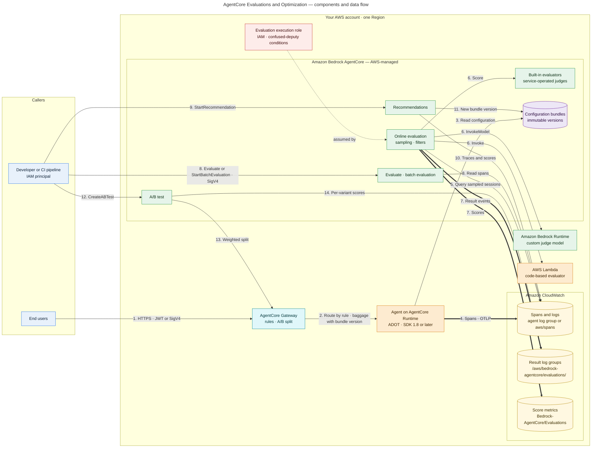
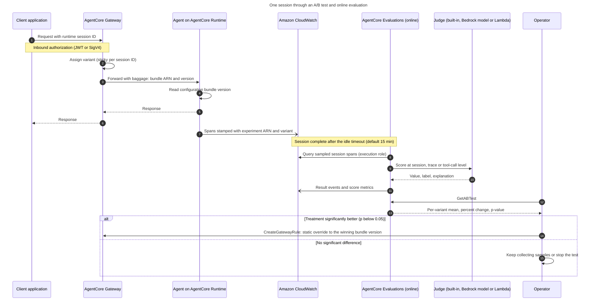

# AgentCore Evaluations and Optimization

> **Level:** Advanced · **Verified:** 2026-11-15 · **Feature status:** GA (Optimization Insights: preview, being redesigned) · **Time:** ~30 min

AgentCore Evaluations scores what an agent actually did — its sessions, traces and tool calls — with LLM judges, deterministic code or ground truth. AgentCore Optimization turns those scores into proposed changes to the system prompt and tool descriptions, ships them as versioned configuration, and proves them with A/B tests on live traffic.

> [!IMPORTANT]
> **Status** — **Evaluations** has been generally available since 2026-03-31 and is listed in all 22 AgentCore Regions. **Optimization** (recommendations, configuration bundles, batch evaluation, A/B testing) is listed in 21 Regions — not AWS GovCloud (US-West); the release notes record recommendations, batch evaluation and A/B testing as generally available in June 2026. **Insights** entered public preview in June 2026; creation of new insights jobs ended on 2026-10-16 and recurring reports stopped on 2026-10-31 while AWS redesigns the feature. Failure analysis is now an evaluator (`Builtin.FailureAnalysis`) that runs in batch evaluation.
> Sources: [Evaluations GA](https://aws.amazon.com/about-aws/whats-new/2026/03/agentcore-evaluations-generally-available), [Release notes](https://docs.aws.amazon.com/bedrock-agentcore/latest/devguide/doc-history.html), [Supported AWS Regions](https://docs.aws.amazon.com/bedrock-agentcore/latest/devguide/agentcore-regions.html), [Recurring insights report](https://docs.aws.amazon.com/bedrock-agentcore/latest/devguide/insights-recurring-report.html)

## Learning objectives

- Choose between online, on-demand and batch evaluation for a given question.
- Pick built-in, custom (LLM or Lambda) and ground-truth evaluators at the right level: session, trace or tool call.
- Find every evaluation score: API response, CloudWatch Logs and CloudWatch metrics.
- Run the optimization loop: recommendation, configuration bundle, A/B test, gateway rule.
- Explain how this differs from Amazon Bedrock model evaluation jobs, and deploy the evaluation resources with Terraform.

## Prerequisites

- [AgentCore Observability](07-agentcore-observability.md) — Evaluations reads the spans described there; CloudWatch Transaction Search must be on.
- [AgentCore Gateway](04-agentcore-gateway.md) — A/B tests split traffic with gateway rules.
- [Model evaluation and model selection](../../00-foundations/generative-ai-fundamentals/07-model-evaluation-and-selection.md)

## 1. What it is

**Plain language.** Observability tells you *what* the agent did. Evaluations tells you *how well* it did it: a second model (the judge) or your own code reads each conversation and gives it a score, a label and an explanation. Optimization is the coach that reads the low scores, suggests a better prompt, and runs a fair trial before you adopt it.

**Precisely.** Both features read OpenTelemetry spans that your agent writes to CloudWatch. Evaluators are resources; online evaluation configurations sample live sessions; on-demand and batch evaluations score sessions you select. Optimization adds recommendations, configuration bundles and A/B tests.

| Item | Value |
|:--|:--|
| Service namespace / endpoint | Control plane `bedrock-agentcore-control.<region>.amazonaws.com`; data plane `bedrock-agentcore.<region>.amazonaws.com` |
| Control-plane operations | `CreateEvaluator`, `ListEvaluators`, `CreateOnlineEvaluationConfig`, `UpdateOnlineEvaluationConfig`, `CreateConfigurationBundle`, `GetConfigurationBundleVersion`, `CreateDataset` |
| Data-plane operations | `Evaluate` (on-demand), `StartBatchEvaluation`, `GetBatchEvaluation`, `StartRecommendation`, `GetRecommendation`, `CreateABTest`, `GetABTest` |
| IAM action prefix | `bedrock-agentcore:` |

Names are checked against the [generated API reference](../../references/bedrock-api-operations.md).

### What is evaluated: three levels

| Level | Unit | Built-in examples |
|:--|:--|:--|
| `SESSION` | A whole conversation | `Builtin.GoalSuccessRate`; trajectory checks `Builtin.TrajectoryExactOrderMatch`, `Builtin.TrajectoryInOrderMatch`, `Builtin.TrajectoryAnyOrderMatch` (programmatic, need an expected tool list) |
| `TRACE` | One request and response | `Builtin.Helpfulness`, `Builtin.Correctness`, `Builtin.Faithfulness`, `Builtin.ResponseRelevance`, `Builtin.Conciseness`, `Builtin.Coherence`, `Builtin.InstructionFollowing`, `Builtin.Refusal`, `Builtin.Harmfulness`, `Builtin.Stereotyping` |
| `TOOL_CALL` | One tool-call span | `Builtin.ToolSelectionAccuracy`, `Builtin.ToolParameterAccuracy`, `Builtin.SkillSelectionAccuracy`, `Builtin.SkillInstructionFollowing` |

AWS described **13 built-in evaluators** at GA: `Builtin.GoalSuccessRate`, the ten trace-level judges and the two tool-selection and tool-parameter judges. The two skill evaluators arrived in August 2026 and `Builtin.FailureAnalysis` (an insight evaluator, batch evaluation only) in October 2026; the trajectory checks are scored programmatically and need ground truth. Built-in evaluators cannot be modified. Call `ListEvaluators` for the current catalogue — it also returns managed third-party evaluators from the DeepEval and AutoEval libraries. Sources: [Built-in evaluators](https://docs.aws.amazon.com/bedrock-agentcore/latest/devguide/built-in-evaluators-overview.html), [Prompt templates](https://docs.aws.amazon.com/bedrock-agentcore/latest/devguide/prompt-templates-builtin.html), [Ground truth evaluations](https://docs.aws.amazon.com/bedrock-agentcore/latest/devguide/ground-truth-evaluations.html), [Release notes](https://docs.aws.amazon.com/bedrock-agentcore/latest/devguide/doc-history.html).

**Custom evaluators** come in two kinds. An **LLM-as-a-judge** evaluator has your instructions (with placeholders such as `{context}` and `{assistant_turn}`), a Bedrock model you choose and a numerical or categorical rating scale; since October 2026 one judge call can rate several named dimensions. A **code-based** evaluator is your AWS Lambda function: it receives the session spans (up to 6 MB, timeout up to 300 s) and returns a `label`, optional `value` and optional `explanation`. Sources: [Custom evaluators](https://docs.aws.amazon.com/bedrock-agentcore/latest/devguide/custom-evaluators.html), [Code-based evaluators](https://docs.aws.amazon.com/bedrock-agentcore/latest/devguide/code-based-evaluators.html).

### Three ways to run them

| Mode | You provide | Result goes to | Use it for |
|:--|:--|:--|:--|
| **Online** | An online evaluation configuration: log groups (or name prefixes) and `serviceNames`, up to 25 evaluators, sampling 0.01–100 % (default 10 %), up to 5 filters, session idle timeout | CloudWatch Logs and metrics, continuously | Production quality monitoring and alarms |
| **On-demand** | `Evaluate` with one evaluator, the session spans and optionally target trace or span IDs and ground truth | The API response (`evaluationResults`) | CI gates, debugging one conversation, trying a new evaluator |
| **Batch** | `StartBatchEvaluation` with a CloudWatch data source and a time range or session IDs; up to 10 evaluators, 500 sessions | `GetBatchEvaluation` (per-evaluator averages, `insightResults`) plus per-session results in CloudWatch Logs | Baselines, before-and-after comparison, regression sets |

Sources: [Evaluation types](https://docs.aws.amazon.com/bedrock-agentcore/latest/devguide/evaluations-types.html), [Create online evaluation](https://docs.aws.amazon.com/bedrock-agentcore/latest/devguide/create-online-evaluations.html), [Quotas](https://docs.aws.amazon.com/bedrock-agentcore/latest/devguide/bedrock-agentcore-limits.html).

### Where scores go

> [!NOTE]
> **Documented fact** — Online results are written as JSON log events, by default to a dedicated log group under `/aws/bedrock-agentcore/evaluations/results/`. `outputConfig.cloudWatchConfig.resultDestination` can be `DEDICATED_LOG_GROUP` (optionally your own `logGroupName`) or `SOURCE_LOG_GROUP`, next to the traces. Scores are also published as CloudWatch metrics in `Bedrock-AgentCore/Evaluations` unless you set `metricsNamespace`. Events follow the OpenTelemetry GenAI evaluation-result conventions (`gen_ai.evaluation.name`, `gen_ai.evaluation.score.value`, `gen_ai.evaluation.score.label`) and are parented to the scored span where possible. Batch per-session results default to `/aws/bedrock-agentcore/evaluations/batch-evaluations/results/default`.
> Sources: [Results and output](https://docs.aws.amazon.com/bedrock-agentcore/latest/devguide/results-and-output.html), [Insights in batch evaluation](https://docs.aws.amazon.com/bedrock-agentcore/latest/devguide/batch-evaluations-insights.html)

### Optimization: four capabilities

| Capability | Status | What it does |
|:--|:--|:--|
| **Recommendations** | GA | `StartRecommendation` with type `SYSTEM_PROMPT_RECOMMENDATION` or `TOOL_DESCRIPTION_RECOMMENDATION`, a target evaluator as the reward signal, and traces from CloudWatch, inline spans, a batch evaluation or an online evaluation. The current configuration is inline text or a configuration bundle version; with a bundle, the result is written back as a new version |
| **Configuration bundles** | GA | Versioned, immutable snapshots of runtime configuration (system prompt, model ID, tool descriptions, any key-value pairs), keyed by the resource ARN they configure, with branches and parent versions like commits |
| **A/B tests** | GA | `CreateABTest` on an existing gateway: two variants (bundle versions on one runtime, or two gateway targets), traffic weights, and online evaluation configurations that score each session. The service reports mean, change, p-value and confidence interval per evaluator |
| **Insights** | Preview, redesign in progress | Clustered failure, user-intent and execution-summary reports. New jobs stopped on 2026-10-16; use `Builtin.FailureAnalysis` in batch evaluation for failure patterns with root causes and suggested fixes |

Sources: [Optimization](https://docs.aws.amazon.com/bedrock-agentcore/latest/devguide/optimization.html), [Recommendations](https://docs.aws.amazon.com/bedrock-agentcore/latest/devguide/optimization-recommendations.html), [Configuration bundles](https://docs.aws.amazon.com/bedrock-agentcore/latest/devguide/configuration-bundles.html), [A/B testing](https://docs.aws.amazon.com/bedrock-agentcore/latest/devguide/ab-testing.html), [Insights: how it works](https://docs.aws.amazon.com/bedrock-agentcore/latest/devguide/insights-how-it-works.html).

## 2. Why it exists

Agents fail quietly: a wrong tool, a skipped policy step, a polite answer that does not solve the problem — all with HTTP 200 and no error metric. Without these features you would export traces, write judge prompts, call a model per trace, store scores, build dashboards, and run your own experiment framework with traffic splitting and significance tests. Evaluations and Optimization package that loop and connect it to Gateway and Runtime.

## 3. When to use it

- Any production agent whose answers matter: online evaluation with a low sampling rate and alarms on score metrics.
- A CI/CD gate: on-demand evaluation with ground truth (`expectedResponse`, `assertions`, `expectedTrajectory`) on a fixed scenario set.
- Before and after a prompt, model or tool change: batch evaluation on the same sessions.
- When scores plateau: a recommendation, then an A/B test, then a gateway rule for the winner.
- Business rules a judge cannot see: a code-based evaluator (format checks, totals, forbidden values).

## 4. When not to use it

- **Choosing a foundation model or scoring a knowledge base against a prompt dataset**, with no agent involved — use Amazon Bedrock model and RAG evaluation jobs ([Model and RAG evaluation](../model-evaluation/01-model-evaluation.md)). The differences are in the table below.
- **Rewriting a prompt template for several models at once** — that is [Advanced Prompt Optimization](../prompt-management/02-prompt-optimization.md).
- **Blocking a harmful answer before the user sees it** — evaluation runs after the fact. Use [Amazon Bedrock Guardrails](../guardrails/01-guardrails.md) or [AgentCore Policy](09-agentcore-policy.md).
- **An agent with no OpenTelemetry spans** in a supported or generic convention — instrument it first ([AgentCore Observability](07-agentcore-observability.md)).
- **Regulatory sign-off that needs human raters** — AgentCore Evaluations has no human-worker mode; Bedrock model evaluation does.

| | AgentCore Evaluations | Amazon Bedrock model and RAG evaluation |
|:--|:--|:--|
| Subject | An agent's real or replayed sessions, traces and tool calls | A model, a knowledge base or an external RAG source |
| Input | OpenTelemetry spans in CloudWatch, or spans passed inline | A prompt dataset (custom or built-in) |
| Modes | Online (continuous), on-demand, batch | Jobs: programmatic, LLM-as-a-judge, human workers, RAG |
| API | `CreateEvaluator` and `CreateOnlineEvaluationConfig` on `bedrock-agentcore-control`; `Evaluate` and `StartBatchEvaluation` on `bedrock-agentcore` | `CreateEvaluationJob` on `bedrock` |
| Output | API response, CloudWatch Logs, CloudWatch metrics | Amazon S3 location in the job's output configuration |
| Terraform | `aws_bedrockagentcore_evaluator`, `aws_bedrockagentcore_online_evaluation_config` | `aws_bedrock_evaluation_job` |

Source: [Bedrock evaluations](https://docs.aws.amazon.com/bedrock/latest/userguide/evaluation.html) and the pages above.

## 5. Internal architecture



**What this shows** — Evaluations never sits in the request path: it reads telemetry after the fact. Optimization touches the request path only through Gateway (traffic split) and configuration bundles (what the agent reads). The boxes inside "AWS-managed" are service functions, not resources you host. This is an academy diagram, not an official AWS reference architecture.

1. Users call the agent through a gateway (required for A/B tests; optional otherwise).
2. The gateway applies its rules; during an A/B test it adds the bundle ARN and version as W3C baggage.
3. The agent reads its configuration for that version with the AgentCore SDK (1.8 or later).
4. The agent's spans land in CloudWatch.
5. The online configuration's execution role queries the sampled sessions once they are idle for the session timeout.
6. Each evaluator scores at its level: a built-in judge, your Bedrock judge model, or your Lambda function.
7. Results become log events and metrics.
8. On-demand and batch evaluations score sessions you pick.
9–11. A recommendation reads traces and scores and can write a new bundle version.
12–14. An A/B test splits traffic and maps online scores to variants.

**Legend** — solid: request · dashed: role assumption · thick: asynchronous telemetry or results · cylinder: stored data. The observability side is drawn in [diagram set 16](../../diagrams/mermaid/16-agentcore-observability.md).

## 6. Request and response lifecycle



- **Steps 1–3.** Assignment uses the `X-Amzn-Bedrock-AgentCore-Runtime-Session-Id` header (generated by the runtime if you omit it); the same session always gets the same variant. Only one A/B test can run per gateway.
- **Step 4.** If no test is active or the bundle fetch fails, the agent must fall back to defaults — the documentation tells you to always supply them.
- **Step 7.** The AgentCore SDK's `BaggageSpanProcessor` stamps the experiment ARN and variant on every span, which is how scores are mapped to variants.
- **Steps 8–11.** Scoring is asynchronous. A missing Transaction Search setup or a wrong `serviceNames` value means *no results and no error* in the request path.
- **Steps 12–15.** For statistics, every evaluator in an A/B test must return a numerical value: custom judges need a numerical scale. Promoting the winner is a gateway rule you create; `agentcore deploy` does not manage it.

Sources: [A/B testing](https://docs.aws.amazon.com/bedrock-agentcore/latest/devguide/ab-testing.html), [A/B prerequisites](https://docs.aws.amazon.com/bedrock-agentcore/latest/devguide/ab-testing-prereqs.html), [Run an A/B test with configuration bundles](https://docs.aws.amazon.com/bedrock-agentcore/latest/devguide/ab-testing-config-bundle.html), [Use configuration bundles at runtime](https://docs.aws.amazon.com/bedrock-agentcore/latest/devguide/configuration-bundles-runtime.html).

## 7. Dependencies

| Depends on | Why | Required or optional |
|:--|:--|:-:|
| Agent spans in CloudWatch (ADOT, supported framework or generic OpenTelemetry/OpenInference conventions) | The only input | Required |
| CloudWatch Transaction Search | Creates and indexes the span store | Required |
| Evaluation execution role | Reads traces, writes results, invokes judge models and Lambda evaluators | Required for online and batch |
| Amazon Bedrock model access | Custom LLM-as-a-judge evaluators run on a model you choose | Custom judges only |
| AWS Lambda | Code-based evaluators | Optional |
| AgentCore Gateway with an HTTP target, AgentCore SDK 1.8 or later | Traffic split and variant stamping | A/B tests only |
| AWS KMS customer managed key | Encrypts custom evaluators, recommendations, batch evaluations, bundles | Optional |

## 8. Security considerations

- **Execution role and confused deputy.** The documented trust policy lets `bedrock-agentcore.amazonaws.com` assume the role only with `aws:SourceAccount`, `aws:ResourceAccount` and an `aws:SourceArn` matching your `evaluator/*` and `online-evaluation-config/*` ARNs. Write permissions are scoped to `/aws/bedrock-agentcore/evaluations/*`. Source: [Prerequisites](https://docs.aws.amazon.com/bedrock-agentcore/latest/devguide/evaluations-prerequisites.html).
- **The judge reads your conversations.** Spans can contain prompts, tool inputs and answers; evaluation sends them to the judge. Restrict who can read result log groups as tightly as the trace log groups.
- **Resource policies.** Each evaluator has an ARN and a resource policy; built-in evaluators are public, custom ones private until you grant access.
- **Evaluator locking.** An enabled online configuration locks its custom evaluators against modification and deletion. **Our reading:** this also stops anyone quietly redefining what "good" means mid-measurement. Clone an evaluator to change it.
- **Configuration bundles are a production change channel.** A new bundle version or gateway rule changes agent behaviour without a code deployment. Restrict who can call `UpdateConfigurationBundle` and `CreateGatewayRule` as tightly as who can deploy, and treat recommendations as untrusted LLM output: the documentation says to review and test them before applying.
- **Encryption.** Custom evaluators accept a customer managed key (`kmsKeyArn`); an online configuration that uses such evaluators needs `kms:Decrypt` on its role, validated at creation.

## 9. Networking requirements

| Path | Option |
|:--|:--|
| Your code → control plane | Interface endpoint `com.amazonaws.<region>.bedrock-agentcore-control` |
| Your code → `Evaluate`, batch, recommendations, A/B tests | Interface endpoint `com.amazonaws.<region>.bedrock-agentcore` (PrivateLink for Evaluations and Optimization since July 2026, commercial Regions) |
| Service → your traces, results, judge model, Lambda | Inside AWS, using the execution role; nothing to open in your VPC |

Source: [Interface VPC endpoints](https://docs.aws.amazon.com/bedrock-agentcore/latest/devguide/vpc-interface-endpoints.html). Design guidance: [Private connectivity for Bedrock](../../02-related-aws-services/networking/01-private-connectivity-for-bedrock.md).

## 10. Pricing dimensions

| Dimension | Unit | Price read on 2026-11-15 |
|:--|:--|:--|
| Built-in evaluators — input tokens | Per 1,000 tokens | $0.0024 (judge model included) |
| Built-in evaluators — output tokens | Per 1,000 tokens | $0.012 |
| Custom evaluators | Per 1,000 evaluations | $1.50, plus the judge model's own charges in your account |
| Batch evaluations | Per 1,000 input / output tokens | $0.0018 / $0.009 (25 % below standard) |
| Recommendations | — | No charge; pay for any new evaluations they consume |
| A/B tests | — | The Gateway, Runtime and Evaluations they consume |
| Insights (preview) | — | Free during preview |
| Results and spans | CloudWatch units | Standard CloudWatch charges |

Source: [AgentCore pricing](https://aws.amazon.com/bedrock/agentcore/pricing/). **Our reading:** the pricing example assumes 15,000 input tokens per built-in evaluation, so cost scales with sessions × evaluators × context length. The sampling percentage is the main lever.

## 11. Scaling considerations

| Quota (default) | Value | Adjustable |
|:--|:--|:-:|
| Online evaluation configurations per account | 1,000 | Yes |
| Evaluators per online configuration | 25 | No |
| Custom evaluators per account | 10,000 | Yes |
| Built-in on-demand evaluations per minute | 1,200 (200 in Mumbai and Singapore) | No |
| Built-in input tokens per minute (on-demand) | 1,000,000 | Yes |
| Spans per sampled session or on-demand evaluation | 20,000 | No |
| Active batch evaluations / sessions per batch job / evaluators per job | 5 / 500 / 10 | Yes / Yes / No |
| Active recommendations / sessions sampled per recommendation / prompt size | 5 / 20 / 20,000 characters | Yes / No / No |
| Active A/B tests / per gateway / variants | 20 / 1 / 2 | Yes / No / No |
| Configuration bundles / versions per bundle / payload | 1,000 / 10,000 / 5 MB | Yes / No / No |

Source: [Quotas for Amazon Bedrock AgentCore](https://docs.aws.amazon.com/bedrock-agentcore/latest/devguide/bedrock-agentcore-limits.html). A batch of about 14 sessions with failure analysis typically finishes in about 3 minutes.

## 12. IaC support

| Tool | Support | Resource / construct | Notes |
|:--|:-:|:--|:--|
| Terraform (`hashicorp/aws` 6.73.0) | ✅ partial | `aws_bedrockagentcore_evaluator`, `aws_bedrockagentcore_online_evaluation_config` | No `derived` (third-party-based) evaluators, no `log_group_name_prefixes`, no settable output configuration (computed only), no insights. No resources for datasets, bundles, recommendations or A/B tests. The provider documents a maximum of 10 evaluators per configuration; the service allows 25 |
| CloudFormation | ✅ | `AWS::BedrockAgentCore::Evaluator`, `OnlineEvaluationConfig`, `Dataset`, `ConfigurationBundle` | Recommendations, batch evaluations and A/B tests are API operations, not resources |
| AWS CDK (`aws-cdk-lib` 2.277.0) | L1 and stable L2 | L2 `Evaluator`, `OnlineEvaluationConfig` with `BuiltinEvaluator` and `EvaluatorSelector`; L1 `CfnDataset`, `CfnConfigurationBundle` | The L2 grants the service permission to invoke code-based evaluator functions |

Checked against [the Terraform schema reference](../../references/terraform-aws-provider-bedrock.md) and [the CDK and CloudFormation reference](../../references/cdk-and-cloudformation-bedrock.md). Coverage across services: [Terraform coverage for Amazon Bedrock](../../04-infrastructure-as-code/terraform/10-terraform-for-bedrock.md).

## 13. Working example

An execution role, a custom LLM judge with a numerical scale (so it also works in A/B tests), an optional Lambda evaluator, and an online configuration that combines them with three built-in evaluators.

> **Code status:** validated with `terraform fmt -check` and `terraform validate` (Terraform 1.17.2, provider 6.73.0) with a `versions.tf` that pins `hashicorp/aws ~> 6.73` and sets `default_tags` from `var.tags` · TFLint 0.66 clean · mock-tested with `terraform test` (3 runs, mock provider) · **never planned or applied against AWS** · **never deployed**

```hcl
variable "aws_region" {
  description = "Region of the agent and its traces. Evaluations is listed in all 22 AgentCore Regions."
  type        = string
  default     = "us-east-1"
}

variable "tags" {
  description = "Tags applied to every resource through the provider's default_tags."
  type        = map(string)
  default     = { Project = "bedrock-academy", Chapter = "agentcore-evaluations" }
}

variable "agent_log_group_name" {
  description = "Log group that holds the agent's spans, for example /aws/bedrock-agentcore/runtimes/<agent_id>-<endpoint_name>."
  type        = string
}

variable "agent_service_name" {
  description = "OpenTelemetry service.name of the agent. For AgentCore Runtime agents: <runtime-name>.<endpoint-name>."
  type        = string
}

variable "judge_model_id" {
  description = "Amazon Bedrock model or inference profile ID for the custom LLM-as-a-judge evaluator. Confirm a current ID in the Bedrock model catalog."
  type        = string
}

variable "code_evaluator_lambda_arn" {
  description = "Optional ARN of an existing Lambda function that implements a code-based evaluator. Leave null to skip it."
  type        = string
  default     = null
}

variable "builtin_evaluator_ids" {
  description = "Built-in evaluators to run online, by documented ID."
  type        = set(string)
  default     = ["Builtin.GoalSuccessRate", "Builtin.Helpfulness", "Builtin.ToolSelectionAccuracy"]
}

variable "sampling_percentage" {
  description = "Percentage of sessions to evaluate (0.01-100). Every sampled session costs judge tokens."
  type        = number
  default     = 10

  validation {
    condition     = var.sampling_percentage >= 0.01 && var.sampling_percentage <= 100
    error_message = "sampling_percentage must be between 0.01 and 100."
  }
}

data "aws_caller_identity" "current" {}
data "aws_partition" "current" {}
data "aws_region" "current" {}

locals {
  account_id   = data.aws_caller_identity.current.account_id
  partition    = data.aws_partition.current.partition
  region       = data.aws_region.current.region
  agentcore    = "arn:${local.partition}:bedrock-agentcore:${local.region}:${local.account_id}"
  logs_prefix  = "arn:${local.partition}:logs:${local.region}:${local.account_id}:log-group"
  custom_evals = concat([aws_bedrockagentcore_evaluator.policy_compliance.evaluator_id], aws_bedrockagentcore_evaluator.json_output[*].evaluator_id)
}

# 1. Execution role that AgentCore Evaluations assumes to read traces, call the judge model and write scores.
data "aws_iam_policy_document" "evaluation_trust" {
  statement {
    effect  = "Allow"
    actions = ["sts:AssumeRole"]

    principals {
      type        = "Service"
      identifiers = ["bedrock-agentcore.amazonaws.com"]
    }

    condition {
      test     = "StringEquals"
      variable = "aws:SourceAccount"
      values   = [local.account_id]
    }

    condition {
      test     = "StringEquals"
      variable = "aws:ResourceAccount"
      values   = [local.account_id]
    }

    condition {
      test     = "ArnLike"
      variable = "aws:SourceArn"
      values   = ["${local.agentcore}:evaluator/*", "${local.agentcore}:online-evaluation-config/*"]
    }
  }
}

resource "aws_iam_role" "evaluation" {
  name_prefix        = "agentcore-evaluation-"
  assume_role_policy = data.aws_iam_policy_document.evaluation_trust.json
}

data "aws_iam_policy_document" "evaluation_permissions" {
  statement {
    sid       = "ReadTraces"
    actions   = ["logs:DescribeLogGroups", "logs:StartQuery", "logs:GetQueryResults"]
    resources = ["*"]
  }

  statement {
    sid       = "WriteResults"
    actions   = ["logs:CreateLogGroup", "logs:CreateLogStream", "logs:PutLogEvents"]
    resources = ["${local.logs_prefix}:/aws/bedrock-agentcore/evaluations/*"]
  }

  statement {
    sid       = "IndexSpans"
    actions   = ["logs:DescribeIndexPolicies", "logs:PutIndexPolicy"]
    resources = ["${local.logs_prefix}:aws/spans", "${local.logs_prefix}:aws/spans:*"]
  }

  statement {
    sid     = "InvokeJudgeModel"
    actions = ["bedrock:InvokeModel", "bedrock:InvokeModelWithResponseStream"]
    resources = [
      "arn:${local.partition}:bedrock:*::foundation-model/*",
      "arn:${local.partition}:bedrock:${local.region}:${local.account_id}:inference-profile/*",
    ]
  }

  dynamic "statement" {
    for_each = var.code_evaluator_lambda_arn == null ? [] : [var.code_evaluator_lambda_arn]

    content {
      sid       = "InvokeCodeEvaluator"
      actions   = ["lambda:InvokeFunction", "lambda:GetFunction"]
      resources = [statement.value]
    }
  }
}

resource "aws_iam_role_policy" "evaluation" {
  name   = "agentcore-evaluation"
  role   = aws_iam_role.evaluation.id
  policy = data.aws_iam_policy_document.evaluation_permissions.json
}

# 2. A custom LLM-as-a-judge evaluator. A numerical scale keeps it usable in A/B tests.
resource "aws_bedrockagentcore_evaluator" "policy_compliance" {
  evaluator_name = "refund_policy_compliance"
  description    = "Did the reply follow the published refund policy?"
  level          = "TRACE"

  evaluator_config {
    llm_as_a_judge {
      instructions = "Read the conversation in {context} and the reply in {assistant_turn}. Rate whether the reply follows the refund policy stated in the system prompt."

      rating_scale {
        numerical {
          label      = "Violates"
          definition = "The reply promises something the policy forbids."
          value      = 0
        }
        numerical {
          label      = "Unclear"
          definition = "The reply is vague about the policy."
          value      = 0.5
        }
        numerical {
          label      = "Complies"
          definition = "The reply follows the policy."
          value      = 1
        }
      }

      model_config {
        bedrock_evaluator_model_config {
          model_id = var.judge_model_id

          inference_config {
            max_tokens  = 1024
            temperature = 0
          }
        }
      }
    }
  }
}

# 3. Optional code-based evaluator backed by your own Lambda function.
resource "aws_bedrockagentcore_evaluator" "json_output" {
  count = var.code_evaluator_lambda_arn == null ? 0 : 1

  evaluator_name = "json_output_check"
  description    = "Deterministic check that the reply is valid JSON."
  level          = "TRACE"

  evaluator_config {
    code_based {
      lambda_config {
        lambda_arn                = var.code_evaluator_lambda_arn
        lambda_timeout_in_seconds = 60
      }
    }
  }
}

# 4. Online evaluation: sample live sessions and score them continuously.
resource "aws_bedrockagentcore_online_evaluation_config" "production" {
  online_evaluation_config_name = "support_agent_online"
  description                   = "Continuous quality scoring of the support agent"
  enable_on_create              = true
  evaluation_execution_role_arn = aws_iam_role.evaluation.arn

  data_source_config {
    cloudwatch_logs {
      log_group_names = [var.agent_log_group_name]
      service_names   = [var.agent_service_name]
    }
  }

  dynamic "evaluator" {
    for_each = setunion(var.builtin_evaluator_ids, toset(local.custom_evals))

    content {
      evaluator_id = evaluator.value
    }
  }

  rule {
    sampling_config {
      sampling_percentage = var.sampling_percentage
    }

    session_config {
      session_timeout_minutes = 15
    }
  }

  # The role must carry its permissions before the service validates it.
  depends_on = [aws_iam_role_policy.evaluation]
}

output "online_evaluation_config_id" {
  description = "ID of the online evaluation configuration."
  value       = aws_bedrockagentcore_online_evaluation_config.production.online_evaluation_config_id
}

output "result_log_groups" {
  description = "Where the service writes scores (computed; not settable in provider 6.73.0)."
  value       = aws_bedrockagentcore_online_evaluation_config.production.output_config
}

output "custom_evaluator_ids" {
  description = "IDs of the custom evaluators, for on-demand Evaluate calls."
  value       = local.custom_evals
}
```

The mock tests assert that the custom evaluator count follows `code_evaluator_lambda_arn`, that four evaluators are attached by default, and that a sampling percentage of 0 is rejected. Applying this creates billable evaluations as soon as traffic flows; run `terraform destroy` in your sandbox when you finish.

> [!TIP]
> **Academy recommendation** — Start online evaluation at 1–10 % sampling with three evaluators (one session-level, one trace-level, one tool-level), alarm on the score metric, and keep a fixed on-demand scenario set with ground truth as a CI gate. Raise sampling to 100 % only for the duration of an A/B test, as the A/B walkthrough does. This is our design guidance, not an official AWS reference architecture.

## Common mistakes

| Mistake | Symptom | Fix |
|:--|:--|:--|
| Transaction Search off, or wrong `serviceNames` | Configuration is `ENABLED` but no results ever appear | Enable Transaction Search; use `<runtime-name>.<endpoint>` or your `OTEL_SERVICE_NAME` |
| Expecting scores immediately | Empty result log group right after a test call | Sessions are scored after the idle timeout; wait |
| Editing a custom evaluator in use | Update or delete is refused | Locked by an enabled configuration — clone it, then swap |
| Categorical custom judge in an A/B test | No significance computed | A/B tests need numerical values |
| Agent ignores the bundle | Both A/B variants behave the same | SDK 1.8 or later, read `get_config_bundle()` with defaults, call through the gateway |
| Still scheduling recurring Insights | No new reports after 2026-10-31 | Run `Builtin.FailureAnalysis` in a scheduled batch evaluation |
| Treating a recommendation as a fix | Regression on other evaluators | Batch-evaluate on the same sessions, then A/B test; check all evaluators |

## Knowledge check

1. A support agent's helpfulness looks fine, but customers complain that refunds are promised against policy. Which evaluator types and levels would you add, and in which mode?
2. Your A/B test shows a +6 % change on `Builtin.GoalSuccessRate` with p = 0.21. What do you do?
3. Where would you look for (a) the score of one CI scenario, (b) last week's average helpfulness in production, (c) recurring failure root causes across 300 sessions?
4. Why can a configuration bundle change be riskier than it looks, and what controls apply?

<details>
<summary>Answers</summary>

1. A custom trace-level LLM judge with instructions about the refund policy (numerical scale), possibly a code-based check if the rule is mechanical; run it online on a sample, and on-demand with `assertions` ground truth in CI.
2. Nothing is proven: p ≥ 0.05 means insufficient evidence. Keep collecting samples (or raise traffic to the treatment), and check the other evaluators for regressions before deciding.
3. (a) The `evaluationResults` in the `Evaluate` response; (b) the CloudWatch metric in `Bedrock-AgentCore/Evaluations` (or your namespace) or a Logs Insights query on the result log group; (c) a batch evaluation with `Builtin.FailureAnalysis`, read through `insightResults` in `GetBatchEvaluation`.
4. A new bundle version, applied through a gateway rule, changes production behaviour without a code deployment or pipeline. Restrict bundle updates and gateway rules with IAM, review recommendation output, and promote only after a significant A/B result.

</details>

## 14. Official documentation

- [Evaluate agent performance with AgentCore Evaluations](https://docs.aws.amazon.com/bedrock-agentcore/latest/devguide/evaluations.html) — overview, ARNs, resource policies.
- [Evaluation types](https://docs.aws.amazon.com/bedrock-agentcore/latest/devguide/evaluations-types.html) — online, on-demand, batch.
- [Built-in evaluators](https://docs.aws.amazon.com/bedrock-agentcore/latest/devguide/built-in-evaluators-overview.html) and [Prompt templates](https://docs.aws.amazon.com/bedrock-agentcore/latest/devguide/prompt-templates-builtin.html) — IDs, levels, placeholders.
- [Ground truth evaluations](https://docs.aws.amazon.com/bedrock-agentcore/latest/devguide/ground-truth-evaluations.html) — reference inputs and trajectory evaluators.
- [Custom evaluators](https://docs.aws.amazon.com/bedrock-agentcore/latest/devguide/custom-evaluators.html) and [Code-based evaluators](https://docs.aws.amazon.com/bedrock-agentcore/latest/devguide/code-based-evaluators.html) — LLM and Lambda contracts.
- [Create online evaluation](https://docs.aws.amazon.com/bedrock-agentcore/latest/devguide/create-online-evaluations.html) and [Results and output](https://docs.aws.amazon.com/bedrock-agentcore/latest/devguide/results-and-output.html) — configuration, locking, result destinations.
- [Prerequisites](https://docs.aws.amazon.com/bedrock-agentcore/latest/devguide/evaluations-prerequisites.html) — execution role trust and permissions.
- [Optimization](https://docs.aws.amazon.com/bedrock-agentcore/latest/devguide/optimization.html), [Recommendations](https://docs.aws.amazon.com/bedrock-agentcore/latest/devguide/optimization-recommendations.html), [Configuration bundles](https://docs.aws.amazon.com/bedrock-agentcore/latest/devguide/configuration-bundles.html), [Use configuration bundles at runtime](https://docs.aws.amazon.com/bedrock-agentcore/latest/devguide/configuration-bundles-runtime.html).
- [A/B testing](https://docs.aws.amazon.com/bedrock-agentcore/latest/devguide/ab-testing.html), [A/B prerequisites](https://docs.aws.amazon.com/bedrock-agentcore/latest/devguide/ab-testing-prereqs.html), [A/B test with configuration bundles](https://docs.aws.amazon.com/bedrock-agentcore/latest/devguide/ab-testing-config-bundle.html).
- [Insights: how it works](https://docs.aws.amazon.com/bedrock-agentcore/latest/devguide/insights-how-it-works.html), [Recurring insights report](https://docs.aws.amazon.com/bedrock-agentcore/latest/devguide/insights-recurring-report.html), [Insights in batch evaluation](https://docs.aws.amazon.com/bedrock-agentcore/latest/devguide/batch-evaluations-insights.html) — preview status, end-of-job dates, failure analysis.
- [Quotas](https://docs.aws.amazon.com/bedrock-agentcore/latest/devguide/bedrock-agentcore-limits.html), [Supported AWS Regions](https://docs.aws.amazon.com/bedrock-agentcore/latest/devguide/agentcore-regions.html), [Interface VPC endpoints](https://docs.aws.amazon.com/bedrock-agentcore/latest/devguide/vpc-interface-endpoints.html), [Release notes](https://docs.aws.amazon.com/bedrock-agentcore/latest/devguide/doc-history.html).
- [AgentCore Evaluations GA announcement](https://aws.amazon.com/about-aws/whats-new/2026/03/agentcore-evaluations-generally-available) and [AgentCore pricing](https://aws.amazon.com/bedrock/agentcore/pricing/).
- [Evaluate the performance of Amazon Bedrock resources](https://docs.aws.amazon.com/bedrock/latest/userguide/evaluation.html) — the model and RAG evaluation jobs this chapter contrasts with.
- Terraform provider documentation (source): [`aws_bedrockagentcore_evaluator`](https://raw.githubusercontent.com/hashicorp/terraform-provider-aws/main/website/docs/r/bedrockagentcore_evaluator.html.markdown), [`aws_bedrockagentcore_online_evaluation_config`](https://raw.githubusercontent.com/hashicorp/terraform-provider-aws/main/website/docs/r/bedrockagentcore_online_evaluation_config.html.markdown) — arguments and the documented 10-evaluator limit.
