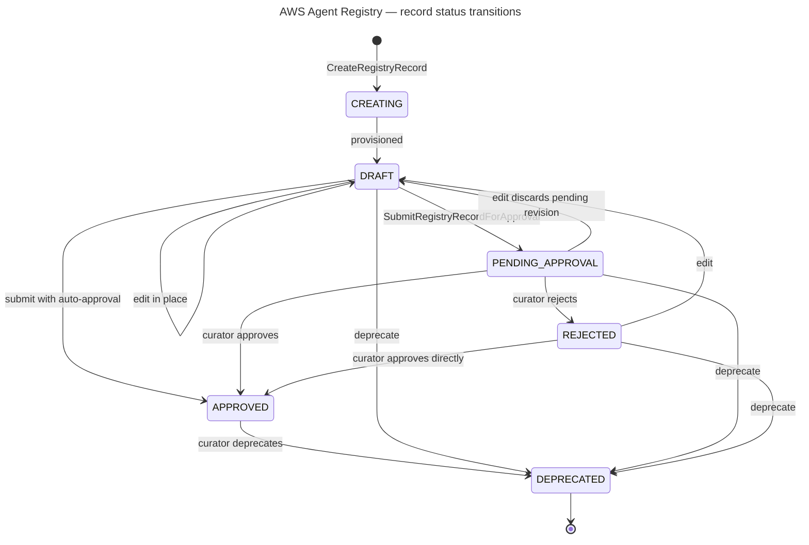
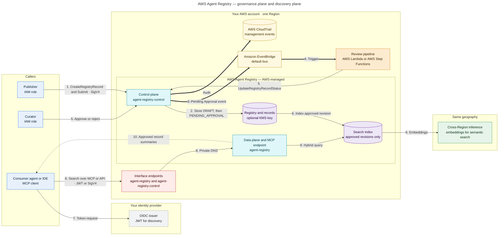
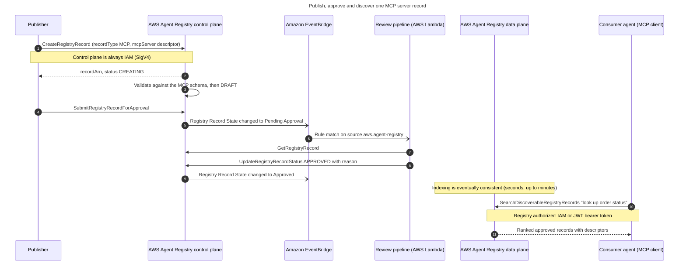

# AWS Agent Registry

> **Level:** Intermediate · **Verified:** 2026-11-15 · **Feature status:** GA · **Time:** ~25 min

AWS Agent Registry is a private, governed catalog of the agents, MCP servers, agent skills and custom resources in your organization. Publishers describe what they built, curators approve it, and people or agents find it with hybrid search or through the registry's own MCP endpoint. It stores descriptions; it does not run, proxy or authorize anything.

> [!IMPORTANT]
> **Status** — Public preview in April 2026 under the `bedrock-agentcore` namespace; relaunched on 2026-08-06 under its own **`agent-registry`** namespace; **generally available since 2026-08-31**. The preview namespace shut down on **2026-10-30**: registries and records left there are no longer readable or writable. Listed in 10 Regions (as of the verification date).
> Sources: [GA announcement](https://aws.amazon.com/about-aws/whats-new/2026/08/aws-agent-registry-generally-available/), [Comprehensive registry migration guide](https://docs.aws.amazon.com/bedrock-agentcore/latest/devguide/registry-faq.html), [Release notes](https://docs.aws.amazon.com/bedrock-agentcore/latest/devguide/doc-history.html), [Supported AWS Regions](https://docs.aws.amazon.com/bedrock-agentcore/latest/devguide/agentcore-regions.html)

## Learning objectives

- Model registries and records, and walk a record through its approval lifecycle.
- Search and browse approved records with the `agent-registry` APIs or the MCP endpoint.
- Choose IAM or JWT authorization for discovery and write matching VPC endpoint policies.
- Use the registry for governance: approval pipelines, EventBridge, auto-detection, cross-account sharing.
- Deploy a registry with the current Terraform resource and recognise the deprecated one.

## Prerequisites

- [AgentCore overview](01-agentcore-overview.md) and [AgentCore Gateway](04-agentcore-gateway.md)
- [AgentCore Identity](05-agentcore-identity.md) — JWT authorizers and credential providers
- [Embeddings, vector search, semantic search and hybrid search](../../00-foundations/generative-ai-fundamentals/03-embeddings-and-vector-search.md)
- [VPC endpoints and AWS PrivateLink](../../00-foundations/networking/03-vpc-endpoints-and-privatelink.md)

## 1. What it is

**Plain language.** Large organizations rebuild the same tool five times because nobody can find the first one. The registry is the internal catalogue with a librarian: teams submit an entry, a curator checks it, and everyone else — including agents — can search the approved shelf.

**Precisely.** A **registry** is a catalog in your account with a name, an authorization configuration for discovery (IAM or JWT), approval settings and records. A **registry record** is metadata about one resource: `name`, optional `displayName` and description, `recordVersion`, `recordType` (`AGENT`, `MCP`, `SKILL` or `CUSTOM`) and protocol-specific **descriptors** (`a2aAgentCard`, `mcpServer`, `agentSkillsDefinition`, `custom`). MCP and agent records are validated against the MCP and A2A schemas; `name` plus `recordVersion` must be unique in a registry. Sources: [What is AWS Agent Registry?](https://docs.aws.amazon.com/bedrock-agentcore/latest/devguide/registry.html), [Concepts](https://docs.aws.amazon.com/bedrock-agentcore/latest/devguide/registry-concepts.html), [Browse approved records](https://docs.aws.amazon.com/bedrock-agentcore/latest/devguide/registry-browse-records.html).

| Item | Value |
|:--|:--|
| Service namespace / endpoint | Control plane `agent-registry-control.<region>.api.aws`; data plane `agent-registry.<region>.api.aws` (note the `.api.aws` domain) |
| Control-plane operations | `CreateRegistry`, `UpdateRegistry`, `CreateRegistryRecord`, `UpdateRegistryRecord`, `SubmitRegistryRecordForApproval`, `UpdateRegistryRecordStatus`, `GetRegistryRecord`, `ListRegistryRecords` |
| Data-plane operations | `SearchDiscoverableRegistryRecords`, `ListDiscoverableRegistryRecords`, `BatchGetDiscoverableRegistryRecord`; the MCP endpoint (authorized by `agent-registry:InvokeRegistryMcp`, not an SDK method) |
| IAM action prefix | `agent-registry:`; service principal `agent-registry.amazonaws.com`; ARNs `arn:aws:agent-registry:<region>:<account>:registry/<id>` |

### Two SDK namespaces — and a legacy one

The AWS SDK has two clients for the registry: **`agent-registry-control`** (management) and **`agent-registry`** (discovery), both API version 2025-12-01 and signed as `agent-registry`. The SDK models also still contain the preview operations under AgentCore — `CreateRegistry` on `bedrock-agentcore-control` and `SearchRegistryRecords` on `bedrock-agentcore`. Those belong to the namespace that shut down on 2026-10-30; the migration guide lists every surface that changed (endpoints, IAM prefix, ARNs, EventBridge source `aws.agent-registry`, CloudWatch namespace `AWS/AgentRegistry`, Service Quotas code) and the breaking schema changes. Workload identities and credential providers used for URL synchronization stay in `bedrock-agentcore`. Source: [Comprehensive registry migration guide](https://docs.aws.amazon.com/bedrock-agentcore/latest/devguide/registry-faq.html).

### Record lifecycle and approval



**What this shows** — Only `APPROVED` revisions are discoverable. Editing an approved record creates a new `DRAFT` revision while the approved one stays discoverable until the new revision is approved; management APIs return the latest revision, discovery APIs the approved one. `DEPRECATED` is terminal. Status changes by curators go through `UpdateRegistryRecordStatus` with a reason. Records can also be `UPDATING`, `CREATE_FAILED` or `UPDATE_FAILED`. Source: [Record lifecycle](https://docs.aws.amazon.com/bedrock-agentcore/latest/devguide/registry-record-lifecycle.html), [CreateRegistryRecord](https://docs.aws.amazon.com/agent-registry-control/latest/APIReference/API_CreateRegistryRecord.html).

### Discovery and hybrid search

`SearchDiscoverableRegistryRecords` takes a natural-language `searchQuery` (up to 256 characters), exactly one registry in `registryIds`, `maxResults` 1–20 (default 10) and optional metadata `filters` with `$eq`, `$ne`, `$in`, `$and` and `$or` on `name`, `recordType`, `recordVersion` and `customMetadata.<field>`. Semantic and keyword search run in parallel on every query and are merged; filters narrow the candidates before ranking. In keyword matching the record name weighs most, then description and descriptor content. Indexing is eventually consistent: an approved record usually appears within seconds, sometimes minutes. `ListDiscoverableRegistryRecords` and `BatchGetDiscoverableRegistryRecord` browse without a query. The same three operations are exposed as MCP tools on the registry's MCP endpoint. Sources: [Search for registry records](https://docs.aws.amazon.com/bedrock-agentcore/latest/devguide/registry-search-records.html), [SearchDiscoverableRegistryRecords](https://docs.aws.amazon.com/agent-registry/latest/APIReference/API_SearchDiscoverableRegistryRecords.html).

> [!NOTE]
> **Documented fact** — Semantic search uses **geographic cross-Region inference** to generate embeddings: record data stays stored in its Region, but queries and outputs can be processed in another Region of the same geography (US, EU, Asia Pacific; requests from EU Regions stay in the EU). CloudWatch and CloudTrail do not show the Region where inference ran. There is no extra charge.
> Source: [Cross-region inference in AWS Agent Registry](https://docs.aws.amazon.com/bedrock-agentcore/latest/devguide/registry-cross-region-inference.html)

## 2. Why it exists

Without a registry, discovery happens in chat threads and wiki pages that go stale, nobody knows which MCP servers passed a security review, and agents are wired to tools by hard-coded URLs. Building your own means a metadata store, schema validation for MCP and A2A, a search index with embeddings, an approval workflow, notifications, an MCP front end and access control — the registry provides all of these.

## 3. When to use it

- Several teams publish agents, MCP servers or skills that others should reuse.
- Security or compliance must review a tool before anyone can find it.
- Agents or IDE assistants should discover approved tools at build time or run time through MCP.
- You want an organization-wide inventory of AgentCore Runtimes and Gateways without asking every account (auto-detection).

## 4. When not to use it

- **Calling or securing tools at run time.** A record is not a route or a permission. Expose tools through [AgentCore Gateway](04-agentcore-gateway.md) and enforce calls with [AgentCore Policy](09-agentcore-policy.md).
- **One team, a handful of tools.** A gateway's `tools/list` and its semantic search are enough.
- **Storing artifacts.** Container images and packages belong in a repository service; a record only points to them.
- **A Region where it is not listed** (for example Europe (Paris) or Asia Pacific (Mumbai)) — use a supported Region and remember that semantic search crosses Regions within the geography.

## 5. Internal architecture



**What this shows** — Two planes: management (always IAM) writes records and drives approval; discovery (IAM or JWT, chosen per registry) reads only approved revisions. The search index and the inference box are our conceptual model of documented behaviour, not published service internals. This is an academy diagram, not an official AWS reference architecture.

1. A publisher creates a record and submits it.
2. The record moves from `DRAFT` to `PENDING_APPROVAL` (or straight to `APPROVED` with auto-approval).
3. The registry sends `Registry Record State changed to Pending Approval` to the default EventBridge bus.
4. Your review pipeline (security scan, duplicate check) starts.
5. The pipeline or a curator calls `UpdateRegistryRecordStatus`.
6. The approved revision is indexed; semantic search generates embeddings within the geography.
7. A JWT consumer obtains a token from your identity provider.
8. The consumer searches through the API or the MCP endpoint, optionally through interface endpoints.
9. Semantic and keyword results are merged.
10. Summaries of approved records return; the consumer then connects to the resource itself (for example through a gateway).

**Legend** — solid: request · dashed: response · thick: asynchronous event or audit · cylinder: stored data · grey dashed: outside AWS.

## 6. Request and response lifecycle



- **Steps 1–4.** Creation is asynchronous (`CREATING`), and invalid MCP or A2A definitions are rejected by validation. `CreateRegistryRecord` defaults to 5 TPS per account.
- **Steps 5–10.** With auto-approval the record skips review; the EventBridge integration is how you plug in existing security and compliance checks.
- **Steps 11–12.** A search right after approval can miss the record; `GetRegistryRecord` on the control plane is immediately consistent. A JWT registry rejects SigV4-only callers, and an IAM registry needs `agent-registry:SearchDiscoverableRegistryRecords` on the registry; `BatchGetDiscoverableRegistryRecord` is authorized per record with `agent-registry:GetDiscoverableRegistryRecord`.

## 7. Dependencies

| Depends on | Why | Required or optional |
|:--|:--|:-:|
| IAM | Control plane, and discovery on IAM registries | Required |
| An OIDC identity provider | Discovery on `CUSTOM_JWT` registries | JWT only |
| Amazon EventBridge | Approval notifications and pipelines | Optional |
| AWS KMS customer managed key | Encryption at rest, set at registry creation | Optional |
| AWS Organizations (delegated administrator) | Auto-detection of AgentCore Runtimes and Gateways | Optional |
| AWS RAM | Cross-account sharing (ReadOnly, Consumer, Publisher, Admin) | Optional |
| AgentCore Identity | Credentials for URL-based record synchronization | Optional |

## 8. Security considerations

- **Separate the personas.** Administrator, publisher, curator and consumer map to different IAM permissions; restrict `SubmitRegistryRecordForApproval` and especially `UpdateRegistryRecordStatus`. Source: [Concepts](https://docs.aws.amazon.com/bedrock-agentcore/latest/devguide/registry-concepts.html).
- **Auto-approval skips human review.** AWS lists compensating controls: restrict who may submit, run automated checks on EventBridge events and deprecate failures, and validate record metadata on the consumer side. Source: [Key capabilities](https://docs.aws.amazon.com/bedrock-agentcore/latest/devguide/registry-key-capabilities.html).
- **Record content is untrusted input.** Descriptions and tool descriptions flow into an agent's context when it searches. **Our reading:** treat them like any tool description — see [Prompt injection, untrusted tool output and retrieval poisoning](../../06-security-governance/04-prompt-injection-and-untrusted-content.md).
- **Approval is not authorization.** Finding a record grants nothing; access to the resource is enforced where it runs.
- **Audit.** Control-plane calls are CloudTrail management events by default; events use source `agent-registry.amazonaws.com`.
- **Managed policy change.** `BedrockAgentCoreFullAccess` was not extended to `agent-registry:*`; use `AgentRegistryFullAccess` or, better, scoped policies.

## 9. Networking requirements

> [!NOTE]
> **Documented fact** — AWS Agent Registry has its own two PrivateLink endpoints: `com.amazonaws.<region>.agent-registry-control` (management) and `com.amazonaws.<region>.agent-registry` (discovery and the MCP endpoint), available in every Region where the registry is. With private DNS they answer as `agent-registry-control.<region>.api.aws` and `agent-registry.<region>.api.aws`. Endpoint policies support `aws:SourceVpc` and `aws:SourceVpce`; bearer-token (JWT) callers match only statements with `Principal` `*`, so restrict them with `Deny` statements scoped by action and resource.
> Source: [VPC and AWS PrivateLink with AWS Agent Registry](https://docs.aws.amazon.com/bedrock-agentcore/latest/devguide/registry-privatelink.html)

The [AgentCore interface endpoint page](https://docs.aws.amazon.com/bedrock-agentcore/latest/devguide/vpc-interface-endpoints.html) lists three service names (`bedrock-agentcore`, `bedrock-agentcore-control`, `bedrock-agentcore.gateway`) and no registry row. That is consistent: the registry is a separate namespace with the endpoints above. Semantic search's cross-Region inference happens inside AWS and needs nothing from your network. Design guidance: [Private connectivity for Bedrock](../../02-related-aws-services/networking/01-private-connectivity-for-bedrock.md).

**Regions** (10): US East (N. Virginia), US East (Ohio), US West (Oregon), Europe (Frankfurt), Europe (Ireland), Europe (London), Asia Pacific (Sydney), Asia Pacific (Tokyo), Canada (Central) and AWS GovCloud (US-West). Source: [Supported AWS Regions](https://docs.aws.amazon.com/bedrock-agentcore/latest/devguide/agentcore-regions.html).

## 10. Pricing dimensions

| Dimension | Unit | Price read on 2026-11-15 |
|:--|:--|:--|
| Registry records (net records present) | Per 1,000 records per month | First 5,000 free, then $0.400 |
| Search API invocations | Per 1,000 invocations | First 1,000,000 free monthly, then $0.020 |
| List and Get API invocations (combined) | Per 1,000 invocations | First 2,000,000 free monthly, then $0.004 |

Customers who resell the registry to their own end users are not eligible for the free tier. Cross-Region inference for search has no extra charge. Source: [AgentCore pricing](https://aws.amazon.com/bedrock/agentcore/pricing/).

## 11. Scaling considerations

| Quota (default) | Value | Adjustable |
|:--|:--|:-:|
| Registries per account per Region | 10 | Yes |
| Conditions per search filter / values per `$in` | 10 / 25 | No |
| `SearchDiscoverableRegistryRecords`, `ListDiscoverableRegistryRecords`, `BatchGetDiscoverableRegistryRecord` | 10 TPS each | Yes |
| `CreateRegistry`, `UpdateRegistry`, `CreateRegistryRecord`, `UpdateRegistryRecord` | 5 TPS each | Yes |
| `SubmitRegistryRecordForApproval`, `UpdateRegistryRecordStatus`, `GetRegistryRecord`, `ListRegistryRecords` | 10 TPS each | Yes |

Source: [Quotas](https://docs.aws.amazon.com/bedrock-agentcore/latest/devguide/bedrock-agentcore-limits.html). Quota increases requested under the old `bedrock-agentcore` code must be requested again under `agent-registry`.

> [!TIP]
> **Academy recommendation** — Search is capped at 10 TPS per account by default and is eventually consistent, so do not put a registry search on every agent turn. Resolve tools at build time or session start and cache the result for the session. Use one registry per environment (`dev` with auto-approval, `prod` with a review pipeline) rather than one per team, and share with AWS RAM. This is our design guidance, not an official AWS reference architecture.

## 12. IaC support

| Tool | Support | Resource / construct | Notes |
|:--|:-:|:--|:--|
| Terraform (`hashicorp/aws` 6.73.0) | ✅ registry only | `aws_agentregistry_registry` | Discovery authorizer, approval rules (`APPROVE_ALL`), auto-detection, KMS. `authorizer_type` forces replacement. No record resource |
| Terraform — legacy | ⚠️ deprecated | `aws_bedrockagentcore_registry` | Targets the preview namespace. `terraform validate` warns: "This resource is deprecated and will continue to work until September 17, 2026. Use the `aws_agentregistry_registry` resource for all new registries." The service-side shutdown date in the AWS migration guide is 2026-10-30 |
| CloudFormation | ✅ | `AWS::AgentRegistry::Registry`, `AWS::AgentRegistry::RegistryRecord` | In the specification bundled with `aws-cdk-lib` 2.277.0 |
| AWS CDK (`aws-cdk-lib` 2.277.0) | L1 | `aws_agentregistry.CfnRegistry`, `aws_agentregistry.CfnRegistryRecord` | Module `aws-cdk-lib/aws-agentregistry`; no L2 |

The two deprecation dates differ by source; follow the AWS migration guide. Coverage for all services: [Terraform coverage for Amazon Bedrock](../../04-infrastructure-as-code/terraform/10-terraform-for-bedrock.md).

## 13. Working example

A production registry with manual approval, optional JWT discovery and KMS, an EventBridge rule that notifies curators, and optional private endpoints.

> **Code status:** validated with `terraform fmt -check` and `terraform validate` (Terraform 1.17.2, provider 6.73.0) with a `versions.tf` that pins `hashicorp/aws ~> 6.73` and sets `default_tags` from `var.tags` · TFLint 0.66 clean · mock-tested with `terraform test` (2 runs, mock provider) · **never planned or applied against AWS** · **never deployed**

```hcl
variable "aws_region" {
  description = "Region of the registry. AWS Agent Registry is listed in 10 Regions; check before you choose."
  type        = string
  default     = "us-east-1"
}

variable "tags" {
  description = "Tags applied to every resource through the provider's default_tags."
  type        = map(string)
  default     = { Project = "bedrock-academy", Chapter = "agent-registry" }
}

variable "registry_name" {
  description = "Registry name: letters, digits, _ - . / and up to 64 characters."
  type        = string
  default     = "platform-agents-prod"
}

variable "auto_approve" {
  description = "true sets APPROVE_ALL (development only); false requires a curator for every record."
  type        = bool
  default     = false
}

variable "jwt_discovery_url" {
  description = "OIDC discovery URL for CUSTOM_JWT discovery. Leave null to authorize consumers with IAM (SigV4)."
  type        = string
  default     = null
}

variable "jwt_allowed_clients" {
  description = "OAuth client IDs accepted when jwt_discovery_url is set."
  type        = list(string)
  default     = []
}

variable "kms_key_arn" {
  description = "Optional customer managed KMS key for registry data at rest. Set at creation time."
  type        = string
  default     = null
}

variable "curator_email_topic_arn" {
  description = "ARN of an existing Amazon SNS topic that notifies curators about records awaiting approval."
  type        = string
}

variable "vpc_id" {
  description = "Optional VPC for interface endpoints to the registry. Leave null for public endpoints."
  type        = string
  default     = null
}

variable "endpoint_subnet_ids" {
  description = "Private subnets for the interface endpoints (one per Availability Zone)."
  type        = list(string)
  default     = []
}

variable "endpoint_security_group_ids" {
  description = "Security groups for the interface endpoints; allow TCP 443 from your clients."
  type        = list(string)
  default     = []
}

data "aws_region" "current" {}

locals {
  use_jwt = var.jwt_discovery_url != null
}

# The registry. Uses the agent-registry namespace (agent-registry-control.<region>.api.aws).
resource "aws_agentregistry_registry" "this" {
  name        = var.registry_name
  description = "Governed catalog of production agents, MCP servers and skills"

  discovery_configuration {
    # Forces replacement if changed: decide IAM versus JWT before go-live.
    authorizer_type = local.use_jwt ? "CUSTOM_JWT" : "AWS_IAM"

    dynamic "authorizer_configuration" {
      for_each = local.use_jwt ? [1] : []

      content {
        custom_jwt_authorizer {
          discovery_url   = var.jwt_discovery_url
          allowed_clients = var.jwt_allowed_clients
        }
      }
    }
  }

  approval_configuration {
    auto_approval_rules = var.auto_approve ? ["APPROVE_ALL"] : []
  }

  dynamic "encryption_configuration" {
    for_each = var.kms_key_arn == null ? [] : [var.kms_key_arn]

    content {
      kms_key_arn = encryption_configuration.value
    }
  }
}

# Curators hear about every record that waits for review.
resource "aws_cloudwatch_event_rule" "pending_approval" {
  name        = "${replace(var.registry_name, "/", "-")}-pending-approval"
  description = "AWS Agent Registry record submitted for approval"

  event_pattern = jsonencode({
    source        = ["aws.agent-registry"]
    "detail-type" = ["Registry Record State changed to Pending Approval"]
    detail        = { registryId = [aws_agentregistry_registry.this.registry_id] }
  })
}

resource "aws_cloudwatch_event_target" "curators" {
  rule = aws_cloudwatch_event_rule.pending_approval.name
  arn  = var.curator_email_topic_arn
}

# Optional private access: one endpoint per plane.
resource "aws_vpc_endpoint" "registry" {
  for_each = var.vpc_id == null ? toset([]) : toset(["agent-registry", "agent-registry-control"])

  vpc_id              = var.vpc_id
  service_name        = "com.amazonaws.${data.aws_region.current.region}.${each.key}"
  vpc_endpoint_type   = "Interface"
  subnet_ids          = var.endpoint_subnet_ids
  security_group_ids  = var.endpoint_security_group_ids
  private_dns_enabled = true
}

output "registry_arn" {
  description = "ARN in the agent-registry namespace (arn:aws:agent-registry:...)."
  value       = aws_agentregistry_registry.this.registry_arn
}

output "registry_id" {
  description = "Pass this ID to SearchDiscoverableRegistryRecords as registryIds."
  value       = aws_agentregistry_registry.this.registry_id
}
```

The SNS topic's access policy must allow `events.amazonaws.com` to publish. The tests check IAM discovery and manual approval by default, and the two endpoint service names when a VPC is given. Applying this creates billable records only when publishers add them; run `terraform destroy` in your sandbox when you finish.

Discovery from code, with the `agent-registry` client (not `bedrock-agentcore`):

> **Code status:** syntax-checked (`python -m py_compile`) · mock-tested with botocore `Stubber` (boto3 1.44.3) · **never deployed**

```python
"""Discover approved MCP servers in AWS Agent Registry (agent-registry namespace)."""
import boto3


def make_client(region: str = "us-east-1"):
    # Data plane: agent-registry.<region>.api.aws. Not bedrock-agentcore (shut down 2026-10-30).
    return boto3.client("agent-registry", region_name=region)


def find_mcp_servers(client, registry_id: str, need: str, limit: int = 5) -> list[dict]:
    """Hybrid search over APPROVED records only; one registry per call."""
    response = client.search_discoverable_registry_records(
        registryIds=[registry_id],
        searchQuery=need,
        maxResults=limit,
        filters={"recordType": {"$eq": "MCP"}},
    )
    return [
        {"name": r["name"], "version": r.get("recordVersion"), "arn": r["recordArn"]}
        for r in response["registryRecords"]
    ]
```

## Common mistakes

| Mistake | Symptom | Fix |
|:--|:--|:--|
| Still calling `SearchRegistryRecords` on `bedrock-agentcore` | Calls fail since 2026-10-30 | Use `agent-registry` and `SearchDiscoverableRegistryRecords`; migrate data with the AWS tooling |
| New Terraform with `aws_bedrockagentcore_registry` | Deprecation warning; resource targets the retired namespace | `aws_agentregistry_registry` |
| IAM policies and SCPs still on `bedrock-agentcore:*Registry*` | Access denied on the new endpoints | Rewrite to `agent-registry:` actions and ARNs |
| EventBridge rule on `aws.bedrock-agentcore` | No curator notifications | Source `aws.agent-registry`; registry detail type `Registry Ready` replaced the old sentence |
| Searching immediately after approval | Record missing from results | Eventual consistency — retry, or confirm with `GetRegistryRecord` |
| JWT registry behind an endpoint policy naming roles | Bearer-token searches denied | Use `Principal` `*` (with scoped `Deny`) for JWT statements |
| Changing `authorizer_type` in Terraform | Plan replaces the registry | Decide IAM or JWT up front; replacement deletes the records |

## Knowledge check

1. A platform team wants agents to discover only security-reviewed MCP servers, and the review already runs in a Step Functions workflow. Which registry features connect the two?
2. A developer approved a record and searched one second later without finding it. Is the registry broken?
3. Why does the AgentCore interface-endpoint page not list the registry, and which endpoints do you create?
4. Your team edits an approved record's description. What do consumers see until a curator acts?

<details>
<summary>Answers</summary>

1. Manual approval (no auto-approval), the `Registry Record State changed to Pending Approval` EventBridge event to start the workflow, and `UpdateRegistryRecordStatus` from the workflow to approve or reject with a reason.
2. No. Discovery indexing is eventually consistent — seconds, sometimes minutes. `GetRegistryRecord` on the control plane shows the approved status immediately.
3. The registry moved to its own `agent-registry` namespace, so it has its own endpoints: `com.amazonaws.<region>.agent-registry-control` for management and `com.amazonaws.<region>.agent-registry` for discovery and MCP.
4. The previously approved revision. The edit is a new `DRAFT` revision that becomes discoverable only after approval.

</details>

## 14. Official documentation

- [What is AWS Agent Registry?](https://docs.aws.amazon.com/bedrock-agentcore/latest/devguide/registry.html), [Concepts and terminology](https://docs.aws.amazon.com/bedrock-agentcore/latest/devguide/registry-concepts.html), [Key capabilities](https://docs.aws.amazon.com/bedrock-agentcore/latest/devguide/registry-key-capabilities.html) — resources, personas, governance, auto-detection.
- [Record lifecycle](https://docs.aws.amazon.com/bedrock-agentcore/latest/devguide/registry-record-lifecycle.html) — statuses, revisions, deprecation.
- [Get started](https://docs.aws.amazon.com/bedrock-agentcore/latest/devguide/registry-get-started.html), [Search for registry records](https://docs.aws.amazon.com/bedrock-agentcore/latest/devguide/registry-search-records.html), [Browse approved records](https://docs.aws.amazon.com/bedrock-agentcore/latest/devguide/registry-browse-records.html) — discovery behaviour and filters.
- [Using AWS Agent Registry with AWS Organizations](https://docs.aws.amazon.com/bedrock-agentcore/latest/devguide/registry-organizations.html) — auto-detection.
- [Cross-region inference in AWS Agent Registry](https://docs.aws.amazon.com/bedrock-agentcore/latest/devguide/registry-cross-region-inference.html) — where search inference runs.
- [VPC and AWS PrivateLink with AWS Agent Registry](https://docs.aws.amazon.com/bedrock-agentcore/latest/devguide/registry-privatelink.html) and [AgentCore interface endpoints](https://docs.aws.amazon.com/bedrock-agentcore/latest/devguide/vpc-interface-endpoints.html).
- [Comprehensive registry migration guide](https://docs.aws.amazon.com/bedrock-agentcore/latest/devguide/registry-faq.html) — namespace change, dates, IAM, EventBridge and SDK changes.
- API references: [Agent Registry Control](https://docs.aws.amazon.com/agent-registry-control/latest/APIReference/Welcome.html), [CreateRegistryRecord](https://docs.aws.amazon.com/agent-registry-control/latest/APIReference/API_CreateRegistryRecord.html), [SubmitRegistryRecordForApproval](https://docs.aws.amazon.com/agent-registry-control/latest/APIReference/API_SubmitRegistryRecordForApproval.html), [SearchDiscoverableRegistryRecords](https://docs.aws.amazon.com/agent-registry/latest/APIReference/API_SearchDiscoverableRegistryRecords.html).
- [Quotas](https://docs.aws.amazon.com/bedrock-agentcore/latest/devguide/bedrock-agentcore-limits.html), [Supported AWS Regions](https://docs.aws.amazon.com/bedrock-agentcore/latest/devguide/agentcore-regions.html), [Release notes](https://docs.aws.amazon.com/bedrock-agentcore/latest/devguide/doc-history.html), [AgentCore pricing](https://aws.amazon.com/bedrock/agentcore/pricing/).
- [AWS Agent Registry GA announcement](https://aws.amazon.com/about-aws/whats-new/2026/08/aws-agent-registry-generally-available/) and [Manage agents, tools and skills at scale with AWS Agent Registry](https://aws.amazon.com/blogs/machine-learning/manage-agents-tools-and-skills-at-scale-with-aws-agent-registry/).
- Terraform provider documentation (source): [`aws_agentregistry_registry`](https://raw.githubusercontent.com/hashicorp/terraform-provider-aws/main/website/docs/r/agentregistry_registry.html.markdown), [`aws_bedrockagentcore_registry`](https://raw.githubusercontent.com/hashicorp/terraform-provider-aws/main/website/docs/r/bedrockagentcore_registry.html.markdown) (deprecated).
