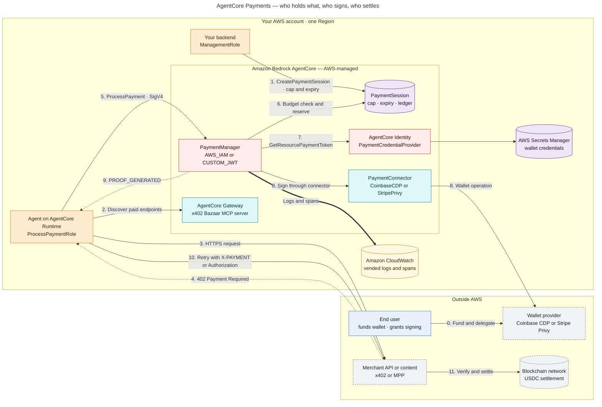
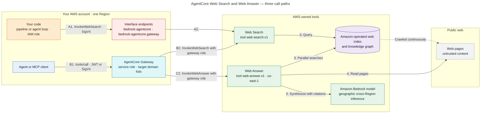
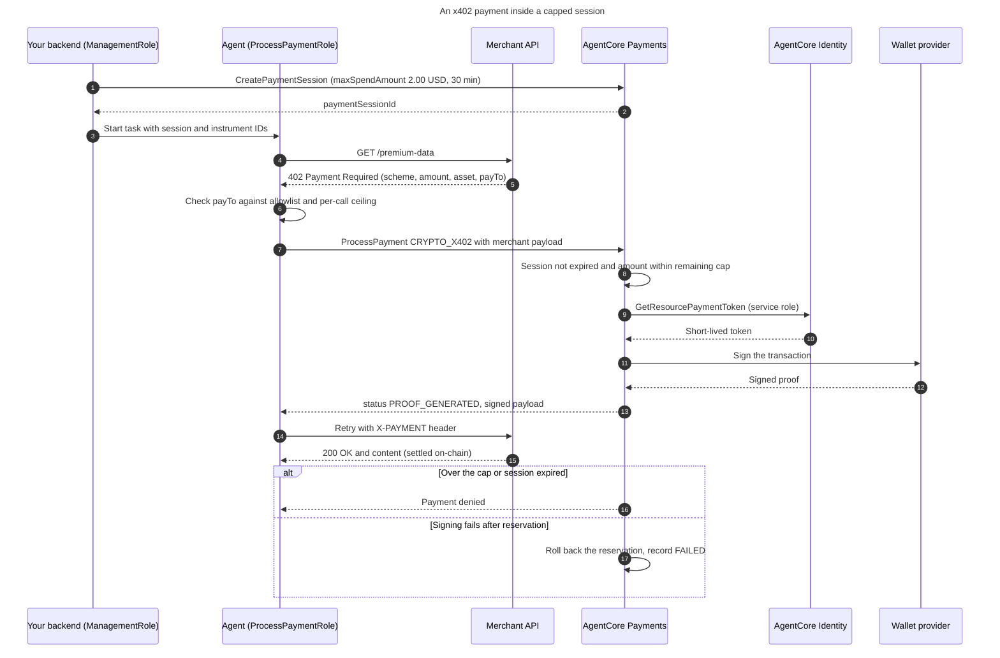
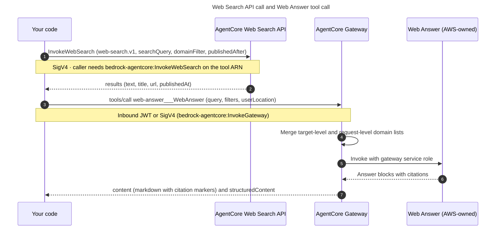

# AgentCore Payments, Web Search and Web Answer

> **Level:** Advanced · **Verified:** 2026-11-15 · **Feature status:** GA (Web Answer: us-east-1 only) · **Time:** ~30 min

Three AgentCore capabilities connect an agent to the open web. **Payments** lets an agent pay small amounts to paid APIs, MCP servers and content, from a stablecoin wallet and inside a hard budget. **Web Search** returns ranked web results — as a Gateway tool or a direct API. **Web Answer** returns one finished, cited answer per question.

> [!IMPORTANT]
> **Status** — **Payments**: preview from May 2026; **generally available since 2026-08-18** per the What's New post; listed in 12 Regions. The AgentCore release notes record the preview and later Payments features but no separate GA entry. **Web Search Tool** (Gateway connector): GA June 2026, 7 Regions including AWS GovCloud (US-West). **Web Search API** (`InvokeWebSearch`): GA November 2026, 6 Regions. **Web Answer** (Gateway connector): GA November 2026 in US East (N. Virginia) only.
> Sources: [Payments GA](https://aws.amazon.com/about-aws/whats-new/2026/08/bedrock-agentcore-payments-ga/), [Web Search API launch](https://aws.amazon.com/about-aws/whats-new/2026/11/amazon-bedrock-agentcore-web-search-api/), [Release notes](https://docs.aws.amazon.com/bedrock-agentcore/latest/devguide/doc-history.html), [Supported AWS Regions](https://docs.aws.amazon.com/bedrock-agentcore/latest/devguide/agentcore-regions.html)

## Learning objectives

- Explain the Payments resources — manager, connector, credential provider, instrument, session — and the x402 and MPP flows.
- Contain the financial risk of an agent that can pay: role separation, session caps, payee allowlists.
- Choose between the Web Search Tool connector, the `InvokeWebSearch` API and Web Answer.
- Say what data leaves your account for each capability and what you must do with citations.
- Deploy web tools on a gateway with Terraform, and Payments with CloudFormation (Terraform has no Payments resources).

## Prerequisites

- [AgentCore Gateway](04-agentcore-gateway.md) and [AgentCore Identity](05-agentcore-identity.md)
- [AgentCore Policy](09-agentcore-policy.md) — constraining tool calls
- [Projects, Workspaces and the Web Search tool](../overview/04-projects-workspaces-and-web-search.md) — the different, model-side Web Search tool on `bedrock-mantle`

## 1. What it is

### Payments

**Plain language.** Give the agent a prepaid card with a spending limit that it cannot raise. When a website answers "402 Payment Required", the agent asks AgentCore to sign a payment of a few cents, then retries with the proof.

**Precisely.** Payments orchestrates the agent side of two HTTP-native protocols. With **x402**, the merchant's `402` response carries a payment payload (scheme, network, amount, asset, `payTo`); `ProcessPayment` with `paymentType` `CRYPTO_X402` returns a signed proof for the `X-PAYMENT` header. Schemes `exact` (fixed price) and `upto` (metered up to a ceiling, settled through the Permit2 contract) are supported. With **MPP** (Machine Payments Protocol), you forward the merchant's `WWW-Authenticate: Payment` challenge and send the returned credential in the `Authorization` header. Status `PROOF_GENERATED` means the transaction was signed. Your agent, not AgentCore, retries the merchant request. Sources: [Core concepts](https://docs.aws.amazon.com/bedrock-agentcore/latest/devguide/payments-concepts.html), [Process a payment](https://docs.aws.amazon.com/bedrock-agentcore/latest/devguide/payments-process-payment.html).

| Resource | What it is |
|:--|:--|
| PaymentManager | Top-level resource: authorizer for the data plane (`AWS_IAM` or `CUSTOM_JWT`) and an IAM service role; AgentCore provisions a workload identity for it |
| PaymentConnector | Link to one wallet provider: `CoinbaseCDP` or `StripePrivy`; one manager can hold several |
| PaymentCredentialProvider | Wallet provider credentials in AgentCore Identity (secrets in AWS Secrets Manager), one per connector, read at run time through `GetResourcePaymentToken` |
| PaymentInstrument | An embedded crypto wallet (`EMBEDDED_CRYPTO_WALLET`) per user and blockchain network; starts with 0 USDC; the end user funds it and grants signing permission |
| PaymentSession | A time-bounded context with an optional cap (`maxSpendAmount` in USD); payments are denied once it expires or the cap is reached; a failed signing rolls the deduction back |

| Item | Value |
|:--|:--|
| Service namespace / endpoint | AgentCore: `bedrock-agentcore-control` and `bedrock-agentcore` |
| Control-plane operations | `CreatePaymentManager`, `CreatePaymentConnector`, `CreatePaymentCredentialProvider`, `RotatePaymentConnectorCredentials` |
| Data-plane operations | `CreatePaymentInstrument`, `CreatePaymentSession`, `ProcessPayment`, `GetPaymentSession`, `GetPaymentInstrumentBalance` |
| IAM action prefix | `bedrock-agentcore:` |

**Wallet providers.** Coinbase CDP supports **Quick create** (AgentCore provisions the Coinbase credentials after you authorize in a browser) and requires a subscription to the Coinbase Wallets for AgentCore Payments listing in AWS Marketplace, billed on your AWS bill. Stripe Privy uses credentials you supply. A curated **Coinbase x402 Bazaar** MCP server, reached through AgentCore Gateway, lists pay-per-use endpoints. Sources: [Release notes](https://docs.aws.amazon.com/bedrock-agentcore/latest/devguide/doc-history.html), [Payments overview](https://docs.aws.amazon.com/bedrock-agentcore/latest/devguide/payments.html).

### Web Search and Web Answer

| | Web Search Tool (connector) | Web Search API | Web Answer (connector) |
|:--|:--|:--|:--|
| Call | MCP `tools/call` through a gateway target with `connectorId` `web-search`; tool takes `query` (≤ 200 characters), `maxResults` 1–25 (default 10) | `InvokeWebSearch` on `bedrock-agentcore` with `webSearchId` `web-search.v1`; `searchQuery` 1–200 characters, `maxResults` 1–25 (default 25) | MCP `tools/call` through a gateway target with `connectorId` `web-answer`; `query` up to 30,000 characters |
| Returns | Ranked results: snippet, URL, title, publication date | Ranked results: `text` extract; `title`, `url`, `publishedAt` when known; no pagination | Markdown answer with inline `[[N](url)]` markers plus `structuredContent.answer[].citations` |
| Inbound authorization | Gateway: IAM or JWT | IAM only | Gateway: IAM or JWT |
| Permission on the AWS-owned tool | Gateway role: `bedrock-agentcore:InvokeWebSearch` on `arn:aws:bedrock-agentcore:<region>:aws:tool/web-search.v1` | Caller: the same action and resource | Gateway role: `bedrock-agentcore:InvokeWebAnswer` on `arn:aws:bedrock-agentcore:us-east-1:aws:tool/web-answer.v1` |
| Filters | Target-level include and exclude lists (up to 100, hidden from the agent); request-level domain and date filters from connector 1.2.0 | Per-request `domainFilter` (1–100) and `publishedAfter` / `publishedBefore` | Target-level lists (up to 50); request-level domain, date and `userLocation.country` from connector 1.1.0 |
| Regions | 7 (incl. GovCloud) | 6 | 1 (us-east-1) |
| Default rate | 10 TPS | 10 TPS per account per Region | 10 TPS |

The account field of the tool ARN is the literal `aws`. Sources: [Web Search Tool](https://docs.aws.amazon.com/bedrock-agentcore/latest/devguide/gateway-target-connector-web-search-tool.html), [Web Search API](https://docs.aws.amazon.com/bedrock-agentcore/latest/devguide/web-search-api.html), [Request and response](https://docs.aws.amazon.com/bedrock-agentcore/latest/devguide/web-search-api-reference.html), [Get started](https://docs.aws.amazon.com/bedrock-agentcore/latest/devguide/web-search-api-get-started.html), [Web Answer](https://docs.aws.amazon.com/bedrock-agentcore/latest/devguide/gateway-target-connector-web-answer-tool.html), [Getting started with Web Answer](https://aws.amazon.com/blogs/machine-learning/getting-started-with-web-answer-on-amazon-bedrock-agentcore/), [Quotas](https://docs.aws.amazon.com/bedrock-agentcore/latest/devguide/bedrock-agentcore-limits.html).

> [!NOTE]
> **Documented fact** — Web Search and Web Answer queries are served within AWS infrastructure from a web index that Amazon builds and operates; they are not sent to a third-party search engine. Web Answer writes its answer with a model on Amazon Bedrock and uses geographic cross-Region inference. Acceptable use requires you to retain and display the source citations and links with any output that uses the results, and forbids bulk extraction or building a competing index.
> Sources: [Web Search Tool](https://docs.aws.amazon.com/bedrock-agentcore/latest/devguide/gateway-target-connector-web-search-tool.html), [Web Answer](https://docs.aws.amazon.com/bedrock-agentcore/latest/devguide/gateway-target-connector-web-answer-tool.html), [Web Search API](https://docs.aws.amazon.com/bedrock-agentcore/latest/devguide/web-search-api.html)

## 2. Why it exists

Paid APIs increasingly charge cents per call, where card fees make no sense and per-vendor billing does not scale. Payments replaces the wallet integration, protocol handling, credential storage, budget enforcement and observability you would otherwise build. Web Search and Web Answer replace a search vendor contract, its keys, result parsing, page fetching and — for Web Answer — the synthesis and citation pipeline.

## 3. When to use it

- **Payments:** a research or data agent that buys individual records from x402 or MPP merchants within a per-task budget; pay-per-inference from metered (`upto`) merchants.
- **Web Search Tool:** agents that discover tools over MCP and should ground answers in current pages, with administrator-controlled domain lists.
- **Web Search API:** your own code — a pipeline, a custom agent loop, a Lambda function — needs ranked results without a gateway.
- **Web Answer:** a factual sub-question inside a larger task, where one cited answer is better than twenty snippets in the context window.

## 4. When not to use it

**Payments — do not use it when:**

- The payment is a purchase order, invoice, payroll or refund. Those need human approval and your financial systems, not an autonomous stablecoin wallet; see [Human-in-the-loop workflows](../../09-advanced-topics/08-human-in-the-loop.md).
- The provider sells an API key or subscription and volume is predictable. Store the key in [AgentCore Identity](05-agentcore-identity.md) and call through Gateway — no wallet, no on-chain settlement.
- The merchant does not speak x402 or MPP, or your organization may not hold stablecoins or share end-user wallet data with Coinbase or Stripe.
- You cannot staff the controls in section 8 (role separation, payee allowlists, monitoring). Without them, do not let an agent pay.

**Web Search and Web Answer — do not use them when:**

- The answer must come from your own documents: use a [Managed Knowledge Base](../knowledge-bases/02-managed-knowledge-base.md) or [agentic retrieval](../agentic-retrieval/01-agentic-retrieval.md).
- You call OpenAI models through the Responses API on `bedrock-mantle` and want the model-side tool: see [Projects, Workspaces and the Web Search tool](../overview/04-projects-workspaces-and-web-search.md).
- Queries would contain secrets or personal data you may not send outside your account boundary.
- You need bulk crawling or to store results in an index — the acceptable-use terms forbid it.
- You need Web Answer outside US East (N. Virginia).

## 5. Internal architecture



**What this shows** — **Our reading:** AgentCore does not hold the money. The instrument is an embedded wallet backed by the provider and managed by the end user, and the merchant settles on-chain. AgentCore holds the budget, the credentials and the signing orchestration. The two roles on the left are the separation the documentation insists on. Academy diagram, not an official AWS reference architecture.

0. The end user funds the instrument and grants the agent signing permission at the provider's wallet hub. 1. Deterministic backend code opens a capped session. 2–4. The agent finds a paid endpoint and receives a `402`. 5–8. `ProcessPayment` checks and reserves budget, fetches a short-lived token through Identity and has the provider sign. 9–11. The agent retries with the proof; the merchant settles on-chain and returns the content.



**What this shows** — Path A is the API (IAM only, no gateway charge); path B the Web Search Tool through a gateway; path C Web Answer through a gateway. In both gateway paths only the gateway's service role holds the tool permission, so the agent never needs it. The index, crawling and page reading are our conceptual model of the documented "Amazon-operated web index" and "reads relevant pages"; AWS does not publish the internals.

## 6. Request and response lifecycle



- **Steps 1–3.** Deterministic code under a role that cannot pay creates the session; the agent only receives IDs and cannot extend it.
- **Step 6.** The payee check is our addition; AWS's guidance is never to let the model generate `payTo` addresses.
- **Steps 7–13.** The budget check is deterministic and runs at the infrastructure layer before any signing. For `upto`, an optional `permit2AllowanceLimit` makes AgentCore submit an on-chain `approve` transaction first, which costs gas from the wallet's native token balance.
- **Steps 14–15.** Settlement happens between merchant and blockchain. Retries of the merchant request are your agent's job; pass a `clientToken` on `ProcessPayment`, as the documented examples do. The session-cap behaviour is described in the [GA blog post](https://aws.amazon.com/blogs/machine-learning/amazon-bedrock-agentcore-payments-is-now-generally-available-enabling-agents-to-transact-safely-and-autonomously-at-scale/) and the [technical deep dive](https://aws.amazon.com/blogs/machine-learning/technical-deep-dive-agentcore-payments-and-innovation-in-agentic-commerce/).



Error paths for the API: `ValidationException` (empty or long query, more than 100 domains, `publishedAfter` later than `publishedBefore`, unknown field, body over 32 KiB), `AccessDeniedException` (missing permission or a VPC endpoint policy), `ResourceNotFoundException` (wrong `webSearchId`), `ThrottlingException` (retry with backoff). Web Answer reports failures in the tool result with `isError` `true`; disjoint include lists fail validation. Sources: [Troubleshoot Web Search](https://docs.aws.amazon.com/bedrock-agentcore/latest/devguide/web-search-api-troubleshooting.html), [Web Answer](https://docs.aws.amazon.com/bedrock-agentcore/latest/devguide/gateway-target-connector-web-answer-tool.html).

## 7. Dependencies

| Depends on | Why | Required or optional |
|:--|:--|:-:|
| Coinbase CDP or Stripe Privy account | Wallet infrastructure; Coinbase also needs the AWS Marketplace subscription | Payments: required |
| AgentCore Identity and AWS Secrets Manager | Holds the wallet provider credentials | Payments: required |
| Five IAM roles (administrator, management, payment execution, service retrieval; Marketplace policy for Coinbase) | Separation of duties | Payments: required |
| A funded instrument with signing granted by the end user | Nothing can be paid otherwise | Payments: required |
| AgentCore Gateway with a service role | Web Search Tool, Web Answer and the x402 Bazaar | Gateway paths |
| AgentCore Policy | Constrain which tools and payees an agent may use | Recommended |

## 8. Security considerations

> [!CAUTION]
> **Cost or security hazard** — An agent that can pay can be talked into paying. Agents are non-deterministic: they can read a response as authorization to spend, or pay twice after an unexpected retry. A prompt-injected page can name a payee. Treat every `ProcessPayment` as a financial transaction made by an untrusted caller, and assume a signed on-chain payment cannot be recalled by AWS (**our reading**; recovery depends on the merchant).

Documented preventive controls ([Security in AgentCore payments](https://docs.aws.amazon.com/bedrock-agentcore/latest/devguide/payments-security-best-practices.html), [IAM roles](https://docs.aws.amazon.com/bedrock-agentcore/latest/devguide/payments-iam-roles.html)):

- **Five-role pattern.** Administrator (managers, connectors, credential providers), management (instruments and sessions, explicitly denied `ProcessPayment`), payment execution, a service role that AgentCore assumes to retrieve credentials, and the `AWSMarketplaceManageSubscriptions` managed policy for Coinbase. Never put `CreatePaymentSession` and `ProcessPayment` in one role — the caller could open a new session with a larger budget.
- **User identity.** On an IAM-authorized manager, your backend asserts `X-Amzn-Bedrock-AgentCore-Payments-User-Id` and AgentCore does not verify it. Never let users or agents set it.
- **Payees.** Never let the model generate `payTo` addresses; prefer verified addresses from the Bazaar through Gateway; constrain payees with Cedar policies; do not cache addresses across sessions; screen recipients.
- **Credentials.** Keep wallet secrets only in AgentCore Identity; for Privy, deny `secretsmanager:GetSecretValue` to every principal except the service role and rotate the app secret and authorization key every 90 days. Rotate Quick create credentials with `RotatePaymentConnectorCredentials`; rotating the Coinbase wallet secret affects every connector on the project and can make `ProcessPayment` fail for up to a minute.
- **Personal data.** Instrument creation can link the end user's e-mail address to the wallet, so user data reaches the wallet provider; cover it in your privacy assessment.
- **Detection.** Enable CloudTrail for all Payments calls and use the vended logs and spans to watch success rates and spend.

For Web Search and Web Answer: results are third-party web content — treat them as untrusted input to the model ([Prompt injection, untrusted tool output and retrieval poisoning](../../06-security-governance/04-prompt-injection-and-untrusted-content.md)); put allow and deny lists at the **target** level where the agent cannot change them; and keep secrets and personal data out of queries, which leave your account for the AWS-owned service. Web Answer is not a substitute for professional advice.

## 9. Networking requirements

| Path | Option |
|:--|:--|
| Code → Web Search API | Interface endpoint `com.amazonaws.<region>.bedrock-agentcore` (the endpoint table lists Web Search, data plane: supported); API calls can be logged as CloudTrail data events |
| Agents → Web Search Tool or Web Answer | The gateway URL, or `com.amazonaws.<region>.bedrock-agentcore.gateway`; the gateway reaches the tools inside AWS |
| Agent → merchant (Payments) | Your agent's own HTTPS call to the internet: a Runtime in VPC mode needs a NAT path |
| Code → Payments APIs | **UNVERIFIED — REQUIRES DOCUMENTATION REVIEW:** the AgentCore endpoint table has no Payments row. The Payments security page recommends VPC endpoints with `aws:sourceVpc` and `aws:sourceVpce` conditions but names no service |
| AgentCore → wallet provider and blockchain | Made by the service, outside your network |

Sources: [Interface VPC endpoints](https://docs.aws.amazon.com/bedrock-agentcore/latest/devguide/vpc-interface-endpoints.html), [Web Search API launch](https://aws.amazon.com/about-aws/whats-new/2026/11/amazon-bedrock-agentcore-web-search-api/).

## 10. Pricing dimensions

| Dimension | Unit | Price or rule read on 2026-11-15 |
|:--|:--|:--|
| Web Search (connector or API) | Per 1,000 queries | $7.00; the API has no gateway charges, the connector adds gateway invocations ($0.005 per 1,000) |
| Web Answer | Per 1,000 tool calls | $10, per call regardless of answer length |
| Payments — AgentCore | — | No additional AWS charge; other Payments API calls are free |
| Payments — wallet operations | Per operation, provider pricing | Coinbase CDP: each instrument creation and each `ProcessPayment` is one operation; Stripe Privy: instrument creation free, each `ProcessPayment` one operation. The pricing example uses $0.005 per Coinbase operation |
| Payments — what you actually spend | — | The amounts paid to merchants, plus gas for Permit2 `approve` transactions |

Source: [AgentCore pricing](https://aws.amazon.com/bedrock/agentcore/pricing/). Coinbase usage is metered through AWS Marketplace and appears on your AWS bill.

## 11. Scaling considerations

| Quota (default) | Value | Adjustable |
|:--|:--|:-:|
| `InvokeWebSearch` | 10 TPS per account per Region | Yes |
| Web Search Tool requests through a gateway / Web Answer requests | 10 TPS each | Yes |
| Payment credential providers per account | 50 | Yes |
| `GetResourcePaymentToken` | 200 TPS | Yes |

Source: [Quotas](https://docs.aws.amazon.com/bedrock-agentcore/latest/devguide/bedrock-agentcore-limits.html). No Payments-specific rate quotas (for example for `ProcessPayment`) were found on that page — **UNVERIFIED — REQUIRES DOCUMENTATION REVIEW**. Gateway call limits still apply to connector traffic ([AgentCore Gateway](04-agentcore-gateway.md)).

## 12. IaC support

| Tool | Support | Resource / construct | Notes |
|:--|:-:|:--|:--|
| Terraform (`hashicorp/aws` 6.73.0) | ❌ Payments · ✅ web connectors | `aws_bedrockagentcore_gateway_target` with `mcp.connector` (`connector_id` `web-search` or `web-answer`) | No Payments resource exists in 6.73.0 (checked against the provider schema). The Web Search API needs no resource |
| CloudFormation | ✅ | `AWS::BedrockAgentCore::PaymentManager`, `PaymentConnector`, `PaymentCredentialProvider`; web connector targets are `AWS::BedrockAgentCore::GatewayTarget` resources | The AgentCore CLI deploys payment managers and connectors through CloudFormation |
| AWS CDK (`aws-cdk-lib` 2.277.0) | L1 | `CfnPaymentManager`, `CfnPaymentConnector`, `CfnPaymentCredentialProvider` | No L2 for Payments |

Verified alternatives for Terraform users: deploy Payments with the CloudFormation template below (for example through `aws_cloudformation_stack`), or with the AgentCore CLI. Instruments and sessions are per-user, per-task runtime objects — create them from code, never from IaC.

## 13. Working example

### Payments: a capped session and a guarded x402 payment

> **Code status:** syntax-checked (`python -m py_compile`) · mock-tested with botocore `Stubber` (boto3 1.44.3; 4 tests: success, unknown payee, over-ceiling amount, service refusal) · **never deployed** · moves real money if pointed at a funded wallet

```python
"""Pay an x402 merchant from a budgeted AgentCore payment session (data plane only)."""
import uuid
from decimal import Decimal

import boto3

# Deterministic guards that live outside the model. Values come from your configuration.
ALLOWED_PAY_TO = {"0x0000000000000000000000000000000000000001"}  # vetted merchant addresses
MAX_ATOMIC_PER_CALL = 500_000  # 0.50 USDC at 6 decimals


def make_client(region: str = "us-east-1"):
    """Data-plane client; payments live on bedrock-agentcore, not the control plane."""
    return boto3.client("bedrock-agentcore", region_name=region)


def open_budgeted_session(client, manager_arn: str, user_id: str, max_usd: str, minutes: int) -> str:
    """CreatePaymentSession: the session cap is the agent's financial boundary."""
    if Decimal(max_usd) <= 0:
        raise ValueError("max_usd must be positive")
    response = client.create_payment_session(
        paymentManagerArn=manager_arn,
        userId=user_id,
        expiryTimeInMinutes=minutes,
        limits={"maxSpendAmount": {"value": max_usd, "currency": "USD"}},
        clientToken=str(uuid.uuid4()),
    )
    return response["paymentSession"]["paymentSessionId"]


def pay_x402(client, manager_arn: str, session_id: str, instrument_id: str, user_id: str,
             requirements: dict, version: str = "2") -> dict:
    """ProcessPayment for an x402 'exact' requirement copied from the merchant's 402 response."""
    if requirements.get("payTo") not in ALLOWED_PAY_TO:
        raise PermissionError("payTo address is not on the allowlist")
    if requirements.get("scheme") != "exact":
        raise ValueError("this helper only pays the exact scheme")
    if int(requirements.get("amount", "0")) > MAX_ATOMIC_PER_CALL:
        raise PermissionError("amount exceeds the per-call ceiling")
    response = client.process_payment(
        paymentManagerArn=manager_arn,
        paymentSessionId=session_id,
        paymentInstrumentId=instrument_id,
        userId=user_id,
        paymentType="CRYPTO_X402",
        paymentInput={"cryptoX402": {"version": version, "payload": requirements}},
        clientToken=str(uuid.uuid4()),
    )
    if response["status"] != "PROOF_GENERATED":
        raise RuntimeError(f"unexpected status {response['status']}")
    # Attach this proof to the X-PAYMENT header when you retry the merchant request.
    return response["paymentOutput"]["cryptoX402"]["payload"]


def remaining_budget(client, manager_arn: str, session_id: str, user_id: str) -> str:
    """GetPaymentSession: read what is left of the cap."""
    session = client.get_payment_session(
        paymentManagerArn=manager_arn, paymentSessionId=session_id, userId=user_id
    )["paymentSession"]
    return session["availableLimits"]["availableSpendAmount"]["value"]
```

In production, `open_budgeted_session` runs under the management role and `pay_x402` under the payment-execution role — two processes, two roles. The allowlist and ceiling are academy additions on top of the service's session cap.

The payment manager itself, as CloudFormation (Terraform has no resource for it):

> **Code status:** validated with `cfn-lint` 1.60.1 (no findings) · **never deployed**

```yaml
AWSTemplateFormatVersion: "2010-09-09"
Description: AgentCore payments - a payment manager with IAM inbound authorization (academy example).

Parameters:
  ManagerName:
    Type: String
    Default: researchagentpayments
    Description: Name of the payment manager.
  ResourceRetrievalRoleArn:
    Type: String
    Description: >-
      Service role that AgentCore payments assumes to fetch session and credential state.
      Create it with the trust and permissions in "IAM roles for AgentCore payments".

Resources:
  PaymentManager:
    Type: AWS::BedrockAgentCore::PaymentManager
    Properties:
      Name: !Ref ManagerName
      Description: Pays x402 and MPP merchants for the research agent
      AuthorizerType: AWS_IAM
      RoleArn: !Ref ResourceRetrievalRoleArn
      Tags:
        - Key: Project
          Value: bedrock-academy

Outputs:
  PaymentManagerArn:
    Description: Pass this ARN to CreatePaymentSession and ProcessPayment.
    Value: !GetAtt PaymentManager.PaymentManagerArn
```

### Web Search Tool and Web Answer on an IAM-authorized gateway

> **Code status:** validated with `terraform fmt -check` and `terraform validate` (Terraform 1.17.2, provider 6.73.0) with a `versions.tf` that pins `hashicorp/aws ~> 6.73` and sets `default_tags` from `var.tags` · TFLint 0.66 clean · mock-tested with `terraform test` (3 runs: both targets in us-east-1, no Web Answer in us-west-2, list-length validation) · **never planned or applied against AWS** · **never deployed**

```hcl
variable "aws_region" {
  description = "Region of the gateway. Web Search Tool: 7 Regions; Web Answer: us-east-1 only."
  type        = string
  default     = "us-east-1"
}

variable "tags" {
  description = "Tags applied to every resource through the provider's default_tags."
  type        = map(string)
  default     = { Project = "bedrock-academy", Chapter = "agentcore-web-search" }
}

variable "gateway_name" {
  description = "Name of the gateway that exposes the web tools."
  type        = string
  default     = "academy-web-tools"
}

variable "excluded_domains" {
  description = "Target-level domains that no result may come from. Hidden from the agent. Web Answer accepts up to 50."
  type        = list(string)
  default     = []

  validation {
    condition     = length(var.excluded_domains) <= 50
    error_message = "Web Answer target-level lists hold up to 50 domains (Web Search Tool: 100)."
  }
}

variable "web_search_connector_version" {
  description = "Pinned Web Search Tool connector version. 1.2.0 and later accept request-level filters."
  type        = string
  default     = "1.3.0"
}

variable "enable_web_answer" {
  description = "Add the Web Answer connector. It is available in us-east-1 only."
  type        = bool
  default     = true
}

data "aws_caller_identity" "current" {}
data "aws_partition" "current" {}
data "aws_region" "current" {}

locals {
  account_id  = data.aws_caller_identity.current.account_id
  partition   = data.aws_partition.current.partition
  region      = data.aws_region.current.region
  web_answer  = var.enable_web_answer && local.region == "us-east-1"
  tool_prefix = "arn:${local.partition}:bedrock-agentcore:${local.region}:aws:tool"
}

# Gateway service role: the only identity that calls the AWS-owned web tools.
data "aws_iam_policy_document" "gateway_trust" {
  statement {
    effect  = "Allow"
    actions = ["sts:AssumeRole"]

    principals {
      type        = "Service"
      identifiers = ["bedrock-agentcore.amazonaws.com"]
    }

    condition {
      test     = "StringEquals"
      variable = "aws:SourceAccount"
      values   = [local.account_id]
    }
  }
}

resource "aws_iam_role" "gateway" {
  name_prefix        = "web-tools-gateway-"
  assume_role_policy = data.aws_iam_policy_document.gateway_trust.json
}

data "aws_iam_policy_document" "gateway_permissions" {
  statement {
    sid       = "InvokeWebSearch"
    actions   = ["bedrock-agentcore:InvokeWebSearch"]
    resources = ["${local.tool_prefix}/web-search.v1"]
  }

  dynamic "statement" {
    for_each = local.web_answer ? [1] : []

    content {
      sid       = "InvokeWebAnswer"
      actions   = ["bedrock-agentcore:InvokeWebAnswer"]
      resources = ["${local.tool_prefix}/web-answer.v1"]
    }
  }
}

resource "aws_iam_role_policy" "gateway" {
  name   = "invoke-web-tools"
  role   = aws_iam_role.gateway.id
  policy = data.aws_iam_policy_document.gateway_permissions.json
}

# IAM-authorized MCP gateway: callers need bedrock-agentcore:InvokeGateway on its ARN.
resource "aws_bedrockagentcore_gateway" "web" {
  name            = var.gateway_name
  description     = "Web Search Tool and Web Answer for internal agents"
  role_arn        = aws_iam_role.gateway.arn
  authorizer_type = "AWS_IAM"
  protocol_type   = "MCP"
}

resource "aws_bedrockagentcore_gateway_target" "web_search" {
  name               = "web-search"
  description        = "Ranked web results with snippets and URLs"
  gateway_identifier = aws_bedrockagentcore_gateway.web.gateway_id

  credential_provider_configuration {
    gateway_iam_role {}
  }

  target_configuration {
    mcp {
      connector {
        source {
          connector_id = "web-search"
          version      = var.web_search_connector_version
        }

        configuration {
          name             = "WebSearch"
          parameter_values = jsonencode(length(var.excluded_domains) == 0 ? {} : { domainFilter = { exclude = var.excluded_domains } })
        }
      }
    }
  }

  depends_on = [aws_iam_role_policy.gateway]
}

resource "aws_bedrockagentcore_gateway_target" "web_answer" {
  count = local.web_answer ? 1 : 0

  name               = "web-answer"
  description        = "One cited answer per question"
  gateway_identifier = aws_bedrockagentcore_gateway.web.gateway_id

  credential_provider_configuration {
    gateway_iam_role {}
  }

  target_configuration {
    mcp {
      connector {
        source {
          connector_id = "web-answer"
          version      = "1.1.0" # target-level domain lists need 1.1.0 or later
        }

        configuration {
          name             = "WebAnswer"
          parameter_values = jsonencode(length(var.excluded_domains) == 0 ? {} : { domainFilter = { exclude = var.excluded_domains } })
        }
      }
    }
  }

  depends_on = [aws_iam_role_policy.gateway]
}

output "gateway_url" {
  description = "MCP endpoint for agents (append /mcp). Tools appear as web-search___WebSearch and web-answer___WebAnswer."
  value       = aws_bedrockagentcore_gateway.web.gateway_url
}

output "gateway_arn" {
  description = "Grant callers bedrock-agentcore:InvokeGateway on this ARN."
  value       = aws_bedrockagentcore_gateway.web.gateway_arn
}
```

The connector shape — configuration names matching the `WebSearch` and `WebAnswer` tools, the gateway service role (`GATEWAY_IAM_ROLE`) as outbound credential, `parameterValues` with `domainFilter` — follows the Web Search Tool page and the `create_gateway_target` example in the Web Answer getting-started post; both are linked in section 14. Every search and answer is billed; run `terraform destroy` in your sandbox when you finish.

### Web Search API from your own code

> **Code status:** syntax-checked · mock-tested with botocore `Stubber` (boto3 1.44.3; 2 tests) · **never deployed**

```python
"""Search the web from your own code with InvokeWebSearch, keeping citations."""
import boto3

WEB_SEARCH_ID = "web-search.v1"  # the AWS managed web search tool


def make_client(region: str = "us-east-1"):
    return boto3.client("bedrock-agentcore", region_name=region)


def search_trusted(client, query: str, domains: list[str], max_results: int = 5) -> list[dict]:
    """Return results from trusted domains only, each with the URL you must show as a citation."""
    if not 1 <= len(query) <= 200:
        raise ValueError("searchQuery must be 1-200 characters")
    response = client.invoke_web_search(
        webSearchId=WEB_SEARCH_ID,
        searchQuery=query,
        maxResults=max_results,
        filters={"domainFilter": {"include": domains}},
    )
    return [
        {"title": r.get("title", ""), "url": r.get("url"), "text": r["text"]}
        for r in response["results"]
        if r.get("url")  # drop results you could not cite
    ]
```

> [!TIP]
> **Academy recommendation** — Start web tools on a dedicated gateway with an IAM or JWT authorizer, a target-level exclude list, and AgentCore Policy on the agent's other tools. Start Payments in a testnet setup with a per-session cap of a few dollars, an explicit payee allowlist, and an alarm on spend, before you let any user fund a real wallet. This is our design guidance, not an official AWS reference architecture.

## Common mistakes

| Mistake | Symptom | Fix |
|:--|:--|:--|
| One role creates sessions and calls `ProcessPayment` | An agent can raise its own budget | Split into management and payment-execution roles; deny `ProcessPayment` on the first |
| Letting the model pick `payTo` | Payments to addresses taken from web content | Allowlist in code, Cedar policies, Bazaar-verified addresses |
| Instrument created but not funded or not delegated | Payments fail despite a valid session | The end user must fund the wallet and grant signing at the provider's hub |
| `permit2AllowanceLimit` on an `exact` payload | `ValidationException` | Only for `upto`, and only when the allowance needs setting |
| Coinbase connector without the Marketplace subscription | Connector or wallet calls refused | Subscribe with the administrator identity (`AWSMarketplaceManageSubscriptions`) |
| Granting `InvokeWebSearch` to the agent's role for the connector path | Works, but widens the agent's permissions | Only the gateway service role needs it; the agent needs `bedrock-agentcore:InvokeGateway` |
| Unpinned Web Search connector version | `filters` missing from the tool schema | Pin 1.2.0 or later on the target |
| Showing web answers without sources | Breach of acceptable use | Always render the URLs and citation markers |

## Knowledge check

1. A finance team wants an agent to pay supplier invoices automatically. Is AgentCore Payments the right tool?
2. Your agent's role can call `CreatePaymentSession` and `ProcessPayment`. What attack does that enable?
3. A data pipeline in a Lambda function needs ranked web results for 5,000 queries a day. Which path, which permission, and what is the search cost?
4. Why put a domain exclude list on the gateway target instead of in the agent's prompt?

<details>
<summary>Answers</summary>

1. No. Payments is for agent micropayments to x402 or MPP merchants from stablecoin wallets within capped sessions. Supplier invoices need human approval and your financial systems.
2. A manipulated agent can open a new session with a larger cap and spend against it. The documented pattern denies `ProcessPayment` to the session-managing role and keeps session creation out of the execution role.
3. The Web Search API (`InvokeWebSearch`), with `bedrock-agentcore:InvokeWebSearch` on the `web-search.v1` tool ARN for the function's role. 5,000 × $7 / 1,000 = $35 per day at the list price read on 2026-11-15, with no gateway charges; mind the 10 TPS default rate.
4. Target-level lists are hidden from the agent and applied to every request; request filters cannot override them. A prompt can be ignored or injected.

</details>

## 14. Official documentation

- [AgentCore payments overview](https://docs.aws.amazon.com/bedrock-agentcore/latest/devguide/payments.html), [Core concepts](https://docs.aws.amazon.com/bedrock-agentcore/latest/devguide/payments-concepts.html), [How it works](https://docs.aws.amazon.com/bedrock-agentcore/latest/devguide/payments-how-it-works.html) — resources, protocols, flow.
- [Get started](https://docs.aws.amazon.com/bedrock-agentcore/latest/devguide/payments-getting-started.html), [Create a payment manager and connector](https://docs.aws.amazon.com/bedrock-agentcore/latest/devguide/payments-create-manager.html), [Create a payment instrument](https://docs.aws.amazon.com/bedrock-agentcore/latest/devguide/payments-create-instrument.html), [Create a payment session](https://docs.aws.amazon.com/bedrock-agentcore/latest/devguide/payments-create-session.html), [Process a payment](https://docs.aws.amazon.com/bedrock-agentcore/latest/devguide/payments-process-payment.html).
- [Security in AgentCore payments](https://docs.aws.amazon.com/bedrock-agentcore/latest/devguide/payments-security-best-practices.html), [IAM roles for AgentCore payments](https://docs.aws.amazon.com/bedrock-agentcore/latest/devguide/payments-iam-roles.html), [Prerequisites](https://docs.aws.amazon.com/bedrock-agentcore/latest/devguide/payments-prerequisites.html).
- [AgentCore payments GA announcement](https://aws.amazon.com/about-aws/whats-new/2026/08/bedrock-agentcore-payments-ga/), [AgentCore payments is now generally available](https://aws.amazon.com/blogs/machine-learning/amazon-bedrock-agentcore-payments-is-now-generally-available-enabling-agents-to-transact-safely-and-autonomously-at-scale/) and [Technical deep dive: AgentCore Payments](https://aws.amazon.com/blogs/machine-learning/technical-deep-dive-agentcore-payments-and-innovation-in-agentic-commerce/) — GA scope, session caps, wallet funding.
- [Web Search Tool](https://docs.aws.amazon.com/bedrock-agentcore/latest/devguide/gateway-target-connector-web-search-tool.html) — connector, index, filters, input schema.
- [Search the web using AgentCore Web Search](https://docs.aws.amazon.com/bedrock-agentcore/latest/devguide/web-search-api.html), [Get started](https://docs.aws.amazon.com/bedrock-agentcore/latest/devguide/web-search-api-get-started.html), [Request and response](https://docs.aws.amazon.com/bedrock-agentcore/latest/devguide/web-search-api-reference.html), [Troubleshoot](https://docs.aws.amazon.com/bedrock-agentcore/latest/devguide/web-search-api-troubleshooting.html), [invoke-web-search CLI reference](https://docs.aws.amazon.com/cli/latest/reference/bedrock-agentcore/invoke-web-search.html).
- [Web Answer](https://docs.aws.amazon.com/bedrock-agentcore/latest/devguide/gateway-target-connector-web-answer-tool.html) and [Getting started with Web Answer](https://aws.amazon.com/blogs/machine-learning/getting-started-with-web-answer-on-amazon-bedrock-agentcore/) — schema, citations, gateway role permission.
- [Web Search API launch](https://aws.amazon.com/about-aws/whats-new/2026/11/amazon-bedrock-agentcore-web-search-api/) and [Introducing the Web Search API](https://aws.amazon.com/blogs/machine-learning/introducing-the-web-search-api-on-amazon-bedrock-agentcore/).
- [Interface VPC endpoints](https://docs.aws.amazon.com/bedrock-agentcore/latest/devguide/vpc-interface-endpoints.html), [Quotas](https://docs.aws.amazon.com/bedrock-agentcore/latest/devguide/bedrock-agentcore-limits.html), [Supported AWS Regions](https://docs.aws.amazon.com/bedrock-agentcore/latest/devguide/agentcore-regions.html), [Release notes](https://docs.aws.amazon.com/bedrock-agentcore/latest/devguide/doc-history.html), [AgentCore pricing](https://aws.amazon.com/bedrock/agentcore/pricing/).
- Terraform provider documentation (source): [`aws_bedrockagentcore_gateway_target`](https://raw.githubusercontent.com/hashicorp/terraform-provider-aws/main/website/docs/r/bedrockagentcore_gateway_target.html.markdown) — the `mcp.connector` block.
