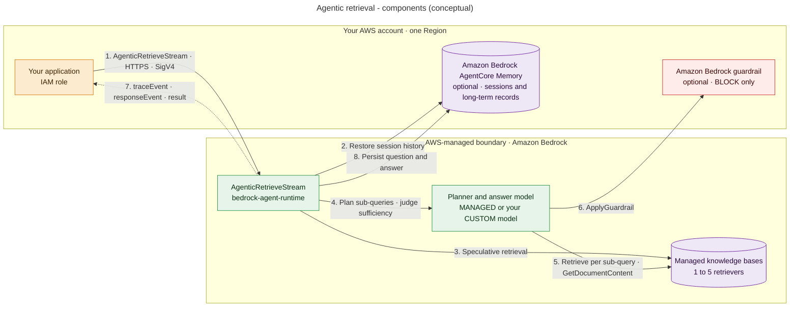
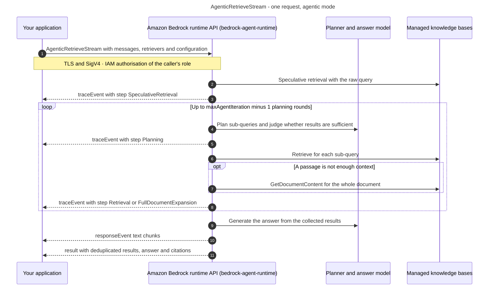

# Agentic retrieval with AgenticRetrieveStream

> **Level:** Advanced · **Verified:** 2026-11-15 · **Feature status:** GA · **Time:** ~25 min

Agentic retrieval is the query mode of a Managed Knowledge Base in which a foundation model plans
the search: it splits a question into sub-queries, retrieves for each, checks whether the evidence
is enough, opens whole documents when a passage is not, and streams back an answer with
citations. It is one API operation, `AgenticRetrieveStream`, and it is also how you get one-call
RAG on a managed knowledge base.

> [!IMPORTANT]
> **Status** — GA. Works **only with managed knowledge bases** and is **not available in AWS
> GovCloud (US-West)**. Added in 2026: AgentCore Memory (2026-08-14), retrieval instructions
> (2026-10-19), and `maxAgentIteration` values 0 and 1 for retrieval-only and single-shot RAG
> (announced 2026-11-09).
> Sources: [Use agentic retrieval](https://docs.aws.amazon.com/bedrock/latest/userguide/kb-test-agentic-retrieve.html),
> [Supported AWS Regions](https://docs.aws.amazon.com/bedrock/latest/userguide/kb-managed-regions.html),
> [Document history](https://docs.aws.amazon.com/bedrock/latest/userguide/bedrock-ug-doc-history.html),
> [Single-shot and agentic retrieval](https://aws.amazon.com/blogs/machine-learning/single-shot-and-agentic-retrieval-with-amazon-bedrock-managed-knowledge-base/)

## Learning objectives

- Explain the plan, retrieve, expand and generate loop, and what counts as one iteration.
- Build a valid request: retrievers, model type, `generateResponse`, `maxAgentIteration`, memory,
  retrieval instruction and guardrail.
- Read the event stream and map each citation to the result that supports it.
- Weigh latency and cost against single-shot retrieval and choose a mode per request.
- Recognise the workloads for which agentic retrieval is the wrong tool.

## Prerequisites

- [Managed Knowledge Base](../knowledge-bases/02-managed-knowledge-base.md)
- [Knowledge Bases overview: managed versus customer-managed](../knowledge-bases/01-knowledge-bases-overview.md)
- [Retrieval-augmented generation (RAG)](../../00-foundations/generative-ai-fundamentals/04-rag-fundamentals.md)
- [Agentic AI, tool calling and multi-agent architectures](../../00-foundations/generative-ai-fundamentals/06-agents-tool-calling-multi-agent.md)

## 1. What it is

**Plain language.** A single search answers "what is our refund policy?". It does badly on "how do
refund rules differ between monthly and annual plans, and what changed last year?" because that
is three searches and a comparison. Agentic retrieval behaves like a researcher: break the
question down, look up each part, read what came back, look again if something is missing, then
write the answer and say where each claim came from.

**Precisely.** `AgenticRetrieveStream` is a `bedrock-agent-runtime` operation (`POST
/agenticRetrieveStream`) that takes messages, one to five knowledge base retrievers and a
configuration, and returns an event stream of trace events, answer chunks and one result event.

| Item | Value |
|:--|:--|
| Service namespace / endpoint | `bedrock-agent-runtime` · `POST /agenticRetrieveStream` |
| Control-plane operations | None for the call. Retrieval instructions live on `bedrock-agent`: `CreateRetrievalInstruction`, `GetRetrievalInstruction`, `UpdateRetrievalInstruction`, `DeleteRetrievalInstruction`, `ListRetrievalInstructions`, `CreateRetrievalInstructionVersion`, `ListRetrievalInstructionVersions` |
| Data-plane operations | `AgenticRetrieveStream`; it uses `Retrieve` and `GetDocumentContent` underneath |
| IAM action prefix | `bedrock:` — `AgenticRetrieveStream`, `Retrieve`, `GetDocumentContent`, `InvokeModelWithResponseStream` |

### One parameter, three modes

| `maxAgentIteration` | What runs | Model calls | `generateResponse` |
|--:|:--|:-:|:--|
| 0 | One retrieval; passages only. Behaves like `Retrieve`, but passages arrive without `score` or `location` | 0 | Must be `false` — `true` is rejected with a 4xx error |
| 1 | **Single-shot RAG**: one retrieval, then one answer. No planning, no query rewriting | 1 | `true` |
| 2 to 5 | **Agentic**: up to *n* − 1 planning rounds (each a query rewrite plus a retrieval), then one answer | Up to *n* | `true` |

One iteration is one foundation model call, and the last one is reserved for the answer. The
initial *speculative retrieval* is not an iteration. All three modes accept several knowledge bases.

> [!NOTE]
> **Documented fact** — the API reference gives `maxAgentIteration` only a minimum (0). The upper
> bound of 5 and the meaning of each value come from the AWS announcement of 2026-11-09. The
> **default** when the field is omitted is **UNVERIFIED — REQUIRES DOCUMENTATION REVIEW** (looked
> in the API reference, the user guide and the quotas page).
> Sources: [AgenticRetrieveConfiguration](https://docs.aws.amazon.com/bedrock/latest/APIReference/API_agent-runtime_AgenticRetrieveConfiguration.html),
> [Single-shot and agentic retrieval](https://aws.amazon.com/blogs/machine-learning/single-shot-and-agentic-retrieval-with-amazon-bedrock-managed-knowledge-base/)

## 2. Why it exists

A multi-part question has no single point in embedding space, so one top-*k* search returns a
blend of its intents. Teams worked around this by prompting a model to plan and calling
`Retrieve` in a loop — custom orchestration, repeated in every application, each copy with its own
latency, cost and reliability behaviour. Agentic retrieval moves that loop (planning, routing
across knowledge bases, sufficiency checks, deduplication, answer synthesis) into the service.
AWS reports, on the public MuSiQue multi-hop benchmark, about 20 points of absolute recall gain
over single-shot retrieval, growing with the number of hops; treat that as AWS's own measurement.
Source: [Agentic retrieval for Managed Knowledge Base](https://aws.amazon.com/blogs/machine-learning/agentic-retrieval-for-amazon-bedrock-managed-knowledge-base/)

## 3. When to use it

- Questions are multi-part, comparative or exploratory.
- Evidence is spread over several managed knowledge bases; the planner routes each sub-query
  using the `description` you give each retriever.
- Answers need whole-document context — summaries, complete lists, specific sections.
- You want one call that returns a cited answer: `maxAgentIteration` 1 is the replacement for
  `RetrieveAndGenerate`.
- A conversation should continue across requests, using [AgentCore Memory](../agentcore/06-agentcore-memory.md).
- An agent should use the knowledge base as an MCP tool through
  [AgentCore Gateway](../agentcore/04-agentcore-gateway.md), which exposes this operation.

## 4. When not to use it

- **The knowledge base is customer-managed, or the Region is GovCloud (US-West).** Use
  `RetrieveAndGenerate` or `Retrieve` — see
  [Customer-managed knowledge bases and vector stores](../knowledge-bases/03-customer-managed-knowledge-bases.md).
- **Short, well-scoped lookups under a latency or cost budget.** Call `Retrieve`, or set
  `maxAgentIteration` to 0 or 1 — see
  [Retrieval, reranking and metadata filtering](../knowledge-bases/05-retrieval-reranking-filtering.md).
- **Your code needs relevance scores or source locations in the results.** The result event
  carries neither; `Retrieve` does.
- **You need guardrail masking or PII anonymization.** Only `BLOCK` works here. Use `Retrieve` and
  your own model call with [Amazon Bedrock Guardrails](../guardrails/01-guardrails.md).
- **You need full control of the generation prompt, tone or tools.** Retrieve chunks
  (`generateResponse` false) and synthesize with [the Converse API](../inference/01-converse-api.md).
- **The task needs actions, not only reading.** That is an agent: see
  [AgentCore harness](../agentcore/03-agentcore-harness.md) and
  [Choosing between RAG, agents, flows and plain inference](../../09-advanced-topics/14-choosing-rag-agents-flows.md).
- **More than five knowledge bases per question**, or a non-streaming client that cannot read an
  event stream.

## 5. Internal architecture

AWS documents the steps and the events, not the implementation. The diagram is a conceptual model
of the customer-visible parts.



**What this shows** — one streaming call fans out into model calls and retrievals inside the
service. Memory and the guardrail are optional resources in your account.

1. The application sends the request with its own IAM role.
2. With `sessionBinding`, earlier turns are restored from AgentCore Memory short-term memory.
3. A speculative retrieval runs before any planning: the raw query for one knowledge base, a probe
   search for routing when there are several.
4. The model plans sub-queries, and after each round judges whether the results are sufficient.
5. Sub-queries run against the retrievers; the model may fetch a full document.
6. With a guardrail configured, it is applied during the run.
7. Trace events stream throughout; answer chunks and the final result follow.
8. With `persistenceMode` `DEFAULT`, the question and answer are written back to the session.

| Legend | Meaning |
|:--|:--|
| Solid / dashed arrow | Request · streamed response |
| Cylinder | Data at rest |
| Boxes | Your account · AWS-managed service |

**Variations** — steps 2, 6 and 8 exist only when configured. At `maxAgentIteration` 0 steps 4
to 6 do not happen; at 1 the model is called once, to answer. The full set of views is in
[diagram set 9](../../diagrams/mermaid/09-agentic-retrieval.md).

### Request fields

| Field | Required | Purpose | Rules |
|:--|:-:|:--|:--|
| `messages` | Yes | The query and optional history: `role` (`user` or `assistant`) and `content.text` | At least one. Query up to 10,000 characters. Only the current user message when `sessionBinding` is set |
| `retrievers` | Yes | Each has `configuration.knowledgeBase.knowledgeBaseId`, optional `retrievalOverrides` (`filter`, `maxNumberOfResults`) and a `description` | **1 to 5**, managed knowledge bases only |
| `agenticRetrieveConfiguration` | Yes | Container for the next four rows | — |
| ↳ `foundationModelType` | No | `MANAGED` (the service chooses the model; the default) or `CUSTOM` | `CUSTOM` requires `foundationModelConfiguration` |
| ↳ `foundationModelConfiguration` | With `CUSTOM` | `type` `BEDROCK_FOUNDATION_MODEL` with `bedrockFoundationModelConfiguration.modelConfiguration.modelArn`, or `MANTLE_FOUNDATION_MODEL` with `mantleFoundationModelConfiguration.modelConfiguration` (`modelArn`, `projectId`) | The model is invoked with **your** IAM credentials |
| ↳ `maxAgentIteration` | No | Mode and depth | 0 to 5 |
| ↳ `rerankingModelType`, `rerankingConfiguration` | No | `MANAGED`, `CUSTOM` (`BEDROCK_RERANKING_MODEL` and a model ARN) or `NONE` | Defaults to `MANAGED` for managed-embedding knowledge bases and `NONE` for custom-embedding ones |
| `generateResponse` | No | Synthesize an answer; default `true` | Must be `false` at `maxAgentIteration` 0 |
| `memoryConfiguration` | No | `memoryId` plus `sessionBinding` (`actorId`, `sessionId`), `retrievalConfigs`, or both; `persistenceMode` `DEFAULT` or `NONE` | `memoryId` alone is invalid. At most one `retrievalConfigs` entry with up to 5 `metadataFilters`. `DEFAULT` needs `generateResponse` true. Memory must be `ACTIVE` and in the same account |
| `retrievalInstructionConfiguration` | No | `retrievalInstructionId` and optional `version` (a number or `DRAFT`) | Instruction must be `ACTIVE`, same account and Region |
| `policyConfiguration` | No | `bedrockGuardrailConfiguration` (`guardrailId`, `guardrailVersion`) | **Only with `CUSTOM`**; only `BLOCK`; no `ANONYMIZE` on sensitive information |
| `userContext` | No | `userId` — the user's e-mail, for document-level ACL filtering | See the managed knowledge base chapter |
| `nextToken` | No | Continuation token | — |

Top-level names match the SDK service model in [the API operations reference](../../references/bedrock-api-operations.md);
nested names are from the [API reference](https://docs.aws.amazon.com/bedrock/latest/APIReference/API_agent-runtime_AgenticRetrieveStream.html)
and its data-type pages.

**AgentCore Memory.** `sessionBinding` restores a session (events with role `USER` or
`ASSISTANT`) and, unless `persistenceMode` is `NONE`, appends the new exchange as one event.
`retrievalConfigs` lets the model search long-term memory records by `namespace` or
`namespacePath`; the model decides whether to do so. The service does not verify that the actor,
session or namespace you send belongs to the conversation you mean.

**Retrieval instructions.** A reusable, versioned resource with four fields: `retrievalGuidance`
(how to decompose and what to prioritise), `persona`, `answerFormat` and `answerPolicy` (the last
three apply only when an answer is generated). Amazon Bedrock reviews the content asynchronously
before it becomes `ACTIVE`. AWS states that it "isn't a guardrail".
Source: [Create and manage retrieval instructions](https://docs.aws.amazon.com/bedrock/latest/userguide/kb-test-agentic-retrieve-instruction.html)

### Latency and cost against single-shot retrieval

| | `Retrieve` | `maxAgentIteration` 0 | `maxAgentIteration` 1 | `maxAgentIteration` 2 to 5 |
|:--|:--|:--|:--|:--|
| Model calls | 0 | 0 | 1 | Up to *n* |
| Retrievals | 1 | 1 | 1 | Speculative, plus one or more per planning round |
| Knowledge bases | 1 | Up to 5 | Up to 5 | Up to 5 |
| Returns | Chunks with score and location | Chunks, no score or location | Answer, citations, chunks | Answer, citations, chunks, planning trace |
| Latency | Lowest | Low | One generation | Grows with planning rounds |

"Each iteration is one planner invocation plus its sub-query retrievals, so the number of
iterations is what drives both cost and wall-clock latency." The pages read give no latency figures.

> [!TIP]
> **Academy recommendation** — Send every request with an explicit `maxAgentIteration`. Start at 1
> for direct questions, use 3 for hard single-knowledge-base questions and 4 to 5 across several
> (the values AWS suggests), and let your application, not the user, choose the mode.
> This is our design guidance, not an official AWS reference architecture.

## 6. Request and response lifecycle



1. Validation happens first. An instruction that is not `ACTIVE` fails with a
   `ValidationException` before any event is streamed; a guardrail with the `MANAGED` model type
   fails validation; `generateResponse` true at `maxAgentIteration` 0 returns a 4xx error.
2. Speculative retrieval starts immediately, so the first planning call already has evidence.
3. The loop may stop early: the planner exits once it judges the evidence sufficient.
4. The final model call writes the answer; its text also streams as `responseEvent` chunks.
5. The `result` event closes the stream.

### The response event stream

| Event | When | Contents |
|:--|:--|:--|
| `traceEvent` | Throughout | `id`, `timestamp`, and `attributes`: `step` (`SpeculativeRetrieval`, `Planning`, `Retrieval`, `FullDocumentExpansion`), `status` (`IN_PROGRESS`, `SUCCEEDED`, `FAILED`), `message`, `actions` (`retrieve`, `memoryRetrieve`, `fullDocumentExpansion`), `retrievalResponse`, `retrievalMetadata`, `appliedInstruction`, `warnings`, `failures` |
| `responseEvent` | Only when `generateResponse` is true | `text` — an incremental piece of the answer |
| `result` | Once, last | `results` (each with `content`, `metadata`, `sourceRetriever.identifier`), `generatedResponse.answer`, `generatedResponse.citations` (`startIndex`, exclusive `endIndex`, `references[].resultIndex`), `nextToken` |
| Exception events | On failure | `validationException` and `serviceQuotaExceededException` (400), `accessDeniedException` (403), `resourceNotFoundException` (404), `conflictException` (409), `dependencyFailedException` (424), `throttlingException` (429), `internalServerException` (500), `badGatewayException` (502) |

A chunk retrieved by several sub-queries appears once in `results`. Citations index into that
array, so keep the result event together when you store an answer. Two gaps between pages: the
user guide describes a *session history load* trace event that is not among the `step` values on
the API reference page, and the response syntax includes a `codeExecution` action that the pages
read do not describe. Sources:
[AgenticRetrieveStream](https://docs.aws.amazon.com/bedrock/latest/APIReference/API_agent-runtime_AgenticRetrieveStream.html),
[AgenticRetrieveTraceEventAttributes](https://docs.aws.amazon.com/bedrock/latest/APIReference/API_agent-runtime_AgenticRetrieveTraceEventAttributes.html),
[Use agentic retrieval](https://docs.aws.amazon.com/bedrock/latest/userguide/kb-test-agentic-retrieve.html)

## 7. Dependencies

| Depends on | Why | Required or optional |
|:--|:--|:-:|
| A synced Managed Knowledge Base | The only supported retriever type | Required |
| IAM permissions for four actions | The call, the retrievals, document expansion and model calls | Required |
| A foundation model you can invoke | Only with `foundationModelType` `CUSTOM` | Optional |
| A Bedrock reranking model | Only with `rerankingModelType` `CUSTOM` | Optional |
| AgentCore Memory resource | Session continuity and long-term recall | Optional |
| Retrieval instruction | Steering search and answer style | Optional |
| Amazon Bedrock guardrail | Blocking; needs the `CUSTOM` model type | Optional |

## 8. Security considerations

The documented identity policy for the caller:

> **Code status:** illustrative · **never deployed**

```json
{
  "Version": "2012-10-17",
  "Statement": [
    {
      "Effect": "Allow",
      "Action": "bedrock:AgenticRetrieveStream",
      "Resource": "*"
    },
    {
      "Effect": "Allow",
      "Action": ["bedrock:Retrieve", "bedrock:GetDocumentContent"],
      "Resource": "arn:aws:bedrock:us-east-1:111122223333:knowledge-base/<kb-id>"
    },
    {
      "Effect": "Allow",
      "Action": "bedrock:InvokeModelWithResponseStream",
      "Resource": "*"
    }
  ]
}
```

- `bedrock:AgenticRetrieveStream` is documented with `Resource: "*"`. **Our reading:** the
  per-knowledge-base control is therefore the `bedrock:Retrieve` statement — list knowledge base
  ARNs there, never a wildcard.
- Add `bedrock:GetGuardrail` and `bedrock:ApplyGuardrail` for a guardrail;
  `bedrock:GetRetrievalInstruction` for an instruction; and for memory `bedrock-agentcore:GetMemory`,
  plus `ListEvents` (with `sessionBinding`), `RetrieveMemoryRecords` (with `retrievalConfigs`) and
  `CreateEvent` (with `persistenceMode` `DEFAULT`). Add `kms:Decrypt` where memory or the
  instruction uses a customer managed key.
- "Your IAM credentials are used to invoke these models": a `CUSTOM` planner, embedding or
  reranking model runs under the caller's permissions and quotas.
- `userContext.userId`, `actorId` and `sessionId` are trusted as sent. Derive them from the
  authenticated session on the server, or one user can read another's documents or history.
- Guardrails need the `CUSTOM` model type, support `BLOCK` only, and reject policies that
  anonymize sensitive information.
- The planner writes its own sub-queries. Log trace events so that you can audit what was
  searched, not only what was returned. Retrieved text can carry instructions; see
  [Prompt injection, untrusted tool output and retrieval poisoning](../../06-security-governance/04-prompt-injection-and-untrusted-content.md).

Source: [Required permissions for agentic retrieval](https://docs.aws.amazon.com/bedrock/latest/userguide/kb-test-agentic-retrieve.html)

## 9. Networking requirements

The call goes to the Regional `bedrock-agent-runtime` endpoint, or privately through the
interface endpoint `com.amazonaws.<region>.bedrock-agent-runtime`. The response is a long-lived
stream, so proxies and client read timeouts must allow for several model calls. The retrieval
instruction must be in the same account and Region as the request, and the memory resource in the
same account as the knowledge base. **Our reading:** a
`CUSTOM` model given as a cross-Region inference profile can be processed in another Region, with
the data-residency consequences described in
[Cross-Region inference](../inference/04-cross-region-inference.md). See also
[Private connectivity for Bedrock](../../02-related-aws-services/networking/01-private-connectivity-for-bedrock.md).
Source: [Interface VPC endpoints for Amazon Bedrock](https://docs.aws.amazon.com/bedrock/latest/userguide/vpc-interface-endpoints.html)

## 10. Pricing dimensions

Figures are those shown on the pricing page on 2026-11-15.

| Dimension | Unit | Notes |
|:--|:--|:--|
| Agentic retrieval, managed planner | $4.00 per 1,000 agentic calls | Plus the next row |
| Underlying `Retrieve` calls | $1.00 per 1,000 | The page's example assumes 2 per agentic call |
| Agentic retrieval, your own planner model | That model's price | Replaces the per-call fee; underlying retrieves are still charged |
| Custom reranking model | Per query | Managed reranking is included |
| Knowledge base storage | Per GB of raw data per month | See the managed knowledge base chapter |
| AgentCore Memory, guardrails | Their own dimensions | Only when configured |

The page's worked example: 100,000 agentic calls a month with two underlying retrieves each costs
$400 + $200, on top of storage. Whether a call with `maxAgentIteration` 0 or 1 is billed at the
agentic rate is **UNVERIFIED — REQUIRES DOCUMENTATION REVIEW** (not stated on the pricing page or
in the announcement). Source: [Amazon Bedrock pricing](https://aws.amazon.com/bedrock/pricing/)

## 11. Scaling considerations

- **Rate.** 300 `AgenticRetrieveStream` requests per minute **per account** (adjustable), so
  every application in the account shares it. Throttling is HTTP 429.
- **Fan-out.** Up to 5 retrievers per request; 10,000 query characters. The user guide refers to
  the quotas page for results per retrieval call and maximum iterations, but that page did not
  list them on 2026-11-15.
- **Depth.** Fewer iterations is faster and more predictable; "reducing the maximum iteration
  count may cause the agent to stop earlier, potentially reducing accuracy for complex queries".
- **Measure it.** The `TotalIterationCount` metric (namespace `AWS/Bedrock/KnowledgeBases`,
  dimension `Operation` = `AgenticRetrieveStream`) shows how many iterations requests really use.
- **Retrieval instructions.** 50 per account per Region, 50 versions each, 24,000 characters
  across the fields (all adjustable).

Sources: [Service quotas for managed knowledge bases](https://docs.aws.amazon.com/bedrock/latest/userguide/kb-managed-quotas.html),
[Observability for managed knowledge bases](https://docs.aws.amazon.com/bedrock/latest/userguide/kb-managed-observability.html).
Wider guidance: [Latency optimization](../../08-cost-performance-and-reliability/03-latency-optimization.md).

## 12. IaC support

`AgenticRetrieveStream` is a data-plane call; there is nothing to provision for it. The resources
around it:

| Tool | Support | Resource / construct | Notes |
|:--|:-:|:--|:--|
| Terraform (`hashicorp/aws` 6.73.0) | ❌ | No resource for retrieval instructions | Knowledge base, guardrail and memory exist: `aws_bedrockagent_knowledge_base`, `aws_bedrock_guardrail`, `aws_bedrockagentcore_memory` |
| CloudFormation | ✅ | `AWS::Bedrock::RetrievalInstruction` | Created content is reviewed before it becomes `ACTIVE` |
| AWS CDK (`aws-cdk-lib` 2.277.0) | L1 | `aws_bedrock.CfnRetrievalInstruction` | Props `name`, `instruction`, `description`, `customerEncryptionKeyArn`, `tags`. No L2 |

For Terraform, the verified alternatives are the CloudFormation type or a
`CreateRetrievalInstruction` call from your pipeline. Checked against
[the Terraform reference](../../references/terraform-aws-provider-bedrock.md) and
[the CDK and CloudFormation reference](../../references/cdk-and-cloudformation-bedrock.md).

## 13. Working example

> **Code status:** syntax-checked (`python -m py_compile`); `build_request`, `consume` and `cited_sources` were exercised locally against hand-written fake events · **never run against AWS**

Every request and response field name below is on the `AgenticRetrieveStream` API reference page
or its data-type pages. The method name `agentic_retrieve_stream` and the `stream` response key
follow AWS's own sample and the SDK service model. The boto3 release in this repository's
toolchain predates the operation, so the call itself is unexercised: use a current boto3.

```python
"""Agentic retrieval against Managed Knowledge Bases with AgenticRetrieveStream."""
from __future__ import annotations

import os
from typing import Any, Iterable

import boto3

# mode -> (maxAgentIteration, generateResponse)
MODES = {
    "passages": (0, False),    # one retrieval, no model call, no answer
    "single-shot": (1, True),  # one retrieval, then one answer
    "agentic": (3, True),      # up to two planning rounds, then one answer
}


def build_request(question: str, retrievers: dict[str, str], mode: str = "agentic") -> dict[str, Any]:
    """Build the request body. `retrievers` maps knowledge base ID to a one-sentence description."""
    if not 1 <= len(retrievers) <= 5:
        raise ValueError("AgenticRetrieveStream takes 1 to 5 retrievers")
    max_agent_iteration, generate_response = MODES[mode]

    configuration: dict[str, Any] = {
        "foundationModelType": "MANAGED",
        "maxAgentIteration": max_agent_iteration,
    }
    planner_model_arn = os.environ.get("PLANNER_MODEL_ARN")  # never hard-code a model ID
    if planner_model_arn:
        configuration["foundationModelType"] = "CUSTOM"
        configuration["foundationModelConfiguration"] = {
            "type": "BEDROCK_FOUNDATION_MODEL",
            "bedrockFoundationModelConfiguration": {"modelConfiguration": {"modelArn": planner_model_arn}},
        }

    request: dict[str, Any] = {
        "messages": [{"role": "user", "content": {"text": question}}],
        "retrievers": [
            {
                "description": description,  # the planner routes sub-queries on this text
                "configuration": {
                    "knowledgeBase": {
                        "knowledgeBaseId": knowledge_base_id,
                        "retrievalOverrides": {"maxNumberOfResults": 5},
                    }
                },
            }
            for knowledge_base_id, description in retrievers.items()
        ],
        "agenticRetrieveConfiguration": configuration,
        "generateResponse": generate_response,
    }

    # Optional: guardrail. Valid only with foundationModelType CUSTOM; BLOCK actions only.
    if planner_model_arn and os.environ.get("GUARDRAIL_ID"):
        request["policyConfiguration"] = {
            "bedrockGuardrailConfiguration": {
                "guardrailId": os.environ["GUARDRAIL_ID"],
                "guardrailVersion": os.environ.get("GUARDRAIL_VERSION", "DRAFT"),
            }
        }
    # Optional: document-level access control. The authenticated user's e-mail address.
    if os.environ.get("END_USER_EMAIL"):
        request["userContext"] = {"userId": os.environ["END_USER_EMAIL"]}
    # Optional: continue an AgentCore Memory session. `messages` must then hold only this question,
    # and persistenceMode DEFAULT needs generateResponse = true.
    if os.environ.get("MEMORY_ID") and generate_response:
        request["memoryConfiguration"] = {
            "memoryId": os.environ["MEMORY_ID"],
            "sessionBinding": {
                "actorId": os.environ["MEMORY_ACTOR_ID"],
                "sessionId": os.environ["MEMORY_SESSION_ID"],
            },
            "persistenceMode": "DEFAULT",
        }
    # Optional: a reviewed retrieval instruction, pinned to a version.
    if os.environ.get("RETRIEVAL_INSTRUCTION_ID"):
        request["retrievalInstructionConfiguration"] = {
            "retrievalInstructionId": os.environ["RETRIEVAL_INSTRUCTION_ID"],
            "version": os.environ.get("RETRIEVAL_INSTRUCTION_VERSION", "DRAFT"),
        }
    return request


def consume(stream: Iterable[dict[str, Any]]) -> dict[str, Any]:
    """Read the event stream: trace events, answer chunks, then one result event."""
    outcome: dict[str, Any] = {"steps": [], "answer": "", "citations": [], "results": []}
    for event in stream:
        if "traceEvent" in event:
            attributes = event["traceEvent"]["attributes"]
            outcome["steps"].append((attributes["step"], attributes["status"]))
        elif "responseEvent" in event:
            print(event["responseEvent"]["text"], end="", flush=True)  # incremental answer text
        elif "result" in event:
            result = event["result"]
            outcome["results"] = result["results"]
            generated = result.get("generatedResponse", {})  # absent when generateResponse is false
            outcome["answer"] = generated.get("answer", "")
            outcome["citations"] = generated.get("citations", [])
    return outcome


def cited_sources(outcome: dict[str, Any]) -> list[tuple[str, list[str]]]:
    """Pair each cited span of the answer with the retrievers that supplied its evidence."""
    pairs = []
    for citation in outcome["citations"]:
        span = outcome["answer"][citation["startIndex"]:citation["endIndex"]]  # endIndex is exclusive
        sources = {
            outcome["results"][reference["resultIndex"]]["sourceRetriever"]["identifier"]
            for reference in citation["references"]
        }
        pairs.append((span, sorted(sources)))
    return pairs


if __name__ == "__main__":
    client = boto3.client("bedrock-agent-runtime", region_name=os.environ.get("AWS_REGION", "us-east-1"))
    body = build_request(
        "How do refund rules differ between monthly and annual plans?",
        {os.environ["KNOWLEDGE_BASE_ID"]: "Billing policies and refund procedures."},
        mode=os.environ.get("RETRIEVAL_MODE", "agentic"),
    )
    response = client.agentic_retrieve_stream(**body)
    outcome = consume(response["stream"])
    print("\nsteps:", outcome["steps"])
    for span, sources in cited_sources(outcome):
        print(f"- {span!r} <- {sources}")
```

> [!CAUTION]
> **Cost or security hazard** — each run in a sandbox account is a billable agentic call plus its
> underlying retrieves, and with a `CUSTOM` model also that model's tokens. A retry loop around a
> streaming call multiplies all three; cap retries and iterations.

## Common mistakes

| Mistake | Symptom | Fix |
|:--|:--|:--|
| Pointing a retriever at a customer-managed knowledge base | The request is not supported | Use a managed knowledge base, or `RetrieveAndGenerate` on the existing one |
| Guardrail with the default `MANAGED` model type | `ValidationException` before any event | Set `foundationModelType` to `CUSTOM` and name a model ARN |
| `maxAgentIteration` 0 with `generateResponse` true (true is also the default) | 4xx error | Send `generateResponse: false` explicitly |
| `sessionBinding` together with earlier turns in `messages` | Not allowed in the same request | Send only the current user message; history comes from memory |
| `memoryConfiguration` with only a `memoryId` | Invalid request | Add `sessionBinding`, `retrievalConfigs`, or both |
| Vague retriever descriptions | Sub-queries routed to the wrong knowledge base | Write one specific sentence per knowledge base |
| Reading `score` or `location` from the result event | Missing keys | Read scores from trace events, or call `Retrieve` |
| Using agentic mode for every request | High latency and per-call cost on simple lookups | Choose the mode per request; default to 1 |
| Treating a retrieval instruction as a safety control | Harmful output is not blocked | Use a guardrail; the instruction only steers |

## Knowledge check

1. A request sets `maxAgentIteration` to 4 with response generation on. How many planning rounds can run, and what is the fourth model call for?
2. Why does a request that adds a guardrail fail when you copied the rest from AWS's basic example?
3. Your chat application passes the browser-supplied `actorId` to `sessionBinding`. What is the risk?
4. What would happen if you switched a results page from `Retrieve` to `AgenticRetrieveStream` with `maxAgentIteration` 0 without changing the rendering code?
5. Traffic is 90% simple lookups and 10% cross-document comparisons. How do you configure the calls?

<details>
<summary>Answers</summary>

1. Up to three planning rounds; the last iteration is reserved for generating the answer. The speculative retrieval does not count.
2. The basic example uses `foundationModelType` `MANAGED`. Guardrails are supported only with `CUSTOM`, which also requires a `foundationModelConfiguration` with a model ARN.
3. The service does not verify that the actor or session belongs to the caller, so a user who changes the value can restore and extend another user's conversation. Derive it from the authenticated identity on the server.
4. Retrieval behaves the same, but the passages arrive in the `result` event without `score` or `location`, so code that reads those fields breaks.
5. The application classifies the request and sends 1 for lookups and 3 to 5 for comparisons; the parameter does not route automatically. Compare both on your own questions before fixing the values.

</details>

## 14. Official documentation

- [Use agentic retrieval to query a knowledge base](https://docs.aws.amazon.com/bedrock/latest/userguide/kb-test-agentic-retrieve.html) — process, request fields, memory, instructions, permissions, considerations.
- [AgenticRetrieveStream API reference](https://docs.aws.amazon.com/bedrock/latest/APIReference/API_agent-runtime_AgenticRetrieveStream.html) — request and response syntax, errors.
- Data types: [AgenticRetrieveConfiguration](https://docs.aws.amazon.com/bedrock/latest/APIReference/API_agent-runtime_AgenticRetrieveConfiguration.html), [AgenticRetriever](https://docs.aws.amazon.com/bedrock/latest/APIReference/API_agent-runtime_AgenticRetriever.html), [KnowledgeBaseRetrieverConfiguration](https://docs.aws.amazon.com/bedrock/latest/APIReference/API_agent-runtime_KnowledgeBaseRetrieverConfiguration.html), [RetrievalOverrides](https://docs.aws.amazon.com/bedrock/latest/APIReference/API_agent-runtime_RetrievalOverrides.html), [FoundationModelConfiguration](https://docs.aws.amazon.com/bedrock/latest/APIReference/API_agent-runtime_FoundationModelConfiguration.html), [AgenticRetrieveMemoryConfiguration](https://docs.aws.amazon.com/bedrock/latest/APIReference/API_agent-runtime_AgenticRetrieveMemoryConfiguration.html), [AgenticRetrieveInstructionConfiguration](https://docs.aws.amazon.com/bedrock/latest/APIReference/API_agent-runtime_AgenticRetrieveInstructionConfiguration.html), [AgenticRetrieveBedrockGuardrailConfiguration](https://docs.aws.amazon.com/bedrock/latest/APIReference/API_agent-runtime_AgenticRetrieveBedrockGuardrailConfiguration.html), [AgenticRetrieveTraceEventAttributes](https://docs.aws.amazon.com/bedrock/latest/APIReference/API_agent-runtime_AgenticRetrieveTraceEventAttributes.html), [AgenticRetrieveResultEvent](https://docs.aws.amazon.com/bedrock/latest/APIReference/API_agent-runtime_AgenticRetrieveResultEvent.html), [AgenticRetrieveCitation](https://docs.aws.amazon.com/bedrock/latest/APIReference/API_agent-runtime_AgenticRetrieveCitation.html), [UserContext](https://docs.aws.amazon.com/bedrock/latest/APIReference/API_agent-runtime_UserContext.html).
- [Create and manage retrieval instructions](https://docs.aws.amazon.com/bedrock/latest/userguide/kb-test-agentic-retrieve-instruction.html) and [CreateRetrievalInstruction](https://docs.aws.amazon.com/bedrock/latest/APIReference/API_agent_CreateRetrievalInstruction.html) — fields, review, versions.
- [Service quotas for managed knowledge bases](https://docs.aws.amazon.com/bedrock/latest/userguide/kb-managed-quotas.html) — request rate, query size, instruction limits.
- [Supported AWS Regions](https://docs.aws.amazon.com/bedrock/latest/userguide/kb-managed-regions.html) — GovCloud exclusion.
- [Observability for managed knowledge bases](https://docs.aws.amazon.com/bedrock/latest/userguide/kb-managed-observability.html) — `TotalIterationCount`.
- [Connect to your knowledge base through AgentCore Gateway](https://docs.aws.amazon.com/bedrock/latest/userguide/kb-gateway-target.html) — the operation as an MCP tool.
- [Encryption of knowledge base resources](https://docs.aws.amazon.com/bedrock/latest/userguide/encryption-kb.html) — retrieval instruction encryption.
- [RetrieveAndGenerate API reference](https://docs.aws.amazon.com/bedrock/latest/APIReference/API_agent-runtime_RetrieveAndGenerate.html) — the note that it cannot be used with managed knowledge bases.
- [Agentic retrieval for Amazon Bedrock Managed Knowledge Base](https://aws.amazon.com/blogs/machine-learning/agentic-retrieval-for-amazon-bedrock-managed-knowledge-base/) (2026-07-23) — design rationale, sample code, benchmark, comparison with `Retrieve`.
- [Single-shot and agentic retrieval with Amazon Bedrock Managed Knowledge Base](https://aws.amazon.com/blogs/machine-learning/single-shot-and-agentic-retrieval-with-amazon-bedrock-managed-knowledge-base/) (2026-11-09) — `maxAgentIteration` 0 to 5.
- [Document history for the Amazon Bedrock User Guide](https://docs.aws.amazon.com/bedrock/latest/userguide/bedrock-ug-doc-history.html) — dates of the memory and instruction additions.
- [Amazon Bedrock pricing](https://aws.amazon.com/bedrock/pricing/) — agentic retrieval rates and worked example.
- [Feature verification matrix](../../FEATURE-VERIFICATION.md) — the academy's register entry for this feature.
