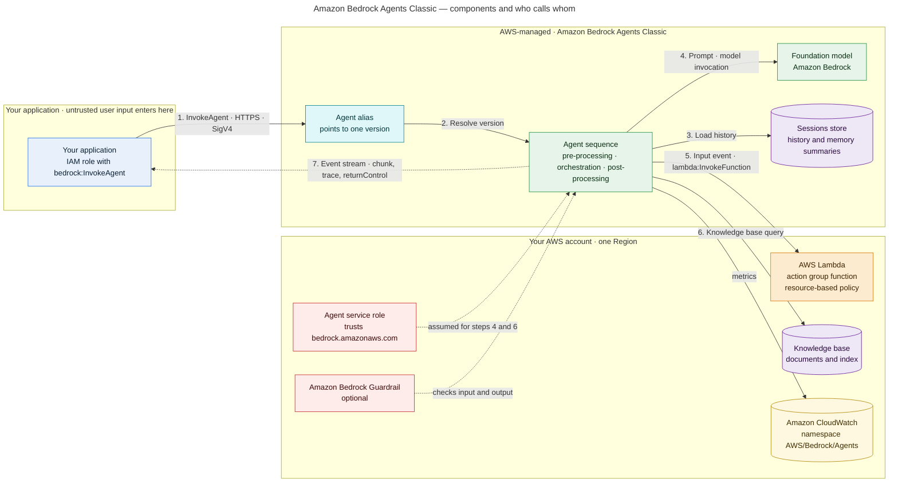
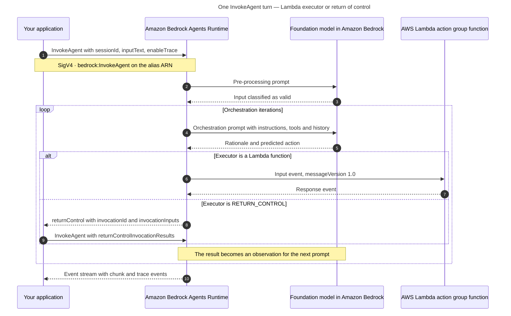

# Amazon Bedrock Agents Classic

> **Level:** Intermediate · **Verified:** 2026-11-15 · **Feature status:** Maintenance mode · **Time:** ~25 min

Amazon Bedrock Agents Classic is the original, fully managed agent service in Amazon Bedrock: you configure a model, instructions, tools and knowledge bases, and AWS runs the reasoning loop. This chapter is written for someone who **inherits** such an agent and has to understand it, keep it running and plan its move.

> [!IMPORTANT]
> **Status** — **Maintenance mode.** Amazon Bedrock Agents (launched November 2023) is now named Amazon Bedrock Agents Classic and has been closed to new customers since **2026-07-30**. An account with no Agents activity in the previous 12 months receives `AccessDeniedException` (HTTP 403) on `CreateAgent` and `InvokeInlineAgent`, and there is no exception process. Existing agents keep working and every other API stays available, but no new features are planned and the model catalog is frozen as of that date. AWS has announced no end-of-life date and no migration deadline. **Build new agents on Amazon Bedrock AgentCore**; AWS recommends the managed harness as the migration path.
> Sources: [Amazon Bedrock Agents Classic maintenance mode](https://docs.aws.amazon.com/bedrock/latest/userguide/agents-classic-maintenance-mode.html), [Amazon Bedrock Agents product page](https://aws.amazon.com/bedrock/agents/)

## Learning objectives

- Describe the steps of the Agents Classic sequence and what the foundation model decides in each.
- Read an inherited agent: its action groups, knowledge bases, versions, aliases, memory and service role.
- Explain what maintenance mode allows, blocks and freezes.
- Operate an existing agent safely: traces, metrics, quotas, pausing an alias.
- Recognise the Terraform, CloudFormation and CDK resources that describe an existing agent.

## Prerequisites

- [Agentic AI, tool calling and multi-agent architectures](../../00-foundations/generative-ai-fundamentals/06-agents-tool-calling-multi-agent.md)
- [The Converse API](../inference/01-converse-api.md)
- [Knowledge Bases overview: managed versus customer-managed](../knowledge-bases/01-knowledge-bases-overview.md)
- [IAM roles, trust policies and cross-account access](../../00-foundations/security/02-iam-roles-and-trust.md)

## 1. What it is

**Plain language.** Think of a temp agency that supplies a capable assistant. You hand over a job description (instructions), a list of phone numbers the assistant may call (action groups) and a filing cabinet (knowledge bases). The agency supervises the assistant's work for you. With Agents Classic, AWS is the agency: you never write the loop that decides what to do next. Terms are defined in the [glossary](../../GLOSSARY.md).

**Precisely.** An agent is a resource in the `bedrock-agent` namespace that you invoke through `bedrock-agent-runtime`. The rename changed nothing technical: the namespaces, SDK clients, CloudFormation types and IAM action prefix are the same as before.

| Item | Value |
|:--|:--|
| Service namespace / endpoint | Build time: `bedrock-agent` (`bedrock-agent.{region}.amazonaws.com`). Runtime: `bedrock-agent-runtime` (`bedrock-agent-runtime.{region}.amazonaws.com`) |
| Control-plane operations | `CreateAgent`, `UpdateAgent`, `PrepareAgent`, `CreateAgentActionGroup`, `AssociateAgentKnowledgeBase`, `CreateAgentAlias`, `UpdateAgentAlias`, `GetAgentVersion`, `DeleteAgent` |
| Data-plane operations | `InvokeAgent`, `InvokeInlineAgent`, `GetAgentMemory`, `DeleteAgentMemory` |
| IAM action prefix | `bedrock:` (for example `bedrock:InvokeAgent`, `bedrock:GetAgentAlias`) |

Sources: [Agents for Amazon Bedrock operations](https://docs.aws.amazon.com/bedrock/latest/APIReference/API_Operations_Agents_for_Amazon_Bedrock.html), [runtime operations](https://docs.aws.amazon.com/bedrock/latest/APIReference/API_Operations_Agents_for_Amazon_Bedrock_Runtime.html), [endpoints](https://docs.aws.amazon.com/general/latest/gr/bedrock.html). Every operation name in this chapter was also checked against the generated [API operations reference](../../references/bedrock-api-operations.md).

### What an agent is made of

| Part | What you will find in an inherited agent |
|:--|:--|
| Foundation model | `foundationModel`: a model ID, inference profile, Provisioned Throughput ARN or imported model ARN |
| Instructions | Natural-language role description, inserted into the orchestration prompt |
| Action groups | The tools: a schema plus an executor (next table) |
| Knowledge base associations | Knowledge bases the agent may query, each with a description that tells the model when to use it |
| Prompt templates | Base templates for pre-processing, orchestration, knowledge base response generation and post-processing, plus memory summarization and the routing classifier; any of them may be overridden ("advanced prompts") |
| Guardrail | Optional `guardrailConfiguration` (guardrail ID and version) |
| Versions and aliases | Immutable snapshots, and the pointers your application calls |

### Action groups

| Choice | Options | Notes |
|:--|:--|:--|
| How the action is described | **OpenAPI schema** (`apiSchema`: inline `payload` or an S3 object) or **function details** (`functionSchema`) | You must give exactly one. The schema's `openapi` value must be `"3.0.0"`; only a subset is supported and `enum` is not |
| Who runs the action | **Lambda function** (`actionGroupExecutor.lambda`) or **return of control** (`customControl: RETURN_CONTROL`) | With return of control, the predicted action and its parameters come back in the `InvokeAgent` response and your application runs it |
| Built-in signatures | `AMAZON.UserInput` (lets the agent ask the user for missing parameters), `AMAZON.CodeInterpreter` (sandboxed code execution), and the computer use values `ANTHROPIC.Computer`, `ANTHROPIC.Bash`, `ANTHROPIC.TextEditor` | Set through `parentActionGroupSignature`; such a group has no schema and no executor |
| Confirmation | `requireConfirmation` (function) or `x-requireConfirmation` (OpenAPI operation) | The documentation presents this as a safeguard against actions triggered by prompt injection |

One action group has one Lambda function, however many operations it defines. Bedrock sends an input event with `messageVersion` `"1.0"`, the `actionGroup`, either `apiPath` and `httpMethod` or `function`, the `parameters`, and the session attributes; the function returns a response event in the same shape. Sources: [Add an action group](https://docs.aws.amazon.com/bedrock/latest/userguide/agents-action-add.html), [CreateAgentActionGroup](https://docs.aws.amazon.com/bedrock/latest/APIReference/API_agent_CreateAgentActionGroup.html), [OpenAPI schemas](https://docs.aws.amazon.com/bedrock/latest/userguide/agents-api-schema.html), [Lambda functions for action groups](https://docs.aws.amazon.com/bedrock/latest/userguide/agents-lambda.html).

## 2. Why it exists

Without a managed agent service you build the loop yourself: prompt construction, tool-call parsing, retries, conversation storage, tracing and versioning. Agents Classic removed that work; AWS describes it as managing "prompt engineering, memory, monitoring, encryption, user permissions, and API invocation". AgentCore now does that job, which is why Agents Classic stopped evolving.

## 3. When to use it

- You **already run** an agent in an account that is allowlisted, and it meets its requirements.
- You need a small change to such an agent (instructions, an action group, a new version) while a migration is planned.
- Your workload runs in a Region where AgentCore is not yet available. AWS states that you can keep using Agents Classic there.

## 4. When not to use it

- **Any new agent.** Use the [AgentCore harness](../agentcore/03-agentcore-harness.md), or code on [AgentCore Runtime](../agentcore/02-agentcore-runtime.md).
- **A new AWS account or environment.** `CreateAgent` fails with HTTP 403; see [Agents Classic versus AgentCore, and migrating](03-agents-classic-vs-agentcore.md).
- **You need a model released after 2026-07-30.** The catalog is frozen.
- **A fixed sequence of steps.** Use [Amazon Bedrock Flows](../flows/01-bedrock-flows.md) or AWS Step Functions.
- **Question answering over documents only.** Use a knowledge base directly or [agentic retrieval](../agentic-retrieval/01-agentic-retrieval.md).

## 5. Internal architecture

AWS documents two sets of operations, **build time** and **runtime**, a "prompt store" that holds the prompts assembled when you prepare the agent, and a "sessions store" that holds conversation history. Everything else about the service internals is undocumented.



**What this shows** — The agent itself lives in the AWS-managed boundary. Your account holds what the agent is allowed to touch (a Lambda function, a knowledge base), the service role that grants that access, and the telemetry.

1. The application calls `InvokeAgent` on an **alias**, signed with SigV4.
2. The alias resolves to a version (or to `DRAFT` for the test alias `TSTALIASID`).
3. The agent loads the session's conversation history.
4. It sends a prompt to the foundation model, using the service role.
5. If the model chooses an action with a Lambda executor, Bedrock invokes the function. The function's resource-based policy must allow `bedrock.amazonaws.com`.
6. If the model chooses a knowledge base, the agent queries it with the service role.
7. The answer returns as an event stream of `chunk`, `trace` and, for return of control, `returnControl` events.

**Legend** — solid arrow: request · dashed arrow: response or control relationship · cylinder: data at rest · red: security control. The full picture is in [diagram set 10](../../diagrams/mermaid/10-bedrock-agents-classic.md).

### The agent sequence

| Step | What happens | Default |
|:--|:--|:--|
| Pre-processing | The model contextualises and categorises the input; can be used to validate it | On |
| Orchestration | The loop: the model produces a rationale, predicts an action or a knowledge base query, receives the result as an **observation**, and repeats until it can answer or must ask the user | On |
| Knowledge base response generation | Inside orchestration: the agent queries an associated knowledge base and summarises the results | Used when a knowledge base is queried |
| Post-processing | The model formats the final response | **Off** |

> [!NOTE]
> **Documented fact** — A *session* is all `InvokeAgent` requests with the same session ID, a *turn* is one `InvokeAgent` call, and an *iteration* is one model call plus an optional action, knowledge base query or question to the user. A turn consists of one or more iterations.
> Source: [Advanced prompt templates](https://docs.aws.amazon.com/bedrock/latest/userguide/advanced-prompts.html)

The default loop can be replaced: `orchestrationType: CUSTOM_ORCHESTRATION` hands control to a Lambda function that answers each state (`START`, `MODEL_INVOKED`, `TOOL_INVOKED`) with an event (`INVOKE_MODEL`, `INVOKE_TOOL`, `APPLY_GUARDRAIL`, `FINISH`). Check for this before anything else, because it changes the migration path. Source: [Custom orchestration](https://docs.aws.amazon.com/bedrock/latest/userguide/agents-custom-orchestration.html).

### Versions and aliases

A new agent has a working draft (`DRAFT`) and a test alias (`TSTALIASID`) that points to it. Changes go to the draft and take effect after `PrepareAgent`. Creating an alias makes Bedrock snapshot the draft as a numbered, **immutable** version. Calling `UpdateAgentAlias` without a `routingConfiguration` also creates a new version; with one, it repoints the alias, which is how you roll back. To pause an agent without touching IAM, set `aliasInvocationState` to `REJECT_INVOCATIONS`. Source: [Deploy an agent](https://docs.aws.amazon.com/bedrock/latest/userguide/deploy-agent.html).

### Session state and memory

| Mechanism | Scope | How it is set |
|:--|:--|:--|
| Conversation history | One session, until `idleSessionTTLInSeconds` (60–5,400) passes without activity | Automatic, keyed by `sessionId` |
| `sessionAttributes` | The session | `sessionState` in the request, or returned by the Lambda function |
| `promptSessionAttributes` | One turn | Same; available to the orchestration template as `$prompt_session_attributes$` |
| `knowledgeBaseConfigurations` | The request | Overrides search type, number of results and metadata filters per knowledge base |
| Memory (`SESSION_SUMMARY`) | Across sessions, 1–365 days (30 by default) | `memoryConfiguration` on the agent plus a `memoryId` per user at invocation |

Memory stores a model-written summary of each session after it ends (`endSession: true` or idle timeout). If memory is enabled but the call carries no `memoryId`, that turn is not stored. Sources: [Control agent session context](https://docs.aws.amazon.com/bedrock/latest/userguide/agents-session-state.html), [Agent memory](https://docs.aws.amazon.com/bedrock/latest/userguide/agents-memory.html), [Enable agent memory](https://docs.aws.amazon.com/bedrock/latest/userguide/agents-configure-memory.html).

## 6. Request and response lifecycle



- **Step 1** sends one turn; reusing the `sessionId` continues the conversation. **Steps 2–3** run only if pre-processing is enabled.
- **Steps 4–5** repeat once per iteration: the orchestration prompt goes out, a rationale and the next action come back.
- **Steps 6–7**: a Lambda executor is invoked synchronously. A function-details action can answer with `responseState` `REPROMPT` (the model retries) or `FAILURE` (the agent raises `DependencyFailedException`).
- **Steps 8–9**: with return of control the turn **ends**. The application runs the action and sends the result in `sessionState.returnControlInvocationResults` with the same `invocationId`; `inputText` is ignored on that call.
- **Step 10**: the answer arrives as `chunk` events; `streamFinalResponse` splits it into smaller chunks.

**Error paths.** Errors are surfaced inside the event stream: `throttlingException` (429), `serviceQuotaExceededException`, `dependencyFailedException` (424, for example a failing Lambda function), `modelNotReadyException` (424, retried by the SDK up to five times), `accessDeniedException` (403) and `validationException`. Source: [InvokeAgent](https://docs.aws.amazon.com/bedrock/latest/APIReference/API_agent-runtime_InvokeAgent.html).

**Traces.** With `enableTrace`, each event carries a `TracePart` whose `trace` is one of `PreProcessingTrace`, `OrchestrationTrace` (rationale, invocation input, observation), `PostProcessingTrace`, `CustomOrchestrationTrace`, `RoutingClassifierTrace`, `GuardrailTrace` or `FailureTrace`. The trace is returned to the caller; it is not written to a log for you. Source: [Trace](https://docs.aws.amazon.com/bedrock/latest/userguide/trace-events.html).

## 7. Dependencies

| Depends on | Why | Required or optional |
|:--|:--|:-:|
| A foundation model in the frozen Agents Classic catalog | Every step is a model invocation | Required |
| IAM service role | Lets Bedrock invoke the model, read schemas and query knowledge bases | Required |
| Action group or knowledge base | An agent needs at least one of the two | Required (one of) |
| AWS Lambda | Runs action group logic, prompt parsers and custom orchestration | Optional |
| Amazon S3 | Stores OpenAPI schemas and files for code interpretation | Optional |
| Amazon Bedrock Guardrails | Filters input and output | Optional |
| AWS KMS customer managed key | Encrypts agent resources instead of the AWS-owned key | Optional |

## 8. Security considerations

- **Two IAM boundaries.** The caller needs `bedrock:InvokeAgent` on the alias ARN. The agent acts through its **service role**, trusted by `bedrock.amazonaws.com`; AWS recommends the `aws:SourceAccount` and `aws:SourceArn` conditions on that trust.
- **Service role contents.** `bedrock:InvokeModel` on the model (plus `bedrock:InvokeModelWithResponseStream` for streaming, and more for inference profiles), `s3:GetObject` on schema objects, `bedrock:Retrieve` and `bedrock:RetrieveAndGenerate` on knowledge bases, and optionally `bedrock:ApplyGuardrail`, Provisioned Throughput and KMS permissions. Source: [Service role for agents](https://docs.aws.amazon.com/bedrock/latest/userguide/agents-permissions.html).
- **Lambda.** Each action group function needs a resource-based policy for `bedrock.amazonaws.com`, scoped to the agent ARN. The function's own execution role is the real limit on what the agent can do.
- **Encryption.** Agent and session data are encrypted with AWS-owned keys by default; `customerEncryptionKeyArn` selects a customer managed key. Agents created before 2025-01-22 follow a different key policy procedure. Source: [Encryption of agent resources](https://docs.aws.amazon.com/bedrock/latest/userguide/encryption-agents-new.html).
- **Traces contain prompts.** A trace includes the full prompt, model output, tool inputs and retrieved text. Treat it as sensitive.
- **Audit.** `InvokeAgent` is a CloudTrail **data event** (resource type `AWS::Bedrock::AgentAlias`) and is not logged unless you enable it. Source: [CloudTrail for Amazon Bedrock](https://docs.aws.amazon.com/bedrock/latest/userguide/logging-using-cloudtrail.html).

> [!TIP]
> **Academy recommendation** — Turn on confirmation for every action that changes data, and keep the Lambda execution role narrower than the agent's instructions. The model decides *which* tool to call; IAM decides what that call can do. See [Prompt injection, untrusted tool output and retrieval poisoning](../../06-security-governance/04-prompt-injection-and-untrusted-content.md).
> This is our design guidance, not an official AWS reference architecture.

## 9. Networking requirements

- Both endpoints are public and Regional. Interface VPC endpoints exist as `com.amazonaws.region.bedrock-agent` and `com.amazonaws.region.bedrock-agent-runtime`. Source: [Interface VPC endpoints for Amazon Bedrock](https://docs.aws.amazon.com/bedrock/latest/userguide/vpc-interface-endpoints.html).
- The agent does not run in your VPC. **Our reading:** it reaches your Lambda function through the Lambda service, so private resources are reached by attaching the *function* to your VPC, not the agent.
- The documentation lists 16 supported Regions, including AWS GovCloud (US-West). Code interpretation is limited to US East (N. Virginia), US West (Oregon) and Europe (Frankfurt). Sources: [Supported Regions](https://docs.aws.amazon.com/bedrock/latest/userguide/agents-supported.html), [Code interpretation](https://docs.aws.amazon.com/bedrock/latest/userguide/agents-code-interpretation.html).

## 10. Pricing dimensions

AWS states: "There is no charge for Bedrock Agents Classic itself. You continue to pay only for the underlying model inference and any associated resources." No figure is quoted here.

| Dimension | Unit | Notes |
|:--|:--|:--|
| Model inference | Input and output tokens | Every iteration is a model call that carries instructions, tool definitions and history; an agent turn costs several plain model calls |
| Knowledge base | As priced for the knowledge base type | See [Knowledge Bases overview](../knowledge-bases/01-knowledge-bases-overview.md) |
| AWS Lambda | Requests and duration | Action groups, parsers, custom orchestration |
| Guardrails, KMS customer managed keys, CloudTrail data events | Per their own pricing | Optional |

## 11. Scaling considerations

Default quotas per Region, as of the verification date ([Amazon Bedrock endpoints and quotas](https://docs.aws.amazon.com/general/latest/gr/bedrock.html)):

| Quota | Default | Adjustable |
|:--|--:|:-:|
| Agents per account | 1,000 | Yes |
| Action groups per agent / enabled action groups per agent | 20 / 15 | Yes |
| APIs per agent | 11 | Yes |
| Parameters per function | 5 | Yes |
| Associated knowledge bases per agent | 2 | Yes |
| Associated aliases per agent | 10 | No |
| Characters in agent instructions | 20,000 | No |
| `PrepareAgent` / `UpdateAgent` / `CreateAgentAlias` requests per second | 2 / 4 / 2 | No |
| Concurrent code interpretation sessions per account | 25 | — |

- The quota table has no `InvokeAgent` rate. **Our reading:** runtime throughput is bounded by the quotas of the model the agent calls; watch `InvocationThrottles` and `ModelInvocationThrottles` in the `AWS/Bedrock/Agents` namespace.
- The `CreateAgent` API reference still shows a 4,000-character maximum for `instruction`, while the quota table says 20,000. Test before relying on the larger value.
- An alias can carry Provisioned Throughput through its routing configuration.
- **Our reading:** a frozen catalog is a lifecycle risk. When the model an agent uses reaches end of life, the replacement must also come from the frozen catalog. See [Model lifecycle and selection](../foundation-models/02-model-lifecycle-and-selection.md).

### What maintenance mode means in practice

| Area | Effect |
|:--|:--|
| Existing agents | Keep working; `UpdateAgent`, `PrepareAgent`, `InvokeAgent`, action group, knowledge base and alias APIs remain available |
| New agents | `CreateAgent` and `InvokeInlineAgent` return HTTP 403 in accounts without Agents activity in the previous 12 months. The check is per account |
| Exceptions | None. AWS determines the allowlist automatically |
| Models | Catalog frozen as of 2026-07-30 |
| Features | None planned |
| IaC | Existing templates keep working in allowlisted accounts; new environments in other accounts must use AgentCore resources |
| Pricing, names | Unchanged. API namespaces, SDK clients, CloudFormation types and IAM prefixes stay the same |

**UNVERIFIED — REQUIRES DOCUMENTATION REVIEW**: whether the 12-month activity window is evaluated once (at 2026-07-30) or continuously. The maintenance-mode page does not say; we looked for a statement on whether an idle allowlisted account can later lose `CreateAgent`.

## 12. IaC support

| Tool | Support | Resource / construct | Notes |
|:--|:-:|:--|:--|
| Terraform (`hashicorp/aws` 6.73.0) | ✅ | `aws_bedrockagent_agent`, `aws_bedrockagent_agent_action_group`, `aws_bedrockagent_agent_knowledge_base_association`, `aws_bedrockagent_agent_alias`, `aws_bedrockagent_agent_collaborator`; data source `aws_bedrockagent_agent_versions` | The 6.73.0 schema of `aws_bedrockagent_agent` has no argument for custom orchestration |
| CloudFormation | ✅ | `AWS::Bedrock::Agent`, `AWS::Bedrock::AgentAlias` | Action groups, knowledge bases and collaborators are properties of the agent; `AutoPrepare` defaults to `false` |
| AWS CDK (`aws-cdk-lib` 2.277.0) | L1 · alpha | `aws_bedrock.CfnAgent`, `aws_bedrock.CfnAgentAlias`; `Agent`, `AgentAlias` in `@aws-cdk/aws-bedrock-alpha` | The alpha package is experimental |

Checked against the [generated Terraform reference](../../references/terraform-aws-provider-bedrock.md), the [CDK and CloudFormation reference](../../references/cdk-and-cloudformation-bedrock.md) and the [`AWS::Bedrock::Agent` reference](https://docs.aws.amazon.com/AWSCloudFormation/latest/TemplateReference/aws-resource-bedrock-agent.html). These resources are **legacy**: applying them in a non-allowlisted account fails at `CreateAgent`. Coverage for the replacement is in [Terraform coverage for Amazon Bedrock](../../04-infrastructure-as-code/terraform/10-terraform-for-bedrock.md).

## 13. Working example

### Terraform — for existing agents only

> **Code status:** validated with `terraform validate` (Terraform 1.17.2, provider 6.73.0, in a scratch root with a `versions.tf` pinning `~> 6.73`) · **never planned or applied against AWS**

```terraform
# FOR EXISTING AGENTS ONLY — Amazon Bedrock Agents Classic is in maintenance mode.
# In an account without Agents activity in the previous 12 months, CreateAgent
# returns AccessDeniedException (HTTP 403). New agents belong on AgentCore.

variable "agent_name" {
  description = "Name of the existing agent this configuration manages."
  type        = string
}

variable "foundation_model_id" {
  description = "Model ID the agent already uses. No default: confirm it in the model catalog."
  type        = string
}

variable "agent_instruction" {
  description = "Agent instructions (40 characters minimum)."
  type        = string
}

variable "action_lambda_arn" {
  description = "ARN of the Lambda function that fulfils the action group."
  type        = string
}

variable "knowledge_base_id" {
  description = "ID of the knowledge base associated with the agent."
  type        = string
}

data "aws_caller_identity" "current" {}
data "aws_partition" "current" {}
data "aws_region" "current" {}

locals {
  account_id  = data.aws_caller_identity.current.account_id
  bedrock_arn = "arn:${data.aws_partition.current.partition}:bedrock:${data.aws_region.current.region}"
}

# Service role: only Amazon Bedrock, acting for an agent in this account, may assume it.
data "aws_iam_policy_document" "agent_trust" {
  statement {
    actions = ["sts:AssumeRole"]
    principals {
      type        = "Service"
      identifiers = ["bedrock.amazonaws.com"]
    }
    condition {
      test     = "StringEquals"
      variable = "aws:SourceAccount"
      values   = [local.account_id]
    }
    condition {
      test     = "ArnLike"
      variable = "aws:SourceArn"
      values   = ["${local.bedrock_arn}:${local.account_id}:agent/*"]
    }
  }
}

data "aws_iam_policy_document" "agent_permissions" {
  statement {
    sid       = "AgentModelInvocationPermissions"
    actions   = ["bedrock:InvokeModel", "bedrock:InvokeModelWithResponseStream"]
    resources = ["${local.bedrock_arn}::foundation-model/${var.foundation_model_id}"]
  }
  statement {
    sid       = "AgentKnowledgeBaseQuery"
    actions   = ["bedrock:Retrieve", "bedrock:RetrieveAndGenerate"]
    resources = ["${local.bedrock_arn}:${local.account_id}:knowledge-base/${var.knowledge_base_id}"]
  }
}

resource "aws_iam_role" "agent" {
  name_prefix        = "AmazonBedrockExecutionRoleForAgents_"
  assume_role_policy = data.aws_iam_policy_document.agent_trust.json
}

resource "aws_iam_role_policy" "agent" {
  role   = aws_iam_role.agent.id
  policy = data.aws_iam_policy_document.agent_permissions.json
}

resource "aws_bedrockagent_agent" "this" {
  agent_name                  = var.agent_name
  agent_resource_role_arn     = aws_iam_role.agent.arn
  foundation_model            = var.foundation_model_id
  instruction                 = var.agent_instruction
  idle_session_ttl_in_seconds = 600
}

# Action group defined with function details and fulfilled by a Lambda function.
resource "aws_bedrockagent_agent_action_group" "orders" {
  action_group_name          = "orders"
  agent_id                   = aws_bedrockagent_agent.this.agent_id
  agent_version              = "DRAFT"
  skip_resource_in_use_check = true

  action_group_executor {
    lambda = var.action_lambda_arn
  }

  function_schema {
    member_functions {
      functions {
        name        = "get_order_status"
        description = "Return the status of one order."
        parameters {
          map_block_key = "order_id"
          type          = "string"
          description   = "Order identifier"
          required      = true
        }
      }
    }
  }
}

# Resource-based policy: lets this agent, and only this agent, invoke the function.
resource "aws_lambda_permission" "agent" {
  statement_id   = "AllowBedrockAgentInvoke"
  action         = "lambda:InvokeFunction"
  function_name  = var.action_lambda_arn
  principal      = "bedrock.amazonaws.com"
  source_account = local.account_id
  source_arn     = aws_bedrockagent_agent.this.agent_arn
}

resource "aws_bedrockagent_agent_knowledge_base_association" "docs" {
  agent_id             = aws_bedrockagent_agent.this.agent_id
  description          = "Use this knowledge base for questions about order and returns policy."
  knowledge_base_id    = var.knowledge_base_id
  knowledge_base_state = "ENABLED"
}

# The alias is what applications call. Creating it snapshots DRAFT as a new version.
resource "aws_bedrockagent_agent_alias" "live" {
  agent_alias_name = "live"
  agent_id         = aws_bedrockagent_agent.this.agent_id
  description      = "Alias used by the application"

  depends_on = [
    aws_bedrockagent_agent_action_group.orders,
    aws_bedrockagent_agent_knowledge_base_association.docs,
  ]
}

output "agent_alias_arn" {
  description = "ARN to scope bedrock:InvokeAgent permissions to."
  value       = aws_bedrockagent_agent_alias.live.agent_alias_arn
}
```

The provider prepares the agent after each change (`prepare_agent` defaults to `true`). **Our reading:** a later change to the draft does not alter the alias resource, so Terraform does not cut a new version for you; check which version the alias serves after every change. The provider documentation gives 0–30 for `storage_days`, whereas the AWS documentation allows 1–365 days of memory retention; verify before setting more than 30.

### Invoking an alias and handling return of control

> **Code status:** syntax-checked (`python -m py_compile`) · **never run against AWS** · **never deployed**

```python
"""Invoke an existing Agents Classic alias and handle return of control."""
import uuid

import boto3

runtime = boto3.client("bedrock-agent-runtime")  # Region comes from your configuration


def invoke(agent_id: str, alias_id: str, session_id: str, **kwargs) -> dict:
    """Run one turn; return the answer text and any returnControl payload."""
    response = runtime.invoke_agent(
        agentId=agent_id, agentAliasId=alias_id, sessionId=session_id, enableTrace=True, **kwargs
    )
    answer, return_control = "", None
    for event in response["completion"]:  # event stream
        if "chunk" in event:
            answer += event["chunk"]["bytes"].decode()
        elif "trace" in event:
            print("trace:", list(event["trace"]["trace"].keys()))  # contains prompts: sensitive
        elif "returnControl" in event:
            return_control = event["returnControl"]
    return {"answer": answer, "return_control": return_control}


def run_turn(agent_id: str, alias_id: str, text: str, fulfil) -> str:
    """`fulfil` is your function: it runs one predicted action and returns an apiResult or functionResult."""
    session_id = str(uuid.uuid4())
    result = invoke(agent_id, alias_id, session_id, inputText=text)
    while result["return_control"]:  # the agent paused and handed the action to your code
        pending = result["return_control"]
        results = [fulfil(item) for item in pending["invocationInputs"]]
        result = invoke(
            agent_id,
            alias_id,
            session_id,
            sessionState={
                "invocationId": pending["invocationId"],
                "returnControlInvocationResults": results,
            },
        )
    return result["answer"]
```

## Common mistakes

| Mistake | Symptom | Fix |
|:--|:--|:--|
| Deploying the agent's template into a new account | `AccessDeniedException` (HTTP 403): "Bedrock Agents is in Maintenance Mode. New agent creation is not available…" | Use AgentCore resources for new accounts; see [chapter 3](03-agents-classic-vs-agentcore.md) |
| Editing the draft and expecting production to change | The application keeps the old behaviour | Prepare, create a version, repoint the alias |
| Applications calling `TSTALIASID` | Every draft edit reaches users immediately | Call a named alias that points to a numbered version |
| Missing Lambda resource-based policy | `dependencyFailedException` at the first tool call | Add `lambda:InvokeFunction` for `bedrock.amazonaws.com`, scoped to the agent ARN |
| Memory enabled but no `memoryId` sent | Nothing is remembered across sessions | Pass a stable `memoryId` per user |
| Streaming turned on without `bedrock:InvokeModelWithResponseStream` on the service role | Access denied during orchestration | Add the action for the agent's model |
| Using `enum` in an action group OpenAPI schema | The constraint is not supported | Describe allowed values in the parameter `description` |
| Logging traces verbatim | Prompts, retrieved text and tool inputs appear in application logs | Redact, or keep traces off in production |

## Knowledge check

1. An inherited agent answers correctly in the console test window but your application still gets last month's behaviour. What are the two most likely explanations?
2. Your platform team creates a new staging account and applies the same Terraform that works in production. `aws_bedrockagent_agent` fails with HTTP 403. Why, and what are the options?
3. What would happen if an action group configured with `RETURN_CONTROL` were called and the application sent the result back with a different `invocationId` and a new `inputText`?
4. Why can one user question to an agent cost several times the tokens of the same question sent to the Converse API?

<details>
<summary>Answers</summary>

1. The test window uses the working draft through `TSTALIASID`, while the application calls an alias that still points to an older immutable version; or the draft was changed but never prepared and versioned. Create a version and repoint the alias.
2. The staging account has no Agents activity in the previous 12 months, so `CreateAgent` is blocked and there is no exception process. Either test in an allowlisted account, or build the staging and future environments on AgentCore.
3. The result must carry the same `invocationId` (and action group) that the agent returned, and `inputText` is ignored when `returnControlInvocationResults` is present. A mismatched ID cannot be matched to the paused action.
4. A turn is one or more iterations, and each iteration is a separate model call that repeats the instructions, tool definitions, history and earlier observations. Pre-processing and knowledge base response generation add further calls.

</details>

## 14. Official documentation

- [Amazon Bedrock Agents Classic maintenance mode](https://docs.aws.amazon.com/bedrock/latest/userguide/agents-classic-maintenance-mode.html) — status, HTTP 403 behaviour, FAQ, capability mapping.
- [Amazon Bedrock Agents product page](https://aws.amazon.com/bedrock/agents/) — end-of-support notice.
- [Automate tasks in your application using AI agents](https://docs.aws.amazon.com/bedrock/latest/userguide/agents.html) and [How Amazon Bedrock Agents works](https://docs.aws.amazon.com/bedrock/latest/userguide/agents-how.html) — build time, runtime, the agent sequence.
- [Use action groups](https://docs.aws.amazon.com/bedrock/latest/userguide/agents-action-create.html), [Add an action group](https://docs.aws.amazon.com/bedrock/latest/userguide/agents-action-add.html), [Function details](https://docs.aws.amazon.com/bedrock/latest/userguide/agents-action-function.html), [OpenAPI schemas](https://docs.aws.amazon.com/bedrock/latest/userguide/agents-api-schema.html), [Lambda functions](https://docs.aws.amazon.com/bedrock/latest/userguide/agents-lambda.html) — action groups.
- [Return control to the agent developer](https://docs.aws.amazon.com/bedrock/latest/userguide/agents-returncontrol.html) and [User input](https://docs.aws.amazon.com/bedrock/latest/userguide/agents-user-input.html) — return of control and `AMAZON.UserInput`.
- [Augment response generation with a knowledge base](https://docs.aws.amazon.com/bedrock/latest/userguide/agents-kb-add.html) — `AssociateAgentKnowledgeBase`.
- [Control agent session context](https://docs.aws.amazon.com/bedrock/latest/userguide/agents-session-state.html), [Memory](https://docs.aws.amazon.com/bedrock/latest/userguide/agents-memory.html), [Enable agent memory](https://docs.aws.amazon.com/bedrock/latest/userguide/agents-configure-memory.html) — session state and memory.
- [Advanced prompt templates](https://docs.aws.amazon.com/bedrock/latest/userguide/advanced-prompts.html) and [Custom orchestration](https://docs.aws.amazon.com/bedrock/latest/userguide/agents-custom-orchestration.html) — templates, terminology, replacing the loop.
- [Code interpretation](https://docs.aws.amazon.com/bedrock/latest/userguide/agents-code-interpretation.html) — Regions and limits.
- [Deploy an agent](https://docs.aws.amazon.com/bedrock/latest/userguide/deploy-agent.html), [Test and troubleshoot agent behavior](https://docs.aws.amazon.com/bedrock/latest/userguide/agents-test.html), [Invoke an agent](https://docs.aws.amazon.com/bedrock/latest/userguide/agents-invoke-agent.html) — versions, aliases, preparing, streaming.
- [Track the agent's reasoning using trace](https://docs.aws.amazon.com/bedrock/latest/userguide/trace-events.html) — trace structure.
- [Create a service role for Amazon Bedrock Agents](https://docs.aws.amazon.com/bedrock/latest/userguide/agents-permissions.html), [Encryption of agent resources](https://docs.aws.amazon.com/bedrock/latest/userguide/encryption-agents-new.html), [agents created before 2025-01-22](https://docs.aws.amazon.com/bedrock/latest/userguide/encryption-agents.html) — IAM and KMS.
- [Interface VPC endpoints](https://docs.aws.amazon.com/bedrock/latest/userguide/vpc-interface-endpoints.html), [Supported Regions for Amazon Bedrock Agents](https://docs.aws.amazon.com/bedrock/latest/userguide/agents-supported.html) — networking and Regions.
- [CloudWatch metrics for agents](https://docs.aws.amazon.com/bedrock/latest/userguide/monitoring-agents-cw-metrics.html), [CloudTrail for Amazon Bedrock](https://docs.aws.amazon.com/bedrock/latest/userguide/logging-using-cloudtrail.html) — monitoring and audit.
- [Amazon Bedrock endpoints and quotas](https://docs.aws.amazon.com/general/latest/gr/bedrock.html) — endpoints and the quota table.
- [InvokeAgent](https://docs.aws.amazon.com/bedrock/latest/APIReference/API_agent-runtime_InvokeAgent.html), [CreateAgent](https://docs.aws.amazon.com/bedrock/latest/APIReference/API_agent_CreateAgent.html), [CreateAgentActionGroup](https://docs.aws.amazon.com/bedrock/latest/APIReference/API_agent_CreateAgentActionGroup.html), [build-time operations](https://docs.aws.amazon.com/bedrock/latest/APIReference/API_Operations_Agents_for_Amazon_Bedrock.html), [runtime operations](https://docs.aws.amazon.com/bedrock/latest/APIReference/API_Operations_Agents_for_Amazon_Bedrock_Runtime.html) — API reference.
- [`AWS::Bedrock::Agent`](https://docs.aws.amazon.com/AWSCloudFormation/latest/TemplateReference/aws-resource-bedrock-agent.html) — CloudFormation properties.
- Terraform provider documentation: [`aws_bedrockagent_agent`](https://raw.githubusercontent.com/hashicorp/terraform-provider-aws/main/website/docs/r/bedrockagent_agent.html.markdown), [`aws_bedrockagent_agent_action_group`](https://raw.githubusercontent.com/hashicorp/terraform-provider-aws/main/website/docs/r/bedrockagent_agent_action_group.html.markdown), [`aws_bedrockagent_agent_alias`](https://raw.githubusercontent.com/hashicorp/terraform-provider-aws/main/website/docs/r/bedrockagent_agent_alias.html.markdown), [`aws_bedrockagent_agent_knowledge_base_association`](https://raw.githubusercontent.com/hashicorp/terraform-provider-aws/main/website/docs/r/bedrockagent_agent_knowledge_base_association.html.markdown).
