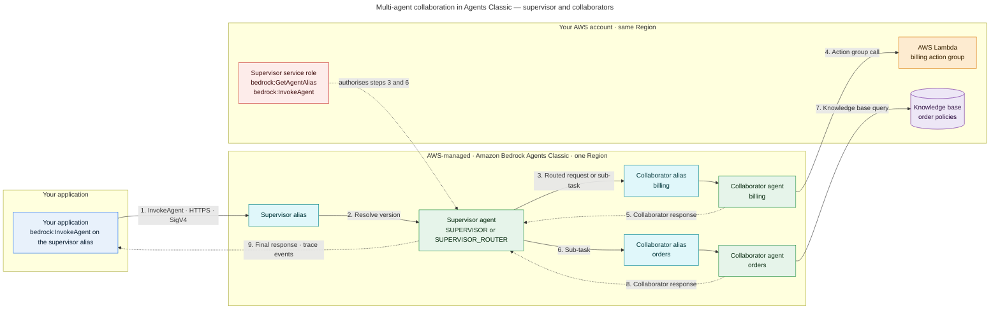
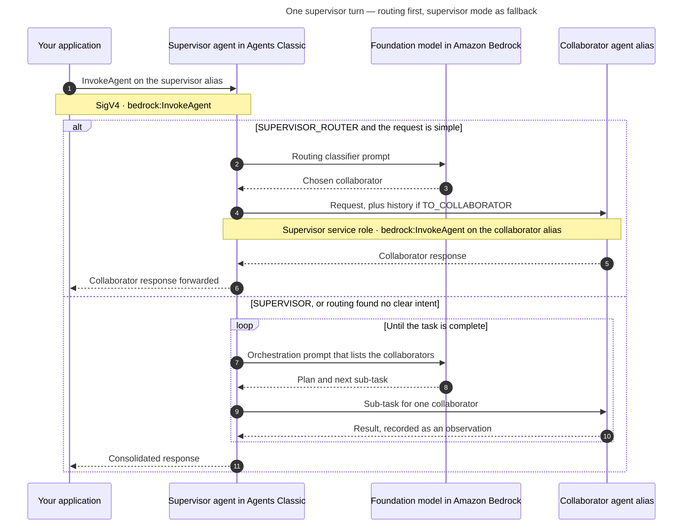

# Multi-agent collaboration

> **Level:** Intermediate · **Verified:** 2026-11-15 · **Feature status:** Maintenance mode · **Time:** ~20 min

Multi-agent collaboration is the Amazon Bedrock Agents Classic feature that lets one agent, the **supervisor**, hand work to other agents, the **collaborators**. This chapter explains how an inherited team of agents works, how to operate it, and how the same pattern is expressed on Amazon Bedrock AgentCore today.

> [!IMPORTANT]
> **Status** — **Maintenance mode.** Multi-agent collaboration is part of Amazon Bedrock Agents Classic, which has been closed to new customers since **2026-07-30**. Supervisors and collaborators are ordinary agents, so an account with no Agents activity in the previous 12 months receives `AccessDeniedException` (HTTP 403) on `CreateAgent` and `InvokeInlineAgent` and cannot build a new team. Existing teams keep working; no new features are planned. For new multi-agent work use AgentCore, where AWS rates the equivalent of this feature as **"Limited"** (explained in section 5).
> Sources: [Amazon Bedrock Agents Classic maintenance mode](https://docs.aws.amazon.com/bedrock/latest/userguide/agents-classic-maintenance-mode.html), [Use multi-agent collaboration](https://docs.aws.amazon.com/bedrock/latest/userguide/agents-multi-agent-collaboration.html)

## Learning objectives

- Describe the supervisor and collaborator roles and the two collaboration modes.
- Explain how conversation history reaches a collaborator and what payload referencing does.
- Read a multi-agent trace to find out which collaborator handled a request.
- State the documented limits, including the ones on which AWS sources disagree.
- Map the pattern to AgentCore and explain what AWS means by "Limited".

## Prerequisites

- [Amazon Bedrock Agents Classic](01-agents-classic.md)
- [Agentic AI, tool calling and multi-agent architectures](../../00-foundations/generative-ai-fundamentals/06-agents-tool-calling-multi-agent.md)

## 1. What it is

**Plain language.** A help desk has a front-desk coordinator and several specialists. The coordinator listens to the customer, decides who knows the answer, passes the question on and gives the customer one reply. The supervisor agent is the coordinator; the collaborators are the specialists. Each of them is a complete agent with its own instructions, tools and knowledge bases.

**Precisely.** A supervisor is an agent whose `agentCollaboration` setting is not `DISABLED`, with one or more collaborators attached by `AssociateAgentCollaborator`. A collaborator is referenced by the ARN of one of its **aliases**. The application invokes only the supervisor.

| Item | Value |
|:--|:--|
| Service namespace / endpoint | `bedrock-agent` (build time) and `bedrock-agent-runtime` (runtime) — the same as any Agents Classic agent |
| Control-plane operations | `CreateAgent` / `UpdateAgent` with `agentCollaboration`; `AssociateAgentCollaborator`, `UpdateAgentCollaborator`, `GetAgentCollaborator`, `ListAgentCollaborators`, `DisassociateAgentCollaborator`; `PrepareAgent` |
| Data-plane operations | `InvokeAgent` on the supervisor's alias; `InvokeInlineAgent` for a supervisor defined at request time |
| IAM action prefix | `bedrock:` — the supervisor's service role needs `bedrock:GetAgentAlias` and `bedrock:InvokeAgent` on each collaborator alias |

### The two collaboration modes

| Console name | `agentCollaboration` | What the supervisor does |
|:--|:--|:--|
| Supervisor | `SUPERVISOR` | Coordinates responses from the collaborators and writes the final response itself |
| Supervisor with routing | `SUPERVISOR_ROUTER` | Routes the request to the appropriate collaborator, which sends the final response. AWS states that this reduces latency |
| (off) | `DISABLED` | The default: an ordinary single agent |

The general availability announcement adds one behaviour: in routing mode, simple requests go straight to a collaborator, and "for complex queries or when no clear intention is detected, it automatically falls back to the full supervisor mode". Sources: [Create multi-agent collaboration](https://docs.aws.amazon.com/bedrock/latest/userguide/create-multi-agent-collaboration.html), [GA announcement blog](https://aws.amazon.com/blogs/machine-learning/amazon-bedrock-announces-general-availability-of-multi-agent-collaboration/).

## 2. Why it exists

One agent with thirty tools and five knowledge bases has a long prompt, picks the wrong tool more often and is hard for several teams to own. Splitting the work gives each specialist a short prompt and a narrow set of permissions. Without the feature you would write the delegation yourself: a tool that calls another agent, code that forwards history, and code that merges traces.

## 3. When to use it

- You **inherit** a supervisor and collaborators in an allowlisted account and they meet their requirements.
- You need to adjust such a team — a collaboration instruction, a collaborator's alias — while a migration is planned.

## 4. When not to use it

- **Any new multi-agent system.** Build it on [AgentCore Runtime](../agentcore/02-agentcore-runtime.md) with a framework, or with the [AgentCore harness](../agentcore/03-agentcore-harness.md) for the simpler agent-as-tool case. Patterns are compared in [Agent orchestration patterns](../../09-advanced-topics/07-agent-orchestration-patterns.md).
- **A new account or environment.** `CreateAgent` is blocked.
- **The specialists never need to reason.** If a "collaborator" only wraps one API call, make it an action group on a single agent.
- **The path is fixed.** Use [Amazon Bedrock Flows](../flows/01-bedrock-flows.md) or AWS Step Functions.

## 5. Internal architecture



**What this shows** — A hierarchy inside one Region. The application knows only the supervisor's alias. Each collaborator is reached through its own alias and keeps its own tools, knowledge bases, guardrail and service role.

1. The application invokes the supervisor alias.
2. The alias resolves to a supervisor version.
3. The supervisor sends the request (routing) or a sub-task (supervisor mode) to a collaborator alias.
4. The billing collaborator runs its own orchestration and calls its action group.
5. Its answer returns to the supervisor.
6. In supervisor mode the supervisor may call further collaborators, one after another or in parallel.
7. The orders collaborator queries its knowledge base.
8. Its answer returns to the supervisor.
9. The supervisor responds; with tracing on, events from every agent arrive in the same stream.

**Legend** — solid arrow: request · dashed arrow: response or authorisation · cylinder: data at rest. The complete set of views is [diagram set 11](../../diagrams/mermaid/11-multi-agent-collaboration.md).

### How a collaborator is attached

| `AssociateAgentCollaborator` field | Meaning |
|:--|:--|
| `agentDescriptor.aliasArn` | The collaborator's **alias** ARN. A collaborator must therefore be prepared, versioned and aliased first |
| `collaboratorName` | A name used only in the supervisor's prompts; it does not rename the agent |
| `collaborationInstruction` | 1–4,000 characters telling the supervisor when to use this collaborator |
| `relayConversationHistory` | `TO_COLLABORATOR` or `DISABLED` |

The association is made on the supervisor's `DRAFT` version, so the supervisor must be prepared and versioned afterwards. AWS also notes that the supervisor must be saved before collaboration can be enabled. Source: [AssociateAgentCollaborator](https://docs.aws.amazon.com/bedrock/latest/APIReference/API_agent_AssociateAgentCollaborator.html).

### How conversation history is shared

- **Off by default per collaborator.** With `relayConversationHistory` set to `TO_COLLABORATOR`, "the supervisor will include the full history of the current session, including the user input text and the supervisor agent response from each turn of the conversation".
- **`conversationHistory` in session state.** The supervisor builds this field automatically when it invokes a collaborator; you may also supply it to add context.
- **Payload referencing.** A prompt compression feature, on by default for the primary agent, that lets the supervisor refer to a payload instead of repeating it. AWS states that it reduces output tokens and the size of the conversation history.
- **Return of control.** If a collaborator's action group returns control, the supervisor's response carries the `agentId` and `collaboratorName`; the caller sends the result back to the *supervisor* with that `agentId`, and it is passed on.

Sources: [Create multi-agent collaboration](https://docs.aws.amazon.com/bedrock/latest/userguide/create-multi-agent-collaboration.html), [Control agent session context](https://docs.aws.amazon.com/bedrock/latest/userguide/agents-session-state.html), [Advanced prompt templates](https://docs.aws.amazon.com/bedrock/latest/userguide/advanced-prompts.html), [Return of control](https://docs.aws.amazon.com/bedrock/latest/userguide/agents-returncontrol.html).

### The same pattern on AgentCore today

The official capability comparison rates "multi-agent collaboration roles and routing" as: "**Limited.** The supervisor pattern is possible by exposing agents as MCP tools (agent-as-tool). Routing mode multi-agent is not straightforward today. Full multi-agent collaboration requires custom framework code." Read as three statements:

1. **Supervisor mode has a counterpart**, but you wire it: each specialist becomes a tool that the supervising agent calls.
2. **Routing mode has no managed counterpart.** Nothing on AgentCore is documented as the equivalent of `SUPERVISOR_ROUTER` and its routing classifier.
3. **Everything richer is code.** AWS lists "multi-agent collaboration and supervisor patterns" under code-defined agents on AgentCore Runtime, and says such migrations "will require more significant code work".

| Agents Classic | AgentCore building block | What the documentation states |
|:--|:--|:--|
| Supervisor coordinating collaborators | Agent-as-tool from a harness or a code-defined agent | Possible; "the managed harness supports an agent-as-tool pattern for simpler multi-agent use cases" |
| `SUPERVISOR_ROUTER` | — | "Not straightforward today" |
| Agent calling agent | A2A servers on AgentCore Runtime | Runtime proxies JSON-RPC 2.0 to a container on port 9000 and serves the Agent Card at `/.well-known/agent-card.json`, with SigV4 or OAuth 2.0 |
| Collaborator reached by alias ARN | AgentCore Gateway **HTTP targets** | A Runtime agent, or an A2A service through a passthrough target, can sit behind a gateway. Traffic is forwarded without aggregation; clients address each target by path |
| Delegation inside one agent | Harness built-in `subagent` tool | Delegates a task to a fresh child agent; "the child is not a separately configured harness" |
| Finding agents | AWS Agent Registry | A catalog of agents, MCP servers, tools and skills |
| Importing a team | AgentCore CLI import | The CLI repository states that multi-agent collaboration "produces separate collaborator files with recursive translation" |

**Our reading:** history relay, payload referencing, relaying return of control through a supervisor, and a single trace with a caller chain have no managed equivalent in that comparison, so plan to implement each one in your framework. Sources: [maintenance mode](https://docs.aws.amazon.com/bedrock/latest/userguide/agents-classic-maintenance-mode.html), [A2A on Runtime](https://docs.aws.amazon.com/bedrock-agentcore/latest/devguide/runtime-a2a.html), [Runtime targets](https://docs.aws.amazon.com/bedrock-agentcore/latest/devguide/gateway-target-http-runtime.html), [passthrough targets](https://docs.aws.amazon.com/bedrock-agentcore/latest/devguide/gateway-target-http-passthrough.html), [harness tools](https://docs.aws.amazon.com/bedrock-agentcore/latest/devguide/harness-tools.html), [AgentCore CLI frameworks](https://raw.githubusercontent.com/aws/agentcore-cli/main/docs/frameworks.md). The AgentCore side is taught in [AgentCore Gateway](../agentcore/04-agentcore-gateway.md) and [AWS Agent Registry](../agentcore/11-agentcore-registry.md).

## 6. Request and response lifecycle



- **Step 1.** Only the supervisor alias is invoked; collaborators need no permission from the caller.
- **Steps 2–6 (routing).** One model call classifies the request. The trace shows a `RoutingClassifierTrace` whose model invocation input has the type `ROUTING_CLASSIFIER`.
- **Steps 7–11 (supervisor).** Each sub-task appears in the supervisor's `OrchestrationTrace` as an invocation input of type `AGENT_COLLABORATOR`, with `agentCollaboratorName`, `agentCollaboratorAliasArn` and the input text; the answer is an observation of the same type.
- **Inside a collaborator** the full sequence from [chapter 1](01-agents-classic.md) runs. Its trace events carry `collaboratorName` and a `callerChain` listing the alias ARNs of every agent that forwarded the request.

**Error paths.** The stream surfaces the same exceptions as any `InvokeAgent` call. **Our reading:** a missing `bedrock:InvokeAgent` permission on a collaborator alias shows up when the supervisor delegates, not when the application calls, so it can pass single-agent tests unnoticed. Sources: [Trace](https://docs.aws.amazon.com/bedrock/latest/userguide/trace-events.html), [TracePart](https://docs.aws.amazon.com/bedrock/latest/APIReference/API_agent-runtime_TracePart.html), [InvocationInput](https://docs.aws.amazon.com/bedrock/latest/APIReference/API_agent-runtime_InvocationInput.html).

## 7. Dependencies

| Depends on | Why | Required or optional |
|:--|:--|:-:|
| Amazon Bedrock Agents Classic in an allowlisted account | Supervisors and collaborators are agents | Required |
| An alias for every collaborator | Collaborators are referenced by alias ARN | Required |
| Supervisor service role with `bedrock:GetAgentAlias` and `bedrock:InvokeAgent` | Lets the supervisor call collaborators | Required |
| Each collaborator's own model, action groups, knowledge bases, guardrail | Collaborators are complete agents | As configured |
| Inline agents (`InvokeInlineAgent`) | An inline supervisor with inline or pre-built collaborators | Optional |

## 8. Security considerations

- **Least privilege per specialist.** Each collaborator has its own service role, Lambda functions and knowledge bases. AWS presents this as a benefit: an agent "only accesses the data required for its role".
- **Scope the delegation permission** to specific collaborator alias ARNs (`agent-alias/<agent-id>/<alias-id>`), as the documented policy does. Source: [Service role for agents](https://docs.aws.amazon.com/bedrock/latest/userguide/agents-permissions.html).
- **History relay moves data.** `TO_COLLABORATOR` sends the whole session, including what other collaborators returned through the supervisor, to that collaborator. Enable it only where the specialist needs it.
- **Guardrails are per agent.** **Our reading:** a guardrail on the supervisor does not replace guardrails on collaborators that produce the final text in routing mode; check each agent's `guardrailConfiguration`.
- **Injection travels.** Text returned by one collaborator becomes input to the supervisor's prompt. See [Prompt injection, untrusted tool output and retrieval poisoning](../../06-security-governance/04-prompt-injection-and-untrusted-content.md).

## 9. Networking requirements

Identical to a single agent: the application calls `bedrock-agent-runtime`, publicly or through the interface endpoint `com.amazonaws.region.bedrock-agent-runtime`. The supervisor and its collaborators communicate inside the service; no network path in your VPC is involved. The GA announcement says the feature is available wherever Amazon Bedrock is supported; in practice it needs Agents Classic, whose Region list is in [chapter 1](01-agents-classic.md). Source: [What's New, 2025-03-10](https://aws.amazon.com/about-aws/whats-new/2025/03/amazon-bedrock-multi-agent-collaboration/).

## 10. Pricing dimensions

There is no charge for Agents Classic itself, and none is documented for collaboration. You pay for what each agent consumes.

| Dimension | Unit | Notes |
|:--|:--|:--|
| Model inference | Input and output tokens, per agent | **Our reading:** one user turn triggers the supervisor's calls (routing classifier or orchestration iterations) *plus* every invoked collaborator's own iterations |
| Relayed history | Input tokens | `TO_COLLABORATOR` repeats the session in each collaborator prompt; payload referencing reduces repetition |
| Lambda, knowledge bases, guardrails | Per their own pricing | Per collaborator |

## 11. Scaling considerations

| Limit | Value | Source |
|:--|:--|:--|
| Collaborators per supervisor | "A maximum of 10 collaborator agents … at this time" | [Create multi-agent collaboration](https://docs.aws.amazon.com/bedrock/latest/userguide/create-multi-agent-collaboration.html) |
| Quota "Agent Collaborators per Agent" | 1,000, adjustable | [Endpoints and quotas](https://docs.aws.amazon.com/general/latest/gr/bedrock.html) |
| `collaborationInstruction` length | 1–4,000 characters | [AssociateAgentCollaborator](https://docs.aws.amazon.com/bedrock/latest/APIReference/API_agent_AssociateAgentCollaborator.html) |
| Version a collaborator can be attached to | The supervisor's `DRAFT` only | Same |
| Interaction style | Synchronous responses in real time | [Use multi-agent collaboration](https://docs.aws.amazon.com/bedrock/latest/userguide/agents-multi-agent-collaboration.html) |

- The first two rows **disagree**. The GA blog mentions "increased collaborator and step count limits", so the user guide sentence may be older. Check the value in Service Quotas for your account before designing around either number.
- **UNVERIFIED — REQUIRES DOCUMENTATION REVIEW**: whether a collaborator may itself be a supervisor, and how deep such a hierarchy may be. The `callerChain` field implies chains of agents, but we found no stated depth limit on the multi-agent pages.
- Latency adds up: every delegation is at least one more model call. Routing mode exists to remove the supervisor's orchestration from simple requests.
- Throttling follows the model quotas of *each* agent's model; a team that shares one model shares its quota.

## 12. IaC support

| Tool | Support | Resource / construct | Notes |
|:--|:-:|:--|:--|
| Terraform (`hashicorp/aws` 6.73.0) | ✅ | `aws_bedrockagent_agent` (`agent_collaboration`), `aws_bedrockagent_agent_collaborator` | Collaborator arguments: `agent_id`, `collaborator_name`, `collaboration_instruction`, `relay_conversation_history`, block `agent_descriptor { alias_arn }` |
| CloudFormation | ✅ | `AWS::Bedrock::Agent` properties `AgentCollaboration` and `AgentCollaborators` | Added at general availability |
| AWS CDK (`aws-cdk-lib` 2.277.0) | L1 · alpha | `aws_bedrock.CfnAgent`; `Agent` in `@aws-cdk/aws-bedrock-alpha` | The generated reference lists `Agent` and `AgentAlias` as alpha resource constructs |

Checked against the [generated Terraform reference](../../references/terraform-aws-provider-bedrock.md), the [CDK and CloudFormation reference](../../references/cdk-and-cloudformation-bedrock.md), the [API operations reference](../../references/bedrock-api-operations.md) and the [`AWS::Bedrock::Agent` reference](https://docs.aws.amazon.com/AWSCloudFormation/latest/TemplateReference/aws-resource-bedrock-agent.html). On AgentCore there is no "collaborator" resource: the pieces are Runtimes, harnesses, gateways and gateway targets, listed in [chapter 3](03-agents-classic-vs-agentcore.md).

## 13. Working example

### Terraform — for existing agents only

> **Code status:** validated with `terraform validate` (Terraform 1.17.2, provider 6.73.0, in a scratch root with a `versions.tf` pinning `~> 6.73`) · **never planned or applied against AWS**

```terraform
# FOR EXISTING AGENTS ONLY — legacy reference for an inherited supervisor/collaborator team.
# CreateAgent returns HTTP 403 in accounts without prior Agents Classic usage.

variable "foundation_model_id" {
  description = "Model ID the agents already use. No default: confirm it in the model catalog."
  type        = string
}

variable "agent_role_arn" {
  description = "Existing agent service role. It needs bedrock:GetAgentAlias and bedrock:InvokeAgent on the collaborator alias."
  type        = string
}

resource "aws_bedrockagent_agent" "billing" {
  agent_name              = "billing-specialist"
  agent_resource_role_arn = var.agent_role_arn
  foundation_model        = var.foundation_model_id
  instruction             = "You answer questions about invoices and payments for one customer account."
}

# A collaborator is always referenced through an alias, never through DRAFT.
resource "aws_bedrockagent_agent_alias" "billing_live" {
  agent_alias_name = "live"
  agent_id         = aws_bedrockagent_agent.billing.agent_id
}

resource "aws_bedrockagent_agent" "supervisor" {
  agent_name              = "support-supervisor"
  agent_resource_role_arn = var.agent_role_arn
  foundation_model        = var.foundation_model_id
  instruction             = "You coordinate specialist agents to resolve customer support requests."

  # SUPERVISOR = coordinate and answer; SUPERVISOR_ROUTER = route simple requests directly.
  agent_collaboration = "SUPERVISOR_ROUTER"

  # Prepare only after the collaborator is associated (see the collaborator resource).
  prepare_agent = false
}

resource "aws_bedrockagent_agent_collaborator" "billing" {
  agent_id                   = aws_bedrockagent_agent.supervisor.agent_id
  collaborator_name          = "billing-specialist"
  collaboration_instruction  = "Use this collaborator for invoice, payment and refund questions."
  relay_conversation_history = "TO_COLLABORATOR"

  agent_descriptor {
    alias_arn = aws_bedrockagent_agent_alias.billing_live.agent_alias_arn
  }
}
```

In production each agent should have its own service role; one role is shared here only to keep the example short.

### Finding out which collaborator answered

> **Code status:** syntax-checked (`python -m py_compile`) · **never run against AWS** · **never deployed**

```python
"""Summarise who did what in one supervisor turn, from InvokeAgent trace events."""


def collaboration_path(completion_events) -> list[dict]:
    """`completion_events` is the event stream returned by invoke_agent(..., enableTrace=True)."""
    steps = []
    for event in completion_events:
        part = event.get("trace")
        if not part:
            continue
        trace = part.get("trace", {})
        step = {
            "agent": part.get("collaboratorName") or "supervisor",
            "caller_chain": [c.get("agentAliasArn") for c in part.get("callerChain", [])],
        }
        if "routingClassifierTrace" in trace:
            step["kind"] = "routing"
        elif "orchestrationTrace" in trace:
            invocation = trace["orchestrationTrace"].get("invocationInput", {})
            delegate = invocation.get("agentCollaboratorInvocationInput")
            step["kind"] = "delegation" if delegate else "orchestration"
            if delegate:
                step["delegated_to"] = delegate.get("agentCollaboratorName")
        else:
            step["kind"] = next(iter(trace), "unknown")
        steps.append(step)
    return steps
```

## Common mistakes

| Mistake | Symptom | Fix |
|:--|:--|:--|
| Attaching a collaborator that has no alias | The association cannot be created | Prepare the collaborator, create an alias, use the alias ARN |
| Updating a collaborator but not its alias | The supervisor keeps calling the old version | Repoint the collaborator alias to the new version |
| Changing collaborators without preparing and versioning the supervisor | Production supervisor ignores the change | Prepare, create a version, repoint the supervisor alias |
| Supervisor role lacks `bedrock:InvokeAgent` on the collaborator alias | Failure during delegation while single-agent tests pass | Add `bedrock:GetAgentAlias` and `bedrock:InvokeAgent` for each collaborator alias ARN |
| Overlapping collaboration instructions | The supervisor picks collaborators inconsistently | AWS advises to "minimize overlapping responsibilities"; give each collaborator one clear domain |
| `TO_COLLABORATOR` on every collaborator | Token cost and data exposure grow with each turn | Relay history only to collaborators that need it |
| Planning a like-for-like move of `SUPERVISOR_ROUTER` to the AgentCore harness | No routing equivalent exists | Budget for a code-defined router on AgentCore Runtime |

## Knowledge check

1. A user asks a simple billing question to a team in `SUPERVISOR_ROUTER` mode. Which agent writes the text the user reads, and what would differ in `SUPERVISOR` mode?
2. A collaborator's team ships a new version and tests it successfully through `TSTALIASID`, yet the supervisor's behaviour does not change. Why?
3. What would happen to cost and data exposure if you set `relayConversationHistory` to `TO_COLLABORATOR` for all eight collaborators of a supervisor that handles long conversations?
4. Your manager reads that AgentCore support for this feature is "Limited" and asks whether the team of agents can be moved with the harness alone. What do you answer?

<details>
<summary>Answers</summary>

1. The billing collaborator: in routing mode its response is the final response. In supervisor mode the supervisor receives the collaborator's result as an observation and writes the final answer itself, at the cost of extra model calls.
2. The supervisor references the collaborator's **alias** ARN, and that alias still points to the older immutable version. Testing through `TSTALIASID` exercises the draft only.
3. Every delegation would carry the full session history, so input tokens grow with conversation length times the number of delegations, and every specialist would see everything the user and supervisor said. Relay history only where it is needed.
4. Only partly. The supervisor pattern is possible by exposing agents as tools, but routing mode "is not straightforward today" and full multi-agent collaboration "requires custom framework code" on AgentCore Runtime.

</details>

## 14. Official documentation

- [Amazon Bedrock Agents Classic maintenance mode](https://docs.aws.amazon.com/bedrock/latest/userguide/agents-classic-maintenance-mode.html) — status and the "Limited" rating.
- [Use multi-agent collaboration with Amazon Bedrock Agents](https://docs.aws.amazon.com/bedrock/latest/userguide/agents-multi-agent-collaboration.html) — concept, roles, hierarchy.
- [Create multi-agent collaboration](https://docs.aws.amazon.com/bedrock/latest/userguide/create-multi-agent-collaboration.html) — modes, steps, the 10-collaborator sentence, history sharing.
- [AssociateAgentCollaborator](https://docs.aws.amazon.com/bedrock/latest/APIReference/API_agent_AssociateAgentCollaborator.html) and [CreateAgent](https://docs.aws.amazon.com/bedrock/latest/APIReference/API_agent_CreateAgent.html) — fields and valid values.
- [Track the agent's reasoning using trace](https://docs.aws.amazon.com/bedrock/latest/userguide/trace-events.html), [Trace](https://docs.aws.amazon.com/bedrock/latest/APIReference/API_agent-runtime_Trace.html), [TracePart](https://docs.aws.amazon.com/bedrock/latest/APIReference/API_agent-runtime_TracePart.html), [InvocationInput](https://docs.aws.amazon.com/bedrock/latest/APIReference/API_agent-runtime_InvocationInput.html) — `collaboratorName`, `callerChain`, routing classifier and collaborator invocation traces.
- [Control agent session context](https://docs.aws.amazon.com/bedrock/latest/userguide/agents-session-state.html), [Return of control](https://docs.aws.amazon.com/bedrock/latest/userguide/agents-returncontrol.html), [Advanced prompt templates](https://docs.aws.amazon.com/bedrock/latest/userguide/advanced-prompts.html) — `conversationHistory`, collaborator return of control, payload referencing.
- [Create a service role for Amazon Bedrock Agents](https://docs.aws.amazon.com/bedrock/latest/userguide/agents-permissions.html) — the collaborator invocation policy.
- [Configure an inline agent at runtime](https://docs.aws.amazon.com/bedrock/latest/userguide/agents-create-inline.html) — inline supervisors and collaborators.
- [Amazon Bedrock now supports multi-agent collaboration (2025-03-10)](https://aws.amazon.com/about-aws/whats-new/2025/03/amazon-bedrock-multi-agent-collaboration/) and the [GA blog post](https://aws.amazon.com/blogs/machine-learning/amazon-bedrock-announces-general-availability-of-multi-agent-collaboration/) — general availability, routing fallback, CloudFormation and CDK support.
- [Amazon Bedrock endpoints and quotas](https://docs.aws.amazon.com/general/latest/gr/bedrock.html) — the collaborator quota.
- [`AWS::Bedrock::Agent`](https://docs.aws.amazon.com/AWSCloudFormation/latest/TemplateReference/aws-resource-bedrock-agent.html) — CloudFormation properties.
- [Deploy A2A servers in AgentCore Runtime](https://docs.aws.amazon.com/bedrock-agentcore/latest/devguide/runtime-a2a.html) — A2A on AgentCore.
- [Core concepts for AgentCore Gateway](https://docs.aws.amazon.com/bedrock-agentcore/latest/devguide/gateway-core-concepts.html), [HTTP targets](https://docs.aws.amazon.com/bedrock-agentcore/latest/devguide/gateway-targets-http.html), [AgentCore Runtime targets](https://docs.aws.amazon.com/bedrock-agentcore/latest/devguide/gateway-target-http-runtime.html), [HTTP passthrough targets](https://docs.aws.amazon.com/bedrock-agentcore/latest/devguide/gateway-target-http-passthrough.html) — agents behind a gateway.
- [AgentCore harness tools](https://docs.aws.amazon.com/bedrock-agentcore/latest/devguide/harness-tools.html) — the `subagent` built-in tool.
- [AgentCore overview](https://docs.aws.amazon.com/bedrock-agentcore/latest/devguide/what-is-bedrock-agentcore.html) — Registry and Runtime descriptions.
- [AgentCore CLI — frameworks](https://raw.githubusercontent.com/aws/agentcore-cli/main/docs/frameworks.md) — what the Bedrock Agents import translates.
- Terraform provider documentation: [`aws_bedrockagent_agent_collaborator`](https://raw.githubusercontent.com/hashicorp/terraform-provider-aws/main/website/docs/r/bedrockagent_agent_collaborator.html.markdown).
