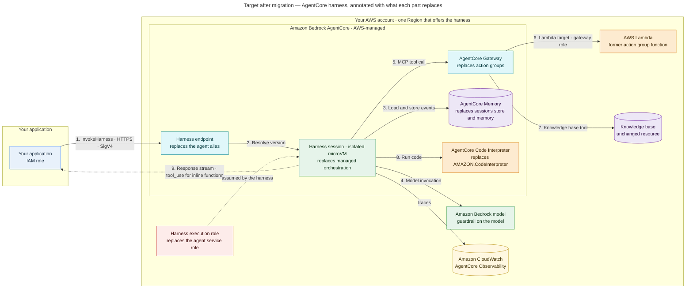
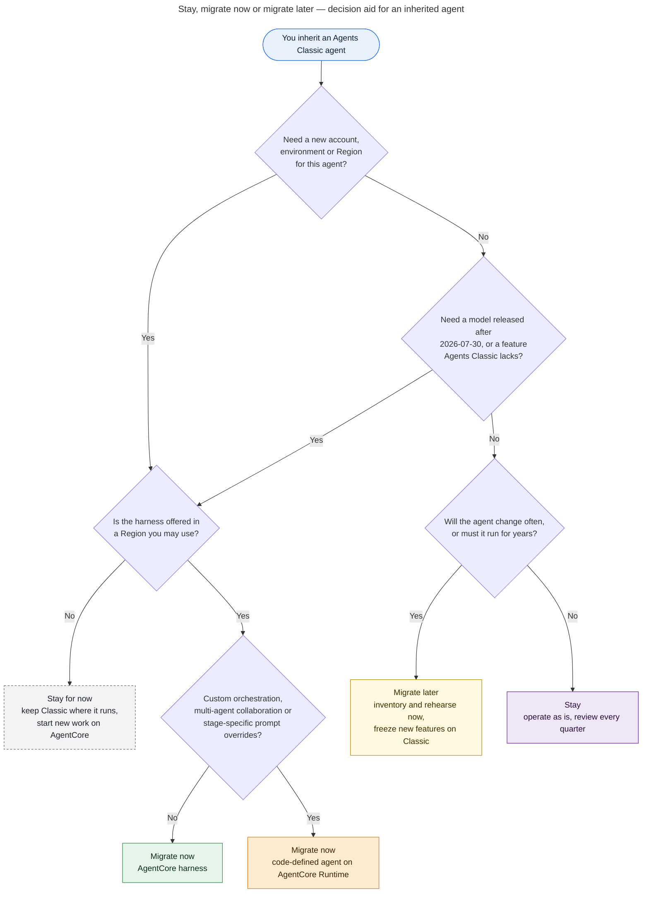

# Agents Classic versus AgentCore, and migrating

> **Level:** Intermediate · **Verified:** 2026-11-15 · **Feature status:** Maintenance mode (Agents Classic) · GA (AgentCore harness) · **Time:** ~25 min

This chapter compares Amazon Bedrock Agents Classic with Amazon Bedrock AgentCore feature by feature, then turns the comparison into a decision (stay, migrate now or migrate later), a migration plan and a list of infrastructure-as-code changes. It is for the person who has inherited an agent and must decide what happens to it.

> [!IMPORTANT]
> **Status** — Amazon Bedrock Agents Classic is in **maintenance mode** and has been closed to new customers since **2026-07-30**. An account with no Agents activity in the previous 12 months receives `AccessDeniedException` (HTTP 403) on `CreateAgent` and `InvokeInlineAgent`. Existing agents keep working, with no new features, a frozen model catalog, no end-of-life date and **no migration deadline**. AWS recommends migrating to AgentCore and names the managed **harness** as the closest equivalent. New work should start on AgentCore.
> Source: [Amazon Bedrock Agents Classic maintenance mode](https://docs.aws.amazon.com/bedrock/latest/userguide/agents-classic-maintenance-mode.html)

## Learning objectives

After this chapter you can:

- Map each part of an Agents Classic agent to its AgentCore equivalent, using the official comparison.
- Choose between staying, migrating now and migrating later, and between the harness and a code-defined agent.
- Write a migration plan that starts with an inventory and ends with decommissioning.
- Name the features that do not map cleanly and what each costs to rebuild.
- List the Terraform and CloudFormation resources that are replaced, and by which.

## Prerequisites

- [Amazon Bedrock Agents Classic](01-agents-classic.md) and [Multi-agent collaboration](02-multi-agent-collaboration.md)
- [AgentCore overview](../agentcore/01-agentcore-overview.md) and [AgentCore harness](../agentcore/03-agentcore-harness.md)
- [Lifecycle rules, import, moved and removed blocks](../../04-infrastructure-as-code/terraform/07-lifecycle-import-moved-removed.md)

## Concept in plain language

Imagine renting a furnished flat. The landlord announces that the building will get no more renovations and accepts no new tenants, but nobody is asked to leave. Next door is a new building of unfurnished units: you choose the furniture, and there is a ready-made "standard layout" if you want one. Staying costs nothing today. It only becomes a problem when you need something the old building will never get: a second flat, a new appliance, a different city.

Agents Classic is the furnished flat. AgentCore is the new building, and the **harness** is its standard layout: you declare a model, instructions and tools, and AWS runs the loop. The furniture does not move by itself: tools, memory, guardrails and callers each have to be reconnected. Terms are in the [glossary](../../GLOSSARY.md).

## How it really works

### Two destinations

| | AgentCore harness (recommended by AWS) | Code-defined agent on AgentCore Runtime |
|:--|:--|:--|
| What you provide | Configuration: model, system prompt, tools, memory | Agent code in any framework (Strands, LangChain, OpenAI Agents SDK, Claude Agent SDK, or custom) |
| Who owns the loop | AgentCore | You |
| AWS's guidance | "Use the harness unless you have a specific reason to own the loop yourself" | For prompt overrides at specific stages, multi-agent collaboration and supervisor patterns, custom orchestration logic |
| Session isolation | Each session runs in its own microVM, backed by AgentCore Runtime | One microVM per session |

### The official feature mapping

The first two columns reproduce the "Comparing capabilities" table on the maintenance-mode page; wording is shortened but not changed in meaning. The third column is the academy's summary of the work.

| Agents Classic | AgentCore equivalent (AWS) | Work for you (academy) |
|:--|:--|:--|
| Managed orchestration loop | Supported out of the box with the AgentCore harness | Configure |
| Action groups: OpenAPI or function schema plus optional Lambda executor | Tools exposed through AgentCore Gateway as MCP tools wrapping REST APIs and Lambda functions, or code-level `@tools` | Rebuild behind a gateway; adapt Lambda handlers |
| Knowledge base association on the agent | Gateway-fronted knowledge base integration; knowledge base accessible through a code-level retrieval tool | Reconnect; the knowledge base itself is unchanged |
| Trace UI and APIs | Persistent, end-to-end tracing of all agent actions | Change how you read traces |
| Prompt overrides at specific stages | System prompt on the harness covers overall behaviour. Stage-specific overrides (pre-processing, knowledge base response generation, post-processing) "are not directly replicated"; equivalent behaviour "requires combining the system prompt with command execution and self-managed scripts" | **Gap** — redesign |
| Built-in `AMAZON.UserInput` | Inline function tools in the harness: the harness pauses and returns `tool_use` to client code. "Requires explicit tool definition rather than automatic elicitation" | Rebuild in the client |
| Built-in `AMAZON.CodeInterpreter` | AgentCore Code Interpreter | Configure |
| Session and memory configuration (idle TTL, memory types, cross-session memory) | AgentCore Memory, short-term and long-term, with memory strategies | Configure; old sessions do not move |
| Guardrails and agent policy attached to the agent | Guardrail configuration in Bedrock, with policy enforcement on AgentCore Gateway | Reconfigure in two places |
| Multi-agent collaboration roles and routing | "**Limited.** The supervisor pattern is possible by exposing agents as MCP tools (agent-as-tool). Routing mode multi-agent is not straightforward today. Full multi-agent collaboration requires custom framework code." | **Gap** — code |
| Custom orchestrator | Supported through AgentCore Runtime. "Not available through harness" | Port your orchestration code |
| Return of control | Inline function tools in the harness: the agent pauses and returns `tool_use` to the client | Rebuild in the client |

Source: [Comparing capabilities](https://docs.aws.amazon.com/bedrock/latest/userguide/agents-classic-maintenance-mode.html)

### What the official table does not list

These rows come from other AgentCore pages; the pairing is the academy's.

| Agents Classic | AgentCore | Difference that matters |
|:--|:--|:--|
| `InvokeAgent` with `agentId`, `agentAliasId`, `sessionId`, `inputText` | `InvokeHarness` with `harnessArn`, `qualifier`, `runtimeSessionId`, `messages` | Every caller changes; the response stream has a different shape |
| Numbered versions and aliases | Harness versions and endpoints | The `DEFAULT` endpoint **moves to the newest version automatically**; only named endpoints stay pinned |
| `memoryId` per user | `actorId` per user | "Each actor gets isolated memory" |
| Agent service role | Harness execution role, plus a gateway role | New roles and policies |
| Frozen model catalog | Bedrock catalog plus OpenAI, Gemini and OpenAI-compatible endpoints | The model can be overridden per invocation |
| Configuration fixed in a version | `InvokeHarness` accepts `model`, `systemPrompt`, `tools` and `allowedTools` per call | A caller with invoke permission can change behaviour |

Sources: [AgentCore harness](https://docs.aws.amazon.com/bedrock-agentcore/latest/devguide/harness.html), [Harness versioning and endpoints](https://docs.aws.amazon.com/bedrock-agentcore/latest/devguide/harness-versioning.html), [Harness tools](https://docs.aws.amazon.com/bedrock-agentcore/latest/devguide/harness-tools.html), [API operations reference](../../references/bedrock-api-operations.md).

> [!NOTE]
> **Documented fact** — "There is no migration deadline. Bedrock Agents Classic remains available to existing customers in maintenance mode with no planned end-of-life date."
> Source: [Maintenance mode FAQ](https://docs.aws.amazon.com/bedrock/latest/userguide/agents-classic-maintenance-mode.html)

## Architecture diagram



**What this shows** — The harness path after migration. It is the academy's drawing of the documented building blocks, not an official AWS reference architecture. Compare it with the "before" picture in [diagram set 10](../../diagrams/mermaid/10-bedrock-agents-classic.md).

**Walkthrough**

1. The application calls `InvokeHarness` on an endpoint (the `qualifier`) instead of `InvokeAgent` on an alias.
2. The endpoint resolves to an immutable harness version.
3. The harness loads the session's events from AgentCore Memory and stores new ones.
4. It invokes the model. A guardrail configured on the Bedrock model still applies.
5. Tools are called over MCP through AgentCore Gateway, where policy is enforced.
6. A Lambda target runs the former action group function, invoked with the gateway's execution role.
7. The knowledge base is reached as a gateway tool, or from code with a retrieval tool.
8. Code runs in AgentCore Code Interpreter.
9. The response streams back. When an inline function is called, the stream ends with `tool_use` and the client continues the turn, which is the counterpart of return of control.

**Legend** — solid arrow: request · dashed arrow: response or role relationship · cylinder: data at rest · nested boxes: account and AWS-managed boundaries.

## Implementation details

### Decide: stay, migrate now, or migrate later

The flowchart is the academy's decision aid. Its inputs are documented facts; the routing is our recommendation.



- **Stay** is legitimate: AWS says no action is needed immediately. The price is a frozen catalog and no new features.
- **Migrate now** is forced by the first two questions: a non-allowlisted account cannot create the agent, and a new model will never arrive.
- **Migrate later** means doing steps 1–3 of the plan below now, so the move is rehearsed before something forces it.
- **Stay for now** covers a Region without the harness. AWS states that you can keep using Agents Classic there while new development goes to a supported Region.

### Migration plan checklist

| # | Step | Evidence that it is done |
|--:|:--|:--|
| 1 | **Inventory** the agent: model, instructions, `orchestrationType`, collaboration mode, memory, guardrail, overridden prompts and parsers, action groups (schema type, executor, built-in signatures), knowledge bases, aliases and versions, collaborators, and every caller | A machine-readable inventory (see the example) |
| 2 | **Classify** each item with the mapping table: configure, rebuild or gap | A list of gaps with an owner each |
| 3 | **Choose the destination**: harness, unless a gap needs code | A written decision |
| 4 | **Choose the Region** and confirm the harness, Memory and Gateway are offered there | Region recorded |
| 5 | **Build the target beside the source**: gateway and targets, adapted Lambda handlers, harness, memory, guardrail and policy, a named endpoint | Target deployed from IaC; source untouched |
| 6 | **Prove behaviour**: replay recorded prompts against both and compare answers and tool calls | A comparison report; see [AgentCore Evaluations and Optimization](../agentcore/10-agentcore-evaluations-and-optimization.md) |
| 7 | **Cut over callers** from `InvokeAgent` to `InvokeHarness`, with new IAM permissions | Callers deployed; old alias receives no traffic |
| 8 | **Keep a fallback**, then decommission: pause the old alias, later delete the agent and its IaC | `InvocationCount` at zero for an agreed period, then resources removed |

### Tooling AWS provides

| Tool | What it does | Source |
|:--|:--|:--|
| Agent toolkit for AWS, `amazon-bedrock` skill (recommended by AWS) | Guides a coding assistant through the migration: inspects the agent, checks eligibility, maps components, then drives the AgentCore CLI. "It never modifies your source agent", pauses for approval before deploying, and stops if a feature has no validated harness path | [Migration procedure](https://docs.aws.amazon.com/bedrock/latest/userguide/agents-classic-maintenance-mode.html) |
| AgentCore CLI, manual harness build | `agentcore create`, `agentcore add tool`, `agentcore add harness`, `agentcore deploy`, `agentcore invoke`. Mapping given by AWS: model → `--model-id`; action groups → Gateway tools; knowledge bases → Gateway or retrieval tool; prompt → `--system-prompt` | Same page |
| AgentCore CLI, import to code | `agentcore add runtime --name … --agent-id … --agent-alias-id … --framework strands` translates an existing agent into AgentCore Runtime code | [Get started with AgentCore](https://docs.aws.amazon.com/bedrock-agentcore/latest/devguide/agentcore-get-started-cli.html) |

> [!WARNING]
> **Common mistake** — `agentcore migrate` is **not** the Agents Classic migration command. It upgrades an AgentCore CLI v0 *project* to v1. Also, the CLI repository and the agent toolkit document the import with different syntax (`--type import`) and describe differently what is translated automatically; run `agentcore add --help` on your installed version and review the generated project.
> Sources: [Migrate an existing project](https://docs.aws.amazon.com/bedrock-agentcore/latest/devguide/agentcore-cli-migrate-project.html), [AgentCore CLI frameworks](https://raw.githubusercontent.com/aws/agentcore-cli/main/docs/frameworks.md), [agent toolkit migrate reference](https://raw.githubusercontent.com/aws/agent-toolkit-for-aws/HEAD/plugins/aws-agents/skills/agents-build/references/migrate.md)

AWS's own estimate: for a straightforward agent (model, action groups, knowledge base) "CLI import or harness setup takes hours"; agents with custom orchestrators or multi-agent collaboration "will require more significant code work".

### What does not map cleanly

| Item | Why | Basis |
|:--|:--|:--|
| Stage-specific prompt overrides and parser Lambda functions | "Not directly replicated" on the harness | Documented |
| `SUPERVISOR_ROUTER` and full multi-agent collaboration | "Limited"; see [chapter 2](02-multi-agent-collaboration.md) | Documented |
| Custom orchestration | Runtime only, not the harness | Documented |
| Automatic parameter elicitation (`AMAZON.UserInput`) | Needs an explicit inline function tool and client code | Documented |
| Action group Lambda functions | A gateway Lambda target passes a flat map of input properties as the event and the tool name in the context object. AWS: "you will need to change the function code to account for a schema change for event and context objects" | Documented |
| Lambda permissions | The resource-based policy for `bedrock.amazonaws.com` is replaced by the gateway's execution role invoking the function | Documented in parts; the pairing is our reading |
| Guardrail attachment | One declarative attachment becomes a guardrail on the model plus policy on the gateway | Documented |
| Conversation history, sessions and memory summaries | The agent toolkit states that migration "does not migrate conversation history or session state" | Documented for that tool |
| Inline agents | "Migration guidance for inline agents is forthcoming" | Documented |
| Trace consumers | Traces move from the `InvokeAgent` response stream to AgentCore Observability | Our reading |
| Region | Agents Classic lists `eu-central-2`; the AgentCore Region table does not list it | Our reading of the two Region pages |

Sources: [Lambda function targets](https://docs.aws.amazon.com/bedrock-agentcore/latest/devguide/gateway-add-target-lambda.html), [Gateway core concepts](https://docs.aws.amazon.com/bedrock-agentcore/latest/devguide/gateway-core-concepts.html), [AgentCore Regions](https://docs.aws.amazon.com/bedrock-agentcore/latest/devguide/agentcore-regions.html), [Agents Classic Regions](https://docs.aws.amazon.com/bedrock/latest/userguide/agents-supported.html).

### IaC implications

Existing templates keep working in allowlisted accounts. In any other account they fail at `CreateAgent`, so AWS tells you to "use Amazon Bedrock AgentCore resources in your templates instead".

| Agents Classic (Terraform · CloudFormation) | Replaced by (Terraform 6.73.0 · CloudFormation) | Notes |
|:--|:--|:--|
| `aws_bedrockagent_agent` · `AWS::Bedrock::Agent` | `aws_bedrockagentcore_harness` · `AWS::BedrockAgentCore::Harness` | Code path: `aws_bedrockagentcore_agent_runtime` · `AWS::BedrockAgentCore::Runtime` |
| `aws_bedrockagent_agent_alias` · `AWS::Bedrock::AgentAlias` | No Terraform resource for a harness endpoint in 6.73.0 · `AWS::BedrockAgentCore::HarnessEndpoint` | A `DEFAULT` endpoint comes with every harness; named endpoints need CloudFormation or the `CreateHarnessEndpoint` API. Code path: `aws_bedrockagentcore_agent_runtime_endpoint` · `RuntimeEndpoint` |
| `aws_bedrockagent_agent_action_group` · `ActionGroups` property | `aws_bedrockagentcore_gateway` and `aws_bedrockagentcore_gateway_target` · `Gateway`, `GatewayTarget` | Target kinds in the schema include `lambda` and `open_api_schema`; the harness references the gateway in a `tool` block |
| `aws_bedrockagent_agent_knowledge_base_association` · `KnowledgeBases` property | A gateway target or a retrieval tool in code | `aws_bedrockagent_knowledge_base` stays as it is |
| `memory_configuration` · `MemoryConfiguration` | Harness `memory` block (managed by default) or `aws_bedrockagentcore_memory` · `Memory` | |
| `guardrail_configuration` · `GuardrailConfiguration` | `aws_bedrock_guardrail` unchanged, plus `aws_bedrockagentcore_policy_engine` and `aws_bedrockagentcore_policy` · `PolicyEngine`, `Policy` | |
| `aws_bedrockagent_agent_collaborator` · `AgentCollaborators` property | No equivalent resource | Runtimes, harnesses and gateway targets, wired by you |
| `aws_lambda_permission` for `bedrock.amazonaws.com` | IAM permission on the gateway's role | |

Names were checked against the [generated Terraform reference](../../references/terraform-aws-provider-bedrock.md) and the [CDK and CloudFormation reference](../../references/cdk-and-cloudformation-bedrock.md).

**Our reading:** this is a replacement, not a refactor. The old and new resources are different types with different identities, so a `moved` block or a CloudFormation logical-ID rename does not apply. Create the new stack beside the old one, cut over, then remove the old resources. If the inherited agent was created in the console, import it first so that its removal is a reviewed change (see the example). Tool-specific coverage is in [Terraform coverage for Amazon Bedrock](../../04-infrastructure-as-code/terraform/10-terraform-for-bedrock.md), [CloudFormation coverage for Amazon Bedrock](../../04-infrastructure-as-code/cloudformation/07-cloudformation-for-bedrock.md) and [CDK coverage for Amazon Bedrock](../../04-infrastructure-as-code/aws-cdk/09-cdk-for-bedrock.md).

## Example

### Step 1 of the plan: a read-only inventory

> **Code status:** syntax-checked (`python -m py_compile`); response field names checked against the SDK service model · **never run against AWS** · **never deployed**

```python
"""Inventory an inherited Agents Classic agent before planning a migration. Read-only."""
import json
import sys

import boto3


def inventory(agent_id: str, region: str) -> dict:
    client = boto3.client("bedrock-agent", region_name=region)
    agent = client.get_agent(agentId=agent_id)["agent"]

    def listing(operation: str, key: str, **kwargs) -> list:
        items, token = [], None
        while True:
            if token:
                kwargs["nextToken"] = token
            page = getattr(client, operation)(agentId=agent_id, **kwargs)
            items += page.get(key, [])
            token = page.get("nextToken")
            if not token:
                return items

    action_groups = []
    for summary in listing("list_agent_action_groups", "actionGroupSummaries", agentVersion="DRAFT"):
        detail = client.get_agent_action_group(
            agentId=agent_id, agentVersion="DRAFT", actionGroupId=summary["actionGroupId"]
        )["agentActionGroup"]
        executor = detail.get("actionGroupExecutor", {})
        action_groups.append(
            {
                "name": detail["actionGroupName"],
                "schema": "openapi" if "apiSchema" in detail else "function" if "functionSchema" in detail else "none",
                "executor": "lambda" if "lambda" in executor else executor.get("customControl", "none"),
                "built_in": detail.get("parentActionSignature"),  # for example AMAZON.UserInput
            }
        )

    overrides = agent.get("promptOverrideConfiguration", {}).get("promptConfigurations", [])
    return {
        "agent": {
            "name": agent["agentName"],
            "model": agent.get("foundationModel"),
            "orchestration": agent.get("orchestrationType", "DEFAULT"),  # CUSTOM_ORCHESTRATION => code path
            "collaboration": agent.get("agentCollaboration", "DISABLED"),  # not DISABLED => chapter 2
            "memory": agent.get("memoryConfiguration"),
            "guardrail": agent.get("guardrailConfiguration"),
            "overridden_prompts": [
                p["promptType"]
                for p in overrides
                if "OVERRIDDEN" in (p.get("promptCreationMode"), p.get("parserMode"))
            ],
        },
        "action_groups": action_groups,
        "knowledge_bases": listing("list_agent_knowledge_bases", "agentKnowledgeBaseSummaries", agentVersion="DRAFT"),
        "collaborators": listing("list_agent_collaborators", "agentCollaboratorSummaries", agentVersion="DRAFT"),
        "aliases": listing("list_agent_aliases", "agentAliasSummaries"),
    }


if __name__ == "__main__":
    print(json.dumps(inventory(sys.argv[1], sys.argv[2]), indent=2, default=str))
```

The script reads the working draft. If the production alias points to an older version, compare it with `GetAgentVersion` before you trust the inventory.

### Bringing a console-created agent under Terraform before you retire it

> **Code status:** validated with `terraform validate` (Terraform 1.17.2, provider 6.73.0, in a scratch root with a `versions.tf` pinning `~> 6.73`) · **never planned or applied against AWS**

```terraform
# Bring an inherited, console-created agent under Terraform before you change it.
# IDs are placeholders: replace them with the values from your inventory.

variable "foundation_model_id" {
  description = "Model ID the agent already uses."
  type        = string
}

variable "agent_role_arn" {
  description = "ARN of the agent's existing service role."
  type        = string
}

import {
  to = aws_bedrockagent_agent.inherited
  id = "AGENT12345" # agent ID
}

import {
  to = aws_bedrockagent_agent_alias.inherited_live
  id = "ALIAS12345,AGENT12345" # alias ID, agent ID
}

resource "aws_bedrockagent_agent" "inherited" {
  agent_name              = "inherited-agent"
  agent_resource_role_arn = var.agent_role_arn
  foundation_model        = var.foundation_model_id
  instruction             = "Copy the instruction text from the existing agent so the plan shows no change."
  prepare_agent           = false
}

resource "aws_bedrockagent_agent_alias" "inherited_live" {
  agent_alias_name = "live"
  agent_id         = aws_bedrockagent_agent.inherited.agent_id
}
```

**Our reading:** importing an existing agent reads it and does not call `CreateAgent`, so it is not affected by the allowlist. Action groups import as `action-group-id,agent-id,DRAFT`, knowledge base associations as `agent-id,DRAFT,knowledge-base-id`, collaborators as `agent-id,DRAFT,collaborator-id`.

## Common mistakes

> [!WARNING]
> **Common mistake** — Pointing production at the harness `DEFAULT` endpoint. An Agents Classic alias stays on its version until you move it; the `DEFAULT` endpoint follows every update. Create a named endpoint and move it deliberately.

| Mistake | Symptom | Fix |
|:--|:--|:--|
| Treating maintenance mode as a shutdown notice | A rushed, risky migration | There is no deadline; plan, rehearse, then move |
| Treating it as "nothing changed" | A new staging account or disaster-recovery account cannot create the agent | Decide now which environments must exist, and build those on AgentCore |
| Reusing action group Lambda functions unchanged behind a gateway | Handlers fail to find `actionGroup`, `function` or `parameters` in the event | Adapt the handler to the gateway event and context format |
| Migrating the agent but not its callers' IAM | Access denied on the new API | Grant the AgentCore actions and remove `bedrock:InvokeAgent` afterwards |
| Deleting the old agent on cutover day | No fallback | Pause the alias with `aliasInvocationState`, delete later |
| Expecting users' conversations to continue | Context is lost at cutover | Cut over at a session boundary and tell users |
| Assuming the harness is in the agent's Region | Deployment fails or data moves Region | Check the Region table first |

## Security considerations

- **A wider request surface.** `InvokeHarness` accepts a model, system prompt and tools per invocation. **Our reading:** never pass end-user input into those fields; keep your own API in front. AWS advises to "validate or replace caller-supplied tool configurations" before serving less-trusted users.
- **A wider tool surface.** With `allowedTools` omitted or set to `["*"]`, a harness agent gets the recommended built-in tools, which include `shell` and file tools inside its microVM. An Agents Classic agent could call only its action groups. List individual tool selectors for least privilege.
- **New IAM actions.** Policies, service control policies and VPC endpoint policies written for `bedrock:InvokeAgent` do not cover the `bedrock-agentcore` service. Rewrite them; see [Identity, least privilege and IAM isolation for agents](../../06-security-governance/02-identity-and-least-privilege.md).
- **Guardrails are no longer one switch.** Verify content filtering end to end after the move: the model-level guardrail and the gateway policy cover different things.
- **Two systems during the transition.** Both agents can act on the same back ends. Make write actions idempotent, or route writes through one system only.

## Cost considerations

- **Agents Classic:** no charge for the service; you pay for model inference and attached resources.
- **AgentCore:** consumption-based pricing across Runtime, Memory and Gateway, with "no separate harness orchestration charge" (maintenance-mode FAQ). The pricing dimensions are covered in the [AgentCore harness](../agentcore/03-agentcore-harness.md) chapter; no figure is quoted here.
- **Managed memory is on by default** for a harness and incurs AgentCore Memory charges. Disable it or set strategies deliberately.
- **AWS's claim, not ours:** the harness "is more token-efficient than Bedrock Agents Classic's internal prompts, so customers may see comparable or lower model inference costs". Measure it in step 6 of the plan.
- **Running both in parallel** doubles some costs for the length of the rehearsal. Budget for it.

## Knowledge check

1. An inherited agent uses default orchestration, two Lambda action groups defined with function details, one knowledge base and a guardrail. Which destination fits, and which single item will take the most engineering time?
2. Your company opens a disaster-recovery account next quarter and wants the agent deployable there. How does that change the decision, even though the agent works today?
3. What would happen if you migrated to a harness, pointed the application at the `DEFAULT` endpoint, and a colleague then changed the system prompt to try something?
4. Why can a Terraform `moved` block not carry an `aws_bedrockagent_agent` over to `aws_bedrockagentcore_harness`?

<details>
<summary>Answers</summary>

1. The AgentCore harness: nothing in the list is a gap. The Lambda functions take the most work, because the gateway passes a different event and context than Agents Classic and AWS says the function code must change.
2. A new account without Agents activity in the previous 12 months cannot call `CreateAgent`, and there is no exception process. The agent therefore has to exist on AgentCore before that account is needed, which makes this "migrate now".
3. The update would create a new harness version and the `DEFAULT` endpoint would move to it automatically, so production would serve the experiment. A named endpoint stays on its version until someone updates it.
4. They are different resource types that describe different AWS resources with different identifiers and APIs. Nothing is renamed; a new resource must be created and the old one removed after cutover.

</details>

## Further reading

Official sources opened while writing this chapter:

- [Amazon Bedrock Agents Classic maintenance mode](https://docs.aws.amazon.com/bedrock/latest/userguide/agents-classic-maintenance-mode.html) — migration plan, capability comparison, procedure, FAQ.
- [Amazon Bedrock Agents product page](https://aws.amazon.com/bedrock/agents/) — end-of-support notice.
- [AgentCore harness](https://docs.aws.amazon.com/bedrock-agentcore/latest/devguide/harness.html) — what the harness is, isolation, models, pricing statement.
- [Harness tools](https://docs.aws.amazon.com/bedrock-agentcore/latest/devguide/harness-tools.html) — tool types, `allowedTools`, inline functions.
- [Harness memory](https://docs.aws.amazon.com/bedrock-agentcore/latest/devguide/harness-memory.html) — managed memory, actor ID, charges.
- [Harness versioning and endpoints](https://docs.aws.amazon.com/bedrock-agentcore/latest/devguide/harness-versioning.html) — immutable versions, `DEFAULT` endpoint behaviour.
- [AgentCore overview](https://docs.aws.amazon.com/bedrock-agentcore/latest/devguide/what-is-bedrock-agentcore.html) — the services.
- [Core concepts for AgentCore Gateway](https://docs.aws.amazon.com/bedrock-agentcore/latest/devguide/gateway-core-concepts.html) and [Lambda function targets](https://docs.aws.amazon.com/bedrock-agentcore/latest/devguide/gateway-add-target-lambda.html) — targets, execution role, Lambda event and context format.
- [Supported AWS Regions for AgentCore](https://docs.aws.amazon.com/bedrock-agentcore/latest/devguide/agentcore-regions.html) and [Supported Regions for Amazon Bedrock Agents](https://docs.aws.amazon.com/bedrock/latest/userguide/agents-supported.html) — Region comparison.
- [Get started with Amazon Bedrock AgentCore](https://docs.aws.amazon.com/bedrock-agentcore/latest/devguide/agentcore-get-started-cli.html) — CLI, importing an Agents Classic agent into Runtime code.
- [Migrate an existing project](https://docs.aws.amazon.com/bedrock-agentcore/latest/devguide/agentcore-cli-migrate-project.html) — what `agentcore migrate` really does.
- [AgentCore CLI — frameworks](https://raw.githubusercontent.com/aws/agentcore-cli/main/docs/frameworks.md) and [commands](https://raw.githubusercontent.com/aws/agentcore-cli/main/docs/commands.md) — import options in the CLI repository.
- [Agent toolkit for AWS — migrate reference](https://raw.githubusercontent.com/aws/agent-toolkit-for-aws/HEAD/plugins/aws-agents/skills/agents-build/references/migrate.md) — what the import does and does not do.
- [Deploy an agent](https://docs.aws.amazon.com/bedrock/latest/userguide/deploy-agent.html) — pausing an alias.
- Terraform provider documentation: [`aws_bedrockagent_agent`](https://raw.githubusercontent.com/hashicorp/terraform-provider-aws/main/website/docs/r/bedrockagent_agent.html.markdown), [`aws_bedrockagent_agent_alias`](https://raw.githubusercontent.com/hashicorp/terraform-provider-aws/main/website/docs/r/bedrockagent_agent_alias.html.markdown), [`aws_bedrockagent_agent_action_group`](https://raw.githubusercontent.com/hashicorp/terraform-provider-aws/main/website/docs/r/bedrockagent_agent_action_group.html.markdown), [`aws_bedrockagent_agent_knowledge_base_association`](https://raw.githubusercontent.com/hashicorp/terraform-provider-aws/main/website/docs/r/bedrockagent_agent_knowledge_base_association.html.markdown), [`aws_bedrockagent_agent_collaborator`](https://raw.githubusercontent.com/hashicorp/terraform-provider-aws/main/website/docs/r/bedrockagent_agent_collaborator.html.markdown) — import ID formats.
