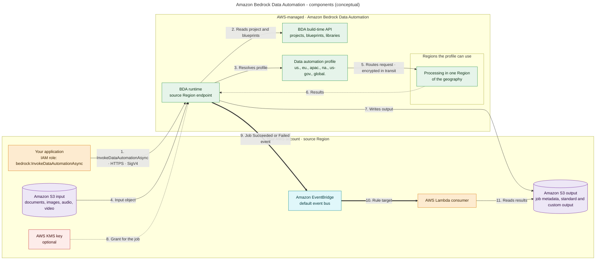
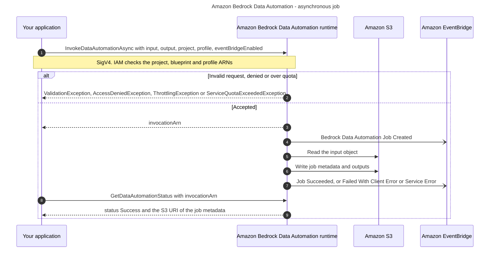

# Amazon Bedrock Data Automation

> **Level:** Intermediate · **Verified:** 2026-11-15 · **Feature status:** GA · **Time:** ~25 min

Amazon Bedrock Data Automation (BDA) turns documents, images, audio and video into structured JSON
without you choosing, prompting or hosting a model. You describe the output once — in a **project**,
optionally with **blueprints** — and send files to it; BDA can also act as the parser that feeds a
knowledge base.

> [!IMPORTANT]
> **Status** — GA since 2025-03-03. Every request must name a **data automation profile**, which is
> a cross-Region inference profile: processing can happen in another Region of your geography, or in
> any commercial Region with the `global.` profile. The synchronous API (2025-11-20) processes images
> only, according to the API usage page. The Data Automation Library (custom vocabulary) is available
> in 7 Regions. A dedicated BDA Region list was not found: the cross-Region page lists 13 source
> Regions; anything beyond that page is **UNVERIFIED** (register item U7).
> Sources: [BDA GA announcement](https://aws.amazon.com/about-aws/whats-new/2025/03/amazon-bedrock-data-automation-generally-available/),
> [Cross Region support required for BDA](https://docs.aws.amazon.com/bedrock/latest/userguide/bda-cris.html),
> [Using the BDA API](https://docs.aws.amazon.com/bedrock/latest/userguide/bda-using-api.html),
> [Data Automation Library](https://docs.aws.amazon.com/bedrock/latest/userguide/bda-library.html),
> [Document history](https://docs.aws.amazon.com/bedrock/latest/userguide/bedrock-ug-doc-history.html)

## Learning objectives

- Distinguish standard output from custom output, and a project from a blueprint.
- Choose between the asynchronous and synchronous invocation APIs and wire completion events.
- Explain what the mandatory cross-Region profile means for where data is processed.
- Configure a project, a blueprint and a library with infrastructure as code.
- Decide when BDA is the right parser for a knowledge base and when it is not.

## Prerequisites

- [Amazon S3, AWS Lambda and Amazon API Gateway](../../00-foundations/aws-fundamentals/02-s3-lambda-api-gateway.md)
- [Amazon EventBridge, Amazon SQS and Amazon SNS](../../00-foundations/aws-fundamentals/03-eventbridge-sqs-sns.md)
- [Cross-Region inference: Geo and Global profiles](../inference/04-cross-region-inference.md)
- [Ingestion, parsing and chunking](../knowledge-bases/04-ingestion-parsing-chunking.md)

## 1. What it is

**Plain language.** You drop an invoice, a call recording or a video into Amazon S3 and ask BDA to
read it. Without configuration you get a sensible default — text and tables for a document, a
transcript and summary for audio, chapters for video. If you need specific fields ("invoice number",
"total"), you write a blueprint that lists them, and BDA returns those fields with confidence scores.

**Precisely.** BDA has two namespaces. `bedrock-data-automation` manages **projects**, **blueprints**
and **libraries**. `bedrock-data-automation-runtime` processes files: `InvokeDataAutomationAsync`
reads from and writes to S3 and returns an `invocationArn`; `InvokeDataAutomation` is synchronous.
Both require `dataAutomationProfileArn`.

| Item | Value |
|:--|:--|
| Service namespace / endpoint | `bedrock-data-automation` (build time), `bedrock-data-automation-runtime` (processing) |
| Control-plane operations | `CreateDataAutomationProject`, `UpdateDataAutomationProject`, `GetDataAutomationProject`, `ListDataAutomationProjects`, `DeleteDataAutomationProject`; `CreateBlueprint`, `CreateBlueprintVersion`, `UpdateBlueprint`, `CopyBlueprintStage`, `InvokeBlueprintOptimizationAsync`; `CreateDataAutomationLibrary`, `InvokeDataAutomationLibraryIngestionJob`, `ListDataAutomationLibraryEntities` |
| Data-plane operations | `InvokeDataAutomationAsync`, `GetDataAutomationStatus`, `InvokeDataAutomation` |
| IAM action prefix | `bedrock:` — for example `bedrock:InvokeDataAutomationAsync` on `blueprint`, `data-automation-profile` and `data-automation-project` resources |
| ARNs | `…:data-automation-project/<id>`, `…:blueprint/<id>`, `…:data-automation-profile/us.data-automation-v1`, `…:data-automation-invocation/<id>` |

Operation names were checked against [the API operations reference](../../references/bedrock-api-operations.md).

### Modalities and output

| Modality | Standard output options (API values) | Custom output (blueprints per project) |
|:--|:--|:--|
| Document | Granularity `DOCUMENT`, `PAGE`, `ELEMENT`, `WORD`, `LINE`; bounding boxes; summary; text as `PLAIN_TEXT`, `MARKDOWN`, `HTML`, `CSV` | Up to 40; BDA matches each document (or split segment) to the best blueprint |
| Image | `CONTENT_MODERATION`, `TEXT_DETECTION`, `LOGOS`; `IMAGE_SUMMARY`, `IAB` | 1 |
| Audio | `TRANSCRIPT` (speaker and channel labels), `AUDIO_CONTENT_MODERATION`, `TOPIC_CONTENT_MODERATION`; `AUDIO_SUMMARY`, `TOPIC_SUMMARY`, `IAB` | 1 |
| Video | `TRANSCRIPT`, `TEXT_DETECTION`, `CONTENT_MODERATION`, `LOGOS`; `VIDEO_SUMMARY`, `CHAPTER_SUMMARY`, `IAB` | 1 — but see the conflict below |

- **Standard output** is always produced, "even if it's alongside a custom output response". For the
  default standard output without a project of your own, the GA blog post names an AWS-owned project
  whose ARN ends in `aws:data-automation-project/public-default`.
- **Custom output** runs a **blueprint**: a JSON schema whose fields have a `type`, an
  `inferenceType` (`explicit` — read as printed — or `inferred` — normalised or derived) and an
  `instruction`. Start from the catalog or write your own. Document results carry confidence scores
  and page numbers; audio and image blueprints return no confidence score.
- **Projects** hold one standard output configuration per modality plus blueprint references, have a
  stage (`LIVE` or `DEVELOPMENT`; the latter is API-only), and a **type**: an `ASYNC` project works
  only with `InvokeDataAutomationAsync`, a `SYNC` project only with `InvokeDataAutomation`.
- **Overrides** per project: enable or disable a modality, route JPEG/PNG to image or document and
  MP4/MOV to video or audio, split multi-document files, and detect or redact PII
  (`sensitiveDataConfiguration`, present in the SDK model and in Terraform).

> [!WARNING]
> **Source conflict — video blueprints.** "How BDA works" and the `CreateBlueprint` API reference
> list custom output for documents, audio and images only. The prerequisites page, the custom output
> page, the SDK model and Terraform (`type = "VIDEO"`) include one video blueprint per project.
> Test before you design around video blueprints.

Sources: [How BDA works](https://docs.aws.amazon.com/bedrock/latest/userguide/bda-how-it-works.html),
[Projects](https://docs.aws.amazon.com/bedrock/latest/userguide/bda-projects.html),
[Standard output](https://docs.aws.amazon.com/bedrock/latest/userguide/bda-standard-output.html),
[Blueprints](https://docs.aws.amazon.com/bedrock/latest/userguide/bda-blueprint-info.html),
[Creating blueprints](https://docs.aws.amazon.com/bedrock/latest/userguide/bda-idp.html),
[BDA CLI guide](https://docs.aws.amazon.com/bedrock/latest/userguide/bda-cli-guide.html),
[BDA GA blog post](https://aws.amazon.com/blogs/aws/get-insights-from-multimodal-content-with-amazon-bedrock-data-automation-now-generally-available/)

### Data Automation Library

A library is a reusable container of **entities**; today the only entity type is `VOCABULARY`
(custom vocabulary that improves audio and video transcription). You create it with
`CreateDataAutomationLibrary`, fill it with `InvokeDataAutomationLibraryIngestionJob` (`UPSERT` or
`DELETE`; jobs run one at a time per library), and associate it with projects. A project takes one
library; a library can serve many projects. Limits: 10 libraries per account, 500 phrases and 30,000
characters per library. Regions: us-east-1, us-west-2, eu-west-1, eu-west-2, eu-central-1, ap-south-1,
ap-southeast-2.

Sources: [Data Automation Library](https://docs.aws.amazon.com/bedrock/latest/userguide/bda-library.html),
[Prerequisites for BDA](https://docs.aws.amazon.com/bedrock/latest/userguide/bda-limits.html)

## 2. Why it exists

Intelligent document processing used to mean an OCR service, a classifier, a field extractor,
normalisation code, a separate speech-to-text service for audio, and glue to orchestrate them. BDA
puts classification, splitting, extraction, normalisation and media analysis behind one API, with
per-page or per-minute pricing instead of tokens and prompts you have to tune.

## 3. When to use it

- Invoices, claims, IDs and forms into typed fields (custom output, document splitting).
- Calls and meetings into transcripts, summaries and topics.
- Video catalogues into chapters, on-screen text, logos and moderation labels.
- Parsing visually rich files for a knowledge base: figures, tables, audio and video become text —
  see [Ingestion, parsing and chunking](../knowledge-bases/04-ingestion-parsing-chunking.md).
- Interactive image checks (synchronous API), such as moderating an upload.

## 4. When not to use it

- **Text-only documents.** A plain parser is free; BDA bills every page — see
  [Ingestion, parsing and chunking](../knowledge-bases/04-ingestion-parsing-chunking.md).
- **Strict in-Region processing outside London or GovCloud.** The geography profiles route across
  several Regions — see [Cross-Region considerations and data residency](../../09-advanced-topics/11-cross-region-and-data-residency.md).
- **Visual similarity search** (find images like this one). In a knowledge base BDA converts media to
  text and supports text queries only; use Amazon Nova Multimodal Embeddings.
- **You need full control of the prompt and model.** Call a vision model through
  [the Converse API](../inference/01-converse-api.md) and own the evaluation.
- **Low-latency documents.** The synchronous API is documented for images; documents go through the
  asynchronous API.

## 5. Internal architecture

AWS documents the resources, the profile routing, the S3 contract and the events. How BDA chains its
models internally is not documented; the diagram is a conceptual model.



| Legend | Meaning |
|:--|:--|
| Solid arrow | Request, read or write |
| Dashed arrow | Result or key use |
| Thick arrow | Asynchronous event |
| Cylinder | Data at rest |

**What this shows** — the files and the results stay in your buckets in the source Region; the
*processing* can move within the profile's geography.

1. The call names the input and output S3 URIs, the project, the profile and the notification flag.
2. BDA applies the project's standard output settings and blueprints.
3. The profile is mandatory; it decides the set of Regions that can process the request.
4. BDA reads the input object. **Our reading:** BDA has no service role of its own (the project API
   has no role field), so the caller's identity needs `s3:GetObject` on the input and `s3:PutObject`
   on the output — an AWS sample asks the calling role to hold that S3 access.
5. "Your requests and output results may move outside of your primary Region", encrypted in transit.
6. Results return to the source Region.
7. BDA writes a job metadata file and the outputs under the output prefix.
8. With a customer managed key, BDA creates a KMS grant for the job.
9. With `eventBridgeEnabled`, BDA emits an event on the default bus.
10. A rule routes it to your consumer.
11. The consumer reads the results.

## 6. Request and response lifecycle



- **Step 1.** `inputConfiguration.s3Uri`, `outputConfiguration.s3Uri` and `dataAutomationProfileArn`
  are required; a project (`dataAutomationConfiguration`) or a list of up to 40 `blueprints` selects
  the output. For video, `assetProcessingConfiguration` can treat a segment of five minutes or more as
  the whole video.
- **Step 3.** Errors in the SDK model are `ValidationException`, `AccessDeniedException`,
  `ThrottlingException`, `ServiceQuotaExceededException` and `InternalServerException`. The documented
  profile error is `ValidationException: The provided DataAutomationProfile ARN is invalid` — usually a
  `global.` profile in a Region that does not support it.
- **Steps 5–9.** Events go to the default bus with source `aws.bedrock`, delivery "best effort". The
  `detail` carries `job_id`, `job_status`, `semantic_modality`, the input object and the output
  location. Because delivery is best effort, keep `GetDataAutomationStatus` as a fallback.
- **Steps 10–11.** Statuses are `Created`, `InProgress`, `Success`, `ServiceError` and `ClientError`.
  A `ClientError` is your file or request (format, size, permissions); a `ServiceError` can be retried.
- **Synchronous.** `InvokeDataAutomation` takes `inputConfiguration.bytes` or `s3Uri`, needs a `SYNC`
  project, and returns `semanticModality` and `outputSegments` (standard and custom output) inline, or
  writes to S3 if you give an output URI. The API usage page says it processes images only and errors
  if an image is classified as a document (use modality routing to force `IMAGE`); the prerequisites
  page nevertheless lists sync document limits (10 pages, 50 MB) — another source conflict.

Sources: [InvokeDataAutomationAsync](https://docs.aws.amazon.com/bedrock/latest/APIReference/API_data-automation-runtime_InvokeDataAutomationAsync.html),
[InvokeDataAutomation](https://docs.aws.amazon.com/bedrock/latest/APIReference/API_data-automation-runtime_InvokeDataAutomation.html),
[Amazon Bedrock events in EventBridge](https://docs.aws.amazon.com/eventbridge/latest/ref/events-ref-bedrock.html),
[Monitor Bedrock jobs with EventBridge](https://docs.aws.amazon.com/bedrock/latest/userguide/monitoring-eventbridge-how-it-works.html)

## 7. Dependencies

| Depends on | Why | Required or optional |
|:--|:--|:-:|
| Data automation profile for the source Region | Mandatory cross-Region routing | Required |
| Amazon S3 input and output locations | Asynchronous API reads and writes S3 | Required (async) |
| IAM permissions of the caller | BDA actions plus S3 access (see section 5, step 4) | Required |
| A project or blueprints | Selects standard and custom output | Required |
| Amazon EventBridge rule | Completion events | Optional |
| Data Automation Library | Custom vocabulary for audio and video | Optional |
| AWS KMS customer managed key | Encrypt projects, blueprints, libraries and outputs with your key | Optional (API only, not the console) |

## 8. Security considerations

- **Least privilege.** `bedrock:InvokeDataAutomationAsync` requires the `data-automation-project`,
  `blueprint` and `data-automation-profile` resources; the documented policy lists the profile ARN in
  **every Region of the geography** (for `us.`: us-east-1, us-east-2, us-west-1, us-west-2).
  `bedrock:GetDataAutomationStatus` is on the `data-automation-invocation-job` resource. Tag-based
  conditions are supported on jobs and resources.
- **Global profile is opt-in.** You must name `global.data-automation-v1` explicitly in IAM, and
  it is the only profile in Asia Pacific (Singapore). An SCP that denies the global profile ARN keeps
  processing inside a geography.
- **Encryption.** AWS owned keys by default. With a customer managed key, the key policy allows
  `kms:DescribeKey`, `kms:GenerateDataKey`, `kms:Decrypt` and `kms:CreateGrant` through
  `kms:ViaService` `bedrock.<region>.amazonaws.com`; grants for a job are retired after 30 hours.
  Encryption contexts include `DataAutomationProjectArn`, `BlueprintArn` and
  `aws:bedrock:data-automation-library-arn`.
- **PII.** A project can detect, or detect and redact, PII entities in standard and custom output.
- **Blueprint instructions are prompts.** AWS says: "Only allow trusted sources to control the prompt
  input." Restrict `bedrock:UpdateBlueprint` like code changes.
- **Outputs are sensitive copies.** Apply bucket policies, SSE-KMS and lifecycle rules to the output
  prefix as you do to the input.

Sources: [Encryption in BDA](https://docs.aws.amazon.com/bedrock/latest/userguide/encryption-bda.html),
[Actions, resources, and condition keys for Amazon Bedrock](https://docs.aws.amazon.com/service-authorization/latest/reference/list_bedrock.html),
[Cross Region support required for BDA](https://docs.aws.amazon.com/bedrock/latest/userguide/bda-cris.html)

## 9. Networking requirements

BDA supports AWS PrivateLink (GA announcement). The Bedrock interface-endpoint page does not list BDA;
the service names `com.amazonaws.<region>.bedrock-data-automation` and
`…bedrock-data-automation-runtime` (plus `-fips` variants) come from `InterfaceVpcEndpointAwsService`
in `aws-cdk-lib` 2.277.0. See [Private connectivity for Bedrock](../../02-related-aws-services/networking/01-private-connectivity-for-bedrock.md).

**Cross-Region data movement.** "Although the data remains stored only in the source Region",
requests and output results "may move outside of your primary Region"; there is "no additional cost
for using cross-Region inference".

| Source Region | Profile | Regions that can process the request |
|:--|:--|:--|
| us-east-1, us-east-2, us-west-2 | `us.data-automation-v1` | us-east-1, us-east-2, us-west-1, us-west-2 |
| ca-central-1 | `na.data-automation-v1` | ca-central-1, ca-west-1, us-east-1, us-east-2, us-west-2 |
| eu-central-1, eu-west-1, eu-south-2 | `eu.data-automation-v1` | eu-central-1, eu-north-1, eu-south-1, eu-south-2, eu-west-1, eu-west-3 |
| eu-west-2 | `eu.data-automation-v1` | eu-west-2 only |
| ap-south-1, ap-southeast-2 | `apac.data-automation-v1` | ap-northeast-1, -2, -3, ap-south-1, -2, ap-southeast-1, -2, -4 |
| ap-northeast-1 | `apac.data-automation-v1` | as above plus ap-southeast-3 and ap-southeast-5 |
| ap-southeast-1 | `global.data-automation-v1` (only option) | Any commercial Region where the model is available |
| us-gov-west-1 | `us-gov.data-automation-v1` | us-gov-west-1 only |

Source: [Cross Region support required for BDA](https://docs.aws.amazon.com/bedrock/latest/userguide/bda-cris.html)

## 10. Pricing dimensions

| Dimension | Unit | Figure in the pricing page's examples |
|:--|:--|:--|
| Document, standard output | Per page | $0.010 (also the knowledge base parser rate) |
| Document, custom output | Per page, blueprint of 30 fields or fewer | $0.040, plus $0.0005 per field above 30 |
| Image, custom output | Per image, 30 fields or fewer | $0.005, plus $0.0005 per field above 30 |
| Video, standard output | Per minute | $0.050 |
| Audio, standard output | Per minute | $0.006 |
| Other combinations | Per image or minute | Not shown in the examples read — check the pricing table |
| Customer managed KMS key | AWS KMS rates | Only if you bring a key |

BDA is priced per page, image or minute, not per token, and cross-Region processing costs nothing extra.

Source: [Amazon Bedrock pricing](https://aws.amazon.com/bedrock/pricing/)

## 11. Scaling considerations

| Limit | Value |
|:--|:--|
| Document (async) | 500 MB; 3,000 pages with the splitter enabled; PDF, TIFF, JPEG, PNG, DOC, DOCX; English, German, Spanish, French, Italian, Portuguese |
| Document (sync) | 10 pages; 50 MB; PDF, TIFF, JPEG, PNG |
| Image | 5 MB; up to 8K; JPEG, PNG |
| Audio | 2,048 MB; 500 ms to 240 minutes; 8–48 kHz; up to 2 channels; AMR, FLAC, M4A, MP3, Ogg, WAV |
| Video | 10,240 MB; 240 minutes; MP4, MOV, AVI, MKV, WEBM |
| Projects / blueprints per account | 100 / 1,000 |
| Blueprints per project | 40 document, 1 image, 1 audio, 1 video |
| Fields per blueprint | 100 (async), 15 (sync); 100,000 characters |
| Inline blueprints per request (quota table) | 10 for documents; 1 for images, audio, video |

Request-rate quotas for the runtime APIs were not found in the rows read; use the Service Quotas
console. Large backlogs fit an S3-event → queue → `InvokeDataAutomationAsync` pattern with
EventBridge for completion — see [Event-driven GenAI](../../diagrams/mermaid/23-event-driven-genai.md).

Sources: [Prerequisites for BDA](https://docs.aws.amazon.com/bedrock/latest/userguide/bda-limits.html),
[Amazon Bedrock endpoints and quotas](https://docs.aws.amazon.com/general/latest/gr/bedrock.html)

## 12. IaC support

| Tool | Support | Resource / construct | Notes |
|:--|:-:|:--|:--|
| Terraform (`hashicorp/aws` 6.73.0) | ✅ | `aws_bedrockdataautomation_project`, `aws_bedrockdataautomation_blueprint`, `aws_bedrockdataautomation_library` | Library entities (vocabulary) are loaded by an ingestion job, not by Terraform. The provider keeps only the project settings you set; service defaults do not appear in state |
| CloudFormation | ✅ | `AWS::Bedrock::DataAutomationProject`, `AWS::Bedrock::Blueprint`, `AWS::Bedrock::DataAutomationLibrary` | |
| AWS CDK (`aws-cdk-lib` 2.277.0) | L1 | `aws_bedrock.CfnDataAutomationProject`, `CfnBlueprint`, `CfnDataAutomationLibrary` | No L2 |

Checked against [the Terraform reference](../../references/terraform-aws-provider-bedrock.md) and
[the CDK and CloudFormation reference](../../references/cdk-and-cloudformation-bedrock.md).

### As a knowledge base parser

A customer-managed knowledge base data source can set the parsing strategy
`BEDROCK_DATA_AUTOMATION`; the service role then needs `bedrock:InvokeDataAutomationAsync` on the
AWS project `data-automation-project/public-rag-default` and on the profile. The integration uses
standard output, billed per page. Without a multimodal storage destination only text is parsed. The
knowledge-base support page still calls the BDA parser "in preview" in US West (Oregon), which
conflicts with the GA announcement. Details: [Ingestion, parsing and chunking](../knowledge-bases/04-ingestion-parsing-chunking.md).

Sources: [Knowledge base service role](https://docs.aws.amazon.com/bedrock/latest/userguide/kb-permissions.html),
[Choose a multimodal approach](https://docs.aws.amazon.com/bedrock/latest/userguide/kb-multimodal-choose-approach.html)

## 13. Working example

An asynchronous project with document standard output (Markdown per page and element), document
splitting, and one invoice blueprint.

> **Code status:** validated with `terraform fmt -check`, `terraform validate` and TFLint (provider 6.73.0, with a `versions.tf` that sets `required_version = ">= 1.11.0"` and `hashicorp/aws ~> 6.73`) · mock-tested with `terraform test` (`mock_provider`, 2 runs, 5 assertions) · **never planned or applied against AWS**

```hcl
provider "aws" {
  region = var.region

  default_tags {
    tags = var.tags
  }
}

variable "region" {
  description = "Region for the project and blueprint. It must be a Bedrock Data Automation source Region."
  type        = string
  default     = "us-east-1"
}

variable "name_prefix" {
  description = "Prefix for the project and blueprint names."
  type        = string
  default     = "invoices"
}

variable "kms_key_arn" {
  description = "Customer managed KMS key for the project and blueprint. Leave null for the AWS owned key."
  type        = string
  default     = null
}

variable "tags" {
  description = "Tags applied to every resource through the provider's default_tags."
  type        = map(string)
  default     = {}
}

# Custom output: the fields to extract from one class of document.
resource "aws_bedrockdataautomation_blueprint" "invoice" {
  name = "${var.name_prefix}-invoice"
  type = "DOCUMENT"

  schema = jsonencode({
    "$schema"   = "http://json-schema.org/draft-07/schema#"
    description = "Supplier invoice"
    class       = "Invoice"
    type        = "object"
    definitions = {}
    properties = {
      invoice_number = {
        type          = "string"
        inferenceType = "explicit"
        instruction   = "The invoice number as printed"
      }
      invoice_date = {
        type          = "string"
        inferenceType = "inferred"
        instruction   = "The invoice date in YYYY-MM-DD format"
      }
      total_amount = {
        type          = "number"
        inferenceType = "explicit"
        instruction   = "The total amount due, without the currency symbol"
      }
    }
  })

  dynamic "encryption_configuration" {
    for_each = var.kms_key_arn == null ? [] : [var.kms_key_arn]
    content {
      kms_key_id = encryption_configuration.value
    }
  }
}

# Project: standard output for documents plus the blueprint above.
resource "aws_bedrockdataautomation_project" "invoices" {
  name        = "${var.name_prefix}-project"
  description = "Invoices: Markdown text per page plus invoice fields."
  type        = "ASYNC"

  standard_output_configuration {
    document {
      extraction {
        bounding_box {
          state = "DISABLED"
        }

        granularity {
          types = ["PAGE", "ELEMENT"]
        }
      }

      generative_field {
        state = "DISABLED"
      }

      output_format {
        additional_file_format {
          state = "DISABLED"
        }

        text_format {
          types = ["MARKDOWN"]
        }
      }
    }
  }

  custom_output_configuration {
    blueprint {
      blueprint_arn   = aws_bedrockdataautomation_blueprint.invoice.arn
      blueprint_stage = "LIVE"
    }
  }

  override_configuration {
    document {
      splitter {
        state = "ENABLED"
      }
    }
  }

  dynamic "encryption_configuration" {
    for_each = var.kms_key_arn == null ? [] : [var.kms_key_arn]
    content {
      kms_key_id = encryption_configuration.value
    }
  }
}

output "project_arn" {
  description = "Pass as dataAutomationConfiguration.dataAutomationProjectArn to InvokeDataAutomationAsync."
  value       = aws_bedrockdataautomation_project.invoices.arn
}

output "project_stage" {
  description = "Stage reported by the service (LIVE or DEVELOPMENT)."
  value       = aws_bedrockdataautomation_project.invoices.project_stage
}

output "blueprint_arn" {
  description = "ARN of the invoice blueprint."
  value       = aws_bedrockdataautomation_blueprint.invoice.arn
}
```

Processing one file with the project:

> **Code status:** syntax-checked (`python -m py_compile`) · mock-tested with botocore `Stubber` (boto3 1.44.3, 3 tests) · **never run against AWS**

```python
"""Start a Bedrock Data Automation job on one S3 object and wait for its result."""
import os
import time

import boto3

PROJECT_ARN = os.environ.get("BDA_PROJECT_ARN", "")
# Data automation profile for the source Region, e.g.
# arn:aws:bedrock:us-east-1:111122223333:data-automation-profile/us.data-automation-v1
PROFILE_ARN = os.environ.get("BDA_PROFILE_ARN", "")


def start(runtime, input_uri: str, output_uri: str) -> str:
    """Asynchronous invocation. Output lands under output_uri; an event goes to EventBridge."""
    response = runtime.invoke_data_automation_async(
        inputConfiguration={"s3Uri": input_uri},
        outputConfiguration={"s3Uri": output_uri},
        dataAutomationConfiguration={"dataAutomationProjectArn": PROJECT_ARN, "stage": "LIVE"},
        dataAutomationProfileArn=PROFILE_ARN,
        notificationConfiguration={"eventBridgeConfiguration": {"eventBridgeEnabled": True}},
    )
    return response["invocationArn"]


def wait(runtime, invocation_arn: str, poll_seconds: float = 15.0) -> str:
    """Polling fallback for callers that do not consume the EventBridge event."""
    while True:
        status = runtime.get_data_automation_status(invocationArn=invocation_arn)
        if status["status"] == "Success":
            # S3 URI of the job metadata file, which points to standard and custom output.
            return status["outputConfiguration"]["s3Uri"]
        if status["status"] in ("ServiceError", "ClientError"):
            raise RuntimeError(f"{status['status']}: {status.get('errorMessage')}")
        time.sleep(poll_seconds)  # Created or InProgress


if __name__ == "__main__":
    client = boto3.client("bedrock-data-automation-runtime")
    arn = start(client, "s3://amzn-s3-demo-bucket/in/invoice-001.pdf", "s3://amzn-s3-demo-bucket/out/")
    print(wait(client, arn))
```

An EventBridge rule that matches the completion events (JSON, syntax-checked):

```json
{
  "source": ["aws.bedrock"],
  "detail-type": [
    "Bedrock Data Automation Job Succeeded",
    "Bedrock Data Automation Job Failed With Client Error",
    "Bedrock Data Automation Job Failed With Service Error"
  ]
}
```

> [!TIP]
> **Academy recommendation** — Make the EventBridge event the trigger and `GetDataAutomationStatus`
> the reconciler: a scheduled sweep that checks jobs older than your expected duration catches the
> rare missed "best effort" event. Store the `invocationArn` with the input key so the consumer can
> find the original request.
> This is our design guidance, not an official AWS reference architecture.

> [!CAUTION]
> **Cost or security hazard** — If you apply this in a sandbox account, every processed page is
> billed, and a blueprint above 30 fields costs more per page. Delete test outputs and run
> `terraform destroy` when you finish.

## Common mistakes

| Mistake | Symptom | Fix |
|:--|:--|:--|
| No `dataAutomationProfileArn` | Request rejected | Use the profile for your source Region (table in section 9) |
| IAM lists the profile ARN for one Region only | Access denied when routed elsewhere | List the profile ARN in every Region of the geography, as documented |
| `global.` profile outside Singapore | `ValidationException: The provided DataAutomationProfile ARN is invalid` | Use the geographic profile |
| `SYNC` project with the async API (or the reverse) | Request rejected | Match project `type` to the API |
| Sync call on a JPEG that looks like a document | Error: classified as a document | Route JPEG/PNG to `IMAGE` in the project overrides |
| Expecting EventBridge without the flag | No events | Set `notificationConfiguration.eventBridgeConfiguration.eventBridgeEnabled` |
| Caller lacks S3 access | `ClientError` status | Grant read on input and write on output |
| BDA as the parser for text-only PDFs | Paying per page for no gain | Use the default parser |
| Customer managed key in the console | Not supported | Use the API or IaC |

## Knowledge check

1. Your files are in a bucket in eu-west-1. Which Regions can process them, and where do the results land?
2. A project has three document blueprints. What does a single PDF that contains three different forms produce if the splitter is on?
3. Which API do you use for a 40-page PDF, and how does your application learn that it finished?
4. Why must the IAM policy list the profile ARN several times?
5. When is Nova Multimodal Embeddings a better knowledge-base choice than BDA?

<details>
<summary>Answers</summary>

1. With `eu.data-automation-v1`: eu-central-1, eu-north-1, eu-south-1, eu-south-2, eu-west-1 or eu-west-3. The input and the results stay in your eu-west-1 buckets; requests and results may transit to the processing Region.
2. BDA splits the file into logical documents, matches each to the best blueprint, and returns custom output per segment, plus standard output.
3. `InvokeDataAutomationAsync` (the synchronous API is for images, and sync documents are limited to 10 pages). An EventBridge event `Bedrock Data Automation Job Succeeded`, with `GetDataAutomationStatus` as fallback.
4. The profile ARN is Regional and the request can be processed in any Region of the geography, so each Region's profile ARN must be allowed.
5. For visual similarity and image queries. BDA converts media to text and supports text queries only.

</details>

## 14. Official documentation

- [Transform unstructured data with Amazon Bedrock Data Automation](https://docs.aws.amazon.com/bedrock/latest/userguide/bda.html) — what BDA is.
- [How Bedrock Data Automation works](https://docs.aws.amazon.com/bedrock/latest/userguide/bda-how-it-works.html) — standard output, custom output, projects.
- [Bedrock Data Automation projects](https://docs.aws.amazon.com/bedrock/latest/userguide/bda-projects.html) — stages, blueprint matching, splitting.
- [Standard output](https://docs.aws.amazon.com/bedrock/latest/userguide/bda-standard-output.html) — per-modality defaults.
- [Blueprints](https://docs.aws.amazon.com/bedrock/latest/userguide/bda-blueprint-info.html) and [Creating blueprints](https://docs.aws.amazon.com/bedrock/latest/userguide/bda-idp.html) — fields, limits, blueprints per project.
- [Document processing examples](https://docs.aws.amazon.com/bedrock/latest/userguide/bda-document-processing-examples.html) — blueprint schema with `inferenceType`.
- [Data Automation Library](https://docs.aws.amazon.com/bedrock/latest/userguide/bda-library.html) — custom vocabulary, Regions.
- [Cross Region support required for BDA](https://docs.aws.amazon.com/bedrock/latest/userguide/bda-cris.html) — profiles, Regions, IAM, troubleshooting.
- [Using the BDA API](https://docs.aws.amazon.com/bedrock/latest/userguide/bda-using-api.html) and [BDA CLI guide](https://docs.aws.amazon.com/bedrock/latest/userguide/bda-cli-guide.html) — async, sync, status, project types.
- [InvokeDataAutomationAsync](https://docs.aws.amazon.com/bedrock/latest/APIReference/API_data-automation-runtime_InvokeDataAutomationAsync.html) and [InvokeDataAutomation](https://docs.aws.amazon.com/bedrock/latest/APIReference/API_data-automation-runtime_InvokeDataAutomation.html) — request and response.
- [CreateBlueprint](https://docs.aws.amazon.com/bedrock/latest/APIReference/API_data-automation_CreateBlueprint.html) — blueprint request.
- [Prerequisites for BDA](https://docs.aws.amazon.com/bedrock/latest/userguide/bda-limits.html) — file and resource limits.
- [Encryption in BDA](https://docs.aws.amazon.com/bedrock/latest/userguide/encryption-bda.html) — keys, grants, encryption context.
- [Amazon Bedrock events in EventBridge](https://docs.aws.amazon.com/eventbridge/latest/ref/events-ref-bedrock.html) and [Monitor Bedrock jobs with EventBridge](https://docs.aws.amazon.com/bedrock/latest/userguide/monitoring-eventbridge-how-it-works.html) — event names and sample.
- [Actions, resources, and condition keys for Amazon Bedrock](https://docs.aws.amazon.com/service-authorization/latest/reference/list_bedrock.html) — IAM resources per action.
- [Knowledge base service role](https://docs.aws.amazon.com/bedrock/latest/userguide/kb-permissions.html) and [Choose a multimodal approach](https://docs.aws.amazon.com/bedrock/latest/userguide/kb-multimodal-choose-approach.html) — BDA as a parser.
- [Amazon Bedrock endpoints and quotas](https://docs.aws.amazon.com/general/latest/gr/bedrock.html) — Data Automation quotas.
- [Amazon Bedrock pricing](https://aws.amazon.com/bedrock/pricing/) — Data Automation examples.
- [BDA GA announcement](https://aws.amazon.com/about-aws/whats-new/2025/03/amazon-bedrock-data-automation-generally-available/) and [GA blog post](https://aws.amazon.com/blogs/aws/get-insights-from-multimodal-content-with-amazon-bedrock-data-automation-now-generally-available/) — PrivateLink, KMS, `public-default` project.
- [Document history](https://docs.aws.amazon.com/bedrock/latest/userguide/bedrock-ug-doc-history.html) — synchronous invocation (2025-11-20), blueprint instruction optimization (2025-12-18).
- [Getting started notebook (aws-samples)](https://github.com/aws-samples/sample-document-processing-with-amazon-bedrock-data-automation/blob/main/10-Understanding-BDA/11_getting_started_with_bda.ipynb) — S3 access by the calling role, job metadata layout.
- Terraform [`aws_bedrockdataautomation_project`](https://raw.githubusercontent.com/hashicorp/terraform-provider-aws/main/website/docs/r/bedrockdataautomation_project.html.markdown) and [`aws_bedrockdataautomation_blueprint`](https://raw.githubusercontent.com/hashicorp/terraform-provider-aws/main/website/docs/r/bedrockdataautomation_blueprint.html.markdown) — arguments.
- [Feature verification matrix](../../FEATURE-VERIFICATION.md) — the academy's register entry for this feature.
