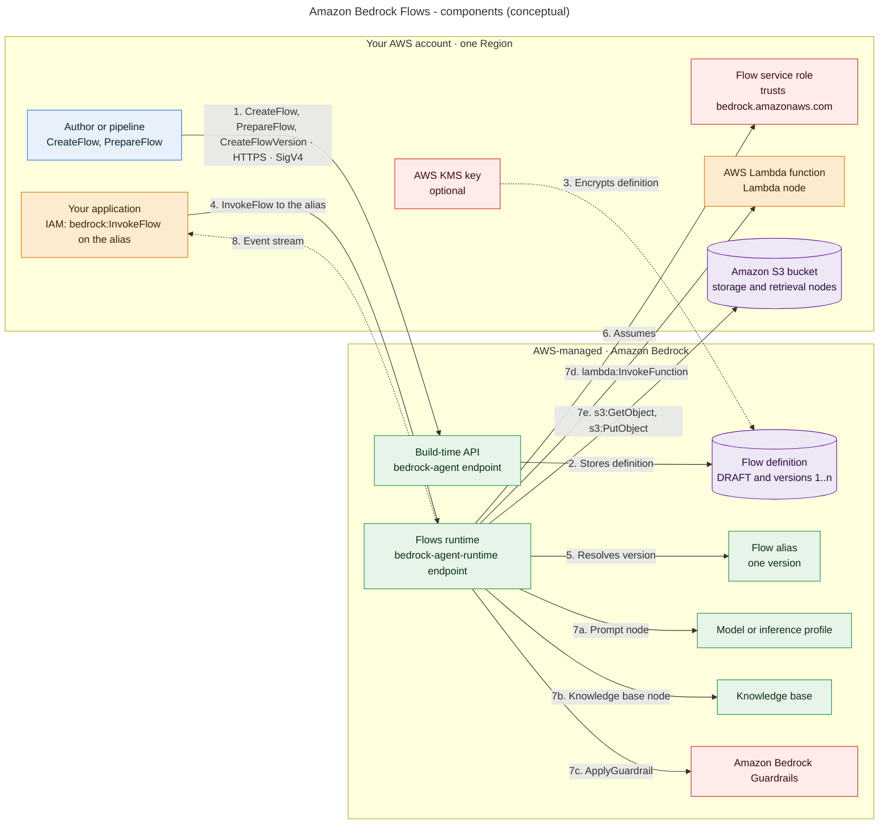
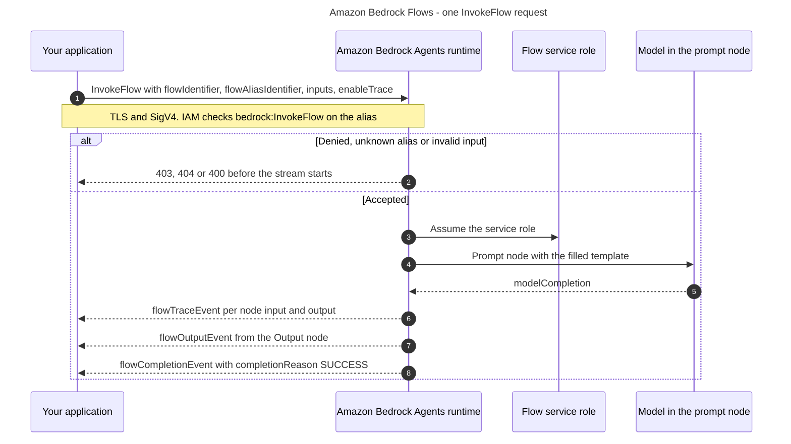

# Amazon Bedrock Flows

> **Level:** Intermediate · **Verified:** 2026-11-15 · **Feature status:** GA (flow executions, inline code nodes and multi-turn conversations are in preview) · **Time:** ~25 min

Amazon Bedrock Flows runs a fixed workflow — a graph of nodes such as prompts, knowledge base
queries, AWS Lambda functions and conditions — as one managed Bedrock resource. You design the graph
once, freeze it as a version, and your application calls an alias of it with `InvokeFlow`.

> [!IMPORTANT]
> **Status** — GA, in the 22 Regions listed in the documentation, including both AWS GovCloud (US)
> Regions. Three parts are still marked preview: **flow executions** (asynchronous runs), the
> **inline code node**, and **multi-turn conversations**. Unlike Agents Classic, the Flows pages carry
> no maintenance notice. 2026 changes to Flows remain **UNVERIFIED** (register item U5): the
> document history entries read for this chapter end with the DoWhile loop node on 2025-09-26.
> Sources: [Supported Regions for flows](https://docs.aws.amazon.com/bedrock/latest/userguide/flows-supported.html),
> [Run flows asynchronously](https://docs.aws.amazon.com/bedrock/latest/userguide/flows-create-async.html),
> [Node types](https://docs.aws.amazon.com/bedrock/latest/userguide/flows-nodes.html),
> [Document history](https://docs.aws.amazon.com/bedrock/latest/userguide/bedrock-ug-doc-history.html)

## Learning objectives

- Name the node types, their fixed input and output names, and how connections carry data.
- Explain the draft → version → alias path and why applications call an alias.
- Read an `InvokeFlow` event stream and run the same flow as an asynchronous flow execution.
- Write the flow service role and the caller's policy with least privilege.
- Decide between Flows, AWS Step Functions and an agent for a given workload.

## Prerequisites

- [Prompt management](../prompt-management/01-prompt-management.md) — prompt nodes reuse it.
- [The Converse API](../inference/01-converse-api.md)
- [IAM roles, trust policies and cross-account access](../../00-foundations/security/02-iam-roles-and-trust.md)
- [Amazon S3, AWS Lambda and Amazon API Gateway](../../00-foundations/aws-fundamentals/02-s3-lambda-api-gateway.md)

## 1. What it is

**Plain language.** A flow is a flowchart that Bedrock executes for you. Each box does one thing —
fill a prompt and call a model, query a knowledge base, call your Lambda function, branch on a
condition — and the arrows say which output feeds which input. You send one input; the flow returns
one or more outputs.

**Precisely.** A flow is a `bedrock-agent` resource whose `definition` holds `nodes` and
`connections`. Every flow starts at exactly one `Input` node and ends at one or more `Output` nodes.
A **data** connection maps a source node's named output to a target node's named input; a
**conditional** connection leaves a `Condition` node when its named condition is true. Each node input
has an `expression` (for example `$.data`) that selects part of the incoming value, and a declared
type (`String`, `Number`, `Boolean`, `Object` or `Array`) that Bedrock validates at run time.

| Item | Value |
|:--|:--|
| Service namespace / endpoint | Build time: `bedrock-agent`. Run time: `bedrock-agent-runtime` |
| Control-plane operations | `CreateFlow`, `UpdateFlow`, `GetFlow`, `ListFlows`, `DeleteFlow`, `PrepareFlow`, `ValidateFlowDefinition`, `CreateFlowVersion`, `GetFlowVersion`, `ListFlowVersions`, `DeleteFlowVersion`, `CreateFlowAlias`, `UpdateFlowAlias`, `GetFlowAlias`, `ListFlowAliases`, `DeleteFlowAlias` |
| Data-plane operations | `InvokeFlow` (streamed); flow executions: `StartFlowExecution`, `GetFlowExecution`, `ListFlowExecutions`, `ListFlowExecutionEvents`, `GetExecutionFlowSnapshot`, `StopFlowExecution` |
| IAM action prefix | `bedrock:` — `bedrock:InvokeFlow` on the `flow-alias` resource; `bedrock:StartFlowExecution` on `flow` and `flow-alias` |
| ARNs | `arn:aws:bedrock:<region>:<account-id>:flow/<flow-id>`, `…/alias/<alias-id>`, `…/alias/<alias-id>/execution/<name>` |

Operation names were checked against [the API operations reference](../../references/bedrock-api-operations.md).

### Node types

The user guide documents the node types below. The AWS SDK model (botocore 1.44.3) lists 16 values for
`FlowNodeType`: the documented ones, with the DoWhile loop represented by three API values —
`Loop`, `LoopInput` and `LoopController`, which the API reference describes as configurations "for a
DoWhile loop".
The user guide's JSON example writes `"type": "DoWhile"`, which is not an SDK value; build loops in
the console or from the API reference.

| Category | Node (`type`) | Inputs → outputs (fixed names in `code`) | Notes from the documentation |
|:--|:--|:--|:--|
| Logic | `Input` | — → `document` | Exactly one per flow; takes the `content` of the request |
| Logic | `Output` | `document` → — | Several allowed, one per branch; returned in `flowOutputEvent` |
| Logic | `Condition` | any number of named inputs → one path per condition | Conditions evaluated in order, first match wins; operators `==`, `!=`, `>`, `>=`, `<`, `<=`, `and`, `or`, `not`; a `default` condition |
| Logic | `Iterator` | `array` → `arrayItem`, `arraySize` | Items processed one by one, not in parallel |
| Logic | `Collector` | `arrayItem`, `arraySize` → `collectedArray` | Re-assembles iterated results |
| Logic | DoWhile loop (`Loop`, `LoopInput`, `LoopController`) | `loopInput` → `loopOutput`, `iterationCount` | Runs at least once; `maxIterations` defaults to 10 |
| Data | `Prompt` | one input per `{{variable}}` → `modelCompletion` | Inline prompt or a Prompt management ARN; optional guardrail |
| Data | `KnowledgeBase` | `retrievalQuery` → `retrievalResults` (array) or `outputText` | With `modelId` it generates; "Guardrails can only be applied when using `RetrieveAndGenerate`" |
| Data | `Agent` | `agentInputText`, `promptAttributes`, `sessionAttributes` → `agentResponse` | Calls an Agents Classic alias; can pause for user input (multi-turn) |
| Data | `Storage` (S3) | `content`, `objectKey` → `s3Uri` | Writes to a bucket you name |
| Data | `Retrieval` (S3) | `objectKey` → `s3Content` | Object must be a UTF-8 string |
| Data | `LambdaFunction` | any inputs → `functionResponse` | Event carries `flow.flowArn`, `flow.flowAliasArn` and the resolved input values |
| Data | `InlineCode` (preview) | up to 5 inputs → `response` | Python 3.12 only; result of the last line; isolated, no internet access; not supported in flow executions |
| Data | `Lex` | `inputText`, `requestAttributes`, `sessionAttributes` → `predictedIntent` | One utterance, no multi-turn |

Sources: [Node types for your flow](https://docs.aws.amazon.com/bedrock/latest/userguide/flows-nodes.html),
[FlowNodeConfiguration](https://docs.aws.amazon.com/bedrock/latest/APIReference/API_agent_FlowNodeConfiguration.html)

### Versions and aliases

Creating a flow also creates a working draft (`DRAFT`) and a test alias `TSTALIASID` that points to it.
`PrepareFlow` applies your latest edits to the draft. `CreateFlowVersion` takes an immutable snapshot,
numbered from 1. An alias (`CreateFlowAlias`) points at exactly one version — its
`routingConfiguration` has a "fixed number of 1 item" — so a rollback is `UpdateFlowAlias` to the
previous number. An alias also carries `concurrencyConfiguration`: `Automatic` (Bedrock decides which
nodes run in parallel) or `Manual` with `maxConcurrency` from 1 to 100.

Sources: [Deploy a flow using versions and aliases](https://docs.aws.amazon.com/bedrock/latest/userguide/flows-deploy.html),
[CreateFlowAlias](https://docs.aws.amazon.com/bedrock/latest/APIReference/API_agent_CreateFlowAlias.html)

## 2. Why it exists

Chaining a prompt, a retrieval and a business rule is easy in code and hard to operate: every change
is a deployment, the logic is hidden in code, and each step needs its own tracing and permissions.
Flows makes the chain a versioned, declarative resource with a visual builder, per-node traces and
one service role, and runs it without compute of your own.

## 3. When to use it

- A **fixed** sequence of model calls and lookups — classify, then route, then draft, then store.
- The same small pipeline runs for many inputs (an iterator over a list of documents).
- Non-developers should see and review the logic in the console builder.
- You want draft, version and alias promotion for the whole pipeline, not only for one prompt.
- Long batch-like jobs fit the **flow execution** limits: five minutes per node, 24 hours per run.

## 4. When not to use it

- **The model must decide which tool to call next.** That is an agent. New agent work goes on
  AgentCore — see the [AgentCore harness](../agentcore/03-agentcore-harness.md) — because
  [Agents Classic](../agents/01-agents-classic.md) is closed to new customers.
- **Long-running orchestration across many AWS services**, human approval steps or exact retry
  semantics — use [AWS Step Functions with Bedrock](../../02-related-aws-services/messaging/02-step-functions.md).
- **One prompt, one call.** Use [Prompt management](../prompt-management/01-prompt-management.md) and Converse.
- **RAG on a Managed Knowledge Base.** A generating knowledge base node uses `RetrieveAndGenerate`,
  which managed knowledge bases do not support; whether a retrieve-only node works with them is
  **UNVERIFIED — REQUIRES DOCUMENTATION REVIEW** (the node and service-role pages do not say). Call
  `AgenticRetrieveStream` from a Lambda node instead — see [Agentic retrieval](../agentic-retrieval/01-agentic-retrieval.md).
- **Heavy data processing.** Nodes are glue, not compute; push the work into Lambda or a batch job.

> [!TIP]
> **Academy recommendation** — Choose by who decides the path. If you can draw every branch in
> advance and it is mostly model calls, use Flows. If the branches span many services, need waits,
> human tasks or compensation, use Step Functions (its optimized integration calls `InvokeModel`). If
> the model chooses the next step, use an agent. The full comparison is in
> [Choosing between RAG, agents, flows and plain inference](../../09-advanced-topics/14-choosing-rag-agents-flows.md).
> This is our design guidance, not an official AWS reference architecture.

| Need | Flows | Step Functions | Agent (AgentCore) |
|:--|:--|:--|:--|
| Path decided by | Your graph | Your state machine | The model |
| Longest run (documented) | 1 h synchronous; 24 h as a flow execution | See the Step Functions quotas | AgentCore Runtime: 8 h per microVM session |
| Native Bedrock steps | Prompt, knowledge base, agent, guardrail | Optimized integrations: `InvokeModel`, `CreateModelCustomizationJob` | Model, tools, memory |

Sources: [Run flows asynchronously](https://docs.aws.amazon.com/bedrock/latest/userguide/flows-create-async.html),
[Step Functions and Amazon Bedrock](https://docs.aws.amazon.com/step-functions/latest/dg/connect-bedrock.html)

## 5. Internal architecture

AWS documents the resources, endpoints, service role and events. How the runtime schedules nodes is
not documented; the diagram is a conceptual model of the visible parts.



| Legend | Meaning |
|:--|:--|
| Solid arrow | Request or write |
| Dashed arrow | Response, stream or key use |
| Cylinder | Data at rest |
| Red box | Security control |

**What this shows** — authoring and running use different endpoints; every node runs with the
**flow's service role**, not the caller's identity.

1. The author creates the flow with a definition and a service role, prepares it and cuts a version.
2. Bedrock stores the definition; the draft and each version are separate snapshots.
3. A customer managed key is optional (`customerEncryptionKeyArn`).
4. The application calls an alias. Its own permission is only `bedrock:InvokeFlow`.
5. The alias selects one version.
6. Bedrock assumes the service role for the run.
7. Nodes call models, knowledge bases, guardrails, Lambda and S3 with that role. For flows created
   after 2024-11-22, Lambda and Amazon Lex are invoked with the service role, not the Bedrock service
   principal.
8. Results stream back as events.

The full picture, with a condition node, is in [diagram set 17](../../diagrams/mermaid/17-bedrock-flows.md).

## 6. Request and response lifecycle



- **Steps 1–2.** The request has one entry in `inputs`: `nodeName`, `nodeOutputName` and `content`.
  The response header `x-amz-bedrock-flow-execution-id` returns the `executionId`.
- **Step 3.** Errors can also arrive *inside* the stream as events — `throttlingException` (429),
  `dependencyFailedException` (424, for example a failing Lambda), `badGatewayException` (502),
  `validationException` and others. Handle both places.
- **Steps 4–8.** Traces appear only with `enableTrace` and include condition results. Several output
  nodes, or an iterator, produce several `flowOutputEvent`s.
- **Multi-turn (preview).** If an agent node needs more information, the stream carries
  `flowMultiTurnInputRequestEvent` and the completion reason is `INPUT_REQUIRED`; call `InvokeFlow`
  again with the same `executionId`, targeting the agent node's `agentInputText`.
- **Time limit.** The flow-executions page says an `InvokeFlow` run "times out at one hour"; the
  `StartFlowExecution` API reference says "after five minutes". The sources conflict — design for
  the shorter value. The AWS CLI does not support `InvokeFlow` (it streams); use an SDK.

**Flow executions (preview).** `StartFlowExecution` returns an `executionArn` immediately. Poll
`GetFlowExecution` until the status leaves `Running` (`Succeeded`, `Failed`, `TimedOut`, `Aborted`),
then read `ListFlowExecutionEvents` with `eventType` `Flow` for outputs or `Node` for every node.
`GetExecutionFlowSnapshot` returns the definition and role the run started with, and
`StopFlowExecution` aborts it. Finished executions are deleted after 90 days.

Sources: [InvokeFlow](https://docs.aws.amazon.com/bedrock/latest/APIReference/API_agent-runtime_InvokeFlow.html),
[StartFlowExecution](https://docs.aws.amazon.com/bedrock/latest/APIReference/API_agent-runtime_StartFlowExecution.html),
[Track each step with traces](https://docs.aws.amazon.com/bedrock/latest/userguide/flows-trace.html),
[Converse with a flow](https://docs.aws.amazon.com/bedrock/latest/userguide/flows-multi-turn-invocation.html)

## 7. Dependencies

| Depends on | Why | Required or optional |
|:--|:--|:-:|
| Flow service role | Every node runs with it | Required |
| A model the role may invoke | Prompt nodes and generating knowledge base nodes | Required for those nodes |
| A prepared draft, a version and an alias | Applications should call a numbered version through an alias | Required for production |
| Prompt management | Prompt nodes that reference a stored prompt need `bedrock:RenderPrompt` | Optional |
| Knowledge base, guardrail, Lambda function, S3 bucket, Lex bot | Matching node types | Optional |
| Amazon Bedrock Agents Classic alias | Agent nodes and multi-turn conversations | Optional — existing Agents Classic customers only |
| AWS KMS customer managed key | Encrypt the flow with your key | Optional |

## 8. Security considerations

- **Two principals.** The caller needs only `bedrock:InvokeFlow` on the alias ARN (or
  `bedrock:StartFlowExecution` and the read actions for executions). Everything the nodes touch is
  granted to the **service role**, so the role, not the caller, defines the blast radius.
- **Trust policy.** Principal `bedrock.amazonaws.com`, with `aws:SourceAccount` and an `aws:SourceArn`
  of `arn:aws:bedrock:<region>:<account-id>:flow/*`; AWS recommends replacing `*` with the flow ID
  once it exists.
- **Identity policy, per node type** (as documented): `bedrock:InvokeModel` on each model,
  `bedrock:RenderPrompt` on each managed prompt, `bedrock:Retrieve` on each knowledge base,
  `bedrock:InvokeAgent` on each agent alias, `s3:GetObject` / `s3:PutObject` on buckets,
  `bedrock:ApplyGuardrail` on each guardrail, `lambda:InvokeFunction`, `lex:RecognizeUtterance`, and
  `kms:Decrypt` / `kms:GenerateDataKey` for encrypted resources.
- **Console-created roles grow.** The role the console creates gains permissions when you add nodes,
  but they are not removed when you delete nodes.
- **Untrusted input.** The `content` you send reaches prompts, Lambda events and S3 keys. Validate it
  in the first node and apply a guardrail on prompt nodes — see
  [Amazon Bedrock Guardrails](../guardrails/01-guardrails.md).
- **Inline code** runs in "an isolated, AWS managed environment" without internet access. **Lex
  nodes:** Amazon Lex "might store and use customer content" unless you apply an AI services opt-out policy.
- **Encryption.** A flow and its executions can use a customer managed key; the key policy page
  (flows encryption) could not be retrieved for this chapter, so the exact key policy is
  **UNVERIFIED — REQUIRES DOCUMENTATION REVIEW**.

Sources: [Create a service role for Flows](https://docs.aws.amazon.com/bedrock/latest/userguide/flows-permissions.html),
[Actions, resources, and condition keys for Amazon Bedrock](https://docs.aws.amazon.com/service-authorization/latest/reference/list_bedrock.html)

## 9. Networking requirements

Both endpoints have interface VPC endpoints: `com.amazonaws.<region>.bedrock-agent` for authoring
and `com.amazonaws.<region>.bedrock-agent-runtime` for `InvokeFlow` and flow executions.
**Our reading:** nodes run inside the service and call models, Lambda and S3 as AWS service calls,
not through your VPC (the pages read do not describe the path), so a Lambda node is how a flow
reaches anything private — attach that function to your VPC. A node whose model ID is a cross-Region inference profile can process data in another Region of
the profile — see [Cross-Region inference](../inference/04-cross-region-inference.md). See also
[Private connectivity for Bedrock](../../02-related-aws-services/networking/01-private-connectivity-for-bedrock.md).

Source: [Interface VPC endpoints for Amazon Bedrock](https://docs.aws.amazon.com/bedrock/latest/userguide/vpc-interface-endpoints.html)

## 10. Pricing dimensions

| Dimension | Unit | Notes |
|:--|:--|:--|
| Node transitions | Per 1,000 transitions | One transition each time a node runs. The pricing page's worked example uses $0.035 per 1,000 |
| Models in prompt and knowledge base nodes | Tokens at the model's rate | Billed as normal inference |
| Guardrails, knowledge bases, Lambda, S3, Lex | Each service's own rates | Billed by the service the node calls |
| Customer managed KMS key | AWS KMS rates | Only if you bring a key |

The user guide states only that Flows pricing "is dependent on the resources that you use"; the
pricing page adds the node-transition charge. An iterator multiplies transitions by the array size.

Sources: [Amazon Bedrock pricing](https://aws.amazon.com/bedrock/pricing/),
[How to estimate Amazon Bedrock costs (AWS blog)](https://aws.amazon.com/blogs/publicsector/how-to-estimate-amazon-bedrock-costs-for-public-sector-applications/)

## 11. Scaling considerations

| Quota (each supported Region) | Default | Adjustable |
|:--|--:|:-:|
| Flows per account | 100 | Yes |
| Flow executions per account | 1,000 | Yes |
| Versions per flow / aliases per flow | 10 / 10 | No |
| Total nodes per flow | 40 | No |
| Prompt nodes per flow | 20 | Yes |
| Knowledge base, agent, Lambda function, output nodes per flow | 20 each | No |
| S3 storage / S3 retrieval nodes per flow | 10 / 10 | No |
| Condition nodes per flow / conditions per node | 5 / 5 | No |
| Lex / inline code nodes per flow | 5 / 5 | No |
| Input, iterator, collector nodes per flow | 1 each | No |
| `CreateFlow`, `UpdateFlow`, `PrepareFlow`, `CreateFlowVersion`, `CreateFlowAlias` | 2 requests per second each | No |

The Flows rows of the quota table list no `InvokeFlow` rate; throughput is bounded by what the nodes
call (model tokens per minute, Lambda concurrency). Inline code allows "a maximum of 25 running inline
code nodes per AWS account". Ten versions is small — delete old ones when you release.

Sources: [Amazon Bedrock endpoints and quotas](https://docs.aws.amazon.com/general/latest/gr/bedrock.html),
[Node types](https://docs.aws.amazon.com/bedrock/latest/userguide/flows-nodes.html)

## 12. IaC support

| Tool | Support | Resource / construct | Notes |
|:--|:-:|:--|:--|
| Terraform (`hashicorp/aws` 6.73.0) | ✅ flow · ❌ version, alias | `aws_bedrockagent_flow` | 13 node types; no `loop`, `loop_input` or `loop_controller` configuration blocks; no flow version or alias resource |
| CloudFormation | ✅ | `AWS::Bedrock::Flow`, `AWS::Bedrock::FlowVersion`, `AWS::Bedrock::FlowAlias` | |
| AWS CDK (`aws-cdk-lib` 2.277.0) | L1 | `aws_bedrock.CfnFlow`, `CfnFlowVersion`, `CfnFlowAlias` | No L2 in `@aws-cdk/aws-bedrock-alpha` |

With Terraform, run `PrepareFlow`, `CreateFlowVersion` and `CreateFlowAlias` / `UpdateFlowAlias` from
the pipeline after `terraform apply`, or use CloudFormation for them. The provider documentation does
not say whether the resource prepares the flow; check the `flow_status` output.
Checked against [the Terraform reference](../../references/terraform-aws-provider-bedrock.md) and
[the CDK and CloudFormation reference](../../references/cdk-and-cloudformation-bedrock.md).

## 13. Working example

A three-node flow — input → prompt → output — with its service role.

> **Code status:** validated with `terraform fmt -check`, `terraform validate` and TFLint (provider 6.73.0, with a `versions.tf` that sets `required_version = ">= 1.11.0"` and `hashicorp/aws ~> 6.73`) · mock-tested with `terraform test` (`mock_provider`, 3 assertions) · **never planned or applied against AWS**

```hcl
provider "aws" {
  region = var.region

  default_tags {
    tags = var.tags
  }
}

variable "region" {
  description = "Region for the flow. Amazon Bedrock Flows must be available there."
  type        = string
  default     = "us-east-1"
}

variable "flow_name" {
  description = "Name of the flow."
  type        = string
  default     = "summarize-topic"
}

variable "model_id" {
  description = "Model ID or inference profile ID used by the prompt node. Confirm the current ID in the model catalog."
  type        = string
}

variable "model_resource_arns" {
  description = "ARNs the flow service role may invoke: the foundation model, or the inference profile plus the foundation model in every destination Region."
  type        = list(string)
}

variable "kms_key_arn" {
  description = "Customer managed KMS key for the flow. Leave null to use the AWS managed key."
  type        = string
  default     = null
}

variable "tags" {
  description = "Tags applied to every resource through the provider's default_tags."
  type        = map(string)
  default     = {}
}

data "aws_caller_identity" "current" {}
data "aws_partition" "current" {}
data "aws_region" "current" {}

# Service role that Amazon Bedrock assumes to run the flow's nodes.
data "aws_iam_policy_document" "flow_trust" {
  statement {
    sid     = "FlowsTrustBedrock"
    actions = ["sts:AssumeRole"]

    principals {
      type        = "Service"
      identifiers = ["bedrock.amazonaws.com"]
    }

    condition {
      test     = "StringEquals"
      variable = "aws:SourceAccount"
      values   = [data.aws_caller_identity.current.account_id]
    }

    condition {
      test     = "ArnLike"
      variable = "aws:SourceArn"
      values   = ["arn:${data.aws_partition.current.partition}:bedrock:${data.aws_region.current.region}:${data.aws_caller_identity.current.account_id}:flow/*"]
    }
  }
}

data "aws_iam_policy_document" "flow_permissions" {
  statement {
    sid       = "InvokeModel"
    actions   = ["bedrock:InvokeModel"]
    resources = var.model_resource_arns
  }
}

resource "aws_iam_role" "flow" {
  name_prefix        = "bedrock-flow-"
  assume_role_policy = data.aws_iam_policy_document.flow_trust.json
}

resource "aws_iam_role_policy" "flow" {
  name   = "flow-node-permissions"
  role   = aws_iam_role.flow.id
  policy = data.aws_iam_policy_document.flow_permissions.json
}

# Input node -> Prompt node -> Output node.
resource "aws_bedrockagent_flow" "this" {
  name                        = var.flow_name
  description                 = "Writes a short summary of the topic it receives."
  execution_role_arn          = aws_iam_role.flow.arn
  customer_encryption_key_arn = var.kms_key_arn

  definition {
    node {
      name = "FlowInputNode"
      type = "Input"

      configuration {
        input {}
      }

      output {
        name = "document"
        type = "String"
      }
    }

    node {
      name = "Summarize"
      type = "Prompt"

      configuration {
        prompt {
          source_configuration {
            inline {
              model_id      = var.model_id
              template_type = "TEXT"

              inference_configuration {
                text {
                  max_tokens  = 400
                  temperature = 0.2
                }
              }

              template_configuration {
                text {
                  text = "Write three sentences that explain {{topic}} to a new engineer."

                  input_variable {
                    name = "topic"
                  }
                }
              }
            }
          }
        }
      }

      input {
        name       = "topic"
        type       = "String"
        expression = "$.data"
      }

      output {
        name = "modelCompletion"
        type = "String"
      }
    }

    node {
      name = "FlowOutputNode"
      type = "Output"

      configuration {
        output {}
      }

      input {
        name       = "document"
        type       = "String"
        expression = "$.data"
      }
    }

    connection {
      name   = "InputToSummarize"
      source = "FlowInputNode"
      target = "Summarize"
      type   = "Data"

      configuration {
        data {
          source_output = "document"
          target_input  = "topic"
        }
      }
    }

    connection {
      name   = "SummarizeToOutput"
      source = "Summarize"
      target = "FlowOutputNode"
      type   = "Data"

      configuration {
        data {
          source_output = "modelCompletion"
          target_input  = "document"
        }
      }
    }
  }

  depends_on = [aws_iam_role_policy.flow]
}

output "flow_id" {
  description = "Flow identifier. Pass it to PrepareFlow, CreateFlowVersion and CreateFlowAlias."
  value       = aws_bedrockagent_flow.this.id
}

output "flow_arn" {
  description = "ARN of the flow (its working draft)."
  value       = aws_bedrockagent_flow.this.arn
}

output "flow_status" {
  description = "Status reported by the service, for example NotPrepared or Prepared."
  value       = aws_bedrockagent_flow.this.status
}

output "service_role_arn" {
  description = "Service role the flow runs with."
  value       = aws_iam_role.flow.arn
}
```

Calling an alias of that flow, synchronously and as a flow execution:

> **Code status:** syntax-checked (`python -m py_compile`) · `run_async` mock-tested with botocore `Stubber` (boto3 1.44.3, 2 tests) · **never run against AWS**

```python
"""Call a flow alias synchronously (InvokeFlow) or asynchronously (flow executions)."""
import os
import time

import boto3

FLOW_ID = os.environ.get("FLOW_ID", "")              # from configuration, never a literal
FLOW_ALIAS_ID = os.environ.get("FLOW_ALIAS_ID", "")  # an alias that points to a numbered version


def invoke(client, topic: str) -> list:
    """Synchronous: read the event stream until flowCompletionEvent."""
    response = client.invoke_flow(
        flowIdentifier=FLOW_ID,
        flowAliasIdentifier=FLOW_ALIAS_ID,
        inputs=[{
            "nodeName": "FlowInputNode",
            "nodeOutputName": "document",
            "content": {"document": topic},
        }],
        enableTrace=True,
    )
    outputs = []
    for event in response["responseStream"]:
        if "flowOutputEvent" in event:
            outputs.append(event["flowOutputEvent"]["content"]["document"])
        elif "flowTraceEvent" in event:
            pass  # node inputs, outputs and condition results: log them
        elif "flowMultiTurnInputRequestEvent" in event:
            pass  # an agent node needs more input: call again with executionId
        elif "flowCompletionEvent" in event:
            reason = event["flowCompletionEvent"]["completionReason"]
            if reason != "SUCCESS":  # INPUT_REQUIRED
                raise RuntimeError(f"flow paused: {reason}")
    return outputs


def run_async(client, topic: str, poll_seconds: float = 10.0) -> list:
    """Asynchronous (preview): start, poll until terminal, then read output events."""
    arn = client.start_flow_execution(
        flowIdentifier=FLOW_ID,
        flowAliasIdentifier=FLOW_ALIAS_ID,
        inputs=[{
            "nodeName": "FlowInputNode",
            "nodeOutputName": "document",
            "content": {"document": topic},
        }],
    )["executionArn"]
    while True:
        execution = client.get_flow_execution(
            flowIdentifier=FLOW_ID,
            flowAliasIdentifier=FLOW_ALIAS_ID,
            executionIdentifier=arn,
        )
        if execution["status"] != "Running":
            break
        time.sleep(poll_seconds)
    if execution["status"] != "Succeeded":  # Failed, TimedOut or Aborted
        raise RuntimeError(f"{execution['status']}: {execution.get('errors')}")
    events = client.list_flow_execution_events(
        flowIdentifier=FLOW_ID,
        flowAliasIdentifier=FLOW_ALIAS_ID,
        executionIdentifier=arn,
        eventType="Flow",  # only flow input and output events
    )["flowExecutionEvents"]
    # In the SDK model an output event carries fields[], each with name and content.
    return [
        field["content"]["document"]
        for e in events if "flowOutputEvent" in e
        for field in e["flowOutputEvent"]["fields"]
    ]


if __name__ == "__main__":
    runtime = boto3.client("bedrock-agent-runtime")
    print(invoke(runtime, "interface VPC endpoints"))
```

> [!WARNING]
> **Common mistake** — The user guide shows a flow-execution output event as
> `flowOutputEvent.content`. In the SDK model, `ListFlowExecutionEvents` returns
> `flowOutputEvent.fields[].content`; only the `InvokeFlow` stream uses `flowOutputEvent.content`.
> The stubbed test above caught the difference.

> [!CAUTION]
> **Cost or security hazard** — If you deploy this in a sandbox account (`terraform apply`), every
> invocation is billed for node transitions and model tokens. Remove it with `terraform destroy`,
> after deleting any versions and aliases you created outside Terraform.

## Common mistakes

| Mistake | Symptom | Fix |
|:--|:--|:--|
| Applications call `TSTALIASID` | Behaviour changes on every edit and prepare | Create a version and a named alias |
| Edits saved but not prepared | Tests run the old logic | `PrepareFlow`, then check the status is `Prepared` |
| Input name differs from the prompt variable | Validation error or empty variable | Node input `name` must equal the `{{variable}}` |
| Expression or type mismatch | `MismatchedNodeInputType` validation or a run-time type error | Call `ValidateFlowDefinition`; align `type` with the upstream output |
| No `default` condition | `MissingDefaultCondition` validation error | Add a `default` conditional connection |
| Permissions given to the caller, not the role | `AccessDenied` from a node | Grant node permissions to the service role |
| Flow created before 2024-11-22 with Lambda, Lex or managed-prompt nodes | Access denied from those nodes | Add `lambda:InvokeFunction`, `lex:RecognizeUtterance` and `bedrock:RenderPrompt` to the service role, as AWS advises |
| Inline code node in a flow execution | Not supported | Use a Lambda node |
| Loops defined in Terraform 6.73.0 | No loop blocks in the schema | Use CloudFormation or the API |

## Knowledge check

1. Your application has `bedrock:InvokeFlow` on the alias, but a Lambda node fails with access denied. Which policy do you change?
2. Why should a production application never call `TSTALIASID`?
3. A flow summarises 300 documents, each about four minutes of processing. `InvokeFlow` or a flow execution?
4. Which node types can carry a guardrail, and when does a knowledge base node apply it?
5. What does Terraform 6.73.0 leave for your pipeline to do after `apply`?

<details>
<summary>Answers</summary>

1. The flow service role. Nodes run with that role; for flows created after 2024-11-22 it needs `lambda:InvokeFunction` on the function.
2. It points to the working draft, which changes whenever someone prepares new edits. A named alias points to an immutable version.
3. A flow execution: up to 24 hours per run and five minutes per node. `InvokeFlow` is bounded at one hour (or five minutes, by the API reference).
4. Prompt nodes and knowledge base nodes. A knowledge base node applies it only when it generates (`RetrieveAndGenerate`, with a `modelId`).
5. `PrepareFlow`, `CreateFlowVersion`, and creating or updating the alias — the provider has no version or alias resource.

</details>

## 14. Official documentation

- [Build an end-to-end generative AI workflow with Amazon Bedrock Flows](https://docs.aws.amazon.com/bedrock/latest/userguide/flows.html) — overview, lifecycle, pricing statement.
- [How Amazon Bedrock Flows works](https://docs.aws.amazon.com/bedrock/latest/userguide/flows-how-it-works.html) — nodes, connections, expressions.
- [Node types for your flow](https://docs.aws.amazon.com/bedrock/latest/userguide/flows-nodes.html) — every node, its inputs, outputs and limits.
- [FlowNodeConfiguration](https://docs.aws.amazon.com/bedrock/latest/APIReference/API_agent_FlowNodeConfiguration.html) — API names, including the three loop configurations.
- [Supported Regions and models for flows](https://docs.aws.amazon.com/bedrock/latest/userguide/flows-supported.html) — the 22 Regions.
- [Create a service role for Amazon Bedrock Flows](https://docs.aws.amazon.com/bedrock/latest/userguide/flows-permissions.html) — trust and identity policies, the 2024-11-22 change.
- [Deploy a flow using versions and aliases](https://docs.aws.amazon.com/bedrock/latest/userguide/flows-deploy.html) — `DRAFT`, `TSTALIASID`, versions.
- [CreateFlowAlias](https://docs.aws.amazon.com/bedrock/latest/APIReference/API_agent_CreateFlowAlias.html) — routing and concurrency configuration.
- [InvokeFlow](https://docs.aws.amazon.com/bedrock/latest/APIReference/API_agent-runtime_InvokeFlow.html) — request, event stream and errors.
- [Run Amazon Bedrock flows asynchronously with flow executions](https://docs.aws.amazon.com/bedrock/latest/userguide/flows-create-async.html) — limits, statuses, events, snapshot.
- [StartFlowExecution](https://docs.aws.amazon.com/bedrock/latest/APIReference/API_agent-runtime_StartFlowExecution.html) — request and preview note.
- [Converse with an Amazon Bedrock flow](https://docs.aws.amazon.com/bedrock/latest/userguide/flows-multi-turn-invocation.html) — multi-turn conversations.
- [Track each step in your flow by viewing its trace](https://docs.aws.amazon.com/bedrock/latest/userguide/flows-trace.html) — trace event types.
- [Actions, resources, and condition keys for Amazon Bedrock](https://docs.aws.amazon.com/service-authorization/latest/reference/list_bedrock.html) — IAM actions and resource types.
- [Interface VPC endpoints for Amazon Bedrock](https://docs.aws.amazon.com/bedrock/latest/userguide/vpc-interface-endpoints.html) — `bedrock-agent` and `bedrock-agent-runtime`.
- [Amazon Bedrock endpoints and quotas](https://docs.aws.amazon.com/general/latest/gr/bedrock.html) — Flows quotas.
- [Amazon Bedrock pricing](https://aws.amazon.com/bedrock/pricing/) — node-transition example.
- [Step Functions and Amazon Bedrock](https://docs.aws.amazon.com/step-functions/latest/dg/connect-bedrock.html) — the alternative orchestrator's Bedrock integration.
- [Document history for the Amazon Bedrock User Guide](https://docs.aws.amazon.com/bedrock/latest/userguide/bedrock-ug-doc-history.html) — DoWhile loop (2025-09-26), preview features (June 2025).
- [Terraform `aws_bedrockagent_flow`](https://raw.githubusercontent.com/hashicorp/terraform-provider-aws/main/website/docs/r/bedrockagent_flow.html.markdown) — arguments and node types.
- [Feature verification matrix](../../FEATURE-VERIFICATION.md) — the academy's register entry for this feature.
