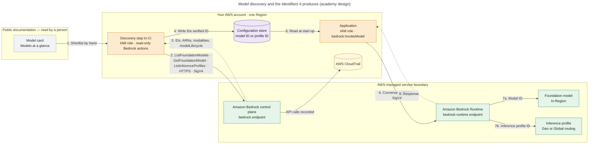

# Model providers and the model catalog

> **Level:** Intermediate · **Verified:** 2026-11-15 · **Feature status:** GA · **Time:** ~20 min

Amazon Bedrock puts foundation models from many providers behind one set of APIs. This chapter shows who the providers are today, how to read a model card, and how to find the exact identifier your code must send — by hand and programmatically.

> [!IMPORTANT]
> **Status** — The catalog changes almost weekly: the document history records new model cards on 2026-11-04 and 2026-11-09. Every list here is a snapshot from 2026-11-15; re-read the linked page before relying on a name, an ID or a Region.
> Source: [Document history for the Amazon Bedrock User Guide](https://docs.aws.amazon.com/bedrock/latest/userguide/bedrock-ug-doc-history.html)

## Learning objectives

After this chapter you can:

- Name the providers and model families in the Bedrock catalog and say which modality each kind of model serves.
- Read a model card and extract the facts an architect needs: identifiers, context window, supported APIs and features, Regions and lifecycle dates.
- Distinguish a model ID from an inference profile ID and choose the right one for a request.
- Discover models and inference profiles with `ListFoundationModels`, `GetFoundationModel`, `ListInferenceProfiles` and the matching Terraform data sources.
- Explain why a model identifier belongs in configuration, not in code.

## Prerequisites

- [What Amazon Bedrock is: services, namespaces and planes](../overview/01-what-is-amazon-bedrock.md)
- [Endpoints, APIs and authentication](../overview/02-endpoints-apis-and-authentication.md)
- [Model access and subscriptions](../overview/03-model-access-and-subscriptions.md)
- [Generative AI, foundation models and LLMs](../../00-foundations/generative-ai-fundamentals/01-generative-ai-and-foundation-models.md) and [Tokens, context windows, and training versus inference](../../00-foundations/generative-ai-fundamentals/02-tokens-context-windows-inference.md)

## Concept in plain language

Think of a wholesaler's catalog. Every product has a **specification sheet** (the model card) and an **article number** (the model ID). You order by article number, never by the name on the box.

Some products cannot be ordered from one warehouse. For those, the catalog prints a **distribution code** instead: you order with the code and the wholesaler ships from any warehouse in the area. That code is an *inference profile ID*. Its prefix (`us.`, `eu.`, `global.`) says how far the order may travel.

The catalog is reprinted constantly, so you look the number up each time you build and keep it somewhere easy to change.

## How it really works

### Three collections of models

| Collection | Who runs the compute | How you address it | Chapter |
|:--|:--|:--|:--|
| Serverless foundation models ("Models at a glance") | AWS, shared capacity | Model ID or inference profile ID | This chapter |
| Amazon Bedrock Marketplace models | Instances on an endpoint managed by Amazon SageMaker AI, in your account | The endpoint ARN | [Amazon Bedrock Marketplace](05-bedrock-marketplace.md) |
| Your own models | AWS, on demand or provisioned | Deployment, provisioned-model or imported-model ARN | [Model customization](03-model-customization.md), [Custom Model Import](04-custom-model-import.md) |

### Providers offered today

The [Models at a glance](https://docs.aws.amazon.com/bedrock/latest/userguide/model-cards.html) page listed nineteen providers on the verification date. The families below are the ones named on that page; the list changes often.

| Provider | Model families listed |
|:--|:--|
| AI21 Labs | Jamba 1.5 |
| Amazon | Nova (Micro, Lite, Pro, 2 Lite, Canvas, Reel, 2 Sonic, 2.5 Sonic, Multimodal Embeddings), Titan embeddings |
| Anthropic | Claude 5.x, 4.x and 3.x |
| Cohere | Command R and R+, Embed, Rerank 3.5 |
| DeepSeek | DeepSeek V3.x, DeepSeek-R1 |
| Google | Gemma 4, Gemma 3 |
| Luma AI | Ray2 |
| Meta | Llama 3.x, Llama 4 |
| MiniMax | MiniMax M2.x |
| Mistral AI | Mistral, Ministral, Magistral, Devstral, Mixtral, Pixtral, Voxtral |
| Moonshot AI | Kimi K2.x, K3.x |
| NVIDIA | Nemotron |
| OpenAI | GPT-6.x, GPT-5.x, GPT OSS |
| Qwen | Qwen3 |
| Stability AI | Stable Image services, Stable Diffusion 3.5 Large |
| TwelveLabs | Pegasus, Marengo Embed |
| Writer | Palmyra |
| xAI | Grok 4.x |
| Z.AI | GLM 4.7, GLM 5.x |

> [!WARNING]
> **Common mistake** — "Listed" does not mean "usable where you are". The page still names Nova Canvas and Nova Reel, yet the lifecycle page records both as end-of-life since 2026-09-30 in the Regions it lists. Always confirm in your Region ([Model lifecycle and selection](02-model-lifecycle-and-selection.md)).

### Modalities

A *modality* is the kind of data a model takes in or produces. The examples are ones whose description was read on an official page.

| Modality | What the model does | Examples read on official pages |
|:--|:--|:--|
| Text and multimodal understanding | Generates text from text, and for some models images, documents or video | Amazon Nova 2 Lite, Anthropic Claude, OpenAI GPT-6 Astra |
| Embeddings | Turns text, images or video into vectors for search | Titan Text Embeddings V2, Amazon Nova Multimodal Embeddings, TwelveLabs Marengo Embed 3.0 |
| Image | Generates or edits images | Stability AI Stable Image services |
| Video generation | Produces video clips, asynchronously | Luma AI Ray2 (`StartAsyncInvoke`) |
| Video understanding | Produces text about a video | TwelveLabs Pegasus |
| Speech | Speech-to-speech conversation | Amazon Nova 2 Sonic, Nova 2.5 Sonic |
| Rerank | Reorders retrieved passages by relevance; priced per query | Cohere Rerank 3.5 |

Embedding and rerank models are covered in depth in [Embedding model selection](../../09-advanced-topics/04-embedding-model-selection.md) and [Retrieval, reranking and metadata filtering](../knowledge-bases/05-retrieval-reranking-filtering.md).

### Reading a model card

Each model has a card page with the same sections. Read them in this order.

| Card section | What it tells you | Why an architect cares |
|:--|:--|:--|
| Model Details | Launch date, "EOL no sooner than" date, Legacy period, lifecycle state, context window, maximum output tokens, knowledge cutoff, Marketplace product ID | Sizing prompts; planning the migration date; scoping `aws-marketplace` permissions |
| Modalities table | Input and output modalities | Whether the model can take your data at all |
| Endpoints and APIs supported | `bedrock-runtime` and `bedrock-mantle`; Invoke, Converse, Chat Completions, Responses, Messages | Which SDK and request shape you can use |
| Capabilities and Features | Per endpoint: supported and not supported Bedrock features (guardrails, prompt caching, structured outputs, application inference profiles, and so on) | A feature you depend on may be missing for this model or this endpoint |
| Programmatic Access | Model ID, In-Region endpoint URL, Geo inference ID, Global inference ID — per endpoint | The exact string for `modelId` |
| Service Tiers | Which of Standard, Priority, Flex and Reserved the model supports | Latency and cost options |
| Regional Availability | In-Region, Geo and Global columns, plus source and destination Regions for each profile | Data residency |
| Pricing, Quotas and Limits, Sample Code | Prices or a pointer to the pricing page; default quotas; a starter call | Cost and throughput estimates |

> [!NOTE]
> **Documented fact** — Model, API and feature support differs between the two endpoints, and AWS recommends `bedrock-runtime` for new applications.
> Source: [Model availability & compatibility](https://docs.aws.amazon.com/bedrock/latest/userguide/models.html)

### Model ID versus inference profile ID

| Identifier | Example seen in the documentation | Meaning |
|:--|:--|:--|
| Model ID | `amazon.nova-2-lite-v1:0` | The request is processed in the Region you call ("In-Region") |
| Geo inference profile ID | `us.amazon.nova-2-lite-v1:0` | Bedrock routes to a Region inside one geography |
| Global inference profile ID | `global.amazon.nova-2-lite-v1:0` | Bedrock routes to any supported commercial Region |
| Model ARN | Returned as `modelArn` by `GetFoundationModel` | What you put in the `Resource` element of an IAM policy |
| Variant ID with a suffix | `amazon.nova-2-lite-v1:0:256k` | The base-model ID used for customization |

Three details trip people up:

1. **Some models have no usable In-Region ID.** The GPT-6 Astra card shows "Not supported" for the In-Region endpoint on `bedrock-runtime`; you must name `us.openai.gpt-6-astra` or `global.openai.gpt-6-astra`. The TwelveLabs Pegasus v1.5 card says the model is available through cross-Region inference only.
2. **The ID can differ per endpoint.** The lifecycle page lists DeepSeek-V3.1 as `deepseek.v3-v1:0` on `bedrock-runtime` and `deepseek.v3.1` on `bedrock-mantle`.
3. **`modelId` also accepts ARNs** of things you own: a provisioned model, a custom model deployment, an imported model, an application inference profile or a Marketplace endpoint.

Routing behaviour, quotas and pricing of profiles are covered in [Cross-Region inference: Geo and Global profiles](../inference/04-cross-region-inference.md).

### Discovering models programmatically

| Operation | Endpoint | Returns | Useful filters |
|:--|:--|:--|:--|
| `ListFoundationModels` | `bedrock` (control plane) | Model summaries: ID, ARN, provider, input and output modalities, inference types, customizations, streaming support, `modelLifecycle` | `byProvider`, `byOutputModality` (`TEXT`, `IMAGE`, `EMBEDDING`), `byInferenceType` (`ON_DEMAND`, `PROVISIONED`), `byCustomizationType` |
| `GetFoundationModel` | `bedrock` | The same details for one model | — |
| `ListInferenceProfiles` | `bedrock` | Profile ID, ARN, status, type and the models behind each profile | `typeEquals` (`SYSTEM_DEFINED`, `APPLICATION`) |
| `GET /v1/models` (OpenAI-compatible) | `bedrock-mantle` only | Model IDs served on that endpoint | — |

> [!NOTE]
> **Documented fact** — `bedrock-runtime` does not implement the OpenAI-compatible `GET /models` operation. `ListFoundationModels` can also return IDs that are "deprecated or for backwards compatibility", so a listed ID is not proof that the model is current.
> Source: [Get list of models](https://docs.aws.amazon.com/bedrock/latest/userguide/models-get-info.html)

The API does not return the context window, feature support or prices. Those live only on the model card and the pricing page. Operation and field names in this chapter were checked against the generated [API operations reference](../../references/bedrock-api-operations.md).

## Architecture diagram



**What this shows** — How a model identifier travels from the documentation into a running application. Discovery uses the control plane; inference uses the runtime. This is an academy design, not an official AWS reference architecture.

**Walkthrough**

1. A person reads the model card and shortlists a model, noting its ID, Regions and supported APIs.
2. A read-only CI step calls the three discovery operations in the target Region.
3. The control plane returns identifiers, ARNs, modalities and the lifecycle state.
4. The step fails the build if the model is missing or Legacy; otherwise it writes the verified ID to configuration.
5. The application reads the ID when it starts.
6. The application calls the runtime with that ID as `modelId`.
7. The runtime serves a model ID in the calling Region (7a) or routes an inference profile ID to a destination Region (7b).
8. The response returns to the application.

**Variations** — On `bedrock-mantle`, discovery is `GET /v1/models` and there is no separate control-plane call. In AWS GovCloud (US), you must first accept a model's end-user licence agreement in a linked standard account, then enable the model in the GovCloud account ([Regional availability by models](https://docs.aws.amazon.com/bedrock/latest/userguide/models-region-compatibility.html)).

**Legend** — solid arrow: request · dashed arrow: response · cylinder: data store · boxes: trust boundaries. The wider picture is in diagram set [Amazon Bedrock high-level architecture](../../diagrams/mermaid/02-bedrock-high-level-architecture.md).

## Implementation details

1. **Shortlist on the documentation.** Use *Models at a glance*, then the [API compatibility](https://docs.aws.amazon.com/bedrock/latest/userguide/models-api-compatibility.html) and [Endpoint availability](https://docs.aws.amazon.com/bedrock/latest/userguide/models-endpoint-availability.html) tables.
2. **Confirm in each Region you deploy to.** Discovery results are Regional. Check `modelLifecycle.status` and `inferenceTypesSupported`.
3. **Resolve the identifier.** Decide In-Region, Geo or Global from your data-residency rule, then copy the matching string from the card's Programmatic Access table or from `ListInferenceProfiles`.
4. **Grant IAM.** Discovery needs `bedrock:ListFoundationModels`, `bedrock:GetFoundationModel` and `bedrock:ListInferenceProfiles`. Invocation needs `bedrock:InvokeModel` on the foundation-model ARN, and for a profile also on the inference-profile ARN and the model ARN in every destination Region.
5. **Store the ID in configuration** and treat a change as a reviewed deployment.

### Terraform data sources

| Data source (`hashicorp/aws` 6.73.0) | Arguments | Use |
|:--|:--|:--|
| `aws_bedrock_foundation_models` | `by_provider`, `by_output_modality`, `by_inference_type`, `by_customization_type`, `region` | List models; read `model_summaries` |
| `aws_bedrock_foundation_model` | `model_id`, `region` | Resolve one model to its `model_arn` |
| `aws_bedrock_inference_profiles` | `type`, `region` | List profiles; read `inference_profile_summaries` |
| `aws_bedrock_inference_profile` | `inference_profile_id`, `region` | Resolve one profile to its ARN and models |

The names come from the [generated Terraform reference](../../references/terraform-aws-provider-bedrock.md). The provider documentation for `model_summaries` lists no lifecycle attribute, so use the API when you need `modelLifecycle`. CloudFormation has no equivalent lookup; the CDK `FoundationModel` class is a reference helper, not a query ([register](../../FEATURE-VERIFICATION.md)).

## Example

> **Code status:** syntax-checked (`python -m py_compile`) · never run against AWS · **never deployed**

```python
"""List foundation models and system-defined inference profiles in one Region. Read-only."""
import boto3


def discover(region: str, provider: str | None = None, modality: str | None = None) -> None:
    bedrock = boto3.client("bedrock", region_name=region)  # control plane, not bedrock-runtime

    filters = {}
    if provider:
        filters["byProvider"] = provider
    if modality:
        filters["byOutputModality"] = modality  # TEXT | IMAGE | EMBEDDING

    for model in bedrock.list_foundation_models(**filters)["modelSummaries"]:
        lifecycle = model.get("modelLifecycle", {})
        print(
            model["modelId"],
            model["providerName"],
            ",".join(model.get("inferenceTypesSupported", [])),
            lifecycle.get("status"),
            lifecycle.get("endOfLifeTime", ""),
            sep="\t",
        )

    kwargs = {"typeEquals": "SYSTEM_DEFINED"}
    while True:
        page = bedrock.list_inference_profiles(**kwargs)
        for profile in page["inferenceProfileSummaries"]:
            print(profile["inferenceProfileId"], profile["status"], sep="\t")
        if "nextToken" not in page:
            break
        kwargs["nextToken"] = page["nextToken"]


if __name__ == "__main__":
    discover(region="us-east-1", provider="Amazon", modality="TEXT")  # Region and filters are parameters
```

> **Code status:** validated with `terraform validate` (provider 6.73.0) · **never planned or applied against AWS**

```hcl
variable "model_provider" {
  description = "Provider name to filter on, as ListFoundationModels returns it."
  type        = string
  default     = "Amazon"
}

variable "model_id" {
  description = "Model ID copied from the model card. Confirm the current ID before use."
  type        = string
}

# All on-demand text models from one provider in this Region.
data "aws_bedrock_foundation_models" "text" {
  by_provider        = var.model_provider
  by_output_modality = "TEXT"
  by_inference_type  = "ON_DEMAND"
}

# One model: fails at plan time if the ID does not exist in this Region.
data "aws_bedrock_foundation_model" "selected" {
  model_id = var.model_id
}

# System-defined (cross-Region) inference profiles visible from this Region.
data "aws_bedrock_inference_profiles" "system" {
  type = "SYSTEM_DEFINED"
}

locals {
  # Profile IDs that end with the chosen model ID, for example "us.<model_id>".
  profile_ids = [
    for p in data.aws_bedrock_inference_profiles.system.inference_profile_summaries :
    p.inference_profile_id if endswith(p.inference_profile_id, var.model_id)
  ]
}

output "model_arn" {
  description = "ARN to use in IAM policies."
  value       = data.aws_bedrock_foundation_model.selected.model_arn
}

output "candidate_profile_ids" {
  description = "Cross-Region inference profile IDs for the chosen model."
  value       = local.profile_ids
}
```

## Common mistakes

> [!WARNING]
> **Common mistake** — Sending a bare model ID for a model that is served only through cross-Region inference. The call is rejected even though the model "exists". Read the Programmatic Access table: if the In-Region column says "Not supported" or "N/A", use the Geo or Global ID.

| Mistake | Symptom | Fix |
|:--|:--|:--|
| Hard-coding a model ID copied from a tutorial | Calls start failing when the model reaches end of life | Keep the ID in configuration; verify it in CI with `GetFoundationModel` |
| Calling discovery on the `bedrock-runtime` client | The SDK client has no such method | Use the `bedrock` control-plane client |
| Calling `client.models.list()` against `bedrock-runtime` | HTTP 404 | Use `ListFoundationModels`, or point the OpenAI SDK at `bedrock-mantle` |
| Checking availability in one Region only | Deployment works in one Region and fails in another | Run discovery in every target Region |
| Granting `bedrock:InvokeModel` on the profile ARN only | `AccessDeniedException` on a cross-Region call | Add the foundation-model ARN for each destination Region |
| Assuming the same ID works on both endpoints | The request is rejected on one endpoint | Copy the ID from the card row for the endpoint you call |
| Using the wrong base path on `bedrock-mantle` (`/v1` versus `/openai/v1`) | "model isn't supported on this route" | Copy the base URL from the card's Programmatic Access table |

## Security considerations

- **Least privilege.** The discovery actions are read-only; give them to CI, not to the application. Scope `bedrock:InvokeModel` to the specific foundation-model and inference-profile ARNs, never `*` ([IAM actions for Amazon Bedrock](https://docs.aws.amazon.com/service-authorization/latest/reference/list_amazonbedrock.html)).
- **Subscription control.** For a model that has a Marketplace product ID on its card, restrict `aws-marketplace:Subscribe` with the `aws-marketplace:ProductId` condition key. Where the card shows no product ID, scope by model ID instead ([Request access to models](https://docs.aws.amazon.com/bedrock/latest/userguide/model-access.html)).
- **Data residency is decided by the identifier.** A `global.` ID allows processing in any supported commercial Region. Make the prefix a reviewed setting ([Cross-Region considerations and data residency](../../09-advanced-topics/11-cross-region-and-data-residency.md)).
- **Audit.** CloudTrail records cross-Region inference in the source Region, with the processing Region in `additionalEventData.inferenceRegion` ([Cross-Region inference](https://docs.aws.amazon.com/bedrock/latest/userguide/cross-region-inference.html)).

## Cost considerations

- You pay for inference, not for looking. **Our reading:** the pricing page lists no charge for the discovery operations.
- The identifier you choose changes the price. The Regional availability page says a Global profile is priced lower per token than a Geo profile for some models; the GPT-6 Astra card shows In-Region and Geo prices 10% above Global.
- Price units differ by modality: tokens for text, queries for rerank, other units for image, video and speech. See the [pricing page](https://aws.amazon.com/bedrock/pricing/) and [Pricing model and cost drivers](../../08-cost-performance-and-reliability/01-pricing-model-and-cost-drivers.md).

## Knowledge check

1. A colleague says "the model is in `ListFoundationModels`, so we can ship". Give two reasons that is not enough.
2. Your policy allows `bedrock:InvokeModel` on `inference-profile/us.*` only. A call with a `us.` profile ID is denied. Why?
3. What would happen if you filtered `ListFoundationModels` with `byOutputModality` to find a video-generation model?

<details>
<summary>Answers</summary>

1. The list can include deprecated or backward-compatible IDs, and it says nothing about feature support, the endpoint, or whether the model is In-Region or profile-only. Check `modelLifecycle` and the model card.
2. A profile call also needs permission on the foundation-model ARN in each Region the profile can route to.
3. You could not: the documented filter values are `TEXT`, `IMAGE` and `EMBEDDING` only. List without the filter and inspect `outputModalities`, or read the model cards.

</details>

## Further reading

Official sources opened while writing this chapter:

- [Models at a glance](https://docs.aws.amazon.com/bedrock/latest/userguide/model-cards.html) — providers and models, with links to every model card.
- [Model availability & compatibility](https://docs.aws.amazon.com/bedrock/latest/userguide/models.html) — chapter overview and the "choosing a model" checklist.
- [API compatibility](https://docs.aws.amazon.com/bedrock/latest/userguide/models-api-compatibility.html) and [Endpoint availability](https://docs.aws.amazon.com/bedrock/latest/userguide/models-endpoint-availability.html) — per-model API and endpoint tables.
- [Regional availability by models](https://docs.aws.amazon.com/bedrock/latest/userguide/models-region-compatibility.html) — In-Region, Geo and Global options and per-model Regions.
- [Get list of models](https://docs.aws.amazon.com/bedrock/latest/userguide/models-get-info.html) — discovery on each endpoint.
- [Using models with Bedrock](https://docs.aws.amazon.com/bedrock/latest/userguide/foundation-models-reference.html) — which value to use as `modelId` in each case.
- Model cards read as examples: [Nova 2 Lite](https://docs.aws.amazon.com/bedrock/latest/userguide/model-card-amazon-nova-2-lite.html), [GPT-6 Astra](https://docs.aws.amazon.com/bedrock/latest/userguide/model-card-openai-gpt-6-astra.html), [Ray2](https://docs.aws.amazon.com/bedrock/latest/userguide/model-card-luma-ai-ray2.html), [Pegasus v1.5](https://docs.aws.amazon.com/bedrock/latest/userguide/model-card-twelvelabs-pegasus-v1-5.html), [Marengo Embed 3.0](https://docs.aws.amazon.com/bedrock/latest/userguide/model-card-twelvelabs-marengo-embed-3-0.html); provider pages for [Amazon](https://docs.aws.amazon.com/bedrock/latest/userguide/model-cards-amazon.html) and [Anthropic](https://docs.aws.amazon.com/bedrock/latest/userguide/model-cards-anthropic.html).
- API reference: [ListFoundationModels](https://docs.aws.amazon.com/bedrock/latest/APIReference/API_ListFoundationModels.html), [GetFoundationModel](https://docs.aws.amazon.com/bedrock/latest/APIReference/API_GetFoundationModel.html), [ListInferenceProfiles](https://docs.aws.amazon.com/bedrock/latest/APIReference/API_ListInferenceProfiles.html).
- [Model lifecycle (Legacy)](https://docs.aws.amazon.com/bedrock/latest/userguide/model-lifecycle-legacy.html) — the per-endpoint IDs quoted above.
- [Amazon Bedrock pricing](https://aws.amazon.com/bedrock/pricing/) — pricing units per provider.
- Terraform provider documentation at tag v6.73.0: [`aws_bedrock_foundation_models`](https://raw.githubusercontent.com/hashicorp/terraform-provider-aws/v6.73.0/website/docs/d/bedrock_foundation_models.html.markdown), [`aws_bedrock_inference_profiles`](https://raw.githubusercontent.com/hashicorp/terraform-provider-aws/v6.73.0/website/docs/d/bedrock_inference_profiles.html.markdown).
