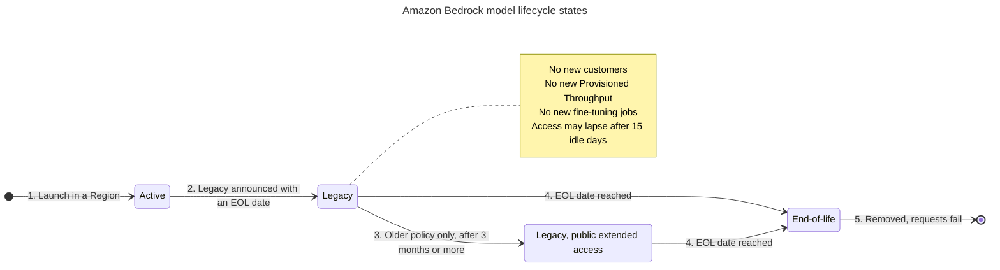
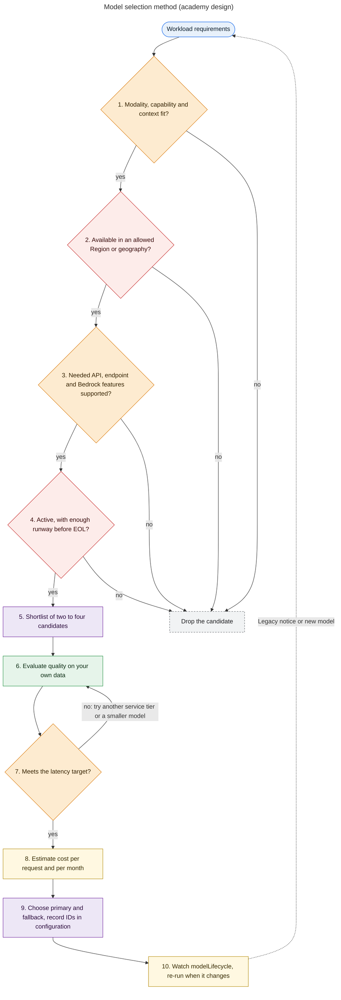

# Model lifecycle and selection

> **Level:** Intermediate · **Verified:** 2026-11-15 · **Feature status:** n/a · **Time:** ~20 min

Every model version on Amazon Bedrock is eventually retired. This chapter explains the three lifecycle states and what each restricts, shows how to see a retirement coming, and gives a repeatable method for choosing a model by capability, latency, cost, Region and feature support.

> [!IMPORTANT]
> **Status** — Two lifecycle policies now exist, split by launch date. Models launched on Amazon Bedrock **on or after 2026-09-07** follow the current "Model lifecycle" page; models launched **before** that date follow "Model lifecycle (Legacy)". Each model card names the policy that applies to it.
> Source: [Model lifecycle](https://docs.aws.amazon.com/bedrock/latest/userguide/model-lifecycle.html), [Model lifecycle (Legacy)](https://docs.aws.amazon.com/bedrock/latest/userguide/model-lifecycle-legacy.html)

## Learning objectives

After this chapter you can:

- Explain the Active, Legacy and End-of-Life (EOL) states and list what you can no longer do in each.
- Tell which of the two lifecycle policies applies to a model and what notice period it guarantees.
- Track deprecations with the API, the model card and AWS notifications.
- Apply a decision matrix and a flowchart to choose a primary and a fallback model.
- Plan a migration before a model reaches EOL.

## Prerequisites

- [Model providers and the model catalog](01-model-providers-and-catalog.md)
- [Model evaluation and model selection](../../00-foundations/generative-ai-fundamentals/07-model-evaluation-and-selection.md)
- [Latency and token economics](../../00-foundations/generative-ai-fundamentals/08-latency-and-token-economics.md)

## Concept in plain language

A model version is like a car model year. While it is **in production** (Active) you can buy it, tune it and order a fleet. When the maker announces the end of the line (**Legacy**), existing owners keep driving, but nobody new can buy one and the factory stops taking special orders. After the cut-off date (**EOL**) the car is not allowed on the road — and nobody swaps it for the new model on your behalf.

Choosing a model is like hiring: apply the hard requirements first, then run a trial on real work and compare the finalists on quality, speed and cost.

## How it really works

### The three states

| State | `modelLifecycle.status` | What still works | What is restricted |
|:--|:--|:--|:--|
| **Active** | `ACTIVE` | Inference, customization where the model supports it, new Provisioned Throughput | Nothing |
| **Legacy** | `LEGACY` | Inference for existing customers; Provisioned Throughput and on-demand deployments created earlier; a *new* on-demand deployment of a model you customized before the Legacy date | New customers cannot adopt the model. Existing customers may lose access after 15 days of inactivity. No new Provisioned Throughput. No new fine-tuning jobs |
| **End-of-Life** | No value — the documented values are only `ACTIVE` and `LEGACY` | Nothing, unless you have a private arrangement with the provider | The model is removed and requests fail. Migration is never automatic |

> [!NOTE]
> **Documented fact** — "Once the Legacy period begins, new customers can't adopt the model, and existing customers may lose access after 15 days of inactivity. You can't create a new Provisioned Throughput for models in the Legacy state."
> Source: [Model lifecycle](https://docs.aws.amazon.com/bedrock/latest/userguide/model-lifecycle.html)

### Two policies, split by launch date

| Topic | Launched before 2026-09-07 | Launched on or after 2026-09-07 |
|:--|:--|:--|
| Minimum availability | At least 12 months on Bedrock before the EOL date | An "EOL no sooner than" date on the model card, where applicable |
| Legacy (notice) period | At least 6 months before EOL | 6 months or 45 days, stated on the model card; most models have 6 months |
| Public extended access | For EOL dates after 2026-02-01: after at least 3 months in Legacy, the model enters a phase of at least 3 more months in which the provider may set higher prices | Not described on the current page |
| Where the dates are published | Tables on the Legacy-policy page, and the model card | The model card; the EOL date is added when the Legacy period starts |

One exception is documented: GPT-6.1 Sol follows OpenAI's own lifecycle terms and has no separate Bedrock minimum-availability date.

> [!NOTE]
> **Documented fact** — Lifecycle dates are specific to Amazon Bedrock and can differ from the dates a provider publishes for its own platform. For Bedrock usage, only the Bedrock dates apply.
> Source: [Model lifecycle](https://docs.aws.amazon.com/bedrock/latest/userguide/model-lifecycle.html)

### State is per Region

A model can be Legacy in one Region and Active in another: on the verification date the Marengo Embed 3.0 card read "Legacy in ap-northeast-2; Active in other Regions". The Legacy-policy page tells you to call the API in the Region you use.

The `modelLifecycle` object returned by `GetFoundationModel` and `ListFoundationModels` carries `status` plus four optional timestamps: `startOfLifeTime`, `legacyTime`, `publicExtendedAccessTime` and `endOfLifeTime`.

### How to track deprecations

| Signal | Where | Automatable |
|:--|:--|:-:|
| `modelLifecycle` per Region | `GetFoundationModel`, `ListFoundationModels` | Yes |
| Lifecycle state, "EOL no sooner than", Legacy period, EOL date | The model card | No |
| Legacy date, EOL date, public extended access date | Tables on the Legacy-policy page (models launched before 2026-09-07) | No |
| "Legacy (EOL: date)" markers per Region | Regional availability by models | No |
| Notifications | E-mail to account contacts, AWS Health Dashboard, alerts in the Bedrock console | Yes, through AWS User Notifications |
| New and changed pages | Document history, which offers an RSS feed | Yes |

The notification channels come from an AWS blog post dated 2026-04-09, before the September policy split. It says notices go by default to the root user's e-mail and the alternate contacts, so check that those addresses reach a team.

### A selection method

The user guide's own checklist names four things to consider: capabilities, endpoint and API, Region, and cost and throughput ([Model availability & compatibility](https://docs.aws.amazon.com/bedrock/latest/userguide/models.html)). The matrix below extends it.

> [!TIP]
> **Academy recommendation** — Treat the first six rows as pass/fail filters and only score the survivors. This is our design guidance, not an official AWS reference architecture.

| # | Criterion | Question | Where to verify | Kind |
|--:|:--|:--|:--|:--|
| 1 | Capability and modality | Can it take my inputs and produce my outputs, including tool use? | Model card: modalities, Capabilities and Features | Filter |
| 2 | Context and output size | Do my largest prompt and longest answer fit? | Model card: context window, max output tokens | Filter |
| 3 | Region and residency | Is it In-Region where I run, or in a Geo profile I may use? | Model card: Regional Availability | Filter |
| 4 | API and endpoint | Does it support the API my code uses, on `bedrock-runtime`? | Model card; API compatibility page | Filter |
| 5 | Bedrock features | Are the features I depend on (guardrails, prompt caching, batch, structured outputs) supported for this model and endpoint? | Model card feature tables | Filter |
| 6 | Lifecycle runway | Is it Active, with an "EOL no sooner than" date beyond my planning horizon? | Model card; `modelLifecycle` | Filter |
| 7 | Quality on my task | Does it pass my own evaluation set? | [Model and RAG evaluation](../model-evaluation/01-model-evaluation.md) | Score |
| 8 | Latency | Time to first token and total time at my load? | Your own measurement; the card's Service Tiers table | Score |
| 9 | Cost | Cost per request at my token mix? | [Pricing page](https://aws.amazon.com/bedrock/pricing/) or the card's Pricing section | Score |
| 10 | Throughput | Do the default quotas cover my peak? | Card: Quotas and Limits | Score |

Score rows 7–10 from 1 to 5, multiply by weights you agree **before** testing, and keep the runner-up as the fallback model ([Model routing and fallback models](../../09-advanced-topics/10-model-routing-and-fallback.md)).

## Architecture diagram



**What this shows** — The path of one model version in one Region. There is no way back: a Legacy model does not return to Active.

**Walkthrough**

1. The model launches and is Active in that Region.
2. The provider retires the version. AWS announces the Legacy state and the EOL date.
3. Older policy only: after at least three months the model enters public extended access, where the provider may raise prices.
4. The EOL date arrives.
5. The model is removed from the Region and every request to it fails.

**Variations** — Under the current policy the Legacy period can be as short as 45 days (for example, the TwelveLabs Pegasus v1.5 card). States are per Region, so one model can be at different steps in different Regions.

**Legend** — rounded box: state · arrow: one-way transition · note: restrictions that apply while Legacy.



**What this shows** — The decision matrix as a process: cheap filters first, expensive evaluation second, and a loop back when the lifecycle state changes. This is an academy design.

**Walkthrough**

1. Remove models that cannot handle your modalities, tools or prompt size (matrix rows 1–2).
2. Remove models that data-residency rules exclude (row 3).
3. Remove models that lack an API, endpoint or Bedrock feature you depend on (rows 4–5).
4. Remove Legacy models and models with too little guaranteed lifetime (row 6).
5. Keep two to four candidates.
6. Run the same evaluation set against each.
7. Measure latency under realistic load; on a miss, try another service tier or a smaller model.
8. Estimate cost from measured token counts.
9. Choose a primary and a fallback; store both identifiers in configuration.
10. Monitor the lifecycle and start again on a Legacy notice or when a better model appears.

**Variations** — If you need customization, add "supports the customization method I need" to step 3 ([Model customization](03-model-customization.md)). If no serverless model passes steps 1–4, consider [Amazon Bedrock Marketplace](05-bedrock-marketplace.md) or [Custom Model Import](04-custom-model-import.md).

**Legend** — diamond: pass/fail decision · rectangle: activity · dashed arrow: trigger to repeat · red nodes: compliance and lifecycle gates.

## Implementation details

- **Latency levers.** Service tiers are a per-request option: Priority is fastest at a premium, Flex is slower at a discount; each model card lists the tiers it supports ([Service tiers](../inference/06-service-tiers.md)).
- **Cost levers.** For models that offer one, a Global inference profile is priced about 10% below a Geo profile; batch and Flex are discounted where the model supports them ([Cross-Region inference](../inference/04-cross-region-inference.md), [Batch inference](../inference/08-batch-inference.md)).
- **Migration plan.** The AWS blog recommends five phases — assessment, research, testing, migration, operation. Technically: update the model ID, request quota for the new model *before* cutting over, re-tune prompts and adjust response parsing. The post adds that quota increases are "not expected to be approved" during public extended access.
- **Customized models.** Re-train on an Active base model well before the old base model's EOL date.

## Example

> **Code status:** syntax-checked (`python -m py_compile`) · never run against AWS · **never deployed**

```python
"""Lifecycle report for the models an application depends on, plus a weighted score helper."""
from datetime import datetime, timezone

import boto3


def lifecycle_report(model_ids: list[str], regions: list[str], warn_days: int = 120) -> list[dict]:
    """Return one finding per model and Region. Model IDs and Regions come from configuration."""
    now = datetime.now(timezone.utc)
    findings = []
    for region in regions:
        bedrock = boto3.client("bedrock", region_name=region)  # lifecycle state is per Region
        for model_id in model_ids:
            try:
                details = bedrock.get_foundation_model(modelIdentifier=model_id)["modelDetails"]
            except bedrock.exceptions.ResourceNotFoundException:
                findings.append({"region": region, "model": model_id, "state": "NOT_FOUND", "action": "migrate now"})
                continue
            lifecycle = details.get("modelLifecycle", {})
            end_of_life = lifecycle.get("endOfLifeTime")
            days_left = (end_of_life - now).days if end_of_life else None
            action = "none"
            if lifecycle.get("status") == "LEGACY":
                action = "migrate now" if days_left is not None and days_left < warn_days else "plan migration"
            findings.append(
                {"region": region, "model": model_id, "state": lifecycle.get("status"),
                 "days_to_eol": days_left, "action": action}
            )
    return findings


def weighted_score(scores: dict[str, float], weights: dict[str, float]) -> float:
    """Scores are 1-5 per criterion (quality, latency, cost, throughput); weights are agreed up front."""
    return sum(scores[name] * weight for name, weight in weights.items()) / sum(weights.values())
```

Run `lifecycle_report` on a schedule and in CI. `GetFoundationModel` takes a model ID or ARN, not an inference profile ID.

## Common mistakes

> [!WARNING]
> **Common mistake** — Treating Legacy as "still fine for a while". An account that stops calling a Legacy model for 15 days may lose access, so a rarely used job or a standby Region can break long before the EOL date.

| Mistake | Symptom | Fix |
|:--|:--|:--|
| Assuming the notice period is always six months | A model under the current policy reaches EOL 45 days after the notice | Read "Legacy period" on the model card |
| Checking lifecycle in one Region | The secondary Region fails first | Call `GetFoundationModel` in every Region you use |
| Using the provider's own deprecation page | Dates do not match what happens on Bedrock | Use the Bedrock model card and API only |
| Expecting automatic migration | Requests fail on the EOL date | Change the model ID yourself and re-test |
| Choosing by public benchmark alone | Good scores, poor results on your data | Evaluate on your own data set |
| Planning Provisioned Throughput on a model about to go Legacy | The purchase is refused | Buy capacity only for Active models |
| Notifications go to an unread root mailbox | Nobody sees the Legacy notice | Add team recipients in AWS User Notifications |

## Security considerations

- **Residency is a filter, not a score.** Decide In-Region, Geo or Global before comparing prices ([Cross-Region considerations and data residency](../../09-advanced-topics/11-cross-region-and-data-residency.md)).
- **A model change is a security-relevant change.** A new model can react differently to prompt injection and to your guardrail configuration; re-run safety tests during migration ([Amazon Bedrock Guardrails](../guardrails/01-guardrails.md)).
- **IAM follows the model.** Policies that name a foundation-model ARN need the new ARN; remove the old one after cut-over. The lifecycle report itself needs only `bedrock:GetFoundationModel`.

## Cost considerations

- **Extended access can cost more.** During public extended access the provider may raise the price; AWS announces such changes in the Legacy notice.
- **Migration has a price.** Budget for evaluation runs, prompt re-tuning and a period of running two models in parallel.
- **The cheapest token is not the cheapest answer.** Compare cost per successful task: a smaller model that needs retries or longer prompts can cost more ([Cost optimization and token budgeting](../../08-cost-performance-and-reliability/02-cost-optimization-and-token-budgeting.md)).

## Knowledge check

1. A model launched on Bedrock on 2026-10-08 shows "Legacy period: at least 45 days". Which policy applies, and what is the shortest warning you can get before EOL?
2. Your disaster-recovery Region has not called a Legacy model for a month. What may have happened, and how would you detect it before a failover?
3. What would happen if you tried to start a fine-tuning job on a base model that entered Legacy last week? What can you still do with a model you fine-tuned from it earlier?

<details>
<summary>Answers</summary>

1. The current policy (launch on or after 2026-09-07). The notice can be as short as 45 days, and the EOL date appears on the model card when the Legacy period begins.
2. Access may have lapsed after 15 days of inactivity. Detect it with a scheduled lifecycle report and a periodic test invocation in that Region.
3. The job is refused: no new fine-tuning jobs on a Legacy model. You can keep using existing deployments and Provisioned Throughput, and create a new on-demand deployment for the model you customized before the Legacy date.

</details>

## Further reading

Official sources opened while writing this chapter:

- [Model lifecycle](https://docs.aws.amazon.com/bedrock/latest/userguide/model-lifecycle.html) — the policy for models launched on or after 2026-09-07.
- [Model lifecycle (Legacy)](https://docs.aws.amazon.com/bedrock/latest/userguide/model-lifecycle-legacy.html) — the policy for earlier models, with Legacy and EOL tables.
- [FoundationModelLifecycle](https://docs.aws.amazon.com/bedrock/latest/APIReference/API_FoundationModelLifecycle.html) — the `modelLifecycle` fields and status values.
- [Understanding Amazon Bedrock model lifecycle](https://aws.amazon.com/blogs/machine-learning/understanding-amazon-bedrock-model-lifecycle/) — AWS blog, 2026-04-09: notification channels and migration practices.
- [Model availability & compatibility](https://docs.aws.amazon.com/bedrock/latest/userguide/models.html) — the "choosing a model" checklist.
- [Regional availability by models](https://docs.aws.amazon.com/bedrock/latest/userguide/models-region-compatibility.html) — per-Region lifecycle markers.
- Model cards: [Pegasus v1.5](https://docs.aws.amazon.com/bedrock/latest/userguide/model-card-twelvelabs-pegasus-v1-5.html) (45-day Legacy period), [Marengo Embed 3.0](https://docs.aws.amazon.com/bedrock/latest/userguide/model-card-twelvelabs-marengo-embed-3-0.html) (state differs by Region).
- [Service tiers](https://docs.aws.amazon.com/bedrock/latest/userguide/service-tiers-inference.html) and [Cross-Region inference](https://docs.aws.amazon.com/bedrock/latest/userguide/cross-region-inference.html) — latency and cost levers.
- [Document history](https://docs.aws.amazon.com/bedrock/latest/userguide/bedrock-ug-doc-history.html) — change log with an RSS feed.
