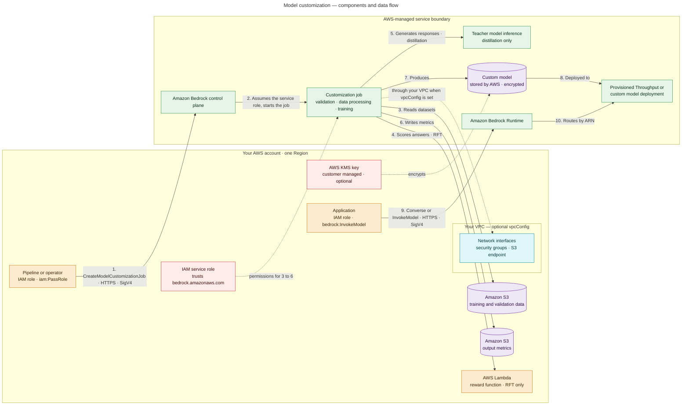
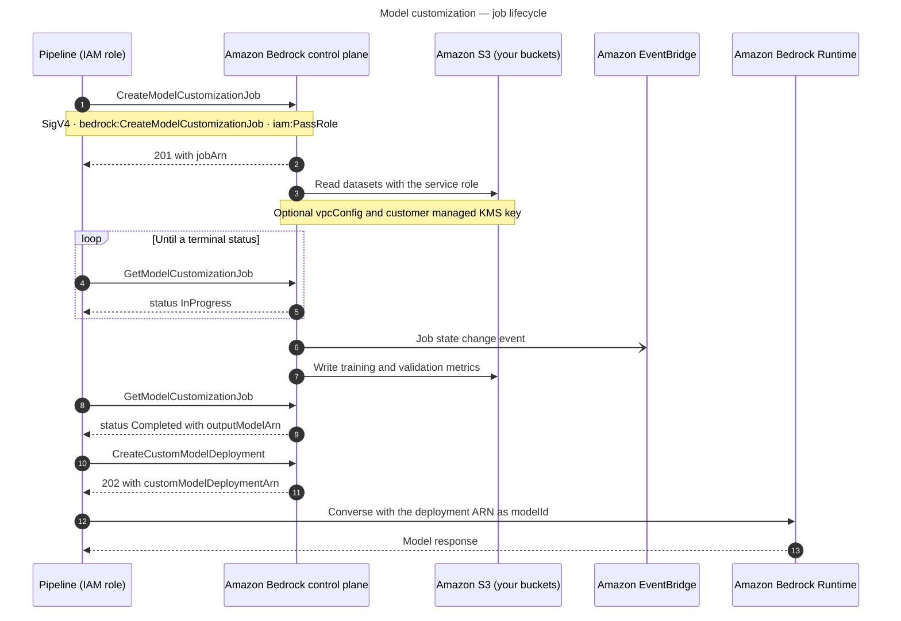

# Model customization: fine-tuning, reinforcement fine-tuning and distillation

> **Level:** Intermediate · **Verified:** 2026-11-15 · **Feature status:** GA · **Time:** ~25 min

Model customization trains a private copy of a foundation model on your data and stores the result as a *custom model* in your account. It sits between prompt engineering and retrieval on one side, and bringing your own model on the other.

> [!IMPORTANT]
> **Status** — GA. Supervised fine-tuning, reinforcement fine-tuning and distillation each work only for the models and Regions listed on their own page. Document history: distillation 2024-12-03, reinforcement fine-tuning 2025-12-03, OpenAI-compatible fine-tuning APIs 2026-02-17. **Continued pre-training** is **UNVERIFIED — REQUIRES DOCUMENTATION REVIEW** (section 1).
> Source: [Customize your model](https://docs.aws.amazon.com/bedrock/latest/userguide/custom-models.html), [Document history](https://docs.aws.amazon.com/bedrock/latest/userguide/bedrock-ug-doc-history.html)

## Learning objectives

- Choose between supervised fine-tuning, reinforcement fine-tuning and distillation for a given problem.
- Describe the data each method needs and the life of a customization job from request to custom model.
- Explain the two ways a custom model is served and which one applies to your base model.
- Configure the security controls for a job: service role, KMS key and VPC.
- State the pricing dimensions and what Terraform, CloudFormation and the CDK can and cannot create.

## Prerequisites

- [Fine-tuning and model customization](../../00-foundations/generative-ai-fundamentals/05-fine-tuning-and-customization.md)
- [Model providers and the model catalog](01-model-providers-and-catalog.md) and [Model lifecycle and selection](02-model-lifecycle-and-selection.md)
- [IAM roles, trust policies and cross-account access](../../00-foundations/security/02-iam-roles-and-trust.md) and [AWS KMS and encryption](../../00-foundations/security/04-kms-encryption.md)

## 1. What it is

In plain language: you show a model examples of the behaviour you want, and Amazon Bedrock produces a private version that behaves that way. You manage no training hardware.

Precisely: a customization is an **asynchronous job** on the `bedrock` control plane. It reads data from your S3 buckets through a service role, trains a copy of a base model, writes metrics to S3 and registers a custom model, which you serve through Provisioned Throughput or a custom model deployment.

| Item | Value |
|:--|:--|
| Service namespace / endpoint | `bedrock` control plane, `bedrock.{region}.amazonaws.com`. Reinforcement fine-tuning of open-weight models also has OpenAI-compatible Files and fine-tuning APIs on `bedrock-mantle` |
| Control-plane operations | `CreateModelCustomizationJob`, `GetModelCustomizationJob`, `ListModelCustomizationJobs`, `StopModelCustomizationJob`, `GetCustomModel`, `ListCustomModels`, `DeleteCustomModel`, `CreateModelCopyJob`, `CreateCustomModelDeployment`, `CreateProvisionedModelThroughput` |
| Data-plane operations | `InvokeModel`, `InvokeModelWithResponseStream`, `Converse`, `ConverseStream` on `bedrock-runtime`, with a deployment ARN or provisioned-model ARN as `modelId` |
| IAM action prefix | `bedrock:` |

### The three methods

| Method | You provide | How the model learns | `customizationType` |
|:--|:--|:--|:--|
| **Supervised fine-tuning** | Labelled examples: an input and the output you want | Adjusts parameters to reproduce your outputs | `FINE_TUNING` (the default) |
| **Reinforcement fine-tuning (RFT)** | Prompts plus a *reward function* that scores answers — your code in AWS Lambda, or a model acting as judge | Generates several answers per prompt, scores them, and optimizes for higher scores (Group Relative Policy Optimization) | `REINFORCEMENT_FINE_TUNING`, with `customizationConfig.rftConfig` |
| **Distillation** | Prompts (answers optional) or invocation logs, a large *teacher* model and a smaller *student* | Bedrock generates teacher responses, adds synthetic data, and fine-tunes the student on them | `DISTILLATION`, with `customizationConfig.distillationConfig` |

### Data formats at a high level

| Method | Format | Notes |
|:--|:--|:--|
| Supervised fine-tuning | `.jsonl`, one record per line. Either `{"prompt": …, "completion": …}` or a conversation record (`schemaVersion: bedrock-conversation-2024` with `system` and `messages`). Image models use image–text pairs with S3 URIs | Format and size limits depend on the model; whether a validation set is allowed also depends on the model. Amazon Nova has its own guide |
| Reinforcement fine-tuning | Prompts in the OpenAI Chat Completions format, or existing Bedrock invocation logs, which are converted automatically | AWS suggests starting with 100–200 examples to validate the reward function |
| Distillation | Prompts as `bedrock-conversation-2024` records, optionally with an assistant answer as a "golden" example; or invocation logs, filtered by `requestMetadata` | 100 to 15,000 prompts per job |

### Models listed on 2026-11-15

| Method | Models named on the page | Regions |
|:--|:--|:--|
| Supervised fine-tuning | Amazon Nova 2 Lite, Nova Lite, Nova Micro, Nova Pro, Nova Canvas, Titan Image Generator G1 v2, Titan Multimodal Embeddings G1; Anthropic Claude 3 Haiku; Meta Llama 3.1, 3.2 and 3.3 Instruct models | `us-east-1` (Nova), `us-east-1` and `us-west-2` (Titan), `us-west-2` (Anthropic, Meta) |
| Reinforcement fine-tuning | Amazon Nova 2 Lite; OpenAI gpt-oss-20b; Qwen3 32B | `us-east-1` (Nova), `us-west-2` (the other two) |
| Distillation | Teachers Nova Pro and Nova Premier with Nova students; teachers Llama 3.1 405B, Llama 3.1 70B and Llama 3.3 70B with smaller Llama students | `us-east-1` (Nova), `us-west-2` (Llama) |

> [!WARNING]
> **Common mistake** — Trusting these lists without checking lifecycle. The lifecycle page records several of these models as end-of-life in those Regions (for example the Llama 3.2 models since 2026-07-07), and a Legacy model cannot start a new fine-tuning job. Distillation is also "not currently available for Anthropic models". Check `customizationsSupported` and `modelLifecycle` with `GetFoundationModel` in your Region.

> [!IMPORTANT]
> **Status** — Continued pre-training (training on unlabelled data): **UNVERIFIED — REQUIRES DOCUMENTATION REVIEW**. The customization overview no longer lists it; the API reference still accepts `CONTINUED_PRE_TRAINING`; the Bedrock FAQ still describes it for Amazon Titan Text models, which are not on *Models at a glance*; we found no deprecation notice. Do not design for it.
> Source: [CreateModelCustomizationJob](https://docs.aws.amazon.com/bedrock/latest/APIReference/API_CreateModelCustomizationJob.html), [Amazon Bedrock FAQs](https://aws.amazon.com/bedrock/faqs/)

## 2. Why it exists

Without it you would rent GPU capacity, build and tune a training pipeline, store the weights securely and run an inference fleet. Here you supply data, a role and a few hyperparameters; for RFT and distillation, Bedrock also automates the reward loop and the teacher responses.

## 3. When to use it

- Prompting and retrieval have plateaued, and you need a consistent format, tone or classification behaviour.
- Long instructions and few-shot examples dominate your token bill; a tuned model needs a shorter prompt.
- You have a large model that works and want similar quality from a smaller, cheaper, faster one (distillation).
- Success can be measured by code or by a judge, and many different answers are valid (RFT).

## 4. When not to use it

- **The knowledge changes often.** Use retrieval: [Knowledge Bases overview](../knowledge-bases/01-knowledge-bases-overview.md). Compare the options in [RAG versus fine-tuning versus long-context inference](../../09-advanced-topics/01-rag-vs-fine-tuning-vs-long-context.md).
- **You have not optimized the prompt yet.** Start with [Prompt optimization](../prompt-management/02-prompt-optimization.md).
- **The model you want is not customizable on Bedrock.** Train elsewhere and use [Custom Model Import](04-custom-model-import.md).
- **The base model is Legacy or close to its end-of-life date.** Your custom model inherits that clock: [Model lifecycle and selection](02-model-lifecycle-and-selection.md).

## 5. Internal architecture



**What this shows** — Your data, role, key, reward function and network stay in your account; the job, the model and the serving capacity are inside the AWS-managed boundary. AWS does not document the training infrastructure.

**Walkthrough**

1. A pipeline calls `CreateModelCustomizationJob`; the caller needs `iam:PassRole`.
2. Amazon Bedrock assumes the service role and starts the job.
3. The job reads training and validation data from your bucket.
4. RFT only: the job invokes your Lambda reward function.
5. Distillation only: the job calls the teacher model to generate responses.
6. The job writes metrics to your output bucket.
7. The job produces a custom model, stored by AWS.
8. You make it callable with Provisioned Throughput or a custom model deployment.
9. Your application calls the runtime with the resulting ARN as `modelId`.
10. The runtime routes the request to that capacity.

**Variations** — With `vpcConfig`, the job reaches S3 through your subnets. Open-weight models tuned through the OpenAI-compatible APIs skip step 8 and are called by their fine-tuned model ID.

**Legend** — solid arrow: request or data flow · dashed arrow: supporting relationship · cylinder: data store · boxes: trust boundaries.

> [!NOTE]
> **Documented fact** — "None of the training or validation data you provide for fine tuning is stored by Amazon Bedrock, after the fine-tuning job completes."
> Source: [Encryption of custom models](https://docs.aws.amazon.com/bedrock/latest/userguide/encryption-custom-job.html)

## 6. Request and response lifecycle



Steps 1–2 create the job; a `clientRequestToken` makes a retry safe. From step 3 the job runs through validation, data processing and training, which "can take several hours". Steps 4–5 poll; the EventBridge event in step 6 can replace polling. Steps 7–9 end in `Completed`, `Failed` or `Stopped`. Steps 10–13 serve the model.

Error paths that matter:

| Error | Typical cause |
|:--|:--|
| `ValidationException` (400) | Unsupported base model or Region, malformed hyperparameters or data configuration |
| `AccessDeniedException` (403) | Missing `bedrock:CreateModelCustomizationJob` or `iam:PassRole` |
| `ServiceQuotaExceededException` (400) | Too many jobs or custom models |
| `ThrottlingException` (429) | Request rate; retry with backoff |
| Job status `Failed` | Read `failureMessage`; the job reports which phase failed |

## 7. Dependencies

| Depends on | Why | Required or optional |
|:--|:--|:-:|
| Amazon S3 | Training and validation data in, metrics out | Required |
| IAM service role | Lets Amazon Bedrock read and write those buckets | Required |
| A customizable, Active base model in a supported Region | The model to copy and train | Required |
| AWS Lambda | Reward function | Required for RFT |
| Teacher model, or an inference profile for it | Generates responses | Required for distillation |
| Model invocation logging to S3 | Source of prompts for distillation or RFT | Optional |
| AWS KMS customer managed key | Encrypts the custom model | Optional |
| Amazon VPC with an S3 endpoint | Keeps training-data traffic private | Optional |
| Provisioned Throughput or a custom model deployment | Makes the model callable | Required to serve |
| Amazon EventBridge | Job state notifications | Optional |

## 8. Security considerations

- **Caller permissions.** `bedrock:CreateModelCustomizationJob` plus `iam:PassRole` on the service role.
- **Service role.** Trusts `bedrock.amazonaws.com`; AWS recommends the confused-deputy conditions `aws:SourceAccount` and `aws:SourceArn` (`model-customization-job/*`). It needs `s3:GetObject` and `s3:ListBucket` on the data buckets and `s3:PutObject` on the output bucket.
- **Extra permissions by method.** RFT: `lambda:InvokeFunction` on the reward function, plus `bedrock:InvokeModel` for the Lambda role if a model is the judge. Distillation with a cross-Region teacher: `bedrock:InvokeModel` on the inference profile and on the model in each of its Regions.
- **Encryption.** An AWS owned key by default. With `customModelKmsKeyId`, Amazon Bedrock creates KMS grants on your customer managed key; the key policy must allow `kms:CreateGrant`, `kms:DescribeKey`, `kms:GenerateDataKey` and `kms:Decrypt`, ideally with `kms:ViaService`. Revoking the grant makes the model unusable.
- **Data handling.** Training data is used only for your job, not to train base models. A fine-tuned model can replay training data, so remove secrets and personal data first.
- **Logging.** API calls are recorded by AWS CloudTrail ([AWS CloudTrail for Bedrock](../../02-related-aws-services/security/05-cloudtrail-for-bedrock.md)).

## 9. Networking requirements

- **Control plane.** Public endpoint, or the interface endpoint `com.amazonaws.<region>.bedrock`.
- **The job.** With `vpcConfig` (subnets and security groups) the job reaches S3 through network interfaces that Amazon Bedrock creates in your subnets, so the service role also needs the documented `ec2:CreateNetworkInterface` and `ec2:Describe*` permissions. AWS recommends an S3 VPC endpoint and a bucket policy limited to that VPC. The path used without `vpcConfig` is not documented.
- **Inference.** `bedrock-runtime`, public or through `com.amazonaws.<region>.bedrock-runtime` ([Private connectivity for Bedrock](../../02-related-aws-services/networking/01-private-connectivity-for-bedrock.md)).
- **OpenAI-compatible fine-tuning.** `bedrock-mantle.us-west-2.api.aws`.
- **Cross-Region traffic.** Only when a distillation teacher is called through a cross-Region inference profile.

## 10. Pricing dimensions

No prices are quoted here; read them on the [pricing page](https://aws.amazon.com/bedrock/pricing/).

| Dimension | Unit | Notes |
|:--|:--|:--|
| Supervised fine-tuning | Tokens processed: tokens in the training set × epochs. Image models are priced per image seen | More epochs cost proportionally more |
| Reinforcement fine-tuning | Training hours | "The entire training workflow is billed at an hourly rate" |
| Distillation — teacher inference | Teacher's on-demand token rates | Charged when Bedrock generates synthetic responses |
| Custom model storage | Per model, per month | Charged while the model exists |
| Inference — custom model deployment | Input and output tokens | The page states that on-demand inference for custom Nova models is priced the same as base Nova inference |
| Inference — Provisioned Throughput | Model units per hour, by commitment term | See [Provisioned Throughput](../inference/07-provisioned-throughput.md) |
| Customer managed KMS key | AWS KMS rates | Only if you bring a key |
| Reward function | **Our reading:** standard Lambda charges, plus judge-model tokens | Not itemized on the Bedrock pricing page |

## 11. Scaling considerations

| Limit (per Region) | Default | Adjustable |
|:--|:--|:-:|
| Custom models per account | 100 | Yes |
| Scheduled customization jobs | 10 | No |
| Total custom model deployments | 10 | Yes |
| In-progress custom model deployments | 2 | Yes |
| Prompts per distillation job | 100 minimum, 15,000 maximum | No |

Source: [Amazon Bedrock endpoints and quotas](https://docs.aws.amazon.com/general/latest/gr/bedrock.html). Custom model deployments have fixed request and token quotas per base model. A custom model exists in one Region; `CreateModelCopyJob` copies it to another.

## 12. IaC support

| Tool | Support | Resource / construct | Notes |
|:--|:-:|:--|:--|
| Terraform (`hashicorp/aws` 6.73.0) | ✅ supervised fine-tuning · ❌ distillation and RFT | `aws_bedrock_custom_model`; data sources `aws_bedrock_custom_model`, `aws_bedrock_custom_models` | Create starts the job and returns; read reports `job_status`; destroy stops the job or deletes the model. Blocks: `training_data_config`, `validation_data_config`, `output_data_config`, `vpc_config`. There is **no** `customization_config` block, so a teacher model or an `rftConfig` cannot be supplied |
| Terraform — serving | ✅ Provisioned Throughput · ❌ custom model deployment | `aws_bedrock_provisioned_model_throughput` | No resource for `CreateCustomModelDeployment` |
| CloudFormation | ❌ | — | No custom-model type in the specification bundled with `aws-cdk-lib` 2.277.0 |
| AWS CDK (`aws-cdk-lib` 2.277.0) | ❌ | — | No L1 or L2 construct |

Checked against the [Terraform reference](../../references/terraform-aws-provider-bedrock.md), the [CDK and CloudFormation reference](../../references/cdk-and-cloudformation-bedrock.md) and the [API operations reference](../../references/bedrock-api-operations.md). `terraform validate` accepts `customization_type = "DISTILLATION"` but rejects a `customization_config` block; the provider documentation lists only `FINE_TUNING` and `CONTINUED_PRE_TRAINING`.

**Verified alternative** — Manage the buckets, service role, KMS key and VPC with IaC, and start the job with `CreateModelCustomizationJob` from a pipeline step (SDK or CLI). A job is a one-time action, not long-lived infrastructure. See [Terraform coverage for Amazon Bedrock](../../04-infrastructure-as-code/terraform/10-terraform-for-bedrock.md).

## 13. Working example

> **Code status:** syntax-checked (`python -m py_compile`) · never run against AWS · **never deployed**

```python
"""Start a supervised fine-tuning job, wait for it, then deploy the model for on-demand inference."""
import time
import uuid

import boto3


def fine_tune_and_deploy(
    region: str,
    base_model_id: str,  # copy from the fine-tuning page; confirm it is Active in this Region
    role_arn: str,  # service role that trusts bedrock.amazonaws.com
    training_s3_uri: str,
    output_s3_uri: str,
    hyperparameters: dict[str, str],  # model-specific, for example {"epochCount": "2"}
    kms_key_arn: str | None = None,
) -> str:
    bedrock = boto3.client("bedrock", region_name=region)
    suffix = uuid.uuid4().hex[:8]

    request = {
        "jobName": f"ft-job-{suffix}",
        "customModelName": f"ft-model-{suffix}",
        "roleArn": role_arn,
        "baseModelIdentifier": base_model_id,
        "customizationType": "FINE_TUNING",
        "hyperParameters": hyperparameters,
        "trainingDataConfig": {"s3Uri": training_s3_uri},
        "outputDataConfig": {"s3Uri": output_s3_uri},
        "clientRequestToken": uuid.uuid4().hex,  # makes a retry idempotent
    }
    if kms_key_arn:
        request["customModelKmsKeyId"] = kms_key_arn
    job_arn = bedrock.create_model_customization_job(**request)["jobArn"]

    while True:  # jobs take hours; in production react to the EventBridge event instead
        job = bedrock.get_model_customization_job(jobIdentifier=job_arn)
        if job["status"] in ("Completed", "Failed", "Stopped"):
            break
        time.sleep(300)
    if job["status"] != "Completed":
        raise RuntimeError(job.get("failureMessage", job["status"]))

    # On-demand deployment exists only for some base models; otherwise buy Provisioned Throughput.
    deployment = bedrock.create_custom_model_deployment(
        modelDeploymentName=f"ft-deploy-{suffix}",
        modelArn=job["outputModelArn"],
    )
    return deployment["customModelDeploymentArn"]  # the modelId to use once the deployment is Active
```

> **Code status:** validated with `terraform validate` (provider 6.73.0) · **never planned or applied against AWS**

```hcl
variable "base_model_id" {
  description = "Customizable base model ID from the fine-tuning page. Confirm it is Active in this Region."
  type        = string
}

variable "customization_role_arn" {
  description = "Service role that Amazon Bedrock assumes for the job."
  type        = string
}

variable "kms_key_arn" {
  description = "Customer managed key for the custom model. Null uses an AWS owned key."
  type        = string
  default     = null
}

variable "custom_model_name" { type = string }
variable "job_name" { type = string }
variable "training_data_s3_uri" { type = string }
variable "output_s3_uri" { type = string }
variable "hyperparameters" { type = map(string) }
variable "subnet_ids" { type = list(string) }
variable "security_group_ids" { type = list(string) }

data "aws_bedrock_foundation_model" "base" {
  model_id = var.base_model_id
}

# Create starts the customization job and returns; Read reports job_status.
resource "aws_bedrock_custom_model" "this" {
  custom_model_name       = var.custom_model_name
  job_name                = var.job_name
  base_model_identifier   = data.aws_bedrock_foundation_model.base.model_arn
  role_arn                = var.customization_role_arn
  customization_type      = "FINE_TUNING"
  custom_model_kms_key_id = var.kms_key_arn
  hyperparameters         = var.hyperparameters

  training_data_config {
    s3_uri = var.training_data_s3_uri
  }

  output_data_config {
    s3_uri = var.output_s3_uri
  }

  vpc_config {
    subnet_ids         = var.subnet_ids
    security_group_ids = var.security_group_ids
  }
}

output "custom_model_arn" {
  value = aws_bedrock_custom_model.this.custom_model_arn
}
```

> [!CAUTION]
> **Cost or security hazard** — In your own sandbox, training bills as soon as the job starts, the custom model bills for storage until deleted, and Provisioned Throughput bills by the hour. Tear down in order: deployment or Provisioned Throughput, custom model, S3 data.

## Common mistakes

| Mistake | Symptom | Fix |
|:--|:--|:--|
| Invoking the custom model ARN directly | The call is rejected | Create a custom model deployment or Provisioned Throughput and use *its* ARN |
| Service role lacks `s3:PutObject` on the output bucket | The job fails | Test the role against both buckets before you submit |
| Missing `iam:PassRole` for the caller | `AccessDeniedException` on job creation | Grant `iam:PassRole` scoped to the service role |
| Adding `vpcConfig` without the EC2 permissions or a route to S3 | The job fails | Attach the documented VPC permissions; add an S3 VPC endpoint |
| Fine-tuning on a base model that is Legacy | Job creation is refused | Choose an Active base model |
| Raising `epochCount` to "improve" a model | Cost grows linearly and the model overfits | Start from the defaults; compare validation loss |
| No held-out evaluation set | You cannot show the tuned model is better | Evaluate base and tuned models on the same data ([Model and RAG evaluation](../model-evaluation/01-model-evaluation.md)) |
| Using Terraform for distillation or RFT | `Unsupported block type` for `customization_config` | Start those jobs with the API |

## Knowledge check

1. You have 300 support tickets with ideal answers, and a script that verifies whether generated SQL returns the right rows. Which method fits each, and why?
2. Training data must not cross the public internet and the model must be encrypted with a key your security team controls. Which request fields and extra role permissions are involved?
3. Why is a customization job a poor fit for a long-lived IaC resource, even where Terraform supports it?

<details>
<summary>Answers</summary>

1. Supervised fine-tuning for the tickets (labelled input–output pairs). Reinforcement fine-tuning for the SQL task: success is verifiable by code, so a Lambda reward function can score answers.
2. `vpcConfig` and `customModelKmsKeyId`, plus a `roleArn` whose role has the EC2 network-interface permissions and can use the key. The subnets need a route to S3.
3. The job is a one-time action that costs money when it starts; re-creating the resource re-trains the model and destroying it deletes the model.

</details>

## 14. Official documentation

- [Customize your model to improve its performance for your use case](https://docs.aws.amazon.com/bedrock/latest/userguide/custom-models.html) — the three methods and the billing note.
- [Customize a model with fine-tuning](https://docs.aws.amazon.com/bedrock/latest/userguide/custom-model-fine-tuning.html), [Prepare data for fine-tuning](https://docs.aws.amazon.com/bedrock/latest/userguide/model-customization-prepare.html), [Submit a model customization job](https://docs.aws.amazon.com/bedrock/latest/userguide/model-customization-submit.html), [Custom model hyperparameters](https://docs.aws.amazon.com/bedrock/latest/userguide/custom-models-hp.html) — supervised fine-tuning.
- [Customize a model with reinforcement fine-tuning](https://docs.aws.amazon.com/bedrock/latest/userguide/reinforcement-fine-tuning.html), [Create and manage fine-tuning jobs for Amazon Nova models](https://docs.aws.amazon.com/bedrock/latest/userguide/rft-submit-job.html), [Fine-tune open-weight models using OpenAI-compatible APIs](https://docs.aws.amazon.com/bedrock/latest/userguide/fine-tuning-openai-apis.html), [Access and security for Amazon Nova models](https://docs.aws.amazon.com/bedrock/latest/userguide/rft-access-security.html), [Access and security for open-weight models](https://docs.aws.amazon.com/bedrock/latest/userguide/rft-open-weight-access-security.html) — RFT.
- [Customize a model with distillation](https://docs.aws.amazon.com/bedrock/latest/userguide/model-distillation.html), [Prerequisites for model distillation](https://docs.aws.amazon.com/bedrock/latest/userguide/prequisites-model-distillation.html), [Prepare your training datasets for distillation](https://docs.aws.amazon.com/bedrock/latest/userguide/distillation-prepare-datasets.html), [Submit a model distillation job](https://docs.aws.amazon.com/bedrock/latest/userguide/submit-model-distillation-job.html) — distillation.
- [Model customization access and security](https://docs.aws.amazon.com/bedrock/latest/userguide/custom-model-job-access-security.html), [Create a service role for model customization](https://docs.aws.amazon.com/bedrock/latest/userguide/model-customization-iam-role.html), [Encryption of custom models](https://docs.aws.amazon.com/bedrock/latest/userguide/encryption-custom-job.html) — role, KMS and VPC.
- [Monitor your model customization job](https://docs.aws.amazon.com/bedrock/latest/userguide/model-customization-monitor.html), [Monitor job state changes using Amazon EventBridge](https://docs.aws.amazon.com/bedrock/latest/userguide/monitoring-eventbridge.html) — job tracking.
- [Set up inference for a custom model](https://docs.aws.amazon.com/bedrock/latest/userguide/model-customization-use.html), [Deploy a custom model for on-demand inference](https://docs.aws.amazon.com/bedrock/latest/userguide/deploy-custom-model-on-demand.html) — serving.
- API reference: [CreateModelCustomizationJob](https://docs.aws.amazon.com/bedrock/latest/APIReference/API_CreateModelCustomizationJob.html), [GetModelCustomizationJob](https://docs.aws.amazon.com/bedrock/latest/APIReference/API_GetModelCustomizationJob.html), [CustomizationConfig](https://docs.aws.amazon.com/bedrock/latest/APIReference/API_CustomizationConfig.html), [DistillationConfig](https://docs.aws.amazon.com/bedrock/latest/APIReference/API_DistillationConfig.html), [CreateCustomModelDeployment](https://docs.aws.amazon.com/bedrock/latest/APIReference/API_CreateCustomModelDeployment.html).
- [Model lifecycle](https://docs.aws.amazon.com/bedrock/latest/userguide/model-lifecycle.html) and [Model lifecycle (Legacy)](https://docs.aws.amazon.com/bedrock/latest/userguide/model-lifecycle-legacy.html) — what a Legacy base model blocks.
- [Interface VPC endpoints for Amazon Bedrock](https://docs.aws.amazon.com/bedrock/latest/userguide/vpc-interface-endpoints.html) — PrivateLink service names.
- [Actions, resources, and condition keys for Amazon Bedrock](https://docs.aws.amazon.com/service-authorization/latest/reference/list_amazonbedrock.html) — IAM actions.
- [Amazon Bedrock pricing](https://aws.amazon.com/bedrock/pricing/) and [Amazon Bedrock endpoints and quotas](https://docs.aws.amazon.com/general/latest/gr/bedrock.html) — pricing units and quotas.
- [Amazon Bedrock FAQs](https://aws.amazon.com/bedrock/faqs/) — the remaining description of continued pre-training.
- Terraform provider documentation at tag v6.73.0: [`aws_bedrock_custom_model`](https://raw.githubusercontent.com/hashicorp/terraform-provider-aws/v6.73.0/website/docs/r/bedrock_custom_model.html.markdown).
