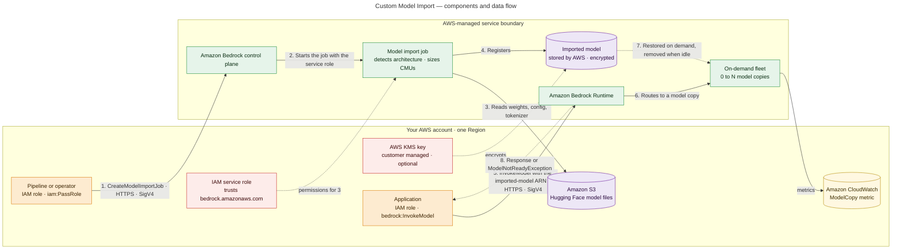
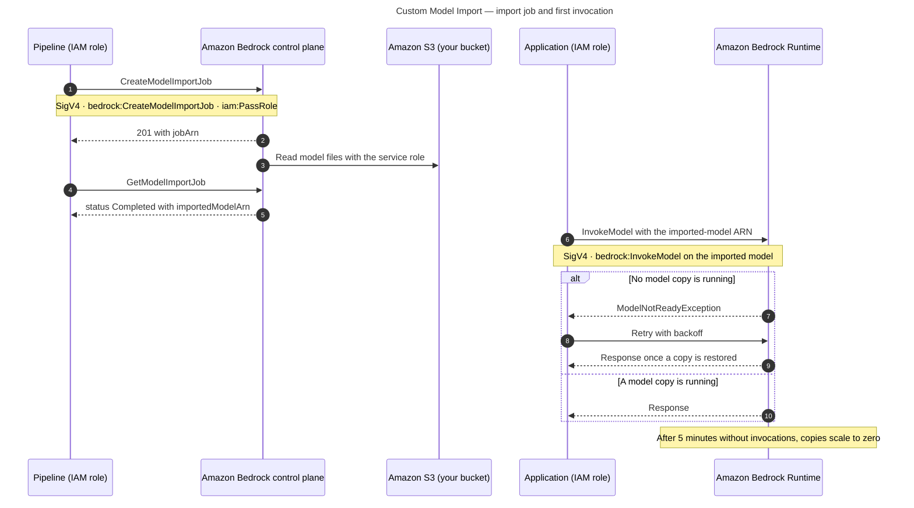

# Custom Model Import and on-demand custom model deployment

> **Level:** Intermediate · **Verified:** 2026-11-15 · **Feature status:** GA · **Time:** ~25 min

This chapter covers two ways to run a model *you* own on Amazon Bedrock without renting capacity by the hour: importing an open-weight model that you trained elsewhere (Custom Model Import), and deploying a model that you customized for on-demand, pay-per-token inference (a custom model deployment).

> [!IMPORTANT]
> **Status** — Both features are GA. Custom Model Import is documented for `us-east-1`, `us-east-2`, `us-west-2` and `eu-central-1`; the GPT-OSS architecture is supported only in `us-east-1`. Custom model deployments, added on 2025-07-16, are available in `us-east-1` and `us-west-2` for a short list of base models. Importing a SageMaker AI-trained Amazon Nova model is `us-east-1` only and API only.
> Source: [Custom model import](https://docs.aws.amazon.com/bedrock/latest/userguide/model-customization-import-model.html), [Deploy a custom model for on-demand inference](https://docs.aws.amazon.com/bedrock/latest/userguide/deploy-custom-model-on-demand.html), [Import a SageMaker AI-trained Amazon Nova model](https://docs.aws.amazon.com/bedrock/latest/userguide/import-with-create-custom-model.html)

## Learning objectives

- Tell apart three similarly named things: a model import job, a custom model created from a SageMaker AI-trained Nova model, and a custom model deployment.
- List the architectures, file formats and size limits that Custom Model Import accepts.
- Describe the import job flow and how an imported model is invoked.
- Explain Custom Model Units, model copies, scale to zero and the cold start that follows.
- State why no Terraform, CloudFormation or CDK resource exists, and what to do instead.

## Prerequisites

- [Model customization: fine-tuning, reinforcement fine-tuning and distillation](03-model-customization.md)
- [InvokeModel and streaming APIs](../inference/02-invokemodel-and-streaming.md)
- [IAM roles, trust policies and cross-account access](../../00-foundations/security/02-iam-roles-and-trust.md)

## 1. What it is

In plain language: you hand Amazon Bedrock the files of a model you already have, and Bedrock serves it through the same API as its own models. You manage no servers, and when nobody calls the model it stops costing compute.

Three related mechanisms exist. Keep them apart.

| Mechanism | API | What goes in | What you get | How it is served |
|:--|:--|:--|:--|:--|
| **Custom Model Import** | `CreateModelImportJob` | Open-weight model files in Amazon S3 | An *imported model* | On demand, automatically. Billed in Custom Model Units |
| **Import of a SageMaker AI-trained Nova model** | `CreateCustomModel` | Nova artifacts in the Amazon-managed bucket that SageMaker AI creates | A *custom model* | Through a custom model deployment or Provisioned Throughput |
| **Custom model deployment** | `CreateCustomModelDeployment` | A custom model that is `Active` | A *deployment* whose ARN is the `modelId` | On demand. Billed per token |

| Item | Value |
|:--|:--|
| Service namespace / endpoint | `bedrock` control plane for jobs, models and deployments; `bedrock-runtime` for inference |
| Control-plane operations | `CreateModelImportJob`, `GetModelImportJob`, `ListModelImportJobs`, `GetImportedModel`, `ListImportedModels`, `DeleteImportedModel`; `CreateCustomModel`; `CreateCustomModelDeployment`, `GetCustomModelDeployment`, `ListCustomModelDeployments`, `UpdateCustomModelDeployment`, `DeleteCustomModelDeployment` |
| Data-plane operations | `InvokeModel`, `InvokeModelWithResponseStream`; `Converse`, `ConverseStream` for architectures that support them |
| IAM action prefix | `bedrock:` |

### What Custom Model Import accepts

| Topic | Documented value |
|:--|:--|
| Architectures | Mistral; Mixtral; Flan (T5); Llama 2, 3, 3.1, 3.2, 3.3 and Mllama; GPTBigCode; Qwen2, Qwen2.5, Qwen2-VL, Qwen2.5-VL, Qwen3 (only `Qwen3ForCausalLM` and `Qwen3MoeForCausalLM`); GPT-OSS (20B and 120B) |
| File format | Hugging Face weights format: `.safetensors` weights, `config.json`, `tokenizer_config.json`, `tokenizer.json`, `tokenizer.model` |
| Model size | Weights under 200 GB for text models, under 100 GB for multimodal models |
| Context length | Maximum positional embeddings or context length under 128K |
| Library version | Transformers 4.51.3 |
| Not supported | Embedding models; batch inference; CloudFormation |
| Converse API | Not supported for Qwen2.5, Qwen2-VL, Qwen2.5-VL, Qwen3 and GPT-OSS models |
| Request formats | `BedrockCompletion`, `OpenAICompletion`, `OpenAIChatCompletion` for models imported after 2025-11-11 |

Source: [Custom model import](https://docs.aws.amazon.com/bedrock/latest/userguide/model-customization-import-model.html), [Invoke your imported model](https://docs.aws.amazon.com/bedrock/latest/userguide/invoke-imported-model.html). The architecture list changes; re-read it before you train.

### What a custom model deployment accepts

A deployment needs a custom model that was customized on or after 2025-07-16 from one of these base models: Amazon Nova Lite, Nova 2 Lite, Nova Micro or Nova Pro (`us-east-1`), or Meta Llama 3.3 70B Instruct (`us-west-2`). For any other custom model the serving option is [Provisioned Throughput](../inference/07-provisioned-throughput.md).

## 2. Why it exists

Without Custom Model Import, an open-weight model that you fine-tuned needs GPU instances that run all day, an autoscaling policy, patching, and a separate API with its own authentication. Import moves the model behind `bedrock-runtime`, with the same IAM actions and SDK calls as any other model.

Without custom model deployments, a model that you fine-tuned on Bedrock could be reached only through Provisioned Throughput, billed by the hour whether or not it was called. A deployment makes it pay-per-token.

## 3. When to use it

- You fine-tuned a supported open-weight architecture elsewhere (for example on Amazon SageMaker AI) and want serverless hosting.
- Traffic is intermittent, so scaling to zero saves money and a cold start is acceptable.
- You want one invocation path, one IAM model and one audit trail for foundation and custom models.
- You fine-tuned or distilled a supported Nova or Llama model on Bedrock and do not need reserved capacity.

## 4. When not to use it

- **The architecture, size or context length is outside the limits, or it is an embedding model.** Host it yourself ([Amazon ECS, Amazon EKS and AWS Fargate](../../02-related-aws-services/compute/02-containers-ecs-eks-fargate.md)) or look for it in [Amazon Bedrock Marketplace](05-bedrock-marketplace.md).
- **You only want a current open-weight model as published.** The user guide says to check the model catalog first: [Model providers and the model catalog](01-model-providers-and-catalog.md).
- **You need batch inference.** It is not supported with Custom Model Import: [Batch inference](../inference/08-batch-inference.md) lists what is.
- **You cannot tolerate a cold start.** A model that has scaled to zero takes time to restore. Use Provisioned Throughput for a Bedrock-customized model, or self-host.
- **Volume is high and steady.** Compare minutes of Custom Model Units against per-token prices: [Pricing model and cost drivers](../../08-cost-performance-and-reliability/01-pricing-model-and-cost-drivers.md).

## 5. Internal architecture



**What this shows** — Your model files, role and key stay in your account. The import job, the stored model and the compute that runs it are inside the AWS-managed boundary. AWS documents the units it bills (Custom Model Units and model copies), not the hardware behind them.

**Walkthrough**

1. A pipeline calls `CreateModelImportJob` with the S3 URI of the model files and a service role.
2. Amazon Bedrock starts the import job with that role.
3. The job reads the weights, configuration and tokenizer files, and detects the architecture.
4. The job registers an imported model and decides how many Custom Model Units one copy needs.
5. Your application calls `InvokeModel` with the imported model's ARN.
6. The runtime routes the request to a running model copy.
7. If no copy is running, Bedrock restores one from the stored model; idle copies are removed.
8. The caller receives the response, or `ModelNotReadyException` while a copy is being restored.

**Variations** — A SageMaker AI-trained Nova model enters through `CreateCustomModel` instead of an import job and needs step "deploy" (`CreateCustomModelDeployment`) before step 5. Whether `Converse` works at step 5 depends on the architecture; `GetImportedModel` returns `instructSupported`.

**Legend** — solid arrow: request or data flow · dashed arrow: response or supporting relationship · cylinder: data store · boxes: trust boundaries.

### Custom Model Units and model copies

A **Custom Model Unit (CMU)** is "an abstract view of the hardware use" needed to host one copy of your model. A **model copy** is one instance of the model that is ready to serve. Bedrock fixes the CMUs per copy at import time — the pricing page gives two reference points, 2 CMUs for a Llama 3.1 8B model and 8 for a Llama 3.1 70B model, both with a 128K context — and varies the number of copies with demand.

> [!NOTE]
> **Documented fact** — "If there are no invocations for a 5-minute period, Bedrock will scale down to zero and scale back up when you invoke your model. While scaling back up, you may experience a cold-start duration (in tens of seconds) depending on model size."
> Source: [Amazon Bedrock pricing — Custom Model Import](https://aws.amazon.com/bedrock/pricing/)

## 6. Request and response lifecycle



Steps 1–3 start the job. The job status is `InProgress`, `Completed` or `Failed`; the user guide says an import "can take several minutes". Step 5 returns the ARN to use as `modelId`. Steps 6–10 are an invocation.

Error paths that matter:

| Error | Meaning | What to do |
|:--|:--|:--|
| `ModelNotReadyException` | The model was removed for inactivity and is being restored | The SDK retries with exponential backoff by default; raise the maximum attempts. If retries keep failing, check the import job and contact Support |
| Job status `Failed` | Unsupported architecture, missing files or a role that cannot read the bucket | Read `failureMessage` |
| `ServiceQuotaExceededException` | Too many imported models or a second concurrent import job | Request an increase or wait |
| `ValidationException` on `Converse` | The architecture does not support the Converse API | Use `InvokeModel` with a supported request format |

## 7. Dependencies

| Depends on | Why | Required or optional |
|:--|:--|:-:|
| Amazon S3 bucket with the model files | Source of the import | Required for an import job |
| IAM service role | Lets Amazon Bedrock read the bucket | Required |
| A supported architecture, within the size and context limits | The job rejects anything else | Required |
| AWS KMS customer managed key | Second layer of encryption for the imported model | Optional |
| VPC configuration | `vpcConfig` on the import job | Optional |
| Amazon SageMaker AI training with Nova recipes | Produces the artifacts for `CreateCustomModel` | Required for the Nova path |
| A custom model in the `Active` state | Input to a custom model deployment | Required for a deployment |

## 8. Security considerations

- **Caller permissions.** `bedrock:CreateModelImportJob` and `iam:PassRole` to import; `bedrock:InvokeModel` on the imported-model ARN or the custom-model-deployment ARN to call. Both are distinct resource types in IAM, so you can scope policies to one model.
- **Service role.** Trusts `bedrock.amazonaws.com`. AWS recommends `aws:SourceAccount` and an `aws:SourceArn` condition limited to `model-import-job/*`. It needs `s3:GetObject` and `s3:ListBucket` on the model bucket; the documented example adds an `aws:ResourceAccount` condition.
- **Encryption.** Imported models are encrypted at rest with AWS owned keys by default. `importedModelKmsKeyId` adds a customer managed key as a second layer; Amazon Bedrock then creates KMS grants, and revoking them makes the model inaccessible.
- **Licences.** The user guide makes you responsible for complying with the licence of the model you import.
- **Model provenance.** Weights are code-like artefacts that decide how your application behaves.

> [!TIP]
> **Academy recommendation** — Treat model files like a container image: build them in a pipeline, record the base model and training data version, store them in a versioned bucket with a restrictive bucket policy, and import only from that bucket. This is our design guidance, not an official AWS reference architecture.

## 9. Networking requirements

- **Control plane and runtime.** Public endpoints, or the interface endpoints `com.amazonaws.<region>.bedrock` and `com.amazonaws.<region>.bedrock-runtime` ([Private connectivity for Bedrock](../../02-related-aws-services/networking/01-private-connectivity-for-bedrock.md)).
- **Import job.** `CreateModelImportJob` accepts an optional `vpcConfig` with subnet IDs and security group IDs.
- **No inbound path to your network.** The imported model runs in the AWS-managed boundary; your application reaches it only through `bedrock-runtime`.
- **Cross-Region.** An imported model lives in the Region where you imported it. Inference profiles do not apply.

## 10. Pricing dimensions

No prices are quoted here; read them on the [pricing page](https://aws.amazon.com/bedrock/pricing/), under *Custom Model Import*.

| Dimension | Unit | Notes |
|:--|:--|:--|
| Import job | None | The pricing page states there is no charge to import |
| Imported model inference | Custom Model Units per minute, billed in 5-minute windows | Metering starts at the first successful invocation; a window counts if it contains at least one invocation. Multiply by CMUs per copy and by the number of running copies |
| Imported model storage | Per Custom Model Unit, per month | Charged while the model exists, even at zero copies |
| Custom model deployment inference | Input and output tokens | The page states that custom Nova models are priced the same as base Nova inference |
| Custom model storage | Per model, per month | |
| Customer managed KMS key | AWS KMS rates | Only if you bring a key |

The rate depends on the Custom Model Unit version and the Region. Read both values from `GetImportedModel` (`customModelUnitsPerModelCopy`, `customModelUnitsVersion`), and the number of running copies from the `ModelCopy` metric in Amazon CloudWatch ([Calculate the cost of running a custom model](https://docs.aws.amazon.com/bedrock/latest/userguide/import-model-calculate-cost.html)).

## 11. Scaling considerations

| Limit (per Region) | Default | Adjustable | Source |
|:--|:--|:-:|:--|
| Imported models per account | 3 | Yes | [Endpoints and quotas](https://docs.aws.amazon.com/general/latest/gr/bedrock.html) |
| Concurrent model import jobs | 1 | No | Endpoints and quotas |
| Model copies per imported model | 3 | Yes | [Pricing page](https://aws.amazon.com/bedrock/pricing/) |
| Total custom model deployments | 10 | Yes | Endpoints and quotas |
| In-progress custom model deployments | 2 | Yes | Endpoints and quotas |

Bedrock adds model copies when your volume "consistently exceeds the concurrency limits of a single model copy". The throughput and concurrency of one copy are determined during import and depend on the model, so measure them. Custom model deployments have fixed requests-per-minute and tokens-per-minute quotas per base model.

> [!TIP]
> **Academy recommendation** — Decide the cold-start policy explicitly. Either accept it and set generous client retries and timeouts, or keep one copy warm with a scheduled low-cost invocation and accept the continuous CMU charge. This is our design guidance.

## 12. IaC support

| Tool | Support | Resource / construct | Notes |
|:--|:-:|:--|:--|
| Terraform (`hashicorp/aws` 6.73.0) | ❌ | — | No resource for a model import job, an imported model or a custom model deployment in the provider schema |
| CloudFormation | ❌ | — | The user guide lists CloudFormation among the features you cannot use with Custom Model Import; no such type is in the specification bundled with `aws-cdk-lib` 2.277.0 |
| AWS CDK (`aws-cdk-lib` 2.277.0) | ❌ | — | No L1 or L2 construct |

Checked against the [Terraform reference](../../references/terraform-aws-provider-bedrock.md), the [CDK and CloudFormation reference](../../references/cdk-and-cloudformation-bedrock.md) and, for operation names, the [API operations reference](../../references/bedrock-api-operations.md). The Terraform provider's `main` branch also had no documentation page for such a resource on the verification date.

**Verified alternative** — Call the API. Use IaC for the long-lived parts — the S3 bucket, the service role, the KMS key — and run `CreateModelImportJob` or `CreateCustomModelDeployment` from a pipeline step with the SDK or CLI. Store the returned ARN in configuration, and call `DeleteImportedModel` or `DeleteCustomModelDeployment` in the teardown step. **Our reading:** wrapping these calls in a CloudFormation custom resource is possible, but you must then handle the asynchronous job status yourself.

## 13. Working example

> **Code status:** syntax-checked (`python -m py_compile`) · never run against AWS · **never deployed**

```python
"""Import a model from S3, report its Custom Model Units, and invoke it with cold-start retries."""
import json
import time

import boto3
from botocore.config import Config


def import_model(region: str, role_arn: str, model_s3_uri: str, name: str, kms_key_arn: str | None = None) -> str:
    bedrock = boto3.client("bedrock", region_name=region)
    request = {
        "jobName": f"{name}-import",
        "importedModelName": name,
        "roleArn": role_arn,  # service role that trusts bedrock.amazonaws.com
        "modelDataSource": {"s3DataSource": {"s3Uri": model_s3_uri}},  # Hugging Face format files
    }
    if kms_key_arn:
        request["importedModelKmsKeyId"] = kms_key_arn
    job_arn = bedrock.create_model_import_job(**request)["jobArn"]

    while True:
        job = bedrock.get_model_import_job(jobIdentifier=job_arn)
        if job["status"] != "InProgress":
            break
        time.sleep(60)
    if job["status"] != "Completed":
        raise RuntimeError(job.get("failureMessage", job["status"]))

    units = bedrock.get_imported_model(modelIdentifier=job["importedModelArn"])["customModelUnits"]
    print("CMUs per model copy:", units["customModelUnitsPerModelCopy"], "version:", units["customModelUnitsVersion"])
    return job["importedModelArn"]


def invoke(region: str, imported_model_arn: str, prompt: str, max_output_tokens: int = 256) -> dict:
    # A model that scaled to zero raises ModelNotReadyException until a copy is restored: allow more retries.
    runtime = boto3.client(
        "bedrock-runtime",
        region_name=region,
        config=Config(retries={"total_max_attempts": 10, "mode": "standard"}),
    )
    response = runtime.invoke_model(
        modelId=imported_model_arn,
        body=json.dumps({"prompt": prompt, "max_tokens": max_output_tokens}),  # OpenAICompletion format
        accept="application/json",
        contentType="application/json",
    )
    return json.loads(response["body"].read())
```

There is no IaC example because no tool has a resource for these features. Deploying a Bedrock-customized model on demand is shown in the working example of [Model customization](03-model-customization.md).

> [!CAUTION]
> **Cost or security hazard** — An imported model bills storage every month until you delete it, and every invocation opens a 5-minute billing window for each running copy. A health check that calls the model every few minutes keeps it billing around the clock. If you try this in a sandbox account, finish with `DeleteImportedModel`.

## Common mistakes

| Mistake | Symptom | Fix |
|:--|:--|:--|
| Treating the first error after an idle period as an outage | `ModelNotReadyException` | Retry with backoff; raise `total_max_attempts` |
| Uploading PyTorch `.bin` weights or a quantized format | The import job fails | Convert to `.safetensors` and include `config.json` and the tokenizer files |
| Fine-tuning with a different Transformers version | Import or inference errors | Use the documented version |
| Calling `Converse` on a GPT-OSS or Qwen3 import | Validation error | Use `InvokeModel` with an OpenAI-compatible body |
| Sending a chat-format request without a chat template | Wrong or empty output | Put the chat template in `tokenizer_config.json`; import applies no default |
| Importing an embedding model | The import job fails | Not supported; host it elsewhere |
| Expecting batch inference | Job creation is refused | Not supported for imported models |
| Confusing an imported model with a custom model deployment | Looking for per-token prices on an import | Imports bill in CMUs; deployments bill per token |
| Leaving unused imports in the account | Monthly storage charges; quota of 3 reached | Delete models you no longer need |

## Knowledge check

1. A team imports a Llama-architecture model and calls it once every four minutes from a monitoring probe. What will the compute bill look like, and why?
2. What is the difference between `CreateModelImportJob` and `CreateCustomModelDeployment` in input, output and billing?
3. What would happen if you tried to declare an imported model in a CloudFormation template?
4. Your imported model answers correctly through `InvokeModel` but `Converse` fails. Name one documented reason and one way to check it.
5. Traffic doubles and stays there. What does Bedrock do, and what limit might you hit?

<details>
<summary>Answers</summary>

1. Continuous. Every 5-minute window contains an invocation, so every window is billed and the model never scales to zero.
2. The import job takes model files in S3 and produces an imported model that is billed in Custom Model Units per minute. The deployment takes an existing custom model and produces a deployment ARN billed per token.
3. There is no resource type for it; the user guide lists CloudFormation as unsupported for Custom Model Import. Use the API from a pipeline step.
4. The architecture does not support the Converse API (Qwen2.5, Qwen2-VL, Qwen2.5-VL, Qwen3 and GPT-OSS). `GetImportedModel` returns `instructSupported`.
5. It adds model copies when volume consistently exceeds the concurrency of one copy. The default maximum is 3 copies per imported model, adjustable through Service Quotas.

</details>

## 14. Official documentation

- [Use Custom model import to import a customized open-source model into Amazon Bedrock](https://docs.aws.amazon.com/bedrock/latest/userguide/model-customization-import-model.html) — Regions, architectures, formats and limits.
- [Invoke your imported model](https://docs.aws.amazon.com/bedrock/latest/userguide/invoke-imported-model.html) — request formats, Converse support and `ModelNotReadyException`.
- [Calculate the cost of running a custom model](https://docs.aws.amazon.com/bedrock/latest/userguide/import-model-calculate-cost.html) — Custom Model Units and model copies.
- [Code samples for custom model import](https://docs.aws.amazon.com/bedrock/latest/userguide/custom-model-import-code-samples.html) — role setup and job commands, including optional VPC and KMS settings.
- [Create a service role for importing pre-trained models](https://docs.aws.amazon.com/bedrock/latest/userguide/model-import-iam-role.html) and [Encryption of imported custom models](https://docs.aws.amazon.com/bedrock/latest/userguide/encryption-import-model.html) — role and KMS.
- [Import a SageMaker AI-trained Amazon Nova model](https://docs.aws.amazon.com/bedrock/latest/userguide/import-with-create-custom-model.html) — the `CreateCustomModel` path.
- [Set up inference for a custom model](https://docs.aws.amazon.com/bedrock/latest/userguide/model-customization-use.html) and [Deploy a custom model for on-demand inference](https://docs.aws.amazon.com/bedrock/latest/userguide/deploy-custom-model-on-demand.html) — custom model deployments.
- API reference: [CreateModelImportJob](https://docs.aws.amazon.com/bedrock/latest/APIReference/API_CreateModelImportJob.html), [GetModelImportJob](https://docs.aws.amazon.com/bedrock/latest/APIReference/API_GetModelImportJob.html), [GetImportedModel](https://docs.aws.amazon.com/bedrock/latest/APIReference/API_GetImportedModel.html), [CreateCustomModelDeployment](https://docs.aws.amazon.com/bedrock/latest/APIReference/API_CreateCustomModelDeployment.html), [GetCustomModelDeployment](https://docs.aws.amazon.com/bedrock/latest/APIReference/API_GetCustomModelDeployment.html).
- [Actions, resources, and condition keys for Amazon Bedrock](https://docs.aws.amazon.com/service-authorization/latest/reference/list_amazonbedrock.html) — IAM actions and resource types.
- [Interface VPC endpoints for Amazon Bedrock](https://docs.aws.amazon.com/bedrock/latest/userguide/vpc-interface-endpoints.html) — PrivateLink service names.
- [Amazon Bedrock pricing](https://aws.amazon.com/bedrock/pricing/) — Custom Model Import units, scale-to-zero note and model-copy limit.
- [Amazon Bedrock endpoints and quotas](https://docs.aws.amazon.com/general/latest/gr/bedrock.html) — quotas.
- [Document history](https://docs.aws.amazon.com/bedrock/latest/userguide/bedrock-ug-doc-history.html) — dates for on-demand deployment and newly supported architectures.
