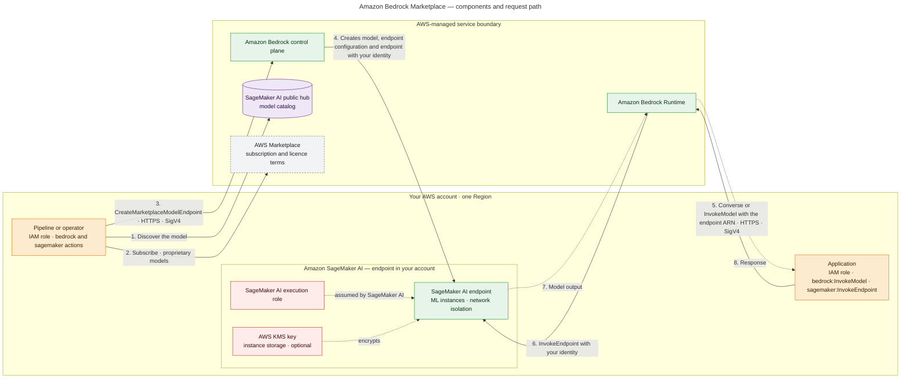
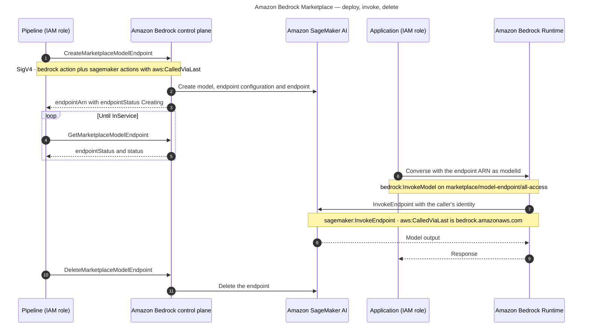

# Amazon Bedrock Marketplace

> **Level:** Intermediate · **Verified:** 2026-11-15 · **Feature status:** GA · **Time:** ~20 min

Amazon Bedrock Marketplace is a second catalog of more than 100 specialized and emerging models. You deploy one onto instances behind an endpoint managed by Amazon SageMaker AI, then call it through the Amazon Bedrock APIs you already use.

> [!IMPORTANT]
> **Status** — GA. The document history records the launch on 2024-12-04. The `AmazonBedrockMarketplaceAccess` managed policy followed in mid-2025 (the document history says 2025-07-07, the managed-policy page 2025-06-13). On 2026-10-22 AWS added distribution of private offers for third-party models from the AWS Marketplace purchase confirmation page. A list of Regions for Bedrock Marketplace was not found on the pages opened: **UNVERIFIED — REQUIRES DOCUMENTATION REVIEW**.
> Source: [Amazon Bedrock Marketplace](https://docs.aws.amazon.com/bedrock/latest/userguide/amazon-bedrock-marketplace.html), [Document history](https://docs.aws.amazon.com/bedrock/latest/userguide/bedrock-ug-doc-history.html), [AWS managed policies for Amazon Bedrock](https://docs.aws.amazon.com/bedrock/latest/userguide/security-iam-awsmanpol.html)

## Learning objectives

- Explain how a Bedrock Marketplace model differs from a serverless Bedrock model in compute, identifier, billing and scaling.
- Describe the deployment model: subscribe, deploy to a SageMaker AI-managed endpoint, call through Bedrock.
- State which Bedrock APIs work with the endpoint and how guardrails are applied.
- Write the IAM permissions for deployment and invocation, which span two services.
- Identify the pricing dimensions and the IaC gap.

## Prerequisites

- [Model providers and the model catalog](01-model-providers-and-catalog.md)
- [Model access and subscriptions](../overview/03-model-access-and-subscriptions.md)
- [The Converse API](../inference/01-converse-api.md) and [InvokeModel and streaming APIs](../inference/02-invokemodel-and-streaming.md)
- [IAM roles, trust policies and cross-account access](../../00-foundations/security/02-iam-roles-and-trust.md)

## 1. What it is

In plain language: the serverless catalog is like a taxi rank — you pay per ride and AWS owns the cars. Bedrock Marketplace is like leasing a car with a driver: you pick the vehicle (the instance type), it is reserved for you, and you pay for the time you hold it, whether or not you travel. The booking desk — the Bedrock API — is the same.

Precisely: you find a model in the model catalog (collection "Bedrock Marketplace"), subscribe if the model is proprietary, and call `CreateMarketplaceModelEndpoint`. Amazon Bedrock creates a SageMaker AI endpoint in your account. From then on the **endpoint ARN is the `modelId`** for `InvokeModel` and, for compatible models, `Converse`.

| Aspect | Serverless foundation model | Bedrock Marketplace model |
|:--|:--|:--|
| Compute | Shared capacity run by AWS; no instances | Instances of a type and count you choose, on a SageMaker AI endpoint |
| `modelId` | Model ID or inference profile ID | The SageMaker AI endpoint ARN |
| Billing | Per use (tokens, images, queries) | SageMaker AI instance time, plus a software price for proprietary models |
| Scaling | Automatic, within quotas | You set the instance count and change it with `UpdateMarketplaceModelEndpoint` |
| APIs | As listed on the model card | `InvokeModel` for every model; `Converse` for some |
| Guardrails | Applied on the inference request, where the model supports it | Applied with the `ApplyGuardrail` API |
| Subscription | Starts automatically on first call for third-party models | Proprietary models need a subscription (Bedrock can also start it in the background on first use); publicly available models need none; some models need a licence acceptance (`acceptEula`) |
| Lifetime | Controlled by the model lifecycle | The endpoint exists until you delete it |

| Item | Value |
|:--|:--|
| Service namespace / endpoint | `bedrock` control plane for endpoints; `bedrock-runtime` for inference. Discovery uses SageMaker AI hub operations |
| Control-plane operations | `CreateMarketplaceModelEndpoint`, `GetMarketplaceModelEndpoint`, `ListMarketplaceModelEndpoints`, `UpdateMarketplaceModelEndpoint`, `DeleteMarketplaceModelEndpoint`, `RegisterMarketplaceModelEndpoint`, `DeregisterMarketplaceModelEndpoint` |
| Data-plane operations | `InvokeModel`, `InvokeModelWithResponseStream`, `Converse`, `ConverseStream`, depending on the model |
| IAM action prefix | `bedrock:`, plus `sagemaker:` actions that Amazon Bedrock performs with your identity |

> [!NOTE]
> **Documented fact** — "All models can use the `InvokeModel` operation. Some models can use the `Converse` operation. For Amazon Bedrock marketplace models, use the ApplyGuardrail API to use Amazon Bedrock Guardrails." The same page lists, per model, whether Converse and streaming are supported.
> Source: [Model compatibility](https://docs.aws.amazon.com/bedrock/latest/userguide/bedrock-marketplace-model-reference.html)

## 2. Why it exists

The serverless catalog cannot hold every model. Domain-specific and regional models would otherwise mean deploying through SageMaker AI yourself and writing a second integration: another API, another request format, another set of permissions in your application. Bedrock Marketplace keeps the application on one API, and the user guide says the deployed models can be used with Bedrock tools such as Agents, Knowledge Bases and Guardrails. (Agents Classic is in maintenance mode; see the [register](../../FEATURE-VERIFICATION.md).)

## 3. When to use it

- You need a specialized model that is on the Marketplace compatibility list but not in the serverless catalog.
- You want capacity that is dedicated to you, on an instance type you choose, without leaving the Bedrock API.
- You already run a compatible model on a SageMaker AI endpoint and want to call it through Bedrock ("bring your own endpoint").

## 4. When not to use it

- **A serverless model does the job.** Pay per use and manage nothing: [Model lifecycle and selection](02-model-lifecycle-and-selection.md).
- **Traffic is low or bursty.** An endpoint has at least one instance; see section 10. For your own weights, [Custom Model Import](04-custom-model-import.md) scales to zero.
- **You want to serve your own fine-tuned weights.** A registered endpoint must keep the provider's model artifacts unchanged. Use Custom Model Import or [Model customization](03-model-customization.md).
- **You depend on the Converse API** and the model's row says "No". Check the compatibility table first: [The Converse API](../inference/01-converse-api.md).
- **Everything must be declared in IaC.** See section 12.

## 5. Internal architecture



**What this shows** — Two services are involved in every step. Bedrock is the API front; SageMaker AI hosts the model on instances in an endpoint whose ARN belongs to your account. That is why the IAM policies name both `bedrock:` and `sagemaker:` actions.

**Walkthrough**

1. You find the model in the model catalog. Programmatically, the catalog is the SageMaker AI public hub.
2. For a proprietary model you accept the provider's price and licence terms through a subscription.
3. You call `CreateMarketplaceModelEndpoint` with the model's ARN, an endpoint name, an instance type, an instance count and an execution role.
4. Amazon Bedrock creates the SageMaker AI model, endpoint configuration and endpoint, calling SageMaker AI with your identity.
5. Your application calls `bedrock-runtime` with the endpoint ARN as `modelId`.
6. The runtime invokes the SageMaker AI endpoint on your behalf.
7. The model returns its output.
8. The runtime returns the response in the Bedrock API's format.

**Variations** — With "bring your own endpoint", steps 3–4 are replaced by `RegisterMarketplaceModelEndpoint` on an endpoint you created in SageMaker AI. The endpoint can be placed in your VPC and encrypted with your KMS key (advanced settings). A publicly available model skips step 2.

**Legend** — solid arrow: request · dashed arrow: response or supporting relationship · cylinder: catalog data · boxes: trust boundaries.

## 6. Request and response lifecycle



Steps 1–3 start a deployment, which "usually takes 10-15 minutes". Steps 4–5 poll until `endpointStatus` is `InService` and `status` is `REGISTERED`; only then can Bedrock use the endpoint. Steps 6–9 are one inference call. Steps 10–11 remove the endpoint and stop the instance charges.

Error paths that matter:

| Situation | Cause | What to do |
|:--|:--|:--|
| `AccessDeniedException` on create or invoke | A `sagemaker:` permission is missing, or its `aws:CalledViaLast` condition is not met | Start from the `AmazonBedrockMarketplaceAccess` managed policy |
| `status` is not `REGISTERED` (the other documented value is `INCOMPATIBLE_ENDPOINT`) | For example, the endpoint was changed in SageMaker AI: network isolation switched off, or the primary container's model definition modified | Revert, then deregister and register the endpoint again |
| `ServiceQuotaExceededException` on create | A quota was exceeded | **Our reading:** usually the SageMaker AI quota for that instance type; request an increase there |
| `Converse` rejected | The model supports `InvokeModel` only | Use `InvokeModel` with the model's native request body |
| Calls fail shortly after subscribing | The subscription is still being finalized, or failed | Subscribing "is usually complete within 10-15 minutes"; check it before retrying |

## 7. Dependencies

| Depends on | Why | Required or optional |
|:--|:--|:-:|
| Amazon SageMaker AI | Hosts the model on an endpoint | Required |
| SageMaker AI execution role | Lets SageMaker AI fetch model artifacts and run the container | Required (the console can create it) |
| AWS Marketplace subscription | Price and licence terms of a proprietary model | Required for proprietary models only |
| AWS License Manager read access | `license-manager:ListReceivedLicenses` is in the recommended custom policy | Recommended |
| AWS KMS key | Encrypts the storage volume of the endpoint's instances | Optional |
| Amazon VPC | Places the endpoint in your subnets | Optional |
| Amazon Bedrock Guardrails | Content safety through `ApplyGuardrail` | Optional |

## 8. Security considerations

- **Two services, one policy.** Deployment needs the `bedrock:*MarketplaceModelEndpoint` actions and, in SageMaker AI, `sagemaker:CreateModel`, `sagemaker:CreateEndpointConfig`, `sagemaker:CreateEndpoint`, `sagemaker:UpdateEndpoint`, `sagemaker:DeleteEndpoint` and the tagging actions. The managed policies `AmazonBedrockFullAccess` and `AmazonBedrockMarketplaceAccess` contain them, restricted with `aws:CalledViaLast` so they work only through Bedrock.
- **Invocation.** The caller needs `bedrock:InvokeModel` on `arn:aws:bedrock:<region>:<account>:marketplace/model-endpoint/all-access` *and* `sagemaker:InvokeEndpoint` on the endpoint ARN. The Bedrock resource is one ARN for all endpoints, so **per-endpoint control is done on the SageMaker AI action**, by ARN or by tag.
- **Tags.** Amazon Bedrock copies your tags to the SageMaker AI endpoint but does not support `aws:ResourceTag` or `aws:RequestTag` on its own Marketplace actions. Put tag conditions on the `sagemaker:` actions. `RegisterMarketplaceModelEndpoint` and `DeregisterMarketplaceModelEndpoint` do not call SageMaker AI and therefore ignore tag conditions.
- **Which models may be deployed.** Restrict the `sagemaker:` create actions with a condition on `aws:ResourceTag/sagemaker-studio:hub-content-arn`.
- **Roles.** The caller needs `iam:PassRole` for the execution role; the managed policy limits it to role names matching `*SageMaker*ForBedrock*`.
- **Encryption.** `kmsEncryptionKey` in the endpoint configuration encrypts the instances' storage volume. The key policy must give the execution role `kms:CreateGrant`.
- **Isolation.** Network isolation must stay enabled on the endpoint; a bring-your-own endpoint must have it enabled to be registered.
- **Licence.** `acceptEula` records acceptance of a model's end-user licence agreement. Make that a human decision, not a default in a script.
- **Guardrails.** Call `ApplyGuardrail` around the model call yourself; see [Amazon Bedrock Guardrails](../guardrails/01-guardrails.md).

## 9. Networking requirements

- **Your application** talks only to `bedrock-runtime` — the public endpoint or the interface endpoint `com.amazonaws.<region>.bedrock-runtime`. Management calls go to `bedrock` (`com.amazonaws.<region>.bedrock`).
- **Bedrock to the model.** The runtime invokes the SageMaker AI endpoint for you. **Our reading:** your application needs no network path to the SageMaker AI runtime endpoint.
- **The endpoint.** Optional VPC settings (the `vpc` member of the SageMaker endpoint configuration). With network isolation enabled, **our reading** is that the model container cannot make outbound calls.
- **Cross-Region.** The endpoint is in one Region and inference profiles do not apply. Multi-Region resilience means an endpoint per Region and routing in your application ([Resilience, fallback models and model routing](../../08-cost-performance-and-reliability/06-resilience-fallback-and-model-routing.md)).

## 10. Pricing dimensions

| Dimension | Unit | Notes |
|:--|:--|:--|
| Model software | Set by the provider's AWS Marketplace offer | Proprietary models only. The subscription page shows "the software costs only" |
| SageMaker AI infrastructure | Instance type × number of instances × time | "You will be billed a separate SageMaker AI infrastructure cost for the instance type and number of instances that you select" |
| Customer managed KMS key | AWS KMS rates | Only if you bring a key |
| Guardrails | Guardrails pricing for `ApplyGuardrail` calls | Only if used |
| A Bedrock charge per request or token | **UNVERIFIED — REQUIRES DOCUMENTATION REVIEW** | The Bedrock pricing page text we retrieved has no Bedrock Marketplace section; we looked for one and for a per-request fee |

**Our reading:** because the endpoint always has at least one instance, infrastructure cost accrues for as long as the endpoint exists, with or without traffic. The Bedrock FAQ notes that Bedrock Marketplace models can appear on an AWS Marketplace bill, because third-party providers sell them. See [Pricing model and cost drivers](../../08-cost-performance-and-reliability/01-pricing-model-and-cost-drivers.md).

## 11. Scaling considerations

- **You size it.** `initialInstanceCount` (minimum 1) and `instanceType` are required at creation. Change them with `UpdateMarketplaceModelEndpoint`. No scale-to-zero is documented.
- **Change it in Bedrock, not in SageMaker AI.** AWS recommends modifying the endpoint only through Amazon Bedrock; some changes made in SageMaker AI stop the endpoint from working with Bedrock.
- **Lead time.** Deployment and subscription each usually take 10–15 minutes, so capacity is not instant.
- **Limits.** The endpoint name is at most 30 characters. Throughput depends on the model and the instance type; measure it. **Our reading:** instance availability is governed by SageMaker AI quotas, not by Bedrock token quotas.

## 12. IaC support

| Tool | Support | Resource / construct | Notes |
|:--|:-:|:--|:--|
| Terraform (`hashicorp/aws` 6.73.0) | ❌ | — | No Bedrock Marketplace endpoint resource in the provider schema |
| CloudFormation | ❌ | — | No such `AWS::Bedrock::*` type in the specification bundled with `aws-cdk-lib` 2.277.0 |
| AWS CDK (`aws-cdk-lib` 2.277.0) | ❌ | — | No L1 or L2 construct |

Checked against the [Terraform reference](../../references/terraform-aws-provider-bedrock.md), the [CDK and CloudFormation reference](../../references/cdk-and-cloudformation-bedrock.md) and the [API operations reference](../../references/bedrock-api-operations.md).

**Verified alternative** — Call `CreateMarketplaceModelEndpoint` from a pipeline step (SDK or CLI), store the returned endpoint ARN in configuration, and call `DeleteMarketplaceModelEndpoint` on teardown. Manage the execution role, KMS key and VPC with IaC.

**Second option, partly verified** — "Bring your own endpoint" is documented: create the endpoint in SageMaker AI, then call `RegisterMarketplaceModelEndpoint`. The SageMaker AI endpoint can be declared with IaC: the Terraform types `aws_sagemaker_model`, `aws_sagemaker_endpoint_configuration` and `aws_sagemaker_endpoint` passed `terraform validate` with provider 6.73.0, and CloudFormation has `AWS::SageMaker::Endpoint`. **Our reading:** the registration call still has to run outside IaC, and we did not verify which model and container settings pass the compatibility check. Documented constraints: network isolation enabled, and the provider's model artifacts unchanged.

## 13. Working example

> **Code status:** syntax-checked (`python -m py_compile`) · never run against AWS · **never deployed**

```python
"""Deploy a Bedrock Marketplace model to a SageMaker AI endpoint, call it, and delete it."""
import time

import boto3


def deploy(
    region: str,
    model_source_arn: str,  # hub-content ARN of the model, from the model catalog
    endpoint_name: str,  # at most 30 characters
    execution_role_arn: str,
    instance_type: str,  # choose from the instance types the model's catalog page offers
    instance_count: int = 1,
    accept_eula: bool = False,
) -> str:
    bedrock = boto3.client("bedrock", region_name=region)
    request = {
        "modelSourceIdentifier": model_source_arn,
        "endpointName": endpoint_name,
        "endpointConfig": {
            "sageMaker": {
                "initialInstanceCount": instance_count,
                "instanceType": instance_type,
                "executionRole": execution_role_arn,
            }
        },
    }
    if accept_eula:
        request["acceptEula"] = True  # only after a person has read and accepted the licence
    endpoint_arn = bedrock.create_marketplace_model_endpoint(**request)["marketplaceModelEndpoint"]["endpointArn"]

    while True:  # usually 10-15 minutes
        endpoint = bedrock.get_marketplace_model_endpoint(endpointArn=endpoint_arn)["marketplaceModelEndpoint"]
        if endpoint["endpointStatus"] not in ("Creating", "Updating"):
            break
        time.sleep(30)
    if endpoint["endpointStatus"] != "InService" or endpoint.get("status") != "REGISTERED":
        raise RuntimeError(f"{endpoint['endpointStatus']} / {endpoint.get('status')}")
    return endpoint_arn  # this ARN is the modelId


def ask(region: str, endpoint_arn: str, question: str) -> str:
    runtime = boto3.client("bedrock-runtime", region_name=region)
    response = runtime.converse(  # only for models listed as Converse-compatible; otherwise use invoke_model
        modelId=endpoint_arn,
        messages=[{"role": "user", "content": [{"text": question}]}],
    )
    return response["output"]["message"]["content"][0]["text"]


def teardown(region: str, endpoint_arn: str) -> None:
    boto3.client("bedrock", region_name=region).delete_marketplace_model_endpoint(endpointArn=endpoint_arn)
```

The matching invocation policy, taken from the pattern in the user guide (placeholders for Region and account):

> **Code status:** syntax-checked (JSON parse) · **never deployed**

```json
{
  "Version": "2012-10-17",
  "Statement": [
    {
      "Sid": "InvokeThroughBedrock",
      "Effect": "Allow",
      "Action": ["bedrock:InvokeModel"],
      "Resource": "arn:aws:bedrock:us-east-1:111122223333:marketplace/model-endpoint/all-access"
    },
    {
      "Sid": "ReachOnlyTaggedEndpointsAndOnlyViaBedrock",
      "Effect": "Allow",
      "Action": ["sagemaker:InvokeEndpoint"],
      "Resource": "arn:aws:sagemaker:us-east-1:111122223333:endpoint/*",
      "Condition": {
        "StringEquals": {
          "aws:ResourceTag/project": "example-project-id",
          "aws:CalledViaLast": "bedrock.amazonaws.com"
        }
      }
    }
  ]
}
```

> [!CAUTION]
> **Cost or security hazard** — If you try this in your own sandbox, the endpoint's instances bill from creation until `DeleteMarketplaceModelEndpoint` succeeds; GPU instance types are expensive, and a forgotten endpoint is the most common surprise on the bill. Deregistering an endpoint does **not** delete it. Tear down, then confirm in the SageMaker AI console that no endpoint remains.

## Common mistakes

| Mistake | Symptom | Fix |
|:--|:--|:--|
| Passing a model name or hub ARN as `modelId` | The call is rejected | Use the SageMaker AI endpoint ARN returned by the deployment |
| Granting only `bedrock:InvokeModel` | `AccessDeniedException` at invocation | Add `sagemaker:InvokeEndpoint` with `aws:CalledViaLast` |
| Tag conditions on `bedrock:*MarketplaceModelEndpoint` actions | The policy does not behave as intended; those keys are not supported there | Put tag conditions on the `sagemaker:` actions |
| Editing the endpoint in SageMaker AI | The endpoint stops working in Bedrock | Change it through Bedrock; if broken, deregister and register again |
| Assuming Converse works for every model | Request rejected | Read the Model compatibility table; fall back to `InvokeModel` |
| Relying on a guardrail attached to the inference request | Not the documented method for Marketplace models | Call `ApplyGuardrail` on input and output |
| Leaving a test endpoint running | Continuous instance charges | Delete the endpoint; add a budget alarm |
| Deregistering instead of deleting | The endpoint keeps running and billing in SageMaker AI | Use `DeleteMarketplaceModelEndpoint` |
| Setting `acceptEula` to true in shared automation | Licence accepted without review | Require a recorded human approval per model |

## Knowledge check

1. Your application has `bedrock:InvokeModel` on `*` and still gets `AccessDeniedException` when calling a Marketplace endpoint. What is missing, and why does the design require it?
2. You want team A to invoke only team A's endpoints. On which service's action do you place the restriction, and why can it not be done on the Bedrock resource?
3. What would happen to your bill if you deployed a model on one instance and sent no requests for a month? Compare with a serverless model and with Custom Model Import.
4. A colleague enabled outbound internet access for the model container directly in SageMaker AI to "fix" a dependency download. What happens in Bedrock, and how do you recover?
5. Which API must you call to apply a guardrail to a Marketplace model's output?

<details>
<summary>Answers</summary>

1. `sagemaker:InvokeEndpoint` on the endpoint, with `aws:CalledViaLast` set to `bedrock.amazonaws.com`. Bedrock invokes the SageMaker AI endpoint with the caller's identity, so the caller needs both permissions.
2. On `sagemaker:InvokeEndpoint`, by endpoint ARN or resource tag. The Bedrock resource is a single ARN, `marketplace/model-endpoint/all-access`, shared by all endpoints.
3. You pay for the instance for the whole month (our reading of the documented dimensions), plus any software price. A serverless model would cost nothing without requests; an imported model would cost only storage, because it scales to zero.
4. Disabling network isolation is one of the documented changes that can make the endpoint fail in Bedrock. Restore the setting, then deregister and register the endpoint again.
5. `ApplyGuardrail`, called by your code on the input and on the output.

</details>

## 14. Official documentation

- [Amazon Bedrock Marketplace](https://docs.aws.amazon.com/bedrock/latest/userguide/amazon-bedrock-marketplace.html) — overview and the APIs that work with deployed models.
- [Set up Amazon Bedrock Marketplace](https://docs.aws.amazon.com/bedrock/latest/userguide/setup-amazon-bedrock-marketplace.html) — recommended policy, invocation policy and KMS requirements.
- [Controlling access to Amazon Bedrock Marketplace models](https://docs.aws.amazon.com/bedrock/latest/userguide/control-amazon-bedrock-marketplace.html) and [Tag-based access control for Marketplace model endpoints](https://docs.aws.amazon.com/bedrock/latest/userguide/marketplace-tag-based-access-control.html) — restricting models and endpoints.
- [Discover a model](https://docs.aws.amazon.com/bedrock/latest/userguide/bedrock-marketplace-discover-a-model.html), [Subscribe to a model](https://docs.aws.amazon.com/bedrock/latest/userguide/bedrock-marketplace-subscribe-to-a-model.html), [Deploy a model](https://docs.aws.amazon.com/bedrock/latest/userguide/bedrock-marketplace-deploy-a-model.html), [Bring your own endpoint](https://docs.aws.amazon.com/bedrock/latest/userguide/bedrock-marketplace-bring-your-own-endpoint.html), [Call the endpoint](https://docs.aws.amazon.com/bedrock/latest/userguide/bedrock-marketplace-call-the-endpoint.html), [Manage your endpoints](https://docs.aws.amazon.com/bedrock/latest/userguide/bedrock-marketplace-manage-your-endpoints.html) — the workflow, step by step.
- [End-to-end workflow](https://docs.aws.amazon.com/bedrock/latest/userguide/bedrock-marketplace-end-to-end-workflow.html) — AWS sample code, including discovery through the SageMaker AI hub.
- [Model compatibility](https://docs.aws.amazon.com/bedrock/latest/userguide/bedrock-marketplace-model-reference.html) — models, Converse support and streaming support.
- API reference: [CreateMarketplaceModelEndpoint](https://docs.aws.amazon.com/bedrock/latest/APIReference/API_CreateMarketplaceModelEndpoint.html), [RegisterMarketplaceModelEndpoint](https://docs.aws.amazon.com/bedrock/latest/APIReference/API_RegisterMarketplaceModelEndpoint.html), [MarketplaceModelEndpoint](https://docs.aws.amazon.com/bedrock/latest/APIReference/API_MarketplaceModelEndpoint.html), [SageMakerEndpoint](https://docs.aws.amazon.com/bedrock/latest/APIReference/API_SageMakerEndpoint.html).
- [AWS managed policies for Amazon Bedrock](https://docs.aws.amazon.com/bedrock/latest/userguide/security-iam-awsmanpol.html) — `AmazonBedrockMarketplaceAccess`.
- [Actions, resources, and condition keys for Amazon Bedrock](https://docs.aws.amazon.com/service-authorization/latest/reference/list_amazonbedrock.html) — the `marketplace/model-endpoint/all-access` resource.
- [Interface VPC endpoints for Amazon Bedrock](https://docs.aws.amazon.com/bedrock/latest/userguide/vpc-interface-endpoints.html) — PrivateLink service names.
- [Amazon Bedrock pricing](https://aws.amazon.com/bedrock/pricing/) and [Amazon Bedrock FAQs](https://aws.amazon.com/bedrock/faqs/) — where Marketplace charges do and do not appear.
- [AWS::SageMaker::Endpoint](https://docs.aws.amazon.com/AWSCloudFormation/latest/TemplateReference/aws-resource-sagemaker-endpoint.html) — the CloudFormation type for a self-managed endpoint.
- [Document history](https://docs.aws.amazon.com/bedrock/latest/userguide/bedrock-ug-doc-history.html) — launch and change dates.
