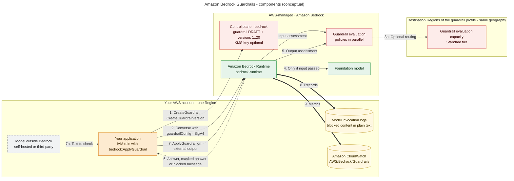
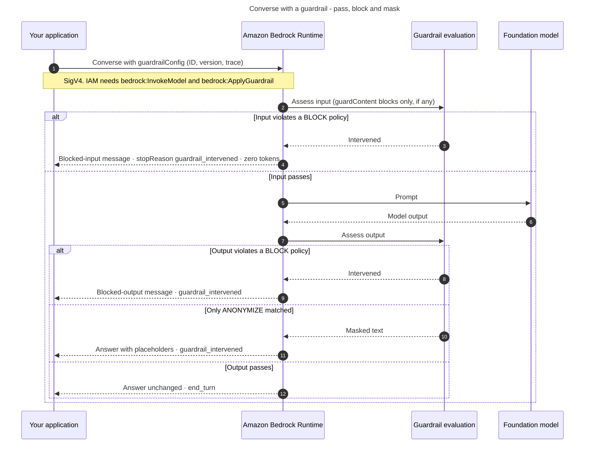

# Amazon Bedrock Guardrails

> **Level:** Intermediate · **Verified:** 2026-11-15 · **Feature status:** GA · **Time:** ~35 min

Amazon Bedrock Guardrails is a configurable checkpoint that inspects what goes into a model and
what comes out of it. You define a guardrail once in the `bedrock` control plane and then name it
on inference calls, run it on its own text with `ApplyGuardrail`, or attach it to Bedrock features.

> [!IMPORTANT]
> **Status** — GA. The Standard tier for contextual grounding checks was added on 2026-10-19 and the
> resourceless `InvokeGuardrailChecks` API was announced on 2026-06-16. Image content filters are GA
> only in US East (N. Virginia), US West (Oregon), Europe (Frankfurt) and Asia Pacific (Tokyo) and in
> preview in eight other Regions. Guardrails are a `bedrock-runtime` feature; the register records
> that they are not applied on `bedrock-mantle`.
> Sources: [Guardrails](https://docs.aws.amazon.com/bedrock/latest/userguide/guardrails.html),
> [Document history](https://docs.aws.amazon.com/bedrock/latest/userguide/bedrock-ug-doc-history.html),
> [InvokeGuardrailChecks announcement](https://aws.amazon.com/about-aws/whats-new/2026/06/amazon-bedrock-guardrails-api-ai/),
> [Image content filters](https://docs.aws.amazon.com/bedrock/latest/userguide/guardrails-mmfilter.html),
> [Feature verification matrix](../../FEATURE-VERIFICATION.md)

## Learning objectives

- Name the six policy types and state what each can and cannot detect.
- Choose between the Classic and Standard tiers and configure cross-Region guardrail inference.
- Apply a guardrail in three ways: `guardrailConfig` on inference, `ApplyGuardrail`, and attachment to agents, knowledge bases and flows.
- Use `guardContent` and input tags to limit evaluation, and read the trace to tell a block from a mask.
- Manage DRAFT and numbered versions in Terraform, and explain why a guardrail is not an authorisation control.

## Prerequisites

- [The Converse API](../inference/01-converse-api.md)
- [InvokeModel and streaming APIs](../inference/02-invokemodel-and-streaming.md)
- [Cross-Region inference: Geo and Global profiles](../inference/04-cross-region-inference.md)
- [IAM fundamentals: principals, policies and evaluation](../../00-foundations/security/01-iam-fundamentals.md)

## 1. What it is

**Plain language.** A guardrail is a list of rules with two doors: one the prompt passes before the
model sees it, one the answer passes before your user sees it. At each door the guardrail either lets
the text through, blocks it and substitutes a message you wrote, or masks parts of it.

**Precisely.** A guardrail is a Regional resource with an editable working draft (`DRAFT`) and
immutable numbered versions. It holds up to six policies. Bedrock evaluates "the input … in parallel
for each configured policy"; if the input is blocked, "the foundation model inference is discarded".

| Item | Value |
|:--|:--|
| Service namespace / endpoint | `bedrock` (control plane) for the resource; `bedrock-runtime` for evaluation |
| Control-plane operations | `CreateGuardrail`, `UpdateGuardrail`, `GetGuardrail`, `ListGuardrails`, `CreateGuardrailVersion`, `DeleteGuardrail` |
| Data-plane operations | `guardrailConfig` on `Converse`/`ConverseStream`; headers on `InvokeModel`/`InvokeModelWithResponseStream` and the OpenAI-compatible APIs; `ApplyGuardrail`; `InvokeGuardrailChecks` |
| IAM action prefix | `bedrock:` — `bedrock:ApplyGuardrail` on the guardrail ARN to use one |

### The six policies

| Policy | What it does | Actions | It cannot |
|:--|:--|:--|:--|
| Content filters | Scores HATE, INSULTS, SEXUAL, VIOLENCE, MISCONDUCT at strength NONE–HIGH per direction, in text and (optionally) images | `BLOCK`, or `NONE` to detect only | Judge business correctness; images must be PNG or JPEG, at most 4 MB and 20 per request, and only the first 100 words of text inside an image are read |
| Prompt attacks (a content filter category) | Jailbreaks, prompt injection, and prompt leakage (Standard tier only) | `BLOCK`, `NONE` | Inspect `toolResult` content or tool definitions; on `InvokeModel` it filters nothing unless the user input is inside input tags |
| Denied topics | Up to 30 topics described in natural language, with up to five example phrases each | `BLOCK`, `NONE` | Accept definitions over 200 characters on Classic (1,000 on Standard) |
| Word filters | Up to 10,000 custom words or phrases of up to three words, plus a managed profanity list; case-insensitive whole-word match | `BLOCK`, `NONE` | Match inflections: `competitor` does not match `competitors` |
| Sensitive information | 31 PII entity types (probabilistic, context-dependent) and up to 30 custom regexes | `BLOCK`, `ANONYMIZE` (replace with `{EMAIL}`-style placeholders), `NONE` | Mask invocation logs or the trace; use regex lookaround; see PII in tool calls, tool results or tool definitions |
| Contextual grounding | Scores the response for GROUNDING in a source and RELEVANCE to a query; thresholds 0–0.99 | `BLOCK`, `NONE` | Run without a grounding source and a query; handle more than 100,000 characters of source, 1,000 of query or 5,000 of response |
| Automated Reasoning | Checks claims in a response against formal rules | Detect only — findings, never a block | See [Automated Reasoning checks and guardrail enforcement](02-automated-reasoning-and-enforcement.md) |

Guardrails evaluate inputs and responses "excluding reasoning content blocks". "Embedding, reranking,
and image generation models don't support guardrails." With tools, `toolResult`, the tool
definitions and the model's `toolUse.input` are not evaluated by any policy.

Sources: [Components](https://docs.aws.amazon.com/bedrock/latest/userguide/guardrails-components.html),
[How guardrails work](https://docs.aws.amazon.com/bedrock/latest/userguide/guardrails-how.html),
[Prompt attacks](https://docs.aws.amazon.com/bedrock/latest/userguide/guardrails-prompt-attack.html),
[Word filters](https://docs.aws.amazon.com/bedrock/latest/userguide/guardrails-word-filters.html),
[Sensitive information filters](https://docs.aws.amazon.com/bedrock/latest/userguide/guardrails-sensitive-filters.html),
[Contextual grounding](https://docs.aws.amazon.com/bedrock/latest/userguide/guardrails-contextual-grounding-check.html),
[Converse with guardrails](https://docs.aws.amazon.com/bedrock/latest/userguide/guardrails-use-converse-api.html),
[Bedrock quotas](https://docs.aws.amazon.com/general/latest/gr/bedrock.html)

### Tiers and cross-Region guardrail inference

Content filters (text) with prompt attacks, denied topics and contextual grounding each take a
**safeguard tier**. Pricing is the same for both.

| | Classic | Standard |
|:--|:--|:--|
| Languages | English, French, Spanish | "Extensive language support" |
| Harmful content inside code (comments, identifiers, string literals) | No | Yes, for content filters, prompt attacks and denied topics |
| Prompt leakage detection | No | Yes |
| Contextual grounding | Strict grounding only | Also reasoning and conversational responses (since 2026-10-19, in 11 Regions; elsewhere a validation error) |
| Cross-Region guardrail inference | Not supported | **Required** |
| Default when no tier is set | Yes (documented for contextual grounding) | — |

A **guardrail profile** is the system-defined resource behind cross-Region guardrail inference. You
set it in `crossRegionConfig`; evaluation can then run in any destination Region of the profile, at
"no additional cost". The configuration stays in your Region, but "your input prompts and output
results might move outside of your primary Region", always inside the profile's geography.

| Profile ID | Geography (source Regions listed on the support page) |
|:--|:--|
| `us.guardrail.v1:0` | us-east-1, us-east-2, us-west-1, us-west-2 |
| `us-gov.guardrail.v1:0` | us-gov-east-1, us-gov-west-1 |
| `eu.guardrail.v1:0` | eu-central-1, eu-west-1, eu-west-3, eu-north-1, eu-south-1, eu-south-2, il-central-1 |
| `uk.guardrail.v1:0`, `au.guardrail.v1:0`, `ca.guardrail.v1:0` | eu-west-2; ap-southeast-2; ca-central-1 |
| `apac.guardrail.v1:0` | ap-south-1, ap-northeast-1/2, ap-southeast-1/2/3/4/5/7, ap-east-2, me-central-1 |

Destination lists differ per source Region; read the row for yours. The caller needs
`bedrock:ApplyGuardrail` on the guardrail **and** on the profile ARN in every destination Region.

Sources: [Safeguard tiers](https://docs.aws.amazon.com/bedrock/latest/userguide/guardrails-tiers.html),
[Cross-Region guardrail inference](https://docs.aws.amazon.com/bedrock/latest/userguide/guardrails-cross-region.html),
[Supported Regions for cross-Region guardrail inference](https://docs.aws.amazon.com/bedrock/latest/userguide/guardrails-cross-region-support.html),
[Profile permissions](https://docs.aws.amazon.com/bedrock/latest/userguide/guardrail-profiles-permissions.html)

## 2. Why it exists

Model safety training differs between models and knows nothing about your business rules: no
investment advice, order numbers stay private, answers stay inside retrieved documents. Without
guardrails you would build classifiers, PII detectors, word lists and a grounding scorer yourself and
re-test them for every model. A guardrail is one versioned policy object that behaves the same across
Bedrock models and, through `ApplyGuardrail`, models hosted elsewhere.

## 3. When to use it

- Any user-facing chat or agent: content filters plus prompt-attack detection on input.
- Regulated domains that must refuse topics (advice, diagnoses) — denied topics.
- Summaries of transcripts or tickets that must not leak personal data — PII `ANONYMIZE` on output.
- RAG answers that must stay inside the retrieved passages — contextual grounding.
- Models outside Bedrock (self-hosted, other providers) that need the same policy — `ApplyGuardrail`.
- Per-step checks inside an agent loop, such as tool output — `InvokeGuardrailChecks` or `ApplyGuardrail`.

## 4. When not to use it

- **To decide who may see or do what.** A guardrail classifies text probabilistically; it does not
  authorise. Use IAM ([Identity, least privilege and IAM isolation for agents](../../06-security-governance/02-identity-and-least-privilege.md)),
  metadata filtering in [retrieval](../knowledge-bases/05-retrieval-reranking-filtering.md), and
  [AgentCore Policy](../agentcore/09-agentcore-policy.md) for tool calls.
- **As the only defence against indirect prompt injection.** Tool results are not evaluated by
  `guardrailConfig`. See [Prompt injection, untrusted tool output and retrieval poisoning](../../06-security-governance/04-prompt-injection-and-untrusted-content.md).
- **For rules that must hold exactly** (eligibility, pricing). Use [Automated Reasoning checks](02-automated-reasoning-and-enforcement.md) or code.
- **With embedding, reranking or image generation models** — not supported.
- **On `bedrock-mantle`** — use `bedrock-runtime`; see [OpenAI- and Anthropic-compatible APIs](../inference/03-openai-and-anthropic-compatible-apis.md).

> [!CAUTION]
> **Security hazard** — Treat a guardrail as a probabilistic content control. It lowers the rate of
> harmful or leaked content; it does not guarantee zero, and AWS updates the underlying detection
> models "periodically" without action on your part, so re-test after changes.
> Source: [How guardrails work](https://docs.aws.amazon.com/bedrock/latest/userguide/guardrails-how.html)

## 5. Internal architecture

AWS documents the resource, the call surfaces, the evaluation order and where data flows. The
diagram is the academy's conceptual model, not the service implementation.



| Legend | Meaning |
|:--|:--|
| Solid arrow | Request or write |
| Dashed arrow | Response, optional routing or data handed over |
| Thick arrow | Asynchronous records |
| Red boxes | Guardrail resource and evaluation (security controls) |

**What this shows** — The guardrail lives in the control plane; evaluation happens inside the
runtime request, around the model call, or on its own for text from anywhere.

1. You create the guardrail and freeze a version.
2. An inference call names the guardrail and version.
3. The input is assessed, possibly in another Region of the profile's geography.
4. The model runs only if the input passed.
5. The response is assessed.
6. You receive the answer, a masked answer, or your blocked message.
7. `ApplyGuardrail` assesses text without a Bedrock model, such as output from a model hosted elsewhere.
8. Invocation logs (if enabled) keep the original request, blocked content included.
9. Metrics go to `AWS/Bedrock/Guardrails`.

**Variations** — The full picture, with IAM enforcement and enforced configurations, is in
[diagram set 18](../../diagrams/mermaid/18-guardrails.md).

### Ways to apply a guardrail

| Way | How you name the guardrail | Notes |
|:--|:--|:--|
| Inference request | `guardrailConfig` on `Converse`/`ConverseStream`; `X-Amzn-Bedrock-GuardrailIdentifier` and `-GuardrailVersion` headers on `InvokeModel`, `InvokeModelWithResponseStream`, Chat Completions and Responses on `bedrock-runtime` | Input and output assessed around the model call |
| Standalone `ApplyGuardrail` | Guardrail ID and version in the path; `source` = `INPUT` or `OUTPUT` | No model invoked; only `bedrock:ApplyGuardrail` needed; text and images |
| Attached to a feature | `guardrailConfiguration` on `CreateAgent`/`UpdateAgent` ([Agents Classic](../agents/01-agents-classic.md)), on `RetrieveAndGenerate`, on prompt and knowledge-base nodes in [Flows](../flows/01-bedrock-flows.md); `policyConfiguration` in [agentic retrieval](../agentic-retrieval/01-agentic-retrieval.md) (BLOCK only) | The feature applies it on your behalf |
| Resourceless `InvokeGuardrailChecks` | Checks listed inline: `contentFilter`, `promptAttack`, `sensitiveInformation` | Detect-only scores 0–1; no guardrail resource; `Resource: "*"` in IAM |
| Enforced configuration | Account- or organisation-level | Applied without the caller asking — see [chapter 2](02-automated-reasoning-and-enforcement.md) |

Sources: [Use cases](https://docs.aws.amazon.com/bedrock/latest/userguide/guardrails-use.html),
[ApplyGuardrail](https://docs.aws.amazon.com/bedrock/latest/userguide/guardrails-use-independent-api.html),
[InvokeGuardrailChecks](https://docs.aws.amazon.com/bedrock/latest/userguide/guardrails-use-invoke-guardrail-checks.html),
[Test your guardrail (headers)](https://docs.aws.amazon.com/bedrock/latest/userguide/guardrails-test.html),
[Responses API](https://docs.aws.amazon.com/bedrock/latest/userguide/inference-responses-api.html)

## 6. Request and response lifecycle



Steps 1–2: the request carries the guardrail and the input is assessed first. Steps 3–4: a blocked
input never reaches the model, and the documented example reports zero token usage. Steps 5–9: the
model runs and a blocked output is replaced by your message; you still pay for the model. Steps
10–11: masking returns a usable answer **with the same `stopReason` as a block** — only the trace
tells them apart. Step 12: nothing matched. Errors are the usual runtime ones: `AccessDeniedException` (missing `bedrock:ApplyGuardrail`,
including on profile ARNs), `ValidationException` (for example a Standard-tier grounding request in
an unsupported Region), `ThrottlingException`.

### Evaluating only part of the input

| API | Mechanism | Rule |
|:--|:--|:--|
| Converse | `guardContent` blocks in `messages` or `system` | "Once you include a `guardContent` block anywhere in your messages, the guardrail evaluates only the content within `guardContent` blocks." The system prompt is assessed **only** inside `guardContent`. Word filters can still act on untagged text |
| InvokeModel, OpenAI-compatible APIs | `<amazon-bedrock-guardrails-guardContent_SUFFIX>` tags plus `amazon-bedrock-guardrailConfig.tagSuffix` | Untagged content is skipped; with no tags the whole prompt is assessed — except prompt attacks, which require tags. Use a new random suffix (1–20 alphanumerics) per request |

> [!WARNING]
> **Common mistake** — Tagging is chosen by the caller, so a caller can leave content out of input
> evaluation. The output is always assessed. To take that choice away, use an enforced
> configuration with `COMPREHENSIVE` guarding ([chapter 2](02-automated-reasoning-and-enforcement.md)).

### Streaming

| Mode | Set with | Behaviour |
|:--|:--|:--|
| Synchronous (default) | `streamProcessingMode` `sync` on `ConverseStream` | Chunks are buffered and scanned before release: added latency, every chunk checked |
| Asynchronous | `async` on `ConverseStream`; `ASYNCHRONOUS` in `amazon-bedrock-guardrailConfig` on `InvokeModelWithResponseStream` | Chunks are released immediately; "response chunks may contain inappropriate content until guardrails scan completes"; masking is **not supported** |

Contextual grounding treats the whole response as relevant if any chunk is relevant, so an
irrelevant streamed answer may be flagged only after it was shown. Automated Reasoning does not run
on streaming APIs.

### Reading the result: trace and versions

- **Trace** — `trace` = `enabled`, `enabled_full` or `disabled` on Converse; `outputScope` =
  `INTERVENTIONS` or `FULL` on `ApplyGuardrail` (FULL does not cover word filters or regexes). Each
  assessment lists per-policy actions (`BLOCKED`, `ANONYMIZED`, `NONE`), `invocationMetrics` (latency,
  units per policy, `guardrailCoverage` of characters guarded versus total) and
  `appliedGuardrailDetails` with `guardrailOrigin` (`REQUEST`, `ACCOUNT_ENFORCED`, `ORGANIZATION_ENFORCED`).
- **The trace is sensitive.** `modelOutput` holds the response before masking and each `match` holds
  the detected value.
- **Versions** — `DRAFT` is the editable working copy. `CreateGuardrailVersion` freezes a numbered
  snapshot (at most 20 per guardrail). Versions "aren't separate resources and don't have their own
  ARN", so an IAM `Resource` cannot target one; use `bedrock:GuardrailIdentifier` with `:version`.

Sources: [Converse with guardrails](https://docs.aws.amazon.com/bedrock/latest/userguide/guardrails-use-converse-api.html),
[Input tags](https://docs.aws.amazon.com/bedrock/latest/userguide/guardrails-tagging.html),
[Streaming](https://docs.aws.amazon.com/bedrock/latest/userguide/guardrails-streaming.html),
[ApplyGuardrail API reference](https://docs.aws.amazon.com/bedrock/latest/APIReference/API_runtime_ApplyGuardrail.html),
[GuardrailConfiguration](https://docs.aws.amazon.com/bedrock/latest/APIReference/API_runtime_GuardrailConfiguration.html),
[AppliedGuardrailDetails](https://docs.aws.amazon.com/bedrock/latest/APIReference/API_runtime_AppliedGuardrailDetails.html),
[Deploy your guardrail](https://docs.aws.amazon.com/bedrock/latest/userguide/guardrails-deploy.html)

## 7. Dependencies

| Depends on | Why | Required or optional |
|:--|:--|:-:|
| A text or chat model on `bedrock-runtime` | Target of `guardrailConfig` | Required for in-request use |
| IAM `bedrock:ApplyGuardrail` on the guardrail (and profile) ARNs | Every use of the guardrail | Required |
| Guardrail profile | Standard tier; Automated Reasoning | Required for Standard |
| AWS KMS customer managed key | Encrypt the guardrail with your key instead of the AWS managed default | Optional |
| Model invocation logging, CloudWatch | Evidence and tuning | Optional |

## 8. Security considerations

- **IAM.** Management needs `bedrock:CreateGuardrail`, `bedrock:CreateGuardrailVersion`,
  `bedrock:UpdateGuardrail` and related actions (plus `bedrock:TagResource` when tagging at creation).
  Use needs `bedrock:ApplyGuardrail` on the guardrail ARN and on each destination-Region profile ARN;
  standalone use needs no model permission. `bedrock:InvokeGuardrailChecks` has no resource to scope.
- **Making it mandatory.** The `bedrock:GuardrailIdentifier` condition key, resource policies and
  enforced configurations are covered in [chapter 2](02-automated-reasoning-and-enforcement.md) and
  encoded in the tested [bedrock-invocation-role module](../../04-infrastructure-as-code/terraform/modules/bedrock-invocation-role/README.md).
- **Encryption.** A guardrail is encrypted with an AWS managed key by default; set `kmsKeyId` for a
  customer managed key.
- **Logs and traces hold the raw text.** "All blocked content … will appear as plain text in Amazon
  Bedrock Model Invocation Logs", and masking never applies to those logs. Protect both with KMS and
  narrow IAM, or use CloudWatch Logs data protection.
- **Not a boundary.** See the caution in section 4 and the threat model in
  [Shared responsibility and a GenAI threat model](../../06-security-governance/01-shared-responsibility-and-threat-model.md).

Sources: [Guardrail permissions](https://docs.aws.amazon.com/bedrock/latest/userguide/guardrails-permissions.html),
[InvokeGuardrailChecks permissions](https://docs.aws.amazon.com/bedrock/latest/userguide/guardrails-use-invoke-guardrail-checks-permissions.html),
[Components](https://docs.aws.amazon.com/bedrock/latest/userguide/guardrails-components.html)

## 9. Networking requirements

Guardrails add no endpoint of their own. `ApplyGuardrail`, `InvokeGuardrailChecks` and guarded
inference use `bedrock-runtime`; guardrail management uses the `bedrock` control plane. Both have
interface VPC endpoints — see [Endpoints, APIs and authentication](../overview/02-endpoints-apis-and-authentication.md)
and [Private connectivity for Bedrock](../../02-related-aws-services/networking/01-private-connectivity-for-bedrock.md).
With a guardrail profile, prompts and responses can be evaluated in another Region of the same
geography over Amazon's network, encrypted in transit; plan residency with
[Cross-Region considerations and data residency](../../09-advanced-topics/11-cross-region-and-data-residency.md).

## 10. Pricing dimensions

Figures read on 2026-11-15 from the pricing page; they carry no Region and are the same for both
tiers. "A text unit can contain up to 1000 characters"; each policy meters its own units.

| Dimension | Unit | Notes |
|:--|:--|:--|
| Content filters (text) | $0.15 per 1,000 text units | Classic and Standard |
| Content filters (image) | $0.00075 per image | — |
| Denied topics | $0.15 per 1,000 text units | — |
| Sensitive information (PII) | $0.10 per 1,000 text units | Regex filters free |
| Word filters | Free | — |
| Contextual grounding | $0.10 per 1,000 text units | Source + query + response characters combined |
| Automated Reasoning | $0.17 per 1,000 text units per policy | See chapter 2 |
| `InvokeGuardrailChecks` | $0.07 content, $0.08 prompt attack, $0.10 PII per 1,000 text units | Separate rate card |
| Model inference | Per the model | Not charged when the input is blocked; charged when the output is blocked |

`inputEnabled`/`outputEnabled` = false switches a policy off for one direction; "you aren't
charged for the evaluation". Enforced guardrails are charged per guardrail applied.

Sources: [Amazon Bedrock pricing](https://aws.amazon.com/bedrock/pricing/),
[How charges are calculated](https://docs.aws.amazon.com/bedrock/latest/userguide/guardrails-how.html)

## 11. Scaling considerations

Each policy has its own text-units-per-second quota and meters units separately, so a 1,600-character
prompt checked by three policies consumes six text units. Defaults read on 2026-11-15 (most
adjustable; check Service Quotas):

| Quota | Default |
|:--|:--|
| `ApplyGuardrail` requests per second | 100 in us-east-1, us-east-2, us-west-1, us-west-2, ap-northeast-1/2, ap-south-1, ap-southeast-1, eu-central-1; 25 elsewhere |
| Text units per second, per policy | Varies by policy, tier and Region (for example sensitive information: 1,000 in us-east-1, 75 in many Regions) |
| Maximum input size, per policy | In text units; Standard-tier denied topics up to 1,000 in us-east-1, 106 in many Regions |
| `InvokeGuardrailChecks` requests per minute | 1,500 |
| Topics per guardrail · versions per guardrail · words per word policy · regexes | 30 · 20 · 10,000 · 30 (not adjustable) |

Throttled calls return `ThrottlingException` and appear as `InvocationThrottles` in CloudWatch.
Enforced guardrails count against the quotas of the account that makes the call.

Sources: [Amazon Bedrock endpoints and quotas](https://docs.aws.amazon.com/general/latest/gr/bedrock.html),
[CloudWatch metrics for guardrails](https://docs.aws.amazon.com/bedrock/latest/userguide/monitoring-guardrails-cw-metrics.html),
[Enforcements FAQ](https://docs.aws.amazon.com/bedrock/latest/userguide/guardrails-enforcements.html)

## 12. IaC support

| Tool | Support | Resource / construct | Notes |
|:--|:-:|:--|:--|
| Terraform (`hashicorp/aws` 6.73.0) | ✅ | `aws_bedrock_guardrail`, `aws_bedrock_guardrail_version`; ephemeral `aws_bedrockruntime_apply_guardrail` | **Gaps in 6.73.0:** no Automated Reasoning block; contextual grounding has no `tier_config`, `action` or `enabled`; denied topics have no per-direction action or `enabled` |
| CloudFormation | ✅ | `AWS::Bedrock::Guardrail`, `AWS::Bedrock::GuardrailVersion` | Has `AutomatedReasoningPolicyConfig`, grounding `Action`/`Enabled` and per-direction topic actions; the bundled specification has no contextual-grounding tier property |
| AWS CDK (`aws-cdk-lib` 2.277.0) | L1 · alpha | `CfnGuardrail`, `CfnGuardrailVersion`; `Guardrail` in `@aws-cdk/aws-bedrock-alpha` | The alpha API can change |

Checked against [the Terraform reference](../../references/terraform-aws-provider-bedrock.md) and
[the CDK and CloudFormation reference](../../references/cdk-and-cloudformation-bedrock.md). A
reusable module is planned at [bedrock-guardrail](../../04-infrastructure-as-code/terraform/modules/bedrock-guardrail/README.md).

## 13. Working example

### Terraform: a Standard-tier guardrail and a version

> **Code status:** `terraform fmt` ✅ · `terraform validate` ✅ (provider 6.73.0) · TFLint ✅ · `terraform test` ✅ 1 run with a mock provider · **never planned or applied against AWS**

`versions.tf`

```hcl
terraform {
  required_version = ">= 1.11.0"

  required_providers {
    aws = {
      source  = "hashicorp/aws"
      version = "~> 6.73"
    }
  }
}

provider "aws" {
  region = var.region

  default_tags {
    tags = var.tags
  }
}
```

`variables.tf`

```hcl
variable "region" {
  description = "Region of the guardrail. It must be a source Region of the guardrail profile."
  type        = string
  default     = "us-east-1"
}

variable "name" {
  description = "Guardrail name."
  type        = string
  default     = "support-chat"
}

variable "guardrail_profile_id" {
  description = "System-defined guardrail profile for cross-Region guardrail inference (required by the Standard tier). Confirm the ID for your Region."
  type        = string
  default     = "us.guardrail.v1:0"
}

variable "kms_key_arn" {
  description = "Customer managed KMS key for the guardrail. Null uses the AWS managed default."
  type        = string
  default     = null
}

variable "tags" {
  description = "Tags applied to every resource through default_tags."
  type        = map(string)
  default     = {}
}
```

`main.tf`

```hcl
data "aws_caller_identity" "current" {}
data "aws_partition" "current" {}

locals {
  # Guardrail profile ARNs use the caller's account ID and the source Region.
  guardrail_profile_arn = "arn:${data.aws_partition.current.partition}:bedrock:${var.region}:${data.aws_caller_identity.current.account_id}:guardrail-profile/${var.guardrail_profile_id}"

  harmful_categories = ["HATE", "INSULTS", "SEXUAL", "VIOLENCE", "MISCONDUCT"]
}

resource "aws_bedrock_guardrail" "this" {
  name                      = var.name
  description               = "Customer-support assistant: harmful content, prompt attacks, investment advice, PII."
  blocked_input_messaging   = "Sorry, I can't help with that request."
  blocked_outputs_messaging = "Sorry, I can't share that answer."
  kms_key_arn               = var.kms_key_arn

  # Standard tier for content filters and denied topics requires a guardrail profile.
  cross_region_config {
    guardrail_profile_identifier = local.guardrail_profile_arn
  }

  content_policy_config {
    tier_config {
      tier_name = "STANDARD"
    }

    dynamic "filters_config" {
      for_each = toset(local.harmful_categories)
      content {
        type              = filters_config.value
        input_strength    = "HIGH"
        output_strength   = "HIGH"
        input_modalities  = ["TEXT", "IMAGE"]
        output_modalities = ["TEXT", "IMAGE"]
      }
    }

    # Prompt attacks are assessed on input; the AWS examples set the output strength to NONE.
    filters_config {
      type            = "PROMPT_ATTACK"
      input_strength  = "HIGH"
      output_strength = "NONE"
    }
  }

  topic_policy_config {
    tier_config {
      tier_name = "STANDARD"
    }

    topics_config {
      name       = "investment-advice"
      type       = "DENY"
      definition = "Recommendations about buying, selling or allocating stocks, funds, cryptocurrency or other investments."
      examples   = ["Which shares should I buy this month?", "Is now a good time to move my pension into crypto?"]
    }
  }

  word_policy_config {
    managed_word_lists_config {
      type = "PROFANITY"
    }

    words_config {
      text = "ExampleCompetitor"
    }
  }

  sensitive_information_policy_config {
    # Block card numbers in either direction.
    pii_entities_config {
      type   = "CREDIT_DEBIT_CARD_NUMBER"
      action = "BLOCK"
    }

    # Let the user mention an e-mail address, but mask any the model writes back.
    pii_entities_config {
      type          = "EMAIL"
      action        = "ANONYMIZE"
      input_action  = "NONE"
      output_action = "ANONYMIZE"
    }

    regexes_config {
      name        = "order-id"
      description = "Internal order identifiers"
      pattern     = "ORD-[0-9]{8}"
      action      = "ANONYMIZE"
    }
  }

  # Contextual grounding only acts when the request supplies a grounding source and a query.
  contextual_grounding_policy_config {
    filters_config {
      type      = "GROUNDING"
      threshold = 0.7
    }

    filters_config {
      type      = "RELEVANCE"
      threshold = 0.7
    }
  }
}

# An immutable snapshot for production traffic. A new version is cut whenever the
# working draft changes; skip_destroy keeps old versions so callers pinned to them keep working.
resource "aws_bedrock_guardrail_version" "this" {
  guardrail_arn = aws_bedrock_guardrail.this.guardrail_arn
  description   = "Managed by Terraform"
  skip_destroy  = true

  lifecycle {
    replace_triggered_by = [aws_bedrock_guardrail.this]
  }
}
```

`outputs.tf`

```hcl
output "guardrail_id" {
  description = "Guardrail ID for guardrailConfig.guardrailIdentifier."
  value       = aws_bedrock_guardrail.this.guardrail_id
}

output "guardrail_arn" {
  description = "Guardrail ARN (no version suffix)."
  value       = aws_bedrock_guardrail.this.guardrail_arn
}

output "guardrail_version" {
  description = "Published version number for guardrailConfig.guardrailVersion."
  value       = aws_bedrock_guardrail_version.this.version
}
```

`tests/guardrail.tftest.hcl`

```hcl
mock_provider "aws" {
  mock_data "aws_caller_identity" {
    defaults = {
      account_id = "111122223333"
    }
  }
  mock_data "aws_partition" {
    defaults = {
      partition = "aws"
    }
  }
}

run "plans_guardrail_with_standard_tier" {
  command = plan

  assert {
    condition     = aws_bedrock_guardrail.this.cross_region_config[0].guardrail_profile_identifier == "arn:aws:bedrock:us-east-1:111122223333:guardrail-profile/us.guardrail.v1:0"
    error_message = "Guardrail profile ARN is wrong."
  }

  assert {
    condition     = length(aws_bedrock_guardrail.this.content_policy_config[0].filters_config) == 6
    error_message = "Expected five harmful categories plus PROMPT_ATTACK."
  }

  assert {
    condition     = aws_bedrock_guardrail_version.this.skip_destroy == true
    error_message = "Old versions must be retained."
  }
}
```

> [!TIP]
> **Academy recommendation** — Pin applications to a numbered version and let Terraform cut a new
> one whenever the draft changes (`replace_triggered_by`). With `skip_destroy` old versions remain, so
> roll-back is a variable change — but prune them before you reach 20.
> This is our design guidance, not an official AWS reference architecture.

### Python: Converse with a guardrail, and `ApplyGuardrail` for an external model

> **Code status:** `py_compile` ✅ · stub-tested with botocore `Stubber` (boto3 1.44.3; pass, blocked input, masked output, `ApplyGuardrail` none/intervened) · **never run against AWS**

```python
"""Converse with a guardrail; tell a block from a mask without logging what was matched."""
import os

import boto3

runtime = boto3.client("bedrock-runtime")

# Configuration, never literals. Confirm the current model or inference profile ID.
MODEL_ID = os.environ.get("MODEL_ID", "")
GUARDRAIL = {
    "guardrailIdentifier": os.environ.get("GUARDRAIL_ID", ""),
    "guardrailVersion": os.environ.get("GUARDRAIL_VERSION", ""),  # a number; DRAFT only in development
    "trace": "enabled",  # needed to tell BLOCKED from ANONYMIZED
}
SYSTEM = [{"text": "You are the support assistant of an online shop. Answer briefly."}]

# Where each policy reports its per-item actions inside one assessment.
_POLICY_ITEMS = {
    "topicPolicy": ["topics"],
    "contentPolicy": ["filters"],
    "wordPolicy": ["customWords", "managedWordLists"],
    "sensitiveInformationPolicy": ["piiEntities", "regexes"],
    "contextualGroundingPolicy": ["filters"],
}


def _assessments(trace):
    """Yield (side, assessment) from a Converse guardrail trace."""
    for assessment in trace.get("inputAssessment", {}).values():
        yield "input", assessment
    for assessments in trace.get("outputAssessments", {}).values():
        for assessment in assessments:
            yield "output", assessment


def summarize(response):
    """Return outcome PASSED, BLOCKED or MASKED plus the policies that acted (no matched values)."""
    text = "".join(b.get("text", "") for b in response["output"]["message"]["content"])
    if response["stopReason"] != "guardrail_intervened":
        return {"outcome": "PASSED", "text": text, "findings": []}

    findings = []
    trace = response.get("trace", {}).get("guardrail", {})
    for side, assessment in _assessments(trace):
        for policy, lists in _POLICY_ITEMS.items():
            for key in lists:
                for item in assessment.get(policy, {}).get(key, []):
                    if item.get("action", "NONE") != "NONE":
                        label = item.get("name") or item.get("type") or key
                        findings.append((side, policy, label, item["action"]))

    actions = {f[3] for f in findings}
    # Masking leaves a usable answer; anything else means the configured blocked message.
    outcome = "MASKED" if actions == {"ANONYMIZED"} else "BLOCKED"
    return {"outcome": outcome, "text": text, "findings": findings}


def ask(history, user_text, client=None):
    """Guard only the newest user turn; earlier turns were already assessed."""
    client = client or runtime
    messages = history + [
        {"role": "user", "content": [{"guardContent": {"text": {"text": user_text}}}]}
    ]
    response = client.converse(
        modelId=MODEL_ID,
        system=SYSTEM,
        messages=messages,
        guardrailConfig=GUARDRAIL,
        inferenceConfig={"maxTokens": 512},
    )
    return summarize(response)


def check_external_output(text, client=None):
    """ApplyGuardrail on text from a model outside Amazon Bedrock (no Bedrock inference)."""
    client = client or runtime
    result = client.apply_guardrail(
        guardrailIdentifier=GUARDRAIL["guardrailIdentifier"],
        guardrailVersion=GUARDRAIL["guardrailVersion"],
        source="OUTPUT",
        content=[{"text": {"text": text}}],
    )
    if result["action"] == "NONE":
        return text
    # Masked: the text with placeholders such as {EMAIL}. Blocked: the blocked-output message.
    return "".join(o.get("text", "") for o in result["outputs"])


if __name__ == "__main__":
    reply = ask([], "Where is my order ORD-12345678?")
    print(reply["outcome"], reply["text"])
    print(reply["findings"])  # policy names and types only; never log trace matches
```

`trace` stays on because it is the only way to tell masking from blocking; the function returns
policy names, never `match` values.

## Common mistakes

| Mistake | Symptom | Fix |
|:--|:--|:--|
| Using `DRAFT` in production | Behaviour changes when someone edits the guardrail | Pin a numbered version |
| Treating `guardrail_intervened` as "blocked" | Masked answers discarded | Read the trace actions |
| Logging the trace | PII in logs despite masking | Log policy names and types only |
| Standard tier without a guardrail profile | Create or update fails | Set `crossRegionConfig` |
| Profile permission only in the source Region | `AccessDeniedException` on some calls | Grant `bedrock:ApplyGuardrail` on every destination profile ARN |
| Prompt-attack filter on `InvokeModel` without tags | Attacks pass | Wrap user input in input tags |
| Expecting masking in async streaming | PII streamed | Use sync mode |
| `guardContent` on one message only | Rest of the conversation unchecked | Intended: tag the newest turn; otherwise do not tag |

## Knowledge check

1. A Converse response has `stopReason` `guardrail_intervened` and readable text with `{EMAIL}` in it. Was the request blocked?
2. Why might a denied topic with a 600-character definition be rejected?
3. You protect an agent with `guardrailConfig`. A web page returned by a tool contains "ignore your instructions". Is it assessed?
4. A guardrail blocks a user's prompt. What do you pay for?
5. Why can an IAM policy not grant `bedrock:ApplyGuardrail` on version 3 only?

<details>
<summary>Answers</summary>

1. No. The guardrail masked a sensitive-information match; a block would return your blocked-output message. The trace shows `ANONYMIZED`.
2. The guardrail uses the Classic tier, which allows 200 characters per definition; Standard allows 1,000.
3. No. `toolResult` content is not evaluated by any policy. Check it with `ApplyGuardrail` or `InvokeGuardrailChecks` before the next model call.
4. The guardrail evaluation of the input only; the model is not invoked.
5. Versions are not separate resources and have no ARN. Use the `bedrock:GuardrailIdentifier` condition key with `ARN:3`.

</details>

## 14. Official documentation

- [Detect and filter harmful content by using Amazon Bedrock Guardrails](https://docs.aws.amazon.com/bedrock/latest/userguide/guardrails.html) — overview of the policies.
- [How Amazon Bedrock Guardrails works](https://docs.aws.amazon.com/bedrock/latest/userguide/guardrails-how.html) — evaluation order, supported models, charging rules.
- [Create your guardrail](https://docs.aws.amazon.com/bedrock/latest/userguide/guardrails-components.html) — policies, logging note.
- [Safeguard tiers](https://docs.aws.amazon.com/bedrock/latest/userguide/guardrails-tiers.html) — Classic versus Standard, Regions.
- [Distribute guardrail inference across AWS Regions](https://docs.aws.amazon.com/bedrock/latest/userguide/guardrails-cross-region.html) and [Supported Regions](https://docs.aws.amazon.com/bedrock/latest/userguide/guardrails-cross-region-support.html) — profiles and destinations.
- [Permissions for cross-Region guardrail inference](https://docs.aws.amazon.com/bedrock/latest/userguide/guardrail-profiles-permissions.html) — profile ARNs in IAM.
- [Detect prompt attacks](https://docs.aws.amazon.com/bedrock/latest/userguide/guardrails-prompt-attack.html), [Image content filters](https://docs.aws.amazon.com/bedrock/latest/userguide/guardrails-mmfilter.html), [Word filters](https://docs.aws.amazon.com/bedrock/latest/userguide/guardrails-word-filters.html), [Sensitive information filters](https://docs.aws.amazon.com/bedrock/latest/userguide/guardrails-sensitive-filters.html), [Contextual grounding](https://docs.aws.amazon.com/bedrock/latest/userguide/guardrails-contextual-grounding-check.html) — per-policy behaviour and limits.
- [Include a guardrail with the Converse API](https://docs.aws.amazon.com/bedrock/latest/userguide/guardrails-use-converse-api.html) — `guardContent`, tool coverage, masked output, trace.
- [Apply tags to user input](https://docs.aws.amazon.com/bedrock/latest/userguide/guardrails-tagging.html) and [Streaming behaviour](https://docs.aws.amazon.com/bedrock/latest/userguide/guardrails-streaming.html) — InvokeModel tagging and stream modes.
- [Use the ApplyGuardrail API](https://docs.aws.amazon.com/bedrock/latest/userguide/guardrails-use-independent-api.html) and [ApplyGuardrail reference](https://docs.aws.amazon.com/bedrock/latest/APIReference/API_runtime_ApplyGuardrail.html) — standalone use, `outputScope`.
- [InvokeGuardrailChecks](https://docs.aws.amazon.com/bedrock/latest/userguide/guardrails-use-invoke-guardrail-checks.html) and [its permissions](https://docs.aws.amazon.com/bedrock/latest/userguide/guardrails-use-invoke-guardrail-checks-permissions.html) — resourceless, detect-only checks.
- [Use cases for guardrails](https://docs.aws.amazon.com/bedrock/latest/userguide/guardrails-use.html) — agents, knowledge bases, flows.
- [Deploy your guardrail](https://docs.aws.amazon.com/bedrock/latest/userguide/guardrails-deploy.html) — versions and IAM.
- [Set up permissions](https://docs.aws.amazon.com/bedrock/latest/userguide/guardrails-permissions.html) — management and invocation policies.
- [Monitor guardrails with CloudWatch](https://docs.aws.amazon.com/bedrock/latest/userguide/monitoring-guardrails-cw-metrics.html) — metrics and dimensions.
- [Amazon Bedrock endpoints and quotas](https://docs.aws.amazon.com/general/latest/gr/bedrock.html) — guardrail quotas.
- [Amazon Bedrock pricing](https://aws.amazon.com/bedrock/pricing/) — Guardrails rate card.
- [Terraform `aws_bedrock_guardrail`](https://raw.githubusercontent.com/hashicorp/terraform-provider-aws/main/website/docs/r/bedrock_guardrail.html.markdown) and [`aws_bedrock_guardrail_version`](https://raw.githubusercontent.com/hashicorp/terraform-provider-aws/main/website/docs/r/bedrock_guardrail_version.html.markdown) — provider documentation.
