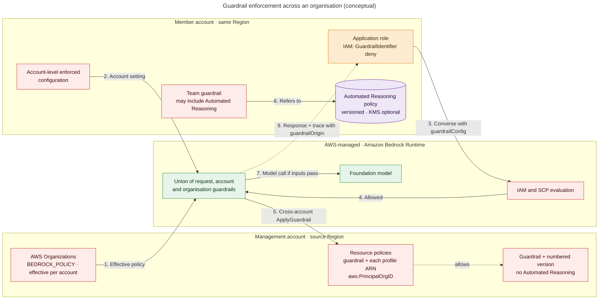
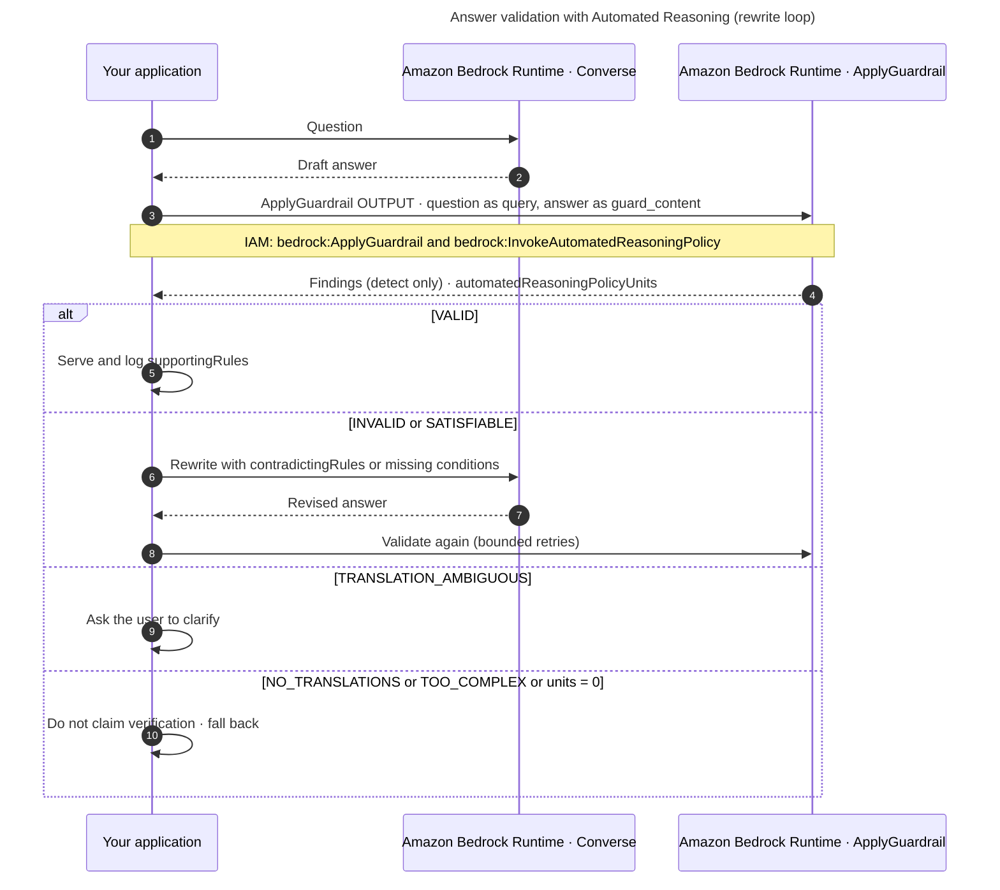

# Automated Reasoning checks and guardrail enforcement

> **Level:** Advanced · **Verified:** 2026-11-15 · **Feature status:** GA · **Time:** ~40 min

This chapter covers the two parts of Amazon Bedrock Guardrails that go beyond filtering text:
Automated Reasoning checks, which verify an answer against formal rules, and the mechanisms that
make a guardrail mandatory — IAM conditions, resource policies, and account- or organisation-level
enforced configurations.

> [!IMPORTANT]
> **Status** — Automated Reasoning checks are GA in US East (N. Virginia), US East (Ohio), US West
> (Oregon), Europe (Frankfurt), Europe (Paris), Europe (Ireland) and Asia Pacific (Sydney), for
> English (US) only. The `bedrock:GuardrailIdentifier` condition key was announced on 2025-03-18.
> Account- and organisation-level enforcement became generally available on 2026-04-03.
> Sources: [Automated Reasoning checks](https://docs.aws.amazon.com/bedrock/latest/userguide/guardrails-automated-reasoning-checks.html),
> [IAM policy-based enforcement (AWS blog)](https://aws.amazon.com/blogs/machine-learning/amazon-bedrock-guardrails-announces-iam-policy-based-enforcement-to-deliver-safe-ai-interactions/),
> [Cross-account safeguards GA (AWS News Blog)](https://aws.amazon.com/blogs/aws/amazon-bedrock-guardrails-supports-cross-account-safeguards-with-centralized-control-and-management/)

## Learning objectives

- Describe how an Automated Reasoning policy is built from a document, tested, versioned and attached to a guardrail.
- Interpret the seven validation results and choose an application action for each.
- Enforce a guardrail with an IAM allow plus explicit deny, an SCP, and an enforced configuration, and state what each guarantees.
- Share a guardrail across an organisation with resource policies, including its guardrail profile.
- Provision enforcement with Terraform and Automated Reasoning with CloudFormation.

## Prerequisites

- [Amazon Bedrock Guardrails](01-guardrails.md)
- [Resource-based policies](../../00-foundations/security/03-resource-policies.md)
- [AWS Organizations and AWS Control Tower](../../00-foundations/aws-fundamentals/05-organizations-control-tower.md)
- [Module: bedrock-invocation-role](../../04-infrastructure-as-code/terraform/modules/bedrock-invocation-role/README.md)

## 1. What it is

**Plain language.** Automated Reasoning turns a rule book (say, an HR leave policy) into logic, then
checks whether a model's answer follows from it — and explains why or why not. Enforcement is the
other half: making sure no team can call a model without the guardrail, whether they remember to
ask for it or not.

**Precisely.**

| Item | Value |
|:--|:--|
| Service namespace / endpoint | `bedrock` (policies, enforcement, resource policies); `bedrock-runtime` (evaluation); AWS Organizations (policy type `BEDROCK_POLICY`) |
| Control-plane operations | `CreateAutomatedReasoningPolicy`, `StartAutomatedReasoningPolicyBuildWorkflow`, `StartAutomatedReasoningPolicyTestWorkflow`, `CreateAutomatedReasoningPolicyVersion`, `ExportAutomatedReasoningPolicyVersion`; `PutEnforcedGuardrailConfiguration`, `ListEnforcedGuardrailsConfiguration`, `DeleteEnforcedGuardrailConfiguration`; `PutResourcePolicy`, `GetResourcePolicy`, `DeleteResourcePolicy` |
| Data-plane operations | `ApplyGuardrail`; guarded `Converse`, `ConverseStream`, `InvokeModel`, `InvokeModelWithResponseStream` |
| IAM | `bedrock:InvokeAutomatedReasoningPolicy` on the versioned policy ARN; condition key `bedrock:GuardrailIdentifier` |

### Automated Reasoning checks

| Stage | What happens | Operation |
|:--|:--|:--|
| Build | Upload a source document (PDF or text, at most 5 MB and 50,000 characters) and optional instructions. Bedrock extracts **variables** (typed, with descriptions), **rules** (logic expressions) and custom types, plus a fidelity report and a quality report | `CreateAutomatedReasoningPolicy`, then `StartAutomatedReasoningPolicyBuildWorkflow` with `INGEST_CONTENT` |
| Test | Generated scenarios check rules; question-and-answer tests check translation; each test has an expected result | `CreateAutomatedReasoningPolicyTestCase`, `StartAutomatedReasoningPolicyTestWorkflow` |
| Version | Freeze the tested definition, identified by its `definitionHash` | `CreateAutomatedReasoningPolicyVersion` → ARN ending `:1`, `:2` … |
| Attach | Add one or two versioned policy ARNs and a `confidenceThreshold` to a guardrail; the guardrail **must** have a guardrail profile or creation fails with `ValidationException` | `CreateGuardrail`/`UpdateGuardrail` `automatedReasoningPolicyConfig` |
| Run | Findings appear in `ApplyGuardrail` assessments or the inference trace. **Detect only** — nothing is blocked | `ApplyGuardrail` (recommended), `Converse`, `InvokeModel` |

At runtime the content is translated into **premises** (conditions) and **claims** (assertions) by
several foundation models, then checked against the rules. Each finding is one of seven results;
the aggregate is the worst, in the documented order `TRANSLATION_AMBIGUOUS` → `IMPOSSIBLE` →
`INVALID` → `SATISFIABLE` → `VALID`.

| Result | Meaning | Documented action |
|:--|:--|:--|
| `VALID` | The claims follow from the premises and rules; `supportingRules` prove it | Serve; log the rules as audit evidence; check untranslated parts |
| `INVALID` | The claims contradict `contradictingRules` | Do not serve; rewrite with the feedback or block |
| `SATISFIABLE` | True under some conditions, false under others | Add the missing conditions, ask the user, or caveat |
| `IMPOSSIBLE` | Premises contradict each other, or the policy conflicts | Check the input, then the policy |
| `TRANSLATION_AMBIGUOUS` | The translating models disagreed | Clarify with the user; improve variable descriptions |
| `TOO_COMPLEX` | Exceeded processing limits | Shorten input; split the policy; avoid non-linear arithmetic |
| `NO_TRANSLATIONS` | Nothing (or part) mapped to policy variables | Treat as "not verified"; add variables or filter off-topic input |

**What it does not do**, in AWS's words: no prompt injection protection, no support for encoded or
obfuscated text, no off-topic detection, no streaming, English (US) only. A `VALID` result covers
only the statements captured by policy variables.

Sources: [What are Automated Reasoning checks](https://docs.aws.amazon.com/bedrock/latest/userguide/guardrails-automated-reasoning-checks.html),
[Create a policy](https://docs.aws.amazon.com/bedrock/latest/userguide/create-automated-reasoning-policy.html),
[Concepts and results](https://docs.aws.amazon.com/bedrock/latest/userguide/automated-reasoning-checks-concepts.html),
[Deploy](https://docs.aws.amazon.com/bedrock/latest/userguide/deploy-automated-reasoning-policy.html),
[Integrate](https://docs.aws.amazon.com/bedrock/latest/userguide/integrate-automated-reasoning-checks.html)

### Enforcement layers

| Layer | Who sets it | Effect | Limits |
|:--|:--|:--|:--|
| IAM condition key `bedrock:GuardrailIdentifier` (allow + explicit deny) | Account administrator, in identity policies | Inference is denied unless the request names an allowed guardrail ARN, optionally `:version` | Applies to `Converse`, `ConverseStream`, `InvokeModel`, `InvokeModelWithResponseStream`. Do not give the same role `RetrieveAndGenerate`, `InvokeAgent` or `InvokeInlineAgent`: their internal model calls lack the guardrail and fail. Input tags can still narrow input evaluation; output is always assessed |
| SCP using the same key | Organisation administrator | Can require that *some* guardrail is named (`Null` condition) or a specific one | An SCP only denies; it never applies a guardrail |
| Account-level enforced configuration | Account administrator, per Region | Bedrock applies a numbered guardrail version to every inference call in the account, without the caller asking | Numbered version only; Automated Reasoning not supported ("will cause runtime failures") |
| Organisation-level enforced configuration | Management account, AWS Organizations `BEDROCK_POLICY` | The same, for every account under the attachment | Guardrail must live in the management account, have a numbered version and a resource policy; a separate guardrail per Region |

Both enforced configurations accept two controls:

- **Selective content guarding** — `system` and `messages`, each `SELECTIVE` (honour the caller's
  `guardContent` or input tags) or `COMPREHENSIVE` (evaluate everything; the default).
- **Model enforcement** — `includedModels` (model IDs or `ALL`) and `excludedModels`; "if a model
  appears in both lists, it is excluded".

**How layers combine.** With an organisation, an account and a request guardrail, "all 3 guardrails
will be enforced at runtime. The net effect is a union of all guardrails, with the most restrictive
control taking precedence." Several `BEDROCK_POLICY` attachments in the hierarchy are different:
Organizations resolves them, using declarative inheritance operators, into **one** effective policy
per account — "it is not a union". Check the result with `DescribeEffectivePolicy`.

**Our reading:** the enforcement pages do not say whether an enforced guardrail satisfies a
`bedrock:GuardrailIdentifier` condition, so treat the two mechanisms as independent: an SCP that
requires a request guardrail still denies calls that rely only on enforcement —
**UNVERIFIED — REQUIRES DOCUMENTATION REVIEW** (looked on the enforcement, permissions-id and
resource-policy pages).

Sources: [Enforce specific guardrails](https://docs.aws.amazon.com/bedrock/latest/userguide/guardrails-permissions-id.html),
[Guardrails enforcements](https://docs.aws.amazon.com/bedrock/latest/userguide/guardrails-enforcements.html),
[Amazon Bedrock policies](https://docs.aws.amazon.com/organizations/latest/userguide/orgs_manage_policies_bedrock.html),
[Bedrock policy syntax](https://docs.aws.amazon.com/organizations/latest/userguide/orgs_manage_policies_bedrock_syntax.html),
[Least privilege for Amazon Bedrock (AWS blog, SCP example)](https://aws.amazon.com/blogs/security/implementing-least-privilege-access-for-amazon-bedrock/)

### Resource policies and cross-account use

A guardrail or guardrail profile can carry a resource-based policy. They are "recommended" for
account-level enforcement and "required" for organisation-level enforcement, because member accounts
apply a guardrail that lives in the management account. The policy language is deliberately narrow:

| Allowed | Not allowed |
|:--|:--|
| Principal = the owning account's root, or `*` with `aws:PrincipalOrgID` (and optionally `aws:PrincipalOrgPaths` for OUs) | Sharing outside your organisation; `*` without an organisation or OU condition; any other condition |
| Actions `bedrock:ApplyGuardrail` and `bedrock:GetGuardrail` on a guardrail; only `bedrock:ApplyGuardrail` on a profile | Any other action |

With cross-Region inference, attach a policy to **every destination-Region profile ARN, through the
source Region's endpoint**. A policy written through the destination Region's endpoint "has no
effect", and cross-account `ApplyGuardrail` fails with "The provided resource ARN is from a different
account." Once enforcement is on, any caller without permission on the guardrail gets
`AccessDenied` on inference — test `ApplyGuardrail` from the real roles first. `DeleteGuardrail` is
refused while a guardrail is used by an enforced configuration.

Source: [Resource-based policies for guardrails](https://docs.aws.amazon.com/bedrock/latest/userguide/guardrails-resource-based-policies.html)

## 2. Why it exists

Filters are probabilistic and opt-in. Regulated answers ("am I eligible?") need a check that can
show its reasoning, and a security team needs a control that does not depend on every developer
adding `guardrailConfig`. Before these features you would hand-code rule engines next to the model
and audit every application's code for the guardrail parameter.

## 3. When to use it

- **Automated Reasoning:** policy-bound answers in HR, insurance, lending or benefits, where a wrong
  "yes" has legal weight and you want the rule that justified the answer.
- **IAM condition key:** one application role that must always use one approved guardrail version.
- **SCP:** organisation-wide "no unguarded inference" baseline for production OUs.
- **Account-level enforcement:** a shared sandbox or platform account where you do not control callers.
- **Organisation-level enforcement:** a central responsible-AI baseline for every account.

## 4. When not to use it

- **Automated Reasoning for open-ended chat or creative text** — it reports `NO_TRANSLATIONS`; use
  denied topics and [content filters](01-guardrails.md).
- **Automated Reasoning in streaming responses** — unsupported; validate the full answer.
- **Automated Reasoning in an enforced guardrail** — unsupported.
- **Condition-key enforcement on roles that call agents or `RetrieveAndGenerate`** — use separate
  roles, and the feature's own guardrail setting.
- **Any of these as authorisation** — they control content, not access; see
  [Governance at scale: Organizations, SCPs and guardrail enforcement](../../06-security-governance/06-governance-at-scale.md).

## 5. Internal architecture



| Legend | Meaning |
|:--|:--|
| Solid arrow | Configuration or request |
| Dashed arrow | Permission or response |
| Red boxes | Security controls |

**What this shows** — Three independent sources of guardrails meet in the runtime request.

1. Organizations resolves the attached Bedrock policies into one effective configuration.
2. The account may add its own enforced guardrail in the Region.
3. The application names its own guardrail, perhaps with an Automated Reasoning policy.
4. IAM and SCPs decide whether the call is allowed at all.
5. Applying the organisation guardrail is a cross-account `ApplyGuardrail`, authorised by its resource policy (and profile policies).
6. The team guardrail refers to a versioned Automated Reasoning policy.
7. The model runs only if every input assessment passes.
8. The trace's `appliedGuardrailDetails.guardrailOrigin` says which layer acted: `REQUEST`, `ACCOUNT_ENFORCED` or `ORGANIZATION_ENFORCED`.

**Variations** — Without Organizations, drop the left box. The full set, with streaming and
masking, is in [diagram set 18](../../diagrams/mermaid/18-guardrails.md).

## 6. Request and response lifecycle



Steps 1–2: the model answers normally. Step 3: the documented recommendation is to validate with
`ApplyGuardrail`, which "gives you full control over what content is validated"; content needs at
least one agent-side block or the call returns `ValidationException`. Step 4: AR never blocks. Steps
5–10: your code decides. On `Converse` plain `text` is skipped — "Always confirm … that
`automatedReasoningPolicyUnits` is greater than `0`".

For an enforced guardrail the lifecycle is that of [chapter 1](01-guardrails.md#6-request-and-response-lifecycle),
with two extra failure paths: `AccessDeniedException` when the caller lacks `bedrock:ApplyGuardrail`
on the enforced guardrail or its profiles, and the blocked message of whichever layer intervened.

## 7. Dependencies

| Depends on | Why | Required or optional |
|:--|:--|:-:|
| Guardrail profile | Required by guardrails with Automated Reasoning; required by Standard tier | Required for AR |
| Numbered guardrail version | Enforcement rejects `DRAFT` | Required for enforcement |
| AWS Organizations with `BEDROCK_POLICY` enabled | Organisation-level enforcement | Optional |
| Resource policies on guardrail and profiles | Cross-account use | Required for organisation-level |
| AWS KMS customer managed key | Encrypt AR policy assets; changing it in CloudFormation replaces the policy | Optional |

## 8. Security considerations

- **Fail-closed effect.** Enforcement turns missing guardrail permissions into failed inference. Roll
  out to a test OU, then widen.
- **Protect the controls.** `bedrock:PutEnforcedGuardrailConfiguration` and
  `bedrock:DeleteEnforcedGuardrailConfiguration` take no resource ARN, so only an SCP can stop an
  account administrator from removing account-level enforcement (see the example).
- **Data movement.** Automated Reasoning uses cross-Region inference automatically for builds, tests
  and runtime validation, within the US, the EU or Australia. Guardrail profiles may move prompts
  within their geography.
- **Evidence.** Log `supportingRules` for `VALID` answers; monitor `FindingCounts` and `TotalFindings` in
  `AWS/Bedrock/Guardrails`; review CloudTrail for `ApplyGuardrail` access-denied events (data events).

> [!CAUTION]
> **Security hazard** — An incorrect guardrail ARN in a `BEDROCK_POLICY` results in "non-enforcement
> of safeguards, and the inability to use the models in Amazon Bedrock for inference" in the attached
> accounts. Validate ARNs in CI before attaching.

## 9. Networking requirements

Nothing beyond chapter 1: `bedrock` and `bedrock-runtime` endpoints, plus AWS Organizations for the
policy. Automated Reasoning's cross-Region processing needs no configuration.

## 10. Pricing dimensions

| Dimension | Unit | Notes |
|:--|:--|:--|
| Automated Reasoning checks | $0.17 per 1,000 text units per policy (pricing page, 2026-11-15) | The AR overview page instead says charges are "based on the number of validation requests processed … regardless of the result" — a source conflict; budget with the pricing page |
| Enforced guardrails | Same rate card as any guardrail | "Charges apply to each enforced guardrail according to its configured safeguards"; 1,000 characters with 3 guardrails is "3 text units of consumption per guardrail per safeguard" |
| IAM, SCPs, resource policies | No charge | — |

Sources: [Amazon Bedrock pricing](https://aws.amazon.com/bedrock/pricing/),
[Guardrails enforcements](https://docs.aws.amazon.com/bedrock/latest/userguide/guardrails-enforcements.html)

## 11. Scaling considerations

| Quota (General Reference, 2026-11-15) | Default |
|:--|:--|
| Variables per Automated Reasoning policy | 200 |
| Versions per Automated Reasoning policy | 1,000 |
| Concurrent policy builds per account · per policy | 5 · 2 |
| Automated Reasoning policies per guardrail | 2 (API limit) |

The number of variables drives validation latency. Enforced guardrails are evaluated on every call
and count against the **member** account's guardrail quotas, so raise them before attaching an
organisation policy to a busy account.

Sources: [Amazon Bedrock endpoints and quotas](https://docs.aws.amazon.com/general/latest/gr/bedrock.html),
[GuardrailAutomatedReasoningPolicyConfig](https://docs.aws.amazon.com/bedrock/latest/APIReference/API_GuardrailAutomatedReasoningPolicyConfig.html)

## 12. IaC support

| Tool | Support | Resource / construct | Notes |
|:--|:-:|:--|:--|
| Terraform (`hashicorp/aws` 6.73.0) | ✅ | `aws_bedrock_enforced_guardrail_configuration`, `aws_bedrock_guardrail_resource_policy`, `aws_organizations_policy` with `type = "BEDROCK_POLICY"` | One enforced configuration per Region; do not manage it from two configurations |
| Terraform — Automated Reasoning | ❌ | — | No policy resource, and `aws_bedrock_guardrail` has no Automated Reasoning block in 6.73.0 |
| CloudFormation | ✅ | `AWS::Bedrock::AutomatedReasoningPolicy`, `AWS::Bedrock::AutomatedReasoningPolicyVersion`, `AWS::Bedrock::EnforcedGuardrailConfiguration`, `AWS::Bedrock::ResourcePolicy`, `AWS::Bedrock::Guardrail` (`AutomatedReasoningPolicyConfig`) | CloudFormation creates the policy from a definition; it "does not run a build workflow" |
| AWS CDK (`aws-cdk-lib` 2.277.0) | L1 | `CfnAutomatedReasoningPolicy`, `CfnAutomatedReasoningPolicyVersion`, `CfnEnforcedGuardrailConfiguration`, `CfnResourcePolicy` | — |

Checked against [the Terraform reference](../../references/terraform-aws-provider-bedrock.md) and
[the CDK and CloudFormation reference](../../references/cdk-and-cloudformation-bedrock.md).

## 13. Working example

### Terraform: shared baseline guardrail with enforcement

> **Code status:** `terraform fmt` ✅ · `terraform validate` ✅ (provider 6.73.0) · TFLint ✅ · `terraform test` ✅ 4 runs with a mock provider · **never planned or applied against AWS**

Run it in the management account, once per Region you enforce. For account-level enforcement alone,
run it in that account with `org_policy_target_ids = []`.

`variables.tf`

```hcl
variable "region" {
  description = "Source Region of the guardrail. Enforcement is per Region: repeat this stack for each Region you enforce."
  type        = string
  default     = "us-east-1"
}

variable "organization_id" {
  description = "AWS Organizations ID (o-...) whose member accounts may apply the guardrail."
  type        = string

  validation {
    condition     = can(regex("^o-[a-z0-9]{10,32}$", var.organization_id))
    error_message = "organization_id must look like o-exampleorgid."
  }
}

variable "guardrail_profile_id" {
  description = "Guardrail profile for cross-Region guardrail inference. Confirm it for your Region."
  type        = string
  default     = "us.guardrail.v1:0"
}

variable "profile_destination_regions" {
  description = "Destination Regions of the guardrail profile for var.region (from the Supported Regions page)."
  type        = list(string)
  default     = ["us-east-1", "us-east-2", "us-west-2"]
}

variable "enforce_in_this_account" {
  description = "Also create an account-level enforced guardrail configuration in this account and Region."
  type        = bool
  default     = true
}

variable "org_policy_target_ids" {
  description = "Root, OU or account IDs to attach the BEDROCK_POLICY to. Empty creates no organization policy."
  type        = list(string)
  default     = []
}

variable "excluded_models" {
  description = "Model IDs exempt from enforcement, for example embedding models."
  type        = list(string)
  default     = []
}

variable "tags" {
  description = "Tags applied to every resource through default_tags."
  type        = map(string)
  default     = {}
}
```

`main.tf`

```hcl
data "aws_caller_identity" "current" {}
data "aws_partition" "current" {}

locals {
  account_id = data.aws_caller_identity.current.account_id
  partition  = data.aws_partition.current.partition

  # One guardrail-profile ARN per destination Region. All of them get their resource policy
  # through the SOURCE Region endpoint (this provider's Region), as the documentation requires.
  profile_arns = {
    for r in var.profile_destination_regions :
    r => "arn:${local.partition}:bedrock:${r}:${local.account_id}:guardrail-profile/${var.guardrail_profile_id}"
  }

  org_condition = {
    StringEquals = { "aws:PrincipalOrgID" = var.organization_id }
  }
}

# The baseline guardrail. No Automated Reasoning policy: enforcement does not support it.
resource "aws_bedrock_guardrail" "baseline" {
  name                      = "org-baseline"
  description               = "Organisation-wide baseline: harmful content and prompt attacks."
  blocked_input_messaging   = "This request was blocked by your organisation's AI usage policy."
  blocked_outputs_messaging = "This response was blocked by your organisation's AI usage policy."

  cross_region_config {
    guardrail_profile_identifier = local.profile_arns[var.region]
  }

  content_policy_config {
    tier_config {
      tier_name = "STANDARD"
    }

    dynamic "filters_config" {
      for_each = toset(["HATE", "INSULTS", "SEXUAL", "VIOLENCE", "MISCONDUCT"])
      content {
        type            = filters_config.value
        input_strength  = "HIGH"
        output_strength = "HIGH"
      }
    }

    filters_config {
      type            = "PROMPT_ATTACK"
      input_strength  = "HIGH"
      output_strength = "NONE"
    }
  }

  sensitive_information_policy_config {
    pii_entities_config {
      type   = "AWS_SECRET_KEY"
      action = "BLOCK"
    }
  }

  lifecycle {
    precondition {
      condition     = contains(var.profile_destination_regions, var.region)
      error_message = "profile_destination_regions must include the source Region."
    }
  }
}

# Enforcement accepts only a numbered version, never DRAFT.
resource "aws_bedrock_guardrail_version" "baseline" {
  guardrail_arn = aws_bedrock_guardrail.baseline.guardrail_arn
  description   = "Enforced baseline"
  skip_destroy  = true

  lifecycle {
    replace_triggered_by = [aws_bedrock_guardrail.baseline]
  }
}

# Resource policy on the guardrail: organisation members may read and apply it.
resource "aws_bedrock_guardrail_resource_policy" "guardrail" {
  resource_arn = aws_bedrock_guardrail.baseline.guardrail_arn

  policy = jsonencode({
    Version = "2012-10-17"
    Statement = [{
      Sid       = "OrgMembersApplyGuardrail"
      Effect    = "Allow"
      Principal = "*"
      Action    = ["bedrock:GetGuardrail", "bedrock:ApplyGuardrail"]
      Resource  = aws_bedrock_guardrail.baseline.guardrail_arn
      Condition = local.org_condition
    }]
  })
}

# Resource policy on every destination-Region guardrail profile (ApplyGuardrail only).
resource "aws_bedrock_guardrail_resource_policy" "profile" {
  for_each = local.profile_arns

  resource_arn = each.value

  policy = jsonencode({
    Version = "2012-10-17"
    Statement = [{
      Sid       = "OrgMembersUseProfile"
      Effect    = "Allow"
      Principal = "*"
      Action    = ["bedrock:ApplyGuardrail"]
      Resource  = each.value
      Condition = local.org_condition
    }]
  })
}

# Account-level enforcement in this account and Region.
resource "aws_bedrock_enforced_guardrail_configuration" "account" {
  count = var.enforce_in_this_account ? 1 : 0

  guardrail_arn     = aws_bedrock_guardrail.baseline.guardrail_arn
  guardrail_version = aws_bedrock_guardrail_version.baseline.version

  # Ignore caller guardContent tags: evaluate system prompts and messages in full.
  selective_content_guarding {
    system   = "COMPREHENSIVE"
    messages = "COMPREHENSIVE"
  }

  model_enforcement {
    included_models = ["ALL"]
    excluded_models = var.excluded_models
  }

  # Callers without ApplyGuardrail on the guardrail start failing once this exists.
  depends_on = [
    aws_bedrock_guardrail_resource_policy.guardrail,
    aws_bedrock_guardrail_resource_policy.profile,
  ]
}

# Organisation-level enforcement: a BEDROCK_POLICY in the management account.
# The BEDROCK_POLICY type must already be enabled on the organisation root.
resource "aws_organizations_policy" "bedrock_guardrail" {
  count = length(var.org_policy_target_ids) > 0 ? 1 : 0

  name        = "bedrock-baseline-guardrail-${var.region}"
  description = "Enforce the baseline guardrail on Amazon Bedrock inference in ${var.region}."
  type        = "BEDROCK_POLICY"

  content = jsonencode({
    bedrock = {
      guardrail_inference = {
        (var.region) = {
          config_1 = {
            identifier = {
              "@@assign" = "${aws_bedrock_guardrail.baseline.guardrail_arn}:${aws_bedrock_guardrail_version.baseline.version}"
            }
            selective_content_guarding = {
              system   = { "@@assign" = "comprehensive" }
              messages = { "@@assign" = "comprehensive" }
            }
            model_enforcement = {
              included_models = { "@@assign" = ["ALL"] }
              excluded_models = { "@@assign" = var.excluded_models }
            }
          }
        }
      }
    }
  })

  depends_on = [
    aws_bedrock_guardrail_resource_policy.guardrail,
    aws_bedrock_guardrail_resource_policy.profile,
  ]
}

resource "aws_organizations_policy_attachment" "bedrock_guardrail" {
  for_each = toset(var.org_policy_target_ids)

  policy_id = aws_organizations_policy.bedrock_guardrail[0].id
  target_id = each.value
}
```

`outputs.tf`

```hcl
output "guardrail_arn" {
  description = "ARN of the enforced guardrail."
  value       = aws_bedrock_guardrail.baseline.guardrail_arn
}

output "guardrail_version" {
  description = "Enforced version number."
  value       = aws_bedrock_guardrail_version.baseline.version
}

output "account_enforcement_config_id" {
  description = "ID of the account-level enforced configuration, or null."
  value       = one(aws_bedrock_enforced_guardrail_configuration.account[*].config_id)
}

output "profile_policy_regions" {
  description = "Destination Regions whose guardrail profile received a resource policy."
  value       = keys(aws_bedrock_guardrail_resource_policy.profile)
}
```

`tests/enforcement.tftest.hcl`

```hcl
mock_provider "aws" {
  mock_data "aws_caller_identity" {
    defaults = {
      account_id = "111122223333"
    }
  }
  mock_data "aws_partition" {
    defaults = {
      partition = "aws"
    }
  }
  mock_resource "aws_bedrock_guardrail" {
    defaults = {
      guardrail_arn = "arn:aws:bedrock:us-east-1:111122223333:guardrail/abcd1234efgh"
    }
  }
  mock_resource "aws_bedrock_guardrail_version" {
    defaults = {
      version = "1"
    }
  }
}

variables {
  organization_id       = "o-exampleorgid"
  org_policy_target_ids = ["ou-exam-ple12345"]
}

run "profile_policies_for_every_destination_region" {
  command = apply

  assert {
    condition     = length(aws_bedrock_guardrail_resource_policy.profile) == 3
    error_message = "Expected one profile policy per destination Region."
  }

  assert {
    condition     = aws_bedrock_guardrail_resource_policy.profile["us-west-2"].resource_arn == "arn:aws:bedrock:us-west-2:111122223333:guardrail-profile/us.guardrail.v1:0"
    error_message = "Destination profile ARN is wrong."
  }

  assert {
    condition     = jsondecode(aws_bedrock_guardrail_resource_policy.guardrail.policy).Statement[0].Condition.StringEquals["aws:PrincipalOrgID"] == "o-exampleorgid"
    error_message = "Guardrail policy must be scoped to the organisation."
  }

  assert {
    condition     = aws_bedrock_enforced_guardrail_configuration.account[0].guardrail_version == "1"
    error_message = "Enforcement must use the numbered version."
  }

  assert {
    condition     = jsondecode(aws_organizations_policy.bedrock_guardrail[0].content).bedrock.guardrail_inference["us-east-1"].config_1.identifier["@@assign"] == "arn:aws:bedrock:us-east-1:111122223333:guardrail/abcd1234efgh:1"
    error_message = "Organisation policy must reference ARN:version."
  }
}

run "no_org_policy_without_targets" {
  command = plan

  variables {
    org_policy_target_ids   = []
    enforce_in_this_account = false
  }

  assert {
    condition     = length(aws_organizations_policy.bedrock_guardrail) == 0 && length(aws_bedrock_enforced_guardrail_configuration.account) == 0
    error_message = "Nothing should be enforced."
  }
}

run "rejects_source_region_outside_profile" {
  command = plan

  variables {
    profile_destination_regions = ["us-east-2", "us-west-2"]
  }

  expect_failures = [aws_bedrock_guardrail.baseline]
}

run "rejects_bad_org_id" {
  command = plan

  variables {
    organization_id = "my-org"
  }

  expect_failures = [var.organization_id]
}
```

`versions.tf` is the same as in [chapter 1](01-guardrails.md#13-working-example).

### IAM and SCP

> **Code status:** syntax-checked (JSON parse) · **never deployed**

An application role that may only infer with one guardrail (any numbered version — `DRAFT` is
denied by the `:*` pattern). The [bedrock-invocation-role module](../../04-infrastructure-as-code/terraform/modules/bedrock-invocation-role/README.md)
generates this shape and tests it.

```json
{
  "Version": "2012-10-17",
  "Statement": [
    {
      "Sid": "InvokeApprovedModels",
      "Effect": "Allow",
      "Action": [
        "bedrock:InvokeModel",
        "bedrock:InvokeModelWithResponseStream"
      ],
      "Resource": "arn:aws:bedrock:us-east-1::foundation-model/MODEL_ID"
    },
    {
      "Sid": "ApplyTheGuardrail",
      "Effect": "Allow",
      "Action": "bedrock:ApplyGuardrail",
      "Resource": [
        "arn:aws:bedrock:us-east-1:111122223333:guardrail/GUARDRAIL_ID",
        "arn:aws:bedrock:us-east-1:111122223333:guardrail-profile/us.guardrail.v1:0",
        "arn:aws:bedrock:us-east-2:111122223333:guardrail-profile/us.guardrail.v1:0",
        "arn:aws:bedrock:us-west-2:111122223333:guardrail-profile/us.guardrail.v1:0"
      ]
    },
    {
      "Sid": "DenyInferenceWithoutThisGuardrail",
      "Effect": "Deny",
      "Action": [
        "bedrock:InvokeModel",
        "bedrock:InvokeModelWithResponseStream"
      ],
      "Resource": "*",
      "Condition": {
        "ArnNotLike": {
          "bedrock:GuardrailIdentifier": "arn:aws:bedrock:us-east-1:111122223333:guardrail/GUARDRAIL_ID:*"
        }
      }
    }
  ]
}
```

An SCP for production OUs. The first statement is AWS's published example; the second is the
academy's tamper protection.

```json
{
  "Version": "2012-10-17",
  "Statement": [
    {
      "Sid": "DenyModelInvocationWithoutGuardrail",
      "Effect": "Deny",
      "Action": [
        "bedrock:InvokeModel",
        "bedrock:InvokeModelWithResponseStream"
      ],
      "Resource": "*",
      "Condition": {
        "Null": {
          "bedrock:GuardrailIdentifier": "true"
        }
      }
    },
    {
      "Sid": "ProtectGuardrailControls",
      "Effect": "Deny",
      "Action": [
        "bedrock:PutEnforcedGuardrailConfiguration",
        "bedrock:DeleteEnforcedGuardrailConfiguration",
        "bedrock:UpdateGuardrail",
        "bedrock:DeleteGuardrail",
        "bedrock:PutResourcePolicy",
        "bedrock:DeleteResourcePolicy"
      ],
      "Resource": "*",
      "Condition": {
        "ArnNotLike": {
          "aws:PrincipalArn": "arn:aws:iam::*:role/platform-guardrail-admin"
        }
      }
    }
  ]
}
```

> [!TIP]
> **Academy recommendation** — Layer them: organisation-level enforcement for the baseline,
> request-level guardrails for application rules (including Automated Reasoning), the IAM deny for
> roles that must use a specific version, and the SCP to protect the controls.
> This is our design guidance, not an official AWS reference architecture.

### CloudFormation: an Automated Reasoning policy in a guardrail

> **Code status:** `cfn-lint` ✅ (1.60.1) · **never deployed**

```yaml
AWSTemplateFormatVersion: "2010-09-09"
Description: Automated Reasoning policy and a guardrail that uses it (academy example, never deployed).

Parameters:
  GuardrailProfileId:
    Type: String
    Default: us.guardrail.v1:0
    Description: Guardrail profile for your Region prefix (us, eu, ...). Automated Reasoning requires one.

Resources:
  LeavePolicy:
    Type: AWS::Bedrock::AutomatedReasoningPolicy
    Properties:
      Name: hr-parental-leave
      Description: Validates answers about parental-leave eligibility.
      # Paste the definition exported from a tested policy version
      # (ExportAutomatedReasoningPolicyVersion). CloudFormation does not run a build workflow.
      PolicyDefinition:
        Version: "1.0"
        Variables:
          - Name: isFullTime
            Type: BOOL
            Description: Whether the employee works full-time (true) or part-time (false).
          - Name: tenureMonths
            Type: INT
            Description: Complete months of continuous employment. Convert years to months.
          - Name: eligibleForParentalLeave
            Type: BOOL
            Description: Whether the employee is eligible for parental leave.
        Rules:
          - Id: A1B2C3D4E5F6
            Expression: (=> (and isFullTime (> tenureMonths 12)) eligibleForParentalLeave)
          - Id: G7H8I9J0K1L2
            Expression: (=> (or (not isFullTime) (<= tenureMonths 12)) (not eligibleForParentalLeave))
        Types: []

  LeavePolicyVersion:
    Type: AWS::Bedrock::AutomatedReasoningPolicyVersion
    Properties:
      PolicyArn: !GetAtt LeavePolicy.PolicyArn

  HrGuardrail:
    Type: AWS::Bedrock::Guardrail
    Properties:
      Name: hr-answers
      BlockedInputMessaging: I cannot process this request.
      BlockedOutputsMessaging: I cannot provide this response.
      AutomatedReasoningPolicyConfig:
        Policies:
          # The versioned ARN: policy ARN plus ":<version>".
          - !Sub "${LeavePolicy.PolicyArn}:${LeavePolicyVersion.Version}"
        ConfidenceThreshold: 1.0
      CrossRegionConfig:
        GuardrailProfileArn: !Sub arn:${AWS::Partition}:bedrock:${AWS::Region}:${AWS::AccountId}:guardrail-profile/${GuardrailProfileId}
      ContentPolicyConfig:
        FiltersConfig:
          - Type: PROMPT_ATTACK
            InputStrength: HIGH
            OutputStrength: NONE

  HrGuardrailVersion:
    Type: AWS::Bedrock::GuardrailVersion
    Properties:
      GuardrailIdentifier: !GetAtt HrGuardrail.GuardrailId
      Description: First published version

Outputs:
  GuardrailId:
    Value: !GetAtt HrGuardrail.GuardrailId
  GuardrailVersion:
    Value: !GetAtt HrGuardrailVersion.Version
  PolicyVersionArn:
    Value: !Sub "${LeavePolicy.PolicyArn}:${LeavePolicyVersion.Version}"
```

The AWS deploy page says an unversioned policy ARN is rejected, yet its own template passes one (the
API pattern accepts both forms). This template uses the versioned form.

### Python: interpret Automated Reasoning findings

> **Code status:** `py_compile` ✅ · stub-tested with botocore `Stubber` (5 cases) · **never run against AWS**

```python
"""Validate a model answer with an Automated Reasoning policy through ApplyGuardrail."""
import os

import boto3

runtime = boto3.client("bedrock-runtime")

GUARDRAIL_ID = os.environ.get("AR_GUARDRAIL_ID", "")
GUARDRAIL_VERSION = os.environ.get("AR_GUARDRAIL_VERSION", "")  # numbered version

# Documented severity order, worst first. TOO_COMPLEX and NO_TRANSLATIONS sit outside it;
# treating TOO_COMPLEX as worst of all is the academy's choice.
_SEVERITY = [
    ("translationAmbiguous", "TRANSLATION_AMBIGUOUS"),
    ("impossible", "IMPOSSIBLE"),
    ("invalid", "INVALID"),
    ("satisfiable", "SATISFIABLE"),
    ("valid", "VALID"),
]


def validate_answer(question, answer, client=None):
    """Return (verdict, findings). The verdict drives the application, AR never blocks."""
    client = client or runtime
    result = client.apply_guardrail(
        guardrailIdentifier=GUARDRAIL_ID,
        guardrailVersion=GUARDRAIL_VERSION,
        source="OUTPUT",
        content=[
            {"text": {"text": question, "qualifiers": ["query"]}},  # user side: the question
            {"text": {"text": answer, "qualifiers": ["guard_content"]}},  # agent side: the answer to validate
        ],
    )
    if result.get("usage", {}).get("automatedReasoningPolicyUnits", 0) == 0:
        return "NOT_CHECKED", []  # nothing was validated: treat as a configuration error

    findings = [
        finding
        for assessment in result.get("assessments", [])
        for finding in assessment.get("automatedReasoningPolicy", {}).get("findings", [])
    ]
    kinds = {next(iter(f)) for f in findings}  # each finding is a union with exactly one key
    if "tooComplex" in kinds:
        return "TOO_COMPLEX", findings
    for key, verdict in _SEVERITY:
        if key in kinds:
            return verdict, findings
    return "NO_TRANSLATIONS", findings


def next_step(verdict):
    """Academy mapping from verdict to action, following the AWS integration guidance."""
    return {
        "VALID": "serve",
        "SATISFIABLE": "rewrite with missing conditions or ask the user",
        "TRANSLATION_AMBIGUOUS": "ask the user to clarify",
        "INVALID": "rewrite using contradictingRules, then validate again",
        "IMPOSSIBLE": "check the input and the policy",
        "TOO_COMPLEX": "shorten the input or split the policy",
        "NO_TRANSLATIONS": "off-topic for this policy: do not claim it was verified",
        "NOT_CHECKED": "fail closed: the guardrail did not run Automated Reasoning",
    }[verdict]
```

## Common mistakes

| Mistake | Symptom | Fix |
|:--|:--|:--|
| Enforcing `DRAFT` | Rejected | Create a numbered version |
| Automated Reasoning in an enforced guardrail | Runtime failures | Keep AR in request-level guardrails |
| Profile policies put through destination-Region endpoints | Cross-account `AccessDeniedException` | Put every profile policy through the source Region |
| Enforcement before testing access | Inference fails across accounts | Test `ApplyGuardrail` from real roles first |
| Plain `text` on Converse with AR | `automatedReasoningPolicyUnits` 0, no error | Use `guardContent` or `ApplyGuardrail` |
| Unversioned AR ARN in a guardrail | API error | Use `…:1` |
| Assuming OU and account policies add up | Child policy replaced the parent's guardrail | Check `DescribeEffectivePolicy` |
| IAM condition key on a `RetrieveAndGenerate` role | Access denied | Separate roles |

## Knowledge check

1. An answer gets `VALID` but the user's question mentioned a forged document. Why might that be?
2. An OU has a Bedrock policy with guardrail A and its child account has one with guardrail B. Which run?
3. An organisation guardrail, an account guardrail and a request guardrail all apply. Which result wins?
4. Your member accounts receive `AccessDeniedException` after you enable organisation enforcement with a Standard-tier guardrail. Name two causes.
5. Why can only an SCP stop an account administrator from deleting account-level enforcement?

<details>
<summary>Answers</summary>

1. `VALID` covers only statements captured by policy variables; with no variable for "forged", that part is untranslated and unvalidated.
2. Organizations resolves the attachments into one effective policy using inheritance operators — not both. Check with `DescribeEffectivePolicy`.
3. All three run; the effect is their union, the most restrictive control wins.
4. Missing `bedrock:ApplyGuardrail` on the guardrail in the roles or its resource policy; missing profile policies for destination Regions, or profile policies written through the wrong Region's endpoint.
5. The enforcement actions have no resource type, so an identity policy cannot protect a specific configuration and an administrator can grant themselves the action; an SCP applies above the account.

</details>

## 14. Official documentation

- [What are Automated Reasoning checks](https://docs.aws.amazon.com/bedrock/latest/userguide/guardrails-automated-reasoning-checks.html) — capabilities, limits, Regions, cross-Region processing.
- [Create your Automated Reasoning policy](https://docs.aws.amazon.com/bedrock/latest/userguide/create-automated-reasoning-policy.html) — source documents, build workflow, KMS.
- [Automated Reasoning concepts](https://docs.aws.amazon.com/bedrock/latest/userguide/automated-reasoning-checks-concepts.html) — findings and the validation results reference.
- [Test an Automated Reasoning policy](https://docs.aws.amazon.com/bedrock/latest/userguide/test-automated-reasoning-policy.html) — tests and aggregated results.
- [Deploy your Automated Reasoning policy](https://docs.aws.amazon.com/bedrock/latest/userguide/deploy-automated-reasoning-policy.html) — versions, guardrail attachment, CloudFormation.
- [Integrate Automated Reasoning checks](https://docs.aws.amazon.com/bedrock/latest/userguide/integrate-automated-reasoning-checks.html) — qualifiers, ApplyGuardrail versus Converse.
- [Permissions for Automated Reasoning with ApplyGuardrail](https://docs.aws.amazon.com/bedrock/latest/userguide/guardrail-automated-reasoning-permissions.html) — `bedrock:InvokeAutomatedReasoningPolicy`.
- [Enforce the use of specific guardrails](https://docs.aws.amazon.com/bedrock/latest/userguide/guardrails-permissions-id.html) — condition key examples and limitations.
- [Apply cross-account safeguards with guardrails enforcements](https://docs.aws.amazon.com/bedrock/latest/userguide/guardrails-enforcements.html) — account and organisation enforcement, FAQ.
- [Using resource-based policies for guardrails](https://docs.aws.amazon.com/bedrock/latest/userguide/guardrails-resource-based-policies.html) — allowed patterns, profile policies.
- [Amazon Bedrock policies](https://docs.aws.amazon.com/organizations/latest/userguide/orgs_manage_policies_bedrock.html) and [syntax](https://docs.aws.amazon.com/organizations/latest/userguide/orgs_manage_policies_bedrock_syntax.html) — AWS Organizations policy type.
- [Actions, resources, and condition keys for Amazon Bedrock](https://docs.aws.amazon.com/service-authorization/latest/reference/list_bedrock.html) — enforcement actions without resource types.
- [Monitor guardrails with CloudWatch](https://docs.aws.amazon.com/bedrock/latest/userguide/monitoring-guardrails-cw-metrics.html) — Automated Reasoning metrics.
- [Amazon Bedrock endpoints and quotas](https://docs.aws.amazon.com/general/latest/gr/bedrock.html) — Automated Reasoning quotas.
- [Amazon Bedrock pricing](https://aws.amazon.com/bedrock/pricing/) — Automated Reasoning rate.
- [Terraform `aws_bedrock_enforced_guardrail_configuration`](https://raw.githubusercontent.com/hashicorp/terraform-provider-aws/main/website/docs/r/bedrock_enforced_guardrail_configuration.html.markdown) and [`aws_bedrock_guardrail_resource_policy`](https://raw.githubusercontent.com/hashicorp/terraform-provider-aws/main/website/docs/r/bedrock_guardrail_resource_policy.html.markdown) — provider documentation.
