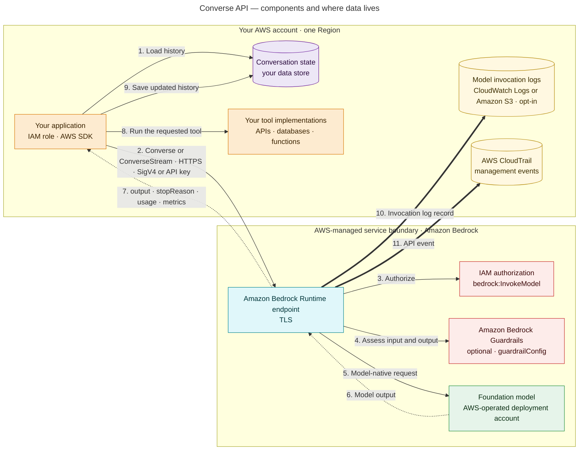
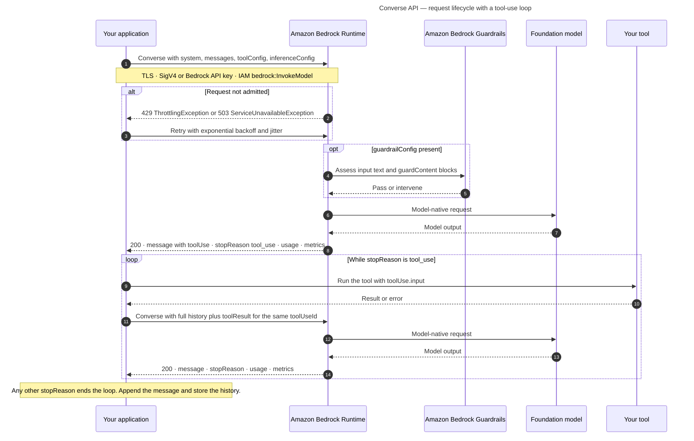

# The Converse API

> **Level:** Intermediate · **Verified:** 2026-11-15 · **Feature status:** GA · **Time:** ~25 min

The Converse API is Amazon Bedrock's model-independent chat interface: one request and response
shape for every model that supports messages. It sits between your application code and the
model, on the `bedrock-runtime` endpoint.

> [!IMPORTANT]
> **Status** — Generally available. `Converse` and `ConverseStream` are served by the
> `bedrock-runtime` endpoint only, not by `bedrock-mantle`. Which content blocks, tool options
> and streaming combinations work depends on the model.
> Source: [Inference using Converse API](https://docs.aws.amazon.com/bedrock/latest/userguide/conversation-inference.html)

## Learning objectives

- Build a `Converse` request from `system`, `messages` and content blocks.
- Separate portable `inferenceConfig` parameters from model-specific `additionalModelRequestFields`.
- Implement the tool-use loop and branch on every `stopReason` value.
- Reassemble a `ConverseStream` response from its events.
- Read `usage` and `metrics`, and handle throttling and mid-stream errors.

## Prerequisites

- [Tokens, context windows, and training versus inference](../../00-foundations/generative-ai-fundamentals/02-tokens-context-windows-inference.md)
- [Agentic AI, tool calling and multi-agent architectures](../../00-foundations/generative-ai-fundamentals/06-agents-tool-calling-multi-agent.md)
- [IAM fundamentals: principals, policies and evaluation](../../00-foundations/security/01-iam-fundamentals.md)
- [Endpoints, APIs and authentication](../overview/02-endpoints-apis-and-authentication.md)

## 1. What it is

In plain language: you send the conversation so far — what the user said, what the model
answered, what your tools returned — plus optional instructions, and the model returns the next
message. The same code keeps working when you change the model ID.

Precisely: two data-plane operations that accept a normalized JSON request, translate it to the
model's native format, and return a normalized envelope (`output`, `stopReason`, `usage`,
`metrics`).

| Item | Value |
|:--|:--|
| Service namespace / endpoint | `bedrock-runtime` · `bedrock-runtime.{region}.amazonaws.com` |
| Control-plane operations | None. `GetFoundationModel` (`bedrock`) tells you whether a model supports streaming |
| Data-plane operations | `Converse` (`POST /model/{modelId}/converse`), `ConverseStream` (`POST /model/{modelId}/converse-stream`); `CountTokens` accepts a Converse-shaped input |
| IAM action prefix | `bedrock:` — `Converse` needs `bedrock:InvokeModel`; `ConverseStream` needs `bedrock:InvokeModelWithResponseStream` |

Operation names and top-level request fields were checked against the academy's generated
[API operations reference](../../references/bedrock-api-operations.md) (botocore 1.44.3).

### Request fields

| Field | What it carries | Portable across models |
|:--|:--|:-:|
| `modelId` (in the URI) | Model ID or ARN, inference profile ID or ARN, Provisioned Throughput ARN, custom model deployment ARN, Marketplace endpoint, or a Prompt management prompt ARN | — |
| `messages` | Array of `{role, content[]}` | Yes |
| `system` | Array of blocks: `text`, `guardContent`, `cachePoint` | Yes |
| `inferenceConfig` | The base parameters: `maxTokens`, `temperature`, `topP`, `stopSequences` | Yes |
| `additionalModelRequestFields` | Free-form JSON handed to the model for anything outside the base set, for example `{"top_k": 200}` | No |
| `additionalModelResponseFieldPaths` | Up to 10 JSON Pointers to model-native response fields, returned in `additionalModelResponseFields` | No |
| `toolConfig` | `tools[]` (`toolSpec`, `systemTool`, `cachePoint`) and `toolChoice` (`auto`, `any`, `tool`) | Mostly |
| `guardrailConfig` | `guardrailIdentifier`, `guardrailVersion`, `trace`; plus `streamProcessingMode` (`sync`, `async`) on `ConverseStream` | Yes |
| `outputConfig`, `performanceConfig`, `serviceTier`, `requestMetadata`, `promptVariables` | Structured output; latency `standard` or `optimized`; tier `priority`, `default`, `flex`, `reserved`; up to 16 tags for invocation logs; variables for a stored prompt | Per model |

`inferenceConfig` is the contract; `additionalModelRequestFields` is the escape hatch. Everything
you put in the second one ties the request to one model family.

### Messages and content blocks

Each message has a `role` and an array of content blocks; each block is a union with exactly one
member set. The user guide describes the roles `user` and `assistant`, and system prompts go in
the top-level `system` field.

| Block | Appears in | Purpose and documented constraints |
|:--|:--|:--|
| `text` | Both roles | Plain text |
| `image` | `user`, tool results | `format` `png`, `jpeg`, `gif`, `webp`; `source.bytes` (Amazon Nova also accepts `s3Location`) |
| `document` | `user`, tool results | `format` is required (`pdf`, `csv`, `doc`, `docx`, `xls`, `xlsx`, `html`, `txt`, `md`); needs a `text` block beside it; `name` must be neutral; optional `citations` |
| `video`, `audio` | `user` | Media input, model-dependent |
| `toolUse` | `assistant` | `toolUseId`, `name`, `input`: the model asks your code to run a tool |
| `toolResult` | `user` | `toolUseId`, `content[]` (`json`, `text`, `image`, `document`, `video`, `searchResult`), optional `status` (`success`, `error`) |
| `reasoningContent` | `assistant` | `reasoningText` (`text`, `signature`) or `redactedContent`; return it unmodified on later turns |
| `cachePoint` | Messages, `system`, `tools` | `{"type": "default"}`, optional `ttl` `5m` or `1h`: a [prompt caching](../prompt-caching/01-prompt-caching.md) checkpoint |
| `guardContent` | Messages, `system` | The text or image a [guardrail](../guardrails/01-guardrails.md) should assess |
| `citationsContent`, `searchResult` | Output, input | Generated text with citations; a search result to ground on |

> [!NOTE]
> **Documented fact** — The two official pages disagree on media limits. The `Message` reference
> says up to 20 images (each at most 3.75 MB and 8,000 px per side) and up to five documents of
> 4.5 MB. The API restrictions page says Bedrock imposes no image count or size limit, and that
> the 4.5 MB limit does not apply to PDF for Claude 4 and later, or to PDF and DOCX for Amazon
> Nova. Treat the model card as the tie-breaker.
> Sources: [Message](https://docs.aws.amazon.com/bedrock/latest/APIReference/API_runtime_Message.html), [API restrictions](https://docs.aws.amazon.com/bedrock/latest/userguide/inference-api-restrictions.html)

The `Message` reference also lists `system` as a valid `role`. Which models accept it inside
`messages` is **UNVERIFIED — REQUIRES DOCUMENTATION REVIEW** (the user guide page does not
describe it).

## 2. Why it exists

Every provider has its own request body, parameter names and stream format. Without Converse
you would write and maintain an adapter per model family, a prompt template for models that need
one (for Mistral AI and Meta models, Converse embeds your input in the model's template), and a
separate tool-calling and guardrail integration for each. Converse removes that layer, so model
choice becomes configuration.

## 3. When to use it

- Multi-turn chat or tool calling where you want to swap or fall back between models.
- Requests that include documents: `InvokeModel` does not accept document blocks.
- Selective guardrail assessment with `guardContent`, or prompts stored in [Prompt management](../prompt-management/01-prompt-management.md).
- Usage attribution through `requestMetadata` or [application inference profiles](05-application-inference-profiles.md).

## 4. When not to use it

- **Embeddings, image or video generation** — use [InvokeModel and the async APIs](02-invokemodel-and-streaming.md).
- **Existing OpenAI or Anthropic SDK code, or server-stored conversation state** — use the [OpenAI- and Anthropic-compatible APIs](03-openai-and-anthropic-compatible-apis.md).
- **Explicit prompt caching on OpenAI GPT-5.6 and 6.x models** — Converse does not support it for those models; see [Prompt caching](../prompt-caching/01-prompt-caching.md).
- **A managed agent loop** — use the [AgentCore harness](../agentcore/03-agentcore-harness.md) instead of writing the loop yourself.
- **Large offline workloads** — use [batch inference](08-batch-inference.md), which accepts the Converse format.

## 5. Internal architecture

AWS documents the contract, not the internals. What is documented: Bedrock does not store the
text, images or documents you send; you keep context by resending the messages; models run in
AWS-operated deployment accounts that providers cannot access. **Our reading:** Converse is
therefore stateless, and the order of the internal steps below is a conceptual model.



**What this shows** — Conversation state and tools live in your account; Bedrock holds nothing
between calls.

1. The application loads the stored conversation.
2. It sends the full message list over TLS, signed with SigV4 or carrying a Bedrock API key.
3. Bedrock authorizes the caller for the target in `modelId`.
4. If `guardrailConfig` is present, the guardrail assesses the input and later the output.
5. The request is converted to the model's native format and run.
6. The model returns its output.
7. Bedrock returns the normalized envelope, or a stream of events.
8. If `stopReason` is `tool_use`, your code runs the tool.
9. The application stores the new messages.
10. If model invocation logging is enabled, a record goes to your log destination.
11. `Converse` and `ConverseStream` are logged by CloudTrail as management events.

**Legend** — orange: your compute · teal: endpoint · green: model · red: security control ·
purple cylinder: data at rest · yellow cylinder: observability · solid: request · dashed:
response · thick: asynchronous record.

**Variations** — With an inference profile as `modelId`, step 5 can run in another Region
([cross-Region inference](04-cross-region-inference.md)). The full picture is in
[diagram set 3](../../diagrams/mermaid/03-model-inference-lifecycle.md) and
[diagram set 4](../../diagrams/mermaid/04-converse-api-application.md).

## 6. Request and response lifecycle



Steps 1–3: the request is authenticated, authorized and checked against your quota; a 429
means it was not admitted. Steps 4–5: when a guardrail blocks the input, the response carries
the guardrail's blocked message and `guardrail_intervened` (the documented example shows zero
token usage). Steps 6–8: the model answers or asks for a tool. Steps 9–14: your code runs each
requested tool, appends the assistant message and a `user` message with one `toolResult` per
`toolUseId`, and calls again. The position of the admission and guardrail steps is our
conceptual ordering.

### Stop reasons

| `stopReason` | What your code does |
|:--|:--|
| `end_turn` | The model finished. Return the message |
| `tool_use` | Run every `toolUse` block and call again with the results |
| `max_tokens` | Output was cut at `maxTokens`. Raise the limit or continue the turn |
| `stop_sequence` | A sequence from `stopSequences` was generated |
| `guardrail_intervened` | A guardrail blocked or masked content. Enable `trace` to tell the two apart |
| `content_filtered`, `malformed_model_output`, `malformed_tool_use`, `model_context_window_exceeded` | Listed in the API reference without a description. **Our reading:** provider content filter, unparsable output or tool call, and a conversation too long for the model; treat all as non-retryable without changing the request |

### ConverseStream events

`ConverseStream` returns the same information as an event stream, in this order.

| Event | Carries |
|:--|:--|
| `messageStart` | `role` |
| `contentBlockStart` | `contentBlockIndex` and `start` — for tool use: `toolUseId`, `name` |
| `contentBlockDelta` | `contentBlockIndex` and a `delta`: `text`, `toolUse.input` (partial JSON string), `reasoningContent`, `citation` |
| `contentBlockStop` | `contentBlockIndex` |
| `messageStop` | `stopReason`, `additionalModelResponseFields` |
| `metadata` | `usage`, `metrics.latencyMs`, guardrail `trace` |

Errors after the HTTP 200 arrive in the stream as `internalServerException`,
`modelStreamErrorException`, `validationException`, `throttlingException` or
`serviceUnavailableException`; botocore raises them as `EventStreamError` while you iterate.

### Usage, metrics and errors

`usage` reports `inputTokens`, `outputTokens`, `totalTokens` and, with prompt caching,
`cacheReadInputTokens`, `cacheWriteInputTokens` and `cacheDetails`. `metrics.latencyMs` is the
latency of the call.

| Error | HTTP | Retry? |
|:--|:-:|:--|
| `ValidationException`, `AccessDeniedException`, `ResourceNotFoundException` | 400, 403, 404 | No — fix the request, policy or model ID |
| `ThrottlingException` | 429 | Yes, with backoff — you exceeded an account quota |
| `ModelNotReadyException` | 429 | The SDK retries automatically, up to five times |
| `ServiceUnavailableException`, `InternalServerException` | 503, 500 | Yes, with backoff — capacity, not your quota |
| `ModelTimeoutException`, `ModelErrorException` | 408, 424 | Case by case; shorten the request or check the model |

## 7. Dependencies

| Depends on | Why | Required or optional |
|:--|:--|:-:|
| Access to the model | See [Model access and subscriptions](../overview/03-model-access-and-subscriptions.md) | Required |
| IAM permission on the target in `modelId` | `bedrock:InvokeModel`, `bedrock:InvokeModelWithResponseStream` | Required |
| An inference profile | Some models are served only through one | Per model |
| Amazon Bedrock Guardrails | `guardrailConfig`; needs `bedrock:GetGuardrail` and `bedrock:ApplyGuardrail` | Optional |
| Prompt management | Prompt ARN as `modelId`; needs `bedrock:RenderPrompt` | Optional |
| Amazon S3 | `s3Location` sources for Amazon Nova; invocation log delivery | Optional |

## 8. Security considerations

- **IAM** — Scope `bedrock:InvokeModel` and `bedrock:InvokeModelWithResponseStream` to specific
  foundation-model and inference-profile ARNs. To deny inference on a resource, deny both
  actions; that also blocks `InvokeModel`.
- **Data handling** — Content is used only to generate the response and is not stored by
  Bedrock; model providers have no access to prompts or completions. Model-specific abuse
  detection can retain traffic for some models; see [Data protection, privacy and data leakage prevention](../../06-security-governance/03-data-protection-and-privacy.md).
- **Guardrail coverage** — With tools, a guardrail does not evaluate `toolResult` content, tool
  definitions or the model's `toolUse.input`. The `system` prompt is assessed only inside a
  `guardContent` block. Once any `guardContent` block exists, only those blocks are assessed.
- **Injection surfaces** — The document `name` field can be read as instructions; tool results
  are untrusted input. See [Prompt injection, untrusted tool output and retrieval poisoning](../../06-security-governance/04-prompt-injection-and-untrusted-content.md).
- **Logging** — Model invocation logs contain prompts and outputs; guardrail traces contain the
  unmasked values. Protect both destinations with KMS and narrow IAM.

Sources: [Converse](https://docs.aws.amazon.com/bedrock/latest/APIReference/API_runtime_Converse.html),
[Include a guardrail with the Converse API](https://docs.aws.amazon.com/bedrock/latest/userguide/guardrails-use-converse-api.html),
[Data protection](https://docs.aws.amazon.com/bedrock/latest/userguide/data-protection.html).

## 9. Networking requirements

The public endpoint is `bedrock-runtime.{region}.amazonaws.com` over TLS 1.2 or later. For
private access, create an interface VPC endpoint with the service name
`com.amazonaws.{region}.bedrock-runtime` and optionally an endpoint policy; see
[Private connectivity for Bedrock](../../02-related-aws-services/networking/01-private-connectivity-for-bedrock.md).
NAT gateways, interface endpoints and Network Load Balancers drop connections idle for 350
seconds, which affects long or streaming calls: enable TCP keep-alive in the SDK and the
operating system. Traffic leaves the Region only when `modelId` is a cross-Region inference
profile.

## 10. Pricing dimensions

The pricing page prices by model, service tier and token type. **Our reading:** there is no
separate charge for the Converse operation itself.

| Dimension | Unit | Notes |
|:--|:--|:--|
| Input and output tokens | Per token, by model and Region | Reported in `usage` |
| Cache write and cache read tokens | Per token | Only with prompt caching |
| Service tier | Changes the token price | See [Service tiers](06-service-tiers.md) |
| Guardrail assessment | Policy units, reported in the guardrail trace | Only with `guardrailConfig`; see [Guardrails](../guardrails/01-guardrails.md) |
| Logs and trails | CloudWatch, S3 and CloudTrail rates | Only if enabled |

Source: [Amazon Bedrock pricing](https://aws.amazon.com/bedrock/pricing/).

## 11. Scaling considerations

On `bedrock-runtime`, quotas are per model and per Region: tokens per minute, a cross-model
tokens-per-day quota, and requests per minute for some models. They are shared by every
inference API that calls the model. At admission Bedrock deducts input tokens plus `maxTokens`
and later replenishes the unused part, so an oversized `maxTokens` causes early throttling.
Output tokens of some models burn quota at a multiple. A 429 means your quota; a 503 means
service capacity. Details and tactics are in
[Quotas, rate limits and throttling](../../08-cost-performance-and-reliability/05-quotas-rate-limits-and-throttling.md).

> [!TIP]
> **Academy recommendation** — Set `maxTokens` close to what you need, configure SDK retries
> explicitly (`standard` mode, a bounded number of attempts), and raise the read timeout for
> long generations. This is our design guidance, not an official AWS reference architecture.

Sources: [Quotas for the bedrock-runtime endpoint](https://docs.aws.amazon.com/bedrock/latest/userguide/quotas-runtime.html),
[How tokens are counted](https://docs.aws.amazon.com/bedrock/latest/userguide/quotas-token-burndown.html).

## 12. IaC support

Converse is a request-time API; there is nothing to provision. IaC creates what the call needs.

| Tool | Support | Resource / construct | Notes |
|:--|:-:|:--|:--|
| Terraform (`hashicorp/aws` 6.73.0) | n/a | Data sources `aws_bedrock_foundation_model`, `aws_bedrock_inference_profile`; resources `aws_bedrock_guardrail`, `aws_bedrock_model_invocation_logging_configuration` | IAM policy with `aws_iam_policy` |
| CloudFormation | n/a | `AWS::Bedrock::Guardrail`, `AWS::Bedrock::ApplicationInferenceProfile` | No invocation-logging type in the bundled specification |
| AWS CDK (`aws-cdk-lib` 2.277.0) | n/a | L1 for the types above; alpha `CrossRegionInferenceProfile` and `ApplicationInferenceProfile` expose `grantInvoke` | Alpha package is experimental |

## 13. Working example

> **Code status:** syntax-checked (`python3 -m py_compile`) · mock-tested offline with a stubbed client (botocore 1.35.99 `Stubber` for `converse`, a hand-written event list for `converse_stream`) · **never deployed, never run against AWS**

The caller owns `messages`. `converse_turn` runs the tool loop; `stream_turn` rebuilds an
assistant message from stream events. The model ID is configuration: confirm the current ID
before you run it.

```python
"""Converse tool-use loop: the caller owns the conversation state."""
import json
import os

import boto3
from botocore.config import Config

# Confirm the current model or inference profile ID on the model card before running.
MODEL_ID = os.environ.get("BEDROCK_MODEL_ID", "us.anthropic.claude-sonnet-4-6")
REGION = os.environ.get("AWS_REGION", "us-east-1")
MAX_TOOL_ROUNDS = 5
SYSTEM = [{"text": "You answer questions about radio stations. Be brief."}]
INFERENCE = {"maxTokens": 512, "temperature": 0.2}
TOOL_CONFIG = {
    "tools": [{
        "toolSpec": {
            "name": "top_song",
            "description": "Get the most popular song played on a radio station.",
            "inputSchema": {"json": {
                "type": "object",
                "properties": {"sign": {"type": "string", "description": "Call sign, for example WZPZ."}},
                "required": ["sign"],
            }},
        }
    }]
}


def make_client():
    """Bounded retries with backoff, a long read timeout and TCP keep-alive."""
    config = Config(retries={"mode": "standard", "total_max_attempts": 4},
                    read_timeout=300, tcp_keepalive=True)
    return boto3.client("bedrock-runtime", region_name=REGION, config=config)


def top_song(sign: str) -> dict:
    """Stand-in for a real tool: an API, a database query, a Lambda function."""
    catalogue = {"WZPZ": {"song": "Elemental Hotel", "artist": "8 Storey Hike"}}
    if sign not in catalogue:
        raise KeyError(f"Station {sign} not found.")
    return catalogue[sign]


def run_tool(tool_use: dict) -> dict:
    """Run one toolUse block and return the toolResult block that answers it."""
    result = {"toolUseId": tool_use["toolUseId"]}  # must echo the same ID
    try:
        if tool_use["name"] != "top_song":
            raise KeyError(f"Unknown tool {tool_use['name']}")
        result["content"] = [{"json": top_song(**tool_use["input"])}]
    except Exception as err:  # tell the model what failed instead of crashing
        result["content"] = [{"text": str(err)}]
        result["status"] = "error"
    return {"toolResult": result}


def converse_turn(client, messages: list, user_text: str) -> dict:
    """Append a user message, run the tool loop, return the final response.

    `messages` is the conversation state. Send all of it on every call:
    the Converse API does not keep it between requests.
    """
    messages.append({"role": "user", "content": [{"text": user_text}]})
    for _ in range(MAX_TOOL_ROUNDS):
        response = client.converse(modelId=MODEL_ID, system=SYSTEM, messages=messages,
                                   toolConfig=TOOL_CONFIG, inferenceConfig=INFERENCE)
        assistant = response["output"]["message"]
        messages.append(assistant)  # keep the assistant turn exactly as returned
        if response["stopReason"] != "tool_use":
            return response  # end_turn, max_tokens, guardrail_intervened, ...
        results = [run_tool(block["toolUse"]) for block in assistant["content"] if "toolUse" in block]
        messages.append({"role": "user", "content": results})
    raise RuntimeError("Tool loop did not finish within MAX_TOOL_ROUNDS.")


def stream_turn(client, messages: list, on_text=print) -> tuple:
    """Call ConverseStream, forward text deltas, rebuild the assistant message.

    Handles text and toolUse blocks. If you enable model reasoning, also keep
    the reasoningContent deltas (text and signature) and send them back unmodified.
    """
    response = client.converse_stream(modelId=MODEL_ID, system=SYSTEM, messages=messages,
                                      toolConfig=TOOL_CONFIG, inferenceConfig=INFERENCE)
    blocks, stop_reason, usage = {}, None, {}
    for event in response["stream"]:  # an in-stream exception is raised here by botocore
        if "contentBlockStart" in event:
            start = event["contentBlockStart"]
            if "toolUse" in start["start"]:
                blocks[start["contentBlockIndex"]] = {"toolUse": {**start["start"]["toolUse"], "input": ""}}
        elif "contentBlockDelta" in event:
            index = event["contentBlockDelta"]["contentBlockIndex"]
            delta = event["contentBlockDelta"]["delta"]
            if "text" in delta:
                blocks.setdefault(index, {"text": ""})["text"] += delta["text"]
                on_text(delta["text"])
            elif "toolUse" in delta:
                blocks[index]["toolUse"]["input"] += delta["toolUse"]["input"]  # partial JSON
        elif "messageStop" in event:
            stop_reason = event["messageStop"]["stopReason"]
        elif "metadata" in event:
            usage = event["metadata"]["usage"]
    content = [blocks[i] for i in sorted(blocks)]
    for block in content:
        if "toolUse" in block:
            block["toolUse"]["input"] = json.loads(block["toolUse"]["input"] or "{}")
    messages.append({"role": "assistant", "content": content})
    return stop_reason, usage


if __name__ == "__main__":
    history: list = []
    reply = converse_turn(make_client(), history, "What is the most popular song on WZPZ?")
    print(reply["output"]["message"]["content"][0]["text"])
    print(reply["stopReason"], reply["usage"], reply["metrics"]["latencyMs"])
```

To try a first call in your own sandbox account, follow
[Lab 2: your first Converse call](../../labs/lab-02-first-converse-call.md).

## Common mistakes

| Mistake | Symptom | Fix |
|:--|:--|:--|
| Sending only the newest message | The model "forgets" earlier turns | Send the whole `messages` array every call |
| Dropping or editing the assistant `toolUse` message, or changing `toolUseId` | The model cannot match the result to its request; the call can be rejected | Append the assistant message as returned; echo the same `toolUseId` |
| Treating every non-error response as a final answer | Truncated or blocked text shown to users | Branch on `stopReason` |
| Sending `toolChoice` `any` or `tool`, or tools with `ConverseStream`, to a model that lacks support | `ValidationException` naming the field | Check the model card; fall back to `auto` or to `Converse` |
| Omitting `format` on a document, or a document without a `text` block | `ValidationException`: "Document format is required." | Set `format`; add a text prompt |
| Putting model-specific parameters in `inferenceConfig` | Unknown-parameter error | Use `additionalModelRequestFields` |
| Modifying `reasoningContent` or its `signature` between turns | Error on the next request | Return reasoning blocks unmodified |
| Setting `maxTokens` far above need | 429 throttling at low traffic | Size `maxTokens` to the expected output |
| Using the AWS CLI for `ConverseStream` | Command not available | The AWS CLI does not support Bedrock streaming operations; use an SDK |

## Knowledge check

1. Why does Converse need the full `messages` array on every call, and where should that array live?
2. A response has `stopReason` `guardrail_intervened` but the text looks like a normal answer with `{NAME}` in it. What happened, and how do you confirm it?
3. Which IAM actions does an application need for `Converse` and `ConverseStream`, and what must a policy deny to block inference on one model?
4. You enabled a guardrail and added tools. Which parts of the exchange does the guardrail not evaluate?
5. Your streaming handler receives `contentBlockDelta` events with `toolUse.input`. What do you do with them?

<details>
<summary>Answers</summary>

1. Bedrock does not store the content you send; context exists only if you resend it. The array lives in your application's data store, which you secure and expire.
2. A sensitive information filter with the `ANONYMIZE` action masked values instead of blocking. Enable `trace` and read the `action` of each `sensitiveInformationPolicy` entry: `ANONYMIZED` versus `BLOCKED`.
3. `bedrock:InvokeModel` for `Converse` and `bedrock:InvokeModelWithResponseStream` for `ConverseStream`. Deny both actions on the resource; that also blocks the base inference operations.
4. Tool results (`toolResult`), tool definitions in `toolConfig`, and the tool-call arguments the model generates (`toolUse.input`). The `system` prompt is assessed only if it is in a `guardContent` block.
5. Concatenate the partial strings per `contentBlockIndex`, parse the JSON after `contentBlockStop`, and pair it with the `toolUseId` and `name` from `contentBlockStart`.

</details>

## 14. Official documentation

- [Inference using Converse API](https://docs.aws.amazon.com/bedrock/latest/userguide/conversation-inference.html) — request fields, content blocks, stream event order, examples.
- [Converse](https://docs.aws.amazon.com/bedrock/latest/APIReference/API_runtime_Converse.html) and [ConverseStream](https://docs.aws.amazon.com/bedrock/latest/APIReference/API_runtime_ConverseStream.html) — syntax, `stopReason` values, errors, in-stream exceptions.
- [ContentBlock](https://docs.aws.amazon.com/bedrock/latest/APIReference/API_runtime_ContentBlock.html), [Message](https://docs.aws.amazon.com/bedrock/latest/APIReference/API_runtime_Message.html), [SystemContentBlock](https://docs.aws.amazon.com/bedrock/latest/APIReference/API_runtime_SystemContentBlock.html) — block types and roles.
- [InferenceConfiguration](https://docs.aws.amazon.com/bedrock/latest/APIReference/API_runtime_InferenceConfiguration.html) and [TokenUsage](https://docs.aws.amazon.com/bedrock/latest/APIReference/API_runtime_TokenUsage.html) — base parameters and usage fields.
- [ToolUseBlock](https://docs.aws.amazon.com/bedrock/latest/APIReference/API_runtime_ToolUseBlock.html), [ToolResultBlock](https://docs.aws.amazon.com/bedrock/latest/APIReference/API_runtime_ToolResultBlock.html), [ToolChoice](https://docs.aws.amazon.com/bedrock/latest/APIReference/API_runtime_ToolChoice.html) — tool-use types.
- [Client-side tool use](https://docs.aws.amazon.com/bedrock/latest/userguide/tool-use-client-side.html) — the loop, `toolChoice` support, tools with streaming, `toolUseId` format.
- [Include a guardrail with the Converse API](https://docs.aws.amazon.com/bedrock/latest/userguide/guardrails-use-converse-api.html) — `guardContent`, coverage with tools, `guardrail_intervened`.
- [API restrictions](https://docs.aws.amazon.com/bedrock/latest/userguide/inference-api-restrictions.html) — document and image limits.
- [Prerequisites for running model inference](https://docs.aws.amazon.com/bedrock/latest/userguide/inference-prereq.html) — IAM actions.
- [Troubleshooting Amazon Bedrock API error codes](https://docs.aws.amazon.com/bedrock/latest/userguide/troubleshooting-api-error-codes.html) — 429 versus 503, idle connection timeouts.
- [Monitor Amazon Bedrock API calls using CloudTrail](https://docs.aws.amazon.com/bedrock/latest/userguide/logging-using-cloudtrail.html) — which operations are management events.
- [Use interface VPC endpoints](https://docs.aws.amazon.com/bedrock/latest/userguide/vpc-interface-endpoints.html) — PrivateLink service names.
- [Retry behavior](https://docs.aws.amazon.com/sdkref/latest/guide/feature-retry-behavior.html) — SDK retry modes and attempts.
