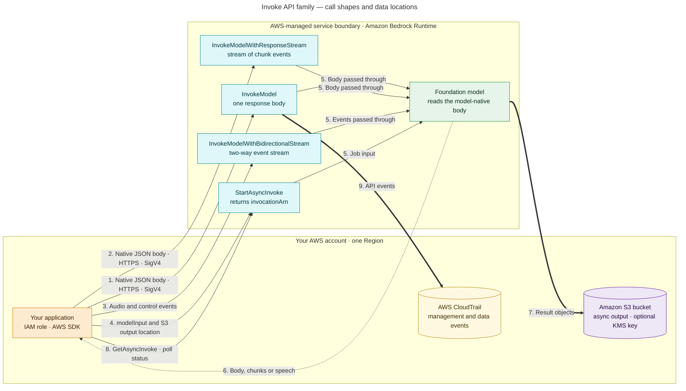
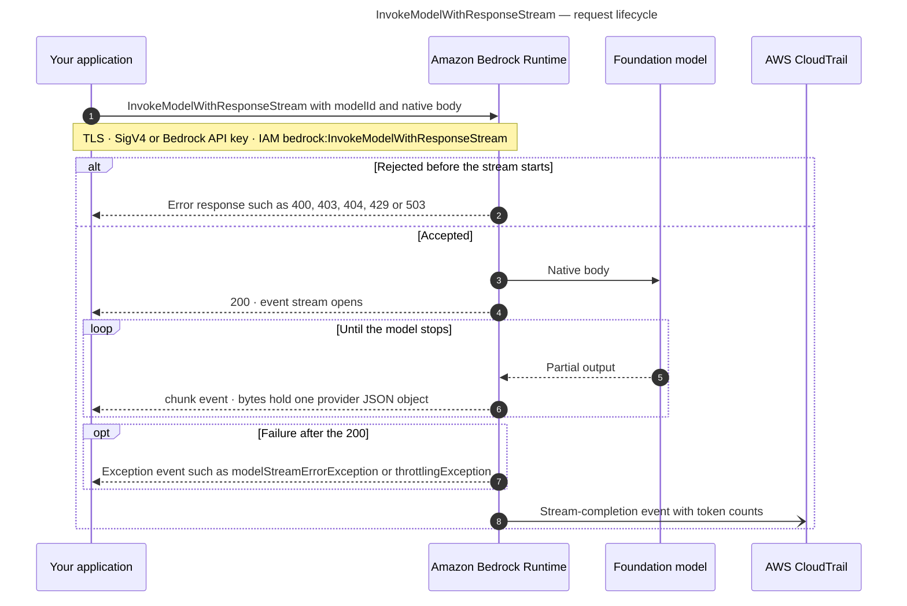

# InvokeModel and streaming APIs

> **Level:** Intermediate · **Verified:** 2026-11-15 · **Feature status:** GA · **Time:** ~20 min

The Invoke API family sends a request body in the model's own format and returns the model's
own response. It is the lowest-level inference interface on the `bedrock-runtime` endpoint, and
the documented path for embeddings, image generation, video jobs and speech-to-speech.

> [!IMPORTANT]
> **Status** — Generally available on the `bedrock-runtime` endpoint only. The family has four
> entry points: `InvokeModel`, `InvokeModelWithResponseStream`, `InvokeModelWithBidirectionalStream`
> and `StartAsyncInvoke`. The API reference states that the bidirectional operation currently
> supports only `amazon.nova-sonic-v1:0`.
> Sources: [Inference using Invoke API](https://docs.aws.amazon.com/bedrock/latest/userguide/inference-api.html), [InvokeModelWithBidirectionalStream](https://docs.aws.amazon.com/bedrock/latest/APIReference/API_runtime_InvokeModelWithBidirectionalStream.html)

## Learning objectives

- Explain what "model-native body" means and where to find each model's schema.
- Decide when `InvokeModel` is still required instead of [the Converse API](01-converse-api.md).
- Parse `InvokeModelWithResponseStream` chunks and handle errors that arrive mid-stream.
- Describe the bidirectional streaming and asynchronous invoke operations and their limits.

## Prerequisites

- [The Converse API](01-converse-api.md)
- [Embeddings, vector search, semantic search and hybrid search](../../00-foundations/generative-ai-fundamentals/03-embeddings-and-vector-search.md)
- [Endpoints, APIs and authentication](../overview/02-endpoints-apis-and-authentication.md)

## 1. What it is

In plain language: Converse is a translator; `InvokeModel` is a direct line. You write the JSON
exactly as the model provider defines it, Bedrock passes it through, and you parse whatever
comes back.

Precisely: the request `body` is an opaque JSON blob of up to 25,000,000 bytes, and everything
Bedrock-specific travels in HTTP headers — content types, guardrail identifier and version,
trace, latency setting, service tier and request metadata.

| Item | Value |
|:--|:--|
| Service namespace / endpoint | `bedrock-runtime` · `bedrock-runtime.{region}.amazonaws.com` |
| Control-plane operations | None. `GetFoundationModel` (`bedrock`) reports `inputModalities`, `outputModalities` and `responseStreamingSupported` |
| Data-plane operations | `InvokeModel` (`POST /model/{modelId}/invoke`) · `InvokeModelWithResponseStream` (`POST /model/{modelId}/invoke-with-response-stream`) · `InvokeModelWithBidirectionalStream` (`POST /model/{modelId}/invoke-with-bidirectional-stream`) · `StartAsyncInvoke` (`POST /async-invoke`), `GetAsyncInvoke`, `ListAsyncInvokes` |
| IAM action prefix | `bedrock:` — `bedrock:InvokeModel` (also for the bidirectional and async operations) and `bedrock:InvokeModelWithResponseStream` |

Operation names and top-level request fields were checked against the academy's generated
[API operations reference](../../references/bedrock-api-operations.md) (botocore 1.44.3).

### The four entry points

| Operation | Shape | Documented use |
|:--|:--|:--|
| `InvokeModel` | One request, one response body | Text, images, embeddings |
| `InvokeModelWithResponseStream` | One request, an event stream of `chunk` events | Incremental text output |
| `InvokeModelWithBidirectionalStream` | Events in both directions on one connection that stays open for 8 minutes | Speech-to-speech with Amazon Nova Sonic; the user can interrupt the model |
| `StartAsyncInvoke` | Returns an `invocationArn`; output is written to Amazon S3 | Video generation |

The Amazon Nova user guide marks its bidirectional-streaming page as "Amazon Nova Version 1"
and points to a separate Amazon Nova 2 Sonic guide. Whether the operation accepts model IDs
other than `amazon.nova-sonic-v1:0` is **UNVERIFIED — REQUIRES DOCUMENTATION REVIEW**.

### Model-native bodies

Each provider defines its own schema, documented under "Inference request parameters and
response fields for foundation models". Three shapes from the official examples:

| Model family | Request body (abridged) | Where the result is |
|:--|:--|:--|
| Amazon Titan Text Embeddings V2 | `{"inputText": "...", "embeddingTypes": ["binary"]}` | `embeddingsByType`, `inputTextTokenCount` |
| Anthropic Claude (Messages format) | `{"anthropic_version": "bedrock-2023-05-31", "max_tokens": 1024, "messages": [...]}` | `content[0].text` |
| OpenAI open-weight models | `{"messages": [...], "max_tokens": 512, "temperature": 0.7}` | The provider's response JSON |

## 2. Why it exists

A normalized API can only expose what all models share. Models that do not exchange messages —
embedding, image and video models — and provider features that have no normalized equivalent
need a pass-through. `InvokeModel` is that pass-through.

## 3. When to use it

- **Embeddings** — the documented path for embedding models, and what RAG ingestion pipelines call.
- **Image generation** — set `accept` to the image type the model returns, for example `image/png`.
- **Video generation** — not supported by `InvokeModel`; use `StartAsyncInvoke`.
- **Provider-specific features** — Anthropic-defined tool types sent in the Messages request
  format, or explicit prompt caching on OpenAI GPT-5.6 and 6.x models, which Converse does not
  support.
- **Single transactions with large payloads** — the positioning AWS gives the Invoke API.
- **Imported models** — the `InvokeModel` reference lists the imported-model ARN as a `modelId` target.

## 4. When not to use it

- **Conversations and tool use across models** — use [the Converse API](01-converse-api.md); AWS recommends it for messages.
- **Documents in the request** — document blocks are not supported by `InvokeModel` or its streaming variant; use Converse.
- **Existing OpenAI or Anthropic SDK clients** — use the [compatible APIs](03-openai-and-anthropic-compatible-apis.md) rather than re-wrapping bodies.
- **Many prompts with no latency requirement** — use [batch inference](08-batch-inference.md).

### InvokeModel compared with Converse

| Aspect | InvokeModel family | Converse family |
|:--|:--|:--|
| Request and response format | Model-native JSON in `body` | Normalized: `messages`, `system`, `inferenceConfig` |
| Changing the model | Rewrite the body and the parser | Change `modelId` |
| Embedding, image and video models | Yes (video through `StartAsyncInvoke`) | No — messages only |
| Documents in the request | Not supported | `document` blocks |
| Tool use | Provider's native format | `toolConfig`, `toolUse`, `toolResult` |
| Guardrail | Headers, plus `amazon-bedrock-guardrailConfig` in the body for input tags | `guardrailConfig`, `guardContent` |
| Service tier, latency, request metadata | Headers `X-Amzn-Bedrock-Service-Tier`, `-PerformanceConfig-Latency`, `-Request-Metadata` | Body fields `serviceTier`, `performanceConfig`, `requestMetadata` |
| Token usage | In the provider's response body; also in invocation logs | Normalized `usage` object |
| Stream events | `chunk` with provider JSON in `bytes` | Typed events (`contentBlockDelta` and so on) |
| IAM | `bedrock:InvokeModel`, `bedrock:InvokeModelWithResponseStream` | The same two actions |
| Quotas and price | Shared per model on `bedrock-runtime` | Shared per model on `bedrock-runtime` |

Whether `InvokeModel` also returns token counts in response headers is **UNVERIFIED — REQUIRES
DOCUMENTATION REVIEW**: the current API reference response syntax lists only the content type,
latency and service tier headers.

## 5. Internal architecture

The customer-visible architecture is one endpoint with four call shapes. **Our reading:** the
service adds authorization, optional guardrail checks, metering and logging around a body it
does not interpret.



**What this shows** — Four operations in front of the same models; only the asynchronous one
writes data into your account.

1. `InvokeModel` sends the body and waits for the whole response.
2. `InvokeModelWithResponseStream` sends the same body and receives an event stream.
3. The bidirectional operation exchanges JSON events that carry audio, text and tool calls.
4. `StartAsyncInvoke` submits `modelInput` and an `outputDataConfig.s3OutputDataConfig` (`s3Uri`, optional `bucketOwner` and `kmsKeyId`).
5. Bedrock hands the payload to the model.
6. Synchronous and streaming results return on the same connection.
7. Async results are written to your bucket.
8. You poll `GetAsyncInvoke` until `status` is `Completed` or `Failed` (`failureMessage` explains a failure).
9. CloudTrail records the calls (see section 8 for which are data events).

**Legend** — orange: your compute · teal: API operation · green: model · purple cylinder: data
at rest · yellow cylinder: observability · solid: request · dashed: response · thick:
asynchronous write.

**Variations** — With a guardrail, add an assessment before and after the model. With an
inference profile as `modelId`, step 5 can run in another Region. The end-to-end lifecycle is in
[diagram set 3](../../diagrams/mermaid/03-model-inference-lifecycle.md).

## 6. Request and response lifecycle



1. The application sends the native body; the model ID is in the URI.
2. Validation, authorization and throttling failures return a normal HTTP error. Retry 429 and
   503 with backoff; fix the others.
3. Bedrock passes the body to the model.
4. HTTP 200 arrives with content type `application/vnd.amazon.eventstream`; the real payload
   type is in the `x-amzn-bedrock-content-type` header.
5. The model produces output incrementally.
6. Each `chunk` event holds bytes that decode to one JSON object in the **provider's** stream
   format. For Anthropic models, objects with `type` `content_block_delta` carry text in
   `delta.text`.
7. After the 200, failures cannot change the status code. They arrive as stream events:
   `internalServerException`, `modelStreamErrorException`, `modelTimeoutException`,
   `serviceUnavailableException`, `throttlingException` or `validationException`. You have
   already shown partial output, so decide deliberately whether to retry.
8. When the stream ends, Bedrock records a CloudTrail stream-completion event (`eventType`
   `AwsServiceEvent`) with the token counts.

For `InvokeModel`, steps 4–7 collapse into one response whose `body` you read once and parse.
With a guardrail, the response body gains `amazon-bedrock-guardrailAction` (`INTERVENED` or
`NONE`).

## 7. Dependencies

| Depends on | Why | Required or optional |
|:--|:--|:-:|
| Access to the model | See [Model access and subscriptions](../overview/03-model-access-and-subscriptions.md) | Required |
| The model's parameter reference | You own the body schema and its changes | Required |
| IAM permission on the target | `bedrock:InvokeModel`, `bedrock:InvokeModelWithResponseStream` | Required |
| Amazon S3 bucket | Output of `StartAsyncInvoke` | Required for async |
| An SDK with bidirectional streaming | The Nova user guide lists .NET, C++, Java, JavaScript, Kotlin, Ruby, Rust and Swift, and a separate Python SDK; boto3 is not listed | Required for speech-to-speech |
| Amazon Bedrock Guardrails | `X-Amzn-Bedrock-GuardrailIdentifier` and `-GuardrailVersion` headers | Optional |

## 8. Security considerations

- **IAM** — The same two actions as Converse authorize every operation here, so a policy that
  allows `bedrock:InvokeModel` on a model allows it through both API families. To block
  inference on a resource, deny both actions.
- **Guardrails** — A guardrail identifier without a version, or with a content type other than
  `application/json`, is an error. Input tagging uses `amazon-bedrock-guardrailConfig.tagSuffix`
  in the body.
- **Audit** — `InvokeModel` and `InvokeModelWithResponseStream` are CloudTrail management
  events. `InvokeModelWithBidirectionalStream`, `StartAsyncInvoke` and `GetAsyncInvoke` are
  **data events**: they are not recorded unless you add advanced event selectors for the
  `AWS::Bedrock::Model` and `AWS:Bedrock::AsyncInvoke` resource types.
- **Async output** — Results are objects in your bucket. Apply bucket policy, encryption
  (`kmsKeyId`) and lifecycle rules as for any generated content.
- **Body is opaque** — Bedrock does not normalize the body, so provider-specific fields reach
  the model unchanged. Validate what your application lets callers put in it.

Sources: [InvokeModel](https://docs.aws.amazon.com/bedrock/latest/APIReference/API_runtime_InvokeModel.html),
[Monitor Amazon Bedrock API calls using CloudTrail](https://docs.aws.amazon.com/bedrock/latest/userguide/logging-using-cloudtrail.html).

## 9. Networking requirements

Identical to Converse: the public endpoint `bedrock-runtime.{region}.amazonaws.com`, or an
interface VPC endpoint with service name `com.amazonaws.{region}.bedrock-runtime`
([Private connectivity for Bedrock](../../02-related-aws-services/networking/01-private-connectivity-for-bedrock.md)).
Streams are long-lived connections: NAT gateways, interface endpoints and Network Load
Balancers drop connections that stay idle for 350 seconds, so enable TCP keep-alive. For
Anthropic Claude 3.7 Sonnet and Claude 4 models the documented inference timeout is 60
minutes while SDK clients default to a 1-minute read timeout; raise `read_timeout`.

## 10. Pricing dimensions

| Dimension | Unit | Notes |
|:--|:--|:--|
| Text models | Input and output tokens | Same price as through Converse — the price belongs to the model, not the API (**our reading** of the pricing page) |
| Embedding models | See the embedding-model tables on the pricing page | Units are per model |
| Image, video and speech models | Per model: see the pricing page | Units differ by model |
| Amazon S3 | Storage and requests | Async output |
| CloudTrail data events | Per event | Only if you enable them |

Source: [Amazon Bedrock pricing](https://aws.amazon.com/bedrock/pricing/).

## 11. Scaling considerations

Quotas are per model and Region and are shared with Converse; the quota names even say
"InvokeModel" although they are not per-API. Embedding models are the exception to token-based
throttling: they are limited by requests per minute. `InvokeModel` also lists
`ServiceQuotaExceededException` (HTTP 400): the request exceeds an account quota and can be
resubmitted later. A bidirectional stream stays open for 8 minutes, so longer voice sessions
need reconnection logic.
See [Quotas, rate limits and throttling](../../08-cost-performance-and-reliability/05-quotas-rate-limits-and-throttling.md).

Sources: [Quotas for Amazon Bedrock](https://docs.aws.amazon.com/bedrock/latest/userguide/quotas.html),
[Quotas for the bedrock-runtime endpoint](https://docs.aws.amazon.com/bedrock/latest/userguide/quotas-runtime.html).

## 12. IaC support

These are request-time operations; nothing is provisioned for the call itself.

| Tool | Support | Resource / construct | Notes |
|:--|:-:|:--|:--|
| Terraform (`hashicorp/aws` 6.73.0) | n/a | Data sources `aws_bedrock_foundation_model`, `aws_bedrock_foundation_models`; resource `aws_bedrock_model_invocation_logging_configuration` | S3 bucket and IAM policy for async output with the standard S3 and IAM resources |
| CloudFormation | n/a | — | IAM and S3 types only |
| AWS CDK (`aws-cdk-lib` 2.277.0) | n/a | Alpha `BedrockFoundationModel` helper for ARNs and grants | Alpha package is experimental |

## 13. Working example

> **Code status:** syntax-checked (`python3 -m py_compile`) · mock-tested offline with a stubbed client (botocore 1.35.99 `Stubber` for `invoke_model`, `start_async_invoke` and `get_async_invoke`; a hand-written chunk list for the stream) · **never deployed, never run against AWS**

Embeddings with `InvokeModel`, chunk handling with `InvokeModelWithResponseStream`, and an
asynchronous job. Model IDs are configuration: confirm the current IDs before you run it.

```python
"""InvokeModel family: embeddings, streamed text chunks and an async job."""
import json
import os

import boto3
from botocore.exceptions import EventStreamError

REGION = os.environ.get("AWS_REGION", "us-east-1")
# Confirm current model IDs on the model cards before running.
EMBED_MODEL_ID = os.environ.get("BEDROCK_EMBED_MODEL_ID", "amazon.titan-embed-text-v2:0")
TEXT_MODEL_ID = os.environ.get("BEDROCK_TEXT_MODEL_ID", "anthropic.claude-sonnet-5")


def embed(client, text: str) -> dict:
    """InvokeModel with an embeddings model. The body is that model's native JSON."""
    body = json.dumps({"inputText": text, "embeddingTypes": ["binary"]})
    response = client.invoke_model(modelId=EMBED_MODEL_ID, body=body,
                                   contentType="application/json", accept="application/json")
    payload = json.loads(response["body"].read())  # the body is a stream: read it once
    return {"binary": payload["embeddingsByType"]["binary"], "tokens": payload["inputTextTokenCount"]}


def stream_text(client, prompt: str, on_text=print) -> list:
    """InvokeModelWithResponseStream with an Anthropic Messages body.

    Every `chunk` event carries bytes that decode to one model-native JSON
    object. The chunk schema belongs to the model provider, not to Bedrock.
    """
    body = {"anthropic_version": "bedrock-2023-05-31", "max_tokens": 512,
            "messages": [{"role": "user", "content": prompt}]}
    response = client.invoke_model_with_response_stream(modelId=TEXT_MODEL_ID, body=json.dumps(body))
    other_chunks = []
    try:
        for event in response["body"]:
            chunk = event.get("chunk")
            if not chunk:
                continue
            data = json.loads(chunk["bytes"])
            if data.get("type") == "content_block_delta":
                on_text(data["delta"].get("text", ""))
            else:
                other_chunks.append(data)  # start, stop and usage chunks: provider-specific
    except EventStreamError as err:  # an exception event arrived after HTTP 200
        raise RuntimeError(f"Stream failed part-way: {err}") from err
    return other_chunks


def start_async_job(client, model_id: str, model_input: dict, s3_uri: str) -> str:
    """StartAsyncInvoke: returns at once with an ARN, the result lands in Amazon S3."""
    response = client.start_async_invoke(
        modelId=model_id, modelInput=model_input,
        outputDataConfig={"s3OutputDataConfig": {"s3Uri": s3_uri}})
    return response["invocationArn"]


def async_job_status(client, invocation_arn: str) -> str:
    """GetAsyncInvoke: InProgress, Completed or Failed."""
    return client.get_async_invoke(invocationArn=invocation_arn)["status"]


if __name__ == "__main__":
    runtime = boto3.client("bedrock-runtime", region_name=REGION)
    print(embed(runtime, "What are the different services that you offer?")["tokens"])
    stream_text(runtime, "Explain event streams in one sentence.", on_text=lambda t: print(t, end=""))
```

`start_async_job` takes the model ID and `modelInput` as arguments because both are specific to
the video model you choose; the academy does not supply defaults for them.

## Common mistakes

| Mistake | Symptom | Fix |
|:--|:--|:--|
| Reusing one body for a different model family | `ValidationException` | Each provider has its own schema; switch to Converse if you need portability |
| Reading `response["body"]` twice | Empty second read | It is a stream; read once and keep the parsed result |
| Assuming every `chunk` is text | Parse errors or missing output | Decode the JSON and branch on the provider's event type |
| Treating HTTP 200 as success for a stream | Truncated output goes unnoticed | Handle exception events raised during iteration |
| Calling `InvokeModel` for video generation or with a document | Request rejected | `StartAsyncInvoke` for video; Converse for documents |
| Expecting bidirectional or async calls in CloudTrail by default | Missing audit records | Add advanced event selectors for data events |
| Sending a guardrail identifier without a version | Error | Always send both headers |
| Using the AWS CLI for a streaming operation | Command not available | The AWS CLI does not support Bedrock streaming operations |

## Knowledge check

1. Give three model types or features for which you would call the Invoke family instead of Converse.
2. A stream returned HTTP 200, printed half an answer and then stopped. Where did the error go, and how does boto3 surface it?
3. Why does the same IAM policy govern `InvokeModel` and `Converse`, and what follows for a deny?
4. Which operations in this chapter are CloudTrail data events, and what must you configure to record them?
5. What does `StartAsyncInvoke` return, and how do you get the result?

<details>
<summary>Answers</summary>

1. Embedding models, image generation models, video generation (through `StartAsyncInvoke`), speech-to-speech (bidirectional stream), and provider-specific features such as Anthropic-defined tools or explicit prompt caching on OpenAI GPT-5.6 and 6.x models.
2. It arrived as an exception event inside the stream (for example `modelStreamErrorException`). botocore raises `EventStreamError` while you iterate over the body.
3. `Converse` is authorized by `bedrock:InvokeModel` and `ConverseStream` by `bedrock:InvokeModelWithResponseStream`. Denying inference on a resource requires denying both actions, and doing so blocks both API families.
4. `InvokeModelWithBidirectionalStream`, `StartAsyncInvoke` and `GetAsyncInvoke`. Add advanced event selectors for the `AWS::Bedrock::Model` and `AWS:Bedrock::AsyncInvoke` resource types.
5. An `invocationArn`. Poll `GetAsyncInvoke` until `status` is `Completed`, then read the output objects from the S3 location you supplied.

</details>

## 14. Official documentation

- [Inference using Invoke API](https://docs.aws.amazon.com/bedrock/latest/userguide/inference-api.html) — the four operations, required and optional fields, native examples.
- [InvokeModel](https://docs.aws.amazon.com/bedrock/latest/APIReference/API_runtime_InvokeModel.html) and [InvokeModelWithResponseStream](https://docs.aws.amazon.com/bedrock/latest/APIReference/API_runtime_InvokeModelWithResponseStream.html) — headers, body limit, stream events, errors.
- [InvokeModelWithBidirectionalStream](https://docs.aws.amazon.com/bedrock/latest/APIReference/API_runtime_InvokeModelWithBidirectionalStream.html) — 8-minute stream, supported model, logging note.
- [Using the Bidirectional Streaming API](https://docs.aws.amazon.com/nova/latest/userguide/speech-bidirection.html) — SDK support and event handling for Amazon Nova Sonic.
- [StartAsyncInvoke](https://docs.aws.amazon.com/bedrock/latest/APIReference/API_runtime_StartAsyncInvoke.html), [GetAsyncInvoke](https://docs.aws.amazon.com/bedrock/latest/APIReference/API_runtime_GetAsyncInvoke.html), [AsyncInvokeS3OutputDataConfig](https://docs.aws.amazon.com/bedrock/latest/APIReference/API_runtime_AsyncInvokeS3OutputDataConfig.html) — asynchronous invocation.
- [API restrictions](https://docs.aws.amazon.com/bedrock/latest/userguide/inference-api-restrictions.html) — video and document restrictions.
- [APIs supported by Amazon Bedrock](https://docs.aws.amazon.com/bedrock/latest/userguide/apis.html) — AWS's positioning of Invoke versus Converse.
- [Anthropic Claude Messages API](https://docs.aws.amazon.com/bedrock/latest/userguide/model-parameters-anthropic-claude-messages.html) — native body, timeout guidance, the recommendation to prefer Converse.
- [Client-side tool use](https://docs.aws.amazon.com/bedrock/latest/userguide/tool-use-client-side.html) and [Prompt caching](https://docs.aws.amazon.com/bedrock/latest/userguide/prompt-caching.html) — provider-specific features reachable through Invoke.
- [Monitor Amazon Bedrock API calls using CloudTrail](https://docs.aws.amazon.com/bedrock/latest/userguide/logging-using-cloudtrail.html) — management versus data events, stream-completion events.
- [Troubleshooting Amazon Bedrock API error codes](https://docs.aws.amazon.com/bedrock/latest/userguide/troubleshooting-api-error-codes.html) — throttling, capacity and idle-connection guidance.
