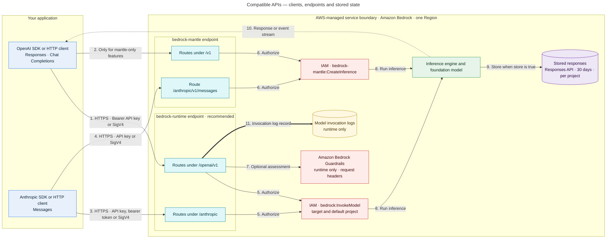
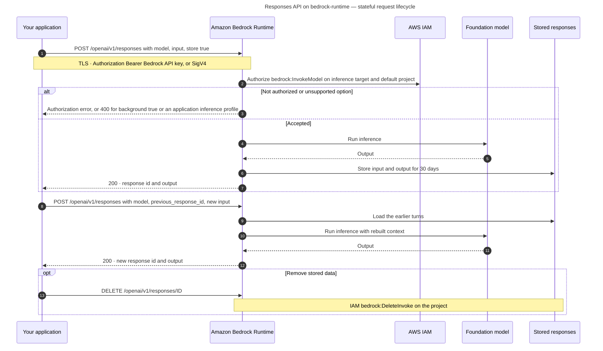

# OpenAI- and Anthropic-compatible APIs

> **Level:** Intermediate · **Verified:** 2026-11-15 · **Feature status:** GA · **Time:** ~25 min

Amazon Bedrock serves three provider-defined HTTP APIs next to its own: the OpenAI **Responses**
and **Chat Completions** APIs and the Anthropic **Messages** API. They let code written for the
OpenAI or Anthropic SDKs call models hosted in Bedrock by changing the base URL, the credential
and the model ID.

> [!IMPORTANT]
> **Status** — Generally available on both inference endpoints, `bedrock-runtime` and
> `bedrock-mantle`, with different feature support on each. AWS recommends `bedrock-runtime` for
> new applications and `bedrock-mantle` only for capabilities that exist only there. Model
> support is per API and per endpoint: check the model card.
> Source: [Inference endpoints supported by Amazon Bedrock](https://docs.aws.amazon.com/bedrock/latest/userguide/endpoints.html)

## Learning objectives

- Name the base URL, route and authentication method for each API on each endpoint.
- List the documented limitations of the Responses API on `bedrock-runtime`.
- Explain what the Responses API stores, where, and how to turn storage off.
- Choose between these APIs and [the Converse API](01-converse-api.md).
- Plan a migration from the OpenAI or Anthropic APIs, or from `bedrock-mantle` to `bedrock-runtime`.

## Prerequisites

- [Endpoints, APIs and authentication](../overview/02-endpoints-apis-and-authentication.md)
- [The Converse API](01-converse-api.md) and [InvokeModel and streaming APIs](02-invokemodel-and-streaming.md)
- [Projects, Workspaces and the Web Search tool](../overview/04-projects-workspaces-and-web-search.md)

## 1. What it is

In plain language: Bedrock speaks other vendors' API dialects. Your OpenAI or Anthropic client
library keeps working; only its address, key and model name change.

Precisely: these are HTTP routes on the two inference endpoints, called with an HTTP client or
the provider's SDK rather than through AWS SDK operations.

| Item | Value |
|:--|:--|
| Service namespace / endpoint | `bedrock-runtime` · `bedrock-runtime.{region}.amazonaws.com` and `bedrock-mantle` · `bedrock-mantle.{region}.api.aws` |
| Control-plane operations | None on `bedrock-runtime` (discover models with `ListFoundationModels` and `ListInferenceProfiles`). Projects are managed on `bedrock-mantle` |
| Data-plane operations | `POST /openai/v1/responses`, `GET` and `DELETE /openai/v1/responses/{id}`, `POST /openai/v1/responses/{id}/cancel`, `POST /openai/v1/chat/completions`, `POST /anthropic/v1/messages` |
| IAM action prefix | `bedrock:` on runtime (`InvokeModel`, `InvokeModelWithResponseStream`, `GetInvoke`, `CancelInvoke`, `DeleteInvoke`, `CallWithBearerToken`) · `bedrock-mantle:` on mantle (`CreateInference`, `CallWithBearerToken`) |

The compatible routes are HTTP paths, not AWS SDK operations, so they do not appear in the SDK
service models or in the academy's generated
[API operations reference](../../references/bedrock-api-operations.md). `GetInvoke`,
`CancelInvoke`, `DeleteInvoke` and `CallWithBearerToken` are IAM actions named on the user
guide pages, not SDK operations.

### Base URLs and conversation state

| API | Conversation state | `bedrock-runtime` | `bedrock-mantle` |
|:--|:--|:--|:--|
| Responses | Stored by Bedrock by default (`store` is `true`) | `https://bedrock-runtime.{region}.amazonaws.com/openai/v1` | `https://bedrock-mantle.{region}.api.aws/v1` |
| Chat Completions | Stateless: you send the history | Same base URL, route `/chat/completions` | Same base URL, route `/chat/completions` |
| Messages | You send alternating `user` and `assistant` messages | SDK base URL `https://bedrock-runtime.{region}.amazonaws.com/anthropic` | `https://bedrock-mantle.{region}.api.aws/anthropic/v1/messages` |

On `bedrock-mantle` the path prefix varies by model: most use `/v1`, some use `/openai/v1`. On
`bedrock-runtime`, Claude models can also be called with a Messages-format body through
`InvokeModel` (`"anthropic_version": "bedrock-2023-05-31"`).

### Authentication

| API | `bedrock-runtime` | `bedrock-mantle` |
|:--|:--|:--|
| Responses | Bedrock API key (required for the OpenAI SDK); AWS credentials for plain HTTP requests | Same |
| Chat Completions | SigV4 or Bedrock API key | Bedrock API key or AWS credentials |
| Messages | SigV4 through an AWS SDK, a Bedrock API key, or a short-term bearer token from `aws-bedrock-token-generator` | Bedrock API key or SigV4 |

A **Bedrock API key** is a bearer token. Short-term keys last up to 12 hours and inherit the
permissions of the principal that generated them. Long-term keys create an IAM user and are
recommended for exploration only. Authentication grants nothing by itself: the principal behind
the key or signature still needs the IAM actions above.

### Documented differences between the endpoints

| Capability | `bedrock-runtime` | `bedrock-mantle` |
|:--|:--|:--|
| Responses with `background=true` | Rejected with 400 — always synchronous | Supported |
| Server-side and pre-configured tools, including web search | Not available | Supported |
| Client-side tool use | Supported | Supported |
| Projects | Default project only; `OpenAI-Project` accepts `default` or the default project ARN | Default or customer-created |
| Workspaces (Anthropic-compatible) | Listed as a reason to choose mantle | Supported |
| `model` on a follow-up with `previous_response_id` | Required on every request | Can be inherited |
| Model value for closed-weight OpenAI GPT models | A system inference profile ID (`us.`, `global.`, `us-gov.`); no in-Region inference | Model ID |
| Application inference profiles | Rejected with 400 on the Responses API | — |
| OpenAI `GET /models` | Not implemented (`404 UnknownOperationException`) | Supported |
| Guardrails | Supported through request headers | Runtime-only feature |
| Cross-Region inference | Geographic and Global system profiles | Listed as a reason to choose runtime; stored responses stay in the Region the request was sent to |
| Model invocation logging | Captured | Not captured |
| Usage attribution | IAM principal, request metadata, application inference profiles — on the Responses API, IAM principal only | Projects and Workspaces |
| Quotas | Combined token quotas shared with Converse and Invoke | Separate input and output token quotas; no RPM quota |

GPT OSS models support Chat Completions, Converse and Invoke on `bedrock-runtime` but not the
Responses API there.

## 2. Why it exists

Large amounts of application code, agent frameworks and tools already speak the OpenAI or
Anthropic wire formats. Without these routes you would rewrite every call site to Converse, or
run a translation proxy. The Responses API adds something Converse does not have: conversation
state kept by the service.

## 3. When to use it

- You are moving an OpenAI SDK application to Bedrock and want the smallest code change.
- You want the service to hold conversation history (`previous_response_id`).
- You need Anthropic-native request features, such as Anthropic-defined tool types.
- A framework or tool you depend on only supports these protocols.
- You need server-side tools, web search or background inference — Responses on `bedrock-mantle`.

## 4. When not to use it

- **One interface across all providers and model types** — use [the Converse API](01-converse-api.md); not every model supports the compatible APIs.
- **Cost attribution by request metadata or [application inference profiles](05-application-inference-profiles.md)** — the Responses API on `bedrock-runtime` supports neither; use Converse or Invoke.
- **No data retention allowed** — avoid the default `store=true`; use Chat Completions or Converse, or set `store=false` on every request.
- **Embeddings, images, video** — use the [Invoke API family](02-invokemodel-and-streaming.md).

> [!TIP]
> **Academy recommendation** — For a new multi-model application on AWS, start with Converse
> and reach for a compatible API when a concrete requirement (existing code, stored state, a
> provider-native feature) calls for it. This is our design guidance, not an official AWS
> reference architecture; AWS's own guidance for newcomers is to use these compatible APIs on
> `bedrock-runtime`.

## 5. Internal architecture

AWS documents that both endpoints use the same underlying inference engine; `bedrock-mantle`
names an endpoint surface. What differs is the feature set, the IAM namespace and the quota
accounting around that engine.



**What this shows** — Two front doors to one engine, with guardrails and invocation logging on
the runtime door only, and a data store that exists only for the Responses API.

1. An OpenAI-style client calls the runtime routes with a bearer API key or a SigV4 signature.
2. The same client points at `bedrock-mantle` only when it needs a mantle-only capability.
3. An Anthropic-style client calls the runtime `/anthropic` routes.
4. Or the mantle Messages route, for example to use Workspaces.
5. Runtime requests are authorized with `bedrock:InvokeModel` on the inference target; the
   Responses API also authorizes the default project.
6. Mantle requests are authorized with `bedrock-mantle:CreateInference`.
7. On runtime, a guardrail named in the request headers assesses the exchange.
8. The inference engine runs the model.
9. The Responses API stores input and output when `store` is `true`.
10. The response, or a stream of events, returns to the client.
11. Runtime calls appear in model invocation logs if logging is enabled.

**Legend** — blue: client · teal: endpoint route · red: security control · green: model · purple
cylinder: data at rest · yellow cylinder: observability · solid: request · dashed: response ·
thick: asynchronous record.

**Variations** — With a cross-Region profile as the model on runtime, step 8 can run in another
Region, and a stored response lives in the Region that processed it. The generic lifecycle is in
[diagram set 3](../../diagrams/mermaid/03-model-inference-lifecycle.md).

## 6. Request and response lifecycle



- **1** — The client creates a response. On `bedrock-runtime`, `model` is a runtime model ID or
  a system inference profile ID.
- **2** — Bedrock authorizes two resources: the inference target and the default project.
- **3** — Failure paths: an authorization error; HTTP 400 for `background=true` or an
  application inference profile; throttling when a quota is exceeded.
- **4–5** — The model runs.
- **6** — With `store` `true` (the default) Bedrock retains the response, including input and
  output, for 30 days, encrypted at rest and scoped to the project.
- **7** — The client receives the response ID.
- **8–12** — The follow-up names `previous_response_id` and, on runtime, **must repeat
  `model`**. Bedrock rebuilds the context from the stored turns. The Region that served the
  first response handles the follow-up.
- **13** — Retrieving, cancelling and deleting use `bedrock:GetInvoke`, `bedrock:CancelInvoke`
  and `bedrock:DeleteInvoke` on the project. An unknown ID returns 404, whatever the reason.

Chat Completions and Messages have no steps 6 and 9: every request carries its own history.
Streaming (`stream: true`) needs `bedrock:InvokeModelWithResponseStream` on runtime.

## 7. Dependencies

| Depends on | Why | Required or optional |
|:--|:--|:-:|
| A model that supports the API on the chosen endpoint | Listed per endpoint on the model card | Required |
| Bedrock API key or AWS credentials | Authentication | Required |
| IAM permissions for the principal behind the credential | Authorization | Required |
| The account's default project | Authorized on every Responses request on runtime | Required for Responses |
| A system inference profile | Required model value for closed-weight OpenAI GPT models on runtime | Per model |
| OpenAI or Anthropic SDK, `aws-bedrock-token-generator` | Client convenience | Optional |

## 8. Security considerations

- **API keys are bearer secrets.** Prefer short-term keys; a long-term key is an IAM user
  credential. Deny `bedrock:CallWithBearerToken` (and `bedrock-mantle:CallWithBearerToken`) to
  identities that must not use keys; the `bedrock:bearerTokenType` condition key separates
  `SHORT_TERM` from `LONG_TERM`.
- **Responses stores prompts and outputs by default.** Set `store=false` on every request, or
  set the account's data retention mode to `none`, if you do not want retention.
- **Scoped IAM needs two resources for Responses on runtime:** the inference target and
  `arn:aws:bedrock:*:111122223333:project/default`. The condition keys `bedrock:ProjectArn` and
  `bedrock:ModelArn` let a policy on one constrain the other. Response IDs are not IAM resources.
- **Guardrails** work on runtime through the `X-Amzn-Bedrock-GuardrailIdentifier` and
  `X-Amzn-Bedrock-GuardrailVersion` headers (`extra_headers` in the OpenAI SDK). They are not
  available on mantle.
- **Data residency** — With a Global inference profile, a stored response can live in any
  commercial Region the profile routes to. Use a Geographic profile when residency matters.

> [!CAUTION]
> **Cost or security hazard** — An OpenAI SDK client with no base URL override sends prompts to
> OpenAI, not to Bedrock. AWS's documentation warns not to use the OpenAI base URL or an OpenAI
> API key. Set the base URL explicitly in code or configuration and test it.

Sources: [Responses API](https://docs.aws.amazon.com/bedrock/latest/userguide/inference-responses-api.html),
[API keys](https://docs.aws.amazon.com/bedrock/latest/userguide/api-keys.html),
[Making inference requests](https://docs.aws.amazon.com/bedrock/latest/userguide/inference.html).

## 9. Networking requirements

Both endpoints are public HTTPS endpoints with interface VPC endpoint services:
`com.amazonaws.{region}.bedrock-runtime` and `com.amazonaws.{region}.bedrock-mantle`. An
endpoint policy can restrict `bedrock:InvokeModel*` or `bedrock-mantle:CreateInference`. See
[Private connectivity for Bedrock](../../02-related-aws-services/networking/01-private-connectivity-for-bedrock.md).
`bedrock-mantle` is available in a subset of the Regions that have `bedrock-runtime`.

## 10. Pricing dimensions

| Dimension | Unit | Notes |
|:--|:--|:--|
| Input and output tokens | Per token, by model | Per-token pricing for the same model is identical on both endpoints |
| Cache write and read tokens | Per token | `prompt_cache_breakpoint` on OpenAI models; `cache_control` on Anthropic models |
| Stored responses | No separate dimension found on the pricing page | **UNVERIFIED — REQUIRES DOCUMENTATION REVIEW** |

On `bedrock-runtime`, Responses usage is attributed to the inference target, as for Converse
and Invoke. Source: [Amazon Bedrock pricing](https://aws.amazon.com/bedrock/pricing/).

## 11. Scaling considerations

On `bedrock-runtime` these APIs draw on the same per-model token quotas as Converse and Invoke,
so migrating traffic between APIs does not create capacity. `bedrock-mantle` has its own
allocations, with separate input and output token quotas and no RPM quota; it can briefly queue
a request instead of rejecting it. See
[Quotas, rate limits and throttling](../../08-cost-performance-and-reliability/05-quotas-rate-limits-and-throttling.md).

## 12. IaC support

| Tool | Support | Resource / construct | Notes |
|:--|:-:|:--|:--|
| Terraform (`hashicorp/aws` 6.73.0) | ❌ | No `bedrock-mantle` project resource | The APIs themselves are request-time; IAM policies use standard IAM resources |
| CloudFormation | ✅ | `AWS::BedrockMantle::Project` | Only needed for non-default projects on mantle |
| AWS CDK (`aws-cdk-lib` 2.277.0) | L1 | `aws_bedrockmantle.CfnProject` | — |

A long-term API key is an IAM service-specific credential; treat creating one as an identity
change that goes through your IAM pipeline.

## 13. Working example

> **Code status:** syntax-checked (`python3 -m py_compile`) · request construction and SigV4 signing unit-tested offline with dummy credentials (botocore 1.35.99) · **never deployed, never sent to AWS**

Chat Completions on `bedrock-runtime` with boto3 credentials and SigV4 — no OpenAI SDK and no
API key. The signing name `bedrock` matches the documented `curl --aws-sigv4` example.

```python
"""Call the OpenAI-compatible Chat Completions API on bedrock-runtime with SigV4.

No OpenAI SDK and no API key: boto3 supplies the credentials and botocore signs
the HTTPS request, exactly as it does for Converse.
"""
import json
import os
import urllib.request

import boto3
from botocore.auth import SigV4Auth
from botocore.awsrequest import AWSRequest

REGION = os.environ.get("AWS_REGION", "us-east-1")
# Confirm on the model card that the model supports Chat Completions on bedrock-runtime.
MODEL_ID = os.environ.get("BEDROCK_MODEL_ID", "openai.gpt-oss-120b-1:0")
SIGNING_NAME = "bedrock"  # the SigV4 service name for the bedrock-runtime endpoint


def chat_completions_url(region: str) -> str:
    return f"https://bedrock-runtime.{region}.amazonaws.com/openai/v1/chat/completions"


def build_signed_request(session, region: str, model_id: str, messages: list,
                         guardrail: tuple = None) -> AWSRequest:
    """Return a SigV4-signed request. `guardrail` is an optional (id, version) pair."""
    headers = {"Content-Type": "application/json"}
    if guardrail:
        headers["X-Amzn-Bedrock-GuardrailIdentifier"] = guardrail[0]
        headers["X-Amzn-Bedrock-GuardrailVersion"] = guardrail[1]
    body = json.dumps({"model": model_id, "messages": messages})
    request = AWSRequest(method="POST", url=chat_completions_url(region), data=body, headers=headers)
    credentials = session.get_credentials().get_frozen_credentials()
    SigV4Auth(credentials, SIGNING_NAME, region).add_auth(request)
    return request


def chat(messages: list, session=None) -> str:
    """Chat Completions is stateless: send the whole message list every time."""
    signed = build_signed_request(session or boto3.Session(), REGION, MODEL_ID, messages)
    http_request = urllib.request.Request(signed.url, data=signed.body,
                                          headers=dict(signed.headers.items()), method="POST")
    with urllib.request.urlopen(http_request, timeout=120) as response:
        payload = json.loads(response.read())
    return payload["choices"][0]["message"]["content"]


if __name__ == "__main__":
    print(chat([{"role": "user", "content": "Say hello in five words."}]))
```

The same request with the OpenAI SDK and a short-term Bedrock API key, using the Responses API
with storage turned off:

> **Code status:** syntax-checked (`python3 -m py_compile`) only · illustrative · **never deployed**

```python
import os

from aws_bedrock_token_generator import provide_token
from openai import OpenAI

REGION = os.environ.get("AWS_REGION", "us-east-1")
# Closed-weight OpenAI GPT models need a system inference profile ID on bedrock-runtime.
PROFILE_ID = os.environ.get("BEDROCK_MODEL_ID", "us.openai.gpt-5.6-sol")

client = OpenAI(
    base_url=f"https://bedrock-runtime.{REGION}.amazonaws.com/openai/v1",  # never the OpenAI default
    api_key=provide_token(region=REGION),  # short-term key, inherits the caller's IAM permissions
)
response = client.responses.create(model=PROFILE_ID, input="Say hello in five words.", store=False)
print(response.output_text)
```

### Migration notes

| From | Change | Watch for |
|:--|:--|:--|
| OpenAI API | Base URL to `https://bedrock-runtime.{region}.amazonaws.com/openai/v1`; key to a Bedrock API key; model to a Bedrock model or inference profile ID | No `models.list()` on runtime; `model` required on every Responses call; `background=true` and server-side tools need mantle; decide `store` deliberately |
| Anthropic API | Base URL to `https://bedrock-runtime.{region}.amazonaws.com/anthropic`; credential to a Bedrock token; model to a Bedrock ID such as an inference profile | Through `InvokeModel` you set `anthropic_version` in the body; on mantle the `anthropic-version: 2023-06-01` header is required |
| `bedrock-mantle` | Base URL to the runtime `/openai/v1`; model ID to a runtime model or system profile ID; model discovery to `ListFoundationModels` and `ListInferenceProfiles`; project to default | Background processing, server-side tools, application inference profiles and model inheritance through `previous_response_id` behave differently |
| Converse | Rewrite requests in the provider's format | You lose `requestMetadata` and application inference profiles on Responses; you gain stored state |

## Common mistakes

| Mistake | Symptom | Fix |
|:--|:--|:--|
| Using `/v1` on `bedrock-runtime` | Request fails | Runtime routes are under `/openai/v1`; an older documentation page still shows `/v1` |
| Sending a bare model ID for a closed-weight OpenAI GPT model on runtime | Request fails | Use the `us.` or `global.` system inference profile ID |
| Omitting `model` on a follow-up with `previous_response_id` | Error on runtime | Repeat `model` on every request |
| Calling `client.models.list()` against runtime | `404 UnknownOperationException` | Use `ListFoundationModels`, `ListInferenceProfiles` and model cards |
| Leaving `store` at its default with sensitive data | Prompts retained for 30 days | `store=false` or data retention mode `none` |
| Scoping IAM to the model only for Responses | Access denied | Add the default project resource |
| Expecting guardrails or invocation logs on mantle | Nothing applied or logged | Use `bedrock-runtime` |
| Using the wrong path prefix for a model on mantle | "isn't supported on this route" | Check the Programmatic Access table on the model card |

## Knowledge check

1. Which three limitations of the Responses API on `bedrock-runtime` would force you to `bedrock-mantle`?
2. What does the Responses API store by default, for how long, and in which Region when you use a Global inference profile?
3. Your policy allows `bedrock:InvokeModel` on one inference profile and its models. A Chat Completions call works but a Responses call is denied. Why?
4. What is the difference between a short-term and a long-term Bedrock API key, and how do you stop an identity from using either?
5. Name two things you lose and one thing you gain when moving a workload from Converse to the Responses API on runtime.

<details>
<summary>Answers</summary>

1. Background (asynchronous) inference, server-side or pre-configured tools such as web search, and customer-created Projects; also a model that is available only on mantle.
2. The response including its input and output, for 30 days, scoped to the project. With a Global profile it is stored in the Region that processed the request, which can be any commercial Region the profile routes to.
3. Creating a response also authorizes `bedrock:InvokeModel` on the account's default project. Chat Completions needs no project resource.
4. A short-term key lasts up to 12 hours and inherits the generating principal's permissions; a long-term key is tied to an IAM user and lasts until its expiry date. Deny `bedrock:CallWithBearerToken` (and the mantle equivalent), optionally conditioned on `bedrock:bearerTokenType`.
5. Lost: per-request metadata tagging and application inference profiles (and the provider-neutral request shape). Gained: conversation state stored by the service.

</details>

## 14. Official documentation

- [Inference endpoints supported by Amazon Bedrock](https://docs.aws.amazon.com/bedrock/latest/userguide/endpoints.html) — endpoint comparison, limitations, recommendation.
- [APIs supported by Amazon Bedrock](https://docs.aws.amazon.com/bedrock/latest/userguide/apis.html) — which API for which use case.
- [Responses API](https://docs.aws.amazon.com/bedrock/latest/userguide/inference-responses-api.html) — base URLs, stored state, runtime behavior differences, mantle-to-runtime migration.
- [Chat Completions API](https://docs.aws.amazon.com/bedrock/latest/userguide/inference-chat-completions.html) — base URLs, authentication, guardrail headers.
- [Inference using Anthropic Messages API](https://docs.aws.amazon.com/bedrock/latest/userguide/inference-messages-api.html) — routes, authentication, version header.
- [API keys](https://docs.aws.amazon.com/bedrock/latest/userguide/api-keys.html) — short-term and long-term keys, IAM controls.
- [Making inference requests](https://docs.aws.amazon.com/bedrock/latest/userguide/inference.html) and [Prerequisites for running model inference](https://docs.aws.amazon.com/bedrock/latest/userguide/inference-prereq.html) — IAM policies for both endpoints.
- [Use a tool to complete a model response](https://docs.aws.amazon.com/bedrock/latest/userguide/tool-use.html) — client-side, server-side and Anthropic tool use by API.
- [Monitor model invocation](https://docs.aws.amazon.com/bedrock/latest/userguide/model-invocation-logging.html) — logging covers runtime only.
- [Quotas for the bedrock-runtime endpoint](https://docs.aws.amazon.com/bedrock/latest/userguide/quotas-runtime.html) and [Scaling and throughput best practices](https://docs.aws.amazon.com/bedrock/latest/userguide/scaling-throughput-best-practices.html) — quota accounting per endpoint.
- [Use interface VPC endpoints](https://docs.aws.amazon.com/bedrock/latest/userguide/vpc-interface-endpoints.html) — PrivateLink service names for both endpoints.
- [Inference using Chat Completions API (earlier page)](https://docs.aws.amazon.com/bedrock/latest/userguide/inference-chat-completions-mantle.html) — still shows the `/v1` runtime path and recommends mantle; superseded by the pages above.
- [Document history](https://docs.aws.amazon.com/bedrock/latest/userguide/bedrock-ug-doc-history.html) — the August and September 2026 changes that made `bedrock-runtime` the recommended path.
