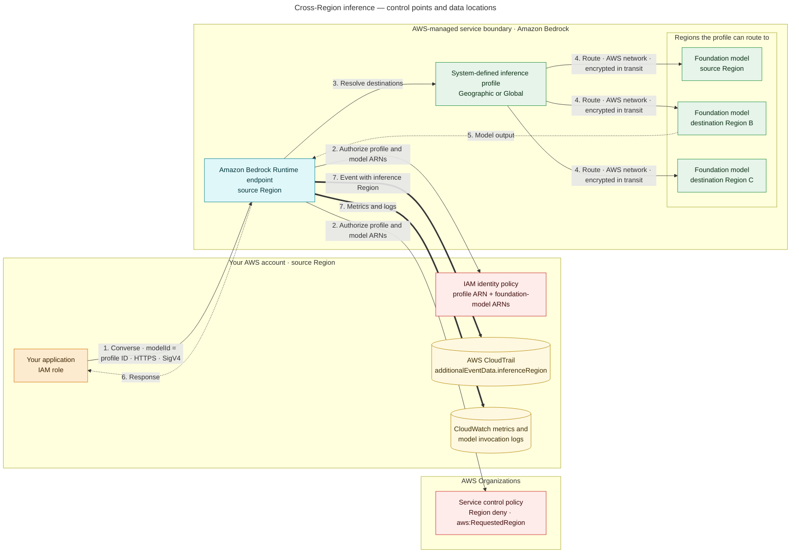
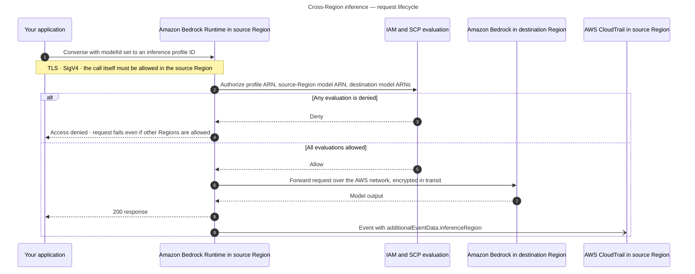

# Cross-Region inference: Geo and Global profiles

> **Level:** Intermediate · **Verified:** 2026-11-15 · **Feature status:** GA · **Time:** ~25 min

Cross-Region inference lets a request that you send to Amazon Bedrock in one Region be processed
by the same model in another Region. You opt in per request by naming an **inference profile**
instead of a model ID. It is a capacity and routing feature of the `bedrock-runtime` endpoint.

> [!IMPORTANT]
> **Status** — Generally available in two forms: **Geographic** profiles (requests stay inside
> a geography such as US or EU) and **Global** profiles (requests can run in any supported
> commercial Region). Availability is per model and per source Region; some models are served
> only through a profile. Profiles do not support Provisioned Throughput.
> Source: [Cross-Region inference](https://docs.aws.amazon.com/bedrock/latest/userguide/cross-region-inference.html)

## Learning objectives

- Read an inference profile ID and ARN, and find a profile's destination Regions.
- Compare Geographic, Global and single-Region inference on routing, data location, price and policy.
- Write the IAM policy a role needs for a Geographic and for a Global profile.
- Predict how a Region-deny service control policy (SCP) interacts with each profile type.
- Locate cross-Region requests in CloudTrail and explain which data leaves the source Region.

## Prerequisites

- [AWS global infrastructure: Regions, Availability Zones and the edge](../../00-foundations/aws-fundamentals/01-global-infrastructure.md)
- [IAM fundamentals: principals, policies and evaluation](../../00-foundations/security/01-iam-fundamentals.md)
- [AWS Organizations and AWS Control Tower](../../00-foundations/aws-fundamentals/05-organizations-control-tower.md)
- [The Converse API](01-converse-api.md)

## 1. What it is

In plain language: instead of asking for "this model, here", you ask for "this model, anywhere
in this group of Regions", and Bedrock picks a Region that has capacity.

Precisely: a **system-defined inference profile** is a Bedrock resource that names one
foundation model and the Regions that can serve it. The **source Region** is where you make the
API call; a **destination Region** is one the profile can route to. You pass the profile ID or
ARN wherever a model ID is accepted.

| Item | Value |
|:--|:--|
| Service namespace / endpoint | `bedrock` (profile metadata) and `bedrock-runtime` (inference), both in the source Region |
| Control-plane operations | `ListInferenceProfiles` (`typeEquals` `SYSTEM_DEFINED`), `GetInferenceProfile` |
| Data-plane operations | `Converse`, `ConverseStream`, `InvokeModel`, `InvokeModelWithResponseStream`, the OpenAI- and Anthropic-compatible routes on runtime, and `CreateModelInvocationJob` — with the profile as the model |
| IAM action prefix | `bedrock:` — `InvokeModel*`, `GetInferenceProfile`, `ListInferenceProfiles`; condition keys `bedrock:InferenceProfileArn` and `aws:RequestedRegion` |

Operation names and top-level request fields were checked against the academy's generated
[API operations reference](../../references/bedrock-api-operations.md) (botocore 1.44.3).

### Identifiers

| Identifier | Format | Example from the documentation |
|:--|:--|:--|
| Geographic profile ID | Geography prefix + model ID | `us.anthropic.claude-sonnet-4-5-20250929-v1:0` |
| Global profile ID | `global.` + model ID | `global.anthropic.claude-sonnet-4-5-20250929-v1:0` |
| Profile ARN | `arn:aws:bedrock:{source Region}:{account}:inference-profile/{profile ID}` | Account-scoped, in the source Region |
| Regional model ARN | `arn:aws:bedrock:{Region}::foundation-model/{model ID}` | One per source and destination Region |
| Global model ARN | `arn:aws:bedrock:::foundation-model/{model ID}` | No Region and no account — intentional |

Documented geography prefixes include `us`, `eu`, `apac`, `in`, `au` and `us-gov`. The complete
current list is on the model cards.

### Geographic, Global and single-Region compared

| Aspect | Geographic profile | Global profile | No profile (single Region) |
|:--|:--|:--|:--|
| Where a request can run | Regions listed in the profile, inside one geography | Any supported commercial Region | The source Region |
| Destination list | Never changes for a profile; can differ by source Region | Can grow as AWS adds Regions | — |
| Price | Standard, based on the source Region | About 10% lower on input and output tokens, based on the source Region | Standard |
| IAM resources | Profile + model in source Region + model in every destination Region | Profile + model in source Region + Global model ARN | Model ARN |
| Region-deny SCP | Allow every destination Region, or add a profile exception | Allow `aws:RequestedRegion` `unspecified`, or add a profile exception | Allow the Region |
| Quota family | Cross-Region tokens per minute | Global cross-Region tokens per minute | On-demand tokens per minute |
| AWS's recommendation | Data-residency requirements | Cost optimization without geographic restriction | — |

> [!WARNING]
> **Common mistake** — Trusting the prefix. The same profile ID can route to different
> destination Regions depending on the source Region. AWS's guidance for data residency is to
> call `GetInferenceProfile` from every source Region you use and check each model ARN.

## 2. Why it exists

On-demand capacity in one Region is finite, and demand is bursty. Without cross-Region
inference you would run your own multi-Region client: one endpoint, quota, IAM scope and log
trail per Region, plus routing logic. A profile gives you one call site, one place for logs, and
a larger pool of compute.

## 3. When to use it

- You need more on-demand throughput than one Region gives, or you see capacity errors (HTTP 503).
- The model you want is offered in your Region only through a profile.
- Processing anywhere in the geography satisfies your residency rules (Geographic).
- You have no geographic restriction and want the lower price (Global).

## 4. When not to use it

- **Processing must stay in one Region** — call the model ID directly where in-Region inference
  is offered; see [Cross-Region considerations and data residency](../../09-advanced-topics/11-cross-region-and-data-residency.md).
- **You need committed capacity** — profiles do not support [Provisioned Throughput](07-provisioned-throughput.md); also compare [service tiers](06-service-tiers.md).
- **You rely on prompt-cache hits** — a cache entry lives on the server that processed the
  request, so routing to another Region writes a new entry; see [Prompt caching](../prompt-caching/01-prompt-caching.md).
- **You need a guaranteed availability target** — AWS's guidance is to add bounded retries and
  multi-Region or multi-model fallback in the application; see [Resilience, fallback models and model routing](../../08-cost-performance-and-reliability/06-resilience-fallback-and-model-routing.md).
- **You only want cost tracking** — that is an [application inference profile](05-application-inference-profiles.md).

## 5. Internal architecture

AWS documents the routing contract, not the algorithm ("automatically routed to one of the
destination Regions … optimizing for performance"). The diagram shows the customer-visible
parts: where you call, what is authorized, where data goes and where records land.



**What this shows** — You talk only to the source Region; authorization covers every Region the
request could reach; records stay in the source Region.

1. The application calls the source-Region endpoint with the profile ID as `modelId`.
2. Bedrock evaluates authorization for the profile, the model in the source Region, and the
   model in each candidate destination Region (Geographic) or the Region-agnostic Global model
   ARN (Global). Identity policies and SCPs both apply.
3. The profile defines the candidate Regions.
4. The request is routed to one of them over the AWS network, encrypted in transit; it never
   crosses the public internet.
5. The model in the chosen Region produces the output.
6. The response returns through the source-Region endpoint.
7. CloudTrail logs the request in the source Region with `additionalEventData.inferenceRegion`;
   CloudWatch records also stay in the source Region.

**Legend** — orange: your compute · teal: endpoint · green: Bedrock resources and models · red:
security control · yellow cylinder: observability · solid: request · dashed: response · thick:
asynchronous record.

### What data is where

| Data | Location | Notes |
|:--|:--|:--|
| Prompt and output in transit | Source Region to destination Region | AWS network, encrypted |
| Processing | One destination Region | Can be an opt-in Region you have not enabled |
| Abuse-detection retention, for models that have it | Destination Region | Model-specific |
| CloudTrail event and CloudWatch records | Source Region | `inferenceRegion` names the destination |
| Model invocation logs | Source Region | **Our reading:** logging is configured per Region and writes to destinations in that Region |
| Stored response (Responses API, `store` `true`) | The Region that processed it | With a Global profile, any commercial Region |
| Batch inference output | S3 bucket in the source Region | — |

**Variations** — For Global profiles the "dest" box is every supported commercial Region. The
full views are in [diagram set 21](../../diagrams/mermaid/21-cross-region-inference.md).

## 6. Request and response lifecycle



- **1** — The only application change is the value of `modelId`.
- **2** — Authorization is evaluated for several resources, not one. For a Global profile the
  model evaluation uses the ARN without a Region, and `aws:RequestedRegion` is `unspecified`.
- **3–4** — If any destination Region in the profile is blocked by an SCP, the request fails
  even though other Regions remain allowed. A missing model ARN in the identity policy has the
  same effect.
- **5–7** — Bedrock chooses a Region and forwards the request. You cannot pin the choice.
- **8** — The response is the same shape as for an in-Region call.
- **9** — The CloudTrail event is written in the source Region.

Throttling works as for any inference call (HTTP 429), counted against the cross-Region quota
of the source Region.

## 7. Dependencies

| Depends on | Why | Required or optional |
|:--|:--|:-:|
| A profile for your model and source Region | Listed on the model card and by `ListInferenceProfiles` | Required |
| IAM permission on the profile **and** the models | See section 8; `bedrock:GetInferenceProfile` is also listed as required to run inference with a profile | Required |
| SCPs that permit the routing | Region-deny policies block it by default | Required in governed organizations |
| Access to the model | See [Model access and subscriptions](../overview/03-model-access-and-subscriptions.md) | Required |

## 8. Security considerations

**IAM for a Geographic profile.** Allow three things: the profile, the model in the source
Region, and the model in every destination Region. AWS's example scopes the model statement
with `bedrock:InferenceProfileArn` so the models can be invoked only through that profile.

**IAM for a Global profile.** A three-part policy: the profile ARN in the source Region; the
Regional model ARN, conditioned on the source Region and the profile; and the Global model ARN
`arn:aws:bedrock:::foundation-model/…`, conditioned on `aws:RequestedRegion` = `unspecified`
and the profile.

> [!NOTE]
> **Documented fact** — `bedrock:InferenceProfileArn` is populated for the foundation-model
> evaluations but **not** for the evaluation of the profile resource itself. A condition on
> that key therefore belongs on the model statement, and it can exempt cross-Region routing in
> a Region-deny SCP without bypassing the Region restriction on the originating call.
> Source: [Geographic cross-Region inference](https://docs.aws.amazon.com/bedrock/latest/userguide/geographic-cross-region-inference.html)

**SCPs.** For Geographic profiles, either allow all destination Regions or add an
inference-profile exception. For Global profiles, either allow `"aws:RequestedRegion":
"unspecified"` or add the exception. To **disable** Global routing, deny `bedrock:*` when
`aws:RequestedRegion` is `unspecified` and `bedrock:InferenceProfileArn` matches
`arn:aws:bedrock:*:*:inference-profile/global.*`. A deny on a named Region does not catch Global
routing. In AWS Control Tower, do not hand-edit managed SCPs; extend the Region-deny control or
deploy custom SCPs. See [Governance at scale](../../06-security-governance/06-governance-at-scale.md).

**Data residency.** Requests can be routed to opt-in Regions that your account has not enabled,
and prompts and outputs may be stored there for abuse detection where a model requires it.

> [!NOTE]
> **Documented fact** — The "Supported Regions and models for inference profiles" page still
> says the Global profile is "currently only supported on Anthropic Claude Sonnet 4". Other
> current pages document Global profiles for more models (for example
> `global.anthropic.claude-sonnet-4-5-20250929-v1:0` and `global.openai.gpt-5.6-sol`). Use the
> model card.
> Sources: [Supported Regions and models for inference profiles](https://docs.aws.amazon.com/bedrock/latest/userguide/inference-profiles-support.html), [Global cross-Region inference](https://docs.aws.amazon.com/bedrock/latest/userguide/global-cross-region-inference.html)

## 9. Networking requirements

You connect only to the source-Region endpoint, publicly or through an interface VPC endpoint
(`com.amazonaws.{region}.bedrock-runtime`). **Our reading:** you need no network path, VPC
endpoint or enabled Region for the destinations, because the documented hop is inside the
Bedrock service on the AWS network. See
[Private connectivity for Bedrock](../../02-related-aws-services/networking/01-private-connectivity-for-bedrock.md).

## 10. Pricing dimensions

| Dimension | Unit | Notes |
|:--|:--|:--|
| Tokens through a Geographic profile | Per token | No additional routing charge; price is that of the source Region |
| Tokens through a Global profile | Per token | About 10% lower on input and output tokens than Geographic; source-Region price basis |
| Cache writes | Per token | Routing across Regions can increase cache writes |

The pricing page lists Global cross-Region prices separately from Geo and in-Region prices.
Source: [Amazon Bedrock pricing](https://aws.amazon.com/bedrock/pricing/).

## 11. Scaling considerations

Cross-Region traffic has its own quotas, separate from in-Region on-demand quotas: Service
Quotas lists "Cross-region model inference tokens per minute" and "Global Cross-region model
inference tokens per minute" per model (and requests per minute where a model has an RPM
quota). You view and raise them in the **source** Region. Output tokens of some models burn
quota at a multiple, and the admission check counts input tokens plus the maximum output
tokens. A quota is an upper bound, not a guarantee of capacity. See
[Quotas, rate limits and throttling](../../08-cost-performance-and-reliability/05-quotas-rate-limits-and-throttling.md).

## 12. IaC support

System-defined profiles are created by AWS; IaC looks them up and grants access to them.

| Tool | Support | Resource / construct | Notes |
|:--|:-:|:--|:--|
| Terraform (`hashicorp/aws` 6.73.0) | ✅ lookup | Data sources `aws_bedrock_inference_profile` (`inference_profile_id` → `inference_profile_arn`, `models`) and `aws_bedrock_inference_profiles` (`type`) | The `aws_bedrock_inference_profile` **resource** creates application profiles (`model_source.copy_from`) |
| CloudFormation | n/a | — | `AWS::Bedrock::ApplicationInferenceProfile` is for application profiles |
| AWS CDK (`aws-cdk-lib` 2.277.0) | alpha | `CrossRegionInferenceProfile.fromConfig` with `CrossRegionInferenceProfileRegion` (includes `GLOBAL`); `grantInvoke` | `@aws-cdk/aws-bedrock-alpha` is experimental |

## 13. Working example

> **Code status:** syntax-checked (`python3 -m py_compile`) · mock-tested offline with botocore 1.35.99 `Stubber` (`get_inference_profile`, `converse`) · **never deployed, never run against AWS**

The script reads a profile's destination Regions, derives the identity policy for a Geographic
profile from them, and makes a call. The profile ID is configuration: confirm it on the model
card.

```python
"""Cross-Region inference: inspect a profile, derive its IAM policy, call it."""
import json
import os

import boto3

SOURCE_REGION = os.environ.get("AWS_REGION", "us-east-1")
# Confirm the current inference profile ID on the model card before running.
PROFILE_ID = os.environ.get("BEDROCK_INFERENCE_PROFILE_ID", "us.anthropic.claude-sonnet-4-5-20250929-v1:0")
INVOKE_ACTIONS = ["bedrock:InvokeModel", "bedrock:InvokeModelWithResponseStream"]


def describe_profile(bedrock, profile_id: str) -> dict:
    """GetInferenceProfile from the source Region: the model ARNs name the destinations."""
    profile = bedrock.get_inference_profile(inferenceProfileIdentifier=profile_id)
    model_arns = [model["modelArn"] for model in profile["models"]]
    return {
        "arn": profile["inferenceProfileArn"],
        "type": profile["type"],
        "model_arns": model_arns,
        "destination_regions": sorted({arn.split(":")[3] for arn in model_arns if arn.split(":")[3]}),
    }


def geo_policy(profile: dict, source_region: str) -> dict:
    """Identity policy for one Geographic profile, following the documented pattern:
    the profile, plus the foundation model in the source and every destination Region,
    and the model only when it is reached through this profile."""
    model_id = profile["model_arns"][0].split("/", 1)[1]
    partition = profile["arn"].split(":")[1]
    source_model = f"arn:{partition}:bedrock:{source_region}::foundation-model/{model_id}"
    return {
        "Version": "2012-10-17",
        "Statement": [
            {"Sid": "InvokeTheProfile", "Effect": "Allow", "Action": INVOKE_ACTIONS,
             "Resource": [profile["arn"]]},
            {"Sid": "InvokeModelsOnlyThroughTheProfile", "Effect": "Allow", "Action": INVOKE_ACTIONS,
             "Resource": sorted(set(profile["model_arns"]) | {source_model}),
             "Condition": {"StringEquals": {"bedrock:InferenceProfileArn": profile["arn"]}}},
        ],
    }


def ask(runtime, profile_id: str, text: str) -> dict:
    """The only application change for cross-Region inference: modelId is the profile ID."""
    return runtime.converse(modelId=profile_id,
                            messages=[{"role": "user", "content": [{"text": text}]}],
                            inferenceConfig={"maxTokens": 256})


if __name__ == "__main__":
    control = boto3.client("bedrock", region_name=SOURCE_REGION)
    info = describe_profile(control, PROFILE_ID)
    print("Destination Regions:", info["destination_regions"])
    print(json.dumps(geo_policy(info, SOURCE_REGION), indent=2))
    reply = ask(boto3.client("bedrock-runtime", region_name=SOURCE_REGION), PROFILE_ID, "Say hello.")
    print(reply["output"]["message"]["content"][0]["text"], reply["usage"])
```

A Region-deny SCP that keeps other services inside two Regions but lets Bedrock route through
US Geographic profiles:

> **Code status:** illustrative · JSON syntax-checked · adapted from the AWS-documented exception pattern · **never attached to an organization**

```json
{
  "Version": "2012-10-17",
  "Statement": [
    {
      "Sid": "DenyOutsideApprovedRegionsExceptBedrockUsProfiles",
      "Effect": "Deny",
      "Action": "*",
      "Resource": "*",
      "Condition": {
        "StringNotEquals": { "aws:RequestedRegion": ["us-east-1", "us-west-2"] },
        "ArnNotLike": { "bedrock:InferenceProfileArn": "arn:aws:bedrock:*:*:inference-profile/us.*" }
      }
    }
  ]
}
```

> [!CAUTION]
> **Cost or security hazard** — An SCP applies to every principal in the accounts it is
> attached to. Real Region-deny policies also exempt global services. Test any change in a
> sandbox organizational unit before you roll it out, and add `global.*` to the exception only
> if you intend to allow worldwide routing.

## Common mistakes

| Mistake | Symptom | Fix |
|:--|:--|:--|
| Allowing only the profile ARN in IAM | Access denied | Add the model ARNs for the source and all destination Regions |
| Putting the `bedrock:InferenceProfileArn` condition on the profile statement | The statement never matches | Put it on the foundation-model statement |
| Region-deny SCP that omits one destination Region | Every cross-Region call fails, even when other Regions are allowed | Allow all destinations or add the profile exception |
| Trying to block Global routing with a deny on named Regions | Global calls still succeed | Deny when `aws:RequestedRegion` is `unspecified` |
| Looking for logs in the destination Region | Nothing found | Records are in the source Region; read `additionalEventData.inferenceRegion` |
| Using a Global profile for data with residency rules | Processing, and stored responses, outside the geography | Use a Geographic profile and verify its destinations |
| Assuming the profile guarantees availability | 429 or 503 under load | Add retries with backoff and an application-level fallback |
| Asking for Provisioned Throughput on a profile | Not supported | Use a model ARN with Provisioned Throughput, or a service tier |

## Knowledge check

1. You call `us.` profile X from `us-east-1`. Which resources must your IAM policy allow, and which API tells you the exact list?
2. Your organization denies all Regions except `eu-west-1` and `eu-central-1`. An `eu.` profile lists three destination Regions. What happens, and what are the two documented ways to fix it?
3. Why does a deny on `"aws:RequestedRegion": "us-west-2"` not stop a Global profile from routing to `us-west-2`?
4. Where do you look to find out which Region processed a request?
5. Name three kinds of data that can end up outside the source Region.

<details>
<summary>Answers</summary>

1. The inference profile ARN, the foundation-model ARN in the source Region, and the foundation-model ARN in every destination Region. `GetInferenceProfile`, called in the source Region, returns the model ARNs.
2. Calls fail, because a blocked destination Region fails the request even if other Regions are allowed. Either allow all three destination Regions in the SCP, or add an inference-profile exception using `bedrock:InferenceProfileArn`.
3. For Global profiles Bedrock evaluates the Region-agnostic model ARN with `aws:RequestedRegion` set to `unspecified`, not the destination Region's name. A deny must match `unspecified`.
4. The CloudTrail event in the source Region, field `additionalEventData.inferenceRegion`.
5. The prompt and output while being processed; inputs and outputs retained for abuse detection for models that require it; a response stored by the Responses API, which lives in the Region that processed it.

</details>

## 14. Official documentation

- [Route model inference requests across AWS Regions with cross-Region inference](https://docs.aws.amazon.com/bedrock/latest/userguide/cross-region-inference.html) — Geographic versus Global, general considerations, CloudTrail field.
- [Geographic cross-Region inference](https://docs.aws.amazon.com/bedrock/latest/userguide/geographic-cross-region-inference.html) — IAM and SCP requirements, authorization evaluation.
- [Global cross-Region inference](https://docs.aws.amazon.com/bedrock/latest/userguide/global-cross-region-inference.html) — three-part IAM policy, `unspecified`, disabling Global routing, quotas, Control Tower.
- [Supported Regions and models for inference profiles](https://docs.aws.amazon.com/bedrock/latest/userguide/inference-profiles-support.html) — source and destination Regions, opt-in Regions, how to verify destinations.
- [Prerequisites for inference profiles](https://docs.aws.amazon.com/bedrock/latest/userguide/inference-profiles-prereq.html) — policy examples with `bedrock:InferenceProfileArn`.
- [Use an inference profile in model invocation](https://docs.aws.amazon.com/bedrock/latest/userguide/inference-profiles-use.html) — which operations accept a profile.
- [GetInferenceProfile](https://docs.aws.amazon.com/bedrock/latest/APIReference/API_GetInferenceProfile.html) — response fields and profile types.
- [Amazon Bedrock abuse detection](https://docs.aws.amazon.com/bedrock/latest/userguide/abuse-detection.html) — retention in destination Regions.
- [Responses API](https://docs.aws.amazon.com/bedrock/latest/userguide/inference-responses-api.html) — where stored responses live with cross-Region inference.
- [Prompt caching](https://docs.aws.amazon.com/bedrock/latest/userguide/prompt-caching.html) — cache behavior with cross-Region inference.
- [Quotas for the bedrock-runtime endpoint](https://docs.aws.amazon.com/bedrock/latest/userguide/quotas-runtime.html) — cross-Region versus on-demand token quotas.
- [Enable Amazon Bedrock cross-Region inference in multi-account environments](https://aws.amazon.com/blogs/machine-learning/enable-amazon-bedrock-cross-region-inference-in-multi-account-environments/) — AWS blog: SCP and Control Tower patterns.
